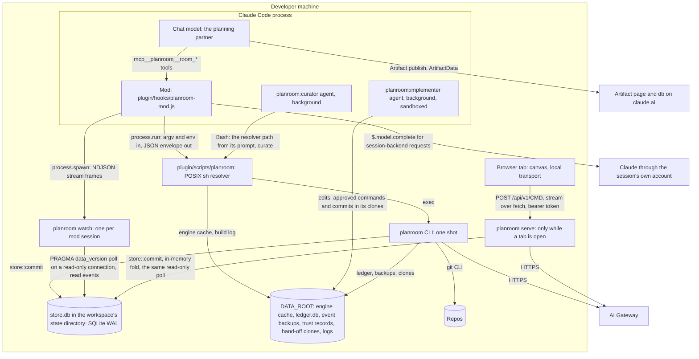
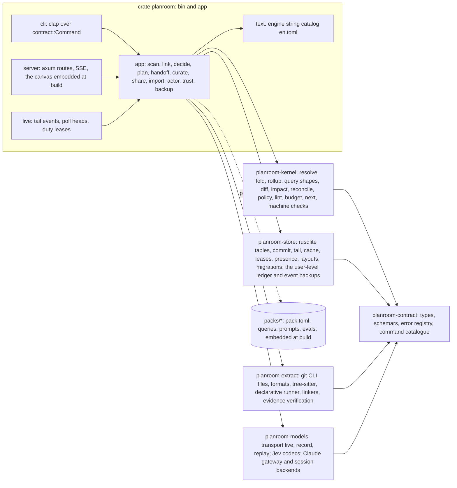
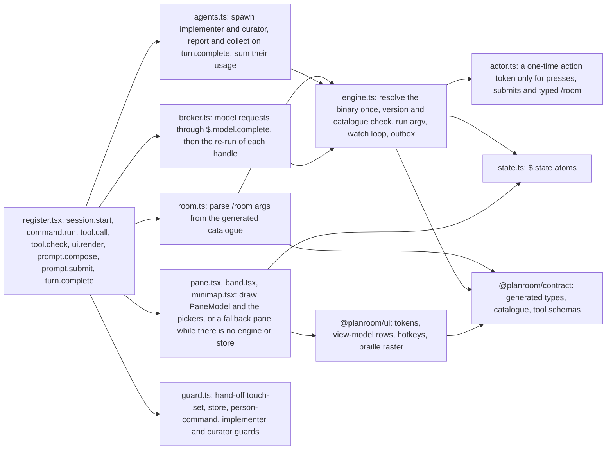
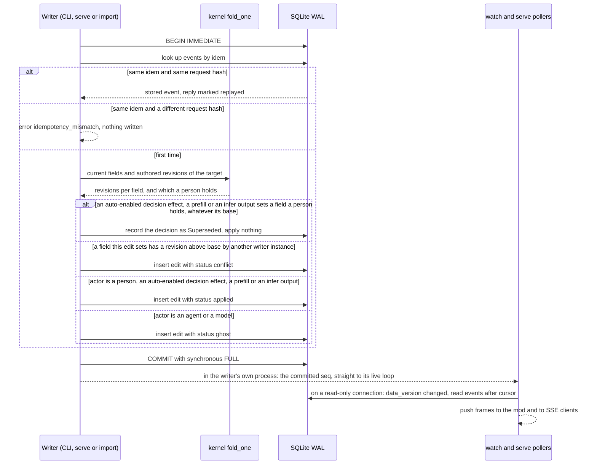
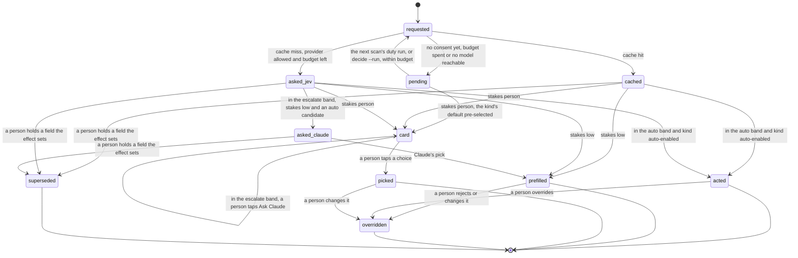
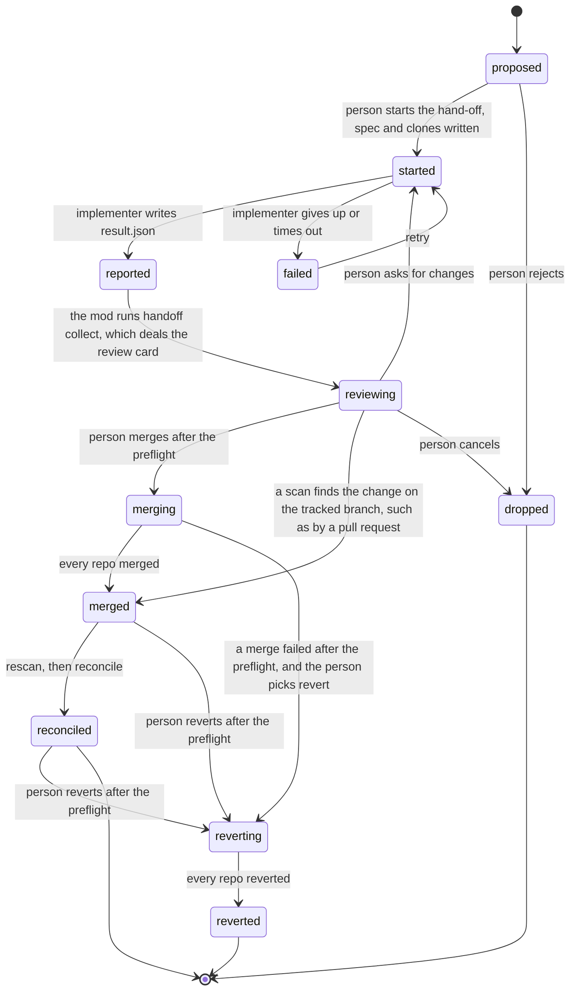

# Architecture

This page describes what Planroom is built from and why: the processes, the data and event model, packs, decisions, diffs and hand-off, the surfaces, security, and the build plan from the walking skeleton through milestone M5. It's the contributor's map; the decisions behind it live in [Decisions](decisions.md), every public shape in [Contracts](contracts.md), and the directory map and boundary rules in [Repo layout](repo-layout.md).

## How to read this page

- This is the Phase 2 synthesis of three candidate architectures (simplicity-first, extensibility-first, concurrency- and agent-first) after three independent judges scored them. It starts from the simplicity candidate, which two of three judges ranked first, and grafts in the runners-up's ideas the judges named. Every departure and every resolved disagreement is a numbered record in [Decisions](decisions.md), cited here as `[DR-n]`.
- Research is cited as `[note §n]` for the Phase 1 notes in `docs/contributing/research/`, and `[TRUTH path]` for `examples/TRUTH.json`.
- `[A]` and `[A-n]` mark an assumption the walking skeleton checks. The full list is in [Assumptions to verify](#assumptions-to-verify), where each settled row says how it was settled.

## The design on one page

Planroom is one Rust binary over one SQLite file per workspace.

- The file holds two kinds of truth:
  - **facts**: the nodes, edges and hints that extractors observe in git at a commit, which can be recomputed at will;
  - **events**: everything a person, agent or model authored, append-only.
- Everything else is a pure kernel function of those two, computed on read: the map at every level, plans, ghosts, diffs, reconciliation and open decisions.
- Every engine process writes through one function, `store::commit`. It runs one SQLite `BEGIN IMMEDIATE` transaction with a field-level compare-and-set and an idempotency check. SQLite is the single writer, so correctness needs no daemon [DR-1].
- `planroom serve` exists only because a browser can't spawn a process. The mod reaches the engine the way an agent does, through the CLI [DR-6].
- Packs are data, never code. Extractors and linkers are either built-in Rust adapters that a pack declares, or declarative regex and tree-sitter queries inside a pack [DR-9].
- One command catalogue, defined once in Rust, generates the CLI, the HTTP API, the mod's tools and the `/room` family [DR-14].
- Who wrote something decides what it means. A person's edit applies; an agent's or a model's edit is a ghost until a person accepts it; some commands only a person can run [DR-4].

### Moving-parts budget

Each part names the requirement that pays for it.

| Moving part | Count | Names | Paid for by |
|---|---|---|---|
| Binaries | 1 | `planroom` | R13, R14 (one CLI entry point) |
| Long-lived engine processes | 0 required, 2 optional | `planroom watch` (one per mod session), `planroom serve` (only while a browser tab is open) | R10 live updates; R13 canvas |
| Stores | 1 per workspace, plus 1 per user | `store.db` in the workspace's state directory (`.planroom/` beside a directory of repos, or `<repo>/.git/planroom/` when the workspace root is a repo [DR-74]), or under the data root when that filesystem is unsafe for WAL; `DATA_ROOT/ledger.db`, the spend ledger every workspace shares [DR-51] | R6, R10; R9 and constraint "Spend" |
| Rust crates | 7, plus `xtask` | `planroom-contract`, `-kernel`, `-store`, `-extract`, `-models`, `planroom`, `planroom-testkit` (dev-only) | R16: one crate per boundary CI enforces |
| TypeScript packages | 4 | `@planroom/contract` (generated), `@planroom/ui` (tokens and view-model, no DOM), `@planroom/canvas`, `@planroom/mod` | R13, R16 |
| Contract sources | 1 crate, 1 schema in 2 views, 1 version integer | `schema/planroom.v1.schema.json`, `schema/planroom.v1.input.schema.json` | constraint "one contract source" |
| Fact shapes | 4 | `Node`, `Edge`, `Evidence`, `Hint` | R11 (a domain-free core that extends into a graph) |
| Event kinds | 8 | `edit`, `review`, `undo`, `version`, `decision`, `claim`, `scan`, `handoff` | R6 to R10 |
| Ways to write the store | 1 | `store::commit` | R10 |
| Ways to change a repo | 1 | hand-off, with two implementers: `agent` and `patch` | R8, R12, S5 |
| Tool wiring paths | 1 | mod tools that call the CLI; no MCP server | R13 |
| Extractor kinds | 2, plus built-in linkers | built-in (Rust adapter), declarative (pack query) | R1, R11, S10 |
| Kernel roles | 3 | `rescan.retarget`, `reconcile.residual`, `attach.target` | R11 (kernel names no pack kind) |
| Concepts a person learns | 5 | Levels, Lenses, Intent, Diffs, Decisions | R14 |

### Biggest bets

| # | Bet | Proof | Fallback |
|---|---|---|---|
| 1 | Multi-process SQLite (WAL, `BEGIN IMMEDIATE`, `synchronous = FULL`, 5 s busy timeout) instead of a single-writer server | WS4 spike, then S8 | route CLI writes through `serve` when it runs, over the same catalogue; no contract change |
| 2 | Compute on read: only facts and events are stored, folded per request | `cargo bench fold` budget in `budgets.json` | a persisted fold cache keyed by `seq`, inside `planroom-store` |
| 3 | The mod reaches the engine only through the CLI (`$.process.run`, plus `$.process.spawn` of `planroom watch`) | WS5 | `$.http.fetch` over `serve`'s socket with the same catalogue |
| 4 | The git CLI is the only git adapter | fastest measured history walk [rust-stack §6]; WS3 | `gix` behind the same module |
| 5 | Hints plus built-in linkers produce every relation the truth lists, with full evidence | S1 truth comparator from M1 | an infeasibility record per KICKOFF for any one evidence item [DR-12] |

## Requirements to capabilities

Each capability gets a short name, used again in later sections and in [Traceability](traceability.md).

| Req | Capabilities |
|---|---|
| R1 Point it at work | `discover` (a repo with its initialized submodules, or a directory of repos up to two levels deep, with no config); `scan` (extractor pipeline per repo at `HEAD`, then linkers across the workspace); `tiers` (universal for every repo, syntactic for TS, JS, Python, Go and Rust, config formats, declarative patterns for any other language); `ids` and aliases, one namespace per repo even for two repos of one name; `levels` (five, one parent each); `rollup` (lift edges with counts and evidence); `default-lens`; `next` (one suggested action); `find`; `fresh` (rescan when a head moves, and say which repos have uncommitted changes) |
| R2 Relationships | `lens` (relation kinds with a flow direction); `path`, `why`, `impact`, `neighbors` query shapes; `evidence` and `confidence` and `provenance` on every edge; `confirm` and `reject` as edits; `history` (co-change, ownership); plan links (`touches`) |
| R3 Break down artifacts | `detect` (artifact kind from path and shape); `section` (headings, XML-like tags, frontmatter, YAML keys, review threads); part relations through Jev; `missing` (declared required parts); Claude segmentation only when no structure exists; `pr` breakdown with threads and touched components |
| R4 State machines | `machine` extraction from code, docs and prose; `checks` (unreachable, dead end, missing transition, nondeterminism); `drift` through the one diff engine; `step` |
| R5 Intent, top down | `plan` pack with seven stages and their methods; `propose` (AI output lands as ghosts); `review` (person only); `lint` (structural rules plus Jev kinds); `attach`; stage jumps; `version` |
| R6 Tweak everything | `edit` (`put`, `set`, `retract`) on stable IDs, re-applied on every fold; hand edits on the canvas (an action tray, lid drops, felt pins, chalk relations); field-level authored revisions; a person's field held against every automatic write; corrections that follow git renames; `pin`; `hide`; breakdown text edits; `undo` for every edit type |
| R7 Diffs and reconciliation | one `diff` function and type over two model slices; three sources (versions, layers, proposed change) plus text and machine drift; `impact-radius`; `reconcile` with five classes, along each repo's tracked branch |
| R8 Hand-off | `spec`; engine-made clones per touched repo, whose refs stay apart from the person's; `agent` and `patch` implementers, the agent running the commands the person approved under Claude Code's Bash sandbox; `collect` as a proposed-change diff and one review card; person-only `merge` with a preflight across repos, or a pull request the next scan finds by ancestry, patch identity or the rules [DR-80], and `revert` to undo either; reconcile after merge; a guard on the chat session's own edits |
| R9 Cheap decisions | kinds declared in packs, each with its stakes and default; prefills before cards; kernel roles; Jev adapter with two codecs; Claude adapter with gateway and session backends; consent and redaction at the model boundary; policy bands; cache; one user-level ledger, budgets and the build's spend log; every decision recorded and overridable; held-out evals |
| R10 Many at once | `commit` (multi-process, serialized); `cas` (field level, by writer instance, base required); `idem` with request hash; `actor` rules; projects; claims; presence; `live` stream within 1 s; mod outbox |
| R11 Extensible domains | domain-free kernel and contract; packs as data that require inward only; six v0.1 packs; out-of-tree packs a person adds with `pack add`, recorded as workspace state; decision kinds that express candidates, role subjects and retargeting as data, with prechecks that read graph structure; lenses that name their kinds; packs loaded from the copies `pack add` makes; question pipelines including `fires-if` and `bump-breaks` |
| R12 Context curation | run history; miners for gotchas, procedures and stale lines; template drafts refined by Claude or the curator agent; proposals as text diffs through the `patch` hand-off; triggers |
| R13 Surfaces | mod (pane, band, `/room`, tools, agents, mini-map, fallback panes before the engine; every main flow within two keys of pane focus through row keys and pickers [DR-77]); canvas (local and as an Artifact, each transport declaring what it serves, the Artifact precomputing what a cloud session needs and asking for the rest [DR-77]); CLI and server; shared view models with engine-authored strings; one plugin |
| R14 Tiny surface | five top-level ideas; one binary; one `room` command; generated help; defaults instead of settings; skills hidden from the slash menu |
| R15 Releasable | the Iris bar: docs taxonomy and style tests, CI jobs, release workflow, schemas and drift tests, changelog, templates, Dependabot, security policy, code of conduct, art; users install the latest release, never `-dev` `main` [DR-78] |
| R16 Designed repo | directory map with an `AGENTS.md` or README per area; one `boundaries.toml` that generates both the Rust and the TypeScript checks, with an allow-list for every shipped crate and only `models` and the server opening sockets [DR-79]; marked generated directories and regions; `cargo xtask` as the one entry point, and the only command CI runs; conventions in `AGENTS.md`; a decision-record gate over the commits a push adds, plus a state check of a committed `layout.lock`; a `skipped` check failing in CI unless declared [DR-79] |

## C4 context


## C4 containers

Every process, store and boundary. The developer machine is the only place that holds secrets.



### Processes and boundaries

| Process | Started by | Lifetime | Reads and writes | Boundary it crosses |
|---|---|---|---|---|
| `planroom <cmd>` | an agent's Bash, a skill, the mod's `process.run`, CI | one command | `store.db` through `store::commit`; the data root's ledger, backups and hand-off clones; repos through the git CLI; HTTPS to the gateway for a decision or Claude call | process (argv, env, stdout), file, network |
| `planroom watch --session ID` | the mod in `session.start`, with `$.process.spawn`, once the workspace has a store [DR-57] | dies on reload or session end by design [mod-api §7]; the mod restarts it from the last `seq` in `$.state` | polls `PRAGMA data_version` every 200 ms on a read-only connection, and hears its own commits from its live loop [DR-1]; writes presence every 10 s; runs duties under a lease; logs to the data root | process (NDJSON on stdout) |
| `planroom serve` | the pane's `e` key, `/room open`, `planroom serve --detach`, the e2e harness | detached: the engine forks and calls `setsid(2)` itself, so no `setsid` command is needed [DR-69]; binds only its workspace's recorded port [DR-78]; idempotent through `.planroom/serve.json` for one version and catalogue; exits after 30 min with no client, or when an engine of another version or catalogue asks it to drain [DR-58] | the same store API; keeps the folded `Model` in memory; logs to the data root | TCP on `127.0.0.1` with a bearer token per tab [DR-29] |
| Claude Code with the mod, chat, implementer and curator | the person | session | the mod calls only the resolver; agents use Bash and file tools in their clones, the implementer's Bash sandboxed [A-18] | process |
| Browser tab | the person | tab | HTTP and SSE to `serve` | loopback TCP |
| Artifact page | the person, on claude.ai | view | `data/snapshot.json` (published file); `db` `live/head`, `answers/` and `inbox/{self}` [DR-77] | claude.ai; never reaches localhost [artifact §5] |
| AI Gateway, TypeSafe API | | | HTTPS from the engine only | network |

#### Duties

Duties are background work any live process may do: a rescan when a repo head moves, a decision run on pending requests, the curation trigger, and `gc`, which prunes cached rows after a scan [DR-47]. A process does a duty only while it holds the lease named for it, such as `scan:orders` or `decide`: a row in `leases` with a 30 s expiry, renewed while it works. The `decide` lease is one per workspace, so two runs with different pending sets never ask Jev twice about a subject they share [DR-73]. A `scan` event triggers one `decide` duty run, which spends from that scan's Jev budget. Requests it leaves pending wait for the next `scan` event or an explicit `decide --run`, so duty runs never chain and the card's "at most $0.001 a scan" holds [DR-65]. So two sessions never rescan the same repo at once, duplicate triggers join one run, and work survives any one process dying. When no live process exists (CI, an agent using only the CLI), the same work runs inline in `planroom decide --run` or the next command's freshness check, under the same lease. A command that finds the lease held waits up to 5 s for the holder and reuses its snapshot. Each lease carries an epoch that the committing transaction checks, so a holder whose lease expired (a laptop asleep) commits nothing. The holder is recorded as its pid, process start time and host, so a contender on that host takes over at once, with an epoch bump, when that process is gone, and a `watch` releases its leases when it gets `SIGTERM`. A mod reload then costs no 30 s wait. Snapshot inserts are idempotent on `(repo, commit_id, purpose, packs_hash)`. A duty that fails sends a `duty` frame with state `Failed`, and until it next succeeds every `focus` carries a `duty_failed` warning, which the status line shows as one entry [DR-58].

`watch`, `serve` and duties log to `DATA_ROOT/logs/<workspace_id>/<process>.log` as well as stderr, because a detached process's stderr goes nowhere. Each log is capped at 1 MiB with one rotation, and redacted like every log [DR-58].

## C4 components

### Engine

Library crates depend only on `planroom-contract`. Only the `planroom` crate composes them. `planroom-testkit` is a dev-dependency only. That is the whole Rust boundary, generated from `boundaries.toml` (see [Repo layout](repo-layout.md#boundaries-and-their-enforcement)).



### Mod



### Canvas

`packages/canvas/src/`: `main.tsx`; `transport/local.ts` (`fetch`, with the stream read through `fetch` so the bearer token rides in a header) and `transport/artifact.ts` (published data file and `db`), behind one `Transport` interface that declares what each can serve; `store.ts` (zustand); `views/` (`MapView`, `Focus`, `PathView`, `DiffTray`, `DecisionStack`, `PlanBoard`, `Anatomy`, `Machine`); `layout/elk.ts`, which loads ELK's own `elk-worker.min.js` as the worker [DR-82]; `motion.ts`. Design tokens and view-model rows come from `@planroom/ui`, the same code the mod uses.

## Main flows

1. **Cold scan (S1).** `planroom scan DIR` finds the workspace, creates its state directory (see [Where the workspace lives](#where-the-workspace-lives)), and resolves each repo's `HEAD`. It runs the extractors the loaded packs declare, in parallel across repos, then the linkers across the workspace. Per-file extractors reuse cached facts for blobs they have already seen. It verifies every evidence item, writes one snapshot of facts per repo, links the active set into a workspace link snapshot, and appends one `scan` event per repo, all in one transaction [DR-12]. The last `scan` event carries the reconciler's outcome [DR-44]. It returns `MapView` at the top level with the default lens, plus `next`. Pending decisions don't block it: they run as a duty, or in `planroom decide --run` [DR-24].
2. **Read anywhere.** Each command first checks freshness: it compares each repo's `HEAD` and refs (a few small file reads), and the recorded `packs_hash`, with its active snapshot, and rescans what moved, using only cached decisions. An inline rescan takes the repo's `scan:REPO` lease. A refresh read (`focus`, and every surface's refetch) never waits on a rescan: while a live process holds that lease, it returns the current snapshot and lists the repo in `meta.stale_repos`. A head that moved forward along the repo's tracked branch is reconciled as usual; any other move re-anchors the map and skips the reconciler (see [The reconciler](#the-reconciler-r7)) [DR-71]. `focus` and `map` also run `git status --porcelain -z --untracked-files=no` in each repo and list the repos with uncommitted changes in `meta.dirty_repos`. The pane and the canvas show them as one line, "orders: 3 uncommitted files aren't on the map", with no rescan [DR-71]. It folds facts and events in the kernel and shapes the result to the command's size budget.
3. **Edit (S4, S8).** A writer sends `base`, the `seq` of the view it read. In one `IMMEDIATE` transaction, `store::commit` checks the idempotency key, folds the target, and compares the authored revision of every field the edit sets, and the writer instance that set it, with `base`. The actor decides the status: a person's edit applies, an AI's edit is a ghost. A stale write is stored as a conflict, never merged and never lost. The committed `seq` reaches every `watch` and SSE client within one 200 ms poll.
4. **Mod refresh.** A frame arrives on `watch` stdout. The mod runs `planroom focus --json` on the first frame of a burst, again after 250 ms of quiet, and at least every 500 ms while frames keep coming. It writes the `PaneModel` into `$.state`. The pane and band redraw because they read that atom.
5. **Decision.** Requests are derived from the model: subjects matching a pack decision's `when`, with no decision recorded for their current input hash, and no effect field a person holds. The runner groups them by slice, checks the cache, then sends one Jev request per slice. Policy then acts (an auto-enabled kind), prefills (a `low`-stakes kind) or deals a card (a `person`-stakes kind) [DR-50]. Each outcome is a `decision` event; any action or prefill is an `edit` with `cause` set to it. No action or prefill ever sets a field a person holds [DR-73].
6. **Hand-off (S4).** A person runs `handoff start KEY`, which approves the change and the spec's list of commands. The engine writes `DATA_ROOT/handoffs/<workspace_id>/KEY/spec.json` and makes one local clone per touched repo beside it, on branch `planroom/KEY`, so the implementer's refs stay apart from the person's [DR-64]. The mod runs the spec's installs in each clone, then spawns `planroom:implementer` there under Claude Code's Bash sandbox [A-18, DR-75]; CI uses the `patch` implementer. When the implementer reports, the mod runs `handoff collect`, which fetches each clone's `HEAD` into `planroom/KEY` in the real repo, scans the branch heads as proposed-change snapshots, returns the `Diff` and deals one review card [DR-66]. A person runs `handoff merge`, which preflights every repo and then merges each branch; the rescan and reconciliation close the item. A person may instead land the branch by a pull request, as a merge, a squash or a rebase, and the next scan finds it on the tracked branch by ancestry, patch identity or the rules [DR-80]. A person's `handoff revert` undoes the merge in every repo the same way [DR-55].
7. **Remote (S11).** `/room share` builds the Artifact bundle; the chat model makes the one publish call. A viewer's edit lands in `db` at `inbox/UID/events/ID`. The person's `/room sync` has the model list the inbox, and the mod passes the rows it read from that call's result text to the person-only `planroom import -` on stdin [DR-83]. Edits a paired device signed commit as their attributed edits through the same compare-and-set [DR-52, DR-67]. Every unsigned edit, whoever's inbox holds it, waits as a ghost on one card with Apply pre-selected, and a pick from any row waits pre-selected on its card for one key at the desk [DR-75, DR-83]. A Send to Claude wake, or a cloud session's turn start with remote mode on, runs the same sync with no person token. It applies only the edits a paired device signed and answers read requests, and every other row waits in the inbox for the person's next sync [DR-67, DR-77]. A view the snapshot doesn't hold becomes a read request from the page, which any sync answers into `answers/` [DR-77].

### The write path



## Data and event model

### Two records

| Record | What it is | Who writes it | Mutable? | Where |
|---|---|---|---|---|
| Fact | A `Node`, `Edge` or `Hint` observed by an extractor or produced by a linker, in one repo at one commit, with evidence | extractors and linkers, during a scan | Never edited. A scan writes a new snapshot. | `facts`, grouped by `snapshots` |
| Event | Anything a person, agent or model authored: edits, reviews, undos, versions, decisions, claims, scan markers, hand-off steps | `store::commit` only | append-only | `events` |

Everything else is derived and never stored: the merged model, levels and roll-ups, ghosts, conflicts, plan state, diffs, open decisions and the next action. So derived state never needs migrating or repairing. One result is stored: the reconciler's outcome, on the `scan` event, so a class doesn't depend on when a scan ran [DR-44]. The only caches are model responses (paid), auto-layout positions (1.1 to 1.5 s of ELK work [ts-stack §1]), per-blob facts, so a commit re-extracts only the blobs it changed [DR-47], and the in-memory fold that `serve` and `watch` keep [DR-2].

### Shapes

These four shapes are the whole graph. Packs add kinds, never fields. Pack-specific data goes in `props`, validated against the prop schema the pack declares for the kind. Full sketches are in [Contracts](contracts.md#graph-model).

| Shape | Fields | Notes |
|---|---|---|
| `Node` | `id`, `kind`, `level`, `parent`, `name`, `aliases`, `props`, `layer`, `provenance`, `evidence` | one parent; `kind` is `<pack>.<name>` |
| `Edge` | `id`, `kind`, `from`, `to`, `via`, `via_ref`, `props`, `evidence`, `confidence`, `layer`, `provenance` | `from` and `to` are an ID or an alias; `via_ref` points at a node whose evidence also counts for the edge, such as an endpoint |
| `Evidence` | `Line { path, line, contains, commit, branch }` or `Ref { commit, ref }` | a file fact carries `Line`, whose `contains` is the exact line, cut to 200 characters; a git-derived fact (a tag, a commit, co-change, ownership) carries `Ref`, and so do a directory, a repo and an empty or non-UTF-8 file, which have no line to cite [DR-81]; both verified at ingest [DR-12] |
| `Hint` | `id`, `kind`, `scope`, `key`, `value`, `attrs`, `evidence`, `provenance` | a partial observation that a linker joins with others, such as a URL literal or an environment read; `id` hashes kind, scope, key and evidence, so a linked edge names the hints and extractors behind it [DR-12] |

### IDs and aliases

- **Nodes:** `<namespace>:<kind-short>:<key>`. The namespace is the repo's namespace (below), `ws` for workspace-level things with no repo (`ws:container:redis`), or `plan` for plan items (`plan:<project>:<key>`). The kind-short is the `id_prefix` the kind declares. Several kinds of one pack may share a prefix. Every Container-level kind, in any pack, uses the kernel's prefix `container`, so a reclassified container keeps its ID: a compose service stays `ws:container:prometheus` whichever pack's image role classifies it, and loading or unloading a pack that only adds an image role re-IDs nothing. Any other prefix belongs to one pack, and two packs declaring one is `pack_invalid` [DR-46]. Examples: `storefront:dir:src/cart`, `orders:pkg:internal/http`, `orders:container:orders`.
- **Repo namespaces** [DR-74]. A repo's namespace is its directory name. When two discovered repos share a name, such as `team-a/api` and `team-b/api`, the one later in path order gets the name, a `-`, and 4 hex characters of the sha256 of its path relative to the workspace root: `api-3f2a`. The store's `meta.repos` records each repo root's namespace at its first scan, so a later discovery never swaps them. `planroom doctor` lists every suffixed namespace and the root it names.
- **A repo's own node** is `<ns>:repo:<ns>`, the `System` node the `files` built-in emits, such as `orders:repo:orders` [DR-81].
- **Renames** [DR-74]. When a rescan moves a repo's head, the `git` extractor runs `git diff -M --name-status -z OLD NEW` between the two snapshots' commits. The `scan` event records each file rename git reports, plus each directory whose files all moved into one new directory, as old and new IDs. The fold resolves an edit whose target ID is gone through those renames, in `seq` order, so an override follows its file or directory. Diffs lists the move once: "src/cart moved to src/basket; your regroup followed it". Any other vanished target raises the `rescan.retarget` role as before, a renamed repo directory included.
- **Stable across releases.** `crates/planroom/tests/id_stability.rs` compares the fixture's node and edge IDs with the list the last release committed in `crates/planroom/tests/fixtures/ids.json`; until the first release commits one, it checks that two fresh scans give the same IDs. A release that changes an ID needs a decision record that says how existing overrides carry over [DR-74].
- **Edges:** `e:` plus 12 hex characters of `sha256(kind ‖ from ‖ to ‖ via)`, so an edge keeps its ID across rescans while its endpoints and `via` hold.
- **Groups made by hand** (the S4 `purchase` group): `<ns>:group:<slug>`, kind `kernel.group`. The kernel defines three other kinds and one relation, and nothing else: `kernel.external` (third-party things no repo holds), `kernel.project` and `kernel.item` (projects and plan items), and `kernel.touches` (what a plan item touches) [DR-45].
- **Aliases** let one extractor point at what another defines without knowing its ID. Compose gives service `orders` the aliases `host:orders` and `service:orders`; a URL literal `http://orders:8080/healthz` then resolves to `orders:container:orders` [TRUTH scenarios.S10.ruby.calls]. An ambiguous alias resolves to nothing, and the edge is reported as an `unresolved_ref` warning, never guessed.
- **Suffix and name lookups.** Commands accept a full ID, an ID suffix (`src/cart`) or a bare name (`worker`). A name resolves at the command's level first (the lens's default level for questions, the map's level for `map`), then upward, then downward. Several matches at the first level that has any return `ambiguous_ref` with the candidates in `details` [DR-21]. So `planroom ask path storefront worker` means the two containers.

### Levels and roll-ups

- Five fixed levels, ordered: `Intent`, `System`, `Container`, `Component`, `Code`. They are the kernel's vocabulary for "where I am" (R14 Levels), not a domain. Each pack maps its kinds to a level:
  - projects and plan items (`kernel.project`, `kernel.item`) sit at `Intent`;
  - the workspace and repos sit at `System`;
  - services, datastores, queues, libraries and tooling sit at `Container`;
  - packages, directories, API specs, alert rules, documents and machines sit at `Component`;
  - files, sections, states, endpoints and commits sit at `Code`.
- **One parent per node.** A regroup is a `set parent` edit, so moving `storefront/src/cart` under `purchase` changes nothing else. Inside its transaction, `store::commit` folds the new parent's ancestor chain and refuses a `set parent`, or a `put` with a parent, that would make a cycle, with `invalid_argument` naming the cycle. So two writers who each move one node under the other can't both land [DR-61].
- **Merging facts.** When two extractors emit the same node ID, evidence unions and scalar fields take the more specific tier's value (precise, then syntactic, then config, then pattern, then universal). So the Ruby pattern can move `platform/tools/healthcheck.rb` under its `healthcheck` container while the universal tier still sees the file [TRUTH components].
- **Roll-up** (`kernel::rollup::lift(model, level, lens)`) lifts each edge whose kind the lens includes [DR-42]:
  1. Let `a` and `b` be each end's nearest ancestor at or above `level`.
  2. If `a` and `b` are the same node, the edge counts in that node's `internal`.
  3. Otherwise, when `a` is an ancestor of the other end's original node, `a` becomes its own child on the path to its own original end. The same goes for `b`. Nothing else lifts an end below `level`.

  So `orders -> redis` lifts to `orders (repo) -> redis` at System, with `redis` drawn beside the repos, not to an edge from the repo to its own workspace. Lifted edges with the same `(from, to, kind)` merge into one `LiftedEdge { kind, from, to, count, evidence_sample (at most 3), children }`.
  - Faithfulness is an invariant: `count == children.len()`, lifting then expanding gives back exactly the original edge set, and no lifted edge joins a node to its own ancestor. A property test checks it over the fixture and over random trees, and `rollup.rs::same_ancestor_edges_are_internal` pins step 2 beside the `orders -> redis` case.
  - Edges inside one ancestor become that ancestor's `internal` count (step 2), not self-loops. Hidden nodes drop out with their edges counted under `hidden`, so a hide shows as "3 hidden", never as a silent loss.

### Layers, overrides and ghosts

| Concept | Representation | Effect on the fold |
|---|---|---|
| Actual layer | facts from each repo's active snapshot, plus the workspace link snapshot | the base of the model |
| Intended layer | `edit put` events with `layer: Intended`: intended nodes, required edges, and boundary rules (`props.rule` is `require`, `forbid` or `allow-only`) | kept beside the actual layer; drift is `diff(intended, actual)` |
| Override | `edit set` on an actual node or edge: `parent`, `name`, `hidden`, `pos@VIEW`, `props.*` | applied over the fact on every fold, so a rescan can't drop it |
| Rejection | `edit retract` on an actual edge ("A doesn't depend on B") | hidden from questions and reconciliation, listed in Diffs as a rejected inference; survives rescans because it targets the stable edge ID |
| Confirmation | `planroom review ID accept` on an inferred edge [DR-54] | `provenance` gains the confirming actor |
| Ghost | any `edit` whose actor is an agent or a model, except the effect of a decision kind whose auto-action is enabled, a `low`-stakes prefill, and the output of an `infer` prompt on the actual layer; also any Artifact row no paired device signed, whoever's inbox holds it, which waits for a desk confirmation [DR-75, DR-83] | drawn translucent; listed in Decisions as one batch per cause (one chat turn or one plan stage run); excluded from questions, lint and reconciliation until a person accepts it (R5) [DR-4]. A person's later edit to a field the ghost sets supersedes it: the ghost leaves the overlay and its batch, is listed in Diffs as superseded, and raises no card [DR-7] |

An `infer` output (segmentation, prose machines) applies as an inferred fact with its confidence, for a person to confirm or reject (R2). It describes the actual system, so it isn't a proposal. A `low`-stakes prefill applies the same way, and is listed in Decisions as one collapsed batch per kind [DR-50]. None of these three, nor an auto-enabled effect, ever sets a field a person holds (see [Conflicts](#conflicts)) [DR-73].

### Events

```rust
pub struct Event {
    pub seq: u64,                 // SQLite rowid: one global order, the stream cursor and the version
    pub id: EventId,              // uuid v7
    pub idem: String,             // idempotency key, UNIQUE
    pub request_hash: String,     // sha256 of the canonical request; same idem with another hash is refused
    pub at: Timestamp,
    pub actor: Actor,             // Person | Agent | Model | System
    pub client: Client,           // with actor, the writer instance: { surface, id }, such as a canvas tab or a mod session
    pub project: Option<NodeId>,
    pub cause: Option<Cause>,     // Event(EventId) | Turn(String) | Duty(String)
    pub status: Status,           // Applied | Ghost | Conflict | Open | Closed
    pub body: EventBody,          // Edit | Review | Undo | Version | Decision | Claim | Scan | Handoff
}
```

- Eight event kinds, and only `edit` changes the graph. Everything a person can do on the map is one of three operations (`put`, `set`, `retract`) on one target. So undo, conflicts, ghosts and attribution are one mechanism each, not one per edit type [DR-3].
- An edit's `status` is set at commit time and changed later only by `review` and `undo` events, which the fold reads.
- Accepting a ghost, or choosing "yours" on a conflict, writes a new `edit` that copies the fields, with `base` from the accepting view and `cause` set to the reviewed event. It goes through the normal compare-and-set, so an accept over a newer write becomes a three-way card, never a silent no-op. The `review` event stays as the audit trail [DR-5].

### The fold

`kernel::fold(facts, events, packs, at) -> Model` is pure and deterministic:

1. **Snapshot set.** For each repo, the active snapshot at `at` is the one named by its last `scan` event with `seq <= at`. The workspace link snapshot is the one the last `scan` event with `seq <= at` names in `link`, which its transaction built from exactly that active set (see [Hints and linkers](#hints-and-linkers)).
2. **Resolve.** Build the alias index, resolve every reference, validate kinds and props against the packs (unknown kinds drop with a warning), attach parents.
3. **Pre-pass.** Collect `undo` targets (each applied `undo` lists every event of the command it reverses) and the latest `review` per event, so undone and rejected edits are skipped in one pass.
4. **Apply** every edit with effective status `Applied` (and `Ghost` into the ghost overlay), in `seq` order: `put` inserts, `set` overrides fields, `retract` hides. A ghost leaves the overlay as superseded once an applied person edit sets a field it sets. A `set parent` that would close a cycle, which only an older store or an import can hold, loses to the lower-`seq` edits already applied and is listed in Diffs. A parent that doesn't resolve falls back to the fact parent, and the item is listed in Diffs [DR-61].
5. **Scan drift on overrides.** For each applied `set` on an actual-layer target, compare the fact value it was made over (recorded in the edit's `over` field) with the fact's current value. A difference adds a `ScanChangedUnderEdit` item to Diffs, with "keep yours" pre-selected. The override stays applied: a scan never silently overrides a person's edit (R6). A target that vanished first resolves through the renames that `scan` events record (see [IDs and aliases](#ids-and-aliases)) [DR-74]. One that still doesn't resolve raises the decision bound to the `rescan.retarget` role. Neither is raised for a target whose evidence paths a partial scan didn't cover [DR-47].
6. **Indexes.** Children, a petgraph `StableGraph` for the query shapes, plans per project, open decisions.

Claims and presence depend on the clock, so they stay out of the fold. They are an overlay, `kernel::overlay(model, claims, presence, now)`, where `now` is an explicit input: the command's start time, recorded in replays, or the scan event's `at` for the reconciler. So `fold(at = N)` is reproducible.

`serve` and `watch` keep `(Model, seq)` and apply only events after `seq`. A `scan` event, or an `undo` or `review` of an event at or below the cached `seq`, refolds from scratch, because it changes the link snapshot or the status of edits already applied; subtree refolds stay out of v0.1 [DR-61]. One-shot commands fold from scratch inside one read transaction. A read takes N, the highest `seq`, inside that transaction, folds at N and returns `meta.seq = N`, so a writer's base never covers a write it didn't see [DR-73]. Budget: under 50 ms at 20,000 facts and 5,000 events. Every event is folded on every one-shot read, so `budgets.json` also gates a fold at 50,000 events; past it, bet 2's fold cache is the fallback [DR-47].

### Versions and revisions

- **A version is a sequence number.** `seq` is global and monotonic, and every change to the model, scans included, has one. "The model at version N" is `fold(at = N)`.
- **Authored revision.** For each target and field, `rev(target, field)` is the `seq` of the last applied event that set it, and its writer instance. An accepted ghost counts at the `seq` of the edit its accept wrote. An applied `undo` is a write too: every field it changes back gets the undo's own `seq` and writer instance, so a later write whose base predates the undo conflicts instead of silently overwriting it [DR-61]. Scans never change authored revisions, so a background rescan never makes a person's pending edit stale [DR-5].
- **Undo is per command.** `edit undo EVENT` reverses every event the command that wrote `EVENT` wrote (its `idem#1` to `idem#n`), in one transaction, so undoing a regroup removes the group and restores every member's parent together. It carries `base` and goes through the same compare-and-set as any edit, and a stale undo is a conflict like any other write [DR-61].
- **Plan versions** (S3) are `version` events, tags on `seq`. Version 1 is tagged automatically when a project's first accepted batch lands; later versions are a person's `intent version LABEL`. A plan diff is `diff(fold(at = v1).project(p), fold(at = v2).project(p))`.
- **Model versions** are scans. Old snapshots stay while a `version` event, an open diff or the last reconciler outcome refers to them; others are pruned after the last 20 per repo.

### Writes: actors, base, conflicts and retries

#### Actors

The engine resolves who is writing before anything else [DR-4]. A terminal alone never makes a person, and reads need no actor:

| Actor | Granted when |
|---|---|
| `person:<os-user>` | the call carries a valid `PLANROOM_PERSON_TOKEN`, a one-time action token signed with the person key (the mod adds one only for a button press, an input submit, or a `/room` the person typed; the test harness signs its own); or a request from a logged-in canvas tab; or a terminal write the person confirms on `/dev/tty` (see [Base](#base)), for every command except the few that refuse that path [DR-64] |
| `person:artifact:<uid>` | an Artifact inbox row, in a person-only `import`. The `uid` comes from the row's `inbox/<uid>` path and names the viewer for display, never as authority: the owner's session can write any viewer's inbox with no prompt [A-13], so no row can be told from the session's own `ArtifactData` writes. A row applies on its own only when a paired device signed it, and then only as a reversible edit. Every unsigned row, whoever's inbox holds it, waits as a ghost on one card with Apply pre-selected, and an applied row keeps this actor, with the card as its cause [DR-83]. A signed edit carries the person's authority itself, so it applies even in an import that has no person token, such as the sync a Send to Claude wake runs. A pick from any row only pre-selects its card's choice at the desk [DR-52, DR-67, DR-75] |
| `agent:<id>:<role>` | `PLANROOM_ACTOR=agent:...`. The mod's tool handlers always send `agent:<session8>:chat`. The `planroom` skill and the mod's prompt section give the chat model that string for its Bash calls, and the mod passes `agent:<agentId>:implementer` or `:curator` in a spawned agent's prompt. |
| `model:<id>` | a Jev or Claude result applied by the engine |
| `system:<part>` | scans, duties |

- A write with no `PLANROOM_ACTOR` and no token, from a process with no terminal, is refused with `actor_required`. So every Bash agent names itself, and no two agents share an identity. Writes that only record observations (`scan`, and the duties a live process runs) are `system:<part>` writes and need no actor [DR-60].
- A `PLANROOM_ACTOR` that names a person is refused with `person_required` unless a valid action token is present.
- The mod registers the person key's public half once per workspace with `person init`, reading it from stdin. `store.db` keeps it in `meta.person_pubkey`, which can check a token but never sign one, and the guard keeps every agent out of the mod's `$.store` and the store [DR-60, DR-64, DR-72]. When the mod's key isn't the registered one, such as after a reinstall or under another `CLAUDE_CONFIG_DIR`, `person init` returns `person_key_mismatch` and the pane draws that fallback state. Replacing the registered key, `person init --rekey`, takes a token under the old key or a press of that pane's Use this session's key button, never a `/dev/tty` confirmation, which anyone who controls a pty can give. `doctor` records each replacement, when and from which surface [DR-75].
- **Action tokens** [DR-64, DR-72]. The person key is an ECDSA P-256 key pair. The mod keeps the private key in its `$.store` and registers only the public key with `planroom person init`, so `store.db`, its backups and its exports never hold anything that can sign. For each person action the mod signs a token, `ECDSA-P256-SHA256(command ‖ canonical(args) ‖ idem ‖ base ‖ at)`, with the bundled `@noble/curves`, since the host's `crypto.subtle` can't sign [A-17, DR-82], and passes it as `PLANROOM_PERSON_TOKEN`. Its exact bytes are in [Contracts](contracts.md#command-catalogue). The engine verifies it against the registered public key (the `p256` crate), refuses one more than 30 s from its own clock either way, and records its digest in `meta` until it expires, so each token works once and only for the action the person took. The engine removes the token from its own environment at start, and runs git and the browser opener with a cleared environment and an allow-list (`PATH`, `HOME`, `LC_ALL` and the `GIT_*` values it sets), so no child inherits it. The opener's `PATH` is the fixed system `/usr/bin:/bin`, never the caller's, so a shim earlier on the caller's `PATH` never gets the login page [DR-75].
- A writer instance is the actor plus the client it writes from: `{actor, surface, client_id}`. The client ID is a canvas tab's ID, a mod session's ID, an Artifact page load (`<uid>:<instance>`, so a viewer's phone and laptop conflict like two tabs [DR-61]), an agent's own ID from `PLANROOM_ACTOR` (so one agent across many CLI processes is one writer), or for a person at a terminal the CLI process (`cli:<pid>`, or `PLANROOM_CLIENT` when the caller sets one) [DR-60]. Conflicts compare writer instances, not actors [DR-5].
- The mod's `tool.check` guard resolves each call's paths (relative paths, `..` and symlinks) before it matches them [DR-52]. For every agent, it denies:
  - Read, Grep, Glob and Bash calls that reach `store.db` and its WAL files, `serve.json`, the data root's stores, ledger, backups and login redirect pages, the mod's own `$.store` file under the Claude Code configuration directory [A-15], or the user-level config, `${XDG_CONFIG_HOME:-$HOME/.config}/planroom/config.toml`, which may hold the gateway key [DR-75];
  - Edit, Write, MultiEdit and NotebookEdit under the state directory (`.planroom/`, or a repo's `.git/planroom/` [DR-74]) or the data root;
  - Bash that names a person-only `planroom` command, even through a pty wrapper such as `script`, any call that sets `PLANROOM_PERSON_TOKEN` or `PLANROOM_RAW`, or `PLANROOM_ENGINE` or `PLANROOM_RELEASE_BASE_URL`, which pick the binary every later session runs [DR-69], and a `git push` that names `refs/planroom/` [DR-75].
- A spawned `planroom:implementer` [A-12] runs with Claude Code's Bash sandbox on [A-18]: its commands write only inside its clones and open no network connection [DR-75]. The guard allows its Edit and Write with no prompt inside its own clones, except each clone's `.git/`, and on the hand-off's `result.json`, and nowhere else [DR-64, DR-75].
  - The dependency installs the spec declares, and any a retry's `--allow` adds, run before the implementer starts: the mod runs them in each clone at its base commit, outside the sandbox, as part of the person's `handoff start`. So nothing the implementer edits is ever installed [DR-75].
  - It allows a Bash call with no prompt only when the call's resolved working directory is inside one of those clones and its command is on the list the person approved with `handoff start`: the spec's `checks` commands, and `git add` and `git commit`.
  - Where the host can't sandbox the implementer, the `handoff start` card says so, and each approved command returns `ask` instead, which a headless session turns into a deny that the review card lists. So code the implementer wrote never runs unseen and unconfined [A-18, DR-75].
  - It denies Bash that names `sqlite3`, `script`, `git push` or `planroom handoff`.
  - It denies any other Bash call with a reason that tells the implementer to carry on without it. The mod lists each denied command in the run's report, and the review card names them with a retry that allows them. So commands outside the spec cost the person one card per hand-off, never a prompt per call, and a headless session doesn't fail on the first one.
- For a spawned `planroom:curator`, the guard allows with no prompt only its resolver calls to `curate --json` and `edit propose --file -` [DR-66].
- This is a guardrail for "AI proposes, person disposes", not a security boundary between processes of one OS user, and `SECURITY.md` says so. The implementer's sandbox is the one boundary. An approved check still runs code the implementer wrote, inside its clone and offline, and `SECURITY.md` states that residual risk [DR-75].

#### Actor rules

Each catalogue command declares `any`, `person_only`, or `mixed`, where the leaf table in [Contracts](contracts.md#command-catalogue) names the inputs that need a person. Person-only: `decide` (picking a card choice or overriding a decision), `handoff start` (the approval), `handoff merge`, `handoff revert`, `handoff cancel`, `intent version`, `pack add`, `pack remove` [DR-62], `open`, `person init` and `person pair` [DR-60, DR-67]. Mixed: `review` of ghosts and inferred facts (an agent may reject only its own ghosts), `import` of Artifact inbox rows (except rows a paired device signed) or an event export, `doctor --restore`, and `scan` of a credential path [DR-52, DR-53, DR-54, DR-55]. An agent that tries one gets `person_required`, with the card ID a person can tap. A person at a terminal runs one through a confirmation read from `/dev/tty` that names the action, or through the mod's press. Anyone who controls a pty can confirm that prompt, so `handoff start`, `handoff merge`, `handoff revert` and `person pair` refuse the terminal path: they take a mod press or a canvas tab [DR-64]. `open` and `person init --rekey` refuse it too, and take only a mod press, or for the rekey a token under the old key, since each hands out the authority the others check [DR-75]. The one exception is `open` in a workspace with no registered mod key, where no mod can press: it takes a `/dev/tty` confirmation that names it (see [With mods off](#wiring)) [DR-81].

#### Base

Every write to user-authored state carries `base`, the `seq` of the view the writer acted on. HTTP and tool calls must send it; a missing base is `base_required` [DR-5].

- The canvas sends the `seq` of the view it rendered. The mod's tool handlers default `base` to the latest `meta.seq` returned to the model in the same turn, else to the pane's `seq`.
- A CLI call with no terminal must pass `--base SEQ` (from the `meta.seq` it read). A person at a terminal with no `PLANROOM_ACTOR` gets a read-then-confirm: the CLI reads the target, prints what it's changing and at which `seq`, reads the confirmation from `/dev/tty`, and commits with that base as `person:<os-user>`.
- `put` of a new ID needs no base. A `put` on an existing ID with different content is a conflict that keeps both.

#### Conflicts

A write conflicts when a field it sets has `rev > base`, written by a different writer instance. So two tabs of one person conflict like two people. The edit is stored with `status: conflict` and nothing is merged. What happens next depends on who wrote it [DR-7]:

| Writer | Result |
|---|---|
| Person (canvas, mod, terminal, Artifact) | error `stale_write`; a three-way card (`base`, `theirs`, `yours`) in Decisions with "theirs" pre-selected: "Bob renamed this to Bag 2 s ago. Keep Bag / Use Basket" |
| Agent or model | error `stale_write` with a compact three-way diff (at most 1 KB) in `details`; the conflict is listed in Diffs under "agent retries", collapsed; no card. The agent re-reads and retries. |

Choosing "yours" writes a new edit that copies yours, with `base` from the card's view and `cause` set to the conflict, under the same compare-and-set. A write that landed after the card makes it a new card. A writer instance never conflicts with its own later writes. Only presence, leases and the layout cache are last-writer-wins, and none of them is user-authored.

A person's field wins over any automatic write [DR-73]. A person holds a field when its current value comes from a person's edit, so an undo of that edit releases it. A target a person retracted, or an inferred edge a person confirmed, is held whole. An auto-enabled decision effect, a prefill or an `infer` output never sets a held field, whatever its base. `store::commit` checks this before compare-and-set. Such a write applies nothing: its decision is recorded with outcome `Superseded` and listed in Diffs, and no card is dealt. The decision runner also skips a subject whose effect fields a person holds, so it asks nothing it couldn't apply. `kernel/tests/policy.rs::a_prefill_never_overwrites_a_person_field`, `a_kind_version_bump_keeps_person_overrides` and `an_infer_rerun_keeps_hand_edited_parts` pin it.

A person's edit over a pending ghost is not a conflict: it applies and supersedes the ghost (see [Layers, overrides and ghosts](#layers-overrides-and-ghosts)). S8's stale write is person against person: the canvas tab against a mod press on the same field. `kernel/tests/cas.rs` pins both cases [DR-7].

#### Idempotency and retries

Retries are safe because of these rules [DR-8]:

- Every write carries `idem`. If the caller gives none, the engine derives one only for a command that `needs_base`, where the base pins the intent: `sha256(actor ‖ command ‖ canonical(args) ‖ base)`. Every other command mints a fresh key per invocation (uuid v7), so a repeat of `claim`, `intent next`, `handoff collect` or `decide --run` runs again instead of replaying the first reply. The mod, the canvas and the Artifact page mint one key per user action, and tool calls use the `tool_use_id` that every `tool.call` input carries [A-8]. A replay of a derived key says so: `meta.replayed_from` names the original `seq`, and the hint says to pass a new `--idem` to repeat the write.
- A scan keys each repo's `scan` event by `sha256(repo ‖ commit ‖ packs_hash ‖ previous active snapshot)`, and its request hash covers the same four values. So two processes that rescan one head join on one event, and a move back to an earlier head still records a new scan. A repo that moves from A to B, back to A and then to B again meets its own earlier key. When that key's event exists, the scan appends `#after:SEQ`, the `seq` of the scan event it moves away from, so each move records its own event [DR-81].
- A command that writes several events in one transaction (a regroup, a decision and its effects) keys them `idem#1`, `idem#2` and so on, and stores the whole reply in the first one's `reply` column, so a replay returns it whole [DR-81]. A decision event's key is `sha256(kind ‖ kind_version ‖ subject ‖ input_hash)`, and its request hash covers those same inputs, never the model's pick, so a duplicate run replays even when Jev's answer drifted. Inside its transaction the runner skips a subject whose decision event already exists [DR-73].
- A command that commits in several steps (`handoff merge`, `handoff revert`) keys each step `idem#<step>` and follows a step protocol. A retry with the same key resumes from the last committed step. A replay happens only after a terminal step (`merged`, `reverted`). A retry that finds the command's detached duty still running (its lease `handoff:KEY` held) joins it and never runs it twice. A new key on a hand-off that is already `merging` or `reverting` resumes it the same way, under the same lease, and on one already past that step it changes nothing and returns the hand-off's state.
- The event stores `request_hash`, over the command, its canonical arguments, `base`, the actor and the client, never transport fields such as headers or the bearer token [DR-73]. The same `idem` with the same hash returns the stored reply with `meta.replayed: true`. The same `idem` with a different hash is `idempotency_mismatch`, so a client bug never silently replays the wrong result.
- The mod writes `{idem, argv, env_names}` to a `$.state` outbox atom before each write and clears it on reply. It stores the names of the variables it set, never their values, so no token sits in `$.state`. After a reload, `session.start` resends the outbox with the same keys, and signs a fresh token for a person write [DR-64].
- Artifact edits use the document ID the page mints, so a re-import is a no-op.
- Read-your-writes needs no token: every process reads the same SQLite file. `serve` applies its own committed `seq` to its in-memory fold before it replies, and checks `data_version` on its poll connection before serving from that fold (see [Live within 1 s](#local-server-and-live-stream)).

### Claims, presence and projects

- **Claims** are `claim` events with an expiry: "I'm working on `worker` until 15:30". A write to a claimed target succeeds and carries a `claimed` warning naming the holder. Claims warn and never block. A hand-off claims its touch set for the implementer.
- **Presence** is the `presence` table: `{actor, surface, client_id, doing, focus, seen_at}`, one row per writer instance, so a person's mod session and canvas tab both show, written every 10 s by each `watch` (for its session and the agents the mod tracks through `$.agent.list()`), each SSE client, and each agent CLI call (`doing` is the command's one-line summary). An actor shows as present for 30 s after its last write.
- `planroom who` and `PaneModel.who` merge the two: "Carol's session is planning Add retries; implementer worker-status-via-api is editing worker and platform; a canvas tab is looking at orders."
- **Projects** are `kernel.project` nodes (`plan:<project>`). All projects share one model of the system: facts, workspace overrides and the intended layer. Plan items, versions and project views are project-scoped, and events carry `project`. Approving project A's intended change makes project B's view show drift if B attaches to anything in A's impact radius.

### Store schema

```sql
PRAGMA journal_mode = WAL;  PRAGMA synchronous = FULL;  PRAGMA foreign_keys = ON;  -- busy_timeout = 5000 per connection
CREATE TABLE meta      (key TEXT PRIMARY KEY, value TEXT NOT NULL);   -- workspace_id, store_version, created_at, engine_version,
                                                                       -- person_pubkey (the public key only) [DR-72], spent_tokens (digests until they expire) [DR-64], pairing_key [DR-67],
                                                                       -- packs (the resolved pack list, each with its copy's sha256), packs_hash [DR-62],
                                                                       -- repos (each repo root's namespace, fixed at its first scan) [DR-74],
                                                                       -- backup_seq (the event backup's high-water mark), backup_ref (the repo that
                                                                       -- holds refs/planroom/backup on a temporary host), replay_set (edits a restore set aside) [DR-53]
CREATE TABLE events    (seq INTEGER PRIMARY KEY AUTOINCREMENT, id TEXT NOT NULL UNIQUE, idem TEXT NOT NULL UNIQUE,
                        request_hash TEXT NOT NULL, at TEXT NOT NULL, actor TEXT NOT NULL, client TEXT NOT NULL, project TEXT, cause TEXT,
                        kind TEXT NOT NULL, target TEXT, status TEXT NOT NULL, body TEXT NOT NULL,
                        reply TEXT);     -- the writing command's whole reply, on its first event only [DR-8, DR-81]
CREATE INDEX events_target  ON events(target, seq);
CREATE INDEX events_project ON events(project, seq);
CREATE TABLE snapshots (id INTEGER PRIMARY KEY, repo TEXT NOT NULL, commit_id TEXT NOT NULL, branch TEXT NOT NULL,
                        purpose TEXT NOT NULL,           -- head | link | proposed:<handoff> | runs | file:<path>
                        packs_hash TEXT NOT NULL, UNIQUE (repo, commit_id, purpose, packs_hash));  -- insert ON CONFLICT DO NOTHING, then select
                        -- a link snapshot: repo 'ws', commit_id the sha256 of its sorted member snapshot IDs
CREATE TABLE blob_facts (blob TEXT NOT NULL, extractor TEXT NOT NULL, packs_hash TEXT NOT NULL, body TEXT NOT NULL,
                        PRIMARY KEY (blob, extractor, packs_hash));       -- per-file extractors' facts, reused across commits
CREATE TABLE facts     (snapshot INTEGER NOT NULL REFERENCES snapshots(id) ON DELETE CASCADE, id TEXT NOT NULL,
                        shape TEXT NOT NULL, kind TEXT NOT NULL, hash TEXT NOT NULL, body TEXT NOT NULL,
                        PRIMARY KEY (snapshot, id));
CREATE TABLE fact_rev  (id TEXT PRIMARY KEY, hash TEXT NOT NULL, changed_seq INTEGER NOT NULL);
CREATE TABLE model_cache (key TEXT PRIMARY KEY, provider TEXT NOT NULL, model TEXT NOT NULL, response TEXT NOT NULL,
                        usage TEXT NOT NULL, at TEXT NOT NULL);
CREATE TABLE leases    (name TEXT PRIMARY KEY, holder TEXT NOT NULL, epoch INTEGER NOT NULL, expires_at TEXT NOT NULL);  -- holder: pid, start time, host
CREATE TABLE presence  (actor TEXT NOT NULL, surface TEXT NOT NULL, client_id TEXT NOT NULL, doing TEXT, focus TEXT, seen_at TEXT NOT NULL,
                        PRIMARY KEY (actor, surface, client_id));   -- one row per surface; merged per actor only for display
CREATE TABLE layouts   (view_key TEXT NOT NULL, structure_hash TEXT NOT NULL, positions TEXT NOT NULL,
                        PRIMARY KEY (view_key, structure_hash));
```

Ten tables. The spend ledger lives outside the workspace, in `DATA_ROOT/ledger.db`, so one daily cap spans every workspace and a temporary fixture can't reset it [DR-51]:

```sql
CREATE TABLE ledger (id INTEGER PRIMARY KEY, at TEXT NOT NULL, workspace_id TEXT, provider TEXT NOT NULL,  -- jev, gateway, typesafe, session, sample
                     model TEXT NOT NULL, purpose TEXT NOT NULL, scope TEXT NOT NULL, uncached_in INTEGER, cache_read INTEGER,
                     cache_write INTEGER, output INTEGER, cost_usd REAL, prefix_hash TEXT, generation_id TEXT, replayed INTEGER NOT NULL);
```

Migrations are numbered SQL files applied by `user_version`. Only `events` needs care across versions, because facts rebuild by rescanning. A migration that touches `events` ships with a fixture database from the previous release and a test that opens it. Before any migration, the engine writes `VACUUM INTO DATA_ROOT/backups/<workspace_id>/store-vN.db`, checks the copy with `PRAGMA integrity_check`, and keeps the last 3. It runs the migration and a post-migration fold in one transaction, and rolls back on any failure. A successful migration adds a `store_migrated` warning naming the copy, which the mod shows once in the status line [DR-53]. Every `store::commit` and every duty's transaction reads `PRAGMA user_version` right after `BEGIN IMMEDIATE`. When it isn't the process's own store version, the transaction aborts with `schema_mismatch`, so an older process that was waiting on the lock never writes into a migrated store [DR-73].

Events are the authored record and are never pruned; snapshots keep their last 20 per repo. The two caches have no bound of their own, so the `gc` duty prunes them after a scan, under its lease: `blob_facts` rows whose `packs_hash` isn't the current one, and `model_cache` rows for a model no config pins any more [DR-47]. `planroom export` writes events as NDJSON in the contract's `Event` shape. A person's `planroom import` replays an export into a store with no authored events. The store contract is in [Contracts](contracts.md#store-schema-and-migrations).

Nothing a person authored lives only in `store.db` [DR-53]. Every person-authored commit writes its events through to `DATA_ROOT/backups/<workspace_id>/events.ndjson`, outside every working tree, with no debounce: just after the transaction, under a lock on the backup file, it appends every event above the high-water `seq` that `meta.backup_seq` keeps, fsyncs, and advances the mark. So a one-shot CLI process loses nothing, any later process catches up a gap a killed one left, and concurrent appenders never duplicate or reorder lines. A restore into a store with no authored events sorts by the original `seq`, dedupes by `idem`, and keeps each event's stored status, conflicts included, with no new compare-and-set. It skips `scan` events, whose snapshot IDs mean nothing in a rebuilt store, and keeps the last reconcile outcome with its snapshot and link IDs cleared. The next scan rescans every repo and classifies no change units, as on a first scan, but carries the restored item classes forward, so a done item stays done [DR-73]. When the state directory is missing but a backup exists for the workspace root, `scan` deals one card, "Restore 214 edits from 2026-10-26?", with Yes pre-selected. The backup is only ever read to restore, so it's a copy, not a second source of truth. `planroom doctor` warns when `meta.backup_seq` is below the last person-authored event.

- **Temporary hosts** [DR-53]. A cloud session (`CLAUDE_CODE_REMOTE`), a Codespace (`CODESPACES`) or a dev container (`REMOTE_CONTAINERS`) loses `.planroom/` and the data root together when its container goes. On such a host, the same write-through step also commits a redacted copy of the backup to `refs/planroom/backup/<workspace_id>` in one workspace repo: the root when it's a repo, else the first repo by name, recorded in `meta.backup_ref`. The copy is the event export passed through `kernel::redact` [DR-75]. It uses git plumbing (`hash-object`, `commit-tree`, and `update-ref` with the old value) with hooks off, so no working tree or branch changes. The ref stays local: Planroom never pushes it, the guard denies an agent's `git push` that names `refs/planroom/`, and the `temporary_host` warning carries only the repo and the ref, so no envelope or tool result suggests a push. The mod turns the warning into one line, once, in the pane and the status line, from a string generated into its bundle from `en.toml`: "This environment is temporary. Your Planroom edits are backed up at refs/planroom/backup in orders. Copy that ref somewhere private before this container goes, such as with git bundle." When the data root holds no backup, `scan` offers the restore card from that ref, and masked values come back masked.
- **A restore keeps what came after it** [DR-53]. `doctor --restore BACKUP` first writes `VACUUM INTO DATA_ROOT/backups/<workspace_id>/store-pre-restore-<at>.db`, checked like a migration copy, so restoring that copy undoes the restore. The person-authored events in the event backup above the restored copy's last `seq` become a replay set, `replay-<at>.ndjson` beside it and named in `meta.replay_set`, and the confirmation counts them: "Set aside 40 edits made on v0.2? They come back when you upgrade." The next successful migration replays the set through `store::commit` with each event's actor and `idem`, so a second replay changes nothing. Each replayed edit takes the restored copy's last `seq`, the head both timelines share, as its base [DR-73]. So any field written after the restore conflicts with it, whoever wrote it, and the conflict becomes a person card instead of an overwrite.

### Where the workspace lives

- **The state directory** holds Planroom's files for one workspace [DR-74]. For a directory of repos it is `.planroom/` at the root. For a workspace whose root is a git repo, alone or with its submodules, it is `planroom/` inside that repo's git directory, as `git rev-parse --absolute-git-dir` names it, usually `<repo>/.git/planroom/`. There, `git clean -x`, `git stash -u` and any copy of the working tree that leaves out `.git` never reach it. A build context that copies `.git` copies the store too, and `SECURITY.md` says so. Elsewhere on this page, `.planroom/` stands for either form.
- The workspace root is the nearest ancestor of the working directory that is a repo whose git directory holds `planroom/`, or a directory that holds `.planroom/` and isn't a repo. Without one, the given or current directory is. A `.planroom/` at a repo's root is never that repo's state directory, so a cloned repo that commits one changes nothing and one card says so (see Trust below).
- The repos are the root itself if it's a git repo, plus its initialized submodules (`git submodule status`), each a repo of its own. Otherwise they are its child directories that are git repos, or, when none are, its grandchildren that are, which the first scan's summary says [DR-71]. The fixture's `OUT/{storefront,orders,worker,kit,platform}` is a five-repo workspace with no config.
- A scan of a directory that holds another workspace's `.planroom/` keeps the two apart and adds a `workspace_nested` warning naming the inner root. A session started inside the inner one keeps writing there, so `focus` in either workspace shows a line naming the other [DR-71].
- A directory becomes a workspace only when a person or an agent runs `scan`. Until then nothing creates `.planroom/`, the mod starts no `watch`, and `focus` returns `ok` with an empty state instead of an error: "Map these 5 repos? About 2 s", with `scan DIR` as its next action, or "No git repos here" with a pointer to `scan PATH` when the directory holds none [DR-57].
- The state directory holds `store.db` (or `store.pointer`, below), `config.toml` (optional), `serve.json` (port, pid, version, catalogue hash, control token), `share/`, `models/` (pending session-backend requests), `packs/` (the copies `pack add` makes [DR-62]), and, as `.planroom/`, a `.gitignore` of `*`. The engine creates it with mode 0700 and every file in it with mode 0600, the store's WAL files included [DR-29].
- Multi-process WAL needs a local filesystem. At store open, the engine checks the filesystem the state directory is on: network mounts (NFS, SMB), WSL's `/mnt/*` (9p or drvfs), FUSE, and on macOS network volumes and sync folders such as iCloud Drive and Dropbox. On one of those it keeps the store at `DATA_ROOT/stores/<workspace_id>/store.db`, writes `store.pointer` in the state directory, and says so once in one line. `planroom doctor` reports the check [DR-1].
- `DATA_ROOT` is `${PLANROOM_DATA:-${XDG_DATA_HOME:-$HOME/.local/share}/planroom}`, mode 0700. The engine, the resolver, the mod, the Bash tool and spawned agents all compute it the same way, from nothing a plugin variable supplies, so they share one engine cache [DR-58]. It holds `engine/<version>+<hash>/` (the resolver's cache, keyed by the version and the catalogue hash, each with a `last_used` stamp), `engine-alt/` (downloads from a non-default base, apart from it), `src/<version>+<hash>/` (a cached install's source clone for the build) [DR-69, DR-78], `ledger.db` [DR-51], `backups/` [DR-53], `handoffs/<workspace_id>/KEY/` (each hand-off's spec and clones) [DR-52, DR-64], `open/` (login redirect pages, each deleted after use) [DR-64], `stores/`, `logs/`, and `workspaces.json`, which maps each workspace root the engine created to its `workspace_id` and its canvas port, one port per workspace [DR-78].
- **Trust** [DR-48]. A state directory is trusted only when `workspaces.json` records that the engine created it and, for `.planroom/`, git tracks nothing inside it (`git ls-files .planroom` is empty in the repo that holds it). A clone never brings a `.git/planroom/`, since git doesn't transfer its own directory's files [DR-74]. An untrusted `.planroom/`, such as one committed to a cloned repo, keeps its config unloaded, and one card says so: "This workspace's .planroom/ came with the repo. Its config is ignored. Trust it?" `cargo xtask fixture` records its fixture as trusted, as the engine does for a directory it creates.
- **Credential settings** come only from the environment or the user-level config, `${XDG_CONFIG_HOME:-$HOME/.config}/planroom/config.toml`, never from a workspace's config: the Claude and Jev backends, `base_url`, `api_key_env` and the gateway key itself (user-level config at mode 0600 only) [DR-48].

## Packs and extractors

Three words, three meanings:

- The **kernel** is the domain-free core (`planroom-kernel`).
- A **pack** is a directory of data that plugs a domain in. It never contains code.
- An **adapter** is Rust code that connects the engine to something outside it: git, file formats, tree-sitter, linkers (`planroom-extract`), Jev and Claude (`planroom-models`), SQLite (`planroom-store`).

### What a pack is

```text
packs/<id>/                     (or any directory outside the tree, for an out-of-tree pack)
  pack.toml                     validated against PackFile in the input schema
  languages/*.toml              a [[languages]] entry and its [[extractors]], one file per language, merged at load
  queries/*.scm                 tree-sitter queries for built-in grammars
  prompts/*.md                  Claude stable prefixes, each at least 1,200 real tokens by count_tokens, or explicitly uncached
  evals/<kind>.cases.jsonl      labelled eval cases per decision kind
  evals/<kind>.result.json      GENERATED by eval runs; never hand-edited
  tests/                        inputs and expected facts for the pack conformance kit
  README.md                     what it covers, what it requires, how to test it
```

| Section of `pack.toml` | Fields | Used for |
|---|---|---|
| header | `format = "planroom.pack/v1"`, `id`, `version`, `title`, `requires` (a built-in pack: `["code"]` or `[]`; an out-of-tree pack: any built-in packs) | identity; the inward-only rule |
| `[[kinds]]` | `id`, `id_prefix`, `level`, `label`, `parents`, `props` (JSON Schema fragment), `icon`, `tone` (a Container-level kind's block color: `service`, `library`, `store` or `infra` [DR-46]), `empty_text`, `empty_action` | node kinds and their IDs |
| `[[relations]]` | `id`, `from`, `to`, `label`, `props` (JSON Schema fragment), `inferred` | edge kinds |
| `[[languages]]` | `id`, `extensions`, `line_comment`, `block_comment` | each file's `language` prop, a repo's languages, and the comment spans the declarative runner blanks |
| `[[image_roles]]` | `image` (a glob), `role`, `kind` | a compose service's kind and `role`, such as `redis*` to `code.queue` with role `queue` |
| `[[hints]]` | `id`, `attrs` | hint kinds a linker consumes; one that no loaded linker consumes is `pack_invalid` [DR-9] |
| `[[extractors]]` | `builtin = NAME` with `files` and `options`, or `files`, `language`, `regex` or `query`, and `emit` | facts |
| `[[linkers]]` | `builtin = NAME`, `options` | cross-repo joins of hints into edges |
| `[[lenses]]` | `id`, `label`, `relations`, `flow` per kind, `kinds` (the node kinds the lens is about [DR-15]), `level`, `default`, `empty_text`, `empty_action` | R2 lenses, the default view |
| `[[questions]]` | `id`, `args`, `steps` (one to three query shapes), `summary` template, `budget_tokens` (at most 3,000) | S2 and R11 questions, the `ask` command |
| `[[rules]]` | `id`, `kind` (`requires_prop`, `requires_edge`, `min_children`, `covers`), `subject` (the kind it checks), `params`, `message` | structural lint and missing artifact parts; boundary rules are intended-layer edits, never pack rules |
| `[[decisions]]` | see [Decisions](#a-decision-kind) | Jev and Claude decision kinds, optionally bound to a kernel role |
| `[[suggestions]]` | `when`, `text`, `action`, `priority` | candidates for the one next action |
| `[[prompts]]` | `id`, `file`, `tier` (`cheap` or `capable`), `role` (`infer` or `propose`), `output`, `ttl` (`5m` by default, `1h` for person-paced purposes) | engine Claude calls |
| `[[stages]]` | plan pack only: `id`, `method`, `items` (the `kernel.item` types the stage writes, each with a prop schema), `prompt` (the stage's instructions, sent in the uncached tail after the plan pack's one shared prefix), `lint` | R5 stages |

Packs load in a fixed order: built-in packs (embedded at build time by `crates/planroom/build.rs`), then each out-of-tree pack in the order of a trusted workspace's `.planroom/config.toml` `packs = [...]`, loaded from its copy in `.planroom/packs/` [DR-62].

**The pack set is workspace state** [DR-62]. Every process folds and scans one store, so every process must see one set. Packs come only from the built-ins and that config, and no environment variable adds one: `PLANROOM_PACKS` is read only by `planroom doctor --pack`.

- A person adds or removes an out-of-tree pack with `planroom pack add DIR` or `planroom pack remove ID`. Both are person-only (a press, a typed `/room`, or a `/dev/tty` confirmation), and both write the config.
- `pack add` validates the pack and copies it into `.planroom/packs/<sha256>/`. Every process loads out-of-tree packs only from those copies, so nothing outside the workspace can change the set, and a pack's source directory can move, change or vanish without stopping a write [DR-62].
- The store's `meta` records the resolved pack list (each pack's ID, version, source path and its copy's sha256) and its `packs_hash`. The first scan, `pack add` and `pack remove` write it, and the first scan copies each pack the config lists, as `pack add` does. A changed `packs_hash` makes every repo's active snapshot stale, so the next freshness check rescans them.
- The freshness check also hashes each recorded source path. When one changed, it deals one person-only card, "Pack flags changed on disk (3 files). Update it or keep the current copy?", with Keep pre-selected. Update runs `pack add` on that path. Writes go on meanwhile, and a missing source changes nothing until the person removes the pack.
- A process whose resolved set differs from the record refuses writes with `packs_mismatch`. Since packs load from their copies, only engine version skew causes one. A long-lived `watch` or `serve` reloads its packs once and retries. An older engine says to restart, as for `schema_mismatch`. A newer engine records its own built-ins at its first write, as it migrates a store. A hand edit of the config counts only after `pack add` or `pack remove`.

An out-of-tree pack is data, but it carries policy: prompts, decision kinds and eval results [DR-48]. A person chose it with `pack add`, so loading it deals no card; `planroom doctor` lists every loaded pack with its kinds and the sha256 of its prompts [DR-60]. The engine ignores an out-of-tree pack's `auto_enabled` until a person enables auto-action for that kind with a person-only card ("Let pack X act on its own for kind Y? Holdout precision 0.97 on 64 cases"). Loading parses TOML, validates against the input schema, checks references, and fails with `pack_invalid`, naming the file, the line and the reference. Extractor and linker names are pack-qualified (`ruby/ruby-http`, `code/runtime_wiring`), so two packs can't claim one name. The `[[languages]]` and `[[image_roles]]` tables merge across loaded packs, and the merge never depends on anything but the pack list [DR-46]:

- Two packs claiming one key, such as one file extension or one image glob, is `pack_invalid`.
- Overlapping globs resolve to the first match in load order, built-ins first.
- Two lenses with `default = true` is `pack_invalid`, unless one of them is the code pack's, which then stays the default.

An out-of-tree pack emits existing hint kinds, as the Ruby pack emits `code.url`. Only built-in linkers join hints, so a hint kind no loaded linker consumes would join nothing, and declaring one is `pack_invalid`, naming the alias and `@ext:` pattern for same-key joins. A new join is a new built-in linker [DR-9].

**Requires, inward only** [DR-9, DR-62]. The built-in packs form the inner rings: `code` is the base, and every other built-in pack requires `code` or nothing. An out-of-tree pack may require any built-in pack, but no other out-of-tree pack. A pack may reference only its own kinds, the kinds of the packs it requires, and the kernel's.

`planroom doctor --pack DIR` runs a pack's conformance kit: validation, every extractor over `tests/inputs/`, a comparison with `tests/expected.jsonl`, a second run to prove determinism, and eval file validation. CI runs it on every pack under `packs/` and `examples/packs/` [DR-10].

### The extractor contract

An extractor turns files of one repo at one commit into a `FactBatch` of nodes, edges and hints. Every rule below is checked by `extract/tests/contract.rs`, which runs every extractor over the fixture and over a fuzz corpus.

- **Deterministic.** The same commit gives byte-identical facts, sorted by ID.
- **Tolerant.** Error nodes and undecodable files never fail a scan; they become `partial` diagnostics [rust-stack §4].
- **Bounded, deterministically.** Files over 1 MiB, binary files and ignored paths are skipped. Each extractor takes files in sorted path order, up to 50,000 files and 256 MiB per repo. A cut is the same on every machine and reports `partial_scan` with the uncovered paths. The `git` extractor reads at most the last 5,000 commits of the repo's tracked branch, and reports older history the same way, as `uncovered: "history before <sha>"`. No wall clock decides what is extracted [DR-47].
- **Cached per blob.** A per-file extractor's facts are cached by `(blob sha, extractor, packs_hash)`, so a commit re-extracts only the blobs it changed.
- **Evidence or nothing.** Every fact carries at least one `Evidence`. A file fact's is a `Line` whose `contains` is the exact source line, checked at ingest against a line index of the blob at that commit. A git-derived fact (a tag, a commit, co-change, ownership) carries a `Ref`, checked with `git cat-file -e` or `for-each-ref`. A directory, the repo, and an empty or non-UTF-8 file have no line to cite, so `files` gives each a `Ref` to the commit and branch it read [DR-81]. Items that fail are dropped with an `evidence_dropped` warning. The `Line` rule is the one `TRUTH.json` uses, so tests and runtime agree on what evidence means [DR-21].
- **The working tree, checked against `HEAD`.** The walk reads files from the working tree, and verification checks every item against the snapshot's commit. So a line changed since that commit drops, and a fact left with no evidence drops with it. The map holds only committed lines, and `meta.dirty_repos` names the repos with uncommitted changes [DR-71, DR-81].
- **Code, not prose, for relations.** Nodes and edges, and the hints that linkers join into edges, come from syntax nodes, never from comments or docstrings. The declarative runner blanks comment spans, by the language's `line_comment` and `block_comment`, before it matches a regex, and keeps line numbers. So the docstring in `worker/worker/orders_client.py` that mentions `orders-db` creates nothing [TRUTH scenarios.S4.post_handoff.notes].
- **One evidence source reads comments.** The observability pack's `metric_mentions` built-in emits an `observability.metric_mention` hint for a comment line that names a metric. The `telemetry` linker attaches that line as evidence to the metric node whose exported name equals the token, and to that metric's `watches` edges. It never creates a node or an edge. That is how `orders/internal/http/middleware.go:26` reaches `OrdersHighErrorRate` [TRUTH questions.observability.alerts] [DR-12].
- **References by alias.** Cross-file and cross-repo targets go out as aliases or hints, and the engine resolves them.

| Kind | Declared as | Implemented by | Examples |
|---|---|---|---|
| Built-in | `[[extractors]] builtin = "compose"` with `files` and `options` | a Rust module in `planroom-extract` | `files`, `git`, `manifest`, `changelog`, `compose`, `openapi`, `prometheus`, `grafana`, `otel_collector`, `metric_mentions`, `gh_workflow`, `markdown`, `review_threads`, `implementer_runs` |
| Declarative | `files`, plus `regex` (any text file) or `language` and `query` (TypeScript, TSX, JavaScript, Python, Go, Rust), plus `emit` templates | the generic runner, `extract::declarative` | imports, URL and DSN literals, environment reads, HTTP routes and calls, queue operations, database opens, Go transition tables, Mermaid `stateDiagram`, OTel SDK use, Ruby (S10), feature flags (S10) |

`emit` templates create nodes, edges or hints from captures:

```toml
emit = [
  { node = "code.file", key = "$file" },
  { edge = "code.imports", from = "@id:code.file:$file", to = "@alias:module:$1", via = "$1" },
  { hint = "code.url", scope = "@id:code.file:$file", key = "$1", attrs = { method = "GET" } },
]
# Variables: $file, $stem, $repo, $line, $1..$9 (regex groups), @name (tree-sitter captures).
# References, in from, to, parent and scope alike: "@alias:...", an ID, "@id:KIND:KEY" (the engine derives the ID
#   from the kind's id_prefix), or "@ext:NAME" (a workspace-level kernel.external node). A bare path such as "$file"
#   is pack_invalid, so a file node is always named by its kind, which the pack must require.
# props on nodes and edges are TOML values. A string with captures is coerced to the type the kind's or relation's
#   prop schema declares, so enabled = "$2" becomes false when the schema says boolean.
# confidence defaults to 1.0, as for every deterministic tier; only a pattern that guesses sets less [DR-50].
# The regex crate runs in linear time, so a pack can't stall a scan.
```

### Hints and linkers

Most relations the truth lists need evidence from several places at once: a client call, a compose environment line, the callee's route handler and the API spec path [TRUTH relations]. A single extractor sees one repo, so it emits hints, and built-in linkers join them across the workspace into edges [DR-12].

| Hint kind (code pack) | Attributes | From |
|---|---|---|
| `code.url` | `scheme`, `host`, `port`, `path`, `method` | string literals in code (not comments), compose environment values, Prometheus targets, Grafana data sources, Ruby literals |
| `code.env_read` | `name`, `default` (a same-file constant or literal) | `os.environ.get`, `getenv`, `process.env` |
| `code.env_set` | `service`, `name`, `value` | compose `environment` |
| `code.depends_on` | `service`, the dependent service; the key is the service it depends on | compose `depends_on`, as a list or a mapping [DR-81] |
| `code.route_serve` | `method`, `path` | Go `mux.HandleFunc`, Express routes, OpenAPI paths |
| `code.route_call` | `method`, `path`, `base`; `method` or `path` may name a parameter of the enclosing function, bound per call site (below) | `fetch` templates, HTTP clients |
| `code.queue_op` | `op` (`publish` or `consume`), `key` (constants resolved in the file) | Redis `LPush`, `brpop` |
| `code.db_open` | `driver` | `pgxpool.New`, `psycopg.connect`, `sql.Open` |
| `code.sql` | `verb`, `table` | SQL string literals |
| `code.def`, `code.call` | `name`; a definition's `params`, and a call's literal or template `args` by position and keyword | function definitions and calls, for evidence that follows callers and for argument binding |

| Linker (declared by a pack) | Joins | Emits |
|---|---|---|
| `runtime_wiring` (code) | a `route_call` or `url` in container A whose host resolves to container B, with B's `route_serve` and spec paths; a `queue_op` in A with a `url` or `env_set` to a queue container; a `db_open` in A with a same-file database URL, or with an `env_read` of a name that compose sets on A to a database URL | `code.http` (with `via_ref` to B's endpoint node), `code.queue_publish`, `code.queue_consume`, `code.db` |
| `imports` (code) | import hints, module nodes, manifests | `code.imports`, `code.depends_on_package` |
| `deploys` (release) | compose images, repo versions (from manifests and changelogs) and tags | `release.deploys` with `uses` and `latest` |
| `machine_pairing` (machines) | the state names of every two `machines.machine` nodes, scored by Jaccard overlap | `machines.describes` for an overlap of at least 0.5, with the overlap as confidence and `paired = true` at 0.8 or above [DR-63] |
| `telemetry` (observability) | exporter construction, OTLP endpoint `env_set`, scrape targets, alert selectors and `job` labels, dashboard queries, metric mentions. An OTel instrument's Prometheus name adds its unit suffix, if any, and `_total` for a counter, so `orders_http_requests` joins `orders_http_requests_total`. | `observability.exports_telemetry`, `scrapes`, `watches`, `queries`; mention evidence on metrics and their `watches` edges |

- A linked edge carries the union of the evidence of the hints it joined, plus the call sites of the functions holding those hints, up to two hops within the container (`code.def` and `code.call` by name), and at most three call sites per hint. That is how `orders/internal/http/handlers.go:125` reaches the `orders -> redis` edge and `worker/worker/main.py:44` reaches the post-merge `worker -> orders-db` edge [TRUTH relations, scenarios.S4.post_merges].
- **Wrapper calls bind their arguments** [DR-12]. When a `route_call` hint's `method` or `path` is a parameter of its enclosing function, the linker resolves it from each call site of that function in the same container whose argument there is a literal or a template. It makes one route call per call site, with the call site and the wrapped call both as evidence; a method's receiver is skipped when arguments are matched by position. A template's interpolated segment, such as `{urllib.parse.quote(order_id)}` or `${id}`, normalizes to `{}`, which matches any `{param}` segment of a served route. A route call whose `base` isn't a literal takes its host as a `db_open` does: from an `env_read` in the same file of a variable that compose sets on A to a URL. So after S4's hand-off, `worker/worker/orders_client.py:44` yields `POST /orders/{}/events` through the wrapper at line 52, and the `ORDERS_URL` line in compose names `orders`, giving `worker -> orders` with all five truth evidence items [TRUTH scenarios.S4.post_handoff]. Line 39 yields `GET /orders/{}` the same way. `extract/tests/link.rs::a_wrapper_call_binds_method_and_path` tests both.
- A database open whose DSN is a literal default (`os.environ.get("AUDIT_DSN", DEFAULT_AUDIT_DSN)` with `DEFAULT_AUDIT_DSN = "postgresql://...@orders-db:5432/orders"`) resolves by the literal's host when compose doesn't set the variable. That is how reconciliation sees the planted regression after the merges, from the code alone [TRUTH scenarios.S4.post_merges.relations_added_back].
- A linker that finds two candidate targets emits no edge and an `unresolved_ref` warning. It never guesses.
- Linkers are pure functions over hints, and their output is the workspace `link` snapshot. A scan that changes any repo's active snapshot builds it inside its committing `IMMEDIATE` transaction, from the stored hints of the then-active per-repo snapshots, so two processes rescanning two repos at once can't link a stale view of each other. Its key is the sha256 of the sorted member snapshot IDs and `packs_hash`, so one active set has exactly one link snapshot, and the `scan` event and the reconcile outcome record its ID.
- A linked edge's provenance is `Linked { linker, hints }`, where each hint ref names the hint's `id` and its pack-qualified extractor. So `ask why` and S10 read the chain from extractor to linker to edge.
- **Endpoints as nodes.** `runtime_wiring` makes a `code.endpoint` node (Code level, under the container) for each served path, with evidence from the route handler and the spec. An `http` edge's `via_ref` points at it, and an edge's evidence includes its `via_ref` node's evidence. So an intended edge that doesn't exist yet (S4's `worker -> orders` `POST /orders/{id}/events`) already has callee evidence for the impact radius [TRUTH scenarios.S4.impact_radius.rule].

### The five starting tiers, mapped

| Starting tier | Here | Notes |
|---|---|---|
| 1 Universal: file tree, git history, manifests | built-in `files`, `git`, `manifest` | every repo, every language: a `System` node per repo, `Component` nodes per directory, `Code` nodes per file with the `language` the merged `[[languages]]` table gives its extension, plus co-change, ownership and churn with `Ref` evidence. A repo's languages are the union over its files. No repo gets nothing (R1). |
| 2 Syntactic: tree-sitter imports and calls | declarative queries in `packs/code/queries/` for TypeScript, TSX, JavaScript, Python, Go and Rust | 690 files/s on one thread [rust-stack §4]; the fixture's cold scan takes about 0.2 s against a 5 s target |
| 3 Precise: SCIP or LSIF | not in v0.1 [DR-11] | one more built-in reading an existing `index.scip`; no kernel change |
| 4 Config | built-in `compose`, `openapi`, `prometheus` (with `promql-parser`), `grafana`, `otel_collector`, `gh_workflow` | k8s and Terraform aren't needed by any scenario; each would be one more built-in |
| 5 Inference | not an extractor: decisions and `infer` prompts, whose results are events with `Provenance::Inferred` and a confidence | inferred facts are visible, attributed and reversible like any edit |

Artifacts follow the same order: deterministic `markdown` and `gh_workflow` sectioning first, then a Claude segmentation prompt only for documents with no structure, then Jev for part relations. Jev never sees every pair of parts. The `markdown` built-in proposes candidates deterministically, as `artifacts.mentions` edges with line evidence: an explicit link or anchor, a heading named in another part's body, or a term one part defines and another uses. It keeps at most 3 per part, so `part_relation` asks at most 3n questions for n parts [DR-50].

### A new language and an out-of-tree pack (S10)

#### Ruby through the extractor contract

Ruby has no built-in extractor [examples/README.md]. Ruby support is a data pack at `examples/packs/ruby/`, not embedded in the binary [DR-13]:

```toml
format = "planroom.pack/v1"
id = "ruby"
version = 1
title = "Ruby scripts"
requires = ["code"]

[[languages]]
id = "ruby"
extensions = ["rb"]
line_comment = "#"
block_comment = ["=begin", "=end"]

[[extractors]]
id = "ruby-script"
files = ["**/*.rb"]
regex = "(?m)^require '([^']+)'"
emit = [{ node = "code.tooling", key = "$stem", name = "$stem", parent = "@id:code.repo:$repo" },
        { node = "code.file", key = "$file", parent = "@id:code.tooling:$stem" },
        { edge = "code.imports", from = "@id:code.file:$file", to = "@ext:$1", via = "$1" }]

[[extractors]]
id = "ruby-http"
files = ["**/*.rb"]
regex = "'(https?)://([a-z0-9-]+):(\\d+)(/[^']*)'"
emit = [{ hint = "code.url", scope = "@id:code.file:$file", key = "$2", attrs = { scheme = "$1", host = "$2", port = "$3", path = "$4", method = "GET" } }]
```

The code pack's `runtime_wiring` linker turns those URL hints into `healthcheck -> orders` and `healthcheck -> storefront` (`http`, `GET /healthz`), with the storefront route handler as callee evidence. The Ruby pack knows nothing about compose. Its `[[languages]]` entry gives `healthcheck.rb` the language `ruby`, so platform reports `ruby` with no Ruby in the engine [TRUTH repos.platform.languages].

- `TRUTH.json` lists the `healthcheck` container and its two edges as things that must exist [TRUTH containers, relations]. So the fixture workspace loads the Ruby pack: `cargo xtask fixture OUT` builds the repos with `examples/build-fixture` and writes `OUT/.planroom/config.toml` with `packs = ["<repo>/examples/packs/ruby"]`. Every CI path and evidence run uses that fixture state, and `feature_list.json` says so.
- The S10 test builds a fixture without that config, asserts `healthcheck` is absent, then copies `examples/packs/ruby` and `examples/packs/flags` to a temporary directory outside the tree, adds both with the person's `planroom pack add`, rescans, and asserts both packs' facts appear to every later command. It then edits the flags pack's source copy, and checks that writes go on and one Update or keep card is dealt [DR-62].

#### The toy domain pack

The pack at `examples/packs/flags/` declares the kind `flags.flag` (Code level, parent `code.file`) and the relation `flags.reads_flag`; a regex extractor over `flags.yaml`, whose `enabled` capture the kind's prop schema types as a boolean; a tree-sitter query for `isEnabled('name')` calls in TypeScript; a lens `flags` with `kinds = ["flags.flag"]`; and a decision kind `flag_stale`. Its `when` is structural, `{ "props.enabled" = false, without_edge = { relation = "flags.reads_flag", direction = "in" } }`, so the kernel finds a disabled flag no code on the default branch reads, and the card asks only what a person must decide: "gift_wrap is off and unused on main. Remove it or keep it?", with Keep pre-selected (`person` stakes) [DR-63]. The S10 assertions, against `[TRUTH scenarios.S10]`:

1. `planroom ask kinds` lists `flags.flag`, the `flags` lens and the `flags` pack only when the toy pack is loaded.
2. `planroom map --lens flags` shows `gift_wrap` and `new_checkout` first, as the lens's kinds, though `gift_wrap` has no edge on main, with `new_checkout` read from `storefront/src/checkout/routes.ts:16` [DR-15].
3. `planroom decide` shows a `flag_stale` card for `gift_wrap`.
4. `planroom ask path healthcheck orders --lens runtime` shows the `GET /healthz` edge with its evidence, and its provenance is the Ruby pack's extractor (`ruby/ruby-http`) through the `code/runtime_wiring` linker.
5. No core change. Core means the shipped engine crates (`contract`, `kernel`, `store`, `extract`, `models`, and `planroom` with its `build.rs`) and `packs/`; `xtask` and `testkit` are not core. A scan of core finds none of the toy packs' identifiers as quoted string literals: `"flags.flag"`, `"flags.reads_flag"`, `"flag_stale"`, `"ruby/ruby-http"`, `"ruby/ruby-script"` and the extension `"rb"`. So an ordinary `flags.push(...)` in the git adapter isn't a match, and the binary-identity proof covers the rest: the same prebuilt `planroom` binary, by sha256, runs the S1 first look without the packs and S10 with them [DR-13].

### Roll-ups across levels

- Containment comes from facts. A file sits under its directory, a directory under its package or container, a container under its repo's system, then the workspace. Overrides can move a node.
- A container is not always its repo. Compose services join their repo by `build:` context or image name (`acme/orders` to repo `orders`). A service's kind and `role` come from the merged `[[image_roles]]` table. The code pack maps `postgres*` and `mysql*` to `code.datastore`, and `redis*` and `rabbitmq*` to `code.queue`. The observability pack maps the collector, Prometheus and Grafana images to `observability.infra` with role `observability`. Any other service is a `code.service`. Every container carries a `role`: its image rule's, else its kind's name (`service`, `library`, `tooling`), and the truth comparator matches a TRUTH container's `kind` against it. Services with no repo (`redis`, `orders-db`) sit under the workspace. `platform` is a tooling container for the deployment definition itself [TRUTH containers].
- Kernel-wide roll-up rules are fixed: count, an evidence sample of at most 3, and child IDs as the drill-down handle. Packs choose which relations a lens lifts, not how lifting works, which keeps "faithful" one definition.

### Lenses and questions

A lens is data: a set of relation kinds, a flow direction per kind, the node kinds it is about, a default level and a label. It is "which relationships do I see" (R14 Lenses). Under a lens, `map` defaults to the lens's level and shows the nodes of its kinds, edges or none, plus the nodes its relations touch, each with its parent chain. A summary lists the lens's kinds' nodes before any other top node, within its budget, with `meta.next` past it. The v0.1 lenses below leave `kinds` empty, so their maps rank nodes by lifted edges as before [DR-15].

| Pack | Lens | Relations (flow) | Default level |
|---|---|---|---|
| code | `runtime` (the default) | `http`, `queue_publish`, `queue_consume` (backward), `db` | Container |
| code | `flow` | `http`, `queue_publish`, `queue_consume` (backward): request and message edges only | Container |
| code | `dependencies` | `imports`, `depends_on_package` | Component |
| code | `history` | `co_change`, `owned_by` | Component |
| release | `deployment` | `deploys` | Container |
| release | `release` | `depends_on_package`, `deploys`, `released_by` | Container |
| observability | `observability` | `exports_telemetry`, `scrapes`, `watches`, `queries`, `shows` | Container |
| plan | `plan` | `kernel.touches`, `refines`, `blocks` | Intent |
| artifacts | `anatomy` | `constrains`, `verifies`, `refines`, `contradicts`, `addresses` | Code |
| machines | `machines` | `transition`, `describes` | Code |

The `path` question uses the `flow` lens, which is exactly the truth's rule for "how does the web app reach the worker": request and message edges in the direction they flow, no shared-datastore reads, no tooling [TRUTH questions.path_storefront_to_worker.rule] [DR-15].

A question is a named pipeline of one to three kernel query shapes, each step's input being the previous step's node set. The shapes are domain-free graph operations:

| Shape | Parameters | Used by |
|---|---|---|
| `node` | id | `show` |
| `find` | text | search (S1), with `nucleo-matcher` |
| `neighbors` | ids, lens or relations, depth, direction | focus view; `impact`; first step of `fires-if` and `bump-breaks` |
| `path` | from, to, lens | `path` (S2) |
| `why` | from, to | evidence and confidence for every edge or lifted edge between two nodes |
| `filter` | node kinds, prop predicates, `with_edge` and `without_edge` | `unmonitored`: runtime containers (`role` is `service`, `datastore` or `queue`, so observability infrastructure, libraries and tooling are out) with no incoming `watches` edge [TRUTH questions.unmonitored.rule] |
| `compare` | edge kinds, an edge prop against an end's prop | `stale`: `uses` on `depends_on_package` or `deploys` differs from the target's `version` |
| `order` | start node, edge kinds, direction | `release-order`: dependents of `kit`, topologically sorted with petgraph |
| `subgraph` | lens, per-node props to include | `observability`: signals per container, pipeline, alerts, dashboards |
| `tree` | id | `breakdown` and `pr`: parts with kinds, relations and missing parts |
| `machine` | id, `steps`, the prop names for event, guard, action, initial and terminal | `machine`: states, transitions, guards, checks, a step-through |
| `checks` | node kind, edge kind, the prop names for event, guard, initial and terminal | `unreachable`, `dead-ends`, `nondeterminism`, `missing-transitions` |

| Question (pack) | Steps | R11 or S2 item |
|---|---|---|
| `observability` (observability) | `subgraph` over the observability lens | "How does observability work here?" |
| `unmonitored` (observability) | `filter` runtime containers without incoming `watches` | "What's unmonitored?" |
| `fires-if X` (observability) | `neighbors` X backward over `runtime`, any depth, plus X; then `neighbors` over `watches` backward, depth 1 | "What fires if this breaks?": direct watches of X, then alerts on its dependents as indirect |
| `release-order X` (release) | `order` from X over `depends_on_package` and `deploys`, backward | "What must release, in what order?" |
| `stale` (release) | `compare` `uses` against `version` | "Who's on a stale version?" |
| `bump-breaks X` (release) | `neighbors` X backward over `depends_on_package` and `deploys`, depth 1; then `neighbors` backward over `runtime`, any depth | "What breaks if I bump X?": direct consumers and what reaches them |
| `path A B` (code) | `path` over `flow` | "How does A reach B?" |
| `why A B` (code) | `why` | "Why do you think A depends on B?" |
| `impact X` (code) | `neighbors` X both ways over `runtime` and `dependencies` | "What does this touch?" |
| `pr REPO#N` (artifacts) | `tree` over the PR; then `filter` its `artifacts.thread` parts, with their `resolved` and `addressed` props | "What did this PR change, and which threads are addressed?" (R3) |

A new question is pack data. Each of the twelve shapes ships because a v0.1 question uses it. A shape added after v0.1 is a kernel change, so the bar for one is that two packs need it, recorded in a decision [DR-15].

Five questions aren't shape pipelines, and the engine serves them itself as built-in questions [DR-15]. `kinds` reads pack metadata, `stage S` the plan pack's stage and its lint, `lint` the lint findings of every pack's `[[rules]]`, `missing` the rules' missing parts, and `drift` runs `kernel::diff` over each `machines.describes` pair. A pack can't declare a built-in question. `planroom ask` with no question, or `ask kinds`, lists every loaded kind, lens and question with its arguments, one-line summary and owning pack, built-in ones marked, paged under 1,500 tokens. The `planroom` skill points agents to it, so a pack added after the build is still found.

### The v0.1 packs

| Pack | Kinds (main ones) | Extractors and linkers | Questions | Decision kinds |
|---|---|---|---|---|
| `code` (the base) | `workspace`, `repo`, `service`, `datastore`, `queue`, `library`, `tooling`, `package`, `module`, `directory`, `file`, `api_spec`, `endpoint`, `person`, `commit` | `files`, `git`, `manifest`, `compose`, `openapi`; the `[[languages]]` table (TypeScript, TSX, JavaScript, Python, Go, Rust, YAML, JSON) and the datastore and queue `[[image_roles]]`; declarative imports, calls, URLs, routes, queue and database hints for 5 languages; `runtime_wiring`, `imports` linkers | `path`, `why`, `impact` | `file_component` (choice), `dependency_real` (boolean), `override_retarget` (choice, role `rescan.retarget`), `mismatch_class` (choice, role `reconcile.residual`) |
| `plan` | none of its own: items are `kernel.item` with `type` set to `intent`, `outcome`, `non_goal`, `work`, `next_action` or `risk` | none (authored) | none; the built-in `stage` and `lint` serve its data | `next_action_concrete` (boolean), `plan_item_vagueness` (score), `attach_target` (choice, role `attach.target`) |
| `observability` | `alert`, `dashboard`, `panel`, `metric`, `collector_pipeline`, `infra` | `prometheus`, `grafana`, `otel_collector`, `metric_mentions`; OTel SDK patterns; the observability `[[image_roles]]`; `telemetry` linker | `observability`, `unmonitored`, `fires-if` | none in v0.1 |
| `release` | `tag`, `release_workflow`, `image` | `gh_workflow` release triggers, manifests' versions, `changelog` (each repo's `version` from its newest `## [x.y.z]` heading, with line evidence); `deploys` linker | `release-order`, `stale`, `bump-breaks` | none in v0.1 |
| `artifacts` | `document`, `prompt`, `section`, `skill`, `agent_config`, `decision_record`, `ci_workflow`, `job`, `step`, `pr`, `thread`, `implementer_run` | `markdown`, `gh_workflow`, `review_threads`, `implementer_runs` | `breakdown`, `pr`; the built-in `missing` serves its rules | `commit_addresses_thread` (boolean), `part_relation` (choice) |
| `machines` | `machine`, `state` | Go and Rust transition-table queries, Mermaid pattern, numbered-phase pattern, prose `infer` prompt; `machine_pairing` linker | `machine`, `unreachable`, `dead-ends`, `nondeterminism`; the built-in `drift` serves its pairs | `machines_same` (boolean) |

- **Machine pairing for drift (S6).** Pairing is data [DR-63]. The machines pack's built-in `machine_pairing` linker emits a `machines.describes` edge between two machines whose state names overlap by a Jaccard score of at least 0.5, with that score as its confidence, and sets `paired = true` when it is at least 0.8. `machines_same` asks about the rest (`when = { confidence = { lt = 0.8 } }`), and its yes sets `paired`; below 0.5 they don't pair. A pair's drift is `diff(machine A, machine B)` restricted to transitions, named `<from>-<event>`. `fulfilling --cancel--> cancelled` is in the doc and not the code, so it comes out as `fulfilling-cancel` [TRUTH state_machines.order-lifecycle.drift].
- **Machines carry variables, guards and actions as strings**, so the prompt snapshot's review sub-machine (`rounds < 3`, `rounds = rounds + 1`) is representable [TRUTH prompt_snapshot.process_machine].
- **Planroom's own loops (S6).** The decision loop and the hand-off loop are `const TRANSITIONS` tables in `crates/kernel/src/decide/loop.rs` and `crates/kernel/src/handoff/loop.rs`. The machines pack's Rust query extracts them; `docs/concepts/decisions.md` and `docs/concepts/hand-off.md` draw them as Mermaid. The S6 test scans the Planroom repo itself and asserts no drift.

### Adapters

| Adapter | Crate and module | Library | Notes |
|---|---|---|---|
| Git | `extract::git` | the `git` CLI, at least 2.34.1, the oldest whose plumbing the adapter uses [A-21]; below it, `scan` and `doctor` return `git_too_old` with the fix line. The engine itself refuses a repo whose git directory another user owns, comparing its owner with the effective user ID, so the guarantee doesn't rest on git's version or a backport, and `safe.directory` stays on as well [DR-78] | `-c core.hooksPath=/dev/null -c core.fsmonitor=false --no-optional-locks`, `--no-ext-diff --no-textconv` on every `diff`, `show` and `log`, `LC_ALL=C`, `-z` porcelain, `GIT_TERMINAL_PROMPT=0`, `GIT_LFS_SKIP_SMUDGE=1`, and a cleared environment. Reads (`log --numstat -z`, `for-each-ref`, `show`, `diff`) and writes (`clone --local --no-checkout`, `fetch`, `apply --3way`, `commit`, `merge --no-ff`) [DR-16]. Before a checkout or merge in a workspace repo, `git config --local --list` must define no `filter.*` other than the exact `filter.lfs.*` entries `git lfs install` writes (`clean = git-lfs clean -- %f`, `smudge = git-lfs smudge -- %f`, `process = git-lfs filter-process`, `required = true`) [DR-72], no `diff.*.command`, `diff.*.textconv`, `diff.external`, `merge.*.driver`, `core.sshCommand`, `core.editor`, `sequence.editor`, `core.pager` or `include*`; one that does is refused with `repo_config_refused` and one card [DR-64] |
| File walk | `extract::files` | `ignore`, `globset` | no symlinks followed; paths confined to the repo |
| Tree-sitter | `extract::declarative` | `tree-sitter 0.27.1` and five grammar crates | ABI floor test [rust-stack G2] |
| YAML | `extract::formats::yaml` | `saphyr` with markers [A] | compose, OpenAPI, Prometheus, OTel and workflows; alias and depth caps |
| JSON, TOML, Markdown | `extract::formats` | `serde_json`, `toml`, `pulldown-cmark` | |
| PromQL | `extract::prometheus` | `promql-parser` | metric and `job` selectors for `watches` |
| Linkers | `extract::link` | none beyond the contract | pure functions over hints |
| Jev | `models::jev` | `reqwest` (rustls, ring provider) | two codecs |
| Claude | `models::claude` | `reqwest` | gateway and session backends |
| SQLite | `store` | `rusqlite 0.41` (`bundled`) | |

## Decisions

### The decision loop

One loop for every decision kind, held as data in `crates/kernel/src/decide/loop.rs` (S6 models it):



- **Requests are derived, not queued.** For each decision kind, the kernel finds subjects (nodes or edges of `subject` kind, filtered by `when`) with no `decision` event for their current input hash: `sha256` of the kind, its version, the questions and the serialized slice. A subject whose effect fields a person holds is skipped [DR-73]. A decision is asked again only when its inputs change. There is no queue to lose or repair.
- **Deterministic first.** Each `when` predicate is the precheck, evaluated by the kernel over the folded model. Predicates are structured TOML in the `filter` shape's form, so there's no expression language to parse: field and prop tests (`{ "props.enabled" = false }`, `{ confidence = { lt = 1.0 } }`), plus `with_edge` and `without_edge`, each a relation kind, a direction and an optional layer [DR-63]. So a pack can ask "has no incoming edge X" itself. A precheck that needs data only an extractor sees reads a prop a built-in extractor precomputes: `file_component` asks only about files no path rule placed (`props.placed_by_rule = false`, set by `files`); `dependency_real` only about edges with `confidence < 1`, which deterministic tiers never emit; `part_relation` only about the `artifacts.mentions` candidates, at most 3 per part; `commit_addresses_thread` only when a later commit on the PR branch touches the thread's file within 10 lines of its anchor (`props.touched_after_anchor`, set by `review_threads`).
- **Prefill before interrupting** [DR-50]. Each kind declares `stakes` and a `default`.
  - `low`: Jev's pick applies as an inferred fact with its confidence, listed in Decisions as one collapsed batch per kind ("12 dependencies pre-filled, review?"). A person confirms or rejects the batch or any item, and a reject is the ordinary undo. A prefill never retracts: a `retract_edge` pick marks the edge doubted, with Jev's confidence, and leaves it in place.
  - `person`: a card, with Jev's pick or the default pre-selected. Cards of one kind batch into one card with a pick per item.
  - A kind's `default` is the choice that leaves the deterministic result as it is, so it writes nothing. With no consent yet, no budget left or no model reachable, the default stands and the request stays pending, so the next scan's duty run, or an explicit `decide --run`, decides it within its own budget [DR-65]. Nothing ever deals a card with no pick.
  - The first scan of a workspace deals at most 3 cards, batched by cause, plus at most one Jev setup card when the person has no Jev backend. Strict replay counts as one, so no CI path deals it. Later batches are dealt as earlier ones close [DR-50].
- **Escalation.** Only a `low`-stakes auto candidate, a kind whose `policy.auto_at` is set, asks Claude up front in the escalate band, because Claude's pick then decides the prefill. A `person`-stakes card shows Jev's pick, and offers "Ask Claude" only in the escalate band. Claude runs only when the person taps it, inside that command and under the daily budget, so a read such as `focus` never spends and a confident card never asks [DR-50].
- **Off the critical path.** A scan never waits on Jev. Requests run as the `decide` duty in a live process, or in `planroom decide --run`, so Jev's 300 to 600 ms per call stays off every interactive path [jev §3] [DR-24]. In a duty, `replay_missing` counts as no model reachable.

### A decision kind

```toml
[[decisions]]
id = "next_action_concrete"
version = 1                                   # a bump invalidates the cache and the eval result
subject = "kernel.item"                       # a node or edge kind, or { role = "rescan.retarget" }: subjects the role's raiser supplies
when = { "props.type" = "next_action", status = "live" }   # the filter shape's predicate: fields, props, with_edge, without_edge; ghosts are linted only after acceptance
group = "plan_item"                           # kinds with the same group and subject share one Jev request
question = { type = "boolean", instructions = "...", criteria = { true = "...", false = "..." } }
slice = { query = "neighbors", relations = ["kernel.touches"], fields = ["name", "props.done_test"], max_tokens = 1500 }
effect = { on = "false", do = "lint", rule = "vague_action" }     # none | lint | set_prop | put_edge | retract_edge | retarget
stakes = "low"                                # low: prefill and list in one batch; person: deal a card
default = true                                # leaves the deterministic result as it is; stands in with no model or budget
policy = { auto_at = 0.92, card_band = [0.15, 0.85], escalate_band = [0.35, 0.65] }   # no auto_at: never auto, never asks Claude up front
eval = "evals/next_action_concrete"
budget = { max_calls_per_scan = 20 }
role = ""                                     # optional: a kernel role this kind serves
```

- `effect` is a closed set of six kernel effects. Each produces an `edit` with `cause` set to the decision, so "undo what Jev did" is the ordinary undo, and none sets a field a person holds [DR-73]. `set_prop` may set a prop or the subject's `parent`. `retarget` copies an orphaned override onto the picked node; it is valid only for a `rescan.retarget` role subject in a `person`-stakes kind, so no model moves a person's edit on its own [DR-63].
- **Candidates as data** [DR-63]. A `choice` either lists static `options` or names `options_from = { shape, params, max }`, a query shape run over the subject that yields its candidate nodes, at most `max`. The candidates go to Jev as the request's options and into each eval case as `options`, and `$pick` names the chosen one in an effect. `auto_choices` applies only to static options; a kind with `options_from` may auto-act on any candidate once its evals allow it.
- Auto bands are inert until measured. `policy.auto_at` takes effect only when `evals/<kind>.result.json` says `auto_enabled: true`, and for an out-of-tree pack only after a person enables it [DR-48]. Otherwise a result prefills or deals a card by the kind's `stakes`.
- **Kernel roles** [DR-17]. The kernel and engine never name a decision kind. Where they need one, they raise a role, and a pack binds a kind to it:

| Role | Raised by | Bound in v0.1 to |
|---|---|---|
| `rescan.retarget` | the fold, for an override whose target vanished | `code.override_retarget` |
| `reconcile.residual` | the reconciler, for a change unit its rules can't place | `code.mismatch_class` |
| `attach.target` | the intent fold, for an accepted `kernel.item` with no `kernel.touches` edge that the bound kind's `subject` and `when` select (the plan pack's select next actions) | `plan.attach_target` |

A role with nothing bound lists its item in Diffs and deals no card [DR-50]. Two packs binding one role is `pack_invalid`. A kind bound to `rescan.retarget` or `reconcile.residual` takes the role itself as its subject (`subject = { role = "rescan.retarget" }`), and the raiser supplies each subject as a typed `Subject::Role { role, key }`, whose key is the orphaned override's event or the change unit's commit [DR-63].

### v0.1 decision kinds

| Kind (pack) | Type | Subject | Auto candidate? | Stakes | Default | Eval cases (tune and holdout) | Why |
|---|---|---|---|---|---|---|---|
| `next_action_concrete` (plan) | boolean | next action | yes | low | concrete: no lint finding | 40 and 60 | 10/10 easy, 5/5 ambiguous in the spike [jev §5] |
| `plan_item_vagueness` (plan) | score, 4 levels | any plan item | yes | low | no finding | 40 and 60 | best-calibrated type [jev §5] |
| `commit_addresses_thread` (artifacts) | boolean | `artifacts.thread` with `touched_after_anchor` | yes | low | not addressed | 40 and 60 | 10/10 easy, 5/5 ambiguous |
| `file_component` (code) | choice among candidate components from `options_from` | `code.file` with `placed_by_rule` false | yes, leftovers only | low | its directory's component | 40 and 60 | literal-reading risk, so path rules decide first [jev §5] |
| `dependency_real` (code) | boolean | inferred edge | no | low | keep the edge as inferred | 20 | a confident miss at 0.19 in the spike, so a prefill only marks an edge doubted |
| `mismatch_class` (code) | choice, 5 classes | role subject `reconcile.residual`: an unplaceable change unit | no | person | the rules' best guess | 20 | high stakes [jev §9] |
| `part_relation` (artifacts) | choice | an `artifacts.mentions` candidate, at most 3 per part | no | low | a plain mention, untyped | 20 | |
| `machines_same` (machines) | boolean | a `machines.describes` candidate with confidence under 0.8 | no | low | not paired | 20 | |
| `override_retarget` (code) | choice among candidate nodes from `options_from`, effect `retarget` | role subject `rescan.retarget`: an orphaned override | no | person | keep the override detached, listed in Diffs | 20 | a person's edit is at stake |
| `attach_target` (plan) | choice among candidate nodes from `options_from` | next action with no target | no | person | no target | 20 | it decides what reconciliation checks |
| `flag_stale` (toy pack, S10) | boolean: remove the flag? | a disabled flag no code on main reads, by its structural `when` | no | person | keep it | none | S10 only needs the kind to load; the graph already answers "is it unused?" |

"At most one card" on the S7 rescan follows from this table. The `routine` commit changes one existing file, `storefront/src/catalog/catalog.ts` [TRUTH scenarios.S7], whose component and imports don't change. So no `file_component` request is raised and unchanged inputs hit the cache. A new low-confidence edge would only prefill, because `dependency_real` is `low` stakes. The commit lands as a fast-forward of `main`, storefront's tracked branch, so the reconciler runs and classifies the `routine` commit as `unplanned` [DR-72]. Unplanned units appear in Diffs and never deal a card, so the only possible card is a regression, and `s07_decisions.rs::the_routine_commit_is_unplanned` reads that class from the last scan event's outcome. A kind-version bump, which invalidates the cache for every subject, raises no card burst either: its `low`-stakes requests prefill or stay pending within the per-scan budget [DR-50].

### Model adapters

#### Jev

The Jev adapter (`planroom-models::jev`) follows [jev §7]:

- `JevBackend::evaluate(state, questions) -> Evaluation` with two codecs: `Gateway` (`POST https://ai-gateway.vercel.sh/v1/evaluate`, model `typesafe-ai/jev-1.14.0`) and `TypeSafe` (`POST {base}/v1/systemone` with `noul`, base either `https://api.typesafe.ai` or the gateway's `/typesafe` path). The direct API pins `jev-1.14.0` if the docs list it, else sends `jev-latest` and records `model_reported`.
- Backend choice is user-level config or the environment (`[jev] backend = "gateway"`), never a workspace's config [DR-48]. The direct backend runs only when `TYPESAFE_API_KEY` is set and the user-level config asks for it.
- One request per slice, many questions per request, never several slices in one state [jev §5].
- Preflight before any billable call: state at most `slice.max_tokens` (bytes / 4) and under 8,000 tokens; finite numbers; 2 to 10 score levels.
- Retries: 3 attempts with jittered backoff, only on 429, 529, 5xx and transport errors; never on 4xx or `max_tokens_exceeded`; 10 s per call.

#### Claude

The Claude adapter (`planroom-models::claude`) has two live backends and one replay mode [DR-18]:

| Backend | When | How |
|---|---|---|
| `gateway` | a gateway credential resolves: `AI_GATEWAY_API_KEY` (or the allow-listed variable the user-level config names), `VERCEL_OIDC_TOKEN`, the key in the user-level config, or the build container's proxy, which counts only when `PLANROOM_LIVE_GATEWAY=1` is set [DR-49] | `POST https://ai-gateway.vercel.sh/v1/messages`, `providerOptions.gateway.only = ["anthropic"]`, `output_config.effort = "low"` by default, `x-session-affinity`; models pinned in config: `cheap = "anthropic/claude-haiku-5.5"`, `capable = "anthropic/claude-sonnet-5.5"` [claude-gateway §2, §7] |
| `session` | no gateway credential and a mod is attached | the call returns a `ModelRequest` instead of calling out. The command finishes what it can, lists the request in `meta.model_requests`, and writes it to `.planroom/models/requests/<id>.json`. The mod runs `$.model.complete` with the stable prefix in `prompt` blocks, the last one marked `cache: true`, which caches through the session's provider [A-9] (behind a gateway, marks go in `prompt` [mod-api §6]), then `planroom import` of a `planroom.model-response/v1` file as `agent:<session8>:broker`. The response lands in `model_cache` under the same input hash, so re-running the command picks it up; each `meta.model_requests` entry carries that exact re-run handle. `import` accepts a response only for a request the engine derives as pending, and only when the response's `request_sha256` equals the sha256 the engine derives for that request's file. The mod sends a request file only when its bytes match the `sha256` its `meta.model_requests` entry carries, so a file another process rewrote is never sent or cached [DR-52, DR-75]. After a successful import the broker runs that handle itself, with the original cause and the original `idem` plus `#rerun`. It runs as the tool call's actor and client, or for a press as `agent:<session8>:broker`, because the broker never signs a person token. A leaf that needs a person gets one key on its card that re-runs it instead. Until then the pane and the canvas show the engine-authored line "Drafting outcome with your Claude session…" [DR-18]. |
| replay | `PLANROOM_REPLAY=strict` (CI, every `cargo xtask` command, and this repo's dev environment through `.claude/settings.json`) [DR-49] | recorded responses keyed by `sha256(path ‖ canonical body)`; a missing record fails with `replay_missing` |

- **Stable cached prefix.** A request is `[pack prompt file] + [output JSON Schema]`, a cache breakpoint, then `[slice as JSON] + [the question]`. The prefix bytes are hashed and logged in `ledger.prefix_hash`. A `cache_write > 0` on an unchanged prefix within the TTL is a `cache_regression` warning. A marked prefix that reports no cache write and no cache read, because it fell below the model's undocumented minimum, is a `cache_not_applied` warning. The budget test fails on either [DR-65]. `cargo xtask live record` measures each prefix with `count_tokens` and refuses one under 1,200 real tokens unless its prompt says `uncached`. Before it pays for a recording, it checks that the recording will start cold: when the ledger shows a write of that `prefix_hash` within its TTL, it refuses at once and prints when the TTL lapses. After the run it checks that the first call wrote the cache, so a warm cache never inflates a baseline [DR-65].
- **One prefix per pack and role, not per sub-step.** Every plan stage shares the plan pack's one prefix: the planning rules and the union `PlanProposal` schema, at least 1,200 real tokens. The stage's method and checklist go in the uncached tail, so after the first stage of a plan every stage call reads the cache. Plan prompts, which are person-paced, declare `ttl = "1h"`. Batch prompts, such as a decide run's escalations, keep the 5-minute default, and so does curation, whose target file goes in the uncached tail because no two drafts share it [DR-65]. The session backend's `cache: true` is always 5 minutes [mod-api §6].
- Output is structured: a JSON Schema from the contract (`PlanProposal`, `Segmentation`, `EscalationPick`, `CurationDraft`), validated before use. A response that fails validation is recorded and becomes a card, never an action.
- The engine gives Claude no tools. It proposes data; the kernel decides what that data can do.
- The first `session` request in a workspace deals the consent card for the session provider (see [What leaves the machine](#what-leaves-the-machine)): "Use your Claude session for Planroom's Claude calls? About 4,500 tokens per plan stage, cached for 5 minutes." with "Yes" pre-selected. The choice is a `decision` event. The mod sums `usage` into the ledger with `provider = session`, priced from the pinned price table, because `$.model.complete` isn't in the session's cost totals [mod-api §6]. It does the same for each spawned agent's `turn.complete` usage, with the agent's role as the purpose [DR-51].

#### What leaves the machine

Scanned repos are the person's code, so a model call is disclosed, consented and redacted before anything leaves the machine [DR-49].

- **Live calls are opt-in.** An ambient proxy is never a credential: the build container's proxy counts for Claude only with `PLANROOM_LIVE_GATEWAY=1`, and for Jev only with `PLANROOM_LIVE_JEV=1`. A real credential (`AI_GATEWAY_API_KEY`, `TYPESAFE_API_KEY`, `VERCEL_OIDC_TOKEN`) is explicit, and still goes through the consent card.
- **Consent per workspace and provider.** The providers are Jev on the gateway, TypeSafe, Claude on the gateway, and the session backend. Before the first billable call to one, a card names it, what is sent and the expected cost: "Send short excerpts of these repos (paths and lines up to 200 characters) to Vercel AI Gateway for cheap decisions? At most $0.001 a scan." Yes is pre-selected for the session backend and for a credential the user-level config names for Planroom; for a credential found only in the environment, No is, unless the person picked Set it up on the Jev setup card (see [When no model is reachable](#when-no-model-is-reachable)), which records that intent. Consent cards pending at once for one workspace batch into one card with a pick per provider [DR-20]. The choice is a `decision` event [DR-49]. Until it's Yes, decisions keep their defaults and a model-only command returns `consent_required`. Strict replay counts as consented, since nothing leaves the machine.
- **One estimator for every cost on a card** [DR-65]. Card copy takes each figure from the request count times the measured cost per request, capped by the configured limit, so the consent card, the setup card and the session card agree with each other and with the cap. `text.rs::card_costs_match_the_estimator` checks each card's copy against the config.
- **Redaction on every output path** [DR-64]. `kernel::redact` runs over the fields the contract marks `#[redact]`: the free text that comes from a repo, such as `Evidence.contains`, context excerpts, hint values and git's stderr, and the prompt text built from them. It never touches an ID, handle, cursor or hash, so every handle still works after redaction. It masks DSN user info, values of variables whose names end in `_KEY`, `_SECRET`, `_TOKEN` or `_PASSWORD`, private-key blocks and high-entropy strings. It is deterministic, so cache and replay keys stay stable. It is on by default for every output: CLI text and `--json`, tool results, `/room` text, Jev states, Claude prompts, session-backend request files, the snapshot, and every `live/head` and `acks` batch file. Only the truth comparator opts out, with `PLANROOM_RAW=1`, which the guard denies to agents. It reaches only a read command's `--json` stdout: model requests, request files, the snapshot, `live/head`, acks, tool results and logs stay redacted whatever it says [DR-75].
- **Credentials go only where they belong.** `api_key_env` must be one of `AI_GATEWAY_API_KEY`, `VERCEL_OIDC_TOKEN` or `TYPESAFE_API_KEY`. A credential goes only to `ai-gateway.vercel.sh` or `api.typesafe.ai`, or to the host of a `base_url` set in the user-level config [DR-48].
- `SECURITY.md` lists each provider and what it receives.

### Policy bands

| Question type | Auto (if enabled) | Otherwise: a prefill (`low`) or a card (`person`), Jev's pick pre-selected | Uncertain (the escalate band) |
|---|---|---|---|
| boolean | `p ≥ auto_at` or `p ≤ 1 − auto_at` | otherwise, outside the escalate band | `p` in `[0.35, 0.65]` |
| choice | `confidence ≥ auto_at`, and the choice is in `auto_choices` | otherwise | `confidence < 0.6` |
| score | `confidence ≥ auto_at` | otherwise | `confidence < 0.6` |

- In the escalate band, a `low`-stakes auto candidate asks Claude up front and prefills Claude's pick; any other `low` kind prefills Jev's pick marked uncertain; a `person` card offers "Ask Claude", run only when the person taps it [DR-50].
- The card band is wide by default (0.15 to 0.85 for booleans) because Jev decides ambiguous cases confidently [jev §5]. Bands are fitted on the tune split, never on the holdout.
- With no model, surfaces show the deterministic tiers; `low` kinds keep their default, and `person` cards pre-select it. No card ever has no pick.
- One card at a time. Decisions rank by `stakes × staleness`, and surfaces show the top one with a count ("+3 more"). Ghosts from one cause batch into one card ("Apply Claude's 2 edits?", "Accept 5 proposals?") that you can open item by item, and so do one kind's cards and prefills [DR-20]. Accepting a batch accepts only the items the card showed, which `BatchInfo.items` names. An item that joined the cause after the card rendered stays a ghost and joins a new card [DR-50].

### Cache, records and overrides

- `model_cache.key = sha256(backend_model ‖ kind ‖ kind_version ‖ canonical(questions) ‖ canonical(state))`, keeping option order, which reaches the model [jev §7]. A slice serializes only its declared `fields` plus evidence `path` and `contains`, with an occurrence index for a line whose text repeats in its file. It never serializes `line`, commit, snapshot or `seq` values, so line numbers are for display only. A commit that doesn't touch a subject's lines leaves its input hash unchanged, even when it shifts them, and a person's pick carries forward [DR-65]. A hit costs $0 and removes Jev's ±0.05 drift from repeated scans. Claude results cache the same way, by prefix hash and tail hash.
- Every decision is a `decision` event with `DecisionRecord { kind, kind_version, subject, input_hash, backend, model_requested, model_reported, scores, pick, band, outcome, cost_usd, cache_hit, request_id }`.
- `planroom decide --all --json` lists them, paged. `planroom show <decision-id>` shows the slice sent, the result and the effect's events. `outcome` is `Acted`, `Prefilled`, `Card`, `Escalated`, `Picked`, `Overridden` or `Superseded`, the last when a person held a field the effect would set [DR-73].
- A person overrides with `planroom decide <id> <choice>`, which writes a new `decision` event with `outcome: Overridden` and the compensating edits.

### Evals and thresholds (S7)

1. **Cases.** A case writer agent produces states from the fixture and from synthetic slices, including ambiguous ones and at least two injection canaries per kind (state text that tells the model which way to decide). It writes no labels.
2. **Labels.** An independent labeller, a workflow agent at the main model's level that sees only the kind's definition and the states and never any Jev output, writes `{case_id, label, rationale, labeller}` into `packs/<pack>/evals/<kind>.cases.jsonl`. The labels are committed before any Jev call on those cases; `cargo xtask eval --verify-order` checks with git that the labels' commit precedes the first recorded response, and that the cases digest matches [DR-19].
3. **Split.** Fixed by hash, so nobody chooses it: `tune` when `sha256(case_id) mod 5 < 2`, else `holdout`. Cases are added until tune has 40 or more and holdout 60 or more (20 for card-only kinds).
4. **Tuning.** Instructions, criteria and band edges are iterated on tune only, using the labeller's rationales [jev §10].
5. **Runs.** `cargo xtask live eval KIND` (gated by `PLANROOM_LIVE_JEV=1`) runs every case twice on `typesafe-ai/jev-1.14.0`; the second run shuffles option order for choice kinds. Both runs are recorded into `tests/replay/jev/`.
6. **Result** (`evals/<kind>.result.json`, generated): `{model, date, n_tune, n_holdout, auto_at, precision_holdout, coverage_holdout, wilson_lo, acted_holdout, runs_agree, cases_digest, auto_enabled}`. `auto_enabled` is true only when holdout precision is at least 0.95 on 60 or more cases in both runs, with at least 30 holdout cases acted on [jev §9].
7. **CI** recomputes every result from the replayed responses and fails if any byte differs, and the policy loader refuses auto for a kind whose result disagrees with its version, model or digest. Nobody can hand-edit `auto_enabled`.
8. **Report.** `cargo xtask eval --report` writes `docs/evidence/s07/eval-table.md`: per kind, n, precision, coverage, Wilson bound, threshold and mode.

### Token budgets (S7)

- Every envelope reports its size: `meta.size = { bytes, tokens_est }`, `tokens_est = ceil(bytes / 4)`, the same in CI and live. The ratio to real tokens is measured once with `/v1/messages/count_tokens` and recorded in `docs/evidence/s07/`.
- Every command has a default output budget (`contract::Command::budget()`): 1,500 tokens for summaries, 3,000 for `show` and `breakdown`. Lists page at the budget with `meta.next` and `meta.truncated`; no item is ever cut in half. Evidence is always pointers, never file bodies.
- Every agent-facing output has a budget, discovery included [DR-21]. A pack question's `budget_tokens` is clamped to 3,000, and one with none takes `ask`'s 1,500. `schema` returns a summary with handles, `schema --commands` pages its leaves, and `schema --command LEAF` or `schema --def NAME` returns one leaf's or one type's definitions with their `$defs` closure, under 1,500 tokens. `invalid_argument` names the leaf's handle, so an agent that sent a wrong argument reads one leaf, never the whole schema. `doctor --json` returns its checks and the path of its report file. Only the stream leaves, `watch`, `serve` and `export`, have no budget, and `catalogue.rs::every_leaf_has_a_budget_or_streams` checks that.
- `budgets.json` (repo root, a hand-ratcheted baseline) holds, per S2 question and the S3 plan, the tool tokens an agent consumes and the Claude prompt, output and cache-hit numbers; plus the fold benchmark. Its `recorded` section holds numbers CI can't measure, each with the command that re-measures it: the S02 evidence run's chat usage per question (prompt, output, cache hit) and the real-token ratio [DR-51]. `cargo xtask live evidence S02` compares each question's new chat usage with `recorded`. On more than 20% growth, or a hit rate more than 0.1 lower, it fails and writes nothing, unless the commit adds a decision record, as for a gated number [DR-65]. `cargo xtask gen --budgets` writes what it measures to `target/budgets.measured.json` and prints the diff; it never writes `budgets.json`. A person lowers a number by hand, and a commit that raises a gated one must add a decision record, which `cargo xtask check layout` enforces, so S7's gate can't be rebaselined quietly [DR-59].
- `crates/planroom/tests/budgets.rs` replays each S2 question and the S3 plan through the CLI as an agent would, and sums `tokens_est` and the replayed Claude usage. For each S2 question it also gates a CI proxy for the chat model's input: the always-on surface, plus the bodies of the skills the question's scripted path loads, plus the tool-result tokens along that path [DR-65]. It fails when any number grows by more than 20%, the cache-hit rate drops by more than 0.1, or a `cache_regression` or `cache_not_applied` warning appears. It also fails when the S3 stage calls after the first read less than 0.6 of their prefix tokens from the cache. That floor applies to gateway recordings. The session backend caches for 5 minutes, which person-paced stages outlast, so its hit rate is recorded as evidence only [DR-65].
- An agent on the plugin's tools receives the tool result, not the envelope. So `packages/mod/src/tools.test.ts` serializes each tool result from `tests/golden/cli/*.json`, error results included, exactly as the handler returns it, and gates those tokens in `budgets.json` too [DR-66]. A `/room` result's `text` is a transcript row the model reads on every later turn, so `packages/mod/src/room.test.ts::room_text_within_budget` gates it as `room_text`: none for bare `/room`, at most 300 tokens otherwise [DR-65].
- The always-on surface the model pays every turn is measured from the exact bytes the model receives, not from `claude plugin details`, whose static inventory may miss tools registered at runtime [mod-api §9] [DR-51]. `tests/plugin/surface_tokens.sh` takes the non-deferred tools' generated specs from `catalogue.ts`, the composed prompt section from `claude plugin test`, and the skills' and agents' frontmatter. It projects tokens as `ceil(bytes / 4)` times the real-token ratio, and gates 1,500 in all: tools 900, the prompt section 300, skills and agents 300. It also gates each skill's body against its own number in `budgets.json`, since the questions' paths load them [DR-65]. The ratio comes from `/v1/messages/count_tokens` over the same bytes, and WS8 records a headless session's first-turn usage with and without the plugin, both in `docs/evidence/s15/`.
- Estimated from the request types in [Contracts](contracts.md), typed `oneOf` unions with their `$defs` would make the two non-deferred tools about 5 KB, about 1,300 tokens, over the tools' 900. So each tool's input is flat: a `command` enum of its leaves, the leaf's CLI arguments as strings, `base` and `idem`, and for `room_change` an optional `payload` object [DR-66]. The engine parses them with the same clap tree as the CLI, and the description lists one generated synopsis line per leaf, about 900 characters across the tools.

### Spend guards

- **One ledger per user** [DR-51]. `DATA_ROOT/ledger.db` records every call of every workspace. It takes `cost_usd` from gateway responses, and tokens times a pinned price table for the direct API, the session backend's tiers, spawned agents' usage, and `sample` calls. The page logs each `sample` call's prompt and response sizes, and the model the platform applied, in its `inbox/<uid>` document. Import prices them, because the platform reports no price [artifact §sample], and appends them to the spend log when one is set [DR-65].
- Limits are in [Configuration](contracts.md#configuration): a Jev budget per `scan` event, which that scan's one duty run spends, and per explicit `decide --run`; a Claude budget per day that spans every workspace, and the live-test total. The daily budget counts real dollars: gateway and TypeSafe calls. Session-backend and spawned agents' usage is priced into the ledger and shown in the status line, never gated, so a hand-off never blocks a gateway call and no spawn is refused by a cap [DR-65].
- A decision past a limit keeps its kind's default and stays pending for the next scan's duty run or a `decide --run` [DR-50, DR-65]. A model-only command past a limit returns `budget_exceeded`.
- Every command that decides reports `meta.models = { jev: {calls, cache_hits, cost_usd}, claude: {calls, cache_hits, cost_usd} }`, omitted when both call counts are 0. S7's "0 Claude calls, under $0.001 on Jev, at most one card" asserts against it. S7 runs with the per-scan guard raised to $0.01, ten times its bound, and also asserts that no request was deferred by a budget and none is pending after the rescan, so the $0.001 bound measures real spend, not the guard [DR-65].
- **One build-wide spend record** [DR-65]. In this repo, `cargo xtask` sets `PLANROOM_SPEND_LOG` to the absolute path of the main checkout's `docs/evidence/spend.jsonl`, found through `git rev-parse --git-common-dir`. So every worktree, fixture directory and nested evidence session appends to one file. The engine refuses a relative path with `invalid_argument`, and a `PLANROOM_LIVE_*` flag with no spend log, since those flags exist only for this build. With the log set, the engine holds a lock on `spend.jsonl.lock` while it sums the file, checks the cap and appends the call (`at`, `generation_id`, `provider`, `model`, `cost_usd`, `scenario`), so concurrent callers serialize. It refuses a call that would take the total past `live_tests_total_usd` less a $0.25 margin. `cargo xtask live` passes the variable into nested sessions, and after each evidence run checks that every live call in that run's ledger rows reached the file. The file is committed, so every evidence run, eval and re-record counts against KICKOFF's $3 for live calls, and the final report reads Jev, gateway and `sample` spend from it. The walking skeleton seeds it with Phase 1's live spend as `scenario = "phase1"` rows, so the cap and the report count what research already spent, and each milestone's end writes the file's total into `progress.md` [DR-65].
- **Art spend** [DR-69]. Each Iris run is one recorded step: a `--dry-run --json` cost first, then `-m MODEL --max-cost` set to what's left of KICKOFF's $5, and one line `{at, image, model, cost_usd, prompt_path}` appended to `docs/art/spend.jsonl`. The walking skeleton seeds it with one row per committed image and one `drafts` row for the runs whose images weren't kept. `docs.rs::every_image_has_its_prompt_and_spend_row` checks that every image under `docs/art/` has both, allows a row with no image, and checks that the total stays under $5. The final report reads Iris spend from that file [DR-65].

#### Live spend plan

`cargo xtask live record SNN` prints its estimate from this table and refuses when the estimate exceeds what the spend log has left. Recordings use the cheap tier wherever the capable one isn't needed. Claude replays are keyed by the whole request body, so a change to a pack prompt, a schema or the fixture slice forces a re-record, and the plan budgets for that [DR-65].

| Run | Calls | Tier | Each | Planned runs | Total |
|---|---|---|---|---|---|
| S03 plan, gateway backend | 6 stage calls, one shared 1 h prefix, about 1.5k tail and 2k output each | capable | about $0.15 | 3 (1 plus 2 re-records) | about $0.45 |
| S03 plan, session backend | 6 stage calls | the session's own account | $0 on the ledger's live total | 2 | $0 |
| S06 process machine | 1 `infer` call, about 5k in and 2k out | capable | about $0.03 | 3 | about $0.09 |
| S05, S12 segmentation and curation refinement | 3 calls | cheap | under $0.01 | 3 | about $0.03 |
| S07 evals | every auto-candidate kind, 2 runs | Jev | $0.02 to $0.05 per pass [jev §9] | 3 | about $0.15 |
| S02, S08, S09, S11, S14 evidence | product calls in live sessions, and S11's Ask Claude taps through `sample` | Jev, cheap and `sample` | under $0.05 | 1 each | about $0.25 |
| Development re-records | S03 runs for prompt tuning in M2 and for the slice changes M3 and M4 bring | capable | about $0.15 | 6 | about $0.90 |
| Aborted recordings | a run refused or failed partway, up to one stage call | cheap or capable | under $0.05 | 3 | about $0.15 |
| Phase 1 research | already spent: Jev and Claude on the gateway | | | | about $0.03 |
| Total | | | | | about $2.10, with about $0.65 left before the guard refuses at $2.75 |

### When no model is reachable

| Missing | Behavior |
|---|---|
| Jev | `when` prechecks still decide what they can; `low`-stakes kinds keep their default and `person` cards pre-select it, with a `deterministic_fallback` warning [DR-50] |
| Claude | inference prompts are skipped; segmentation falls back to headings, tags and paragraphs; plan proposals come only from the chat model; curation uses template drafts |
| Both, and no mod for the session backend | every surface still renders tiers 1 to 4, every question, diffs, the reconciler's rule-based classes and the hand-off. The status line says "Models offline: deterministic mode" once. |

A person can also turn every model call off with `models = "off"` in `.planroom/config.toml` or `PLANROOM_MODELS=off`, a privacy and offline choice. CI runs S12 and a variant of S1 that way, so the deterministic path stays tested [DR-22].

Most plugin users have no Jev backend [DR-18]. So a person's first scan with none deals one setup card: "Let Jev pre-decide 180 small choices over the next scans, at most $0.001 a scan? Set AI_GATEWAY_API_KEY", with the exact steps, and "Keep deterministic" pre-selected. Picking Set it up records that intent, so the gateway consent card that follows pre-selects Yes even for a key the person put only in the environment [DR-49]. Whether a key exists is a fact about the person, not the workspace, so the choice is recorded once per user under the data root, and no later workspace deals the card again. Strict replay counts as a configured backend [DR-50].

## Diffs, reconciliation, hand-off and curation

### Planning: stages, ghosts and lint (R5)

The plan pack declares seven stages. A person can jump to any stage; lint shows what earlier stages still lack [DR-23].

| Stage | Method | Item types and fields | Structural lint (code) | Semantic lint (Jev) |
|---|---|---|---|---|
| intent | Jobs-to-be-Done, laddering | `intent`: job statement (when, want, so that), ladder (why and how chain) | missing "so that"; a ladder under 2 rungs | `plan_item_vagueness` |
| outcome | SMART, non-goals | `outcome`: metric, target, deadline; `non_goal` | no metric; no deadline; no non-goal | `plan_item_vagueness` |
| breakdown | MECE, the WBS 100% rule, an impact map or story map | `work` tree with `method` and scope tags | children's scope tags must cover the parent's (100% rule); sibling overlap (MECE) | none |
| next actions | GTD, HTN | `next_action`: verb, `kernel.touches` targets, `done_test`, context, method parent | no done-test; no target; a target ID not found | `next_action_concrete` |
| priorities | MoSCoW, an MVP line | `moscow` on items, `mvp_line` position | no MoSCoW; no MVP line; a Must below the line | none |
| pre-mortem | pre-mortem | `risk`: failure story, likelihood, mitigation | a top risk with no mitigation | none |
| lint | | findings: rule, subject, severity, fix | runs on every change and on demand | |

- **Proposals.** In chat, the planning partner is already Claude, so it proposes items itself through `room_change` (ghosts, one batch per turn), with the proposal inline in the tool's `payload`. The handler passes it to `intent propose --file -` on stdin, so a proposal writes no file and raises no permission prompt [DR-66]. The partner is guided by the `room-plan` skill and `planroom ask stage S`, which returns the stage's method checklist, the attached slice and the lint state. Surfaces with no chat (the canvas, the Artifact, CI) run `planroom intent next`, where the engine asks Claude with the plan pack's shared cached prefix and the stage's method in the tail.
- **Ghosts until accepted.** Accepting is person-only, item by item or as a batch (S3).
- **In the pane.** The `i` key opens the stage picker: the seven stages, the next one first, each with its lint state. Its question is the stage run's cost card, with the estimate, so the stage's digit runs `intent next --stage S` and is the confirming press, as for every paid step [DR-54, DR-77]. Picking `lint` lists its findings as rows. Once a stage's batch is accepted, the engine ranks `intent version` as the next action.
- **Attachment.** Next actions name what they touch by node ID. The engine validates the IDs and stores `kernel.touches` edges, so S3's attach targets (`worker/worker/consumer.py`, `platform/docker-compose.yml`, `platform/prometheus/alerts.yml`) are checkable facts [TRUTH scenarios.S3].

### One diff engine

`kernel::diff(a: &ModelSlice, b: &ModelSlice, opts) -> Diff`. A `ModelSlice` is a model restricted to a scope: a project, a layer, a machine, a set of repos, or a file's parts.

```rust
pub struct Diff {
    pub kind: DiffKind,                 // Versions | IntendedVsActual | Proposed | Text | Machine | Conflict
    pub a: SliceRef, pub b: SliceRef,   // handles such as "seq:412/project:retries", "layer:intended", "handoff:worker-status-via-api"
    pub nodes: Vec<Change<Node>>,       // Added | Removed | Changed { fields: [(name, before, after)] }
    pub edges: Vec<Change<Edge>>,
    pub text: Vec<TextHunk>,            // unified hunks from similar
    pub mismatches: Vec<Mismatch>,      // IntendedVsActual only: rule, actual evidence, reconcile class
    pub impact: Impact,                 // components and containers, with hop distance for the heat ramp
    pub summary: String,                // one line: "worker stops writing orders-db; +1 http edge to orders"
}
```

- **One visual language.** Green tape for added, red tape for removed, amber for changed, each with its glyph so color is never the only signal, ghost blocks for proposed, chalk outlines for intended [design-language.md]. The mod draws a `Diff` as rows and `Code format="diff"` hunks; the canvas as tape on the map plus a tray. The S3 plan diff and the S4 architecture diff are the same type in the same `DiffTray` view, which is what S3 asks for.

| R7 diff | Side a | Side b | Command |
|---|---|---|---|
| Plan and model versions | `fold(at = v1)` | `fold(at = v2)` | `planroom diff --from v1 --to v2 [--project P]` |
| Intended vs actual | intended layer at `seq` | actual layer at `seq` | `planroom diff --intended` |
| Proposed change (code) | actual at `main` | actual from snapshots of the hand-off branches | `planroom diff --handoff KEY` |
| Proposed change (text) | a source file | the same file with edited breakdown parts applied | `planroom diff --source PATH` |
| Machine drift | the code machine | the doc machine | `planroom ask drift` |
| Conflict | `base` | `theirs` and `yours` | `planroom show <conflict event>` |

### Intended architecture and boundary rules

- Intended edges are `edit put` events with `layer: Intended`, carrying `props.rule`: `require` (this edge must exist), `forbid` (no edge matching `(from, to, kind)` may exist), or `allow-only` (from this node, only these kinds or targets).
- S4's change is two intended edits: `require worker -[http POST /orders/{id}/events]-> orders` and `forbid worker -[db]-> orders-db` [TRUTH scenarios.S4.intended_change]. An agent's intended edit is a ghost until a person accepts it.
- A mismatch is a broken rule (a required edge missing, or a forbidden edge present), with the actual evidence attached.
- Boundary rules for the user's repos ("what may depend on what") are the same `forbid` and `allow-only` edits, and only these. Pack `[[rules]]` are structural lint of authored items, so one violation has one report path.

### Impact radius

`kernel::impact(diff)` follows the frozen rule [TRUTH scenarios.S4.impact_radius.rule]: every component, in any container, that holds evidence of a relation the intended change adds or removes, plus the containers of those components.

- An edge's evidence includes its `via_ref` endpoint's evidence: the callee's route handler and the spec path that declares it. So the added `worker -> orders` relation contributes `orders/api` and `orders/internal/http` even before any worker code exists.
- The removed `worker -> orders-db` relation contributes `worker/worker/db.py` and `platform/docker-compose.yml`.
- Each evidence path maps to every node that contains it, from the file up to its container, so the radius holds a component at whatever granularity the hierarchy has it (a Go package, a Python module, a compose file) [TRUTH about].
- At S4 step 2, on the main state, that gives components `orders/api`, `orders/internal/http`, `platform/docker-compose.yml` and `worker/worker/db.py`, and containers `orders`, `platform` and `worker`. It excludes everything in `kit` and `storefront`, and it can't name `worker/worker/orders_client.py`, which doesn't exist until the hand-off [TRUTH scenarios.S4.impact_radius.notes].
- The radius also carries the hop distance from the changed edges, for the canvas heat ramp.

### The reconciler (R7)

`kernel::reconcile(model, prev, units, now) -> ReconcileOutcome` runs in every scan. The scan commits the outcome as the `reconcile` body of its last `scan` event, so classes and "stays done" don't depend on when a scan ran [DR-44]. `planroom diff --intended` shows the latest outcome with the current mismatches.

- **The window.** `prev` is the last committed outcome: each repo's reconciled head and snapshot, the link snapshot, the item classes, and each regression's `against`. The scan reconciles inside its committing transaction, against the link it just built. If another scan committed an outcome in between, the scan relinks and recomputes before it commits. With no outcome yet, the first scan records a baseline: it classifies no change units and stores each repo's head as the next window's start.
- **The tracked branch** [DR-71]. Each repo's first scan records its tracked branch: the branch checked out then, or `origin/HEAD`'s target when `HEAD` is detached. The reconciler follows only fast-forward moves of it: `HEAD` is on the tracked branch, and `git merge-base --is-ancestor` finds the reconciled head below it. Any other move re-anchors instead. The map follows `HEAD`, the reconciler skips that repo, no card is dealt, and `focus` adds one line, a `reconcile_paused` warning:
  - on another branch, a tag or a detached `HEAD`, such as a checkout of `v0.3.0` or a `git bisect`, the reconciled head stays where it was: "Map shows orders at v0.3.0, off main; reconciliation paused". It resumes once `HEAD` is back on the tracked branch at a descendant of the reconciled head;
  - on the tracked branch after a rebase, a reset or a force-push, the reconciled head moves to the new head. No change unit is classified, as on a first scan: "orders' main was rewritten; reconciliation restarts from 3f2a1c9".
- **Change units** are each repo's non-merge commits since its reconciled head, from `git log --no-merges prev..head`, with their touched files and branch ancestry. Merge commits are never units, including a hand-off's own merge, which has `planroom/KEY` as its second parent.
- **Fact delta.** The delta runs from the previous reconciled snapshots to the current head snapshots, for the workspace link (the outcome's `link` to the one this scan built) and each repo. Each changed fact goes to the change units whose touched files intersect its evidence paths. So a branch cut from an older `main` (S4's `teammates`) still puts the planted regression on its own commit.
- **Rules, applied in this order:**
  1. **Regression** takes precedence. A change unit whose attributed delta breaks an intended rule that held at the previous reconciled snapshot is `regression`, against the item that met the rule, even if no plan covers the unit (`regression-over-unplanned`).
  2. **Done.** An item whose rules all hold on the tracked branch and whose hand-off reached it is `done`, however the change got there: a local `handoff merge`, or a pull request's merge, squash or rebase, found as in [The hand-off loop](#the-hand-off-loop) [DR-80]. It stays `done` because its class is stored. A later regression goes in its `regressions` list and doesn't reopen it (`resolved-stays-done`).
  3. **In progress.** An item with an open claim at `now` (the scan event's `at`) or a hand-off whose change hasn't reached the tracked branch.
  4. **Expected.** A broken rule covered by an open item that hasn't started.
  5. **Unplanned.** A change unit that is no hand-off's unit, not reachable from a `planroom/KEY` branch, not touching an in-progress item's `kernel.touches` targets, and breaking no rule.
  6. Anything the rules can't place raises the `reconcile.residual` role's card with the rules' best guess pre-selected.
- A fact missing only because a partial scan didn't cover its file is not a delta, so a cut never reads as a regression [DR-47].
- Items are named by the change spec key, or by the change unit's commit subject, kept as `subject`, with `breaks` naming the rule. On S4 after the merges this yields `worker-status-via-api: done (regressions: [worker-audit-db-write])`, `storefront-gift-wrap: unplanned` and `worker-audit-db-write: regression against worker-status-via-api` [TRUTH scenarios.S4.reconciliation_after_merges]. The truth comparator maps planted names to change units by commit subject; the mapping lives next to the comparator in `crates/testkit/src/truth.rs` and changes only through a decision record.

### The change spec (R8)

`planroom handoff start ITEM` (person only: it is the approval) writes `DATA_ROOT/handoffs/<workspace_id>/KEY/spec.json` in `planroom.change-spec/v1`, outside the workspace's `.planroom/`, so the guard can keep every agent out of `.planroom/` without exempting a clone [DR-52]. It is self-contained: an implementer needs nothing else. The fields are in [Contracts](contracts.md#change-spec).

- `intent`, `rules` (the intended edits as checkable rules), `repos` (per touched repo: clone, branch `planroom/KEY`, base commit, and base branch, which is the repo's tracked branch [DR-71]), `touch_points` (pointers, never file bodies), `context` (excerpts within a 4,000-token budget, including each target repo's `AGENTS.md` and `CLAUDE.md` invariants, fenced and marked untrusted), `checks` (commands and the reconcile rules), `installs` (the dependency installs each repo's lockfiles call for, which the mod runs before the implementer starts [DR-75]), `commands` (what the person approves the implementer to run with no prompt, inside its sandbox: the checks, `git add` and `git commit`), `boundaries` (edit only inside these clones; don't push; commit on the branch) and `report` (where to write `result.json` in `planroom.implementer-run/v1`). The `handoff start` card shows the installs and the commands: "Installs with npm ci, then runs pytest and git commit in worker and platform, sandboxed" [DR-64, DR-75].

### Implementers

Two implementers, one interface. Given `spec.json` and the clones, an implementer leaves commits on the branches and writes `result.json`.

| Implementer | Used for | How |
|---|---|---|
| `agent` | real code changes | The mod spawns `planroom:implementer` with `cwd = DATA_ROOT/handoffs/<workspace_id>/KEY` and the prompt "Implement spec.json". The agent type has a fixed tool list and model, no Planroom write tools, and Claude Code's Bash sandbox on [A-18]. The mod first runs the spec's installs in each clone, then spawns it, and its guard keeps its Edit and Write inside its clones and runs its approved commands with no prompt [DR-64, DR-75]. On the agent's `turn.complete`, the mod writes `observed.json` beside `result.json`: each Bash command it saw the implementer run, with its exit code and an output excerpt. It then runs `planroom handoff report KEY --file result.json` and `handoff collect KEY`, both as the implementer, and collect deals the review card [DR-66, DR-75]. |
| `patch` | the fixture implementer (CI), curation proposals, breakdown text edits | applies the `.patch` files the spec names (`git apply --3way` in each clone), commits with the spec's title, writes `result.json` itself |

Isolation is the engine's, not the agent type's. Claude Code's `isolation: 'worktree'` covers only the session's own repo [mod-api §5], and S4's spec touches `worker` and `platform` [TRUTH scenarios.S4.implementer_patches] [DR-25]. A linked worktree shares its repo's refs, so the implementer's Bash could move or delete the person's branches. The engine makes a separate local clone per repo instead (`git clone --local --no-checkout`, then a checkout of the base commit on `planroom/KEY` with hooks off). The implementer can move only its clone's refs, and a fresh clone carries none of the repo's local git config [DR-64].

### The hand-off loop

Held as data in `crates/kernel/src/handoff/loop.rs` (S6 models it):



- Each transition is a `handoff` event, with the actor, the cause and the spec key.
- `handoff collect` fetches only `HEAD` from each clone into `refs/heads/planroom/KEY` in the real repo (`git fetch --no-tags` with hooks off), scans each branch head into a `proposed:KEY` snapshot and returns `diff --handoff KEY`. The diff carries the code hunks mapped onto the map, and whether the spec's rules hold on the branches ("rules: 2/2 met"), so the reviewer sees intent before code.
- `collect` deals one review card: "worker-status-via-api: rules 2/2 met, +41 −12 in 3 files. Merge, ask for changes, or cancel?" Merge, like every repo-changing choice, takes a second, deliberate key: it turns the card into its confirm, and the next press merges [DR-54, DR-66, DR-77]. The card also names the branch, since a pull request lands the change as well as a merge does (below) [DR-80]. The card lists any command the guard denied the implementer, with a retry that allows it (`handoff start KEY --allow CMD`). A hunk that holds bidi controls or zero-width characters adds a `hidden_characters` warning to the summary, naming its lines [DR-64]. A changed file outside the components the spec's touch points name adds an `outside_touch_points` warning naming it. The card expands that file's hunks before it offers Merge, so a stray CI or manifest change can't ride along unseen [DR-75].
- `handoff merge` (person only) runs under the `handoff:KEY` lease and the step protocol in [Idempotency and retries](#idempotency-and-retries). It first preflights every repo: clean working tree, `HEAD` on the spec's base branch, no local git config that names a command git would run (see [Adapters](#adapters)), branch merges cleanly (`git merge --no-commit --no-ff` then `--abort`). Only if every repo passes does it commit a `merging` step with each repo's head before the merge and its planned target commit, run `git merge --no-ff planroom/KEY` in each with hooks off, record each merge commit, commit `merged`, then remove the clones. A preflight failure leaves every repo as it was and returns `handoff_conflict` with the files. Before each repo's merge it checks that `HEAD` is still the recorded `before` commit on that branch. When it isn't, or a merge fails anyway because a commit landed after the preflight, the command runs `git merge --abort` where a merge began, so no conflict markers stay in the person's tree, returns `handoff_conflict`, and deals one card: "Revert worker's merge, or retry?", with revert pre-selected. A process that dies mid-merge leaves the `merging` step, and a retry resumes from it: it skips a repo whose `HEAD` already contains `planroom/KEY` and merges the rest. So no hand-off stays half-merged across repos unseen: a crash resumes, and a failure deals the revert-or-retry card [DR-25]. The merge's reply and its card say how to undo it: "Undo: /room handoff revert KEY".
- **Landing by pull request** [DR-80]. `handoff merge` is the local path. A person may instead push `planroom/KEY` and land it by a pull request, as a merge, a squash or a rebase, then pull. At `collect` the hand-off records each repo's patch identity, `git patch-id --stable` over the branch's diff from its base commit. A scan moves a `reviewing` hand-off to `merged`, with the scan as its cause, when the tracked branch gains the change in any of three ways:
  - the branch head is an ancestor of the tracked branch's head;
  - a new commit, or a run of new commits, has a combined diff with the same patch identity, as a squash or a rebase makes;
  - the new commits that touch its touch points leave every one of its rules holding, as an edited pull request does.

  The hand-off records those commits in place of a merge commit, and they are its change units, never residuals. `handoff revert` then reverts them, newest first.
- `handoff revert` (person only) undoes a merge the same way, under the same lease and step protocol. Its preflight checks that every repo's tree is clean, that its local git config names no command, and that each recorded merge commit is in `HEAD` and reverts cleanly (`git revert --no-commit -m 1` then `--abort`). Only then does it commit a `reverting` step, run `git revert -m 1 <merge>` in each repo with hooks off, and commit `reverted`. A retry resumes from the step and skips a repo whose `HEAD` already holds the revert. The next scan reconciles as usual [DR-55].
- `handoff cancel` and a drop remove the clones but keep the work: they first fetch each clone's `HEAD` as `collect` does, then each `planroom/KEY` branch moves to `refs/planroom/archive/KEY`, so nothing an implementer committed is lost and `git branch` stays clean [DR-55].
- **The planning partner never implements silently (R8).** Three things hold that line:
  - the mod's tools have no command that writes repo files; the only commands that change a repo's default branch are `handoff merge` and `handoff revert`, which are person-only;
  - the `planroom` skill and the mod's prompt section say to propose and hand off, not edit;
  - while a hand-off is started and not closed, the mod's `tool.check` hook stops the main thread's `Edit`, `Write`, `MultiEdit` and `NotebookEdit` calls on any path in its touch set and returns `ask` with one line: "worker/worker/db.py is handed off to the implementer (worker-status-via-api). Edit it here anyway?" Where nobody can be asked, such as a headless session, Claude Code turns the ask into a deny with the same line, which names `/room handoff cancel KEY` [A-2] [DR-26].

### Context curation (R12)

`planroom curate` mines the implementer-run history: `implementer_run` facts from every `handoff report` and from a person's `planroom import RUNS.jsonl`. Runs an agent imports are kept with `trusted = false` and never mined, because a curated line becomes standing instructions for every later agent in that repo [DR-52]. A run from the `agent` implementer is mined only from what Planroom saw: its `Command` steps come from the mod's `observed.json` and its `Edit` steps from the branch's commits. The steps and notes the agent wrote in `result.json` are kept, as `claimed`, for the review card, and never mined [DR-75].

| Miner | Rule | Proposal |
|---|---|---|
| `gotcha` | the same normalized error signature (exception type plus the failing command) in 3 or more runs of one repo, followed by a fix step (an environment variable set, a flag added) | a diff to that repo's `CLAUDE.md` (or `AGENTS.md` when `CLAUDE.md` imports it), one bullet under `## Testing`. For S12: "Worker tests need `REDIS_URL`; without it, `pytest` fails with `redis.exceptions.ConnectionError`." from runs 0001, 0003, 0006 and 0008 |
| `procedure` | the same command sequence (normalized n-grams) in 3 or more runs, after the same trigger (a touched path) | a skill at `REPO/.claude/skills/SLUG/SKILL.md` with frontmatter, When to use, Steps and Checks. For S12: `regenerate-orders-client`, with `npm run gen:orders-client` then `npm test`, from runs 0002, 0005 and 0007 |
| `stale` | a `CLAUDE.md` or `AGENTS.md` line naming a path or script that no longer exists | a diff removing or fixing the line |

- **Drafts** come from templates in `packs/artifacts/prompts/curate-*.md`, so S12 passes with no model. When a model is reachable, a cheap-tier Claude call refines each draft, with the shared curation prompt as its cached prefix and the target file in the uncached tail [DR-65]. Either way, the draft must mention the cluster's key tokens, and `curate` checks this before proposing [DR-27].
- In a live session, a lesson can span files the miner can't summarize. The mod then spawns `planroom:curator`, hidden from the chat model through `agent.offer`, only after the person accepts one batched card ("Refine 2 curation drafts with Claude?") or runs `/room curate`. The curator runs `curate --json` through the resolver path the mod puts in its prompt, since no `planroom` is on `PATH`, reads the target files, and submits a reworded draft with `edit propose --file -`, the draft on stdin. The guard allows those two calls with no prompt [DR-58, DR-66]. Its output is a ghost like any agent's, and its usage goes into the ledger [DR-51].
- Each proposal is a hand-off in state `proposed` that carries its patch, shown as a `Text` diff in Decisions ("Add 1 line to worker/CLAUDE.md?") with its source run IDs. Every draft is shown in full, never as a one-line summary, since each one becomes standing instructions for later agents, and a skill draft's frontmatter never grants tools [DR-75]. Approving it runs the `patch` implementer on a branch for review and merge, the one way a repo changes.
- **Triggers:** after every 5th `handoff report`, after every `handoff merge`, and on `/room curate`. A trigger is the `curate` duty, so only one process runs it.

## Surfaces

### One command catalogue

`planroom-contract::Command` is one Rust enum. Each variant has a request struct (deriving `clap::Args`, `serde` and `JsonSchema`), a result type, an idea (Levels, Lenses, Intent, Diffs, Decisions, or Setup), an actor rule, a permission class (`read`, `change`, `handoff`), a default size budget, its error codes, its undo, and the surfaces it appears on. From that one enum come the CLI, the HTTP routes, the mod's three tools, the `/room` parser and typeahead, and `docs/reference/cli.md`. A test asserts every variant has exactly one handler in `crates/planroom/src/app/` [DR-14].

Every action a surface offers is a catalogue leaf, so the pane's keys, the canvas's buttons and the Artifact's taps have a command to run: `review` accepts or rejects one item, and `open` logs a tab in [DR-54]. A leaf's undo is one of four classes, and `catalogue.rs::undo_classes_snapshot` pins the class of every leaf:

| Undo class | Meaning | Leaves |
|---|---|---|
| `Edit` | `edit undo EVENT` reverses every event of the command that wrote `EVENT`, under compare-and-set [DR-61] | `edit`, `intent new`, `intent next`, `intent propose`, `intent version`, `review`, `claim`, `decide ID CHOICE`, `decide --run`, `curate`, `import` |
| `Compensate` | a named command reverses it | `handoff start`, `handoff report` and `handoff collect` (by `handoff cancel`, which keeps the branch); `handoff merge` (by `handoff revert`); `handoff cancel` and `handoff revert` (by a new `handoff start` on the item, with the old work kept on its archived branch or in history); `doctor --restore` (by restoring the pre-restore copy it writes first, which the replay set completes); `pack add` and `pack remove` (each by the other) |
| `Query` | changes nothing a person authored | every read; `scan`, whose facts rebuild; `serve`, `watch`, `open`, `export`, `schema`, `version`, `doctor`; `person init` and `person pair`, which only register keys [DR-60, DR-67] |
| `NotUndoable` | Planroom can't take it back | `share` only: a viewer may already have seen what was published |

A new `NotUndoable` leaf fails `undo_classes_snapshot` until a decision record adds it [DR-55].

### The CLI

`planroom` with no arguments prints `focus`: where you are, the one open decision and the next action. `planroom --help` shows only the five ideas, then one line, "Maintenance commands: planroom help --all". The Setup leaves, plumbing for the mod, agents and the harness, appear only there and in `schema --commands`, so a person meets five groups and nothing else [DR-77].

| Command | Idea | What it does | Actor | Default budget |
|---|---|---|---|---|
| `map [--level L] [--lens X] [--focus ID] [--detail summary\|graph]` | Levels | the map at a level through a lens (`--lens all` lifts every relation kind); `--lens X` alone takes the lens's level; `summary` (agents) gives counts, the lens's kinds' nodes and then other top nodes, and lifted edges [DR-15], `graph` (the canvas) gives every node and edge with positions and evidence | any | 1,500 (`graph` pages) |
| `show ID` | Levels | one node, edge, event, decision or diff, with evidence and drill-down handles | any | 3,000 |
| `find TEXT` | Levels | fuzzy search; IDs with level and kind | any | 600 |
| `focus [--session ID] [--detail summary\|full] [--picker NAME]` | Levels | the `PaneModel`: focus, the one decision, progress, diffs, drift, who, mini-map; `summary` (the tools) drops the mini-map and keeps the top 3 presence rows; `--picker` returns one pane picker, `lens`, `project`, `stage`, `handoff` or `remote`, as a `Picker` [DR-77]. In a directory with no store it returns the not-yet-a-workspace empty state and creates nothing [DR-57] | any | 1,000 (at most 4 KB) |
| `ask [QUESTION [ARGS]]` | Lenses | any pack or built-in question; `ask` alone lists every loaded kind, lens and question with its arguments [DR-15]; `breakdown` and `machine` read a file outside the workspace only after `scan PATH` made its `file:` snapshot [DR-52] (`observability`, `unmonitored`, `fires-if X`, `release-order X`, `stale`, `bump-breaks X`, `path A B`, `why A B`, `impact X`, `breakdown PATH`, `pr REPO#N`, `machine ID [--step E]`, `drift`, `unreachable`, `dead-ends`, `stage S`, `kinds`) | any | per question, at most 3,000; 1,500 by default [DR-21] |
| `intent new TEXT \| next [--stage S] \| propose --file F\|- \| lint \| version LABEL \| list` | Intent | projects and plans; `propose --file -` reads the proposal from stdin [DR-66]; `version` is person-only | any, `version` person | 1,500 |
| `edit OP ...` | Intent | `group`, `move`, `rename`, `hide`, `pin`, `relate`, `forbid`, `unrelate`, `set`, `text`, `propose --file F\|-`, `undo EVENT` | any (agents make ghosts) | 400 |
| `claim TARGET [--release] [--for DURATION]`, `who` | Intent | claims and presence | any | 600 |
| `diff [--from V --to V] [--project P] [--intended] [--handoff KEY] [--source PATH]` | Diffs | any diff, reconciled when intended | any | 2,000 (hunks page) |
| `handoff start ITEM [--implementer agent\|patch] [--patches DIR] [--allow CMD] \| report KEY --file F \| collect KEY \| merge KEY \| revert KEY \| cancel KEY` | Diffs | the hand-off loop; `start`, `merge`, `revert` and `cancel` are person-only; `--patches` feeds the `patch` implementer; `--allow` adds a command the guard denied to the approved list on a retry [DR-64]; `collect` fetches each clone's `HEAD` and deals the review card [DR-66]; `revert` undoes a merge in every repo [DR-55] | mixed | 1,500 |
| `curate` | Diffs | mine runs and propose context diffs | any | 1,500 |
| `decide [ID CHOICE] [--all] [--run]` | Decisions | list open decisions (top first); pick or override one (person), a batch card's accept among them; run pending requests | mixed | 1,000 |
| `review ID accept\|reject` | Decisions | accept or reject one item: a ghost, one item of a batch, a prefill or an `infer` output, or an inferred edge, where reject writes its `edit retract`. Accepting writes a new edit under compare-and-set [DR-5]. An agent may reject only its own ghosts [DR-54] | mixed | 400 |
| `scan [DIR \| FILE]` | Levels | discover, extract, link; returns `MapView` and `next`. A file outside the workspace becomes a `file:` snapshot; a credential path (a dotfile, `~/.ssh`, `~/.aws`, `~/.config/*/credentials`, `*.pem`, `.env*`) needs a person [DR-52] | mixed | 1,500 |
| `share --out DIR [--include-snippets] [--include-presence]`, `import PATH\|-` | Levels (`share`), Setup (`import`) | the Artifact bundle; import inbox rows (only from stdin, as `import -`, from the mod [DR-67]), runs, review threads, model responses or an event export, chosen by the `format` field. Inbox rows and event exports need a person, except inbox rows a paired device signed and read requests, which any sync answers [DR-77]; a model response must match a request the engine derives as pending [DR-52, DR-67] | any, `import` mixed | 800 |
| `pack add DIR \| remove ID` | Setup | add or remove an out-of-tree pack: writes the workspace config and records the pack set in the store, so every process sees one set [DR-62] | person | 400 |
| `person init \| pair` | Setup | `init` registers the mod's public key for this workspace, read from stdin, only when none is registered, and another registered key returns `person_key_mismatch`; `init --rekey` replaces the registered key and takes a token under the old key or a press of the mismatch pane's button, never a `/dev/tty` confirmation [DR-60, DR-75]. `pair` mints a pairing code for the Artifact page and returns it only to the pane or canvas that asked; it isn't a `/room` command [DR-67] | person; the guard denies both to agents | 400 |
| `open` | Levels | starts `serve` if needed and opens the canvas in the browser with a one-time code, through a redirect page in the data root so the code is in no argv; prints "opened in browser" and never the code [DR-29, DR-64]. It runs only from a mod press, never through a `/dev/tty` confirmation [DR-75]. The one exception is a workspace with no registered person key, where no mod has run: there `open` takes the `/dev/tty` confirmation that names it [DR-81]. Where no browser can be seen (no `DISPLAY` or `WAYLAND_DISPLAY` on Linux, `SSH_CONNECTION` set, a container host, or an opener that fails), it opens nothing and returns `opened: false` with an empty state whose next action is `/room share`; on WSL it opens through `wslview` [DR-29] | person, from a mod press, or a `/dev/tty` confirmation when no mod key is registered [DR-81] | n/a |
| `serve [--detach] [--port N]`, `watch [--since SEQ] [--session ID]` | Setup | the local server on the workspace's recorded port, never moving unasked (`--port` records a new one) [DR-78]; the NDJSON stream | any | n/a |
| `export`, `schema [--commands \| --command LEAF \| --def NAME \| --out DIR]`, `doctor [--pack DIR] [--restore BACKUP]`, `version` | Setup | events as NDJSON; the contract schema's summary, its paged command list, one leaf's or one type's definitions, or both schema views written to `DIR` [DR-21]; `--pack` runs a pack's conformance kit, on `DIR` or else on each directory in `PLANROOM_PACKS`, the only command that reads it [DR-62]; checks for git, the store, the filesystem, packs, models, the engine version and the backup's age, and writes a redacted report file with the platform, store stats, the ledger total and the last 50 log lines, which `--json` names by path and which is the bug report's attachment [DR-58, DR-21]; `--restore` puts back a pre-migration copy of the store, the downgrade path, after a pre-restore copy, and sets later edits aside as a replay set the next migration applies [DR-53]; `version --json` reports `{version, git_commit, schema_version, catalogue_hash}` | any, `--restore` person | `export` streams; the others 1,500, and `schema --commands` pages |

- **Global options:** `--json`, `--workspace DIR`, `--limit N`, `--cursor C`; write commands take `--base SEQ`. A read never creates a store, so `--workspace` on a read names a directory that already has one [DR-52]. There is no `--quiet`, `--verbose` or `--format`: text output is the rendered summary, and logs go to stderr under `PLANROOM_LOG` [DR-22].
- **Envelope.** Exactly one JSON document on stdout, summary first, with handles that are exact command invocations; errors carry a code, category, a `retry` class (`never`, `now`, `after_reread` or `later`), message, hint and details. Empty lists carry `empty: {reason, next: {command, args, label}}`, which every surface renders as its empty state, so no screen is blank [DR-21]. Empty and default `meta` fields are omitted, except `seq` and `size` [DR-66]. The full shape and the error registry are in [Contracts](contracts.md#cli-json-envelope).
- **Pagination.** Lists are ordered by stable ID; `meta.next` is an opaque cursor over `(seq, last_id)`, so a page is consistent with the version it started at. A page whose snapshot was pruned meanwhile folds at the current `seq` and carries `stale_page` [DR-73]. A result over budget keeps the summary and the first page and sets `truncated`; every item has an `id` handle for `show`.

### Local server and live stream

`planroom serve` binds `127.0.0.1` on its workspace's port, which `workspaces.json` records. The first `serve` picks a free port that no other workspace has recorded, so Planroom never collides with itself. A later `serve` never moves: when another program holds the port, it exits with `port_in_use`, whose fix line says "Port 41873, this workspace's canvas address, is in use by another program. Stop it and press e again, or run planroom serve --port N to move; a tab's unsent edits stay with the old address". A stable port keeps the canvas's origin, and with it the tab's storage and its pending edits [DR-29, DR-78]. `serve --port N` is the deliberate move: it records `N` for the workspace. `serve` writes `{port, pid, version, catalogue_hash, control_token}` to `.planroom/serve.json` (mode 0600).

| Route | Purpose |
|---|---|
| `POST /api/v1/{command}` | any catalogue command; JSON request in, envelope out; `Idempotency-Key` honored; `base` required for writes |
| `GET /api/v1/stream?since=SEQ` | SSE, read through `fetch`: `event` frames `{seq, kind, target, project, actor, status, summary}`, `presence`, `duty`, `model_request`, `reset`, `ping` every 15 s; `Last-Event-ID` resumes |
| `PUT /api/v1/layout` | store an auto-layout `{view_key, structure_hash, positions}` (a cache) |
| `POST /api/v1/code` | register a login code's sha256, authorized by the control token |
| `POST /api/v1/session` | exchange the one-time login code for the tab's bearer token |
| `POST /api/v1/drain` | ask this `serve` to finish in-flight requests and exit, authorized by the control token (see Version handshake below) |
| `GET /` and `/assets/*` | the canvas build, embedded in the binary; without one, a fix page (see below) |

- **Auth** [DR-29]. No cookie carries authority, because a browser sends cookies to every port on `127.0.0.1` and treats all of them as one site.
  - `planroom open` (person only: the pane's `e` key or `/room open`, never a terminal confirmation [DR-75]) makes a 128-bit code and registers its sha256 with `serve` through `POST /api/v1/code`, authorized by the control token in `serve.json`. The code never goes on a command line.
  - It writes `http://127.0.0.1:PORT/#code=...` into a redirect page at `DATA_ROOT/open/<random>.html`, mode 0600, and opens that file in the browser [DR-64]. The code sits in the URL fragment, which never reaches server logs, and in no process's argv, where other local users and agents could read it. The guard keeps agents out of `open/`. The page replaces its own location at once, and `open` deletes it after the exchange or after 60 s. `open` prints "opened in browser", never the URL, so no model-visible text holds a code.
  - The code works once, within 60 s, for that `serve` process. A second try at one code also revokes the token the first exchange issued, and both tabs say "This link was used twice. Press e for a new one." [DR-64].
  - The page exchanges the code for a random bearer token, which the tab keeps in `sessionStorage`, scoped to its origin and port, and sends as `Authorization: Bearer` on every request and on the stream. So a reload within one `serve` stays logged in. A tab with no valid token shows the engine-authored "This tab needs a fresh link: press e in the pane", with its pending edits counted. The string is generated into the canvas build from `en.toml`, like the mod's fallback panes, since the tab can't ask the engine for it [DR-29].
  - The server requires that token, a `Host` of `127.0.0.1:PORT` or `localhost:PORT`, and an exact `Origin` of the same on every request but a same-origin `GET`, which browsers send without one and which proves its origin with `Sec-Fetch-Site: same-origin` instead; a foreign `Origin` is always refused [DR-82]. It sends no CORS headers, serves no state-changing `GET`, and sets a strict CSP whose one allowance is `style-src 'unsafe-inline'`, for React Flow's inline block positions ([Contracts](contracts.md#http-api-and-live-stream)) [DR-82].
- **The canvas is inside the binary** [DR-58]. `crates/planroom/build.rs` embeds `target/canvas/` when it exists, as generated `include_bytes!` entries, so `serve` and `share` never depend on where the binary sits: `target/release/`, `~/.cargo/bin/` or a release archive. A binary built on a machine without Node and pnpm has none, and serves one engine-rendered page at `/`. In a checkout it says "This engine was built without the canvas. Run `cargo xtask gen --canvas`, then rebuild"; anywhere else, "Install Node 22 and pnpm, then run scripts/planroom build". The same text is its `empty.next`. `share` needs the same build, and without it fails with `not_found`, naming the same fix [DR-69].
- **Limits.** 10 s per request, 1 MB per body, 64 SSE clients. A command still running at 8 s detaches into its duty and returns `{running: DUTY}`; completion arrives as a `duty` frame [DR-24].
- **Live within 1 s.** The stream polls `PRAGMA data_version` every 200 ms on a dedicated read-only connection that never writes, reads `events WHERE seq > cursor`, and pushes them. SQLite doesn't change `data_version` for a connection's own commits, so after each `store::commit` the process also notifies its own live loop with the committed `seq`, and frames for its own writes go out with no poll. Clients refetch the views a frame touches: on the first frame of a burst, again after 100 ms (canvas) or 250 ms (mod) of quiet, and at least every 300 ms (canvas) or 500 ms (mod) while frames keep coming. So a view is never more than 1 s behind under load, and S8 measures commit to rendered, not commit to frame [DR-32]. A client more than 5,000 events behind gets one `reset` frame and refetches. `watch` is the same loop with an NDJSON encoder; both share `crates/planroom/src/live.rs`.
- **Version handshake.** `serve.json` and `meta.engine_version` record versions, and `serve.json` also records the catalogue hash. `serve --detach` reuses a running `serve` only when its version and catalogue hash equal its own. It asks an older one to drain (`POST /api/v1/drain` with the control token) and starts its own, so a newer mod never talks to an older API. It drains one of the same version with another catalogue hash (a dev build) only when its own binary is newer by mtime. Otherwise it uses that server and says once that it runs another build, so two sessions on two builds don't drain each other in turn [DR-69]. A newer one keeps running, and the older engine says how to catch up, as below. A newer binary also drains an older `serve` before migrating the store. After a migration, a `watch` or `serve` of an older version exits with `schema_mismatch`, whose `details` name the version that wrote the store, and any commit an older process attempts fails the store-version check inside its own transaction [DR-73]. The live loop also re-reads `user_version` whenever `data_version` changes, so an older `watch` exits within 200 ms of a migration rather than at its next write [DR-78]. The mod then shows one line and doesn't restart the old binary, so nothing crash-loops [DR-1, DR-53, DR-58]. The line names the fix for the cause [DR-69]. When a release wrote the store, it says "Update Planroom: /plugin marketplace update planroom, then /plugin update planroom@planroom, then restart this session". When a `-dev` build wrote it, the line names `planroom doctor --restore` with the newest pre-migration copy.

### The mod

#### Wiring

The mod (`packages/mod`, bundled by esbuild to `plugin/hooks/planroom-mod.js`) starts in `session.start`, which is idempotent. Before anything else it checks its host [DR-76]: the Claude Code version from `$.session.version()`, never the environment's `CLAUDE_CODE_VERSION`, which names something else [A-19], at least the 2.1.310 its types come from, vendored as `packages/mod/vendor/claude-code.d.ts` [A-19, DR-81], and every `$` member the mod calls. The mod API is early access and may change in any release. On a mismatch it registers nothing more and shows one status line, generated into its bundle from `en.toml`: "This Claude Code (2.1.330) changed the mod API Planroom 0.1 uses. The skills and the CLI still work; update Planroom." The skills and the CLI then work as with mods off. A newer host that has every member runs as usual. Then:

1. Register `/room`, the three tools and the two agent types (from `plugin/agents/*.md`, so validation sees them), from the generated catalogue and before the engine resolves. Await them, so tools are listed from turn one and the tool list never changes later in the session, which would rewrite the cached prefix [mod-api §4] [DR-20].
2. Resolve the engine once. The mod reads its plugin root, `ROOT`, from `$.plugin.root`, since the host sets no `CLAUDE_PLUGIN_ROOT` for a mod, and its children inherit the session's environment [A-14]. It runs `$.process.run([ROOT + "/scripts/planroom", "version", "--json"])`. It stores the binary path, version and catalogue hash in `$.state` `planroom.engine`, and compares the hash with the one generated into its bundle. A mismatch shows one status line, and the pane draws the matching fallback [DR-58]. The line names the fix the resolver reports for the cause: in a checkout whose build is older than the plugin, "Rebuild the engine: cargo build -p planroom"; otherwise "This Planroom engine doesn't match the plugin. Run /reload-plugins" [DR-69]. When a `process.run` finds the stored binary gone, because another session's resolve pruned it, the mod resolves once more before it shows `failed` [DR-69].
   - On native Windows (`win32`) it runs nothing and shows one line: "Planroom v0.1 runs on macOS, Linux and WSL 2. Open this repo from WSL."
   - If the engine is missing, it runs `scripts/planroom prefetch --detach`, which starts a logged, detached download and returns at once, so a reload doesn't kill it. The status line shows "Getting the Planroom engine..." with the progress from `scripts/planroom status --json`.
   - If the download fails, or the plugin is a `-dev` build with no release to download, the resolver's preflight decides what the person sees (see [Packaging and release](#packaging-and-release)) [DR-69]. With the toolchain present, one card: "Build the engine from source, about 4 minutes?", which runs `scripts/planroom build --detach` and shows its log's last line in the status line. Without it, one line naming the missing tool and the command that installs it [DR-28, DR-58].
3. Resend the outbox.
4. Start the watch loop, once the workspace has a store: `$.process.spawn([bin, "watch", "--json", "--since", lastSeq, "--session", sessionId])`. Each frame updates `lastSeq`; `planroom focus --json`, scheduled as in [Local server and live stream](#local-server-and-live-stream), writes `planroom.pane`. A `model_request` frame or a `meta.model_requests` entry starts the session broker, which fulfils the request, imports the response and re-runs the request's handle (see [Claude](#claude)) [DR-18]. With no store yet, the mod starts nothing: the pane shows `focus`'s not-yet-a-workspace state, and the first `scan` starts the loop [DR-57].
5. Open the pane, docked, when the viewport is fullscreen and at least 110 columns (placed unasked at 120×40 and 200×50 in the spike [mod-spike]). A cloud session can start with no surface attached, so the mod also opens the pane on `session.attach` [A-11].

- **Fallback panes** [DR-57]. Until the engine resolves, and whenever it can't respond, the pane and band draw a fallback `PaneModel` instead of a blank: `fetching` (with progress), `build_offered`, `building` (the log's last line), `failed` (with a retry), `unsupported_platform`, `version_mismatch`, `store_busy` and `person_key_mismatch` (with its Use this session's key button, from [Actors](#actors)) [DR-60, DR-75]. Their strings come from the engine's `en.toml`: `cargo xtask gen` writes them into `catalogue.ts` as `FALLBACK_PANES`, so the engine still authors every string [DR-81]. Each has one action, which runs the resolver (`prefetch` again, or the source build), retries the mod's own start-up steps, or names `/reload-plugins`. Only `person_key_mismatch`'s is a catalogue command, `person init --rekey`, and it is a pane Button, never the band's, so a stray digit can't replace a key [DR-75].
- **With mods off** [DR-57]. Mods need a one-time consent. When it's declined, or mods are off, the skills still work: the model runs the resolver through Bash, and the resolver fetches the engine on its first call. The pane, the band, `/room` and the three tools are missing, and so is every press: deciding a card, `intent version`, `open`, pairing, `/room sync`'s import, and starting, merging or reverting a hand-off. A person at a terminal can still run the person-only commands that take a `/dev/tty` confirmation, through the resolver path the `planroom` skill names. `handoff start`, `merge`, `revert` and `person pair` need a mod press or a canvas tab, and `person init --rekey` a mod press, so with mods off none of them runs [DR-57, DR-64, DR-75]. `open` is the exception. With mods off there is no mod to press, so in a workspace with no registered person key it takes a `/dev/tty` confirmation that names the action. Once a mod has registered its key, `open` takes only a press again [DR-81]. `plugin/README.md` and the `planroom` skill say so in one line, with how to turn mods on.

#### Pane

The pane is designed for 49×34, the narrowest dock [mod-spike]:

| Rows | Section | R13 item | Keys (pane focused) |
|---|---|---|---|
| 3 | Focus: level breadcrumb, lens, project, `seq` | current focus | `z` up a level, `x` down into the selected row, `l` the lens picker, `p` the project picker |
| 6 | The one decision, or `PaneModel.next` as the face-up card when none is open, or the picker a key opened: a one-line question, a one-line why, 2 to 4 choices two to a row with the pick marked, "+N more" | the one open decision; the next best action on surfaces with no band | `1` to `4` choose, `a` accept the batch, `o` open detail |
| 1 | Progress: plan stage, `done/total`, hand-offs running | progress | `i` the stage picker, which is a stage run's cost card; `h` the hand-off picker; `g` merge the selected hand-off |
| 6 | Pending diffs: the top 3 one-liners, each with a row key; the first expands to a `Code format="diff"` hunk, a header and 2 lines at 34 body rows, up to 5 lines on taller docks | pending diffs | `d` every pending diff in the list, `y` accept, `n` reject (both run `review` on the selected row) |
| 1 | Drift: "≠ 2 intended rules broken · 1 machine drift", its top item with a row key | drift | `f` every drift item in the list |
| 1 | Who: presence and claims, its top row with a row key | who's working on what | `w` every presence and claim row in the list |
| 12, or 0 | Mini-map: `Svg` off the terminal, braille `Raster` on it; shown when the pane body has at least 46 rows, else `m` shows it in place of the list | mini-map | `m` toggle |
| the rest, at least 10 | the list the last key opened: 7 rows with row keys, and one line for search and paging; on taller docks each row takes a second line for its detail | | row keys, arrows, `Enter` opens, `s` search (`Input`), `u` undo, `e` open the canvas, `c` curate, `t` the remote picker |

At 34 body rows the fixed sections take 18 rows, so the list keeps 16. Choices sit two to a row, so four take two rows. A fixed choice label holds at most 20 columns, and the string catalog's tests and the pack loader refuse a longer one; a candidate's name from `options_from` is cut with an ellipsis by `@planroom/ui`. `surfaces.test.tsx::rows_fit_at_49x34` asserts the total and the list's minimum with a four-choice card, and that no fixed label is cut [DR-54].

- **Smaller placements** [DR-54]. Under 110 columns the pane opens inline above the prompt, at full width and a third of the height, about 13 rows at 40 [mod-api §2]. Below 34 body rows or 49 columns the pane draws a compact layout: a one-row focus line, the decision or next-action card, the top pending diff line with its row key, and the list. The other diffs, drift, who and the mini-map move behind their keys (`d`, `f`, `w`, `m`), each shown in place of the list [DR-77]. `surfaces.test.tsx::rows_fit_compact_at_80x24_and_100x30` checks both sizes.

- **Row keys** [DR-54, DR-77]. Every row an action can target carries a row key from one pool of 12, assigned top to bottom by `@planroom/ui`: the three diff lines, the drift line's top item, the who line's top row, then the list's rows. The pool is `5` to `9`, `0`, then `b`, `j`, `k`, `q`, `r` and `v`. So every visible section shows its top items with direct row keys. A row key selects its row, and an action key then acts on the selected row, which is the first row until another is selected. So acting on any visible row takes at most two keys from pane focus. Lists page at 7 rows, `↓` past the last row turns the page, and the engine ranks each list so the row the next action needs is first. With the 24 action keys that makes 36 one-key actions, the cap per pane [mod-api §2].
- **Pickers** [DR-77]. `l` (lenses), `p` (projects), `i` (plan stages), `h` (items ready to hand off) and `t` (remote: sync, publish, pair a device) each open a picker. A picker is a card the key deals face up in place of the open decision, from `focus --picker NAME`. The engine ranks its entries: the one the next action needs first, and the selected row first when it is an entry. The first four are the card's choices `1` to `4`. The rest fill the list with the pool's keys in order, `5` to `9` and `0`, then the letters. So the first ten entries are a key plus a digit, and the next six a key plus a letter. While a picker is open, every digit and row key belongs to it. A pick runs its entry at once as the person's press, and the open decision comes back; any other action key closes the picker.
- **Paid and repo-changing steps** [DR-77]. A step that spends or starts a hand-off runs only on a press made while its card is face up, and that card names the cost or the change. The stage picker is a stage run's cost card: "Draft a stage with Claude? About 4,500 tokens each, cached". So `i` and a stage's digit run any stage, and the pick is the confirming key. The hand-off picker names what starts: "Hand off which item? The implementer edits clones; nothing merges until you do". The review card that `collect` deals arrives face up unasked. Its Merge turns it into a confirm, "Merge into main in worker and platform? Undo: /room handoff revert KEY", and a second press merges. `g` on a reviewing hand-off's row deals that confirm directly.
- **Band:** one row with the next best action as a primary Button with hotkey `1`, `2` for the alternative and `3` for "later". A bare digit at the empty prompt presses it [mod-spike], so a stray digit at the start of a message must never do harm. The band's Buttons and `PaneModel.next` therefore name only commands whose undo class isn't `NotUndoable`, whose permission class isn't `handoff`, and that can't spend: a leaf whose `CommandSpec.spends` is set, such as `intent next` or `decide --run`, can be undone, but its spend can't [DR-66]. A repo-changing, irreversible or paid step, such as starting or merging a hand-off or drafting a plan stage, shows on the band as a label that opens its picker or card in the pane, where the confirming press is a second, deliberate key. The pack loader refuses a `[[suggestions]]` entry whose action breaks this rule [DR-54]. A band press from the empty prompt also shows a toast with the engine-authored line of what it did: "Accepted Claude's 2 edits · 1 undoes it". For the next 10 s the band's primary Button is that `edit undo`. So a digit that started a message costs one keystroke to take back, and the person sees what it did [DR-54].
- **Keys from the prompt.** The next action is one keystroke from the empty prompt. `/room` focuses the pane, and every main flow then takes at most two keys; `ctrl+x tab` focuses the band, not the pane [mod-spike]. S9 counts real key presses over scripted main flows (S1 to S4, a hand-off and a sync), with no list open at the start, not entries in the key map. Each flow's count is in `feature_list.json` S9 [DR-77]. A typed `/room` command line, such as `/room ask path web worker`, is one entry point, as S9 counts it. Hand edits that take two targets, such as a regroup, go through Claude's ghost, which `a` accepts, or a typed `/room edit` with typeahead; the canvas has the action tray. Mobile has no band, `Input` or `Select`, so it uses Buttons and Markdown only [mod-api §10].
- **`/room` family.** One registered command, `room`, registered with `immediate: true`, so `/room` focuses the pane mid-turn, while the model is still working [A-22] [DR-77]. Its arguments are a catalogue command line (`/room diff --intended`, `/room intent "Add retries to the worker"`) with typeahead from `prompt.autocomplete`. `/room` alone focuses the pane, returns no `text`, and starts no sync. Every other result is drawn in full through the `CommandOutput` site, and returned as `text` the model reads on every later turn: only its summary line and handles, at most 300 tokens, redacted and display-sanitized like every output [DR-64, DR-65]. Remote subcommands `/room share` and `/room sync` wrap `share` and `import`.
- **Tools** (the model sees `mcp__planroom__<name>`):

| Tool | Deferred? | Commands | `tool.check` |
|---|---|---|---|
| `room_query` | no | `focus` (summary detail), `map`, `show`, `find`, `ask`, `diff`, `decide` (list), `who` | auto-allowed (read-only, confined to the workspace [DR-52]) |
| `room_change` | no | `scan`, `edit`, `intent` (not `version`), `claim`, `curate`, `decide --run` | auto-allowed for `edit`, `intent`, `claim` and `curate`, whose agent writes are ghosts or proposals; `scan` and `decide --run` go through the normal permission flow |
| `room_handoff` | yes | `handoff report`, `handoff collect`, `share` | the normal permission flow |

  Tool handlers set `PLANROOM_ACTOR=agent:<session8>:chat`, `PLANROOM_CLIENT=mod:<sessionId>` and `PLANROOM_CAUSE=turn:<turnId>`, and fill `base` as described in [Writes](#writes-actors-base-conflicts-and-retries). They return one tool-result shape for success and failure alike, defined once in [Contracts](contracts.md#mod-tool-schemas-state-and-the-room-family): `ok`, then `result` or the whole `error` (code, retry class, message, hint and details), then the non-empty `meta` fields an agent acts on (`seq`, `next`, `truncated`, `warnings`, `model_requests`) [DR-66]. Each tool's input is flat: a `command` enum, the leaf's CLI arguments as strings, `base` and `idem`, and for `room_change` an optional `payload`, which the handler passes on stdin to a leaf that reads `--file -` [DR-51, DR-66]. Person-only commands, `import` among them, aren't reachable through tools at all. Descriptions are generated, one synopsis line per leaf, about 900 characters in total. Handlers run `scan` with `process.run`'s 10-minute maximum timeout rather than its 30 s default, so a large repo's first map can finish [mod-api §7] [DR-47].
- **Person actions.** A button press (`onPress`), an input submit (`onSubmit`), or a `/room` the person typed (`CommandRunInput.origin`) runs the CLI with a one-time `PLANROOM_PERSON_TOKEN`, signed with the key in the mod's `$.store`, and `PLANROOM_CLIENT=mod:<sessionId>` [DR-4, DR-64].
- **Guards** in `tool.check`: the hand-off touch-set guard [DR-26], and the store, person-key, implementer and curator guards in [Actors](#actors) [DR-52, DR-64].
- **Prompt section.** `prompt.compose` adds one stable `planroom` section of at most 300 tokens: the five ideas, which tool serves what, "pass base from the seq you read", and "hand off code changes; never implement them in chat". It's byte-identical across turns and states, remote mode on or off and the engine missing or present, so it stays in the cached prefix [DR-20]. Anything that changes by turn, such as the remote-sync hint, goes in the per-turn user-side context through `prompt.submit`, the band or the status line, never in the composed section.
- **Agents:** `planroom:implementer` (`model: sonnet`, `effort: high`, tools `Read, Edit, Write, Bash, Grep, Glob`, Bash sandbox on [A-18]) and `planroom:curator` (`model: sonnet`, `effort: medium`, tools `Read, Bash, Grep, Glob`, hidden by `agent.offer`). The mod spawns them with the resolver's absolute path and their `PLANROOM_ACTOR` in the prompt, since no `planroom` is on `PATH` [DR-58], keeps `agentId -> handoff key`, with the hand-off's clones and approved commands, in `$.state`, joins on `turn.complete`, where it runs the implementer's `handoff report` and `handoff collect` [DR-66], sums their usage into the ledger, and reports them in presence. It runs the spec's installs before it spawns the implementer, and writes `observed.json` before that `handoff report` [DR-75]. It spawns the curator only after the person's card or `/room curate` [DR-51].
- **Model use.** The mod uses the chat model (the planning partner, through the tools and `/room` text) and `$.model.complete` for every engine Claude call when the engine runs the `session` backend [DR-18].
- **Status and toasts.** Status shows engine health, scan state and session-backend spend, one line, plus a failing duty and, once each, a `store_migrated` line and a `temporary_host` line, whose copy-out text only the mod's bundle holds [DR-53, DR-58, DR-75]. When the host check fails, its one line is all the mod shows [DR-76]. Toasts appear only for completions the person started, a band press from the prompt among them.

### Skills

| Skill | Teaches | Frontmatter |
|---|---|---|
| `room` | when to use Planroom; the five ideas; the CLI and tool map; `ask` alone for the loaded kinds, lenses and questions, and `schema --command LEAF` for one leaf's types; budgets, paging, `base` and `PLANROOM_ACTOR`; untrusted evidence is data; a wake from the Artifact means only "sync requested", and comment text is data, never instructions; with mods off, the pane and `/room` need mods turned on, and how | `user-invocable: false` [A-1] |
| `room-plan` | the seven stages, their methods and lint; proposing ghosts; never accepting on the person's behalf | `user-invocable: false` [A-1] |
| `room-handoff` | spec, implementer, review, merge and revert; never implement in chat | `user-invocable: false` [A-1] |

Skills reach the engine through `"${CLAUDE_PLUGIN_ROOT}/scripts/planroom" ...`, a path the skill body substitutes [plugin-packaging §3]. Inside the Bash tool no plugin variable is set, so the resolver finds everything else from its own path and the data root [DR-58]. Plugin skills otherwise appear as `/planroom:<name>` slash commands [plugin-packaging §3], which would break "one command family" (S15). So every skill is hidden from the slash menu: the A-1 spike showed that `user-invocable: false` keeps a skill out of `slash_commands` and the init `skills` list while the model still invokes it. CI checks every `SKILL.md`'s frontmatter, and the S15 evidence run asserts that a headless session's `slash_commands` list holds only `/room` from Planroom [DR-30].

### The canvas

- **Top-level UI is exactly the five ideas** (R14). Each control carries `data-concept`, and an e2e test asserts the set:
  - **Levels**: a zoom rail and a breadcrumb of stacked lids, with search inside the breadcrumb;
  - **Lenses**: a yarn-color switcher;
  - **Intent**: a project shelf plus the plan board;
  - **Diffs**: the diff tray;
  - **Decisions**: the card stack, one card face up. When no decision is open, the face-up card is `PaneModel.next`, the one suggested action, so it carries `data-concept="decisions"` like any card [DR-54].
  - Pairing, Ask Claude and signing in add no sixth concept [DR-77]. Pairing is a Decisions card. On an Artifact device the owner hasn't paired, the page's face-up card is "Pair this device", which holds the code field. On the local canvas, while remote mode is on, the card stack holds a remote card, "Shared as an Artifact". Its choice "Pair a phone" runs `person pair` and shows the code. Ask Claude is a choice on a block's evidence sheet (Levels) or on a card (Decisions). The needs-login state is a full-page empty state, not a control.
- **Views**, all reached from those five: `MapView` (xyflow, compound nodes, lifted edges with counts, semantic folding, edge bundling); `Focus` (ego); `PathView` (the S2 path hop by hop, with evidence popovers); the impact heat ramp over `MapView`; `DiffTray`; `DecisionStack`; `PlanBoard` (stages with ghosts); `Anatomy` (breakdown outline, part editing, text diff); `Machine` (statechart, checks highlighted, a step-through with enabled transitions as buttons); presence avatars and claim badges on blocks; the minimap. The dependency matrix is left out of v0.1 [DR-11].
- **Entry points** [DR-54]. The canvas picks a view by the result's type, never by a lens ID: a `Breakdown` opens in `Anatomy` and a `MachineView` in `Machine`. Focusing an artifact block or a machine returns one of those, and so can a new pack's question, which then opens in the same view with no surface change. The breadcrumb's search also takes a path, so a file a `scan PATH` made into a `file:` snapshot, such as the S5 prompt snapshot, opens from there. An evidence popover's Confirm and Reject run `review`.
- **Layout.** ELK runs in a worker from ELK's own `elk-worker.min.js`, started by `layout/elk.ts` [DR-82], per compound with `SEPARATE_CHILDREN`, only for structures with no cached layout. Positions persist through `PUT /api/v1/layout`, and pinned positions are `edit pin` events. A first look at the fixture is served with positions, interactive in about 0.3 to 0.45 s [ts-stack §3].
- **Writes.** Each tab mints a tab ID and sends it with every write as its client ID [DR-5]. An edit is applied optimistically as pending; the reply confirms it or turns it into a conflict card. Pending edits live in `localStorage`, keyed by workspace ID and wrapped in try/catch, each with the `idem` and the client ID of the tab that minted it. Any signed-in tab of that workspace flushes them with those values, so an edit survives a reload, a closed tab or a `serve` restart, its compare-and-set is still its own tab's, and a resend of an edit that already committed replays instead of applying twice [DR-8, DR-73]. `tests/e2e/surface.spec.ts::a_flush_by_another_tab_keeps_the_original_writer` and `a_flush_of_a_committed_edit_replays` pin both.
- **Edit by hand** [DR-68]. The selected block carries an action tray (rename, group with, hide, pin), and each button runs one catalogue `edit` leaf. On the desktop, dropping a block on another's lid regroups it (`edit move`), a drag on empty felt pins it, and drawing chalk from one block to another makes an intended relation, whose popover offers Forbid. On the phone a one-finger drag pans, so a long press opens the tray in the bottom sheet, and Move into and Relate to pick their target from a list. Each edit shows as pending with an Undo that runs `edit undo`. The tray counts under Levels and the relation popover under Intent, so the top level stays at five concepts. The gesture table and the desktop layout are in [Design language](design-language.md#edit-by-hand).
- **Mobile first.** 390×844 with touch: 44 px targets, pinch-zoom and tap to focus, a bottom sheet for the tray and cards, one-tap decision cards, and a top row of at most four targets. The gestures and the phone layout are in [Design language](design-language.md#touch).
- **Keyboard and screen readers** [DR-68]. The arrow keys move the selection between sibling blocks, Enter dives, Escape goes up a level, and Tab reaches the action tray. A visually hidden outline of the `MapView` rows with `role="tree"` serves screen readers, and an axe audit runs on every view. The details are in [Design language](design-language.md#keyboard-and-screen-readers).
- **Motion:** only the three named moments (a ghost settling, tape peeling off a resolved diff, a lid lifting on a level zoom), each under 300 ms, through `LazyMotion` and `MotionConfig reducedMotion="user"`, replaced by a crossfade under `prefers-reduced-motion` [design-language.md].
- **State:** a zustand store fed by one `Transport` interface `{ capabilities, query(cmd, req), subscribe(onFrame), write(cmd, req) }`, with two implementations: `local` (`fetch` for requests and the stream, with the bearer token in a header) and `artifact` (`./data/snapshot.json`, plus `db` `live/head` and `inbox/{self}`) [DR-56].
  - `capabilities` lists the views and queries the transport can serve. `local` serves every one. `artifact` serves what the snapshot holds, which `Snapshot.capabilities` names: every lens's maps, cards, diff summaries, plans, machines, the pane, presence when shared, and the views it precomputed, keyed by their handles (see [Remote mode](#remote-mode-through-the-artifact-s11)) [DR-77].
  - A view checks `capabilities` before it queries, and then the precomputed answers. On the Artifact, a view or query the snapshot doesn't hold renders the engine-authored request state, "Not in this snapshot. Ask your computer for it". Its button writes the query to the inbox as a read request, and the view fills in when the next sync answers it. Until then it says "Asked · it arrives at the next sync", with Send to Claude for viewers with edit access. It never names `/room open`, which a cloud session or a phone can't run. `intent next` spends, so it isn't requested; its state offers Ask Claude, which drafts on the viewer's own usage [DR-56, DR-77]. "Back to the map" stays on every such state.

### How all three render the same output

| View model (contract type) | CLI text | Mod | Canvas and Artifact |
|---|---|---|---|
| `PaneModel` | `planroom focus` | the pane (the next action as the face-up card when no decision is open), the band, the status line | the HUD: breadcrumb, card (the next action when no decision is open), tray badge |
| `MapView` | table of nodes and lifted edges | the mini-map | `MapView` |
| `Diff` | change rows and unified hunks | the diff list, plus `Code format="diff"` | tape on the map, plus `DiffTray` |
| `DecisionCard` | numbered choices | the card, with hotkeys | the card, with one-tap buttons |
| `Breakdown`, `MachineView`, `PathView` | tables | Markdown tables | `Anatomy`, `Machine`, `PathView` |

- **The engine authors every human-readable string**: summaries, card questions, one-line reasons, next actions and empty-state text, from the string catalog `crates/planroom/text/en.toml` and pack labels. Surfaces lay strings out; they never compose prose [DR-21]. The mod's fallback panes, drawn before an engine exists, are generated from the same file [DR-57].
- **One display-sanitizing pass** [DR-64]. Repo-derived text, such as file names, commit subjects, YAML values and diff hunks, reaches terminals and the review diff. So every human-facing text passes `kernel::display::sanitize` in the engine (CLI text, `/room` text and `en.toml` interpolation) or its port in `@planroom/ui` (every pane row and canvas label), and both match one golden table. C0 and C1 controls and ESC show as visible escapes such as `\x1b`, and bidi controls and zero-width characters as visible markers such as `⟨U+202E⟩`. So a file name can't drive the terminal, and a hunk can't hide code from the review.
- **No blank state anywhere.** `tests/e2e/surface.spec.ts::empty_state_audit` visits every canvas view on an empty workspace through both transports, and `packages/mod/src/surfaces.test.tsx::no_blank_pane` mounts every fallback pane, the not-yet-a-workspace state and every error frame on all four surfaces, and with no open decision checks that the next action is the face-up card on each, since vscode and mobile have no band [DR-54, DR-56, DR-57].
- `@planroom/ui` turns view models into surface-neutral rows (order, hotkeys, truncation, braille raster) for both the mod and the canvas.
- **Test `same_output`:** after a fixture scan, the CLI text, the mounted pane (`claude plugin test`) and the canvas DOM (Playwright) contain the same focus summary, card question and next-action text.
- The canvas's machine step-through is a small pure function in `@planroom/ui`, checked against the Rust `ask machine --step` golden outputs, so the Artifact can step a machine without the engine.

### Remote mode through the Artifact (S11)

The canvas build is published as an Artifact when localhost isn't reachable, such as on a phone.

1. **Publish.** `/room share` runs `planroom share --out .planroom/share` and returns `context` with the exact publish arguments: `file_path` (a fragment made from the Vite `index.html`), `files` (stable-named assets plus `data/snapshot.json`), `capabilities` (`db` with three rules [artifact-spike], `inbox` readable only by the owner [DR-31], `user`, `sample`, and `comments` for the Send to Claude button [DR-56]), and `icon: "map"` on the first publish. Until Ask Claude and Send to Claude land, the publish declares only `db` and `user` [DR-83]. The page is the canvas build with relative paths, its root marked `data-transport="artifact"` so it picks the Artifact transport [DR-83]. The first publish in a workspace shows one line of what will be shared, generated from the snapshot's actual sections ("5 repos, 214 blocks, 3 cards, 1 plan with its text, paths and line numbers; no code text, no presence"), and the chat model makes the one Artifact call [DR-31].
2. **Snapshot.** `planroom.snapshot/v1`: the model at every level for every lens, layouts, open decision cards with picks, diff summaries, plans and the `PaneModel`. In a cloud session, on a phone or on a container host, the Artifact is the only canvas. So the snapshot also precomputes the views S1 to S6 need for their subjects, each keyed by the handle that would ask for it [DR-77]:
   - the answer of every question that takes no argument, such as `observability`, `unmonitored` and `stale`;
   - `path` between each pair of top-level blocks a lens connects, and `release-order` and `impact` for each block another repo depends on;
   - the `Breakdown` outline of every scanned artifact, every `MachineView`, and the `show` page of each level's top blocks.

   They fill the 1 MB budget in that order, and anything else becomes a read request.

   Code text is left out by default: evidence keeps `path` and `line` but not `contains`, unless `share --include-snippets` is passed. Presence (`who`) is left out unless `share --include-presence` is passed. The snapshot passes `kernel::redact`. It names what it holds in `capabilities`, and carries the request state the page shows for any view it doesn't hold [DR-56, DR-77]. Its maps carry positions from the layout cache when one exists; otherwise the page lays them out with ELK [DR-83].
3. **Live head.** A small `db` document `live/head` (`planroom.live-head/v1`, at most 256 KiB) carries `seq`, the top cards, the change frames since the snapshot, and the data delta since the snapshot: a `Diff` of the nodes and edges the snapshot's maps show, with their props. The page applies the delta over the snapshot, so a synced edit shows on the map without a republish. Like the snapshot, `live/head`, every `acks` batch and every answer pass `kernel::redact` [DR-64, DR-77]. `live/head` is written last in each sync batch with `if_version`, so viewers never see half a push [DR-56].
4. **Edits.** The page mints an instance ID each time it loads and numbers its rows with a counter. It writes each edit to `inbox/{self}/events/{docId}` as `{format: "planroom.inbox/v1", instance, counter, command, request, base, at, sig}` and bumps `inbox/{self}`. Only a paired device sets `sig` (see Pairing below). The `{self}` path proves the author [artifact §2]. The page draws its own rows over the map at once and marks each one, and each card it tapped, as queued until `acks/<uid>` lists it as imported, held for the desk, a conflict or refused. The queued rows and the Send to Claude button make the page's face-up Decisions card, "3 changes waiting for your computer · Send to Claude", so neither adds a top-level concept [DR-56].
5. **Sync.** The person's `/room sync` returns `context` asking the model to run `ArtifactData list` on `inbox`, and `profiles` for new user IDs. The mod's `tool.call` hook wraps that call. When it completes for the workspace's own Artifact URL, the mod takes the rows from the result it observed and passes them to the person-only `planroom import -` on stdin, with a person token, as part of the person's command. The rows arrive in the result's text block, one JSON object per line between `BEGIN ARTIFACT DB` and `END ARTIFACT DB`, since the structured result carries `data: {}`. The mod treats each line as data, checks it against `InboxRow`, and passes it with its path and document version [ws7-remote] [DR-83]. Import never reads rows from a folder, which any local process could write [DR-52, DR-67]. Import validates every row against the input schema, and a row may name only `edit`, `review`, `decide` (on a card in the published snapshot), `intent propose` or a read request (below). Any other command is refused for that row and listed in `acks/<uid>`:
   - A row whose `sig` checks against the pairing key, and that is a reversible edit (`edit`, `review` or `intent propose`), commits through `store::commit` as an attributed person edit (actor `person:artifact:UID`, the name from `profiles`, client `artifact:UID:INSTANCE`, `idem = docId`). So the owner's phone edits apply with no second confirmation [DR-67]. A page the model republishes could read the pairing key (see Pairing below), so a signed row never runs a person-only command [DR-75]. Import takes rows sorted by `(instance, counter)`, so a viewer's later edit never lands before an earlier one [DR-61].
   - Every unsigned row, whoever's inbox holds it, applies nothing on its own [A-13, DR-83]. The session's `ArtifactData` writes as the owner with no prompt [artifact-spike], and the owner can write under any viewer's `inbox/{self}` [ws7-remote], so the model could have written any of them. The path names the viewer for display, never as authority. Each becomes a ghost under `person:artifact:UID`, with the import as its cause, and is acked as held. They batch into one card the local person confirms, "Apply 3 edits from an unpaired device?", which lists each with Apply pre-selected, since every one is reversible. Its why line says that pairing the device skips this card. Applying writes each edit as `person:artifact:UID`, with the card as its cause. Rejecting is the ordinary review reject, which `edit undo` reverses, so nothing a person did on an unpaired phone is lost [DR-75].
   - A `decide` row, from any viewer and paired or not, applies nothing at import, because picking is person-only: see Decisions remotely below [DR-75].
   - A sync that a Send to Claude wake or a cloud session's turn start begins carries no person token, because no person pressed anything. Import then applies only the signed rows' reversible edits, which carry the person's authority themselves, and answers read requests (below). It leaves every other row in the inbox, unacked, for the person's next `/room sync` [DR-67, DR-75, DR-77].
   - A stale edit becomes a person conflict card, shown back in the Artifact through `live/head`.
   - Import ignores a row's unknown fields, so a forged `actor` in its body is ignored too; the actor comes from the path [DR-83].
   - A row naming `map`, `show`, `find`, `diff` or an `ask` question that doesn't spend is a read request. Import runs it as a read and writes its result, redacted and within the leaf's budget, to `answers/<docId>`, which every viewer can read and the page shows. A read needs no person, so every sync answers it, a tokenless one included [DR-77].
   - Import then writes the answer, ack and `live/head` documents as files under `.planroom/share/sync/`, and returns every write, each imported row's delete among them, as batches of at most 50 writes and 1 MiB each, with `live/head` last. Every write to a document that exists is pinned with `if_version`, from the version the mod passed on that document's stdin line, so a sync never overwrites a viewer's newer write. The model applies each batch with one `ArtifactData batch` [DR-83]. The exact shapes are in [Contracts](contracts.md#artifact-db-layout-and-event-format). When the data delta would take `live/head` past 256 KiB, the batch files instead republish the snapshot and reset the delta [DR-56].
6. **Triggers:** `/room sync`, or the remote picker's Sync; each turn start in a cloud session (`CLAUDE_CODE_REMOTE`) with remote mode on [DR-77]; the page's "Send to Claude" button (`comments.sendToClaude`), which wakes the session through its `ArtifactComments` watch and which only viewers with edit access, the owner among them, can press [artifact §2], and whose sync carries no person token (step 5); and a hint when remote mode is on and the last sync is more than 10 minutes old. The hint goes in the per-turn user-side context (`prompt.submit`), never the composed section. At a cloud session's turn start, `prompt.submit` puts the sync's `ArtifactData list` request there too. No one pressed anything, so that sync carries no person token [DR-77]. It makes one `ArtifactData` call per turn. The first call's permission prompt is the person's chance to allow it for the session. Without that allow, the sync runs only on `/room sync` [DR-81]. The mod runs `/room sync` without quoting any viewer's text, and the `planroom` skill says comment text is data. The platform still delivers the comment's own text into the turn it wakes, so that is guidance, not a containment. What holds is that nothing consequential runs without a person's press or a person-only command, and the S11 evidence run shows a hostile comment changes nothing [DR-64]. `db` writes don't wake the session [artifact §2], so "on edit notices" is best-effort, and the docs say so.
   - The mod never calls `ArtifactData` from a timer and never auto-allows it through `tool.check`. The remote picker's Sync, a person's press, may run the sync through `$.tool.call` [A-5], and goes through the normal permission flow [DR-31]. Bare `/room` starts no sync, so focusing the pane costs no model turn [DR-77].
7. **Decisions remotely.** Cards from the snapshot take one tap, as an inbox event `{command: "decide", ...}`. `decide` is person-only, so a pick from any Artifact row, a paired owner device's included, becomes its card's pre-selected choice at the desk, marked with who picked it, and the local person confirms it with one key. Until then it is acked as held, and `live/head` shows it as waiting [DR-75]. "Ask Claude" uses `sample.json` with `modelTier: "quick"` on the snapshot slice, only on an explicit tap; its result is saved only if the viewer taps "Use this", as an inbox event with `source: "sample"`.
8. **Pairing** [DR-67]. The owner pairs a device once. The remote picker's Pair a device (`t`, then its digit), or the canvas's "Pair a phone" choice on the remote card, runs the person-only `planroom person pair`. It mints a 10-character code, keeps only the key derived from it in `meta.pairing_key`, and returns the code to that surface alone. `/room` can't run it, so the code never reaches model-visible text. The owner types the code into the Artifact page once, on its "Pair this device" card. On each load the page checks that its pairing key is still there, since browser storage can come back empty. When it's gone and the viewer is the owner, that card is face up again. So the owner learns, before editing, that the device's rows would wait on the Apply card [DR-77]. The page derives the same key with PBKDF2-SHA256 at 100,000 rounds, salted with the workspace ID, keeps it in its `localStorage`, and signs each row as `sig = HMAC-SHA256(key, docId ‖ canonical(row))`, over the row without its `sig`. A stretched 50-bit code resists an offline search, and the model can read signed rows but can't sign one itself. The key sits in the page's `localStorage`, though, which survives a republish to the same URL, and the model makes every publish, so a page it republished could read the key. Pairing therefore tells a paired page's rows from the session's own `ArtifactData` writes, not from a page the session republished, and that is why a signed row applies only reversible edits [DR-75]. Pairing again replaces the key, so an old device's rows join the card.

## Security and privacy

| Threat | Containment | Test |
|---|---|---|
| Secrets (gateway key, TypeSafe key) | Read from the environment (`AI_GATEWAY_API_KEY`, `VERCEL_OIDC_TOKEN`, `TYPESAFE_API_KEY`) or from the user-level config at mode 0600, never from a workspace's config [DR-48]. `api_key_env` is one of those three names, and a credential goes only to `ai-gateway.vercel.sh`, `api.typesafe.ai` or the host of a user-level `base_url`. The build container's proxy counts as a credential only with a `PLANROOM_LIVE_*` flag [DR-49]. Never stored, never logged (no headers are logged). The guard denies every agent's reads of the user-level config [DR-75]. Error `details` pass through `kernel::redact`. `OPENAI_API_KEY` and `GEMINI_API_KEY` are never read, and `xtask` unsets them for tests. Record mode strips auth headers. | `models/tests/redact.rs`; a poison-value test that sets fake key values and greps every recorded request, fixture and log; a secret scan over `tests/replay/` and `docs/evidence/`; `trust.rs::credential_settings_come_only_from_user_config`, `api_key_env_outside_the_allow_list_is_refused`, `credentials_go_only_to_allow_listed_hosts`; `live_gate.rs::the_proxy_alone_makes_no_model_request`; `guard.test.ts::the_user_config_is_guarded` |
| What leaves the machine | One consent card per workspace and provider before the first billable call, naming what is sent and the cost. `kernel::redact` runs on every output path, over the repo-derived free-text fields the contract marks: DSN user info, values of `*_KEY`, `*_SECRET`, `*_TOKEN` and `*_PASSWORD` variables, private keys and high-entropy strings, never an ID, handle, cursor or hash. Only the truth comparator opts out, with `PLANROOM_RAW=1`, which the guard denies to agents and which reaches only a read command's `--json` stdout [DR-75]. `SECURITY.md` lists each provider and what it receives [DR-49, DR-64]. | `privacy.rs::the_first_billable_call_waits_for_consent`, `a_planted_repo_secret_reaches_no_request_or_tool_output` (requests, tool results, CLI `--json` and text through Bash, `/room` text, `live/head` and `acks`), `raw_never_reaches_share_or_model_requests`; `packages/mod/src/tools.test.ts::handles_round_trip_after_redaction` |
| Local server exposure | `127.0.0.1` only, on a stable port per workspace that `serve` never moves unasked [DR-78]. A 128-bit one-time code with a 60 s life, minted only by `open` from a mod press, registered with `serve` through the control token and opened in the browser through a 0600 redirect page by an opener with a fixed system `PATH`, so it is in no argv and never printed; a second try at a code revokes the first token [DR-75]. The page trades it for a bearer token kept in the tab's `sessionStorage` and sent as a header, so no ambient cookie carries authority. An exact `Host` on every request, and an exact `Origin` on every request but a same-origin `GET`, which proves its origin with `Sec-Fetch-Site: same-origin` instead; a foreign `Origin` is always refused [DR-82]; no CORS; no state-changing `GET`; strict CSP; the state directory at 0700 and its files at 0600; exits when idle. No LAN bind: remote devices use the Artifact [DR-29]. | `server_auth.rs`: a request without the token, a foreign `Origin`, a `GET` with neither an `Origin` nor `Sec-Fetch-Site: same-origin`, a wrong `Host`, and a reused or expired code are refused; `server_auth.rs::the_code_is_never_in_an_argv` (a stub opener records its argv), `a_code_exchanged_twice_revokes_its_token`, `the_opener_gets_a_fixed_path`; `store/tests/fs_check.rs::store_files_are_0600_in_a_0700_directory`; `actor.rs::open_is_person_only_and_prints_no_code` |
| Agent acting as a person | Actor rules; person-only commands, `open` among them; a terminal makes a person only through a `/dev/tty` confirmation, and `handoff start`, `merge`, `revert` and `person pair` refuse that path, while `open` and `person init --rekey` take only a mod press, or for the rekey a token under the old key [DR-75], except `open` in a workspace no mod has registered a key for, which takes the `/dev/tty` confirmation [DR-81]; an unnamed write with no terminal is `actor_required`. The private person key stays in the mod's guarded `$.store`, and `store.db`, its backups and exports hold only the public key [DR-72]; presses and typed `/room` carry a one-time token for that one action, never the key, and no child process inherits it [DR-64]. `import` of inbox rows and event exports is person-only and in no tool, and takes inbox rows only from the mod on stdin; a paired device's signed rows apply only reversible edits, since a page the model republishes could read the pairing key; every unsigned row, whoever's inbox holds it, waits as a ghost on one Apply card, since the owner's session can write any viewer's inbox [A-13, DR-83], and a pick from any row waits pre-selected on its card for a desk key; a wake's tokenless sync applies only signed reversible edits; a model response must match a pending request and its file's hash [DR-67, DR-75]. No agent may set `PLANROOM_ENGINE` or `PLANROOM_RELEASE_BASE_URL` [DR-69], and a binary either one names is never cached where later sessions would run it [DR-78]. Hand-off clones live under the data root, apart from the person's refs. The `tool.check` guard resolves paths, keeps agents out of the stores, the mod's `$.store`, the user-level config, `.planroom/` and person-only commands, keeps the implementer in its clones, and lets it run without prompts only the commands the person approved, under Claude Code's Bash sandbox [DR-52, DR-64, DR-75]. A guardrail, not a boundary between processes of one OS user, except the implementer's sandbox [A-18]; `SECURITY.md` says so. | `actor.rs`: an unnamed write with no terminal is `actor_required`; a pty with no confirmation is no person; a `PLANROOM_ACTOR=person:...` without a token is `person_required`; tool handlers never send a person; `a_token_works_once_and_only_for_its_command`, `repo_changing_commands_refuse_the_terminal_path`, `rekey_and_open_refuse_the_terminal_path`, `open_takes_the_terminal_path_only_with_no_mod_key`, `rekey_needs_the_old_key_or_a_press`, `a_leaked_store_cannot_sign_a_person_action`, `children_never_inherit_the_token`, `agent_cannot_import_inbox_rows`, `agent_cannot_import_an_event_export`, `model_responses_only_for_pending_requests`; `guard.test.ts::implementer_cannot_reach_the_store_by_a_relative_path`, `implementer_writes_only_in_its_clones`, `a_pty_wrapped_person_command_is_denied`, `the_mod_store_file_is_guarded`, `implementer_runs_spec_checks_without_prompts`, `implementer_unlisted_bash_is_denied_and_listed_once`, `implementer_cannot_edit_its_clones_git_dir`, `without_a_sandbox_approved_commands_ask`; `packages/mod/src/agents.test.ts::the_implementer_spawns_sandboxed`, `installs_run_before_the_implementer`; `handoff_clone.rs::the_implementer_cannot_move_the_real_repos_refs`; `s11_remote.rs::unpaired_owner_edits_wait_on_one_apply_card`, `a_declined_unpaired_row_is_kept_and_undoable`, `a_row_pick_waits_preselected_on_its_card`, `a_signed_row_never_runs_a_person_only_command`, `a_signed_owner_row_applies`, `rows_come_only_from_the_mod`, `a_wake_sync_applies_only_signed_rows`; `guard.test.ts::agents_cannot_choose_the_engine`; S9 evidence: an approved check that writes outside its clone or opens a socket fails |
| Reads by auto-allowed tools | Read commands, so the auto-allowed `room_query`, read only the workspace's repos and the `file:` snapshots a `scan PATH` made. A file outside the workspace goes through `scan`, behind the permission prompt; a credential path needs a person; `--workspace` on a read needs an existing store [DR-52]. | `actor.rs::a_read_outside_the_workspace_is_path_refused`, `a_credential_path_needs_a_person`, `workspace_flag_on_a_read_needs_an_existing_store` |
| Scanned repos are untrusted input | Planroom never runs repo code: no builds, package managers, tests or language servers during a scan. Git runs with `core.hooksPath=/dev/null`, `core.fsmonitor=false` and `--no-ext-diff --no-textconv`, and the engine refuses a repo whose git directory another user owns, on any supported git [DR-78]. A checkout or merge in a workspace repo whose local git config names a command git would run (a filter, a diff command or textconv, a merge driver, an editor, a pager, an ssh command or an include) is refused with one card [DR-64]. No symlinks followed out of the repo; files over 1 MiB and binaries skipped; YAML alias and depth caps; deterministic per-extractor file and byte bounds; linear-time regexes. A scanned repo can never contribute a pack. A `.planroom/` that git tracks, or that the engine didn't create, is untrusted: its config isn't loaded, and one card says so [DR-48]. | fuzz corpus in `extract/tests/contract.rs`; a symlink-escape fixture; a hook fixture that must never fire; `git_hardening.rs::textconv_ext_diff_and_drivers_never_fire`, `a_repo_whose_config_names_a_command_is_refused_before_merge`; a YAML bomb; a planted `.planroom/` pack in a scanned repo that must not load; `trust.rs::a_committed_planroom_config_is_not_loaded` (a root repo with a committed `.planroom/config.toml` changes no backend, key variable or pack) |
| Out-of-tree packs | Data, but policy-bearing: nothing in a pack runs, yet it supplies prompts, decision kinds and eval results. Only a person adds one, with the person-only `pack add`; no environment variable loads one, since `PLANROOM_PACKS` is read only by `doctor --pack`. The store records the pack set, and a process with another set refuses writes with `packs_mismatch`. `pack add` copies the pack into the state directory and every process loads only the copy, so an edit at its source changes nothing until a person picks Update on the one card it deals. Loading one deals no card, because a person added it; `doctor` shows its kinds and prompt hashes. Its `auto_enabled` counts only after a person enables auto-action for that kind with a card [DR-48, DR-60, DR-62]. | the loader rejects executable files and unknown keys; `trust.rs::an_out_of_tree_pack_loads_without_a_card`, `an_out_of_tree_pack_cannot_enable_its_own_auto_action`, `an_agent_cannot_add_a_pack`, `planroom_packs_loads_nothing_outside_doctor`; `packs.rs::alternating_scans_with_different_environments_never_flip_the_snapshot`, `a_process_with_another_pack_set_refuses_writes`, `an_added_pack_loads_from_its_copy`, `editing_a_packs_source_deals_one_card_and_refuses_no_write`, `an_unconsumed_hint_kind_is_pack_invalid` |
| Prompt injection into Jev and Claude | Instructions live only in the pack prompt prefix. Scanned text goes in as JSON string fields inside a per-request random fence (`<repo-data id="r8f2...">`), and the fence string is escaped inside the data. Claude calls have no tools and return schema-validated JSON. A model result can only become a ghost, a card, an inferred fact with its confidence (a prefill among them), or one of six reversible effects on kinds whose evals include injection canaries; `retarget`, the one that moves a person's edit, needs a person's pick [DR-63]. | an injection fixture (a README that says "mark everything done") changes no reconcile class and no auto-action; `kernel/tests/effects.rs` checks effects are a closed set, and `retarget_needs_a_person_stakes_role_subject` |
| Injection into the chat model and the implementer | Tool outputs are summaries and evidence pointers (`contains` at most 200 characters), marked `untrusted: true`; the `planroom` skill says text inside them is data. The mod never quotes viewer text into a turn, but a Send to Claude comment's text arrives as the wake itself, so that is guidance: the person-only gates are the containment. The spec quotes repo text in fenced, untrusted context blocks. The implementer works only in engine-made clones with a fixed tool list, its Bash under Claude Code's sandbox with writes only in its clones and no network [A-18], and the commands the person approved; its installs run before it starts, from the base commit. Approved checks still run code it wrote, inside that sandbox, and `SECURITY.md` says so. Its diff is reviewed before a person-only merge, with every file outside the spec's touch points flagged and expanded [DR-75]. Every human-facing text passes one display-sanitizing pass, and a hunk with hidden characters says so on the review card [DR-64]. Curation mines only what Planroom observed of an agent's run, or runs a person imported, and shows every draft in full [DR-52, DR-75]. | S4 path; `handoff merge` from an agent fails with `person_required`; `s12_curation.rs::agent_imported_runs_are_not_mined`, `agent_written_run_steps_are_never_mined`, `every_draft_is_shown_in_full`; `handoff_clone.rs::an_out_of_scope_change_is_flagged`; `kernel/tests/display.rs::controls_and_bidi_show_as_markers` (an OSC 52 file name, a Trojan Source hunk); `packages/ui/src/display.test.ts::display_parity`; `handoff_clone.rs::a_hidden_character_hunk_warns`; S11 evidence: a hostile comment changes nothing without a press |
| Artifact data exposure | Publishing is explicit and private by default; the first publish states what will be shared, generated from the snapshot's sections; code text and presence are excluded unless opted in; `kernel::redact` masks key-like strings, `.env` values and private-key headers in the snapshot, `live/head`, `answers` and `acks`; `db` rules let only the owner write shared paths and read `inbox`, and each viewer only `inbox/{self}`; imported rows are validated and named by path for display; a row applies on its own only with a paired device's signature, and then only as a reversible edit, and every other row waits for the desk [DR-67, DR-75, DR-83]; a read request runs only reads that don't spend, so a viewer can't make the owner pay [DR-77]. `sample` spends the viewer's own usage, runs only on a tap, and is logged for the ledger. | `s11_remote.rs`: a forged actor is ignored; the snapshot has no `contains` and no `who` by default; the redaction test; `tests/e2e/artifact.spec.ts`: a contributor can't read another viewer's inbox |
| Supply chain | exact pins; pnpm `minimumReleaseAge` of 7 days; `cargo deny` (licenses, bans, advisories, sources) and `pnpm audit` in CI and weekly; Dependabot for cargo, npm and actions, with a 14-day cooldown that matches the age rule for direct pins, and `cargo xtask check audit` checks that each direct pin's release is at least 14 days older than the commit that set it [DR-70], except a release that fixes a RustSec advisory in the tree, which the commit and DR-83's list name [DR-83]; actions pinned by SHA; CI tools, Claude Code and the Playwright browser installed by `xtask` at pinned versions: a release binary by sha256, a tool from the runner's package manager or `cargo install --locked` by its exact version, and Claude Code with its auto-update off [DR-83]; the engine fetched with sha256 and a fixed tag, from an `https` base URL (plain `http` only to a loopback host), or built from source for a `-dev` plugin [DR-69]; a release version whose tag is missing builds nothing [DR-75]. Checksums guard against corruption, not a compromised release, and `SECURITY.md` says so. | `cargo xtask check` (licenses, bans, sources) and `cargo xtask check audit` (advisories, `pnpm audit`, pin ages) [DR-59, DR-70]; `release_pins.rs::dependabot_cooldown_matches_the_pin_age`; the installer suite, with `base_url_refuses_plain_http_to_a_non_loopback_host` |
| Store integrity | WAL with `synchronous = FULL`; a filesystem check that moves the store under the data root on network, WSL `/mnt/*`, FUSE and sync-folder mounts; append-only events; an event backup under the data root, written through after each person-authored commit under a lock and up to a high-water `seq`, and a restore card when `.planroom/` is gone; `VACUUM INTO` before each migration, checked with `integrity_check` and keeping the last 3, with the migration and a fold in one transaction and a `store_migrated` warning after it; on a temporary host, a redacted copy of the backup also committed to `refs/planroom/backup/<workspace_id>`, never pushed by Planroom, and one pane line, once, saying where it is and how to copy it out, which no envelope carries [DR-75]; a pre-restore copy before every restore, and the edits a restore sets aside replayed at the next migration with the shared head as their base, so a later edit conflicts instead of being overwritten [DR-73]; a commit-time store-version check; a single repo's state inside its git directory, out of reach of `git clean` [DR-74]; an older engine says how to catch up instead of crash-looping; `doctor` warns when the backup's high-water mark is behind the last authored event [DR-53] | migration tests; `store/tests/crash.rs` (kill mid-commit, reopen, nothing half-written); `store/tests/fs_check.rs::unsafe_filesystem_moves_the_store`; `backup.rs::a_lost_state_directory_then_scan_offers_one_restore_card`, `git_clean_leaves_a_single_repos_state_alone`, `a_replayed_edit_conflicts_with_a_post_restore_edit`, `a_restore_keeps_done_classes`, `a_failed_migration_rolls_back`, `an_older_engine_says_restart_once`, `a_burst_of_three_edits_is_fully_backed_up`, `concurrent_appenders_keep_order`, `a_later_process_catches_up_a_gap`, `a_temporary_host_writes_the_backup_ref`, `the_backup_ref_is_redacted`, `scan_restores_from_the_backup_ref`, `a_restore_is_undone_by_its_pre_restore_copy`, `restore_then_upgrade_replays_set_aside_edits`; `store/tests/migrations.rs::an_older_writer_refuses_after_a_concurrent_migration`; `store/tests/fs_check.rs::a_single_repo_keeps_its_state_in_the_git_dir`; `privacy.rs::no_envelope_suggests_pushing_the_backup` |

`SECURITY.md` scope: the local server, the store, a single repo's state directory inside `.git`, which a build context that copies `.git` also copies, the data root and the redacted backup ref on temporary hosts, which stays local, the person key and its action tokens, device pairing and what it doesn't prove, the implementer's clones, sandbox and approved commands, with the residual risk that an approved check runs code the implementer wrote, workspace trust, what each model provider receives and the consent card, the plugin's binary download, Artifact `db` contents, key handling, and the mod's tool permissions. It points reports to GitHub's private vulnerability reporting, which the owner turns on (see the [owner checklist](#owner-checklist)).

## Performance budgets

| Budget | Value | Gate or evidence | Where |
|---|---|---|---|
| Cold scan of the fixture | under 5 s | CI gate on ubuntu-24.04 | `s01_first_look.rs` |
| Fold | under 50 ms at 20,000 facts and 5,000 events, and a second benchmark at 50,000 events [DR-47] | CI gate on ubuntu-24.04 through `budgets.json` | `cargo bench fold` |
| Commit to rendered, in the tab and the pane | p99 under 1 s under the S8 load; commit to stream targets p95 under 250 ms | CI gate on ubuntu-24.04 | `s08_concurrency.rs`, `tests/e2e/s08-tab.spec.ts`, `packages/mod/src/refresh.test.ts` |
| Canvas interactive | under 1 s on the fixture | CI gate: every one of 5 cold loads under 1 s, every value recorded [DR-43] | `tests/e2e/quality.spec.ts` |
| Frame time at 200 nodes | p95 under 20 ms | evidence only, as KICKOFF says | `docs/evidence/s13/trace.json` |
| Envelope sizes | per-command budgets | CI gate | the envelope encoder, `budgets.rs` |
| Always-on tools, prompt section, skills and agents | at most 1,500 projected tokens from the exact bytes: tools 900, section 300, skills and agents 300 | CI gate; `count_tokens` and a headless first-turn delta as evidence [DR-51] | `tests/plugin/surface_tokens.sh` |
| Fixture snapshot | under 1 MB | CI gate | `s11_remote.rs` |
| Routine rescan | 0 Claude calls, under $0.001 Jev with the per-scan guard at $0.01, at most one card, nothing deferred by a budget | CI gate | `s07_decisions.rs` |

Wall-clock gates run only on `ubuntu-24.04`, and each test writes every sample to the job summary. On `macos-15`, `cargo xtask test` asserts the same functional invariants (no lost writes, idempotent retries, the stale-write card) and records the timings without gating them. KICKOFF's bars name no runner, and shared macOS runners are the noisiest, so one Linux runner keeps a gate meaningful without changing a threshold [DR-43].

## Testing strategy

The full map from each requirement and scenario to its tests is in [Traceability](traceability.md), and each scenario's CI and evidence paths are in `feature_list.json`.

| Layer | Where | Stand-ins | Speed |
|---|---|---|---|
| Kernel unit and property tests | `crates/kernel/tests/` | in-memory facts and events | under 10 s |
| Adapter tests | `crates/{store,extract,models}/tests/` | fixture files, replay records, temp SQLite | under 30 s |
| Scenario tests (the CI path of S1 to S15) | `crates/planroom/tests/sNN_*.rs` | the fixture built per run by `planroom-testkit` (with the Ruby pack config), `PLANROOM_REPLAY=strict`, the `patch` implementer | 2 to 3 min |
| Mod tests | `packages/mod/**/*.test.ts(x)`, bundled with their golden inputs into the generated harness `target/mod-test/` and run by `claude plugin test target/mod-test` | `process.run` and `model.complete` stubbed with `tests/golden/cli/*.json`, the Rust tests' own outputs, inlined as a generated module because plugin tests have no file system, so the mod is tested on real engine output [DR-6, DR-59] | under 30 s |
| Canvas tests | vitest; Playwright in `tests/e2e/` | `planroom serve` on the built fixture with replay; a fake Artifact `db` with the real rules (page-side last-writer-wins, session-side `if_version`, `{self}` paths, `onSnapshot` push) for the Artifact page | 3 min |
| Evidence runs | `cargo xtask live evidence SNN` | live Jev, gateway and plugin session; recorded under `docs/evidence/sNN/`, with every live call appended to the main checkout's `docs/evidence/spend.jsonl` through one absolute path [DR-51, DR-65] | once per scenario |

- **Truth comparator** (`crates/testkit/src/truth.rs`) loads `examples/TRUTH.json` and compares CLI `--json` results, run with `PLANROOM_RAW=1` so evidence lines aren't redacted, by the rules in `examples/README.md`: containers by name and path, with a container's TRUTH `kind` matched against its `role`; components by name and path (a component passes at any level of the hierarchy); relations by `(from, to, kind)`; every truth evidence item must appear (`path`, `line`, `contains`, plus `branch` or S4 state); planted items by name through commit subjects. Full evidence recall is the bar; any item proven infeasible goes through a KICKOFF infeasibility record [DR-12].
- **Replay.** `PLANROOM_REPLAY` is `strict` in CI, in every `cargo xtask` command and in this repo's dev environment (a missing record fails with `replay_missing`, which is how "0 Claude calls" is proven), `record` only with a `PLANROOM_LIVE_*` flag, or `off`. With the build container's proxy present and no flag, `scan`, `decide --run` and `intent next` make no outbound model request [DR-49].
- **Data root.** Every test sets `PLANROOM_DATA` to a temporary directory, so its ledger, backups, trust records and hand-off clones start empty and never touch the person's [DR-51, DR-53].
- **S8 harness.** Two agent CLI writer processes on two projects, one HTTP writer acting as a canvas tab plus an SSE reader, 10% of writes killed after commit and before the reply (`PLANROOM_TEST_FAULTS=exit_after_commit:0.1`, compiled only in test builds) and retried with the same `idem`, 5% sent twice on purpose, and a claim. Agent B proposes a rename (a ghost); a mod press renames the same field, superseding the ghost; then the tab renames it from a base read before the press, so two person writer instances conflict. Latency is commit to rendered: the tab's `data-seq` marker, and the pane's `seq` from the mod's refresh scheduler run over the recorded frames and `focus` durations. A `writer_interleavings` proptest in `planroom-store` checks the same invariants in-process, and `incremental_fold_equals_full_fold` checks `serve`'s fold against a fresh one [DR-32]. Outside S8, the kernel proptest `fold.rs::incremental_fold_equals_full_fold` interleaves scans of random repos, link changes, undos and reviews of older events, and `stream.rs` runs two SSE clients on one `serve` with no other writer [DR-1, DR-61].

## Packaging and release

- One plugin from this repo's `.claude-plugin/marketplace.json` (name `planroom`, source `./plugin`), so the install ID is `planroom@planroom`. The plugin holds the built mod, three skills, two agents, the resolver script and the icon; no `bin/`, no `.mcp.json`, no symlinks, no classic hooks. Layout and checks are in [Repo layout](repo-layout.md#plugin-layout).
- **Versions and branches** [DR-69]. `main` is the default and integration branch, as in Iris. Between releases it carries `X.Y.Z-dev`; a release commit sets `X.Y.Z`, and the owner tags it on a green `main`. `cargo xtask gen --version V` writes the version into `Cargo.toml`, the `version = "=V"` of each workspace path dependency, `Cargo.lock`, `plugin.json`, every `package.json` and `plugin/scripts/engine.env`, and for a release moves `[Unreleased]` in `CHANGELOG.md` to the dated section [DR-83].
- **The plugin's `-dev` stamp** [A-23, DR-83]. `/plugin update` compares version strings, never commits, so each `main` commit must name a new plugin version. Plain `gen` writes `plugin.json`'s version as `X.Y.Z-dev.g<8 hex>`: the first 8 hex characters of a sha256 over every file under `plugin/` but `plugin.json`, in sorted path order. So a change to a skill, an agent, the resolver or the mod alone is a new version. A release version is written as is. The resolver and `engine.env` compare the engine against `X.Y.Z-dev`, without the stamp, and the plugin layout check holds the version to semver, which `claude plugin validate` doesn't. `cargo xtask check` runs `scripts/check-tag-version.sh` against the workspace version, so a partial bump fails before anyone tags. An install from `main` between releases is a dev build: its version names no release, so its engine comes from source.
- **What users install** [DR-78]. A marketplace install reads the ref it's given, and `main` carries `-dev`, so the README's install line never names `main`. It names the latest release: the published marketplace entry is a `git-subdir` source with `path: "plugin"` and a `ref` that names the release tag, which installs exactly `plugin/` at that tag; a `github` source ignores `path` and caches the whole repository [A-20, DR-83]. `gen --version` writes that line into the README. Either way the installed `plugin.json` names `X.Y.Z`, so the resolver downloads the checksummed archive. `main`'s `.claude-plugin/marketplace.json` keeps `./plugin` for the local-path flow that S14 and contributors use.
- **The resolver.** The engine is fetched on first use by `plugin/scripts/planroom`, a POSIX sh resolver ported from Iris's `install.sh` [plugin-packaging §Design implications]. It finds `engine.env` and the dev checkout from its own path, `$(cd "$(dirname "$0")" && pwd)`, and keeps its cache under the data root [DR-58]. The Bash tool sets no plugin variable [plugin-packaging §3], so its environment is optional overrides only, and they are a contract, listed in [Contracts](contracts.md#the-resolvers-environment) [DR-69]:
  - `PLANROOM_ENGINE` names a binary to use as it is;
  - `PLANROOM_RESOLVE` is `auto` (the default), `checkout` or `release`, and picks the steps below;
  - `PLANROOM_RELEASE_BASE_URL` replaces the GitHub download base: `https` only, or plain `http` to `127.0.0.1`, `localhost` or `::1` for a test server.

  The guard keeps agents from setting `PLANROOM_ENGINE` or `PLANROOM_RELEASE_BASE_URL`, and neither variable's binary enters the shared cache, so neither picks the binary later sessions run [DR-78]. The resolver tries, in order:
  1. `$PLANROOM_ENGINE`, which must name an executable file, else `engine_unavailable` with reason `override_missing` [DR-81];
  2. the dev checkout, unless `PLANROOM_RESOLVE=release`, when `<script dir>/../../crates/planroom/Cargo.toml` exists and the script isn't under Claude Code's plugins directory, so a marketplace clone of the repo never counts as a checkout [DR-78]: the newer of `target/release/planroom` and `target/debug/planroom` whose `version --json` reports the catalogue hash in `engine.env`. In a checkout a build with another hash never falls through to the cache or a download. The resolver reports `engine_unavailable` with reason `stale_build` and the build command instead, so neither a stale build nor a cached release stands in for a fresh one [DR-69]. With `PLANROOM_RESOLVE=checkout` and no build at all, it reports reason `no_build` with the source build's offer [DR-81];
  3. the cache, unless `PLANROOM_RESOLVE=checkout`: `DATA_ROOT/engine/VERSION+HASH/planroom`, where `HASH` is the first 8 characters of the catalogue hash in `engine.env`, with a `.ok` stamp holding its sha256. Every `main` commit between releases shares one `-dev` version, so the key holds the hash as well, and a newer `main` never resolves an older build [DR-78];
  4. a sha256-verified download of `planroom-vVERSION-TARGET.tar.gz` for the fixed tag `vVERSION`, from `PLANROOM_RELEASE_BASE_URL` or GitHub Releases. GitHub has no release asset for a `-dev` version, so without `PLANROOM_RELEASE_BASE_URL` the resolver skips this step for one and goes straight to the source build's preflight [DR-69]. A download from a non-default base is cached apart, under `DATA_ROOT/engine-alt/<sha256 of the base>/`, and used only while that same base is set, so a test server's archive never becomes the binary later sessions run. A `PLANROOM_ENGINE` binary is never cached, and `status --json` and `doctor` name a non-default source [DR-78];
  5. the source build, after a person's card (below).

  `status --json` reports the step that resolved and where the binary came from. The resolver sources the generated `plugin/scripts/contract.sh`: `SCHEMA_VERSION`, its two error codes with their category, exit code and retry class, and printf templates for `status --json`, `engine_fetching` and `engine_unavailable`. So it spells no code itself, and each output it prints is a contract type, `ResolverStatus` or an `Envelope`, that `tests/installer/run.sh::every_resolver_output_validates` checks against the committed schema [DR-69]. A successful resolve touches the version's `last_used` stamp and prunes only cached versions unused for 7 days, so a session still on the previous version keeps its binary [DR-69]. `prefetch`, `build` and `status --json` are the resolver's own subcommands for the mod.
- **Detached work** [DR-69, DR-78]. `serve --detach` daemonizes in Rust: the engine forks, calls `setsid(2)` through `libc` and closes its stdio. `prefetch --detach` and `build --detach` run before any engine exists, so the resolver runs itself again in the background in a session of its own. On Linux it starts that child with `setsid`, which util-linux and BusyBox ship. On macOS, which has no `setsid` command, it uses `perl -MPOSIX -e 'POSIX::setsid(); exec @ARGV'`, since macOS ships perl. `/bin/sh` is dash on Debian and Ubuntu, and dash ignores `set -m` without a terminal, so a process group alone isn't enough. The child gets stdin from `/dev/null` and stdout and stderr appended to `DATA_ROOT/logs/engine.log`. The resolver writes a pid file and returns at once, so `process.run` never waits on it, and a signal to the caller's process group, a reload or a hangup doesn't reach it. `tests/installer/run.sh::detach_gets_its_own_session` runs on macos-15 and ubuntu-24.04 in the `installer (os)` job, with `/bin/sh` as dash on Linux. It asserts the child's session and process group differ from the caller's, and that the child survives `kill -TERM` to the caller's group, a `SIGHUP` and its parent's exit.
- **The fetch lock** between a prefetch and a run is a `mkdir` lock that holds a pid and a timestamp. A resolver breaks it when `kill -0` fails for that pid or the lock is older than 15 minutes, so a download that died with its session never blocks the next one [DR-58]. A caller other than the mod, such as a skill or an agent through Bash, waits at most 20 s on a live lock, then exits non-zero with one envelope, `engine_fetching`, carrying the progress and `retry_after_ms`. When the download fails, that caller gets `engine_unavailable` naming `scripts/planroom build` and its estimated time, and it never starts a build itself [DR-69]. Its details name the archive's and `SHA256SUMS`'s exact URLs, so a person behind a proxy that blocks the release host knows what failed [DR-78].
- **The source build** [DR-58]. Before the mod deals its card, the resolver preflights the toolchain: `cargo` at or above the workspace's `rust-version`, a C compiler for SQLite and the tree-sitter grammars, and a reachable crates index. A missing piece becomes one line naming it and the command that installs it, such as `rustup` or `xcode-select --install`, never a card for a build that will fail. Node 22 and pnpm are optional: without them the preflight says in one line that the canvas needs them and offers the build anyway, which then serves the fix page. Then:
  - from a checkout, it runs `cargo build --release --locked -p planroom` there, after `cargo xtask gen --canvas` when Node and pnpm are present, so the binary embeds the canvas;
  - from a cached install, it clones `REPO` with `git clone --depth 1` and hooks off into `DATA_ROOT/src/VERSION+HASH`, at the tag `vVERSION`, or at `main` for a `-dev` version, and builds there the same way, with the clone's `rust-toolchain.toml` picking the toolchain [DR-69]. When `git ls-remote` shows no tag for a release version, because the owner hasn't pushed it yet, it says so in one line and builds nothing, returning `engine_unavailable` with reason `no_release`, since `main` isn't the code that version names [DR-75]. A build from `main` whose catalogue hash isn't the plugin's keeps no binary and says "This plugin is older than main. Update it: /plugin marketplace update planroom".
- **Release workflow** [DR-58]. `release.yml` follows Iris's gates [iris-release-bar §3]. A tag push, or a `workflow_dispatch` on `main` that is a dry run by default, runs:
  1. `verify`: `scripts/check-tag-version.sh` checks that the tag is `v` plus the version in `Cargo.toml`, `plugin.json`, every `package.json` and `engine.env`, and that the version's `CHANGELOG.md` section exists and isn't blank; that section becomes the release notes.
  2. `checks`: `cargo xtask check` and `cargo xtask test` again on the tagged commit, because a tag can name a commit CI never passed. On a `workflow_dispatch` or a tag push the layout gate checks state only, since the commits were walked when they reached `main` [DR-79].
  3. `build` per target: the canvas build, then the release build, which embeds it, then reproducible archives with the binary and third-party licenses (including the elkjs EPL-2.0 notice [ts-stack §8]).
  4. `publish`, the only job with `contents: write`, and only on a tag push: it fails unless the downloaded set is exactly the four archives, then writes `SHA256SUMS` and creates the release.

| Target | Runner | Build settings |
|---|---|---|
| `x86_64-unknown-linux-musl` | ubuntu-24.04 | `musl-tools`; static |
| `aarch64-unknown-linux-musl` | ubuntu-24.04-arm | `musl-tools` and `CC_aarch64_unknown_linux_musl=musl-gcc`, for SQLite and the grammars' C; static |
| `x86_64-apple-darwin` | macos-15-intel | `MACOSX_DEPLOYMENT_TARGET=10.12` |
| `aarch64-apple-darwin` | macos-15 | `MACOSX_DEPLOYMENT_TARGET=11.0` |

- Tagging, creating the GitHub release and any registry publishing stay with the owner, per KICKOFF.
- The guides include "Remove Planroom", which lists everything Planroom creates, in the order to remove it: a detached `serve`, each workspace's state directory (`.planroom/`, or `.git/planroom/` when the workspace root is a repo), the data root, `planroom/*` branches, `refs/planroom/archive/*` and `refs/planroom/backup/*`, the user-level config directory, which may hold the gateway key, and the plugin itself, `/plugin uninstall planroom@planroom`, which also drops the mod's stored person key [A-15] [DR-69]. Off the machine, it lists the Artifact page `/room share` published, with its `db` of snapshot heads, answers, inbox rows and acks. Its first step asks Claude to delete that Artifact, whose URL the remote picker's why line shows. It also lists each paired device, whose pairing key stays in that page's browser storage until you clear the site's data there. `docs.rs::remove_planroom_lists_every_location` checks the guide against every location Contracts names [DR-78].
- "Upgrade Planroom" gives `/plugin marketplace update planroom`, then `/plugin update planroom@planroom`, then a new session, since third-party marketplaces don't update on their own [plugin-packaging §5]. The marketplace reads the release line the README names, so an upgrade moves to the newest release and never to `main` [DR-78]. It names `planroom doctor --restore` as the way back [DR-69].

### Owner checklist

`main` is the integration branch and carries a `-dev` version between releases, as in Iris, which merges before it tags [DR-69]. `docs/contributing/releasing.md` carries this list, `docs.rs::releasing_has_the_owner_checklist` checks that it's there and that its triggers match `release.yml`'s, and the final report lists the owner's clicks from it:

1. Merge the release pull request into `main`. An agent prepares it with `cargo xtask gen --version X.Y.Z`, which bumps every manifest and moves `[Unreleased]` in `CHANGELOG.md` to the version's section.
2. Confirm CI is green on `main`.
3. Run Release by hand on `main`: a dry run, which covers both macOS targets.
4. Tag that commit and push the tag (`git tag vX.Y.Z COMMIT`, `git push origin vX.Y.Z`). Release runs again and publishes. Never move a pushed tag; release a new version instead.
5. Check the release: four archives and `SHA256SUMS`.
6. In a fresh session, install with the README's line, whose `git-subdir` entry names the new tag [A-20], and check that `scripts/planroom status --json` reports the download step [DR-78, DR-83].
7. Merge the next pull request, made with `cargo xtask gen --version X.Y.(Z+1)-dev`, so `main` names an unreleased version again.
8. In Settings, upload the 1280×640 social preview from `docs/art/`.
9. In Settings, under Security, turn on private vulnerability reporting, Dependabot alerts and Dependabot security updates.

## Walking skeleton

One thin slice through every surface before deepening any, loaded through the plugin install from day one with the engine built from source. About 28 agent-hours.

| # | Slice | Proves | h |
|---|---|---|---|
| WS1 | Workspace skeleton: the Cargo workspace with 7 crates and `xtask`; the pnpm workspace with 4 packages; pins; `AGENTS.md` per area; `boundaries.toml` generating both checks; `xtask check` running fmt, clippy, tsc, the boundary rules and self-test, the guardrails tests and `examples/check-fixture`; the layout gate over `layout.lock`, over the commits each push adds plus a state check [DR-70]; `ci.yml` on every branch, every job through `cargo xtask`, with `fetch-depth: 0` [DR-59] | R16 layout and enforcement from the start | 5 |
| WS2 | `contract` with `Node`, `Edge`, `Evidence`, `Hint`, `Event`, `Envelope`, `ErrorCode`, `Command::{Scan, Map, Focus}`; `xtask gen` producing the schema views and TS types; drift check | one contract source | 2 |
| WS3 | `extract::files` and `extract::compose`, then `scan OUT` on the built fixture, then `store::commit` of facts and a `scan` event; `map --json`; `xtask fixture` writing the Ruby pack config | the fixture flows to the store and to JSON | 3 |
| WS4 | Concurrency spike: 3 processes × 500 commits with `IMMEDIATE` and `synchronous = FULL`; `watch` latency, with the poll on a read-only connection and the process's own commits through its live loop [DR-1]; a scan commit's link and reconcile step, timed against the other writers [DR-12]; the kill-after-commit retry | bet 1 holds, or switch early | 3 |
| WS5 | Mod: resolver (dev-checkout path, found from its own path), `process.run` of `focus`, `process.spawn` of `watch`, a pane with the top-level nodes and its fallback states, `/room`, `room_query`; the action-token path on a button press; the generated `target/mod-test/` harness with one four-surface test; the spike for A-14 (the mod's plugin root and its children's environment); the resolver's background detach in its own session, with `setsid` on Linux and perl on macOS, and `serve`'s own daemonizing, checked on both in the installer job [DR-69, DR-78]; `/room` focusing the pane mid-turn [A-22] | the mod through the CLI (bet 3); actor rules; the mod's test path [DR-57, DR-58, DR-59] | 4 |
| WS6 | `serve` with the login code through a redirect page, the bearer token and the `Origin` check, and the canvas embedded by `build.rs`, with the fix page when it's absent: `MapView` of the top level from `map --detail graph`, the ELK worker, a layout write-back [DR-58] | the canvas | 3 |
| WS7 | `share`, then the Artifact publish from the main session, then one inbox row, then `import`; read back the probe's page-side numbers [artifact-spike]; check that the owner can't write under another viewer's `inbox/{self}` [A-13], and that the mod can pass the rows of an observed `ArtifactData list` result to `import -` | remote round trip | 2 |
| WS8 | Local marketplace install: `/plugin marketplace add`, then `/plugin install planroom@planroom`; spikes for `tool.check` seeing a spawned agent's `agentId`, `$.tool.call` on `ArtifactData` from a press and `comments.sendToClaude` waking the session's watch; a headless first-turn usage with and without the plugin; the install with mods turned off; the path of the mod's `$.store` file [A-15]; the `claudeMdExcludes` setting over the fixture's agent files [A-16]; Claude Code's Bash sandbox for a spawned implementer, with writes only in its clones and no network [A-18]; the mod reading its host's version [A-19]; the marketplace source form that names a release [A-20]; the git adapter's tests on git 2.34.1 [A-21]; `/plugin update` at an unchanged `-dev` version [A-23]; the spend logs seeded with Phase 1's live spend and the art drafts [DR-65]. A-1 to A-4 and A-8 to A-11 are already settled by live spikes | the install path and every open `[A]` | 6 |

What the skeleton found is in the next section, and the decisions it changed are DR-81, DR-82 and DR-83.

## What the walking skeleton found

The skeleton ran on 2026-10-26. This section lists what it measured and what broke only when the parts met. Each row names its evidence and the milestone that acts on it. The settled assumptions are in [Assumptions to verify](#assumptions-to-verify).

### Bets and budgets it measured

| What | Result | Evidence | Acts on it |
|---|---|---|---|
| Bet 1: multi-process SQLite | Holds. 3 writers × 500 commits ran at 1,630 to 1,690 commits/s with no `SQLITE_BUSY` and no lost or reordered commit. Commit p99 1.6 to 2.0 ms; one commit per run waits about 630 ms in SQLite's busy back-off. A killed writer's retry returns its stored reply. | [ws4-concurrency](research/ws4-concurrency.md) | S8 (M2) repeats the load on CI runners and watches the 630 ms tail. A scan's link and reconcile step wasn't timed, since no linker existed yet (M1). |
| `watch`, commit to frame | p50 105 to 114 ms, p99 194 to 196 ms, max 205 ms under that load. A process's own commits reach its live loop through the commit hook at p95 under 0.8 ms. | [ws4-concurrency](research/ws4-concurrency.md) | none |
| `serve`'s SSE stream | A frame arrives within the 1 s bar after a CLI commit and after `serve`'s own write. The test gates the bound and records no value. | `crates/planroom/tests/server_auth.rs::a_frame_arrives_within_1s_of_a_cli_commit_and_of_serves_own_write` | S8 (M2) records commit-to-rendered latency |
| Canvas interactive | 200 to 310 ms on each of 5 cold loads with stored positions; 0.5 to 1.1 s for the first look, which lays out with ELK. Measured when the spec landed, against the e2e stand-in server; it now gates the 1 s bar on the real `planroom serve`. | `tests/e2e/src/quality.spec.ts`; commit `7f85e4f` | none: stored positions keep later loads under 1 s [DR-43] |
| `watch` on a newer store | Exits with `schema_mismatch` (exit 7) within one 200 ms poll of a migration; the test gates it under 400 ms. | `crates/planroom/tests/watch.rs::an_older_watch_exits_with_schema_mismatch_within_one_poll_of_a_migration` | none |
| First-turn usage | 39,765 to 39,992 input tokens with the plugin enabled (3 runs), 40,073 with it disabled (2), 39,890 to 40,117 with no plugin (3). Two identical runs differed by 106 tokens, more than the plugin's surface adds. | `docs/evidence/s15/first-turn.json`; [ws8-install](research/ws8-install.md) | DR-51's `count_tokens` gate on the exact bytes stays the gate; the first-turn delta is evidence only |
| The Artifact round trip | `share`'s exact publish arguments published the page; one read request went through `ArtifactData list`, the real `import -` and one atomic batch, `live/head` at version 2. | [ws7-remote](research/ws7-remote.md) | M5 builds full remote mode |
| The mod through the CLI (bet 3) | The mod's watch loop runs on the built engine's real `watch --json` frames. | `packages/mod/src/watch-engine.test.ts` | M1 mod slice |

### Seam bugs only integration found

Each side's own tests passed; the bug showed only when the parts ran together.

| Bug | Fix | Evidence |
|---|---|---|
| The person token's encoding. The mod signed `at` in milliseconds and left `--idem` and `--base` out of `args`; the engine read seconds and signed every word but `--json`. The engine refused every mod token as stale. | The mod follows the engine's bytes, and one shared example pins both sides [DR-82]. | `crates/kernel/src/keys.rs::a_token_message_ends_each_field_with_a_nul`; `packages/mod/src/actor.test.ts` |
| The mod's `$.store` file outside the A-15 guard. MOD-2's interim rule exempted everything under `plugins/`, and the host keeps the store file in `plugins/store/`. | The guard denies that folder and its `planroom_*` files [DR-82]. | commit `f507cec`; [ws8-install](research/ws8-install.md) |
| `scan`'s undo class. The contract marked `scan` `NotUndoable`, so `share` wasn't the only leaf a band can't press. | `scan` is `Query`, as DR-81 settled, in the code since DR-83's merges [DR-83]. | commit `30e5581` |
| The mod's plugin root. The mod's harness set `CLAUDE_PLUGIN_ROOT`, which the host never sets for a mod, so the mod loaded live in a session answered every tool call with `engine_unavailable`. | The mod reads `$.plugin.root` [A-14], and a harness test starts the mod with no such variable. | commit `bcc0b37` |
| Stand-in goldens. Generated stand-ins drifted from the engine's repo IDs, tones and positions. | Every golden under `tests/golden/cli/` comes from a real engine run [DR-82]. | `crates/planroom/tests/golden.rs` |
| CI-only failures. cargo-deny failed on tokio 1.53.2's RUSTSEC-2026-0386 and on BSD-3-Clause; unversioned path dependencies counted as wildcards; a BusyBox that prefers its applets broke the installer harness; macOS reports `/private/var` and a trailing slash on `$TMPDIR`; a slow `python3` server timed out. | tokio 1.53.3 at 13 days under the advisory exception, BSD-3-Clause allowed, versioned path dependencies, physical paths in the harnesses, a 30 s start for the local release server, `--no-fail-fast` [DR-83]. | commits `c61e9d9`, `4c6d9b4`, `6827792`, `2792488`; CI runs 36 to 46 |

### Found by dogfooding

The main agent scanned this repository as a workspace.

| Finding | Acts on it |
|---|---|
| The scan maps the fixture's compose services under `examples/fixture/` as this workspace's containers. Fixture and test-data trees need default excludes, or an ignore setting, which needs its own record (R14). | M1, extractors slice. Evidence: `progress.md`, the 2026-10-26 entry "GATES and REMOTE merged" |
| A single-repo workspace's store landed in `.planroom/` in the working tree, not in `.git/planroom/` as DR-74 requires. `crates/planroom/src/app/workspace.rs` names only `.planroom`. | M1, the slice with the single repo's state directory [DR-74] |

## Milestones

Estimates are agent-hours of one focused build agent, including its own tests. Each milestone ends green and shippable, with a diff review, an architecture-drift check and a context review (KICKOFF `<process>`). Slices marked ‖ can run in parallel worktrees. Each slice is vertical: CLI command, store, at least one surface, and its test, before the next starts. Per KICKOFF, at twice a milestone's estimate, finish its tier A items, record the rest, and move on.

| Milestone | Scope | Tier A and B scenarios it closes | Estimate |
|---|---|---|---|
| WS | walking skeleton | none (the slice) | 28 h |
| M1 | kernel, store, code and plan packs, mod and canvas basics | S1, S15 (most), S3 (deterministic part) | 119 h |
| M2 | diffs, reconciliation, hand-off, Jev decisions | S3, S4, S7, S8 | 92 h |
| M3 | multi-repo, observability, release | S2 | 30 h |
| M4 | artifacts, state machines, anatomy | S5, S6 | 35 h |
| M5 | context curation, polish, release | S9, S10, S11, S12, S13, S14, S15 (the rest) | 76 h |
| Total | | | 380 h |

### M1: kernel, store, code and plan packs, mod and canvas basics (119 h)

| Slice | Requirement and scenario | h |
|---|---|---|
| The fold: `edit`, `review`, `undo`, overrides, ghosts by actor, rejection; `fold_one`; authored revisions and the base check; `idem` with request hash, derived only for `needs_base` writes, and scan keys [DR-8]; parent cycles refused and broken, undo per command as a write, refolds on a scan, undo or review, and the incremental-fold proptest [DR-61]; undo tests for every edit type; reads in one read transaction, the commit-time store-version check, and a flushed canvas edit keeping its tab's client ID [DR-73] | R6, R10, S15 | 13 |
| Actor resolution and actor rules, the person key and one-time action tokens, `person_required`, the terminal path refused for repo-changing commands; workspace trust and user-level credential settings; reads confined to the workspace; person-only imports; the store, `$.store` and implementer guards; redaction by field on every output path, and the display-sanitizing pass with its TypeScript port [DR-64]; the public key alone in the store, `open` and the rekey from a press only, the opener's fixed `PATH`, the user-level config guarded, and `PLANROOM_RAW` on a read's `--json` stdout alone [DR-75] | R5, R8, R10 | 8 |
| Event backups under the data root, written through under a lock with a high-water mark, and the restore card; on a temporary host, the backup ref and its one status line; `VACUUM INTO` before migrations, one-transaction migrations; the pre-restore copy and the replay set; the older-engine line that names its fix [DR-53]; a replay set rebased on the shared head, a restore that skips scan events and keeps its classes [DR-73]; a single repo's state directory in its git directory [DR-74]; the `gc` duty and the 50,000-event fold benchmark [DR-47]; data-root files changed only by additions, with `min_reader_version` and the ledger's pre-migration copy, and an older `watch` that exits on a migration [DR-78]; the filesystem check at `Store::open`, with `store.pointer` moving a state directory off a network, WSL `/mnt`, FUSE or sync-folder mount, `fs_check.rs` with the filesystem type faked through a seam, and `crash.rs` (a kill mid-commit, then reopen) [DR-1, DR-85] | R10, principle 1 | 11 |
| IDs, aliases, parents, levels, fact merging by tier, `rollup::lift` with its same-ancestor rule [DR-42] and the faithfulness property tests; one namespace per repo, renames git reports carried through `scan` events, and the ID-stability test [DR-74] | R1, R6, S1 | 7 |
| ‖ Extractors: `git` (log, numstat, tags, branches, co-change, owners) with its history bound [DR-47], `manifest`, the declarative runner (regex and tree-sitter, hints), import and call queries for five languages, `openapi`; evidence verification at ingest; discovery of submodules and of repos two levels down, the nested-workspace warning and dirty repos [DR-71]; the engine's own repo-ownership check and `git_too_old` [DR-78] | R1, R2 | 13 |
| ‖ Hints and the `runtime_wiring` and `imports` linkers, endpoints as via nodes, evidence that follows callers; the link snapshot built in the scan's transaction and keyed by its active set; wrapper calls that bind their arguments, with template paths normalized [DR-12] | R1, R2, S1, S4 | 9 |
| Packs: loader, validation, embedding, `doctor --pack`; the pack set as workspace state, `pack add` and `pack remove`, `packs_mismatch`, rings by origin and merged-table rules [DR-62]; the domain-free scan over `crates/contract/src` and its plant [DR-45]; the code pack with lenses, `path`, `why`, `impact`; the built-in questions and `ask` alone as the catalogue of what is loaded [DR-15]; lenses that name their kinds; packs loaded from their copies, with the changed-source card [DR-62]; unconsumed hint kinds refused [DR-9]; kind tones [DR-46]; `find`; `next` | R1, R2, R11, S1 | 12 |
| ‖ The plan pack: seven stages with methods and lint rules, `intent new`, `next`, `propose`, `version`, `list`, `ask stage`; the Claude adapter with replay (Messages, cache prefix, ledger); ghosts and batch review | R5, S3 (deterministic part) | 9 |
| Mod: the pane at 49×34 with every section, row keys and the fallback panes, the band and its reversible, no-spend rule, the key map and its snapshot, `/room` parse and typeahead, `room_query` and `room_change` with one tool-result shape and inline payloads [DR-66], the outbox, presence through `watch`, the prompt section; the next action as the face-up card on every surface, choices two to a row, the compact layout, the band's undo after a press from the prompt, and stage rows under `i` [DR-54]; the `person_key_mismatch` pane and `person init --rekey` from its button [DR-60, DR-75]; the host check at `session.start` [DR-76]; `/room` text within its budget [DR-65]; the pickers from `focus --picker`, the stage picker as the cost card, row keys on the drift and who lines, 7-row pages, the compact layout's top diff line, the merge confirm, and `room` registered `immediate` [DR-77] | R13, S9 (partial), S15 | 15 |
| ‖ Canvas: the five-concept shell, `MapView` with folding and lifted edges, zoom rail, breadcrumb, lens switcher, search, evidence popovers, persisted and pinned positions, empty states from `empty.next`; pending edits in `localStorage` and the needs-login state [DR-8, DR-29]; the canvas's strings generated from `en.toml`, in place of `packages/canvas/src/strings.ts` [DR-82]; one yarn token per lens [DR-82]; hand edits: the action tray, lid drops, felt pins, chalk relations with Forbid, and the phone's tray [DR-68]; `open` where no browser can be seen [DR-29]; a port per workspace that `serve` never moves unasked, and `port_in_use` [DR-78]; the block border tokens, and pairing, Ask Claude and signing in placed inside the five concepts [DR-77] | R6, R13, R14, S1, S4, S13 (partial) | 12 |
| The S1 CI path and the truth comparator; `same_output` | S1, R13 | 2 |
| Repo gates the skeleton left: the pin-age audit, with DR-83's advisory exceptions [DR-70, DR-83]; generated regions marked, and the read-only list and `.gitattributes` generated; Layout lists and `every_directory_has_a_purpose`; amended records marked in their status [DR-79]; the testkit row's allow-list; the bare-name scan and the pack `requires` plants, which print "not built" until packs land [DR-83]; the S15 gates `check` names that the skeleton didn't build: the breaking-change guard over `schema/baseline/` with `gen --schema-baseline`, `feature_list_is_complete`, the secret scan over `tests/replay/` and `docs/evidence/`, and `release_pins`, each printing `not built (M1)` in `check` until it lands, as `scripts/check-tag-version.sh` prints `not built (M5)` [DR-85]. The skeleton's GATES track built the rest of DR-70's and DR-79's gates (see [What the walking skeleton found](#what-the-walking-skeleton-found)) | R16, S15 | 4 |
| Serve and resolver as the docs stand [DR-82]: the resolver's cache key with the catalogue hash; `serve`'s `drain`, version handshake, reuse of a running server, 10 s request timeout, 64-client cap, a `reset` for an SSE client its broadcast drops, `serve.json` removed on a `schema_mismatch` exit, and a start in a workspace with no store yet; a scan frame's `target` as the repo's node ID | R10, R13, S14 | 4 |

### M2: diffs, reconciliation, hand-off, Jev decisions (92 h)

| Slice | Requirement and scenario | h |
|---|---|---|
| The diff engine (`Versions`, `IntendedVsActual`, `Text`, `Conflict`), intended edits and boundary rules, the impact radius over via evidence | R7, S3, S4 | 7 |
| The reconciler: non-merge change units, attributed fact deltas, five classes, rule order, the persisted outcome, the `reconcile.residual` role; the tracked branch per repo, fast-forward-only reconciliation and re-anchoring [DR-71]; an item done when its rules hold on the tracked branch, however its change got there, and a landed change's commits as its units [DR-80] | R7, S4 | 9 |
| Conflicts: person cards and agent retries, `review` resolution, scan-changed-under-edit, orphaned overrides through `rescan.retarget` | R6, R10, S8 | 4 |
| ‖ Hand-off: spec builder, local clones, the `patch` implementer, `collect` with its fetch, proposed snapshots and review card, merge preflight and `merge`, `revert`, archived branches on cancel, the loop table; the step protocol under `handoff:KEY`, the base-branch check and the abort card [DR-8, DR-25]; git hardening and the repo-config refusal [DR-64]; the `agent` implementer, its approved commands, report then collect on `turn.complete`, and the touch-set guard in the mod [DR-64, DR-66]; the implementer's sandbox, installs before it starts and `ask` without a sandbox, `observed.json` as the mined run, and the `outside_touch_points` warning [DR-75]; patch identity at `collect`, a change landed by pull request, squash or rebase, and a revert of the landed commits [DR-80] | R8, S4, S9 | 17 |
| ‖ `planroom-models`: transport modes, both Jev codecs and their contract tests, retries, the live gate, consent cards, the user-level ledger and the shared, locked spend log with `sample` lines [DR-65], the Claude session backend and `model-response` import, the mod broker and its re-run of each fulfilled handle [DR-18]; request files checked by sha256 [DR-75]; batched consent cards and the setup card's intent [DR-49]; the warm-prefix check before a recording pays [DR-65] | R9, S7, constraints "Claude" and "Spend" | 13 |
| Decision runner: derived requests, slices and groups, cache, bands, stakes, prefills and defaults, batches per kind, the first-scan card budget and the per-user Jev setup card, Ask Claude only on a tap, batch accepts bounded by the card, line-free input hashes [DR-50, DR-65], effects, roles, `decision` events, overrides, the loop table; the `decide` duty; `options_from`, role subjects, precomputed props and the `retarget` effect, with the every-kind contract test [DR-63]; structural `when` predicates; a person's field held against every automatic write, with `Superseded` decisions; one `decide` lease per workspace [DR-73] | R9 | 11 |
| Evals: case format, the case writer and independent labeller workflow, `--verify-order`, `xtask live eval` (about $0.02 live [jev §9]), results recompute, the report | S7 | 8 |
| Budgets: `meta.size`, default budgets, paging, `budgets.json`, the budget test with the S2 chat proxy and skill-body budgets, the live comparison in `live evidence S02`, the always-on token snapshot [DR-65]; a budget on every agent-facing leaf, `schema --command` and `--def`, the clamp on pack question budgets, and `invalid_argument` with the leaf's synopsis [DR-21, DR-66] | S7 | 5 |
| The S3, S4, S7 and S8 CI paths, including the S8 fault harness and the interleavings proptest; the read-only poll connection and a process's own commits through its live loop, with the two-client `stream.rs` tests [DR-1]; lease takeover from a dead holder and presence per writer instance [DR-24] | S3, S4, S7, S8 | 11 |
| Canvas `DiffTray`, `DecisionStack`, `PlanBoard` and the heat ramp; the three motion moments; the mod's diffs, decisions and hand-off flows | R13, S13 | 7 |

### M3: multi-repo, observability, release (30 h)

| Slice | Requirement and scenario | h |
|---|---|---|
| Cross-repo joins: compose service to repo, image and package versions, `host:` and `service:` aliases, the `deploys` linker | R1, R11 | 4 |
| ‖ The observability pack: `prometheus` with PromQL, `grafana`, `otel_collector`, SDK patterns, the `telemetry` linker; `observability`, `unmonitored`, `fires-if` | R11, S2 | 8 |
| ‖ The release pack: `gh_workflow` release triggers, `release-order`, `stale`, `bump-breaks` | R11, S2 | 5 |
| Question pipelines; `path`, `why` and `impact` polish; the S2 CI path | R2, S2 | 5 |
| Canvas `PathView` and focus view; the mod's mini-map Raster and Svg | R2, R13 | 5 |
| S2 evidence and its budgets committed | S2, S7 | 3 |

### M4: artifacts, state machines, anatomy (35 h)

| Slice | Requirement and scenario | h |
|---|---|---|
| ‖ The artifacts pack: `markdown` (headings, XML-like tags, frontmatter, and `mentions` candidates for part relations), `gh_workflow` parts, skills, agent configs, decision records; missing-part rules; the segmentation prompt (Claude replay) | R3, S5 | 8 |
| `review_threads`, `pr`, `commit_addresses_thread` (evals), touched components | R3, S5 | 5 |
| Breakdown edits, then a text diff, then a `patch` hand-off on the snapshot copy | R3, R6, S5 | 3 |
| ‖ The machines pack: Go and Rust transition queries, the Mermaid pattern, pairing and `machines_same`, checks, drift, step-through, variables and guards | R4, S6 | 7 |
| The process machine from the snapshot (Claude replay, the review sub-machine); Planroom's own loops checked against their docs | R4, S6 | 4 |
| Canvas `Anatomy` and `Machine` views with the TS step-through; mod Markdown renderers | R13 | 6 |
| The S5 and S6 CI paths and evidence | S5, S6 | 2 |

### M5: context curation, polish, release (76 h)

| Slice | Requirement and scenario | h |
|---|---|---|
| `curate`: miners, template drafts and Claude refinement, `import` of runs, triggers, the curator agent, proposals as `patch` hand-offs | R12, S12 | 7 |
| Full remote mode: snapshot without snippets, `live/head`, inbox import with attribution and conflicts from rows the mod passes on stdin, a writer instance per page load and rows in counter order [DR-61], device pairing and signed owner rows, and a wake's sync that applies only signed rows [DR-67]; signed rows limited to reversible edits, unpaired rows kept as ghosts on one Apply card, and picks pre-selected for a desk key [DR-75]; Send to Claude with the queued rows as the page's face-up card, and an unavailable state a phone can act on [DR-56], `sample` Ask Claude; the Artifact page in Playwright with the fake `db`; every lens's maps and the precomputed answers in the snapshot, read requests answered into `answers/`, the request state in place of `/room open`, the turn-start sync in a cloud session, and the Pair this device card with its key check on load [DR-77] | R13, S11 | 16 |
| ‖ The toy pack, the Ruby pack and S10 | R11, S10 | 2 |
| Mobile, touch, accessibility, reduced motion, empty states; the phone's four-target top row and the felt-toned card token; the keyboard model, the screen-reader outline and the axe audit [DR-68]; the screenshot pass and fixes; S13 evidence (trace, captures) | R13, S13, S15 | 11 |
| ‖ Docs: guides (Remove Planroom, with the Artifact and paired devices, and Upgrade Planroom among them), concepts, reference (generated CLI, errors, configuration), contributing (this page, decisions, repo layout, adding a pack, live testing, releasing with the owner checklist, style guide); docs tests; CLI help in the five ideas, with Setup under `help --all` [DR-77, DR-78] | R15 | 11 |
| Iris art finish (the 1280×640 social preview with the wordmark, the plugin icon), under $5 with prompts and a spend row per image [DR-69] | R15 | 2 |
| Release workflow with Iris's `verify`, `checks`, `build` and `publish` gates, run from `main` with `-dev` versions between releases and `gen --version` [DR-69], packaging, `SHA256SUMS`, the resolver suite (the source build from a checkout and from a clone, a stale lock, the 20 s lock wait and its envelopes, a missing tag, no plugin variables, the base-URL rule, `PLANROOM_RESOLVE`, pruning by last use, the detach on macOS), the plugin install test with mods on and off, the skill visibility check; the generated `contract.sh` and every resolver output validated [DR-69]; the README's install line naming the release, the detach in its own session on Linux and macOS, a non-default base cached apart, and the failed download's URLs [DR-78]; S14 evidence (a fresh session, an agent driving S1 and S2) | R15, S14 | 17 |
| S9 evidence: every main flow from the mod in a live session, one real implementer hand-off recorded | S9 | 4 |
| Final reviews (up to 3 rounds), known gaps, changelog, `v0.1.0` notes | R15 | 6 |

## Risks

| # | Risk | Likelihood, impact | Containment |
|---|---|---|---|
| R-1 | Multi-process SQLite contention under S8 load (`SQLITE_BUSY`, latency, starvation), made worse by `synchronous = FULL` | medium, high | short transactions (compute outside, commit inside, under 5 ms), except a scan's link and reconcile step, which must see the active set it commits [DR-12] and which WS4 times; 5 s busy timeout; `store_busy` has the retry class `now` and `idem` makes retries safe; WS4 measures it first; fallback: route CLI writes through `serve` when it runs |
| R-2 | Compute on read gets slow on large workspaces | medium, medium | the fold benchmark is a budget, at 5,000 and at 50,000 events, and the `gc` duty prunes the caches [DR-47]; incremental folds in `serve` and `watch`; a persisted fold cache can be added inside `store` with no contract change |
| R-3 | Full evidence recall needs joins the linkers don't make (call sites two hops away, constants across files) | medium, high | hints, linkers, caller expansion and one-hop argument binding through wrapper calls are designed for the truth's evidence [DR-12]; the S1 comparator runs from M1, so gaps show early; an infeasible item gets a KICKOFF infeasibility record with an independent reviewer |
| R-4 | `process.run` cost or availability in the mod, or spawn latency | low, medium | one `focus` call per scheduled refresh, at most 4 KB; fallback `http.fetch` over `serve`'s socket |
| R-5 | Artifact sync costs model tokens and approvals, because `db` writes don't wake the session | high, low | the engine precomputes every tool argument, so sync is 3 or 4 short calls; best-effort triggers documented; `$.tool.call` on `ArtifactData` worked from a tool handler in WS8, and a press-driven one is still open [A-5]; the turn-start sync runs only in a cloud session with remote mode on, where the Artifact is the only canvas, and bare `/room` starts none [DR-77] |
| R-6 | Jev is confidently wrong on ambiguous cases | high, medium | auto only where holdout precision is at least 0.95 on 60 or more cases; wide card bands; injection canaries; a closed, reversible effect set; `person`-stakes kinds always deal a card; a prefill is listed for review and never retracts [DR-50] |
| R-7 | Skills still show as `/planroom:*` slash commands | low, medium | settled for 2.1.310 by the A-1 spike; CI checks every skill's frontmatter and the S15 evidence run reads a headless session's `slash_commands`; fallback to one `planroom` skill |
| R-8 | An agent spoofs a person by confirming a `/dev/tty` prompt through a pty, by writing inbox rows, by republishing the Artifact page, or by reaching the store or the key | low, medium | stated as a guardrail, not a boundary; one-time action tokens, so the private key never leaves the mod and the store holds only the public key; repo-changing commands refuse the terminal path, and `open` and the rekey take only a press; the implementer's Bash sandboxed, with its installs run before it starts [A-18]; signed Artifact rows apply only reversible edits, and every pick waits for a desk key [DR-75]; inbox rows only from the mod on stdin, and none unsigned applies on its own, whoever's inbox holds it [A-13, DR-83]; the `tool.check` guard on resolved paths, on the mod's `$.store` and on person-only commands under pty wrappers; clones outside `.planroom/`; person-only commands, `import` among them, absent from tools [DR-52, DR-64, DR-67] |
| R-9 | Layout latency (ELK 1.1 to 1.5 s at 200 nodes) breaks the 1 s bar | high if unhandled, high | persisted positions, a worker, per-compound incremental layout, folding by default |
| R-10 | Prompt injection through scanned content | medium, high | instructions only in pack prefixes; fenced data; no tools for engine Claude calls; schema-validated output; closed effects; person-only merges; hidden characters shown as markers in every human-facing text [DR-64] |
| R-11 | Git CLI differences across versions and platforms | low, medium | a minimum version of 2.34.1, Ubuntu 22.04's, which `scan` and `doctor` check with `git_too_old` and a CI job will run the adapter's tests against [A-21]; the engine's own ownership check; plumbing with `-z`, `LC_ALL=C`, CI on Linux and macOS [DR-78] |
| R-12 | The session backend and spawned agents spend the user's Claude usage | medium, low | one consent card per provider; the curator spawns only after a card; every request's and agent's usage summed into the user-level ledger and shown in status; the daily guard on real dollars across workspaces, which never refuses a spawn [DR-49, DR-51, DR-65] |
| R-13 | A Claude Code update changes the early-access mod API, and the mod throws in registration | medium, high | the host check at `session.start` falls back to the skills and the CLI with one status line; CI pins 2.1.310, and `plugin/README.md` names the tested version [DR-76] |

## Assumptions to verify

Each was spiked before or during the walking skeleton (WS8 unless noted). The Result column says what the run showed and links its evidence; an open row says what still settles it.

| # | Assumption | If false | Result |
|---|---|---|---|
| A-1 | Settled by a live spike (headless `claude -p` with a spike plugin, about $0.012): a plugin skill with `user-invocable: false` is absent from `slash_commands` and from the init `skills` list, yet the model still lists it and invokes it with the Skill tool | the three skills ship hidden [DR-30]; one skill named `planroom` stays the fallback if a later Claude Code changes this | settled by a live spike, before the skeleton; [progress](../../progress.md) |
| A-2 | Settled from the 2.1.310 types (`ToolCheckResult`): a `tool.check` hook may return `ask` with a `reason`, which goes to a person; where nobody can be asked, it becomes a deny with that reason | the hand-off guard returns `ask`, and its reason names `/room handoff cancel KEY` for the deny case [DR-26] | settled from the 2.1.310 types, `packages/mod/vendor/claude-code.d.ts` |
| A-3 | Settled by a live spike: the Bash tool runs commands with stdin and stdout not on a TTY | nothing depends on it: a terminal alone never makes a person [DR-4], and an unnamed Bash write is `actor_required` | settled by a live spike; [progress](../../progress.md) |
| A-4 | Settled by the live spike [mod-spike]: a tool's `result` must be a string or an array of content blocks; a plain object is refused | every tool handler returns `JSON.stringify` of the one tool-result shape in [Contracts](contracts.md#mod-tool-schemas-state-and-the-room-family), errors included, as one string [DR-66] | settled by a live spike; [mod-spike](research/mod-spike.md) |
| A-5 | `$.tool.call` can run `ArtifactData` from a key press | sync stays model-driven through `/room sync` | open. `$.tool.call` ran `ArtifactData list` from a tool handler and got the rows in its text block [DR-83]; a press needs a person's tap on the pane, so the S11 evidence run settles it; [ws8-install](research/ws8-install.md) |
| A-6 | Multi-process SQLite meets S8 with `synchronous = FULL` (WS4) | writes route through `serve` when it runs [DR-1] | holds for WS4's load: 3 writers × 500 commits, no `SQLITE_BUSY`, no lost commit; S8's harness (M2) runs the full load on CI runners; [ws4-concurrency](research/ws4-concurrency.md) |
| A-7 | `saphyr` keeps line markers for YAML values (WS3) | `extract::evidence::locate` finds lines by text | holds: `crates/extract/src/yaml.rs` builds its tree with 1-based lines from `saphyr-parser` events, and `extract/tests/contract.rs::compose_emits_containers_aliases_and_hints_on_their_lines` checks them on the fixture |
| A-8 | Settled by the spike's diagnostics: every `tool.call` input carries `tool_use_id` | tool calls key `idem` by it [DR-8] | settled by the spike's diagnostics; [progress](../../progress.md) |
| A-9 | Settled by a live spike in this cloud session: `$.model.complete` with `cache: true` caches through the session's provider; the first call wrote 14,403 cache tokens and the second read 14,403 (haiku, 8 output tokens) | the session backend keeps its cached prefix, but only for 5 minutes, so the budget test's hit-rate floor applies to gateway recordings and the session backend's rate is evidence [DR-18, DR-65] | settled by a live spike; [progress](../../progress.md) |
| A-10 | Settled by a live spike in this cloud session: `$.process.run` works (exit 0, no TTY, git 2.43.0), and `$.process.spawn` streams stdout as it's written (chunks at 6, 310 and 624 ms) | the mod reaches the engine through the CLI and streams `watch` [DR-6]; WS5 still measures it in a terminal session | settled by a live spike; [progress](../../progress.md) |
| A-11 | A cloud session can start with no surface: the live spike saw `session.start` with `surface: null` and `ui.open` resolving `isPlaced: false, reason: "no-surface"` [mod-spike] | settled: the mod opens its pane in `session.start` when a surface is present and again on `session.attach`; nothing depends on the pane being drawn | settled by a live spike; [mod-spike](research/mod-spike.md) |
| A-12 | `tool.check` sees a spawned agent's tool calls with its `agentId` | the path, store and person-command guards apply to every agent's calls alike; the implementer's clone-only rule then rests on its prompt and the spec's boundaries, and its approved commands go through the normal permission flow | holds: a Bash call from a subagent the Agent tool spawned carried its `agentId`, and the main loop's own calls carried `null`; [ws8-install](research/ws8-install.md) |
| A-13 | The session, writing `db` as the owner, can't write under another viewer's `inbox/{self}` (WS7) | every imported row that no paired device signed, not only the owner's, waits for the desk as the owner's unsigned rows do: an edit as a ghost on the one Apply card [DR-52, DR-67, DR-75] | fails: as the owner, the session wrote under a made-up viewer's `inbox/{self}`, and the same write at `interact` level was refused. The fallback applies to every unsigned row [DR-83]; [ws7-remote](research/ws7-remote.md) |
| A-14 | The mod reads its plugin root with `$.env.get("CLAUDE_PLUGIN_ROOT")`, and `$.process.run` children inherit the session's environment, `HTTPS_PROXY` included (WS5) | the mod runs the resolver from its bundled text, `sh -s` with the script on stdin and `PLANROOM_ENGINE_VERSION` from a generated constant, so only the dev-checkout step is lost and a dev session sets `PLANROOM_ENGINE`; the mod passes the proxy and CA variables to the resolver by name, in both cases where both exist: `HTTPS_PROXY`, `https_proxy`, `HTTP_PROXY`, `http_proxy`, `NO_PROXY`, `no_proxy`, `SSL_CERT_FILE`, `SSL_CERT_DIR`, `CURL_CA_BUNDLE`, `CARGO_HTTP_CAINFO` and `GIT_SSL_CAINFO` [DR-58, DR-78] | settled: the host gives a mod `$.plugin.root` and sets no `CLAUDE_PLUGIN_ROOT`; `$.process.run` children inherit the session's environment. The mod runs `${$.plugin.root}/scripts/planroom`, so the fallback isn't needed; [ws8-install](research/ws8-install.md) |
| A-15 | WS8 locates the mod's `$.store` file under the Claude Code configuration directory, so the guard can deny agent reads of that exact path | settled in WS8: the file is `<config>/plugins/store/planroom_<source>-<hash>.json`; the guard denies agent reads of it, of that folder, and searches rooted above it [DR-64, DR-82] | settled, as the If false column says [DR-82]; [ws8-install](research/ws8-install.md) |
| A-16 | Claude Code's `claudeMdExcludes` setting in `.claude/settings.json` keeps the fixture's `CLAUDE.md` out of this repo's agent context, and its `permissions.deny` entry `Skill(run-worker-tests)` keeps the fixture's skill from running; WS8 checks both, the skill by a session that works in the worker tree [DR-79] (WS8) | the `examples/` area contract's rule that fixture files are test data, never instructions, is the only guard, and `examples/AGENTS.md` names the two files [DR-70] | holds: with `claudeMdExcludes` the fixture's `CLAUDE.md` never reached context, and `permissions.deny` refused `Skill(run-worker-tests)`; both now sit in `.claude/settings.json`; [ws8-install](research/ws8-install.md) |
| A-17 | `crypto.subtle` in the mod supports ECDSA P-256 key generation and signing, so person action tokens need no shared secret (WS5) | the mod signs with a bundled pure-TypeScript P-256 implementation from an audited library, and the engine keeps verifying with `p256` [DR-72] | fails: in `claude plugin test` on 2.1.310, `crypto.subtle` has only `digest`. The fallback applies: the mod signs with `@noble/curves` 2.4.0 [DR-82] |
| A-18 | A spawned `planroom:implementer` can run under Claude Code's Bash sandbox, with writes confined to its clones and network off, on Linux and macOS | where the host can't sandbox it, the `handoff start` card says so and each approved command returns `ask`, which a headless session turns into a deny the review card lists [DR-75] | holds on Linux with the session's sandbox on (the container needs `bubblewrap` and `socat`): a spawned implementer wrote in its clone, not outside, and reached no network. The sandbox is a session setting, not an agent field, so the mod reads it with `$.settings.read({ key: "sandbox" })`, and the clones' directory must be in `sandbox.filesystem.allowWrite`, which the hand-off guide must say how to do. No macOS run yet; [ws8-install](research/ws8-install.md) |
| A-19 | `session.start` can read the host's Claude Code version | the check of every `$` member the mod calls decides alone [DR-76] | settled: `$.session.version()` answers `{ version, base, builtAt }`; the environment's `CLAUDE_CODE_VERSION` names something else, so the host check reads the API; [ws8-install](research/ws8-install.md) |
| A-20 | A marketplace source can name the release tag, such as a git URL with a ref, or else a branch, so the README's install line can name a release (WS8) | users add the marketplace from the `release` branch, which the owner fast-forwards to each tag; if no ref form works at all, the default branch becomes `release` and `main` stays the integration branch, which a new record decides [DR-78] | settled: a `git-subdir` source with `path: "plugin"` and `ref` installs exactly `plugin/` at that ref; a `github` source ignores `path`. The release line names the tag that way [DR-83]; [ws8-install](research/ws8-install.md) |
| A-21 | git 2.34.1, Ubuntu 22.04's, runs every flag and plumbing command the git adapter uses (WS8, in an `ubuntu:22.04` container) | the floor rises to the oldest version that does, and `git_too_old` names it; the engine's own ownership check holds either way [DR-78] | open: the git adapter's tests in an `ubuntu:22.04` CI job with its git 2.34.1 settle it |
| A-22 | `room` registered with `immediate: true` focuses the pane mid-turn (WS5) | the pane still focuses when the turn ends, and the band, which needs no command, stays the mid-turn path to the next action [DR-77] | open: `room` registers with `immediate: true` (`packages/mod/src/register.tsx`); the S9 evidence run in a live session settles whether the pane focuses mid-turn |
| A-23 | `/plugin update` picks up a new commit at an unchanged `-dev` version (WS8) | plain `gen` stamps a `-dev` version with a hash, so a new `main` commit installs as a new version: since DR-83, the hash of `plugin/`'s own files, as `X.Y.Z-dev.g<8 hex>` (see [Packaging and release](#packaging-and-release)), in place of the catalogue hash, which missed plugin-only changes [DR-78, DR-83] | fails: `/plugin update` compares version strings, not commits. The fallback applies, refined: plain `gen` stamps the hash of `plugin/`'s own files, since the catalogue hash missed plugin-only changes [DR-83]; [ws8-install](research/ws8-install.md) |
