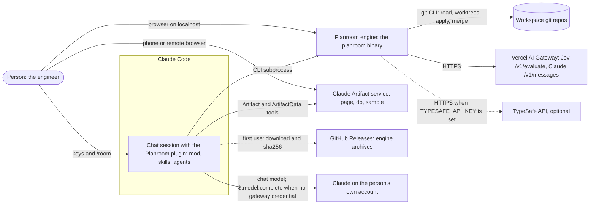
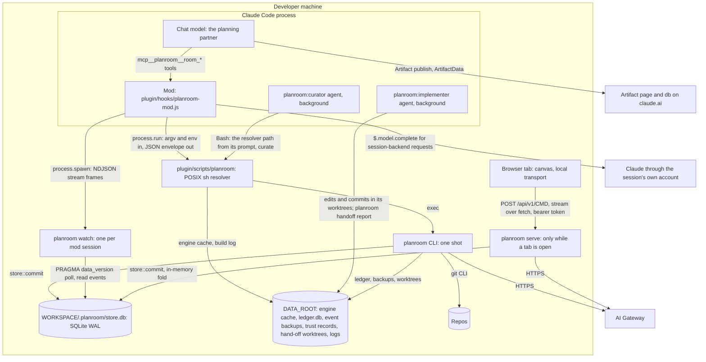
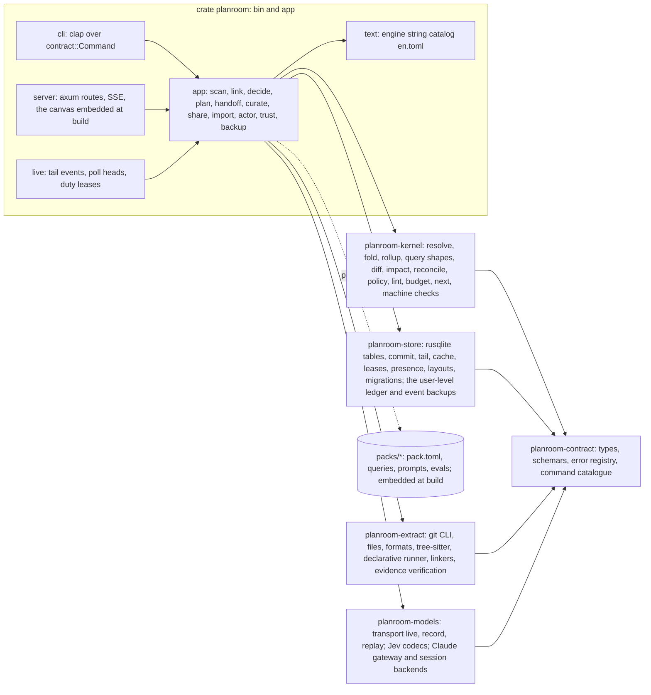
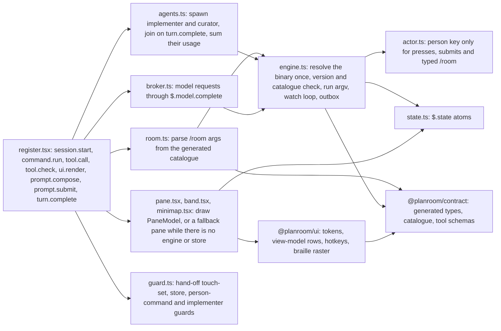
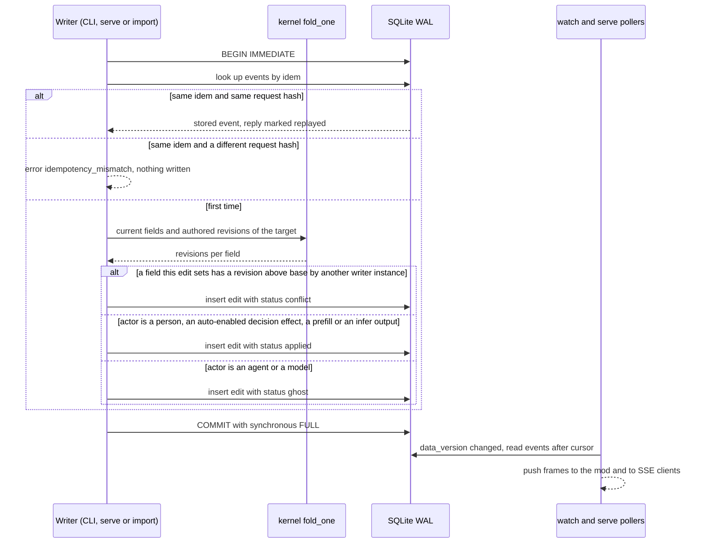
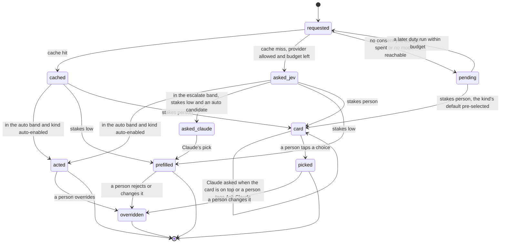
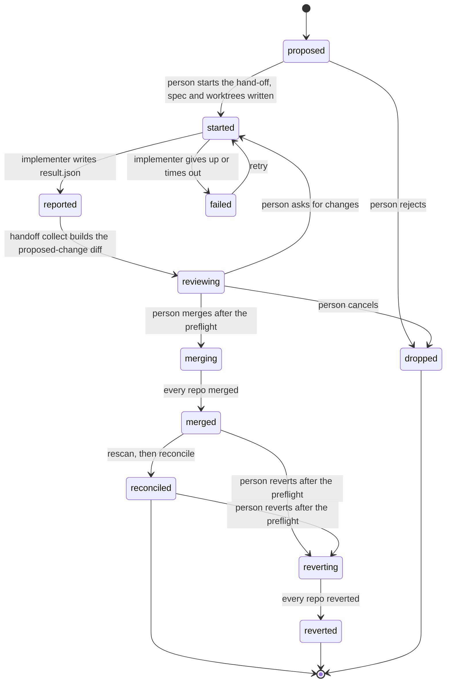

# Architecture

This page describes what Planroom is built from and why: the processes, the data and event model, packs, decisions, diffs and hand-off, the surfaces, security, and the build plan from the walking skeleton through milestone M5. It's the contributor's map; the decisions behind it live in [Decisions](decisions.md), every public shape in [Contracts](contracts.md), and the directory map and boundary rules in [Repo layout](repo-layout.md).

## How to read this page

- This is the Phase 2 synthesis of three candidate architectures (simplicity-first, extensibility-first, concurrency- and agent-first) after three independent judges scored them. It starts from the simplicity candidate, which two of three judges ranked first, and grafts in the runners-up's ideas the judges named. Every departure and every resolved disagreement is a numbered record in [Decisions](decisions.md), cited here as `[DR-n]`.
- Research is cited as `[note §n]` for the Phase 1 notes in `docs/contributing/research/`, and `[TRUTH path]` for `examples/TRUTH.json`.
- `[A]` and `[A-n]` mark an assumption the walking skeleton checks. The full list is in [Assumptions to verify](#assumptions-to-verify), where each settled row says how it was settled.

## The design on one page

Planroom is one Rust binary over one SQLite file per workspace.

- The file holds two kinds of truth:
  - **facts**: the nodes, edges and hints that extractors observe in git at a commit, which can be recomputed at will;
  - **events**: everything a person, agent or model authored, append-only.
- Everything else is a pure kernel function of those two, computed on read: the map at every level, plans, ghosts, diffs, reconciliation and open decisions.
- Every engine process writes through one function, `store::commit`. It runs one SQLite `BEGIN IMMEDIATE` transaction with a field-level compare-and-set and an idempotency check. SQLite is the single writer, so correctness needs no daemon [DR-1].
- `planroom serve` exists only because a browser can't spawn a process. The mod reaches the engine the way an agent does, through the CLI [DR-6].
- Packs are data, never code. Extractors and linkers are either built-in Rust adapters that a pack declares, or declarative regex and tree-sitter queries inside a pack [DR-9].
- One command catalogue, defined once in Rust, generates the CLI, the HTTP API, the mod's tools and the `/room` family [DR-14].
- Who wrote something decides what it means. A person's edit applies; an agent's or a model's edit is a ghost until a person accepts it; some commands only a person can run [DR-4].

### Moving-parts budget

Each part names the requirement that pays for it.

| Moving part | Count | Names | Paid for by |
|---|---|---|---|
| Binaries | 1 | `planroom` | R13, R14 (one CLI entry point) |
| Long-lived engine processes | 0 required, 2 optional | `planroom watch` (one per mod session), `planroom serve` (only while a browser tab is open) | R10 live updates; R13 canvas |
| Stores | 1 per workspace, plus 1 per user | `WORKSPACE/.planroom/store.db`, or under the data root when that filesystem is unsafe for WAL; `DATA_ROOT/ledger.db`, the spend ledger every workspace shares [DR-51] | R6, R10; R9 and constraint "Spend" |
| Rust crates | 7, plus `xtask` | `planroom-contract`, `-kernel`, `-store`, `-extract`, `-models`, `planroom`, `planroom-testkit` (dev-only) | R16: one crate per boundary CI enforces |
| TypeScript packages | 4 | `@planroom/contract` (generated), `@planroom/ui` (tokens and view-model, no DOM), `@planroom/canvas`, `@planroom/mod` | R13, R16 |
| Contract sources | 1 crate, 1 schema in 2 views, 1 version integer | `schema/planroom.v1.schema.json`, `schema/planroom.v1.input.schema.json` | constraint "one contract source" |
| Fact shapes | 4 | `Node`, `Edge`, `Evidence`, `Hint` | R11 (a domain-free core that extends into a graph) |
| Event kinds | 8 | `edit`, `review`, `undo`, `version`, `decision`, `claim`, `scan`, `handoff` | R6 to R10 |
| Ways to write the store | 1 | `store::commit` | R10 |
| Ways to change a repo | 1 | hand-off, with two implementers: `agent` and `patch` | R8, R12, S5 |
| Tool wiring paths | 1 | mod tools that call the CLI; no MCP server | R13 |
| Extractor kinds | 2, plus built-in linkers | built-in (Rust adapter), declarative (pack query) | R1, R11, S10 |
| Kernel roles | 3 | `rescan.retarget`, `reconcile.residual`, `attach.target` | R11 (kernel names no pack kind) |
| Concepts a person learns | 5 | Levels, Lenses, Intent, Diffs, Decisions | R14 |

### Biggest bets

| # | Bet | Proof | Fallback |
|---|---|---|---|
| 1 | Multi-process SQLite (WAL, `BEGIN IMMEDIATE`, `synchronous = FULL`, 5 s busy timeout) instead of a single-writer server | WS4 spike, then S8 | route CLI writes through `serve` when it runs, over the same catalogue; no contract change |
| 2 | Compute on read: only facts and events are stored, folded per request | `cargo bench fold` budget in `budgets.json` | a persisted fold cache keyed by `seq`, inside `planroom-store` |
| 3 | The mod reaches the engine only through the CLI (`$.process.run`, plus `$.process.spawn` of `planroom watch`) | WS5 | `$.http.fetch` over `serve`'s socket with the same catalogue |
| 4 | The git CLI is the only git adapter | fastest measured history walk [rust-stack §6]; WS3 | `gix` behind the same module |
| 5 | Hints plus built-in linkers produce every relation the truth lists, with full evidence | S1 truth comparator from M1 | an infeasibility record per KICKOFF for any one evidence item [DR-12] |

## Requirements to capabilities

Each capability gets a short name, used again in later sections and in [Traceability](traceability.md).

| Req | Capabilities |
|---|---|
| R1 Point it at work | `discover` (a repo, or a directory of repos, with no config); `scan` (extractor pipeline per repo at `HEAD`, then linkers across the workspace); `tiers` (universal for every repo, syntactic for TS, JS, Python, Go and Rust, config formats, declarative patterns for any other language); `ids` and aliases; `levels` (five, one parent each); `rollup` (lift edges with counts and evidence); `default-lens`; `next` (one suggested action); `find`; `fresh` (rescan when a head moves) |
| R2 Relationships | `lens` (relation kinds with a flow direction); `path`, `why`, `impact`, `neighbors` query shapes; `evidence` and `confidence` and `provenance` on every edge; `confirm` and `reject` as edits; `history` (co-change, ownership); plan links (`touches`) |
| R3 Break down artifacts | `detect` (artifact kind from path and shape); `section` (headings, XML-like tags, frontmatter, YAML keys, review threads); part relations through Jev; `missing` (declared required parts); Claude segmentation only when no structure exists; `pr` breakdown with threads and touched components |
| R4 State machines | `machine` extraction from code, docs and prose; `checks` (unreachable, dead end, missing transition, nondeterminism); `drift` through the one diff engine; `step` |
| R5 Intent, top down | `plan` pack with seven stages and their methods; `propose` (AI output lands as ghosts); `review` (person only); `lint` (structural rules plus Jev kinds); `attach`; stage jumps; `version` |
| R6 Tweak everything | `edit` (`put`, `set`, `retract`) on stable IDs, re-applied on every fold; field-level authored revisions; `pin`; `hide`; breakdown text edits; `undo` for every edit type |
| R7 Diffs and reconciliation | one `diff` function and type over two model slices; three sources (versions, layers, proposed change) plus text and machine drift; `impact-radius`; `reconcile` with five classes |
| R8 Hand-off | `spec`; engine-made worktrees per touched repo; `agent` and `patch` implementers; `collect` as a proposed-change diff; person-only `merge` with a preflight across repos, and `revert` to undo it; reconcile after merge; a guard on the chat session's own edits |
| R9 Cheap decisions | kinds declared in packs, each with its stakes and default; prefills before cards; kernel roles; Jev adapter with two codecs; Claude adapter with gateway and session backends; consent and redaction at the model boundary; policy bands; cache; one user-level ledger, budgets and the build's spend log; every decision recorded and overridable; held-out evals |
| R10 Many at once | `commit` (multi-process, serialized); `cas` (field level, by writer instance, base required); `idem` with request hash; `actor` rules; projects; claims; presence; `live` stream within 1 s; mod outbox |
| R11 Extensible domains | domain-free kernel; packs as data that may require only `code`; six v0.1 packs; out-of-tree packs by path; question pipelines including `fires-if` and `bump-breaks` |
| R12 Context curation | run history; miners for gotchas, procedures and stale lines; template drafts refined by Claude or the curator agent; proposals as text diffs through the `patch` hand-off; triggers |
| R13 Surfaces | mod (pane, band, `/room`, tools, agents, mini-map, fallback panes before the engine); canvas (local and as an Artifact, each transport declaring what it serves); CLI and server; shared view models with engine-authored strings; one plugin |
| R14 Tiny surface | five top-level ideas; one binary; one `room` command; generated help; defaults instead of settings; skills hidden from the slash menu |
| R15 Releasable | the Iris bar: docs taxonomy and style tests, CI jobs, release workflow, schemas and drift tests, changelog, templates, Dependabot, security policy, code of conduct, art |
| R16 Designed repo | directory map with an `AGENTS.md` or README per area; one `boundaries.toml` that generates both the Rust and the TypeScript checks; marked generated directories; `cargo xtask` as the one entry point, and the only command CI runs; conventions in `AGENTS.md`; a per-commit decision-record gate over a committed `layout.lock` |

## C4 context



## C4 containers

Every process, store and boundary. The developer machine is the only place that holds secrets.



### Processes and boundaries

| Process | Started by | Lifetime | Reads and writes | Boundary it crosses |
|---|---|---|---|---|
| `planroom <cmd>` | an agent's Bash, a skill, the mod's `process.run`, CI | one command | `store.db` through `store::commit`; the data root's ledger, backups and hand-off worktrees; repos through the git CLI; HTTPS to the gateway for a decision or Claude call | process (argv, env, stdout), file, network |
| `planroom watch --session ID` | the mod in `session.start`, with `$.process.spawn`, once the workspace has a store [DR-57] | dies on reload or session end by design [mod-api §7]; the mod restarts it from the last `seq` in `$.state` | polls `PRAGMA data_version` every 200 ms; writes presence every 10 s; runs duties under a lease; logs to the data root | process (NDJSON on stdout) |
| `planroom serve` | the pane's `e` key, `/room open`, `planroom serve --detach`, the e2e harness | detached (`setsid`), idempotent through `.planroom/serve.json` for one version and catalogue; exits after 30 min with no client, or when an engine of another version or catalogue asks it to drain [DR-58] | the same store API; keeps the folded `Model` in memory; logs to the data root | TCP on `127.0.0.1` with a bearer token per tab [DR-29] |
| Claude Code with the mod, chat, implementer and curator | the person | session | the mod calls only the resolver; agents use Bash and file tools in worktrees | process |
| Browser tab | the person | tab | HTTP and SSE to `serve` | loopback TCP |
| Artifact page | the person, on claude.ai | view | `data/snapshot.json` (published file); `db` `live/head` and `inbox/{self}` | claude.ai; never reaches localhost [artifact §5] |
| AI Gateway, TypeSafe API | | | HTTPS from the engine only | network |

#### Duties

Duties are background work any live process may do: a rescan when a repo head moves, a decision run on pending requests, and the curation trigger. A process does a duty only while it holds the lease named for it, such as `scan:orders` or `decide:<requests hash>` (a row in `leases` with a 30 s expiry, renewed while it works). So two sessions never rescan the same repo at once, duplicate triggers join one run, and work survives any one process dying. When no live process exists (CI, an agent using only the CLI), the same work runs inline in `planroom decide --run` or the next command's freshness check, under the same lease. A command that finds the lease held waits up to 5 s for the holder and reuses its snapshot. Each lease carries an epoch that the committing transaction checks, so a holder whose lease expired (a laptop asleep) commits nothing. Snapshot inserts are idempotent on `(repo, commit_id, purpose, packs_hash)`. A duty that fails sends a `duty` frame with state `Failed`, and until it next succeeds every `focus` carries a `duty_failed` warning, which the status line shows as one entry [DR-58].

`watch`, `serve` and duties log to `DATA_ROOT/logs/<workspace_id>/<process>.log` as well as stderr, because a detached process's stderr goes nowhere. Each log is capped at 1 MiB with one rotation, and redacted like every log [DR-58].

## C4 components

### Engine

Library crates depend only on `planroom-contract`. Only the `planroom` crate composes them. `planroom-testkit` is a dev-dependency only. That is the whole Rust boundary, generated from `boundaries.toml` (see [Repo layout](repo-layout.md#boundaries-and-their-enforcement)).



### Mod



### Canvas

`packages/canvas/src/`: `main.tsx`; `transport/local.ts` (`fetch`, with the stream read through `fetch` so the bearer token rides in a header) and `transport/artifact.ts` (published data file and `db`), behind one `Transport` interface that declares what each can serve; `store.ts` (zustand); `views/` (`MapView`, `Focus`, `PathView`, `DiffTray`, `DecisionStack`, `PlanBoard`, `Anatomy`, `Machine`); `layout/elk.worker.ts`; `motion.ts`. Design tokens and view-model rows come from `@planroom/ui`, the same code the mod uses.

## Main flows

1. **Cold scan (S1).** `planroom scan DIR` finds the workspace, creates `.planroom/`, and resolves each repo's `HEAD`. It runs the extractors the loaded packs declare, in parallel across repos, then the linkers across the workspace. Per-file extractors reuse cached facts for blobs they have already seen. It verifies every evidence item, writes one snapshot of facts per repo plus a workspace link snapshot, and appends one `scan` event per repo, all in one transaction. The last `scan` event carries the reconciler's outcome [DR-44]. It returns `MapView` at the top level with the default lens, plus `next`. Pending decisions don't block it: they run as a duty, or in `planroom decide --run` [DR-24].
2. **Read anywhere.** Each command first checks freshness: it compares each repo's `HEAD` and refs (a few small file reads) with its active snapshot, and rescans what moved, using only cached decisions. An inline rescan takes the repo's `scan:REPO` lease. A refresh read (`focus`, and every surface's refetch) never waits on a rescan: while a live process holds that lease, it returns the current snapshot and lists the repo in `meta.stale_repos`. It folds facts and events in the kernel and shapes the result to the command's size budget.
3. **Edit (S4, S8).** A writer sends `base`, the `seq` of the view it read. In one `IMMEDIATE` transaction, `store::commit` checks the idempotency key, folds the target, and compares the authored revision of every field the edit sets, and the writer instance that set it, with `base`. The actor decides the status: a person's edit applies, an AI's edit is a ghost. A stale write is stored as a conflict, never merged and never lost. The committed `seq` reaches every `watch` and SSE client within one 200 ms poll.
4. **Mod refresh.** A frame arrives on `watch` stdout. The mod runs `planroom focus --json` on the first frame of a burst, again after 250 ms of quiet, and at least every 500 ms while frames keep coming. It writes the `PaneModel` into `$.state`. The pane and band redraw because they read that atom.
5. **Decision.** Requests are derived from the model: subjects matching a pack decision's `when`, with no decision recorded for their current input hash. The runner groups them by slice, checks the cache, then sends one Jev request per slice. Policy then acts (an auto-enabled kind), prefills (a `low`-stakes kind) or deals a card (a `person`-stakes kind) [DR-50]. Each outcome is a `decision` event; any action or prefill is an `edit` with `cause` set to it.
6. **Hand-off (S4).** A person runs `handoff start KEY` (the approval). The engine writes `DATA_ROOT/handoffs/<workspace_id>/KEY/spec.json` and makes one worktree per touched repo beside it, on branch `planroom/KEY`. The mod spawns `planroom:implementer` there; CI uses the `patch` implementer. `handoff collect` scans the branch heads as proposed-change snapshots and returns the `Diff`. A person runs `handoff merge`, which preflights every repo and then merges each branch; the rescan and reconciliation close the item. A person's `handoff revert` undoes the merge in every repo the same way [DR-55].
7. **Remote (S11).** `/room share` builds the Artifact bundle; the chat model makes the one publish call. A viewer's edit lands in `db` at `inbox/UID/events/ID`. The person's `/room sync` has the model list the inbox into a directory, then runs the person-only `planroom import`. Other viewers' rows commit as their attributed edits through the same compare-and-set; the owner's own rows and any person-only command become one card [DR-52].

### The write path



## Data and event model

### Two records

| Record | What it is | Who writes it | Mutable? | Where |
|---|---|---|---|---|
| Fact | A `Node`, `Edge` or `Hint` observed by an extractor or produced by a linker, in one repo at one commit, with evidence | extractors and linkers, during a scan | Never edited. A scan writes a new snapshot. | `facts`, grouped by `snapshots` |
| Event | Anything a person, agent or model authored: edits, reviews, undos, versions, decisions, claims, scan markers, hand-off steps | `store::commit` only | append-only | `events` |

Everything else is derived and never stored: the merged model, levels and roll-ups, ghosts, conflicts, plan state, diffs, open decisions and the next action. So derived state never needs migrating or repairing. One result is stored: the reconciler's outcome, on the `scan` event, so a class doesn't depend on when a scan ran [DR-44]. The only caches are model responses (paid), auto-layout positions (1.1 to 1.5 s of ELK work [ts-stack §1]), per-blob facts, so a commit re-extracts only the blobs it changed [DR-47], and the in-memory fold that `serve` and `watch` keep [DR-2].

### Shapes

These four shapes are the whole graph. Packs add kinds, never fields. Pack-specific data goes in `props`, validated against the prop schema the pack declares for the kind. Full sketches are in [Contracts](contracts.md#graph-model).

| Shape | Fields | Notes |
|---|---|---|
| `Node` | `id`, `kind`, `level`, `parent`, `name`, `aliases`, `props`, `layer`, `provenance`, `evidence` | one parent; `kind` is `<pack>.<name>` |
| `Edge` | `id`, `kind`, `from`, `to`, `via`, `via_ref`, `props`, `evidence`, `confidence`, `layer`, `provenance` | `from` and `to` are an ID or an alias; `via_ref` points at a node whose evidence also counts for the edge, such as an endpoint |
| `Evidence` | `Line { path, line, contains, commit, branch }` or `Ref { commit, ref }` | a file fact carries `Line`, whose `contains` is the exact line, cut to 200 characters; a git-derived fact (a tag, a commit, co-change, ownership) carries `Ref`; both verified at ingest [DR-12] |
| `Hint` | `id`, `kind`, `scope`, `key`, `value`, `attrs`, `evidence`, `provenance` | a partial observation that a linker joins with others, such as a URL literal or an environment read; `id` hashes kind, scope, key and evidence, so a linked edge names the hints and extractors behind it [DR-12] |

### IDs and aliases

- **Nodes:** `<namespace>:<kind-short>:<key>`. The namespace is the repo name, `ws` for workspace-level things with no repo (`ws:container:redis`), or `plan` for plan items (`plan:<project>:<key>`). The kind-short is the `id_prefix` the kind declares. Several kinds of one pack may share a prefix, such as `container` for every Container-level code kind, so a reclassified container keeps its ID. Two packs declaring one prefix is `pack_invalid` [DR-46]. Examples: `storefront:dir:src/cart`, `orders:pkg:internal/http`, `orders:container:orders`.
- **Edges:** `e:` plus 12 hex characters of `sha256(kind ‖ from ‖ to ‖ via)`, so an edge keeps its ID across rescans while its endpoints and `via` hold.
- **Groups made by hand** (the S4 `purchase` group): `<ns>:group:<slug>`, kind `kernel.group`. The kernel defines three other kinds and one relation, and nothing else: `kernel.external` (third-party things no repo holds), `kernel.project` and `kernel.item` (projects and plan items), and `kernel.touches` (what a plan item touches) [DR-45].
- **Aliases** let one extractor point at what another defines without knowing its ID. Compose gives service `orders` the aliases `host:orders` and `service:orders`; a URL literal `http://orders:8080/healthz` then resolves to `orders:container:orders` [TRUTH scenarios.S10.ruby.calls]. An ambiguous alias resolves to nothing, and the edge is reported as an `unresolved_ref` warning, never guessed.
- **Suffix and name lookups.** Commands accept a full ID, an ID suffix (`src/cart`) or a bare name (`worker`). A name resolves at the command's level first (the lens's default level for questions, the map's level for `map`), then upward, then downward. Several matches at the first level that has any return `ambiguous_ref` with the candidates in `details` [DR-21]. So `planroom ask path storefront worker` means the two containers.

### Levels and roll-ups

- Five fixed levels, ordered: `Intent`, `System`, `Container`, `Component`, `Code`. They are the kernel's vocabulary for "where I am" (R14 Levels), not a domain. Each pack maps its kinds to a level:
  - projects and plan items (`kernel.project`, `kernel.item`) sit at `Intent`;
  - the workspace and repos sit at `System`;
  - services, datastores, queues, libraries and tooling sit at `Container`;
  - packages, directories, API specs, alert rules, documents and machines sit at `Component`;
  - files, sections, states, endpoints and commits sit at `Code`.
- **One parent per node.** A regroup is a `set parent` edit, so moving `storefront/src/cart` under `purchase` changes nothing else.
- **Merging facts.** When two extractors emit the same node ID, evidence unions and scalar fields take the more specific tier's value (precise, then syntactic, then config, then pattern, then universal). So the Ruby pattern can move `platform/tools/healthcheck.rb` under its `healthcheck` container while the universal tier still sees the file [TRUTH components].
- **Roll-up** (`kernel::rollup::lift(model, level, lens)`): each edge whose kind the lens includes is lifted to the nearest ancestor of each end at or above `level`. Lifted edges with the same `(from, to, kind)` merge into one `LiftedEdge { kind, from, to, count, evidence_sample (at most 3), children }`.
  - Faithfulness is an invariant: `count == children.len()`, and lifting then expanding gives back exactly the original edge set. A property test checks it over the fixture and over random trees.
  - Edges inside one ancestor become that ancestor's `internal` count, not self-loops. Hidden nodes drop out with their edges counted under `hidden`, so a hide shows as "3 hidden", never as a silent loss.

### Layers, overrides and ghosts

| Concept | Representation | Effect on the fold |
|---|---|---|
| Actual layer | facts from each repo's active snapshot, plus the workspace link snapshot | the base of the model |
| Intended layer | `edit put` events with `layer: Intended`: intended nodes, required edges, and boundary rules (`props.rule` is `require`, `forbid` or `allow-only`) | kept beside the actual layer; drift is `diff(intended, actual)` |
| Override | `edit set` on an actual node or edge: `parent`, `name`, `hidden`, `pos@VIEW`, `props.*` | applied over the fact on every fold, so a rescan can't drop it |
| Rejection | `edit retract` on an actual edge ("A doesn't depend on B") | hidden from questions and reconciliation, listed in Diffs as a rejected inference; survives rescans because it targets the stable edge ID |
| Confirmation | `planroom review ID accept` on an inferred edge [DR-54] | `provenance` gains the confirming actor |
| Ghost | any `edit` whose actor is an agent or a model, except the effect of a decision kind whose auto-action is enabled, a `low`-stakes prefill, and the output of an `infer` prompt on the actual layer | drawn translucent; listed in Decisions as one batch per cause (one chat turn or one plan stage run); excluded from questions, lint and reconciliation until a person accepts it (R5) [DR-4]. A person's later edit to a field the ghost sets supersedes it: the ghost leaves the overlay and its batch, is listed in Diffs as superseded, and raises no card [DR-7] |

An `infer` output (segmentation, prose machines) applies as an inferred fact with its confidence, for a person to confirm or reject (R2). It describes the actual system, so it isn't a proposal. A `low`-stakes prefill applies the same way, and is listed in Decisions as one collapsed batch per kind [DR-50].

### Events

```rust
pub struct Event {
    pub seq: u64,                 // SQLite rowid: one global order, the stream cursor and the version
    pub id: EventId,              // uuid v7
    pub idem: String,             // idempotency key, UNIQUE
    pub request_hash: String,     // sha256 of the canonical request; same idem with another hash is refused
    pub at: Timestamp,
    pub actor: Actor,             // Person | Agent | Model | System
    pub client: Client,           // with actor, the writer instance: { surface, id }, such as a canvas tab or a mod session
    pub project: Option<NodeId>,
    pub cause: Option<Cause>,     // Event(EventId) | Turn(String) | Duty(String)
    pub status: Status,           // Applied | Ghost | Conflict | Open | Closed
    pub body: EventBody,          // Edit | Review | Undo | Version | Decision | Claim | Scan | Handoff
}
```

- Eight event kinds, and only `edit` changes the graph. Everything a person can do on the map is one of three operations (`put`, `set`, `retract`) on one target. So undo, conflicts, ghosts and attribution are one mechanism each, not one per edit type [DR-3].
- An edit's `status` is set at commit time and changed later only by `review` and `undo` events, which the fold reads.
- Accepting a ghost, or choosing "yours" on a conflict, writes a new `edit` that copies the fields, with `base` from the accepting view and `cause` set to the reviewed event. It goes through the normal compare-and-set, so an accept over a newer write becomes a three-way card, never a silent no-op. The `review` event stays as the audit trail [DR-5].

### The fold

`kernel::fold(facts, events, packs, at) -> Model` is pure and deterministic:

1. **Snapshot set.** For each repo, the active snapshot at `at` is the one named by its last `scan` event with `seq <= at`. The workspace link snapshot is the one built from those.
2. **Resolve.** Build the alias index, resolve every reference, validate kinds and props against the packs (unknown kinds drop with a warning), attach parents.
3. **Pre-pass.** Collect `undo` targets and the latest `review` per event, so undone and rejected edits are skipped in one pass.
4. **Apply** every edit with effective status `Applied` (and `Ghost` into the ghost overlay), in `seq` order: `put` inserts, `set` overrides fields, `retract` hides. A ghost leaves the overlay as superseded once an applied person edit sets a field it sets.
5. **Scan drift on overrides.** For each applied `set` on an actual-layer target, compare the fact value it was made over (recorded in the edit's `over` field) with the fact's current value. A difference adds a `ScanChangedUnderEdit` item to Diffs, with "keep yours" pre-selected. The override stays applied: a scan never silently overrides a person's edit (R6). A target that vanished raises the decision bound to the `rescan.retarget` role. Neither is raised for a target whose evidence paths a partial scan didn't cover [DR-47].
6. **Indexes.** Children, a petgraph `StableGraph` for the query shapes, plans per project, open decisions.

Claims and presence depend on the clock, so they stay out of the fold. They are an overlay, `kernel::overlay(model, claims, presence, now)`, where `now` is an explicit input: the command's start time, recorded in replays, or the scan event's `at` for the reconciler. So `fold(at = N)` is reproducible.

`serve` and `watch` keep `(Model, seq)` and apply only events after `seq`; a `scan` event refolds only the affected repo's subtree. One-shot commands fold from scratch. Budget: under 50 ms at 20,000 facts and 5,000 events, tracked in `budgets.json`.

### Versions and revisions

- **A version is a sequence number.** `seq` is global and monotonic, and every change to the model, scans included, has one. "The model at version N" is `fold(at = N)`.
- **Authored revision.** For each target and field, `rev(target, field)` is the `seq` of the last applied event that set it, and its writer instance. An accepted ghost counts at the `seq` of the edit its accept wrote. Scans never change authored revisions, so a background rescan never makes a person's pending edit stale [DR-5].
- **Plan versions** (S3) are `version` events, tags on `seq`. Version 1 is tagged automatically when a project's first accepted batch lands; later versions are a person's `intent version LABEL`. A plan diff is `diff(fold(at = v1).project(p), fold(at = v2).project(p))`.
- **Model versions** are scans. Old snapshots stay while a `version` event, an open diff or the last reconciler outcome refers to them; others are pruned after the last 20 per repo.

### Writes: actors, base, conflicts and retries

#### Actors

The engine resolves who is writing before anything else [DR-4]. A terminal alone never makes a person, and reads need no actor:

| Actor | Granted when |
|---|---|
| `person:<os-user>` | the call carries `PLANROOM_PERSON_KEY` whose sha256 matches the one in `store.db` (the mod adds it only for a button press, an input submit, or a `/room` the person typed; the test harness adds its own); or a request from a logged-in canvas tab; or a terminal write the person confirms on `/dev/tty` (see [Base](#base)) |
| `person:artifact:<uid>` | another viewer's Artifact inbox row, in a person-only `import`; the `{self}` path segment proves the author [artifact §2]. The owner's own rows can't be told from the session's `ArtifactData` writes, so they come back as one card, never as applied edits [DR-52] |
| `agent:<id>:<role>` | `PLANROOM_ACTOR=agent:...`. The mod's tool handlers always send `agent:<session8>:chat`. The `room` skill and the mod's prompt section give the chat model that string for its Bash calls, and the mod passes `agent:<agentId>:implementer` or `:curator` in a spawned agent's prompt. |
| `model:<id>` | a Jev or Claude result applied by the engine |
| `system:<part>` | scans, duties |

- A write with no `PLANROOM_ACTOR` and no key, from a process with no terminal, is refused with `actor_required`. So every Bash agent names itself, and no two agents share an identity. Writes that only record observations (`scan`, and the duties a live process runs) are `system:<part>` writes and need no actor [DR-60].
- A `PLANROOM_ACTOR` that names a person is refused with `person_required` unless the person key is present.
- The person key is 32 random bytes in the mod's `$.store`. `store.db` keeps only its sha256 in `meta`, which the mod registers on its first start.
- A writer instance is the actor plus the client it writes from: `{actor, surface, client_id}`. The client ID is a canvas tab's ID, a mod session's ID, an Artifact viewer's `uid`, an agent's own ID from `PLANROOM_ACTOR` (so one agent across many CLI processes is one writer), or for a person at a terminal the CLI process (`cli:<pid>`, or `PLANROOM_CLIENT` when the caller sets one) [DR-60]. Conflicts compare writer instances, not actors [DR-5].
- The mod's `tool.check` guard resolves each call's paths (relative paths, `..` and symlinks) before it matches them [DR-52]. For every agent, it denies:
  - Read, Grep, Glob and Bash calls that reach `store.db` and its WAL files, `serve.json`, or the data root's stores, ledger and backups;
  - Edit, Write, MultiEdit and NotebookEdit under `.planroom/` or the data root;
  - Bash that names a person-only `planroom` command, even through a pty wrapper such as `script`, and any call that sets `PLANROOM_PERSON_KEY`.
- For a spawned `planroom:implementer` [A-12], the guard also allows Edit and Write only inside its own worktrees, and denies Bash that names `sqlite3`, `script`, `git push` or `planroom handoff`.
- This is a guardrail for "AI proposes, person disposes", not a security boundary between processes of one OS user, and `SECURITY.md` says so.

#### Actor rules

Each catalogue command declares `any`, `person_only`, or `mixed`, where the leaf table in [Contracts](contracts.md#command-catalogue) names the inputs that need a person. Person-only: `decide` (picking a card choice or overriding a decision), `handoff start` (the approval), `handoff merge`, `handoff revert`, `handoff cancel`, `intent version` and `open`. Mixed: `review` of ghosts and inferred facts (an agent may reject only its own ghosts), `import` of Artifact inbox rows or an event export, `doctor --restore`, and `scan` of a credential path [DR-52, DR-53, DR-54, DR-55]. An agent that tries one gets `person_required`, with the card ID a person can tap. A person at a terminal runs one through a confirmation read from `/dev/tty` that names the action, or through the mod's press.

#### Base

Every write to user-authored state carries `base`, the `seq` of the view the writer acted on. HTTP and tool calls must send it; a missing base is `base_required` [DR-5].

- The canvas sends the `seq` of the view it rendered. The mod's tool handlers default `base` to the latest `meta.seq` returned to the model in the same turn, else to the pane's `seq`.
- A CLI call with no terminal must pass `--base SEQ` (from the `meta.seq` it read). A person at a terminal with no `PLANROOM_ACTOR` gets a read-then-confirm: the CLI reads the target, prints what it's changing and at which `seq`, reads the confirmation from `/dev/tty`, and commits with that base as `person:<os-user>`.
- `put` of a new ID needs no base. A `put` on an existing ID with different content is a conflict that keeps both.

#### Conflicts

A write conflicts when a field it sets has `rev > base`, written by a different writer instance. So two tabs of one person conflict like two people. The edit is stored with `status: conflict` and nothing is merged. What happens next depends on who wrote it [DR-7]:

| Writer | Result |
|---|---|
| Person (canvas, mod, terminal, Artifact) | error `stale_write`; a three-way card (`base`, `theirs`, `yours`) in Decisions with "theirs" pre-selected: "Bob renamed this to Bag 2 s ago. Keep Bag / Use Basket" |
| Agent or model | error `stale_write` with a compact three-way diff (at most 1 KB) in `details`; the conflict is listed in Diffs under "agent retries", collapsed; no card. The agent re-reads and retries. |

Choosing "yours" writes a new edit that copies yours, with `base` from the card's view and `cause` set to the conflict, under the same compare-and-set. A write that landed after the card makes it a new card. A writer instance never conflicts with its own later writes. Only presence, leases and the layout cache are last-writer-wins, and none of them is user-authored.

A person's edit over a pending ghost is not a conflict: it applies and supersedes the ghost (see [Layers, overrides and ghosts](#layers-overrides-and-ghosts)). S8's stale write is person against person: the canvas tab against a mod press on the same field. `kernel/tests/cas.rs` pins both cases [DR-7].

#### Idempotency and retries

Retries are safe because of these rules [DR-8]:

- Every write carries `idem`. If the caller gives none, the engine derives `sha256(actor ‖ command ‖ canonical(args) ‖ base)`. Tool calls use the `tool_use_id` that every `tool.call` input carries [A-8]. A replay of a derived key says so: `meta.replayed_from` names the original `seq`, and the hint says to pass a new `--idem` to repeat the write.
- A command that writes several events (a regroup, a scan, a decision and its effects) keys them `idem#1`, `idem#2` and so on, and stores the whole reply on the first, so a replay returns it whole. A decision event's key is `sha256(kind ‖ kind_version ‖ subject ‖ input_hash)`, so a duplicate run replays.
- The event stores `request_hash`. The same `idem` with the same hash returns the stored reply with `meta.replayed: true`. The same `idem` with a different hash is `idempotency_mismatch`, so a client bug never silently replays the wrong result.
- The mod writes `{idem, argv, env_names}` to a `$.state` outbox atom before each write and clears it on reply. It stores the names of the variables it set, never their values, so the person key never sits in `$.state`. After a reload, `session.start` resends the outbox with the same keys, and reads the person key from `$.store` again for a person write.
- Artifact edits use the document ID the page mints, so a re-import is a no-op.
- Read-your-writes needs no token: every process reads the same SQLite file, and `serve` checks `data_version` before serving from its in-memory fold.

### Claims, presence and projects

- **Claims** are `claim` events with an expiry: "I'm working on `worker` until 15:30". A write to a claimed target succeeds and carries a `claimed` warning naming the holder. Claims warn and never block. A hand-off claims its touch set for the implementer.
- **Presence** is the `presence` table: `{actor, surface, doing, focus, seen_at}`, written every 10 s by each `watch` (for its session and the agents the mod tracks through `$.agent.list()`), each SSE client, and each agent CLI call (`doing` is the command's one-line summary). An actor shows as present for 30 s after its last write.
- `planroom who` and `PaneModel.who` merge the two: "Carol's session is planning Add retries; implementer worker-status-via-api is editing worker and platform; a canvas tab is looking at orders."
- **Projects** are `kernel.project` nodes (`plan:<project>`). All projects share one model of the system: facts, workspace overrides and the intended layer. Plan items, versions and project views are project-scoped, and events carry `project`. Approving project A's intended change makes project B's view show drift if B attaches to anything in A's impact radius.

### Store schema

```sql
PRAGMA journal_mode = WAL;  PRAGMA synchronous = FULL;  PRAGMA foreign_keys = ON;  -- busy_timeout = 5000 per connection
CREATE TABLE meta      (key TEXT PRIMARY KEY, value TEXT NOT NULL);   -- workspace_id, store_version, created_at, engine_version, person_key_sha256
CREATE TABLE events    (seq INTEGER PRIMARY KEY AUTOINCREMENT, id TEXT NOT NULL UNIQUE, idem TEXT NOT NULL UNIQUE,
                        request_hash TEXT NOT NULL, at TEXT NOT NULL, actor TEXT NOT NULL, client TEXT NOT NULL, project TEXT, cause TEXT,
                        kind TEXT NOT NULL, target TEXT, status TEXT NOT NULL, body TEXT NOT NULL);
CREATE INDEX events_target  ON events(target, seq);
CREATE INDEX events_project ON events(project, seq);
CREATE TABLE snapshots (id INTEGER PRIMARY KEY, repo TEXT NOT NULL, commit_id TEXT NOT NULL, branch TEXT NOT NULL,
                        purpose TEXT NOT NULL,           -- head | link | proposed:<handoff> | runs | file:<path>
                        packs_hash TEXT NOT NULL, UNIQUE (repo, commit_id, purpose, packs_hash));  -- insert ON CONFLICT DO NOTHING, then select
CREATE TABLE blob_facts (blob TEXT NOT NULL, extractor TEXT NOT NULL, packs_hash TEXT NOT NULL, body TEXT NOT NULL,
                        PRIMARY KEY (blob, extractor, packs_hash));       -- per-file extractors' facts, reused across commits
CREATE TABLE facts     (snapshot INTEGER NOT NULL REFERENCES snapshots(id) ON DELETE CASCADE, id TEXT NOT NULL,
                        shape TEXT NOT NULL, kind TEXT NOT NULL, hash TEXT NOT NULL, body TEXT NOT NULL,
                        PRIMARY KEY (snapshot, id));
CREATE TABLE fact_rev  (id TEXT PRIMARY KEY, hash TEXT NOT NULL, changed_seq INTEGER NOT NULL);
CREATE TABLE model_cache (key TEXT PRIMARY KEY, provider TEXT NOT NULL, model TEXT NOT NULL, response TEXT NOT NULL,
                        usage TEXT NOT NULL, at TEXT NOT NULL);
CREATE TABLE leases    (name TEXT PRIMARY KEY, holder TEXT NOT NULL, epoch INTEGER NOT NULL, expires_at TEXT NOT NULL);
CREATE TABLE presence  (actor TEXT PRIMARY KEY, surface TEXT NOT NULL, doing TEXT, focus TEXT, seen_at TEXT NOT NULL);
CREATE TABLE layouts   (view_key TEXT NOT NULL, structure_hash TEXT NOT NULL, positions TEXT NOT NULL,
                        PRIMARY KEY (view_key, structure_hash));
```

Ten tables. The spend ledger lives outside the workspace, in `DATA_ROOT/ledger.db`, so one daily cap spans every workspace and a temporary fixture can't reset it [DR-51]:

```sql
CREATE TABLE ledger (id INTEGER PRIMARY KEY, at TEXT NOT NULL, workspace_id TEXT, provider TEXT NOT NULL,  -- jev, gateway, typesafe, session, sample
                     model TEXT NOT NULL, purpose TEXT NOT NULL, scope TEXT NOT NULL, uncached_in INTEGER, cache_read INTEGER,
                     cache_write INTEGER, output INTEGER, cost_usd REAL, prefix_hash TEXT, generation_id TEXT, replayed INTEGER NOT NULL);
```

Migrations are numbered SQL files applied by `user_version`. Only `events` needs care across versions, because facts rebuild by rescanning. A migration that touches `events` ships with a fixture database from the previous release and a test that opens it. Before any migration, the engine writes `VACUUM INTO DATA_ROOT/backups/<workspace_id>/store-vN.db`, checks the copy with `PRAGMA integrity_check`, and keeps the last 3. It runs the migration and a post-migration fold in one transaction, and rolls back on any failure. A successful migration adds a `store_migrated` warning naming the copy, which the mod shows once in the status line [DR-53]. `planroom export` writes events as NDJSON in the contract's `Event` shape. A person's `planroom import` replays an export into a store with no authored events. The store contract is in [Contracts](contracts.md#store-schema-and-migrations).

Nothing a person authored lives only in `store.db` [DR-53]. After each person-authored commit, debounced to one write per 5 s, the engine appends the new events to `DATA_ROOT/backups/<workspace_id>/events.ndjson`, outside every working tree. When `.planroom/` is missing but a backup exists for the workspace root, `scan` deals one card, "Restore 214 edits from 2026-10-26?", with Yes pre-selected. The backup is only ever read to restore, so it's a copy, not a second source of truth. `planroom doctor` warns when the newest backup is older than the last person-authored event.

### Where the workspace lives

- The nearest ancestor of the working directory with `.planroom/` is the workspace root; without one, the given or current directory is.
- The repos are the root itself if it's a git repo, else its immediate child directories that are git repos. The fixture's `OUT/{storefront,orders,worker,kit,platform}` is a five-repo workspace with no config.
- A directory becomes a workspace only when a person or an agent runs `scan`. Until then nothing creates `.planroom/`, the mod starts no `watch`, and `focus` returns `ok` with an empty state instead of an error: "Map these 5 repos? About 2 s", with `scan DIR` as its next action, or "No git repos here" with a pointer to `scan PATH` when the directory holds none [DR-57].
- `.planroom/` holds `store.db` (or `store.pointer`, below), `config.toml` (optional), `serve.json` (port, pid, version, catalogue hash, control token), `share/`, `models/` (pending session-backend requests), and a `.gitignore` of `*`. The engine creates `.planroom/` with mode 0700 and every file in it with mode 0600, the store's WAL files included [DR-29].
- Multi-process WAL needs a local filesystem. At store open, the engine checks the filesystem `.planroom/` is on: network mounts (NFS, SMB), WSL's `/mnt/*` (9p or drvfs), FUSE, and on macOS network volumes and sync folders such as iCloud Drive and Dropbox. On one of those it keeps the store at `DATA_ROOT/stores/<workspace_id>/store.db`, writes `.planroom/store.pointer`, and says so once in one line. `planroom doctor` reports the check [DR-1].
- `DATA_ROOT` is `${PLANROOM_DATA:-${XDG_DATA_HOME:-$HOME/.local/share}/planroom}`, mode 0700. The engine, the resolver, the mod, the Bash tool and spawned agents all compute it the same way, from nothing a plugin variable supplies, so they share one engine cache [DR-58]. It holds `engine/<version>/` (the resolver's cache), `ledger.db` [DR-51], `backups/` [DR-53], `handoffs/<workspace_id>/KEY/` (each hand-off's spec and worktrees) [DR-52], `stores/`, `logs/`, and `workspaces.json`, which maps each workspace root the engine created to its `workspace_id`.
- **Trust** [DR-48]. A `.planroom/` is trusted only when `workspaces.json` records that the engine created it and git tracks nothing inside it (`git ls-files .planroom` is empty in the repo that holds it). An untrusted `.planroom/`, such as one committed to a cloned repo, keeps its config unloaded, and one card says so: "This workspace's .planroom/ came with the repo. Its config is ignored. Trust it?" `cargo xtask fixture` records its fixture as trusted, as the engine does for a directory it creates.
- **Credential settings** come only from the environment or the user-level config, `${XDG_CONFIG_HOME:-$HOME/.config}/planroom/config.toml`, never from a workspace's config: the Claude and Jev backends, `base_url`, `api_key_env` and the gateway key itself (user-level config at mode 0600 only) [DR-48].

## Packs and extractors

Three words, three meanings:

- The **kernel** is the domain-free core (`planroom-kernel`).
- A **pack** is a directory of data that plugs a domain in. It never contains code.
- An **adapter** is Rust code that connects the engine to something outside it: git, file formats, tree-sitter, linkers (`planroom-extract`), Jev and Claude (`planroom-models`), SQLite (`planroom-store`).

### What a pack is

```text
packs/<id>/                     (or any directory outside the tree, for an out-of-tree pack)
  pack.toml                     validated against PackFile in the input schema
  languages/*.toml              a [[languages]] entry and its [[extractors]], one file per language, merged at load
  queries/*.scm                 tree-sitter queries for built-in grammars
  prompts/*.md                  Claude stable prefixes, each at least 1,024 tokens or explicitly uncached
  evals/<kind>.cases.jsonl      labelled eval cases per decision kind
  evals/<kind>.result.json      GENERATED by eval runs; never hand-edited
  tests/                        inputs and expected facts for the pack conformance kit
  README.md                     what it covers, what it requires, how to test it
```

| Section of `pack.toml` | Fields | Used for |
|---|---|---|
| header | `format = "planroom.pack/v1"`, `id`, `version`, `title`, `requires` (only `["code"]` or `[]`) | identity; the inward-only rule |
| `[[kinds]]` | `id`, `id_prefix`, `level`, `label`, `parents`, `props` (JSON Schema fragment), `icon`, `empty_text`, `empty_action` | node kinds and their IDs |
| `[[relations]]` | `id`, `from`, `to`, `label`, `props` (JSON Schema fragment), `inferred` | edge kinds |
| `[[languages]]` | `id`, `extensions`, `line_comment`, `block_comment` | each file's `language` prop, a repo's languages, and the comment spans the declarative runner blanks |
| `[[image_roles]]` | `image` (a glob), `role`, `kind` | a compose service's kind and `role`, such as `redis*` to `code.queue` with role `queue` |
| `[[hints]]` | `id`, `attrs` | hint kinds a linker consumes |
| `[[extractors]]` | `builtin = NAME` with `files` and `options`, or `files`, `language`, `regex` or `query`, and `emit` | facts |
| `[[linkers]]` | `builtin = NAME`, `options` | cross-repo joins of hints into edges |
| `[[lenses]]` | `id`, `label`, `relations`, `flow` per kind, `level`, `default`, `empty_text`, `empty_action` | R2 lenses, the default view |
| `[[questions]]` | `id`, `steps` (one to three query shapes), `summary` template | S2 and R11 questions, the `ask` command |
| `[[rules]]` | `id`, `kind` (`requires_prop`, `requires_edge`, `min_children`, `covers`), `subject` (the kind it checks), `params`, `message` | structural lint and missing artifact parts; boundary rules are intended-layer edits, never pack rules |
| `[[decisions]]` | see [Decisions](#a-decision-kind) | Jev and Claude decision kinds, optionally bound to a kernel role |
| `[[suggestions]]` | `when`, `text`, `action`, `priority` | candidates for the one next action |
| `[[prompts]]` | `id`, `file`, `tier` (`cheap` or `capable`), `role` (`infer` or `propose`), `output`, `ttl` (`5m` by default, `1h` for person-paced purposes) | engine Claude calls |
| `[[stages]]` | plan pack only: `id`, `method`, `items` (the `kernel.item` types the stage writes, each with a prop schema), `prompt` (the stage's instructions, sent in the uncached tail after the plan pack's one shared prefix), `lint` | R5 stages |

Packs load in a fixed order: built-in packs (embedded at build time by `crates/planroom/build.rs`), then each path in a trusted workspace's `.planroom/config.toml` `packs = [...]`, then `PLANROOM_PACKS` (colon-separated). An out-of-tree pack is data, but it carries policy: prompts, decision kinds and eval results [DR-48]. A person chose it by listing it in config or `PLANROOM_PACKS`, so loading it deals no card; `planroom doctor` lists every loaded pack with its kinds and the sha256 of its prompts [DR-60]. The engine ignores an out-of-tree pack's `auto_enabled` until a person enables auto-action for that kind with a person-only card ("Let pack X act on its own for kind Y? Holdout precision 0.97 on 64 cases"). Loading parses TOML, validates against the input schema, checks references, and fails with `pack_invalid`, naming the file, the line and the reference. Extractor and linker names are pack-qualified (`ruby/ruby-http`, `code/runtime_wiring`), so two packs can't claim one name. The `[[languages]]` and `[[image_roles]]` tables merge across loaded packs [DR-46]. `planroom doctor --pack DIR` runs a pack's conformance kit: validation, every extractor over `tests/inputs/`, a comparison with `tests/expected.jsonl`, a second run to prove determinism, and eval file validation. CI runs it on every pack under `packs/` and `examples/packs/` [DR-10].

### The extractor contract

An extractor turns files of one repo at one commit into a `FactBatch` of nodes, edges and hints. Every rule below is checked by `extract/tests/contract.rs`, which runs every extractor over the fixture and over a fuzz corpus.

- **Deterministic.** The same commit gives byte-identical facts, sorted by ID.
- **Tolerant.** Error nodes and undecodable files never fail a scan; they become `partial` diagnostics [rust-stack §4].
- **Bounded, deterministically.** Files over 1 MiB, binary files and ignored paths are skipped. Each extractor takes files in sorted path order, up to 50,000 files and 256 MiB per repo. A cut is the same on every machine and reports `partial_scan` with the uncovered paths. No wall clock decides what is extracted [DR-47].
- **Cached per blob.** A per-file extractor's facts are cached by `(blob sha, extractor, packs_hash)`, so a commit re-extracts only the blobs it changed.
- **Evidence or nothing.** Every fact carries at least one `Evidence`. A file fact's is a `Line` whose `contains` is the exact source line, checked at ingest against a line index of the blob at that commit. A git-derived fact (a tag, a commit, co-change, ownership) carries a `Ref`, checked with `git cat-file -e` or `for-each-ref`. Items that fail are dropped with an `evidence_dropped` warning. The `Line` rule is the one `TRUTH.json` uses, so tests and runtime agree on what evidence means [DR-21].
- **Code, not prose, for relations.** Nodes and edges, and the hints that linkers join into edges, come from syntax nodes, never from comments or docstrings. The declarative runner blanks comment spans, by the language's `line_comment` and `block_comment`, before it matches a regex, and keeps line numbers. So the docstring in `worker/worker/orders_client.py` that mentions `orders-db` creates nothing [TRUTH scenarios.S4.post_handoff.notes].
- **One evidence source reads comments.** The observability pack's `metric_mentions` built-in emits an `observability.metric_mention` hint for a comment line that names a metric. The `telemetry` linker attaches that line as evidence to the metric node whose exported name equals the token, and to that metric's `watches` edges. It never creates a node or an edge. That is how `orders/internal/http/middleware.go:26` reaches `OrdersHighErrorRate` [TRUTH questions.observability.alerts] [DR-12].
- **References by alias.** Cross-file and cross-repo targets go out as aliases or hints, and the engine resolves them.

| Kind | Declared as | Implemented by | Examples |
|---|---|---|---|
| Built-in | `[[extractors]] builtin = "compose"` with `files` and `options` | a Rust module in `planroom-extract` | `files`, `git`, `manifest`, `changelog`, `compose`, `openapi`, `prometheus`, `grafana`, `otel_collector`, `metric_mentions`, `gh_workflow`, `markdown`, `review_threads`, `implementer_runs` |
| Declarative | `files`, plus `regex` (any text file) or `language` and `query` (TypeScript, TSX, JavaScript, Python, Go, Rust), plus `emit` templates | the generic runner, `extract::declarative` | imports, URL and DSN literals, environment reads, HTTP routes and calls, queue operations, database opens, Go transition tables, Mermaid `stateDiagram`, OTel SDK use, Ruby (S10), feature flags (S10) |

`emit` templates create nodes, edges or hints from captures:

```toml
emit = [
  { node = "code.file", key = "$file" },
  { edge = "code.imports", from = "$file", to = "@alias:module:$1", via = "$1" },
  { hint = "code.url", scope = "$file", key = "$1", attrs = { method = "GET" } },
]
# Variables: $file, $stem, $repo, $line, $1..$9 (regex groups), @name (tree-sitter captures).
# Targets and parents: "@alias:...", an ID, "@id:KIND:KEY" (the engine derives the ID from the kind's id_prefix),
#   or "@ext:NAME" (a workspace-level kernel.external node).
# props on nodes and edges are TOML values. A string with captures is coerced to the type the kind's or relation's
#   prop schema declares, so enabled = "$2" becomes false when the schema says boolean.
# confidence defaults to 1.0, as for every deterministic tier; only a pattern that guesses sets less [DR-50].
# The regex crate runs in linear time, so a pack can't stall a scan.
```

### Hints and linkers

Most relations the truth lists need evidence from several places at once: a client call, a compose environment line, the callee's route handler and the API spec path [TRUTH relations]. A single extractor sees one repo, so it emits hints, and built-in linkers join them across the workspace into edges [DR-12].

| Hint kind (code pack) | Attributes | From |
|---|---|---|
| `code.url` | `scheme`, `host`, `port`, `path`, `method` | string literals in code (not comments), compose environment values, Prometheus targets, Grafana data sources, Ruby literals |
| `code.env_read` | `name`, `default` (a same-file constant or literal) | `os.environ.get`, `getenv`, `process.env` |
| `code.env_set` | `service`, `name`, `value` | compose `environment` |
| `code.route_serve` | `method`, `path` | Go `mux.HandleFunc`, Express routes, OpenAPI paths |
| `code.route_call` | `method`, `path`, `base` | `fetch` templates, HTTP clients |
| `code.queue_op` | `op` (`publish` or `consume`), `key` (constants resolved in the file) | Redis `LPush`, `brpop` |
| `code.db_open` | `driver` | `pgxpool.New`, `psycopg.connect`, `sql.Open` |
| `code.sql` | `verb`, `table` | SQL string literals |
| `code.def`, `code.call` | `name` | function definitions and calls, for evidence that follows callers |

| Linker (declared by a pack) | Joins | Emits |
|---|---|---|
| `runtime_wiring` (code) | a `route_call` or `url` in container A whose host resolves to container B, with B's `route_serve` and spec paths; a `queue_op` in A with a `url` or `env_set` to a queue container; a `db_open` in A with a same-file database URL, or with an `env_read` of a name that compose sets on A to a database URL | `code.http` (with `via_ref` to B's endpoint node), `code.queue_publish`, `code.queue_consume`, `code.db` |
| `imports` (code) | import hints, module nodes, manifests | `code.imports`, `code.depends_on_package` |
| `deploys` (release) | compose images, repo versions (from manifests and changelogs) and tags | `release.deploys` with `uses` and `latest` |
| `telemetry` (observability) | exporter construction, OTLP endpoint `env_set`, scrape targets, alert selectors and `job` labels, dashboard queries, metric mentions. An OTel instrument's Prometheus name adds its unit suffix, if any, and `_total` for a counter, so `orders_http_requests` joins `orders_http_requests_total`. | `observability.exports_telemetry`, `scrapes`, `watches`, `queries`; mention evidence on metrics and their `watches` edges |

- A linked edge carries the union of the evidence of the hints it joined, plus the call sites of the functions holding those hints, up to two hops within the container (`code.def` and `code.call` by name), and at most three call sites per hint. That is how `orders/internal/http/handlers.go:125` reaches the `orders -> redis` edge and `worker/worker/main.py:44` reaches the post-merge `worker -> orders-db` edge [TRUTH relations, scenarios.S4.post_merges].
- A database open whose DSN is a literal default (`os.environ.get("AUDIT_DSN", DEFAULT_AUDIT_DSN)` with `DEFAULT_AUDIT_DSN = "postgresql://...@orders-db:5432/orders"`) resolves by the literal's host when compose doesn't set the variable. That is how reconciliation sees the planted regression after the merges, from the code alone [TRUTH scenarios.S4.post_merges.relations_added_back].
- A linker that finds two candidate targets emits no edge and an `unresolved_ref` warning. It never guesses.
- Linkers are pure functions over hints, and their output is the workspace `link` snapshot, rebuilt whenever any repo's snapshot changes.
- A linked edge's provenance is `Linked { linker, hints }`, where each hint ref names the hint's `id` and its pack-qualified extractor. So `ask why` and S10 read the chain from extractor to linker to edge.
- **Endpoints as nodes.** `runtime_wiring` makes a `code.endpoint` node (Code level, under the container) for each served path, with evidence from the route handler and the spec. An `http` edge's `via_ref` points at it, and an edge's evidence includes its `via_ref` node's evidence. So an intended edge that doesn't exist yet (S4's `worker -> orders` `POST /orders/{id}/events`) already has callee evidence for the impact radius [TRUTH scenarios.S4.impact_radius.rule].

### The five starting tiers, mapped

| Starting tier | Here | Notes |
|---|---|---|
| 1 Universal: file tree, git history, manifests | built-in `files`, `git`, `manifest` | every repo, every language: a `System` node per repo, `Component` nodes per directory, `Code` nodes per file with the `language` the merged `[[languages]]` table gives its extension, plus co-change, ownership and churn with `Ref` evidence. A repo's languages are the union over its files. No repo gets nothing (R1). |
| 2 Syntactic: tree-sitter imports and calls | declarative queries in `packs/code/queries/` for TypeScript, TSX, JavaScript, Python, Go and Rust | 690 files/s on one thread [rust-stack §4]; the fixture's cold scan takes about 0.2 s against a 5 s target |
| 3 Precise: SCIP or LSIF | not in v0.1 [DR-11] | one more built-in reading an existing `index.scip`; no kernel change |
| 4 Config | built-in `compose`, `openapi`, `prometheus` (with `promql-parser`), `grafana`, `otel_collector`, `gh_workflow` | k8s and Terraform aren't needed by any scenario; each would be one more built-in |
| 5 Inference | not an extractor: decisions and `infer` prompts, whose results are events with `Provenance::Inferred` and a confidence | inferred facts are visible, attributed and reversible like any edit |

Artifacts follow the same order: deterministic `markdown` and `gh_workflow` sectioning first, then a Claude segmentation prompt only for documents with no structure, then Jev for part relations. Jev never sees every pair of parts. The `markdown` built-in proposes candidates deterministically, as `artifacts.mentions` edges with line evidence: an explicit link or anchor, a heading named in another part's body, or a term one part defines and another uses. It keeps at most 3 per part, so `part_relation` asks at most 3n questions for n parts [DR-50].

### A new language and an out-of-tree pack (S10)

#### Ruby through the extractor contract

Ruby has no built-in extractor [examples/README.md]. Ruby support is a data pack at `examples/packs/ruby/`, not embedded in the binary [DR-13]:

```toml
format = "planroom.pack/v1"
id = "ruby"
version = 1
title = "Ruby scripts"
requires = ["code"]

[[languages]]
id = "ruby"
extensions = ["rb"]
line_comment = "#"
block_comment = ["=begin", "=end"]

[[extractors]]
id = "ruby-script"
files = ["**/*.rb"]
regex = "(?m)^require '([^']+)'"
emit = [{ node = "code.tooling", key = "$stem", name = "$stem", parent = "@id:code.repo:$repo" },
        { node = "code.file", key = "$file", parent = "@id:code.tooling:$stem" },
        { edge = "code.imports", from = "$file", to = "@ext:$1", via = "$1" }]

[[extractors]]
id = "ruby-http"
files = ["**/*.rb"]
regex = "'(https?)://([a-z0-9-]+):(\\d+)(/[^']*)'"
emit = [{ hint = "code.url", scope = "$file", key = "$2", attrs = { scheme = "$1", host = "$2", port = "$3", path = "$4", method = "GET" } }]
```

The code pack's `runtime_wiring` linker turns those URL hints into `healthcheck -> orders` and `healthcheck -> storefront` (`http`, `GET /healthz`), with the storefront route handler as callee evidence. The Ruby pack knows nothing about compose. Its `[[languages]]` entry gives `healthcheck.rb` the language `ruby`, so platform reports `ruby` with no Ruby in the engine [TRUTH repos.platform.languages].

- `TRUTH.json` lists the `healthcheck` container and its two edges as things that must exist [TRUTH containers, relations]. So the fixture workspace loads the Ruby pack: `cargo xtask fixture OUT` builds the repos with `examples/build-fixture` and writes `OUT/.planroom/config.toml` with `packs = ["<repo>/examples/packs/ruby"]`. Every CI path and evidence run uses that fixture state, and `feature_list.json` says so.
- The S10 test builds a fixture without that config, asserts `healthcheck` is absent, then copies `examples/packs/ruby` and `examples/packs/flags` to a temporary directory outside the tree, sets `PLANROOM_PACKS`, rescans, and asserts both packs' facts appear.

#### The toy domain pack

The pack at `examples/packs/flags/` declares the kind `flags.flag` (Code level, parent `code.file`) and the relation `flags.reads_flag`; a regex extractor over `flags.yaml`, whose `enabled` capture the kind's prop schema types as a boolean; a tree-sitter query for `isEnabled('name')` calls in TypeScript; a lens `flags`; and a decision kind `flag_stale` ("Is this disabled flag referenced by no code on the default branch?", `person` stakes, so it deals a card). The S10 assertions, against `[TRUTH scenarios.S10]`:

1. `planroom ask kinds` lists `flags.flag` only when the toy pack is loaded.
2. `planroom map --lens flags` shows `gift_wrap` and `new_checkout`, with `new_checkout` read from `storefront/src/checkout/routes.ts:16`.
3. `planroom decide` shows a `flag_stale` card for `gift_wrap`.
4. `planroom ask path healthcheck orders --lens runtime` shows the `GET /healthz` edge with its evidence, and its provenance is the Ruby pack's extractor (`ruby/ruby-http`) through the `code/runtime_wiring` linker.
5. No core change. Core means the shipped engine crates (`contract`, `kernel`, `store`, `extract`, `models`, and `planroom` with its `build.rs`) and `packs/`; `xtask` and `testkit` are not core. A scan of core finds none of the toy packs' identifiers (`\bruby\b`, `\.rb\b`, `\bflags\.[a-z_]`, `flag_stale`, `reads_flag`). The same prebuilt `planroom` binary, by sha256, runs the S1 first look without the packs and S10 with them [DR-13].

### Roll-ups across levels

- Containment comes from facts. A file sits under its directory, a directory under its package or container, a container under its repo's system, then the workspace. Overrides can move a node.
- A container is not always its repo. Compose services join their repo by `build:` context or image name (`acme/orders` to repo `orders`). A service's kind and `role` come from the merged `[[image_roles]]` table. The code pack maps `postgres*` and `mysql*` to `code.datastore`, and `redis*` and `rabbitmq*` to `code.queue`. The observability pack maps the collector, Prometheus and Grafana images to `observability.infra` with role `observability`. Any other service is a `code.service`. Every container carries a `role`: its image rule's, else its kind's name (`service`, `library`, `tooling`), and the truth comparator matches a TRUTH container's `kind` against it. Services with no repo (`redis`, `orders-db`) sit under the workspace. `platform` is a tooling container for the deployment definition itself [TRUTH containers].
- Kernel-wide roll-up rules are fixed: count, an evidence sample of at most 3, and child IDs as the drill-down handle. Packs choose which relations a lens lifts, not how lifting works, which keeps "faithful" one definition.

### Lenses and questions

A lens is data: a set of relation kinds, a flow direction per kind, a default level and a label. It is "which relationships do I see" (R14 Lenses).

| Pack | Lens | Relations (flow) | Default level |
|---|---|---|---|
| code | `runtime` (the default) | `http`, `queue_publish`, `queue_consume` (backward), `db` | Container |
| code | `flow` | `http`, `queue_publish`, `queue_consume` (backward): request and message edges only | Container |
| code | `dependencies` | `imports`, `depends_on_package` | Component |
| code | `history` | `co_change`, `owned_by` | Component |
| release | `deployment` | `deploys` | Container |
| release | `release` | `depends_on_package`, `deploys`, `released_by` | Container |
| observability | `observability` | `exports_telemetry`, `scrapes`, `watches`, `queries`, `shows` | Container |
| plan | `plan` | `kernel.touches`, `refines`, `blocks` | Intent |
| artifacts | `anatomy` | `constrains`, `verifies`, `refines`, `contradicts`, `addresses` | Code |
| machines | `machines` | `transition`, `describes` | Code |

The `path` question uses the `flow` lens, which is exactly the truth's rule for "how does the web app reach the worker": request and message edges in the direction they flow, no shared-datastore reads, no tooling [TRUTH questions.path_storefront_to_worker.rule] [DR-15].

A question is a named pipeline of one to three kernel query shapes, each step's input being the previous step's node set. The shapes are domain-free graph operations:

| Shape | Parameters | Used by |
|---|---|---|
| `node` | id | `show` |
| `find` | text | search (S1), with `nucleo-matcher` |
| `neighbors` | ids, lens or relations, depth, direction | focus view; `impact`; first step of `fires-if` and `bump-breaks` |
| `path` | from, to, lens | `path` (S2) |
| `why` | from, to | evidence and confidence for every edge or lifted edge between two nodes |
| `filter` | node kinds, prop predicates, `with_edge` and `without_edge` | `unmonitored`: runtime containers (`role` is `service`, `datastore` or `queue`, so observability infrastructure, libraries and tooling are out) with no incoming `watches` edge [TRUTH questions.unmonitored.rule] |
| `compare` | edge kinds, an edge prop against an end's prop | `stale`: `uses` on `depends_on_package` or `deploys` differs from the target's `version` |
| `order` | start node, edge kinds, direction | `release-order`: dependents of `kit`, topologically sorted with petgraph |
| `subgraph` | lens, per-node props to include | `observability`: signals per container, pipeline, alerts, dashboards |
| `tree` | id | `breakdown` and `pr`: parts with kinds, relations and missing parts |
| `machine` | id, `steps`, the prop names for event, guard, action, initial and terminal | `machine`: states, transitions, guards, checks, a step-through |
| `checks` | node kind, edge kind, the prop names for event, guard, initial and terminal | `unreachable`, `dead-ends`, `nondeterminism`, `missing-transitions` |

| Question (pack) | Steps | R11 or S2 item |
|---|---|---|
| `observability` (observability) | `subgraph` over the observability lens | "How does observability work here?" |
| `unmonitored` (observability) | `filter` runtime containers without incoming `watches` | "What's unmonitored?" |
| `fires-if X` (observability) | `neighbors` X backward over `runtime`, any depth, plus X; then `neighbors` over `watches` backward, depth 1 | "What fires if this breaks?": direct watches of X, then alerts on its dependents as indirect |
| `release-order X` (release) | `order` from X over `depends_on_package` and `deploys`, backward | "What must release, in what order?" |
| `stale` (release) | `compare` `uses` against `version` | "Who's on a stale version?" |
| `bump-breaks X` (release) | `neighbors` X backward over `depends_on_package` and `deploys`, depth 1; then `neighbors` backward over `runtime`, any depth | "What breaks if I bump X?": direct consumers and what reaches them |
| `path A B` (code) | `path` over `flow` | "How does A reach B?" |
| `why A B` (code) | `why` | "Why do you think A depends on B?" |
| `impact X` (code) | `neighbors` X both ways over `runtime` and `dependencies` | "What does this touch?" |
| `pr REPO#N` (artifacts) | `tree` over the PR; then `filter` its `artifacts.thread` parts, with their `resolved` and `addressed` props | "What did this PR change, and which threads are addressed?" (R3) |

A new question is pack data. A new shape is a kernel change, so the bar for one is that two packs need it, recorded in a decision.

### The v0.1 packs

| Pack | Kinds (main ones) | Extractors and linkers | Questions | Decision kinds |
|---|---|---|---|---|
| `code` (the base) | `workspace`, `repo`, `service`, `datastore`, `queue`, `library`, `tooling`, `package`, `module`, `directory`, `file`, `api_spec`, `endpoint`, `person`, `commit` | `files`, `git`, `manifest`, `compose`, `openapi`; the `[[languages]]` table (TypeScript, TSX, JavaScript, Python, Go, Rust, YAML, JSON) and the datastore and queue `[[image_roles]]`; declarative imports, calls, URLs, routes, queue and database hints for 5 languages; `runtime_wiring`, `imports` linkers | `path`, `why`, `impact`, `kinds` | `file_component` (choice), `dependency_real` (boolean), `override_retarget` (choice, role `rescan.retarget`), `mismatch_class` (choice, role `reconcile.residual`) |
| `plan` | none of its own: items are `kernel.item` with `type` set to `intent`, `outcome`, `non_goal`, `work`, `next_action` or `risk` | none (authored) | `stage`, `lint` | `next_action_concrete` (boolean), `plan_item_vagueness` (score), `attach_target` (choice, role `attach.target`) |
| `observability` | `alert`, `dashboard`, `panel`, `metric`, `collector_pipeline`, `infra` | `prometheus`, `grafana`, `otel_collector`, `metric_mentions`; OTel SDK patterns; the observability `[[image_roles]]`; `telemetry` linker | `observability`, `unmonitored`, `fires-if` | none in v0.1 |
| `release` | `tag`, `release_workflow`, `image` | `gh_workflow` release triggers, manifests' versions, `changelog` (each repo's `version` from its newest `## [x.y.z]` heading, with line evidence); `deploys` linker | `release-order`, `stale`, `bump-breaks` | none in v0.1 |
| `artifacts` | `document`, `prompt`, `section`, `skill`, `agent_config`, `decision_record`, `ci_workflow`, `job`, `step`, `pr`, `thread`, `implementer_run` | `markdown`, `gh_workflow`, `review_threads`, `implementer_runs` | `breakdown`, `pr`, `missing` | `commit_addresses_thread` (boolean), `part_relation` (choice) |
| `machines` | `machine`, `state` | Go and Rust transition-table queries, Mermaid pattern, numbered-phase pattern, prose `infer` prompt | `machine`, `unreachable`, `dead-ends`, `nondeterminism`, `drift` | `machines_same` (boolean) |

- **Machine pairing for drift (S6).** Two machines pair deterministically when the Jaccard overlap of their state names is at least 0.8. Between 0.5 and 0.8, `machines_same` asks; below 0.5 they don't pair. A pair's drift is `diff(machine A, machine B)` restricted to transitions, named `<from>-<event>`. `fulfilling --cancel--> cancelled` is in the doc and not the code, so it comes out as `fulfilling-cancel` [TRUTH state_machines.order-lifecycle.drift].
- **Machines carry variables, guards and actions as strings**, so the prompt snapshot's review sub-machine (`rounds < 3`, `rounds = rounds + 1`) is representable [TRUTH prompt_snapshot.process_machine].
- **Planroom's own loops (S6).** The decision loop and the hand-off loop are `const TRANSITIONS` tables in `crates/kernel/src/decide/loop.rs` and `crates/kernel/src/handoff/loop.rs`. The machines pack's Rust query extracts them; `docs/concepts/decisions.md` and `docs/concepts/hand-off.md` draw them as Mermaid. The S6 test scans the Planroom repo itself and asserts no drift.

### Adapters

| Adapter | Crate and module | Library | Notes |
|---|---|---|---|
| Git | `extract::git` | the `git` CLI, at least 2.30 | `-c core.hooksPath=/dev/null -c core.fsmonitor=false --no-optional-locks`, `LC_ALL=C`, `-z` porcelain. Reads (`log --numstat -z`, `for-each-ref`, `show`, `diff`) and writes (`worktree add`, `apply --3way`, `commit`, `merge --no-ff`) [DR-16] |
| File walk | `extract::files` | `ignore`, `globset` | no symlinks followed; paths confined to the repo |
| Tree-sitter | `extract::declarative` | `tree-sitter 0.27.1` and five grammar crates | ABI floor test [rust-stack G2] |
| YAML | `extract::formats::yaml` | `saphyr` with markers [A] | compose, OpenAPI, Prometheus, OTel and workflows; alias and depth caps |
| JSON, TOML, Markdown | `extract::formats` | `serde_json`, `toml`, `pulldown-cmark` | |
| PromQL | `extract::prometheus` | `promql-parser` | metric and `job` selectors for `watches` |
| Linkers | `extract::link` | none beyond the contract | pure functions over hints |
| Jev | `models::jev` | `reqwest` (rustls, ring provider) | two codecs |
| Claude | `models::claude` | `reqwest` | gateway and session backends |
| SQLite | `store` | `rusqlite 0.41` (`bundled`) | |

## Decisions

### The decision loop

One loop for every decision kind, held as data in `crates/kernel/src/decide/loop.rs` (S6 models it):



- **Requests are derived, not queued.** For each decision kind, the kernel finds subjects (nodes or edges of `subject` kind, filtered by `when`) with no `decision` event for their current input hash: `sha256` of the kind, its version, the questions and the serialized slice. A decision is asked again only when its inputs change. There is no queue to lose or repair.
- **Deterministic first.** Each `when` predicate is the precheck. Predicates are structured TOML (`{ "props.enabled" = false }`, `{ confidence = { lt = 1.0 } }`), the same form as the `filter` shape's parameters, so there's no expression language to parse: `file_component` asks only about files no path rule placed; `dependency_real` only about edges with `confidence < 1`, which deterministic tiers never emit; `part_relation` only about the `artifacts.mentions` candidates, at most 3 per part; `commit_addresses_thread` only when a later commit on the PR branch touches the thread's file within 10 lines of its anchor.
- **Prefill before interrupting** [DR-50]. Each kind declares `stakes` and a `default`.
  - `low`: Jev's pick applies as an inferred fact with its confidence, listed in Decisions as one collapsed batch per kind ("12 dependencies pre-filled, review?"). A person confirms or rejects the batch or any item, and a reject is the ordinary undo. A prefill never retracts: a `retract_edge` pick marks the edge doubted, with Jev's confidence, and leaves it in place.
  - `person`: a card, with Jev's pick or the default pre-selected. Cards of one kind batch into one card with a pick per item.
  - A kind's `default` is the choice that leaves the deterministic result as it is, so it writes nothing. With no consent yet, no budget left or no model reachable, the default stands and the request stays pending, so a later duty run within budget decides it. Nothing ever deals a card with no pick.
  - The first scan of a workspace deals at most 3 cards, batched by cause, plus at most one Jev setup card when no backend is configured. Later batches are dealt as earlier ones close.
- **Escalation.** Only a `low`-stakes auto candidate, a kind whose `policy.auto_at` is set, asks Claude up front in the escalate band, because Claude's pick then decides the prefill. A `person`-stakes card shows Jev's pick, and the engine asks Claude only when the card reaches the top of the stack or the person taps "Ask Claude".
- **Off the critical path.** A scan never waits on Jev. Requests run as the `decide` duty in a live process, or in `planroom decide --run`, so Jev's 300 to 600 ms per call stays off every interactive path [jev §3] [DR-24]. In a duty, `replay_missing` counts as no model reachable.

### A decision kind

```toml
[[decisions]]
id = "next_action_concrete"
version = 1                                   # a bump invalidates the cache and the eval result
subject = "kernel.item"
when = { "props.type" = "next_action", status = "live" }   # a structured predicate, no expression language; ghosts are linted only after acceptance
group = "plan_item"                           # kinds with the same group and subject share one Jev request
question = { type = "boolean", instructions = "...", criteria = { true = "...", false = "..." } }
slice = { query = "neighbors", relations = ["kernel.touches"], fields = ["name", "props.done_test"], max_tokens = 1500 }
effect = { on = "false", do = "lint", rule = "vague_action" }     # none | lint | set_prop | put_edge | retract_edge
stakes = "low"                                # low: prefill and list in one batch; person: deal a card
default = true                                # leaves the deterministic result as it is; stands in with no model or budget
policy = { auto_at = 0.92, card_band = [0.15, 0.85], escalate_band = [0.35, 0.65] }   # no auto_at: never auto, never asks Claude up front
eval = "evals/next_action_concrete"
budget = { max_calls_per_scan = 20 }
role = ""                                     # optional: a kernel role this kind serves
```

- `effect` is a closed set of five kernel effects. Each produces an `edit` with `cause` set to the decision, so "undo what Jev did" is the ordinary undo.
- Auto bands are inert until measured. `policy.auto_at` takes effect only when `evals/<kind>.result.json` says `auto_enabled: true`, and for an out-of-tree pack only after a person enables it [DR-48]. Otherwise a result prefills or deals a card by the kind's `stakes`.
- **Kernel roles** [DR-17]. The kernel and engine never name a decision kind. Where they need one, they raise a role, and a pack binds a kind to it:

| Role | Raised by | Bound in v0.1 to |
|---|---|---|
| `rescan.retarget` | the fold, for an override whose target vanished | `code.override_retarget` |
| `reconcile.residual` | the reconciler, for a change unit its rules can't place | `code.mismatch_class` |
| `attach.target` | the intent fold, for an accepted `kernel.item` with no `kernel.touches` edge that the bound kind's `subject` and `when` select (the plan pack's select next actions) | `plan.attach_target` |

A role with nothing bound lists its item in Diffs and deals no card [DR-50]. Two packs binding one role is `pack_invalid`.

### v0.1 decision kinds

| Kind (pack) | Type | Subject | Auto candidate? | Stakes | Default | Eval cases (tune and holdout) | Why |
|---|---|---|---|---|---|---|---|
| `next_action_concrete` (plan) | boolean | next action | yes | low | concrete: no lint finding | 40 and 60 | 10/10 easy, 5/5 ambiguous in the spike [jev §5] |
| `plan_item_vagueness` (plan) | score, 4 levels | any plan item | yes | low | no finding | 40 and 60 | best-calibrated type [jev §5] |
| `commit_addresses_thread` (artifacts) | boolean | PR thread | yes | low | not addressed | 40 and 60 | 10/10 easy, 5/5 ambiguous |
| `file_component` (code) | choice | unplaced file | yes, leftovers only | low | its directory's component | 40 and 60 | literal-reading risk, so path rules decide first [jev §5] |
| `dependency_real` (code) | boolean | inferred edge | no | low | keep the edge as inferred | 20 | a confident miss at 0.19 in the spike, so a prefill only marks an edge doubted |
| `mismatch_class` (code) | choice, 5 classes | unplaceable change unit | no | person | the rules' best guess | 20 | high stakes [jev §9] |
| `part_relation` (artifacts) | choice | an `artifacts.mentions` candidate, at most 3 per part | no | low | a plain mention, untyped | 20 | |
| `machines_same` (machines) | boolean | machine pair in the 0.5 to 0.8 band | no | low | not paired | 20 | |
| `override_retarget` (code) | choice | orphaned override | no | person | keep the override detached, listed in Diffs | 20 | a person's edit is at stake |
| `attach_target` (plan) | choice | next action with no target | no | person | no target | 20 | it decides what reconciliation checks |
| `flag_stale` (toy pack, S10) | boolean | disabled flag | no | person | not stale | none | S10 only needs the kind to load |

"At most one card" on the S7 rescan follows from this table. The `routine` commit changes one existing file, `storefront/src/catalog/catalog.ts` [TRUTH scenarios.S7], whose component and imports don't change. So no `file_component` request is raised and unchanged inputs hit the cache. A new low-confidence edge would only prefill, because `dependency_real` is `low` stakes. Unplanned changes appear in Diffs and never deal a card, so the only possible card is a regression. A kind-version bump, which invalidates the cache for every subject, raises no card burst either: its `low`-stakes requests prefill or stay pending within the per-scan budget [DR-50].

### Model adapters

#### Jev

The Jev adapter (`planroom-models::jev`) follows [jev §7]:

- `JevBackend::evaluate(state, questions) -> Evaluation` with two codecs: `Gateway` (`POST https://ai-gateway.vercel.sh/v1/evaluate`, model `typesafe-ai/jev-1.14.0`) and `TypeSafe` (`POST {base}/v1/systemone` with `noul`, base either `https://api.typesafe.ai` or the gateway's `/typesafe` path). The direct API pins `jev-1.14.0` if the docs list it, else sends `jev-latest` and records `model_reported`.
- Backend choice is user-level config or the environment (`[jev] backend = "gateway"`), never a workspace's config [DR-48]. The direct backend runs only when `TYPESAFE_API_KEY` is set and the user-level config asks for it.
- One request per slice, many questions per request, never several slices in one state [jev §5].
- Preflight before any billable call: state at most `slice.max_tokens` (bytes / 4) and under 8,000 tokens; finite numbers; 2 to 10 score levels.
- Retries: 3 attempts with jittered backoff, only on 429, 529, 5xx and transport errors; never on 4xx or `max_tokens_exceeded`; 10 s per call.

#### Claude

The Claude adapter (`planroom-models::claude`) has two live backends and one replay mode [DR-18]:

| Backend | When | How |
|---|---|---|
| `gateway` | a gateway credential resolves: `AI_GATEWAY_API_KEY` (or the allow-listed variable the user-level config names), `VERCEL_OIDC_TOKEN`, the key in the user-level config, or the build container's proxy, which counts only when `PLANROOM_LIVE_GATEWAY=1` is set [DR-49] | `POST https://ai-gateway.vercel.sh/v1/messages`, `providerOptions.gateway.only = ["anthropic"]`, `output_config.effort = "low"` by default, `x-session-affinity`; models pinned in config: `cheap = "anthropic/claude-haiku-5.5"`, `capable = "anthropic/claude-sonnet-5.5"` [claude-gateway §2, §7] |
| `session` | no gateway credential and a mod is attached | the call returns a `ModelRequest` instead of calling out. The command finishes what it can, lists the request in `meta.model_requests`, and writes it to `.planroom/models/requests/<id>.json`. The mod runs `$.model.complete` with the stable prefix in `prompt` blocks, the last one marked `cache: true`, which caches through the session's provider [A-9] (behind a gateway, marks go in `prompt` [mod-api §6]), then `planroom import` of a `planroom.model-response/v1` file as `agent:<session8>:broker`. The response lands in `model_cache` under the same input hash, so re-running the command picks it up; each `meta.model_requests` entry carries that exact re-run handle. `import` accepts a response only for a request the engine derives as pending [DR-52]. |
| replay | `PLANROOM_REPLAY=strict` (CI, every `cargo xtask` command, and this repo's dev environment through `.claude/settings.json`) [DR-49] | recorded responses keyed by `sha256(path ‖ canonical body)`; a missing record fails with `replay_missing` |

- **Stable cached prefix.** A request is `[pack prompt file] + [output JSON Schema]`, a cache breakpoint, then `[slice as JSON] + [the question]`. The prefix bytes are hashed and logged in `ledger.prefix_hash`. A `cache_write > 0` on an unchanged prefix within the TTL is a `cache_regression` warning, and the budget test fails on it.
- **One prefix per pack and role, not per sub-step.** Every plan stage shares the plan pack's one prefix: the planning rules and the union `PlanProposal` schema, at least 1,024 tokens. The stage's method and checklist go in the uncached tail, so after the first stage of a plan every stage call reads the cache. Person-paced prompts (plan, curate) declare `ttl = "1h"`; batch prompts, such as a decide run's escalations, keep the 5-minute default. The session backend's `cache: true` is always 5 minutes [mod-api §6].
- Output is structured: a JSON Schema from the contract (`PlanProposal`, `Segmentation`, `EscalationPick`, `CurationDraft`), validated before use. A response that fails validation is recorded and becomes a card, never an action.
- The engine gives Claude no tools. It proposes data; the kernel decides what that data can do.
- The first `session` request in a workspace deals the consent card for the session provider (see [What leaves the machine](#what-leaves-the-machine)): "Use your Claude session for Planroom's Claude calls? About 3,000 tokens per plan stage." with "Yes" pre-selected. The choice is a `decision` event. The mod sums `usage` into the ledger with `provider = session`, priced from the pinned price table, because `$.model.complete` isn't in the session's cost totals [mod-api §6]. It does the same for each spawned agent's `turn.complete` usage, with the agent's role as the purpose [DR-51].

#### What leaves the machine

Scanned repos are the person's code, so a model call is disclosed, consented and redacted before anything leaves the machine [DR-49].

- **Live calls are opt-in.** An ambient proxy is never a credential: the build container's proxy counts for Claude only with `PLANROOM_LIVE_GATEWAY=1`, and for Jev only with `PLANROOM_LIVE_JEV=1`. A real credential (`AI_GATEWAY_API_KEY`, `TYPESAFE_API_KEY`, `VERCEL_OIDC_TOKEN`) is explicit, and still goes through the consent card.
- **Consent per workspace and provider.** The providers are Jev on the gateway, TypeSafe, Claude on the gateway, and the session backend. Before the first billable call to one, a card names it, what is sent and the expected cost: "Send short excerpts of these repos (paths and lines up to 200 characters) to Vercel AI Gateway for cheap decisions? About $0.001 per scan." Yes is pre-selected for the session backend and for a credential the user-level config names for Planroom; for a credential found only in the environment, No is. The choice is a `decision` event. Until it's Yes, decisions keep their defaults and a model-only command returns `consent_required`. Strict replay counts as consented, since nothing leaves the machine.
- **Redaction at the model boundary.** `kernel::redact` runs on every Jev state, every Claude prompt, every session-backend request file and every mod tool output. It masks DSN user info, values of variables whose names end in `_KEY`, `_SECRET`, `_TOKEN` or `_PASSWORD`, private-key blocks and high-entropy strings. It is deterministic, so cache and replay keys stay stable. The mod's tool handlers set `PLANROOM_REDACT=1`, and the local CLI `--json` keeps raw `contains`, so the truth comparator still matches.
- **Credentials go only where they belong.** `api_key_env` must be one of `AI_GATEWAY_API_KEY`, `VERCEL_OIDC_TOKEN` or `TYPESAFE_API_KEY`. A credential goes only to `ai-gateway.vercel.sh` or `api.typesafe.ai`, or to the host of a `base_url` set in the user-level config [DR-48].
- `SECURITY.md` lists each provider and what it receives.

### Policy bands

| Question type | Auto (if enabled) | Otherwise: a prefill (`low`) or a card (`person`), Jev's pick pre-selected | Uncertain (the escalate band) |
|---|---|---|---|
| boolean | `p ≥ auto_at` or `p ≤ 1 − auto_at` | otherwise, outside the escalate band | `p` in `[0.35, 0.65]` |
| choice | `confidence ≥ auto_at`, and the choice is in `auto_choices` | otherwise | `confidence < 0.6` |
| score | `confidence ≥ auto_at` | otherwise | `confidence < 0.6` |

- In the escalate band, a `low`-stakes auto candidate asks Claude up front and prefills Claude's pick; any other `low` kind prefills Jev's pick marked uncertain; a `person` card offers "Ask Claude", run lazily [DR-50].
- The card band is wide by default (0.15 to 0.85 for booleans) because Jev decides ambiguous cases confidently [jev §5]. Bands are fitted on the tune split, never on the holdout.
- With no model, surfaces show the deterministic tiers; `low` kinds keep their default, and `person` cards pre-select it. No card ever has no pick.
- One card at a time. Decisions rank by `stakes × staleness`, and surfaces show the top one with a count ("+3 more"). Ghosts from one cause batch into one card ("Apply Claude's 2 edits?", "Accept 5 proposals?") that you can open item by item, and so do one kind's cards and prefills [DR-20].

### Cache, records and overrides

- `model_cache.key = sha256(backend_model ‖ kind ‖ kind_version ‖ canonical(questions) ‖ canonical(state))`, keeping option order, which reaches the model [jev §7]. A slice serializes only its declared `fields` plus evidence `path`, `line` and `contains`, never commit, snapshot or `seq` values. So a commit that doesn't touch a subject leaves its input hash unchanged. A hit costs $0 and removes Jev's ±0.05 drift from repeated scans. Claude results cache the same way, by prefix hash and tail hash.
- Every decision is a `decision` event with `DecisionRecord { kind, kind_version, subject, input_hash, backend, model_requested, model_reported, scores, pick, band, outcome, cost_usd, cache_hit, request_id }`.
- `planroom decide --all --json` lists them, paged. `planroom show <decision-id>` shows the slice sent, the result and the effect's events. `outcome` is `Acted`, `Prefilled`, `Card`, `Escalated`, `Picked` or `Overridden`.
- A person overrides with `planroom decide <id> <choice>`, which writes a new `decision` event with `outcome: Overridden` and the compensating edits.

### Evals and thresholds (S7)

1. **Cases.** A case writer agent produces states from the fixture and from synthetic slices, including ambiguous ones and at least two injection canaries per kind (state text that tells the model which way to decide). It writes no labels.
2. **Labels.** An independent labeller, a workflow agent at the main model's level that sees only the kind's definition and the states and never any Jev output, writes `{case_id, label, rationale, labeller}` into `packs/<pack>/evals/<kind>.cases.jsonl`. The labels are committed before any Jev call on those cases; `cargo xtask eval --verify-order` checks with git that the labels' commit precedes the first recorded response, and that the cases digest matches [DR-19].
3. **Split.** Fixed by hash, so nobody chooses it: `tune` when `sha256(case_id) mod 5 < 2`, else `holdout`. Cases are added until tune has 40 or more and holdout 60 or more (20 for card-only kinds).
4. **Tuning.** Instructions, criteria and band edges are iterated on tune only, using the labeller's rationales [jev §10].
5. **Runs.** `cargo xtask live eval KIND` (gated by `PLANROOM_LIVE_JEV=1`) runs every case twice on `typesafe-ai/jev-1.14.0`; the second run shuffles option order for choice kinds. Both runs are recorded into `tests/replay/jev/`.
6. **Result** (`evals/<kind>.result.json`, generated): `{model, date, n_tune, n_holdout, auto_at, precision_holdout, coverage_holdout, wilson_lo, acted_holdout, runs_agree, cases_digest, auto_enabled}`. `auto_enabled` is true only when holdout precision is at least 0.95 on 60 or more cases in both runs, with at least 30 holdout cases acted on [jev §9].
7. **CI** recomputes every result from the replayed responses and fails if any byte differs, and the policy loader refuses auto for a kind whose result disagrees with its version, model or digest. Nobody can hand-edit `auto_enabled`.
8. **Report.** `cargo xtask eval --report` writes `docs/evidence/s07/eval-table.md`: per kind, n, precision, coverage, Wilson bound, threshold and mode.

### Token budgets (S7)

- Every envelope reports its size: `meta.size = { bytes, tokens_est }`, `tokens_est = ceil(bytes / 4)`, the same in CI and live. The ratio to real tokens is measured once with `/v1/messages/count_tokens` and recorded in `docs/evidence/s07/`.
- Every command has a default output budget (`contract::Command::budget()`): 1,500 tokens for summaries, 3,000 for `show` and `breakdown`. Lists page at the budget with `meta.next` and `meta.truncated`; no item is ever cut in half. Evidence is always pointers, never file bodies.
- `budgets.json` (repo root, a hand-ratcheted baseline) holds, per S2 question and the S3 plan, the tool tokens an agent consumes and the Claude prompt, output and cache-hit numbers; plus the fold benchmark. Its `recorded` section holds numbers CI can't measure, each with the command that re-measures it: the S02 evidence run's chat usage per question (prompt, output, cache hit) and the real-token ratio [DR-51]. `cargo xtask gen --budgets` writes what it measures to `target/budgets.measured.json` and prints the diff; it never writes `budgets.json`. A person lowers a number by hand, and a commit that raises a gated one must add a decision record, which `cargo xtask check layout` enforces, so S7's gate can't be rebaselined quietly [DR-59].
- `crates/planroom/tests/budgets.rs` replays each S2 question and the S3 plan through the CLI as an agent would, and sums `tokens_est` and the replayed Claude usage. It fails when any number grows by more than 20%, the cache-hit rate drops by more than 0.1, or a `cache_regression` appears. It also fails when the S3 stage calls after the first read less than 0.6 of their prefix tokens from the cache.
- An agent on the plugin's tools receives the tool result, not the envelope. So `packages/mod/src/tools.test.ts` serializes each tool result from `tests/golden/cli/*.json` exactly as the handler returns it, and gates those tokens in `budgets.json` too.
- The always-on surface the model pays every turn is measured from the exact bytes the model receives, not from `claude plugin details`, whose static inventory may miss tools registered at runtime [mod-api §9] [DR-51]. `tests/plugin/surface_tokens.sh` takes the non-deferred tools' generated specs from `catalogue.ts`, the composed prompt section from `claude plugin test`, and the skills' and agents' frontmatter. It projects tokens as `ceil(bytes / 4)` times the real-token ratio, and gates 1,500 in all: tools 900, the prompt section 300, skills and agents 300. The ratio comes from `/v1/messages/count_tokens` over the same bytes, and WS8 records a headless session's first-turn usage with and without the plugin, both in `docs/evidence/s15/`.
- Estimated from the request types in [Contracts](contracts.md), typed `oneOf` unions with their `$defs` would make the two non-deferred tools about 5 KB, about 1,300 tokens, over the tools' 900. So each tool's input is flat: a `command` enum of its leaves, the leaf's CLI arguments as strings, and `base` and `idem`. The engine parses them with the same clap tree as the CLI, and the description lists one generated synopsis line per leaf, about 900 characters across the tools.

### Spend guards

- **One ledger per user** [DR-51]. `DATA_ROOT/ledger.db` records every call of every workspace. It takes `cost_usd` from gateway responses, and tokens times a pinned price table for the direct API, the session backend's tiers, spawned agents' usage, and `sample` calls. The page logs each `sample` call's prompt and response sizes in its `inbox/<uid>` document, and import prices them, because the platform reports no price [artifact §sample].
- Limits are in [Configuration](contracts.md#configuration): a Jev budget per scan, a Claude budget per day that spans every workspace, and the live-test total.
- A decision past a limit keeps its kind's default and stays pending for a later duty run within budget [DR-50]. A model-only command past a limit returns `budget_exceeded`.
- Every command that decides reports `meta.models = { jev: {calls, cache_hits, cost_usd}, claude: {calls, cache_hits, cost_usd} }`. S7's "0 Claude calls, under $0.001 on Jev, at most one card" asserts against it.
- **One build-wide spend record.** In this repo, `cargo xtask` and `.claude/settings.json` set `PLANROOM_SPEND_LOG=docs/evidence/spend.jsonl`. With it set, the engine appends every live call there (`at`, `generation_id`, `provider`, `model`, `cost_usd`, `scenario`), and sums the file before each live call. It refuses a call that would take the total past `live_tests_total_usd` less a $0.25 margin. The file is committed, so every evidence run, eval and re-record counts against KICKOFF's $3 for live calls, and the final report reads Jev, gateway and `sample` spend from it.

#### Live spend plan

`cargo xtask live record SNN` prints its estimate from this table and refuses when the estimate exceeds what the spend log has left. Recordings use the cheap tier wherever the capable one isn't needed.

| Run | Calls | Tier | Each | Planned runs | Total |
|---|---|---|---|---|---|
| S03 plan, gateway backend | 6 stage calls, one shared 1 h prefix, about 1.5k tail and 2k output each | capable | about $0.15 | 3 (1 plus 2 re-records) | about $0.45 |
| S03 plan, session backend | 6 stage calls | the session's own account | $0 on the ledger's live total | 2 | $0 |
| S06 process machine | 1 `infer` call, about 5k in and 2k out | capable | about $0.03 | 3 | about $0.09 |
| S05, S12 segmentation and curation refinement | 3 calls | cheap | under $0.01 | 3 | about $0.03 |
| S07 evals | every auto-candidate kind, 2 runs | Jev | $0.02 to $0.05 per pass [jev §9] | 3 | about $0.15 |
| S02, S08, S09, S11, S14 evidence | product calls in live sessions | Jev and cheap | under $0.05 | 1 each | about $0.25 |
| Total | | | | | about $1.00, with $2.00 of margin |

### When no model is reachable

| Missing | Behavior |
|---|---|
| Jev | `when` prechecks still decide what they can; `low`-stakes kinds keep their default and `person` cards pre-select it, with a `deterministic_fallback` warning [DR-50] |
| Claude | inference prompts are skipped; segmentation falls back to headings, tags and paragraphs; plan proposals come only from the chat model; curation uses template drafts |
| Both, and no mod for the session backend | every surface still renders tiers 1 to 4, every question, diffs, the reconciler's rule-based classes and the hand-off. The status line says "Models offline: deterministic mode" once. |

A person can also turn every model call off with `models = "off"` in `.planroom/config.toml` or `PLANROOM_MODELS=off`, a privacy and offline choice. CI runs S12 and a variant of S1 that way, so the deterministic path stays tested [DR-22].

Most plugin users have no Jev backend [DR-18]. So the first scan of a workspace with none deals one setup card: "Let Jev pre-decide 180 small choices, about $0.002 a scan? Set AI_GATEWAY_API_KEY", with the exact steps, and "Keep deterministic" pre-selected. The choice is a `decision` event, so the card isn't dealt again in that workspace [DR-50].

## Diffs, reconciliation, hand-off and curation

### Planning: stages, ghosts and lint (R5)

The plan pack declares seven stages. A person can jump to any stage; lint shows what earlier stages still lack [DR-23].

| Stage | Method | Item types and fields | Structural lint (code) | Semantic lint (Jev) |
|---|---|---|---|---|
| intent | Jobs-to-be-Done, laddering | `intent`: job statement (when, want, so that), ladder (why and how chain) | missing "so that"; a ladder under 2 rungs | `plan_item_vagueness` |
| outcome | SMART, non-goals | `outcome`: metric, target, deadline; `non_goal` | no metric; no deadline; no non-goal | `plan_item_vagueness` |
| breakdown | MECE, the WBS 100% rule, an impact map or story map | `work` tree with `method` and scope tags | children's scope tags must cover the parent's (100% rule); sibling overlap (MECE) | none |
| next actions | GTD, HTN | `next_action`: verb, `kernel.touches` targets, `done_test`, context, method parent | no done-test; no target; a target ID not found | `next_action_concrete` |
| priorities | MoSCoW, an MVP line | `moscow` on items, `mvp_line` position | no MoSCoW; no MVP line; a Must below the line | none |
| pre-mortem | pre-mortem | `risk`: failure story, likelihood, mitigation | a top risk with no mitigation | none |
| lint | | findings: rule, subject, severity, fix | runs on every change and on demand | |

- **Proposals.** In chat, the planning partner is already Claude, so it proposes items itself through `room_change` (ghosts, one batch per turn), guided by the `room-plan` skill and `planroom ask stage S`, which returns the stage's method checklist, the attached slice and the lint state. Surfaces with no chat (the canvas, the Artifact, CI) run `planroom intent next`, where the engine asks Claude with the plan pack's shared cached prefix and the stage's method in the tail.
- **Ghosts until accepted.** Accepting is person-only, item by item or as a batch (S3).
- **Attachment.** Next actions name what they touch by node ID. The engine validates the IDs and stores `kernel.touches` edges, so S3's attach targets (`worker/worker/consumer.py`, `platform/docker-compose.yml`, `platform/prometheus/alerts.yml`) are checkable facts [TRUTH scenarios.S3].

### One diff engine

`kernel::diff(a: &ModelSlice, b: &ModelSlice, opts) -> Diff`. A `ModelSlice` is a model restricted to a scope: a project, a layer, a machine, a set of repos, or a file's parts.

```rust
pub struct Diff {
    pub kind: DiffKind,                 // Versions | IntendedVsActual | Proposed | Text | Machine | Conflict
    pub a: SliceRef, pub b: SliceRef,   // handles such as "seq:412/project:retries", "layer:intended", "handoff:worker-status-via-api"
    pub nodes: Vec<Change<Node>>,       // Added | Removed | Changed { fields: [(name, before, after)] }
    pub edges: Vec<Change<Edge>>,
    pub text: Vec<TextHunk>,            // unified hunks from similar
    pub mismatches: Vec<Mismatch>,      // IntendedVsActual only: rule, actual evidence, reconcile class
    pub impact: Impact,                 // components and containers, with hop distance for the heat ramp
    pub summary: String,                // one line: "worker stops writing orders-db; +1 http edge to orders"
}
```

- **One visual language.** Green tape for added, red tape for removed, amber for changed, each with its glyph so color is never the only signal, ghost blocks for proposed, chalk outlines for intended [design-language.md]. The mod draws a `Diff` as rows and `Code format="diff"` hunks; the canvas as tape on the map plus a tray. The S3 plan diff and the S4 architecture diff are the same type in the same `DiffTray` view, which is what S3 asks for.

| R7 diff | Side a | Side b | Command |
|---|---|---|---|
| Plan and model versions | `fold(at = v1)` | `fold(at = v2)` | `planroom diff --from v1 --to v2 [--project P]` |
| Intended vs actual | intended layer at `seq` | actual layer at `seq` | `planroom diff --intended` |
| Proposed change (code) | actual at `main` | actual from snapshots of the hand-off branches | `planroom diff --handoff KEY` |
| Proposed change (text) | a source file | the same file with edited breakdown parts applied | `planroom diff --source PATH` |
| Machine drift | the code machine | the doc machine | `planroom ask drift` |
| Conflict | `base` | `theirs` and `yours` | `planroom show <conflict event>` |

### Intended architecture and boundary rules

- Intended edges are `edit put` events with `layer: Intended`, carrying `props.rule`: `require` (this edge must exist), `forbid` (no edge matching `(from, to, kind)` may exist), or `allow-only` (from this node, only these kinds or targets).
- S4's change is two intended edits: `require worker -[http POST /orders/{id}/events]-> orders` and `forbid worker -[db]-> orders-db` [TRUTH scenarios.S4.intended_change]. An agent's intended edit is a ghost until a person accepts it.
- A mismatch is a broken rule (a required edge missing, or a forbidden edge present), with the actual evidence attached.
- Boundary rules for the user's repos ("what may depend on what") are the same `forbid` and `allow-only` edits, and only these. Pack `[[rules]]` are structural lint of authored items, so one violation has one report path.

### Impact radius

`kernel::impact(diff)` follows the frozen rule [TRUTH scenarios.S4.impact_radius.rule]: every component, in any container, that holds evidence of a relation the intended change adds or removes, plus the containers of those components.

- An edge's evidence includes its `via_ref` endpoint's evidence: the callee's route handler and the spec path that declares it. So the added `worker -> orders` relation contributes `orders/api` and `orders/internal/http` even before any worker code exists.
- The removed `worker -> orders-db` relation contributes `worker/worker/db.py` and `platform/docker-compose.yml`.
- Each evidence path maps to every node that contains it, from the file up to its container, so the radius holds a component at whatever granularity the hierarchy has it (a Go package, a Python module, a compose file) [TRUTH about].
- At S4 step 2, on the main state, that gives components `orders/api`, `orders/internal/http`, `platform/docker-compose.yml` and `worker/worker/db.py`, and containers `orders`, `platform` and `worker`. It excludes everything in `kit` and `storefront`, and it can't name `worker/worker/orders_client.py`, which doesn't exist until the hand-off [TRUTH scenarios.S4.impact_radius.notes].
- The radius also carries the hop distance from the changed edges, for the canvas heat ramp.

### The reconciler (R7)

`kernel::reconcile(model, prev, units, now) -> ReconcileOutcome` runs in every scan. The scan commits the outcome as the `reconcile` body of its last `scan` event, so classes and "stays done" don't depend on when a scan ran [DR-44]. `planroom diff --intended` shows the latest outcome with the current mismatches.

- **The window.** `prev` is the last committed outcome: each repo's reconciled head and snapshot, the item classes, and each regression's `against`. If another scan committed an outcome in between, the scan recomputes before it commits.
- **Change units** are each repo's non-merge commits since its reconciled head, from `git log --no-merges prev..head`, with their touched files and branch ancestry. Merge commits are never units, including a hand-off's own merge, which has `planroom/KEY` as its second parent.
- **Fact delta.** The delta runs from the previous reconciled snapshots to the current head snapshots, for the workspace link and each repo. Each changed fact goes to the change units whose touched files intersect its evidence paths. So a branch cut from an older `main` (S4's `teammates`) still puts the planted regression on its own commit.
- **Rules, applied in this order:**
  1. **Regression** takes precedence. A change unit whose attributed delta breaks an intended rule that held at the previous reconciled snapshot is `regression`, against the item that met the rule, even if no plan covers the unit (`regression-over-unplanned`).
  2. **Done.** An item whose rules all hold and whose hand-off branches are merged is `done`, and stays `done` because its class is stored. A later regression goes in its `regressions` list and doesn't reopen it (`resolved-stays-done`).
  3. **In progress.** An item with an open claim at `now` (the scan event's `at`) or an unmerged hand-off branch.
  4. **Expected.** A broken rule covered by an open item that hasn't started.
  5. **Unplanned.** A change unit not reachable from a `planroom/KEY` branch, not touching an in-progress item's `kernel.touches` targets, and breaking no rule.
  6. Anything the rules can't place raises the `reconcile.residual` role's card with the rules' best guess pre-selected.
- A fact missing only because a partial scan didn't cover its file is not a delta, so a cut never reads as a regression [DR-47].
- Items are named by the change spec key, or by the change unit's commit subject, kept as `subject`, with `breaks` naming the rule. On S4 after the merges this yields `worker-status-via-api: done (regressions: [worker-audit-db-write])`, `storefront-gift-wrap: unplanned` and `worker-audit-db-write: regression against worker-status-via-api` [TRUTH scenarios.S4.reconciliation_after_merges]. The truth comparator maps planted names to change units by commit subject; the mapping lives next to the comparator in `crates/testkit/src/truth.rs` and changes only through a decision record.

### The change spec (R8)

`planroom handoff start ITEM` (person only: it is the approval) writes `DATA_ROOT/handoffs/<workspace_id>/KEY/spec.json` in `planroom.change-spec/v1`, outside the workspace's `.planroom/`, so the guard can keep every agent out of `.planroom/` without exempting a worktree [DR-52]. It is self-contained: an implementer needs nothing else. The fields are in [Contracts](contracts.md#change-spec).

- `intent`, `rules` (the intended edits as checkable rules), `repos` (per touched repo: worktree, branch `planroom/KEY`, base commit), `touch_points` (pointers, never file bodies), `context` (excerpts within a 4,000-token budget, including each target repo's `AGENTS.md` and `CLAUDE.md` invariants, fenced and marked untrusted), `checks` (commands and the reconcile rules), `boundaries` (edit only inside these worktrees; don't push; commit on the branch) and `report` (where to write `result.json` in `planroom.implementer-run/v1`).

### Implementers

Two implementers, one interface. Given `spec.json` and the worktrees, an implementer leaves commits on the branches and writes `result.json`.

| Implementer | Used for | How |
|---|---|---|
| `agent` | real code changes | The mod spawns `planroom:implementer` with `cwd = DATA_ROOT/handoffs/<workspace_id>/KEY` and the prompt "Implement spec.json". The agent type has a fixed tool list and model, and no Planroom write tools. The mod's guard keeps its Edit and Write inside its worktrees. On the agent's `turn.complete`, the mod runs `planroom handoff report KEY --file result.json`. |
| `patch` | the fixture implementer (CI), curation proposals, breakdown text edits | applies the `.patch` files the spec names (`git apply --3way` in each worktree), commits with the spec's title, writes `result.json` itself |

Worktree isolation is the engine's, not the agent type's. Claude Code's `isolation: 'worktree'` covers only the session's own repo [mod-api §5], and S4's spec touches `worker` and `platform` [TRUTH scenarios.S4.implementer_patches] [DR-25].

### The hand-off loop

Held as data in `crates/kernel/src/handoff/loop.rs` (S6 models it):



- Each transition is a `handoff` event, with the actor, the cause and the spec key.
- `handoff collect` scans each branch head into a `proposed:KEY` snapshot and returns `diff --handoff KEY`, with the code hunks mapped onto the map, and whether the spec's rules hold on the branches ("rules: 2/2 met"), so the reviewer sees intent before code.
- `handoff merge` (person only) first preflights every repo: clean working tree, branch merges cleanly (`git merge --no-commit --no-ff` then `--abort`). Only if every repo passes does it commit a `merging` step with each repo's head before the merge and its planned target commit, run `git merge --no-ff planroom/KEY` in each with hooks off, record each merge commit, commit `merged`, then remove the worktrees. A preflight failure leaves every repo as it was and returns `handoff_conflict` with the files. A process that dies mid-merge leaves the `merging` step, and a retry resumes from it: it skips a repo whose `HEAD` already contains `planroom/KEY` and merges the rest. So no hand-off stays half-merged across repos [DR-25]. The merge's reply and its card say how to undo it: "Undo: /room handoff revert KEY".
- `handoff revert` (person only) undoes a merge the same way. Its preflight checks that every repo's tree is clean and that each recorded merge commit is in `HEAD` and reverts cleanly (`git revert --no-commit -m 1` then `--abort`). Only then does it commit a `reverting` step, run `git revert -m 1 <merge>` in each repo with hooks off, and commit `reverted`. A retry resumes from the step and skips a repo whose `HEAD` already holds the revert. The next scan reconciles as usual [DR-55].
- `handoff cancel` and a drop remove the worktrees but keep the work: each `planroom/KEY` branch moves to `refs/planroom/archive/KEY`, so nothing an implementer committed is lost and `git branch` stays clean [DR-55].
- **The planning partner never implements silently (R8).** Three things hold that line:
  - the mod's tools have no command that writes repo files; the only commands that change a repo's default branch are `handoff merge` and `handoff revert`, which are person-only;
  - the `room` skill and the mod's prompt section say to propose and hand off, not edit;
  - while a hand-off is started and not closed, the mod's `tool.check` hook stops the main thread's `Edit`, `Write`, `MultiEdit` and `NotebookEdit` calls on any path in its touch set and returns `ask` with one line: "worker/worker/db.py is handed off to the implementer (worker-status-via-api). Edit it here anyway?" Where nobody can be asked, such as a headless session, Claude Code turns the ask into a deny with the same line, which names `/room handoff cancel KEY` [A-2] [DR-26].

### Context curation (R12)

`planroom curate` mines the implementer-run history: `implementer_run` facts from every `handoff report` and from a person's `planroom import RUNS.jsonl`. Runs an agent imports are kept with `trusted = false` and never mined, because a curated line becomes standing instructions for every later agent in that repo [DR-52].

| Miner | Rule | Proposal |
|---|---|---|
| `gotcha` | the same normalized error signature (exception type plus the failing command) in 3 or more runs of one repo, followed by a fix step (an environment variable set, a flag added) | a diff to that repo's `CLAUDE.md` (or `AGENTS.md` when `CLAUDE.md` imports it), one bullet under `## Testing`. For S12: "Worker tests need `REDIS_URL`; without it, `pytest` fails with `redis.exceptions.ConnectionError`." from runs 0001, 0003, 0006 and 0008 |
| `procedure` | the same command sequence (normalized n-grams) in 3 or more runs, after the same trigger (a touched path) | a skill at `REPO/.claude/skills/SLUG/SKILL.md` with frontmatter, When to use, Steps and Checks. For S12: `regenerate-orders-client`, with `npm run gen:orders-client` then `npm test`, from runs 0002, 0005 and 0007 |
| `stale` | a `CLAUDE.md` or `AGENTS.md` line naming a path or script that no longer exists | a diff removing or fixing the line |

- **Drafts** come from templates in `packs/artifacts/prompts/curate-*.md`, so S12 passes with no model. When a model is reachable, a cheap-tier Claude call refines each draft with the target file in its cached prefix. Either way, the draft must mention the cluster's key tokens, and `curate` checks this before proposing [DR-27].
- In a live session, a lesson can span files the miner can't summarize. The mod then spawns `planroom:curator`, hidden from the chat model through `agent.offer`, only after the person accepts one batched card ("Refine 2 curation drafts with Claude?") or runs `/room curate`. The curator runs `curate --json` through the resolver path the mod puts in its prompt, since no `planroom` is on `PATH`, reads the target files, and submits a reworded draft with `edit propose --file` [DR-58]. Its output is a ghost like any agent's, and its usage goes into the ledger [DR-51].
- Each proposal is a hand-off in state `proposed` that carries its patch, shown as a `Text` diff in Decisions ("Add 1 line to worker/CLAUDE.md?") with its source run IDs. A draft that contains a URL, command substitution, a pipe into a shell, or `allowed-tools` is shown in full, never as a one-line summary, and a skill draft's frontmatter never grants tools. Approving it runs the `patch` implementer on a branch for review and merge, the one way a repo changes.
- **Triggers:** after every 5th `handoff report`, after every `handoff merge`, and on `/room curate`. A trigger is the `curate` duty, so only one process runs it.

## Surfaces

### One command catalogue

`planroom-contract::Command` is one Rust enum. Each variant has a request struct (deriving `clap::Args`, `serde` and `JsonSchema`), a result type, an idea (Levels, Lenses, Intent, Diffs, Decisions, or Setup), an actor rule, a permission class (`read`, `change`, `handoff`), a default size budget, its error codes, its undo, and the surfaces it appears on. From that one enum come the CLI, the HTTP routes, the mod's three tools, the `/room` parser and typeahead, and `docs/reference/cli.md`. A test asserts every variant has exactly one handler in `crates/planroom/src/app/` [DR-14].

Every action a surface offers is a catalogue leaf, so the pane's keys, the canvas's buttons and the Artifact's taps have a command to run: `review` accepts or rejects one item, and `open` logs a tab in [DR-54]. A leaf's undo is one of four classes, and `catalogue.rs::undo_classes_snapshot` pins the class of every leaf:

| Undo class | Meaning | Leaves |
|---|---|---|
| `Edit` | `edit undo EVENT` reverses it | `edit`, `intent new`, `intent next`, `intent propose`, `intent version`, `review`, `claim`, `decide ID CHOICE`, `decide --run`, `curate`, `import` |
| `Compensate` | a named command reverses it | `handoff start`, `handoff report` and `handoff collect` (by `handoff cancel`, which keeps the branch); `handoff merge` (by `handoff revert`); `handoff cancel` and `handoff revert` (by a new `handoff start` on the item, with the old work kept on its archived branch or in history); `doctor --restore` (by another restore, since it backs up the current events first) |
| `Query` | changes nothing a person authored | every read; `scan`, whose facts rebuild; `serve`, `watch`, `open`, `export`, `schema`, `version`, `doctor` |
| `NotUndoable` | Planroom can't take it back | `share` only: a viewer may already have seen what was published |

A new `NotUndoable` leaf fails `undo_classes_snapshot` until a decision record adds it [DR-55].

### The CLI

`planroom` with no arguments prints `focus`: where you are, the one open decision and the next action. Help is grouped by the five ideas.

| Command | Idea | What it does | Actor | Default budget |
|---|---|---|---|---|
| `map [--level L] [--lens X] [--focus ID] [--detail summary\|graph]` | Levels | the map at a level through a lens (`--lens all` lifts every relation kind); `summary` (agents) gives counts, top nodes and lifted edges, `graph` (the canvas) gives every node and edge with positions and evidence | any | 1,500 (`graph` pages) |
| `show ID` | Levels | one node, edge, event, decision or diff, with evidence and drill-down handles | any | 3,000 |
| `find TEXT` | Levels | fuzzy search; IDs with level and kind | any | 600 |
| `focus [--session ID] [--detail summary\|full]` | Levels | the `PaneModel`: focus, the one decision, progress, diffs, drift, who, mini-map; `summary` (the tools) drops the mini-map and keeps the top 3 presence rows. In a directory with no store it returns the not-yet-a-workspace empty state and creates nothing [DR-57] | any | 1,000 (at most 4 KB) |
| `ask QUESTION [ARGS]` | Lenses | any pack question; `breakdown` and `machine` read a file outside the workspace only after `scan PATH` made its `file:` snapshot [DR-52] (`observability`, `unmonitored`, `fires-if X`, `release-order X`, `stale`, `bump-breaks X`, `path A B`, `why A B`, `impact X`, `breakdown PATH`, `pr REPO#N`, `machine ID [--step E]`, `drift`, `unreachable`, `dead-ends`, `stage S`, `kinds`) | any | per question |
| `intent new TEXT \| next [--stage S] \| propose --file F \| lint \| version LABEL \| list` | Intent | projects and plans; `version` is person-only | any, `version` person | 1,500 |
| `edit OP ...` | Intent | `group`, `move`, `rename`, `hide`, `pin`, `relate`, `forbid`, `unrelate`, `set`, `text`, `propose --file`, `undo EVENT` | any (agents make ghosts) | 400 |
| `claim TARGET [--release] [--for DURATION]`, `who` | Intent | claims and presence | any | 600 |
| `diff [--from V --to V] [--project P] [--intended] [--handoff KEY] [--source PATH]` | Diffs | any diff, reconciled when intended | any | 2,000 (hunks page) |
| `handoff start ITEM [--implementer agent\|patch] [--patches DIR] \| report KEY --file F \| collect KEY \| merge KEY \| revert KEY \| cancel KEY` | Diffs | the hand-off loop; `start`, `merge`, `revert` and `cancel` are person-only; `--patches` feeds the `patch` implementer; `revert` undoes a merge in every repo [DR-55] | mixed | 1,500 |
| `curate` | Diffs | mine runs and propose context diffs | any | 1,500 |
| `decide [ID CHOICE] [--all] [--run]` | Decisions | list open decisions (top first); pick or override one (person), a batch card's accept among them; run pending requests | mixed | 1,000 |
| `review ID accept\|reject` | Decisions | accept or reject one item: a ghost, one item of a batch, a prefill or an `infer` output, or an inferred edge, where reject writes its `edit retract`. Accepting writes a new edit under compare-and-set [DR-5]. An agent may reject only its own ghosts [DR-54] | mixed | 400 |
| `scan [DIR \| FILE]` | Setup | discover, extract, link; returns `MapView` and `next`. A file outside the workspace becomes a `file:` snapshot; a credential path (a dotfile, `~/.ssh`, `~/.aws`, `~/.config/*/credentials`, `*.pem`, `.env*`) needs a person [DR-52] | mixed | 1,500 |
| `share --out DIR [--include-snippets] [--include-presence]`, `import PATH` | Setup | the Artifact bundle; import inbox rows, runs, review threads, model responses or an event export, chosen by the `format` field. Inbox rows and event exports need a person; a model response must match a request the engine derives as pending [DR-52] | any, `import` mixed | 800 |
| `open` | Setup | starts `serve` if needed and opens the canvas in the browser with a one-time code; prints "opened in browser" and never the code [DR-29] | person | n/a |
| `serve [--detach]`, `watch [--since SEQ] [--session ID]` | Setup | the local server; the NDJSON stream | any | n/a |
| `export`, `schema [--commands]`, `doctor [--pack DIR] [--restore BACKUP]`, `version` | Setup | events as NDJSON; the contract schema and command list; checks for git, the store, the filesystem, packs, models, the engine version and the backup's age, with the platform, store stats, the ledger total and the last 50 log lines, redacted, so `doctor --json` is the bug report's attachment [DR-58]; `--restore` puts back a pre-migration copy of the store, the downgrade path, after appending the current events to the backup [DR-53]; `version --json` reports `{version, git_commit, schema_version, catalogue_hash}` | any, `--restore` person | n/a |

- **Global options:** `--json`, `--workspace DIR`, `--limit N`, `--cursor C`; write commands take `--base SEQ`. A read never creates a store, so `--workspace` on a read names a directory that already has one [DR-52]. There is no `--quiet`, `--verbose` or `--format`: text output is the rendered summary, and logs go to stderr under `PLANROOM_LOG` [DR-22].
- **Envelope.** Exactly one JSON document on stdout, summary first, with handles that are exact command invocations; errors carry a code, category, a `retry` class (`never`, `now`, `after_reread` or `later`), message, hint and details. Empty lists carry `empty: {reason, next: {command, args, label}}`, which every surface renders as its empty state, so no screen is blank [DR-21]. The full shape and the error registry are in [Contracts](contracts.md#cli-json-envelope).
- **Pagination.** Lists are ordered by stable ID; `meta.next` is an opaque cursor over `(seq, last_id)`, so a page is consistent with the version it started at. A result over budget keeps the summary and the first page and sets `truncated`; every item has an `id` handle for `show`.

### Local server and live stream

`planroom serve` binds `127.0.0.1:0` and writes `{port, pid, version, catalogue_hash, control_token}` to `.planroom/serve.json` (mode 0600).

| Route | Purpose |
|---|---|
| `POST /api/v1/{command}` | any catalogue command; JSON request in, envelope out; `Idempotency-Key` honored; `base` required for writes |
| `GET /api/v1/stream?since=SEQ` | SSE, read through `fetch`: `event` frames `{seq, kind, target, project, actor, status, summary}`, `presence`, `duty`, `model_request`, `reset`, `ping` every 15 s; `Last-Event-ID` resumes |
| `PUT /api/v1/layout` | store an auto-layout `{view_key, structure_hash, positions}` (a cache) |
| `POST /api/v1/code` | register a login code's sha256, authorized by the control token |
| `POST /api/v1/session` | exchange the one-time login code for the tab's bearer token |
| `POST /api/v1/drain` | ask this `serve` to finish in-flight requests and exit, authorized by the control token (see Version handshake below) |
| `GET /` and `/assets/*` | the canvas build, embedded in the binary; without one, a fix page (see below) |

- **Auth** [DR-29]. No cookie carries authority, because a browser sends cookies to every port on `127.0.0.1` and treats all of them as one site.
  - `planroom open` (person only: the pane's `e` key or `/room open`) makes a 128-bit code and registers its sha256 with `serve` through `POST /api/v1/code`, authorized by the control token in `serve.json`. The code never goes on a command line.
  - It opens `http://127.0.0.1:PORT/#code=...` in the browser itself, with the code in the URL fragment, which never reaches server logs. It prints "opened in browser", never the URL, so no model-visible text holds a code.
  - The code works once, within 60 s, for that `serve` process. The page exchanges it for a random bearer token, which the tab keeps in memory and sends as `Authorization: Bearer` on every request and on the stream. A reload asks for a new code: `e` or `/room open`.
  - The server requires that token, an exact `Origin` of `http://127.0.0.1:PORT` or `http://localhost:PORT` on every API request (a missing one is refused), and a `Host` of the same. It sends no CORS headers, serves no state-changing `GET`, and sets a strict CSP.
- **The canvas is inside the binary** [DR-58]. `crates/planroom/build.rs` embeds `target/canvas/` when it exists, as generated `include_bytes!` entries, so `serve` and `share` never depend on where the binary sits: `target/release/`, `~/.cargo/bin/` or a release archive. A binary built without it, such as `cargo install --git` on a machine without Node, serves one engine-rendered page at `/`: "This engine was built without the canvas. Run `cargo xtask gen --canvas`, then rebuild", with the same text as an `empty.next`. `share` needs the same build, and without it fails with `not_found`, naming the same fix.
- **Limits.** 10 s per request, 1 MB per body, 64 SSE clients. A command still running at 8 s detaches into its duty and returns `{running: DUTY}`; completion arrives as a `duty` frame [DR-24].
- **Live within 1 s.** The stream polls `PRAGMA data_version` every 200 ms, reads `events WHERE seq > cursor`, and pushes them. Clients refetch the views a frame touches: on the first frame of a burst, again after 100 ms (canvas) or 250 ms (mod) of quiet, and at least every 300 ms (canvas) or 500 ms (mod) while frames keep coming. So a view is never more than 1 s behind under load, and S8 measures commit to rendered, not commit to frame [DR-32]. A client more than 5,000 events behind gets one `reset` frame and refetches. `watch` is the same loop with an NDJSON encoder; both share `crates/planroom/src/live.rs`.
- **Version handshake.** `serve.json` and `meta.engine_version` record versions, and `serve.json` also records the catalogue hash. `serve --detach` reuses a running `serve` only when its version and catalogue hash equal its own. It asks an older one, or one of the same version with another catalogue hash (a dev build), to drain (`POST /api/v1/drain` with the control token) and starts its own, so a newer mod never talks to an older API. A newer one keeps running, and the older engine says "Restart this session to use Planroom vX". A newer binary also drains an older `serve` before migrating the store. After a migration, a `watch` or `serve` of an older version exits with `schema_mismatch`. The mod then shows one line, "Restart this session to use Planroom vX", and doesn't restart the old binary, so nothing crash-loops [DR-1, DR-53, DR-58].

### The mod

#### Wiring

The mod (`packages/mod`, bundled by esbuild to `plugin/hooks/planroom-mod.js`) starts in `session.start`, which is idempotent:

1. Register `/room`, the three tools and the two agent types (from `plugin/agents/*.md`, so validation sees them), from the generated catalogue and before the engine resolves. Await them, so tools are listed from turn one and the tool list never changes later in the session, which would rewrite the cached prefix [mod-api §4] [DR-20].
2. Resolve the engine once. The mod reads its plugin root, `ROOT`, with `$.env.get("CLAUDE_PLUGIN_ROOT")` [A-14] and runs `$.process.run([ROOT + "/scripts/planroom", "version", "--json"])`. It stores the binary path, version and catalogue hash in `$.state` `planroom.engine`, and compares the hash with the one generated into its bundle. A mismatch shows one status line, "This Planroom engine doesn't match the plugin. Run /reload-plugins", and the pane draws the matching fallback [DR-58].
   - On native Windows (`win32`) it runs nothing and shows one line: "Planroom v0.1 runs on macOS, Linux and WSL 2. Open this repo from WSL."
   - If the engine is missing, it runs `scripts/planroom prefetch --detach`, which starts a logged, detached download and returns at once, so a reload doesn't kill it. The status line shows "Getting the Planroom engine..." with the progress from `scripts/planroom status --json`.
   - If the download fails, the resolver's preflight decides what the person sees (see [Packaging and release](#packaging-and-release)). With the toolchain present, one card: "Build the engine from source, about 4 minutes?", which runs `scripts/planroom build --detach` and shows its log's last line in the status line. Without it, one line naming the missing tool and the command that installs it [DR-28, DR-58].
3. Resend the outbox.
4. Start the watch loop, once the workspace has a store: `$.process.spawn([bin, "watch", "--json", "--since", lastSeq, "--session", sessionId])`. Each frame updates `lastSeq`; `planroom focus --json`, scheduled as in [Local server and live stream](#local-server-and-live-stream), writes `planroom.pane`. A `model_request` frame or a `meta.model_requests` entry starts the session broker. With no store yet, the mod starts nothing: the pane shows `focus`'s not-yet-a-workspace state, and the first `scan` starts the loop [DR-57].
5. Open the pane, docked, when the viewport is fullscreen and at least 110 columns (placed unasked at 120×40 and 200×50 in the spike [mod-spike]). A cloud session can start with no surface attached, so the mod also opens the pane on `session.attach` [A-11].

- **Fallback panes** [DR-57]. Until the engine resolves, and whenever it can't respond, the pane and band draw a fallback `PaneModel` instead of a blank: `fetching` (with progress), `build_offered`, `building` (the log's last line), `failed` (with a retry), `unsupported_platform`, `version_mismatch` and `store_busy`. Their strings come from the engine's `en.toml`: `cargo xtask gen` writes them into `catalogue.ts` as `FALLBACK_PANES`, so the engine still authors every string. Each has one band action, which runs the resolver (`prefetch` again, or the source build) or names `/reload-plugins`, never a catalogue command.
- **With mods off** [DR-57]. Mods need a one-time consent. When it's declined, or mods are off, the skills still work: the model runs the resolver through Bash, and the resolver fetches the engine on its first call. Only the pane, the band, `/room` and the three tools are missing. `plugin/README.md` and the `room` skill say so in one line, with how to turn mods on.

#### Pane

The pane is designed for 49×34, the narrowest dock [mod-spike]:

| Rows | Section | R13 item | Keys (pane focused) |
|---|---|---|---|
| 3 | Focus: level breadcrumb, lens, project, `seq` | current focus | `z` up a level, `x` down, `l` next lens, `p` next project |
| 6 | The one decision: a one-line question, a one-line why, 2 to 4 choices with the pick marked, "+N more" | the one open decision | `1` to `4` choose, `a` accept the batch, `o` open detail |
| 1 | Progress: plan stage, `done/total`, hand-offs running | progress | `i` intent |
| 6 | Pending diffs: the top 3 one-liners, each with a row key; the first expands to a `Code format="diff"` hunk, a header and 2 lines at 34 body rows, up to 5 lines on taller docks | pending diffs | `d` next diff, `y` accept, `n` reject (both run `review` on the selected row) |
| 1 | Drift: "≠ 2 intended rules broken · 1 machine drift" | drift | `f` show drift |
| 1 | Who: presence and claims | who's working on what | `w` |
| 12, or 0 | Mini-map: `Svg` off the terminal, braille `Raster` on it; shown when the pane body has at least 46 rows, else `m` shows it in place of the list | mini-map | `m` toggle |
| the rest, at least 10 | the list the last key opened: 9 rows with row keys, and one line for search and paging | | row keys, arrows, `Enter` opens, `s` search (`Input`), `h` hand off, `g` merge, `u` undo, `e` open the canvas, `c` curate, `t` remote |

At 34 body rows the fixed sections take 18 rows, so the list keeps 16. `surfaces.test.tsx::rows_fit_at_49x34` asserts the total and the list's minimum [DR-54].

- **Row keys** [DR-54]. Every row an action can target, the three diff lines and the list's rows, carries a row key from one pool of 12, assigned top to bottom by `@planroom/ui`: `5` to `9`, `0`, then `b`, `j`, `k`, `q`, `r` and `v`. A row key selects its row, and an action key then acts on the selected row, which is the first row until another is selected. So acting on any visible row takes at most two keys from pane focus. Lists page at 9 rows, `↓` past the last row turns the page, and the engine ranks each list so the row the next action needs is first. With the 24 action keys that makes 36 one-key actions, the cap per pane [mod-api §2].
- **Band:** one row with the next best action as a primary Button with hotkey `1`, `2` for the alternative and `3` for "later". A bare digit at the empty prompt presses it [mod-spike], so a stray digit at the start of a message must never do harm. The band's Buttons and `PaneModel.next` therefore name only commands whose undo class isn't `NotUndoable` and whose permission class isn't `handoff`. A repo-changing or irreversible step, such as starting or merging a hand-off, shows on the band as a label that opens its card in the pane, where confirming takes a second, deliberate key. The pack loader refuses a `[[suggestions]]` entry whose action breaks this rule [DR-54].
- **Keys from the prompt.** The next action is one keystroke from the empty prompt. `/room` focuses the pane, and any pane action then takes at most two keys; `ctrl+x tab` focuses the band, not the pane [mod-spike]. S9 counts real key presses over scripted main flows, not entries in the key map. Mobile has no band, `Input` or `Select`, so it uses Buttons and Markdown only [mod-api §10].
- **`/room` family.** One registered command, `room`. Its arguments are a catalogue command line (`/room diff --intended`, `/room intent "Add retries to the worker"`) with typeahead from `prompt.autocomplete`. `/room` alone focuses the pane. Each result is drawn through the `CommandOutput` site and returned as `text` the model can read. Remote subcommands `/room share` and `/room sync` wrap `share` and `import`.
- **Tools** (the model sees `mcp__planroom__<name>`):

| Tool | Deferred? | Commands | `tool.check` |
|---|---|---|---|
| `room_query` | no | `focus` (summary detail), `map`, `show`, `find`, `ask`, `diff`, `decide` (list), `who` | auto-allowed (read-only, confined to the workspace [DR-52]) |
| `room_change` | no | `scan`, `edit`, `intent` (not `version`), `claim`, `curate`, `decide --run` | auto-allowed for `edit`, `intent`, `claim` and `curate`, whose agent writes are ghosts or proposals; `scan` and `decide --run` go through the normal permission flow |
| `room_handoff` | yes | `handoff report`, `handoff collect`, `share` | the normal permission flow |

  Tool handlers set `PLANROOM_ACTOR=agent:<session8>:chat`, `PLANROOM_CLIENT=mod:<sessionId>`, `PLANROOM_CAUSE=turn:<turnId>` and `PLANROOM_REDACT=1`, fill `base` as described in [Writes](#writes-actors-base-conflicts-and-retries), and return the envelope's `result` and `meta.next`. Each tool's input is flat: a `command` enum, the leaf's CLI arguments as strings, and `base` and `idem` [DR-51]. Person-only commands, `import` among them, aren't reachable through tools at all. Descriptions are generated, one synopsis line per leaf, about 900 characters in total.
- **Person actions.** A button press (`onPress`), an input submit (`onSubmit`), or a `/room` the person typed (`CommandRunInput.origin`) runs the CLI with `PLANROOM_PERSON_KEY` from the mod's `$.store` and `PLANROOM_CLIENT=mod:<sessionId>` [DR-4].
- **Guards** in `tool.check`: the hand-off touch-set guard [DR-26], and the store, person-key and implementer guards in [Actors](#actors) [DR-52].
- **Prompt section.** `prompt.compose` adds one stable `planroom` section of at most 300 tokens: the five ideas, which tool serves what, "pass base from the seq you read", and "hand off code changes; never implement them in chat". It's byte-identical across turns and states, remote mode on or off and the engine missing or present, so it stays in the cached prefix [DR-20]. Anything that changes by turn, such as the remote-sync hint, goes in the per-turn user-side context through `prompt.submit`, the band or the status line, never in the composed section.
- **Agents:** `planroom:implementer` (`model: sonnet`, `effort: high`, tools `Read, Edit, Write, Bash, Grep, Glob`) and `planroom:curator` (`model: sonnet`, `effort: medium`, tools `Read, Bash, Grep, Glob`, hidden by `agent.offer`). The mod spawns them with the resolver's absolute path and their `PLANROOM_ACTOR` in the prompt, since no `planroom` is on `PATH` [DR-58], keeps `agentId -> handoff key` in `$.state`, joins on `turn.complete`, sums their usage into the ledger, and reports them in presence. It spawns the curator only after the person's card or `/room curate` [DR-51].
- **Model use.** The mod uses the chat model (the planning partner, through the tools and `/room` text) and `$.model.complete` for every engine Claude call when the engine runs the `session` backend [DR-18].
- **Status and toasts.** Status shows engine health, scan state and session-backend spend, one line, plus a failing duty and, once, a `store_migrated` line [DR-53, DR-58]. Toasts appear only for completions the person started.

### Skills

| Skill | Teaches | Frontmatter |
|---|---|---|
| `room` | when to use Planroom; the five ideas; the CLI and tool map; budgets, paging, `base` and `PLANROOM_ACTOR`; untrusted evidence is data; a wake from the Artifact means only "sync requested", and comment text is data, never instructions; with mods off, the pane and `/room` need mods turned on, and how | `user-invocable: false` [A-1] |
| `room-plan` | the seven stages, their methods and lint; proposing ghosts; never accepting on the person's behalf | `user-invocable: false` [A-1] |
| `room-handoff` | spec, implementer, review, merge and revert; never implement in chat | `user-invocable: false` [A-1] |

Skills reach the engine through `"${CLAUDE_PLUGIN_ROOT}/scripts/planroom" ...`, a path the skill body substitutes [plugin-packaging §3]. Inside the Bash tool no plugin variable is set, so the resolver finds everything else from its own path and the data root [DR-58]. Plugin skills otherwise appear as `/planroom:<name>` slash commands [plugin-packaging §3], which would break "one command family" (S15). So every skill is hidden from the slash menu: the A-1 spike showed that `user-invocable: false` keeps a skill out of `slash_commands` and the init `skills` list while the model still invokes it. CI checks every `SKILL.md`'s frontmatter, and the S15 evidence run asserts that a headless session's `slash_commands` list holds only `/room` from Planroom [DR-30].

### The canvas

- **Top-level UI is exactly the five ideas** (R14). Each control carries `data-concept`, and an e2e test asserts the set:
  - **Levels**: a zoom rail and a breadcrumb of stacked lids, with search inside the breadcrumb;
  - **Lenses**: a yarn-color switcher;
  - **Intent**: a project shelf plus the plan board;
  - **Diffs**: the diff tray;
  - **Decisions**: the card stack, one card face up. When no decision is open, the face-up card is `PaneModel.next`, the one suggested action, so it carries `data-concept="decisions"` like any card [DR-54].
- **Views**, all reached from those five: `MapView` (xyflow, compound nodes, lifted edges with counts, semantic folding, edge bundling); `Focus` (ego); `PathView` (the S2 path hop by hop, with evidence popovers); the impact heat ramp over `MapView`; `DiffTray`; `DecisionStack`; `PlanBoard` (stages with ghosts); `Anatomy` (breakdown outline, part editing, text diff); `Machine` (statechart, checks highlighted, a step-through with enabled transitions as buttons); presence avatars and claim badges on blocks; the minimap. The dependency matrix is left out of v0.1 [DR-11].
- **Entry points** [DR-54]. `Anatomy` is what the `anatomy` lens shows on a focused artifact block, and `Machine` is what the `machines` lens shows on a focused machine. The breadcrumb's search also takes a path, so a file a `scan PATH` made into a `file:` snapshot, such as the S5 prompt snapshot, opens from there. An evidence popover's Confirm and Reject run `review`.
- **Layout.** ELK runs in `layout/elk.worker.ts`, per compound with `SEPARATE_CHILDREN`, only for structures with no cached layout. Positions persist through `PUT /api/v1/layout`, and pinned positions are `edit pin` events. A first look at the fixture is served with positions, interactive in about 0.3 to 0.45 s [ts-stack §3].
- **Writes.** Each tab mints a tab ID and sends it with every write as its client ID [DR-5]. An edit is applied optimistically as pending; the reply confirms it or turns it into a conflict card. Pending edits survive a reload in `sessionStorage`, wrapped in try/catch, until confirmed [DR-8].
- **Mobile first.** 390×844 with touch: 44 px targets, pinch-zoom and tap to focus, a bottom sheet for the tray and cards, one-tap decision cards. The gestures and the phone layout are in [Design language](design-language.md#touch).
- **Motion:** only the three named moments (a ghost settling, tape peeling off a resolved diff, a lid lifting on a level zoom), each under 300 ms, through `LazyMotion` and `MotionConfig reducedMotion="user"`, replaced by a crossfade under `prefers-reduced-motion` [design-language.md].
- **State:** a zustand store fed by one `Transport` interface `{ capabilities, query(cmd, req), subscribe(onFrame), write(cmd, req) }`, with two implementations: `local` (`fetch` for requests and the stream, with the bearer token in a header) and `artifact` (`./data/snapshot.json`, plus `db` `live/head` and `inbox/{self}`) [DR-56].
  - `capabilities` lists the views and queries the transport can serve. `local` serves every one. `artifact` serves what the snapshot holds, which `Snapshot.capabilities` names: the default-lens maps, cards, diff summaries, plans, machines, the pane, and presence when shared.
  - A view checks `capabilities` before it queries. On the Artifact, `PathView`, `Anatomy`, the impact heat ramp, evidence text, diff hunks, other lenses and `intent next` render the snapshot's engine-authored empty state, "Needs your computer: open this workspace there with /room open", never a blank or an error.

### How all three render the same output

| View model (contract type) | CLI text | Mod | Canvas and Artifact |
|---|---|---|---|
| `PaneModel` | `planroom focus` | the pane, the band, the status line | the HUD: breadcrumb, card (the next action when no decision is open), tray badge |
| `MapView` | table of nodes and lifted edges | the mini-map | `MapView` |
| `Diff` | change rows and unified hunks | the diff list, plus `Code format="diff"` | tape on the map, plus `DiffTray` |
| `DecisionCard` | numbered choices | the card, with hotkeys | the card, with one-tap buttons |
| `Breakdown`, `MachineView`, `PathView` | tables | Markdown tables | `Anatomy`, `Machine`, `PathView` |

- **The engine authors every human-readable string**: summaries, card questions, one-line reasons, next actions and empty-state text, from the string catalog `crates/planroom/text/en.toml` and pack labels. Surfaces lay strings out; they never compose prose [DR-21]. The mod's fallback panes, drawn before an engine exists, are generated from the same file [DR-57].
- **No blank state anywhere.** `tests/e2e/surface.spec.ts::empty_state_audit` visits every canvas view on an empty workspace through both transports, and `packages/mod/src/surfaces.test.tsx::no_blank_pane` mounts every fallback pane, the not-yet-a-workspace state and every error frame on all four surfaces [DR-56, DR-57].
- `@planroom/ui` turns view models into surface-neutral rows (order, hotkeys, truncation, braille raster) for both the mod and the canvas.
- **Test `same_output`:** after a fixture scan, the CLI text, the mounted pane (`claude plugin test`) and the canvas DOM (Playwright) contain the same focus summary, card question and next-action text.
- The canvas's machine step-through is a small pure function in `@planroom/ui`, checked against the Rust `ask machine --step` golden outputs, so the Artifact can step a machine without the engine.

### Remote mode through the Artifact (S11)

The canvas build is published as an Artifact when localhost isn't reachable, such as on a phone.

1. **Publish.** `/room share` runs `planroom share --out .planroom/share` and returns `context` with the exact publish arguments: `file_path` (a fragment made from the Vite `index.html`), `files` (stable-named assets plus `data/snapshot.json`), `capabilities` (`db` with three rules [artifact-spike], `inbox` readable only by the owner [DR-31], `user`, `sample`, and `comments` for the Send to Claude button [DR-56]), and `icon: "map"` on the first publish. The first publish in a workspace shows one line of what will be shared, generated from the snapshot's actual sections ("5 repos, 214 blocks, 3 cards, 1 plan with its text, paths and line numbers; no code text, no presence"), and the chat model makes the one Artifact call [DR-31].
2. **Snapshot.** `planroom.snapshot/v1`: the model at every level for the default lenses, layouts, open decision cards with picks, diff summaries, plans and the `PaneModel`. Code text is left out by default: evidence keeps `path` and `line` but not `contains`, unless `share --include-snippets` is passed. Presence (`who`) is left out unless `share --include-presence` is passed. The snapshot passes `kernel::redact`. It names what it holds in `capabilities`, and carries the empty state the page shows for any view it can't serve [DR-56].
3. **Live head.** A small `db` document `live/head` (`planroom.live-head/v1`, at most 256 KiB) carries `seq`, the top cards, the change frames since the snapshot, and the data delta since the snapshot: a `Diff` of the nodes and edges the default-lens maps show, with their props. The page applies the delta over the snapshot, so a synced edit shows on the map without a republish. `live/head` is written last in each sync batch with `if_version`, so viewers never see half a push [DR-56].
4. **Edits.** The page writes each edit to `inbox/{self}/events/{docId}` as `{format: "planroom.inbox/v1", seq, command, request, base, at}` and bumps `inbox/{self}`. The `{self}` path proves the author [artifact §2]. The page draws its own rows over the map at once and marks each one, and each card it tapped, as queued until `acks/<uid>` lists it as imported, a conflict or refused [DR-56].
5. **Sync.** The person's `/room sync` returns `context` asking the model to run `ArtifactData list` on `inbox` with `out_dir: .planroom/share/inbox`, and `profiles` for new user IDs. When the mod's `tool.call` hook sees that call complete, the mod runs the person-only `planroom import .planroom/share/inbox` with the person key, as part of the person's command [DR-52]. Import validates every row against the input schema, and a row may name only `edit`, `review`, `decide` (on a card in the published snapshot) or `intent propose`. Any other command is refused for that row and listed in `acks/<uid>`:
   - Another viewer's row commits through `store::commit` as an attributed person edit (actor `person:artifact:UID`, the name from `profiles`, `idem = docId`). Only that viewer can write under their `inbox/{self}` [artifact §2] [A-13].
   - A row under the owner's own uid, and any row that asks for a person-only command, applies nothing. The session's `ArtifactData` writes as the owner with no prompt [artifact-spike], so the model could have written it. They become one card the local person confirms: "Apply 3 edits and 1 pick from your phone?", with Yes pre-selected.
   - A stale edit becomes a person conflict card, shown back in the Artifact through `live/head`.
   - A forged `actor` in a row body is ignored; the path is the author.
   - Import then writes the ack and `live/head` batch files; the model applies them with one `ArtifactData batch`. When the data delta would take `live/head` past 256 KiB, the batch files instead republish the snapshot and reset the delta [DR-56].
6. **Triggers:** `/room sync`; `/room` opening while remote mode is on; the page's "Send to Claude" button (`comments.sendToClaude`), which wakes the session through its `ArtifactComments` watch and which only viewers with edit access, the owner among them, can press [artifact §2]; and a hint when remote mode is on and the last sync is more than 10 minutes old. The hint goes in the per-turn user-side context (`prompt.submit`), never the composed section. A wake carries only "sync requested": the mod runs `/room sync` without quoting any viewer's text, and the `room` skill says comment text is data. `db` writes don't wake the session [artifact §2], so "on edit notices" is best-effort, and the docs say so.
   - The mod never calls `ArtifactData` from a timer and never auto-allows it through `tool.check`. A pane key press (`t`) may run the sync through `$.tool.call` [A-5], which is a person's action and goes through the normal permission flow [DR-31].
7. **Decisions remotely.** Cards from the snapshot take one tap, as an inbox event `{command: "decide", ...}`. `decide` is person-only, so the next sync folds the pick into the one confirming card above, and `live/head` shows it as waiting until the local person confirms. "Ask Claude" uses `sample.json` with `modelTier: "quick"` on the snapshot slice, only on an explicit tap; its result is saved only if the viewer taps "Use this", as an inbox event with `source: "sample"`.

## Security and privacy

| Threat | Containment | Test |
|---|---|---|
| Secrets (gateway key, TypeSafe key) | Read from the environment (`AI_GATEWAY_API_KEY`, `VERCEL_OIDC_TOKEN`, `TYPESAFE_API_KEY`) or from the user-level config at mode 0600, never from a workspace's config [DR-48]. `api_key_env` is one of those three names, and a credential goes only to `ai-gateway.vercel.sh`, `api.typesafe.ai` or the host of a user-level `base_url`. The build container's proxy counts as a credential only with a `PLANROOM_LIVE_*` flag [DR-49]. Never stored, never logged (no headers are logged). Error `details` pass through `kernel::redact`. `OPENAI_API_KEY` and `GEMINI_API_KEY` are never read, and `xtask` unsets them for tests. Record mode strips auth headers. | `models/tests/redact.rs`; a poison-value test that sets fake key values and greps every recorded request, fixture and log; a secret scan over `tests/replay/` and `docs/evidence/`; `trust.rs::credential_settings_come_only_from_user_config`, `api_key_env_outside_the_allow_list_is_refused`, `credentials_go_only_to_allow_listed_hosts`; `live_gate.rs::the_proxy_alone_makes_no_model_request` |
| What leaves the machine | One consent card per workspace and provider before the first billable call, naming what is sent and the cost. `kernel::redact` runs on every Jev state, Claude prompt, session-backend request file and mod tool output: DSN user info, values of `*_KEY`, `*_SECRET`, `*_TOKEN` and `*_PASSWORD` variables, private keys and high-entropy strings. The local CLI `--json` keeps raw `contains`. `SECURITY.md` lists each provider and what it receives [DR-49]. | `privacy.rs::the_first_billable_call_waits_for_consent`, `a_planted_repo_secret_reaches_no_request_or_tool_output` |
| Local server exposure | `127.0.0.1` only, random port. A 128-bit one-time code with a 60 s life, registered with `serve` through the control token and opened in the browser, never printed. The page trades it for a bearer token kept in the tab's memory and sent as a header, so no ambient cookie carries authority. An exact `Origin` (a missing one is refused) and `Host` on every request; no CORS; no state-changing `GET`; strict CSP; `.planroom/` at 0700 and its files at 0600; exits when idle. No LAN bind: remote devices use the Artifact [DR-29]. | `server_auth.rs`: a request without the token, a missing or foreign `Origin`, a wrong `Host`, and a reused or expired code are refused; `store/tests/fs_check.rs::store_files_are_0600_in_a_0700_directory`; `actor.rs::open_is_person_only_and_prints_no_code` |
| Agent acting as a person | Actor rules; person-only commands, `open` among them; a terminal makes a person only through a `/dev/tty` confirmation; an unnamed write with no terminal is `actor_required`; the person key in the mod's `$.store`, with only its hash in `store.db`, passed only by the mod on presses and typed `/room`. `import` of inbox rows and event exports is person-only and in no tool; the owner's own rows and person-only rows become one card; a model response must match a pending request. Hand-off worktrees live under the data root. The `tool.check` guard resolves paths, keeps agents out of the stores, `.planroom/` and person-only commands, and keeps the implementer in its worktrees [DR-52]. A guardrail, not a boundary between processes of one OS user; `SECURITY.md` says so. | `actor.rs`: an unnamed write with no terminal is `actor_required`; a pty with no confirmation is no person; a `PLANROOM_ACTOR=person:...` without the key is `person_required`; tool handlers never send a person; `agent_cannot_import_inbox_rows`, `agent_cannot_import_an_event_export`, `model_responses_only_for_pending_requests`; `guard.test.ts::implementer_cannot_reach_the_store_by_a_relative_path`, `implementer_writes_only_in_its_worktrees`, `a_pty_wrapped_person_command_is_denied`; `s11_remote.rs::owner_rows_and_person_only_rows_become_one_card` |
| Reads by auto-allowed tools | Read commands, so the auto-allowed `room_query`, read only the workspace's repos and the `file:` snapshots a `scan PATH` made. A file outside the workspace goes through `scan`, behind the permission prompt; a credential path needs a person; `--workspace` on a read needs an existing store [DR-52]. | `actor.rs::a_read_outside_the_workspace_is_path_refused`, `a_credential_path_needs_a_person`, `workspace_flag_on_a_read_needs_an_existing_store` |
| Scanned repos are untrusted input | Planroom never runs repo code: no builds, package managers, tests or language servers during a scan. Git runs with `core.hooksPath=/dev/null` and `core.fsmonitor=false`. No symlinks followed out of the repo; files over 1 MiB and binaries skipped; YAML alias and depth caps; deterministic per-extractor file and byte bounds; linear-time regexes. A scanned repo can never contribute a pack. A `.planroom/` that git tracks, or that the engine didn't create, is untrusted: its config isn't loaded, and one card says so [DR-48]. | fuzz corpus in `extract/tests/contract.rs`; a symlink-escape fixture; a hook fixture that must never fire; a YAML bomb; a planted `.planroom/` pack in a scanned repo that must not load; `trust.rs::a_committed_planroom_config_is_not_loaded` (a root repo with a committed `.planroom/config.toml` changes no backend, key variable or pack) |
| Out-of-tree packs | Data, but policy-bearing: nothing in a pack runs, yet it supplies prompts, decision kinds and eval results. Loading one deals no card, because a person listed it; `doctor` shows its kinds and prompt hashes. Its `auto_enabled` counts only after a person enables auto-action for that kind with a card [DR-48, DR-60]. | the loader rejects executable files and unknown keys; `trust.rs::an_out_of_tree_pack_loads_without_a_card`, `an_out_of_tree_pack_cannot_enable_its_own_auto_action` |
| Prompt injection into Jev and Claude | Instructions live only in the pack prompt prefix. Scanned text goes in as JSON string fields inside a per-request random fence (`<repo-data id="r8f2...">`), and the fence string is escaped inside the data. Claude calls have no tools and return schema-validated JSON. A model result can only become a ghost, a card, an inferred fact with its confidence (a prefill among them), or one of five reversible effects on kinds whose evals include injection canaries. | an injection fixture (a README that says "mark everything done") changes no reconcile class and no auto-action; `kernel/tests/effects.rs` checks effects are a closed set |
| Injection into the chat model and the implementer | Tool outputs are summaries and evidence pointers (`contains` at most 200 characters), marked `untrusted: true`; the `room` skill says text inside them is data. A wake from the Artifact carries only "sync requested", and viewer text is never quoted into a turn. The spec quotes repo text in fenced, untrusted context blocks. The implementer works only in engine-made worktrees with a fixed tool list, and its diff is reviewed before a person-only merge. Curation mines only runs Planroom wrote or a person imported, and shows a draft with a URL or a shell pipe in full [DR-52]. | S4 path; `handoff merge` from an agent fails with `person_required`; `s12_curation.rs::agent_imported_runs_are_not_mined`, `a_draft_with_a_url_or_shell_is_shown_in_full` |
| Artifact data exposure | Publishing is explicit and private by default; the first publish states what will be shared, generated from the snapshot's sections; code text and presence are excluded unless opted in; `kernel::redact` masks key-like strings, `.env` values and private-key headers; `db` rules let only the owner write shared paths and read `inbox`, and each viewer only `inbox/{self}`; imported rows are validated and attributed by path. `sample` spends the viewer's own usage, runs only on a tap, and is logged for the ledger. | `s11_remote.rs`: a forged actor is ignored; the snapshot has no `contains` and no `who` by default; the redaction test; `tests/e2e/artifact.spec.ts`: a contributor can't read another viewer's inbox |
| Supply chain | exact pins; pnpm `minimumReleaseAge` of 7 days; `cargo deny` (licenses, bans, advisories, sources) and `pnpm audit` in CI and weekly; Dependabot for cargo, npm and actions, with a 7-day cooldown that matches `minimumReleaseAge`; actions pinned by SHA; CI tools, Claude Code and the Playwright browser installed by `xtask` at pinned versions, with sha256 where the source publishes one and Claude Code's auto-update off; the engine fetched with sha256 and a fixed tag. Checksums guard against corruption, not a compromised release, and `SECURITY.md` says so. | `cargo xtask check` (licenses, bans, sources) and `cargo xtask check audit` (advisories, `pnpm audit`) [DR-59]; `release_pins.rs::dependabot_cooldown_matches_minimum_release_age`; the installer suite |
| Store integrity | WAL with `synchronous = FULL`; a filesystem check that moves the store under the data root on network, WSL `/mnt/*`, FUSE and sync-folder mounts; append-only events; an event backup under the data root after each person-authored commit, and a restore card when `.planroom/` is gone; `VACUUM INTO` before each migration, checked with `integrity_check` and keeping the last 3, with the migration and a fold in one transaction and a `store_migrated` warning after it; an older engine says to restart instead of crash-looping; `doctor` warns when the newest backup is older than the last authored event [DR-53] | migration tests; `store/tests/crash.rs` (kill mid-commit, reopen, nothing half-written); `store/tests/fs_check.rs::unsafe_filesystem_moves_the_store`; `backup.rs::git_clean_then_scan_offers_one_restore_card`, `a_failed_migration_rolls_back`, `an_older_engine_says_restart_once` |

`SECURITY.md` scope: the local server, the store, the data root, the person key, workspace trust, what each model provider receives and the consent card, the plugin's binary download, Artifact `db` contents, key handling, and the mod's tool permissions. It points reports to GitHub's private vulnerability reporting, which the owner turns on (see the [owner checklist](#owner-checklist)).

## Performance budgets

| Budget | Value | Gate or evidence | Where |
|---|---|---|---|
| Cold scan of the fixture | under 5 s | CI gate on ubuntu-24.04 | `s01_first_look.rs` |
| Fold | under 50 ms at 20,000 facts and 5,000 events | CI gate on ubuntu-24.04 through `budgets.json` | `cargo bench fold` |
| Commit to rendered, in the tab and the pane | p99 under 1 s under the S8 load; commit to stream targets p95 under 250 ms | CI gate on ubuntu-24.04 | `s08_concurrency.rs`, `tests/e2e/s08-tab.spec.ts`, `packages/mod/src/refresh.test.ts` |
| Canvas interactive | under 1 s on the fixture | CI gate: every one of 5 cold loads under 1 s, every value recorded [DR-43] | `tests/e2e/quality.spec.ts` |
| Frame time at 200 nodes | p95 under 20 ms | evidence only, as KICKOFF says | `docs/evidence/s13/trace.json` |
| Envelope sizes | per-command budgets | CI gate | the envelope encoder, `budgets.rs` |
| Always-on tools, prompt section, skills and agents | at most 1,500 projected tokens from the exact bytes: tools 900, section 300, skills and agents 300 | CI gate; `count_tokens` and a headless first-turn delta as evidence [DR-51] | `tests/plugin/surface_tokens.sh` |
| Fixture snapshot | under 1 MB | CI gate | `s11_remote.rs` |
| Routine rescan | 0 Claude calls, under $0.001 Jev, at most one card | CI gate | `s07_decisions.rs` |

Wall-clock gates run only on `ubuntu-24.04`, and each test writes every sample to the job summary. On `macos-15`, `cargo xtask test` asserts the same functional invariants (no lost writes, idempotent retries, the stale-write card) and records the timings without gating them. KICKOFF's bars name no runner, and shared macOS runners are the noisiest, so one Linux runner keeps a gate meaningful without changing a threshold [DR-43].

## Testing strategy

The full map from each requirement and scenario to its tests is in [Traceability](traceability.md), and each scenario's CI and evidence paths are in `feature_list.json`.

| Layer | Where | Stand-ins | Speed |
|---|---|---|---|
| Kernel unit and property tests | `crates/kernel/tests/` | in-memory facts and events | under 10 s |
| Adapter tests | `crates/{store,extract,models}/tests/` | fixture files, replay records, temp SQLite | under 30 s |
| Scenario tests (the CI path of S1 to S15) | `crates/planroom/tests/sNN_*.rs` | the fixture built per run by `planroom-testkit` (with the Ruby pack config), `PLANROOM_REPLAY=strict`, the `patch` implementer | 2 to 3 min |
| Mod tests | `packages/mod/**/*.test.ts(x)`, bundled with their golden inputs into the generated harness `target/mod-test/` and run by `claude plugin test target/mod-test` | `process.run` and `model.complete` stubbed with `tests/golden/cli/*.json`, the Rust tests' own outputs, inlined as a generated module because plugin tests have no file system, so the mod is tested on real engine output [DR-6, DR-59] | under 30 s |
| Canvas tests | vitest; Playwright in `tests/e2e/` | `planroom serve` on the built fixture with replay; a fake Artifact `db` with the real rules (page-side last-writer-wins, session-side `if_version`, `{self}` paths, `onSnapshot` push) for the Artifact page | 3 min |
| Evidence runs | `cargo xtask live evidence SNN` | live Jev, gateway and plugin session; recorded under `docs/evidence/sNN/`, with every live call appended to `docs/evidence/spend.jsonl` [DR-51] | once per scenario |

- **Truth comparator** (`crates/testkit/src/truth.rs`) loads `examples/TRUTH.json` and compares CLI `--json` results by the rules in `examples/README.md`: containers by name and path, with a container's TRUTH `kind` matched against its `role`; components by name and path (a component passes at any level of the hierarchy); relations by `(from, to, kind)`; every truth evidence item must appear (`path`, `line`, `contains`, plus `branch` or S4 state); planted items by name through commit subjects. Full evidence recall is the bar; any item proven infeasible goes through a KICKOFF infeasibility record [DR-12].
- **Replay.** `PLANROOM_REPLAY` is `strict` in CI, in every `cargo xtask` command and in this repo's dev environment (a missing record fails with `replay_missing`, which is how "0 Claude calls" is proven), `record` only with a `PLANROOM_LIVE_*` flag, or `off`. With the build container's proxy present and no flag, `scan`, `decide --run` and `intent next` make no outbound model request [DR-49].
- **Data root.** Every test sets `PLANROOM_DATA` to a temporary directory, so its ledger, backups, trust records and hand-off worktrees start empty and never touch the person's [DR-51, DR-53].
- **S8 harness.** Two agent CLI writer processes on two projects, one HTTP writer acting as a canvas tab plus an SSE reader, 10% of writes killed after commit and before the reply (`PLANROOM_TEST_FAULTS=exit_after_commit:0.1`, compiled only in test builds) and retried with the same `idem`, 5% sent twice on purpose, and a claim. Agent B proposes a rename (a ghost); a mod press renames the same field, superseding the ghost; then the tab renames it from a base read before the press, so two person writer instances conflict. Latency is commit to rendered: the tab's `data-seq` marker, and the pane's `seq` from the mod's refresh scheduler run over the recorded frames and `focus` durations. A `writer_interleavings` proptest in `planroom-store` checks the same invariants in-process, and `incremental_fold_equals_full_fold` checks `serve`'s fold against a fresh one [DR-32].

## Packaging and release

- One plugin from this repo's `.claude-plugin/marketplace.json` (name `planroom`, source `./plugin`), so the install ID is `planroom@planroom`. The plugin holds the built mod, three skills, two agents, the resolver script and the icon; no `bin/`, no `.mcp.json`, no symlinks, no classic hooks. Layout and checks are in [Repo layout](repo-layout.md#plugin-layout).
- **The resolver.** The engine is fetched on first use by `plugin/scripts/planroom`, a POSIX sh resolver ported from Iris's `install.sh` [plugin-packaging §Design implications]. It needs nothing from its environment but optional overrides, because the Bash tool sets no plugin variable [plugin-packaging §3]. It finds `engine.env` and the dev checkout from its own path, `$(cd "$(dirname "$0")" && pwd)`, and keeps its cache under the data root [DR-58]. It tries, in order:
  1. `$PLANROOM_ENGINE`;
  2. the dev checkout, when `<script dir>/../../Cargo.toml` exists: the newer of `target/release/planroom` and `target/debug/planroom` whose `version --json` reports the catalogue hash in `engine.env`, so a stale build never shadows a fresh one;
  3. the cache, `DATA_ROOT/engine/VERSION/planroom`, with a `.ok` stamp holding its sha256;
  4. a sha256-verified download of `planroom-vVERSION-TARGET.tar.gz` for the fixed tag `vVERSION`;
  5. the source build, after a person's card (below).

  A successful resolve prunes older versions from the cache. `prefetch`, `build` and `status --json` are the resolver's own subcommands for the mod. `prefetch --detach` and `build --detach` run under `setsid`, log to `DATA_ROOT/logs/engine.log` and write a pid file, so a reload doesn't kill them.
- **The fetch lock** between a prefetch and a run is a `mkdir` lock that holds a pid and a timestamp. A resolver breaks it when `kill -0` fails for that pid or the lock is older than 15 minutes, so a download that died with its session never blocks the next one [DR-58].
- **The source build** [DR-58]. Before the mod deals its card, the resolver preflights the toolchain: `cargo` at or above the workspace's `rust-version`, a C compiler for SQLite and the tree-sitter grammars, and a reachable crates index. A missing piece becomes one line naming it and the command that installs it, such as `rustup` or `xcode-select --install`, never a card for a build that will fail. Then:
  - from a checkout, it runs `cargo build --release --locked -p planroom` there, after `cargo xtask gen --canvas` when Node and pnpm are present, so the binary embeds the canvas;
  - from a cached install, it runs `cargo install --locked --git REPO --tag vVERSION planroom`. When `git ls-remote` shows no such tag, because the owner hasn't released this version yet, it says so in one line and offers `--branch main`, warning that the engine may not match the plugin.
- **Release workflow** [DR-58]. `release.yml` follows Iris's gates [iris-release-bar §3]. A tag push, or a `workflow_dispatch` that is a dry run by default, runs:
  1. `verify`: `scripts/check-tag-version.sh` checks that the tag is `v` plus the version in `Cargo.toml`, `plugin.json`, every `package.json` and `engine.env`, and that the version's `CHANGELOG.md` section exists and isn't blank; that section becomes the release notes.
  2. `checks`: `cargo xtask check` and `cargo xtask test` again on the tagged commit, because a tag can name a commit CI never passed.
  3. `build` per target: the canvas build, then the release build, which embeds it, then reproducible archives with the binary and third-party licenses (including the elkjs EPL-2.0 notice [ts-stack §8]).
  4. `publish`, the only job with `contents: write`, and only on a tag push: it fails unless the downloaded set is exactly the four archives, then writes `SHA256SUMS` and creates the release.

| Target | Runner | Build settings |
|---|---|---|
| `x86_64-unknown-linux-musl` | ubuntu-24.04 | `musl-tools`; static |
| `aarch64-unknown-linux-musl` | ubuntu-24.04-arm | `musl-tools` and `CC_aarch64_unknown_linux_musl=musl-gcc`, for SQLite and the grammars' C; static |
| `x86_64-apple-darwin` | macos-15-intel | `MACOSX_DEPLOYMENT_TARGET=10.12` |
| `aarch64-apple-darwin` | macos-15 | `MACOSX_DEPLOYMENT_TARGET=11.0` |

- Tagging, creating the GitHub release and any registry publishing stay with the owner, per KICKOFF.
- The guides include "Remove Planroom", which lists everything Planroom creates: each workspace's `.planroom/`, the data root, `planroom/*` branches and `refs/planroom/archive/*`, and a detached `serve`.

### Owner checklist

`main` never names a version that has no release, so an install from `main` always finds its engine. That reverses Iris's order, which merges before it tags [DR-58]. `docs/contributing/releasing.md` carries this list, `docs.rs::releasing_has_the_owner_checklist` checks it's there, and the final report lists the owner's clicks from it:

1. Confirm CI is green on the release branch. Its last commit bumps the version and moves `[Unreleased]` in `CHANGELOG.md` to the version's section.
2. Run Release by hand on that branch: a dry run.
3. Tag the branch's last commit and push the tag (`git tag vX.Y.Z COMMIT`, `git push origin vX.Y.Z`). Release runs again and publishes.
4. Check the release: four archives and `SHA256SUMS`.
5. Fast-forward `main` to the tag.
6. In Settings, upload the 1280×640 social preview from `docs/art/`.
7. In Settings, under Security, turn on private vulnerability reporting, Dependabot alerts and Dependabot security updates.

## Walking skeleton

One thin slice through every surface before deepening any, loaded through the plugin install from day one with the engine built from source. About 26 agent-hours.

| # | Slice | Proves | h |
|---|---|---|---|
| WS1 | Workspace skeleton: the Cargo workspace with 7 crates and `xtask`; the pnpm workspace with 4 packages; pins; `AGENTS.md` per area; `boundaries.toml` generating both checks; `xtask check` running fmt, clippy, tsc, the boundary rules and self-test, the guardrails tests and `examples/check-fixture`; the layout gate over `layout.lock`; `ci.yml` on every branch, every job through `cargo xtask`, with `fetch-depth: 0` [DR-59] | R16 layout and enforcement from the start | 5 |
| WS2 | `contract` with `Node`, `Edge`, `Evidence`, `Hint`, `Event`, `Envelope`, `ErrorCode`, `Command::{Scan, Map, Focus}`; `xtask gen` producing the schema views and TS types; drift check | one contract source | 2 |
| WS3 | `extract::files` and `extract::compose`, then `scan OUT` on the built fixture, then `store::commit` of facts and a `scan` event; `map --json`; `xtask fixture` writing the Ruby pack config | the fixture flows to the store and to JSON | 3 |
| WS4 | Concurrency spike: 3 processes × 500 commits with `IMMEDIATE` and `synchronous = FULL`; `watch` latency; the kill-after-commit retry | bet 1 holds, or switch early | 3 |
| WS5 | Mod: resolver (dev-checkout path, found from its own path), `process.run` of `focus`, `process.spawn` of `watch`, a pane with the top-level nodes and its fallback states, `/room`, `room_query`; the person-key path on a button press; the generated `target/mod-test/` harness with one four-surface test; the spike for A-14 (the mod's plugin root and its children's environment) | the mod through the CLI (bet 3); actor rules; the mod's test path [DR-57, DR-58, DR-59] | 4 |
| WS6 | `serve` with the login code, the bearer token and the `Origin` check, and the canvas embedded by `build.rs`, with the fix page when it's absent: `MapView` of the top level from `map --detail graph`, the ELK worker, a layout write-back [DR-58] | the canvas | 3 |
| WS7 | `share`, then the Artifact publish from the main session, then one inbox row, then `import`; read back the probe's page-side numbers [artifact-spike]; check that the owner can't write under another viewer's `inbox/{self}` [A-13] | remote round trip | 2 |
| WS8 | Local marketplace install: `/plugin marketplace add`, then `/plugin install planroom@planroom`; spikes for `tool.check` seeing a spawned agent's `agentId`, `$.tool.call` on `ArtifactData` from a press and `comments.sendToClaude` waking the session's watch; a headless first-turn usage with and without the plugin; the install with mods turned off. A-1 to A-4 and A-8 to A-11 are already settled by live spikes | the install path and every open `[A]` | 4 |

After the skeleton, update this page with what it found, and record any changed decision.

## Milestones

Estimates are agent-hours of one focused build agent, including its own tests. Each milestone ends green and shippable, with a diff review, an architecture-drift check and a context review (KICKOFF `<process>`). Slices marked ‖ can run in parallel worktrees. Each slice is vertical: CLI command, store, at least one surface, and its test, before the next starts. Per KICKOFF, at twice a milestone's estimate, finish its tier A items, record the rest, and move on.

| Milestone | Scope | Tier A and B scenarios it closes | Estimate |
|---|---|---|---|
| WS | walking skeleton | none (the slice) | 26 h |
| M1 | kernel, store, code and plan packs, mod and canvas basics | S1, S15 (most), S3 (deterministic part) | 70 h |
| M2 | diffs, reconciliation, hand-off, Jev decisions | S3, S4, S7, S8 | 71 h |
| M3 | multi-repo, observability, release | S2 | 30 h |
| M4 | artifacts, state machines, anatomy | S5, S6 | 35 h |
| M5 | context curation, polish, release | S9, S10, S11, S12, S13, S14 | 56 h |
| Total | | | 288 h |

### M1: kernel, store, code and plan packs, mod and canvas basics (70 h)

| Slice | Requirement and scenario | h |
|---|---|---|
| The fold: `edit`, `review`, `undo`, overrides, ghosts by actor, rejection; `fold_one`; authored revisions and the base check; `idem` with request hash; undo tests for every edit type | R6, R10, S15 | 9 |
| Actor resolution and actor rules, the person key, `person_required`; workspace trust and user-level credential settings; reads confined to the workspace; person-only imports; the store and implementer guards | R5, R8, R10 | 5 |
| Event backups under the data root and the restore card; `VACUUM INTO` before migrations, one-transaction migrations; the older-engine line | R10, principle 1 | 2 |
| IDs, aliases, parents, levels, fact merging by tier, `rollup::lift` and the faithfulness property tests | R1, S1 | 5 |
| ‖ Extractors: `git` (log, numstat, tags, branches, co-change, owners), `manifest`, the declarative runner (regex and tree-sitter, hints), import and call queries for five languages, `openapi`; evidence verification at ingest | R1, R2 | 11 |
| ‖ Hints and the `runtime_wiring` and `imports` linkers, endpoints as via nodes, evidence that follows callers | R1, R2, S1 | 6 |
| Packs: loader, validation, embedding, `doctor --pack`; the code pack with lenses, `path`, `why`, `impact`, `kinds`; `find`; `next` | R1, R2, R11, S1 | 6 |
| ‖ The plan pack: seven stages with methods and lint rules, `intent new`, `next`, `propose`, `version`, `list`, `ask stage`; the Claude adapter with replay (Messages, cache prefix, ledger); ghosts and batch review | R5, S3 (deterministic part) | 9 |
| Mod: the pane at 49×34 with every section, row keys and the fallback panes, the band and its reversible-only rule, the key map and its snapshot, `/room` parse and typeahead, `room_query` and `room_change`, the outbox, presence through `watch`, the prompt section | R13, S9 (partial), S15 | 9 |
| ‖ Canvas: the five-concept shell, `MapView` with folding and lifted edges, zoom rail, breadcrumb, lens switcher, search, evidence popovers, persisted and pinned positions, empty states from `empty.next` | R13, R14, S1, S13 (partial) | 6 |
| The S1 CI path and the truth comparator; `same_output` | S1, R13 | 2 |

### M2: diffs, reconciliation, hand-off, Jev decisions (71 h)

| Slice | Requirement and scenario | h |
|---|---|---|
| The diff engine (`Versions`, `IntendedVsActual`, `Text`, `Conflict`), intended edits and boundary rules, the impact radius over via evidence | R7, S3, S4 | 7 |
| The reconciler: non-merge change units, attributed fact deltas, five classes, rule order, the persisted outcome, the `reconcile.residual` role | R7, S4 | 6 |
| Conflicts: person cards and agent retries, `review` resolution, scan-changed-under-edit, orphaned overrides through `rescan.retarget` | R6, R10, S8 | 4 |
| ‖ Hand-off: spec builder, worktrees, the `patch` implementer, `collect` with proposed snapshots, merge preflight and `merge`, `revert`, archived branches on cancel, the loop table; the `agent` implementer and the touch-set guard in the mod | R8, S4, S9 | 10 |
| ‖ `planroom-models`: transport modes, both Jev codecs and their contract tests, retries, the live gate, consent cards, redaction at the model boundary, the user-level ledger and the spend log, the Claude session backend and `model-response` import, the mod broker | R9, S7, constraints "Claude" and "Spend" | 10 |
| Decision runner: derived requests, slices and groups, cache, bands, stakes, prefills and defaults, batches per kind, the first-scan card budget and the Jev setup card, lazy escalation, effects, roles, `decision` events, overrides, the loop table; the `decide` duty | R9 | 7 |
| Evals: case format, the case writer and independent labeller workflow, `--verify-order`, `xtask live eval` (about $0.02 live [jev §9]), results recompute, the report | S7 | 8 |
| Budgets: `meta.size`, default budgets, paging, `budgets.json`, the budget test, the always-on token snapshot | S7 | 3 |
| The S3, S4, S7 and S8 CI paths, including the S8 fault harness and the interleavings proptest | S3, S4, S7, S8 | 9 |
| Canvas `DiffTray`, `DecisionStack`, `PlanBoard` and the heat ramp; the three motion moments; the mod's diffs, decisions and hand-off flows | R13, S13 | 7 |

### M3: multi-repo, observability, release (30 h)

| Slice | Requirement and scenario | h |
|---|---|---|
| Cross-repo joins: compose service to repo, image and package versions, `host:` and `service:` aliases, the `deploys` linker | R1, R11 | 4 |
| ‖ The observability pack: `prometheus` with PromQL, `grafana`, `otel_collector`, SDK patterns, the `telemetry` linker; `observability`, `unmonitored`, `fires-if` | R11, S2 | 8 |
| ‖ The release pack: `gh_workflow` release triggers, `release-order`, `stale`, `bump-breaks` | R11, S2 | 5 |
| Question pipelines; `path`, `why` and `impact` polish; the S2 CI path | R2, S2 | 5 |
| Canvas `PathView` and focus view; the mod's mini-map Raster and Svg | R2, R13 | 5 |
| S2 evidence and its budgets committed | S2, S7 | 3 |

### M4: artifacts, state machines, anatomy (35 h)

| Slice | Requirement and scenario | h |
|---|---|---|
| ‖ The artifacts pack: `markdown` (headings, XML-like tags, frontmatter, and `mentions` candidates for part relations), `gh_workflow` parts, skills, agent configs, decision records; missing-part rules; the segmentation prompt (Claude replay) | R3, S5 | 8 |
| `review_threads`, `pr`, `commit_addresses_thread` (evals), touched components | R3, S5 | 5 |
| Breakdown edits, then a text diff, then a `patch` hand-off on the snapshot copy | R3, R6, S5 | 3 |
| ‖ The machines pack: Go and Rust transition queries, the Mermaid pattern, pairing and `machines_same`, checks, drift, step-through, variables and guards | R4, S6 | 7 |
| The process machine from the snapshot (Claude replay, the review sub-machine); Planroom's own loops checked against their docs | R4, S6 | 4 |
| Canvas `Anatomy` and `Machine` views with the TS step-through; mod Markdown renderers | R13 | 6 |
| The S5 and S6 CI paths and evidence | S5, S6 | 2 |

### M5: context curation, polish, release (56 h)

| Slice | Requirement and scenario | h |
|---|---|---|
| `curate`: miners, template drafts and Claude refinement, `import` of runs, triggers, the curator agent, proposals as `patch` hand-offs | R12, S12 | 7 |
| Full remote mode: snapshot without snippets, `live/head`, inbox import with attribution and conflicts, Send to Claude, `sample` Ask Claude; the Artifact page in Playwright with the fake `db` | R13, S11 | 7 |
| ‖ The toy pack, the Ruby pack and S10 | R11, S10 | 2 |
| Mobile, touch, accessibility, reduced motion, empty states; the screenshot pass and fixes; S13 evidence (trace, captures) | R13, S13, S15 | 9 |
| ‖ Docs: guides (Remove Planroom among them), concepts, reference (generated CLI, errors, configuration), contributing (this page, decisions, repo layout, adding a pack, live testing, releasing with the owner checklist, style guide); docs tests | R15 | 9 |
| Iris art finish (the 1280×640 social preview with the wordmark, the plugin icon), under $5 with prompts | R15 | 2 |
| Release workflow with Iris's `verify`, `checks`, `build` and `publish` gates, packaging, `SHA256SUMS`, the resolver suite (source build, stale lock, missing tag, no plugin variables), the plugin install test with mods on and off, the skill visibility check; S14 evidence (a fresh session, an agent driving S1 and S2) | R15, S14 | 10 |
| S9 evidence: every main flow from the mod in a live session, one real implementer hand-off recorded | S9 | 4 |
| Final reviews (up to 3 rounds), known gaps, changelog, `v0.1.0` notes | R15 | 6 |

## Risks

| # | Risk | Likelihood, impact | Containment |
|---|---|---|---|
| R-1 | Multi-process SQLite contention under S8 load (`SQLITE_BUSY`, latency, starvation), made worse by `synchronous = FULL` | medium, high | short transactions (compute outside, commit inside, under 5 ms); 5 s busy timeout; `store_busy` has the retry class `now` and `idem` makes retries safe; WS4 measures it first; fallback: route CLI writes through `serve` when it runs |
| R-2 | Compute on read gets slow on large workspaces | medium, medium | the fold benchmark is a budget; incremental folds in `serve` and `watch`; a persisted fold cache can be added inside `store` with no contract change |
| R-3 | Full evidence recall needs joins the linkers don't make (call sites two hops away, constants across files) | medium, high | hints, linkers and caller expansion are designed for the truth's evidence; the S1 comparator runs from M1, so gaps show early; an infeasible item gets a KICKOFF infeasibility record with an independent reviewer |
| R-4 | `process.run` cost or availability in the mod, or spawn latency | low, medium | one `focus` call per scheduled refresh, at most 4 KB; fallback `http.fetch` over `serve`'s socket |
| R-5 | Artifact sync costs model tokens and approvals, because `db` writes don't wake the session | high, low | the engine precomputes every tool argument, so sync is 3 or 4 short calls; best-effort triggers documented; a press-driven `$.tool.call` spiked in WS8 |
| R-6 | Jev is confidently wrong on ambiguous cases | high, medium | auto only where holdout precision is at least 0.95 on 60 or more cases; wide card bands; injection canaries; a closed, reversible effect set; `person`-stakes kinds always deal a card; a prefill is listed for review and never retracts [DR-50] |
| R-7 | Skills still show as `/planroom:*` slash commands | low, medium | settled for 2.1.310 by the A-1 spike; CI checks every skill's frontmatter and the S15 evidence run reads a headless session's `slash_commands`; fallback to one `room` skill |
| R-8 | An agent spoofs a person by confirming a `/dev/tty` prompt through a pty, by writing inbox rows, or by reaching the store | low, medium | stated as a guardrail, not a boundary; the key only in the mod's `$.store`; the `tool.check` guard on resolved paths and on person-only commands under pty wrappers; worktrees outside `.planroom/`; person-only commands, `import` among them, absent from tools [DR-52] |
| R-9 | Layout latency (ELK 1.1 to 1.5 s at 200 nodes) breaks the 1 s bar | high if unhandled, high | persisted positions, a worker, per-compound incremental layout, folding by default |
| R-10 | Prompt injection through scanned content | medium, high | instructions only in pack prefixes; fenced data; no tools for engine Claude calls; schema-validated output; closed effects; person-only merges |
| R-11 | Git CLI differences across versions and platforms | low, medium | a minimum version in `doctor`, plumbing with `-z`, `LC_ALL=C`, CI on Linux and macOS |
| R-12 | The session backend and spawned agents spend the user's Claude usage | medium, low | one consent card per provider; the curator spawns only after a card; every request's and agent's usage summed into the user-level ledger and shown in status; the daily spend guard across workspaces [DR-49, DR-51] |

## Assumptions to verify

Each is spiked in the walking skeleton (WS8 unless noted), and the result updates this page.

| # | Assumption | If false |
|---|---|---|
| A-1 | Settled by a live spike (headless `claude -p` with a spike plugin, about $0.012): a plugin skill with `user-invocable: false` is absent from `slash_commands` and from the init `skills` list, yet the model still lists it and invokes it with the Skill tool | the three skills ship hidden [DR-30]; one skill named `room` stays the fallback if a later Claude Code changes this |
| A-2 | Settled from the 2.1.310 types (`ToolCheckResult`): a `tool.check` hook may return `ask` with a `reason`, which goes to a person; where nobody can be asked, it becomes a deny with that reason | the hand-off guard returns `ask`, and its reason names `/room handoff cancel KEY` for the deny case [DR-26] |
| A-3 | Settled by a live spike: the Bash tool runs commands with stdin and stdout not on a TTY | nothing depends on it: a terminal alone never makes a person [DR-4], and an unnamed Bash write is `actor_required` |
| A-4 | Settled by the live spike [mod-spike]: a tool's `result` must be a string or an array of content blocks; a plain object is refused | every tool handler returns `JSON.stringify` of the envelope's `result` and `meta.next` as one string |
| A-5 | `$.tool.call` can run `ArtifactData` from a key press | sync stays model-driven through `/room sync` |
| A-6 | Multi-process SQLite meets S8 with `synchronous = FULL` (WS4) | writes route through `serve` when it runs [DR-1] |
| A-7 | `saphyr` keeps line markers for YAML values (WS3) | `extract::evidence::locate` finds lines by text |
| A-8 | Settled by the spike's diagnostics: every `tool.call` input carries `tool_use_id` | tool calls key `idem` by it [DR-8] |
| A-9 | Settled by a live spike in this cloud session: `$.model.complete` with `cache: true` caches through the session's provider; the first call wrote 14,403 cache tokens and the second read 14,403 (haiku, 8 output tokens) | the session backend keeps its cached prefix, and the budget test's hit-rate floor applies to it [DR-18] |
| A-10 | Settled by a live spike in this cloud session: `$.process.run` works (exit 0, no TTY, git 2.43.0), and `$.process.spawn` streams stdout as it's written (chunks at 6, 310 and 624 ms) | the mod reaches the engine through the CLI and streams `watch` [DR-6]; WS5 still measures it in a terminal session |
| A-11 | A cloud session can start with no surface: the live spike saw `session.start` with `surface: null` and `ui.open` resolving `isPlaced: false, reason: "no-surface"` [mod-spike] | settled: the mod opens its pane in `session.start` when a surface is present and again on `session.attach`; nothing depends on the pane being drawn |
| A-12 | `tool.check` sees a spawned agent's tool calls with its `agentId` | the path, store and person-command guards apply to every agent's calls alike; the implementer's worktree-only rule then rests on its prompt and the spec's boundaries |
| A-13 | The session, writing `db` as the owner, can't write under another viewer's `inbox/{self}` (WS7) | every imported row, not only the owner's, becomes part of the one confirming card [DR-52] |
| A-14 | The mod reads its plugin root with `$.env.get("CLAUDE_PLUGIN_ROOT")`, and `$.process.run` children inherit the session's environment, `HTTPS_PROXY` included (WS5) | the mod runs the resolver from its bundled text, `sh -s` with the script on stdin and `PLANROOM_ENGINE_VERSION` from a generated constant, so only the dev-checkout step is lost and a dev session sets `PLANROOM_ENGINE`; the mod passes `HTTPS_PROXY`, `NO_PROXY` and `SSL_CERT_FILE` to the resolver by name [DR-58] |
