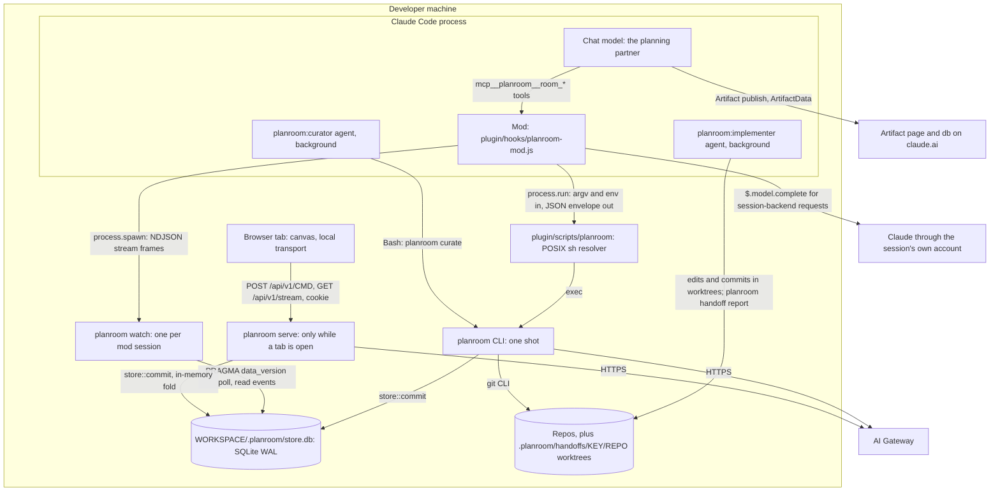
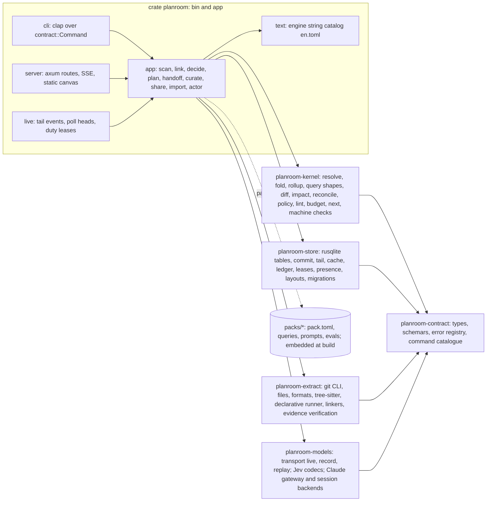
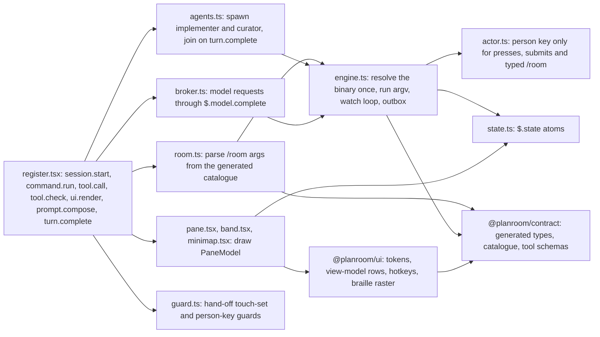
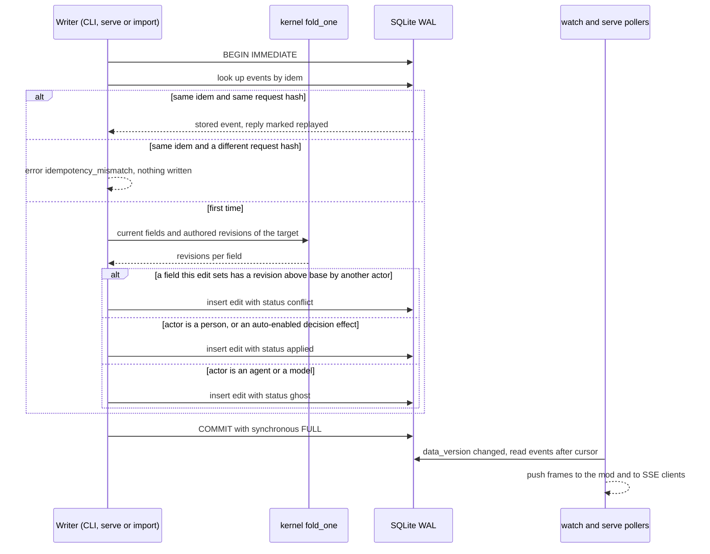
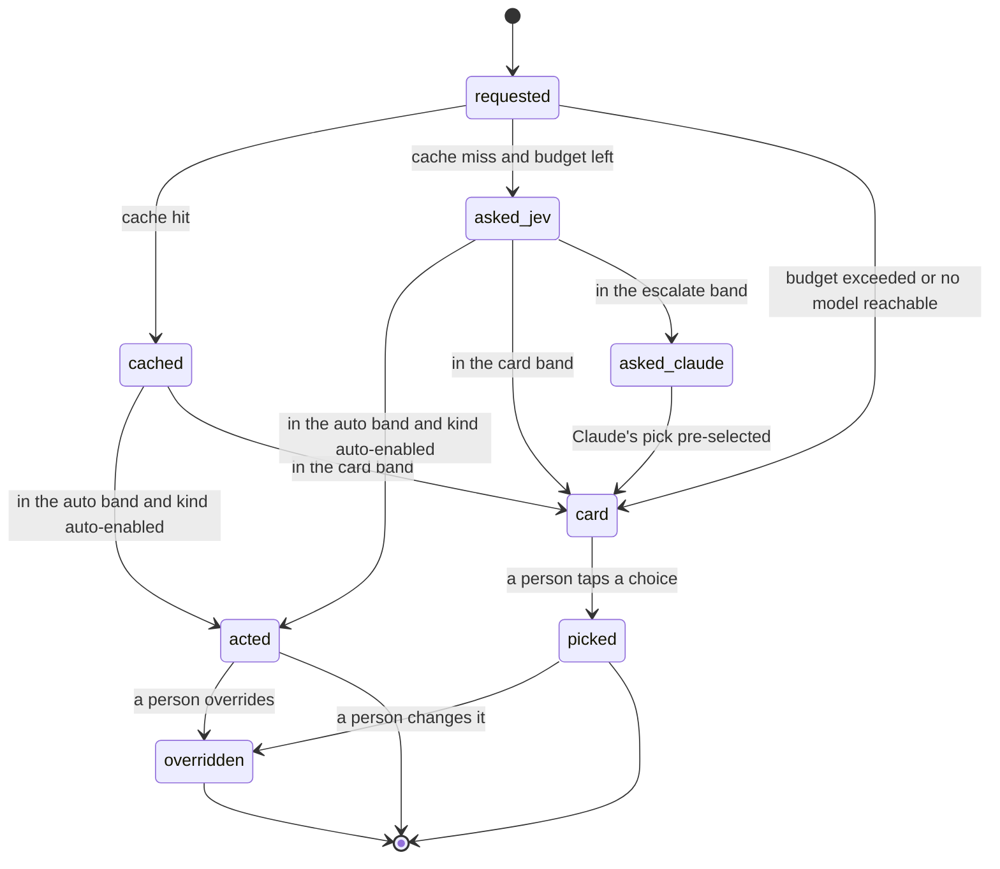
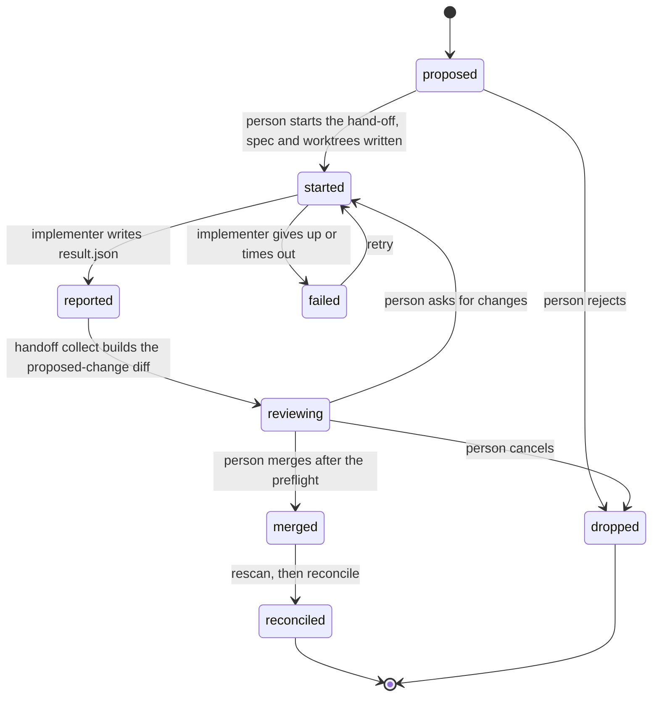

# Architecture

This page describes what Planroom is built from and why: the processes, the data and event model, packs, decisions, diffs and hand-off, the surfaces, security, and the build plan from the walking skeleton through milestone M5. It's the contributor's map; the decisions behind it live in [Decisions](decisions.md), every public shape in [Contracts](contracts.md), and the directory map and boundary rules in [Repo layout](repo-layout.md).

## How to read this page

- This is the Phase 2 synthesis of three candidate architectures (simplicity-first, extensibility-first, concurrency- and agent-first) after three independent judges scored them. It starts from the simplicity candidate, which two of three judges ranked first, and grafts in the runners-up's ideas the judges named. Every departure and every resolved disagreement is a numbered record in [Decisions](decisions.md), cited here as `[DR-n]`.
- Research is cited as `[note §n]` for the Phase 1 notes in `docs/contributing/research/`, and `[TRUTH path]` for `examples/TRUTH.json`.
- `[A]` marks an assumption the walking skeleton must check. The full list is in [Assumptions to verify](#assumptions-to-verify).

## The design on one page

Planroom is one Rust binary over one SQLite file per workspace.

- The file holds two kinds of truth:
  - **facts**: the nodes, edges and hints that extractors observe in git at a commit, which can be recomputed at will;
  - **events**: everything a person, agent or model authored, append-only.
- Everything else is a pure kernel function of those two, computed on read: the map at every level, plans, ghosts, diffs, reconciliation and open decisions.
- Every engine process writes through one function, `store::commit`. It runs one SQLite `BEGIN IMMEDIATE` transaction with a field-level compare-and-set and an idempotency check. SQLite is the single writer, so correctness needs no daemon [DR-1].
- `planroom serve` exists only because a browser can't spawn a process. The mod reaches the engine the way an agent does, through the CLI [DR-6].
- Packs are data, never code. Extractors and linkers are either built-in Rust adapters that a pack declares, or declarative regex and tree-sitter queries inside a pack [DR-9].
- One command catalogue, defined once in Rust, generates the CLI, the HTTP API, the mod's tools and the `/room` family [DR-14].
- Who wrote something decides what it means. A person's edit applies; an agent's or a model's edit is a ghost until a person accepts it; some commands only a person can run [DR-4].

### Moving-parts budget

Each part names the requirement that pays for it.

| Moving part | Count | Names | Paid for by |
|---|---|---|---|
| Binaries | 1 | `planroom` | R13, R14 (one CLI entry point) |
| Long-lived engine processes | 0 required, 2 optional | `planroom watch` (one per mod session), `planroom serve` (only while a browser tab is open) | R10 live updates; R13 canvas |
| Stores | 1 per workspace | `WORKSPACE/.planroom/store.db` | R6, R10 |
| Rust crates | 7, plus `xtask` | `planroom-contract`, `-kernel`, `-store`, `-extract`, `-models`, `planroom`, `planroom-testkit` (dev-only) | R16: one crate per boundary CI enforces |
| TypeScript packages | 4 | `@planroom/contract` (generated), `@planroom/ui` (tokens and view-model, no DOM), `@planroom/canvas`, `@planroom/mod` | R13, R16 |
| Contract sources | 1 crate, 1 schema in 2 views, 1 version integer | `schema/planroom.v1.schema.json`, `schema/planroom.v1.input.schema.json` | constraint "one contract source" |
| Fact shapes | 4 | `Node`, `Edge`, `Evidence`, `Hint` | R11 (a domain-free core that extends into a graph) |
| Event kinds | 8 | `edit`, `review`, `undo`, `version`, `decision`, `claim`, `scan`, `handoff` | R6 to R10 |
| Ways to write the store | 1 | `store::commit` | R10 |
| Ways to change a repo | 1 | hand-off, with two implementers: `agent` and `patch` | R8, R12, S5 |
| Tool wiring paths | 1 | mod tools that call the CLI; no MCP server | R13 |
| Extractor kinds | 2, plus built-in linkers | built-in (Rust adapter), declarative (pack query) | R1, R11, S10 |
| Kernel roles | 3 | `rescan.retarget`, `reconcile.residual`, `attach.target` | R11 (kernel names no pack kind) |
| Concepts a person learns | 5 | Levels, Lenses, Intent, Diffs, Decisions | R14 |

### Biggest bets

| # | Bet | Proof | Fallback |
|---|---|---|---|
| 1 | Multi-process SQLite (WAL, `BEGIN IMMEDIATE`, `synchronous = FULL`, 5 s busy timeout) instead of a single-writer server | WS4 spike, then S8 | route CLI writes through `serve` when it runs, over the same catalogue; no contract change |
| 2 | Compute on read: only facts and events are stored, folded per request | `cargo bench fold` budget in `budgets.json` | a persisted fold cache keyed by `seq`, inside `planroom-store` |
| 3 | The mod reaches the engine only through the CLI (`$.process.run`, plus `$.process.spawn` of `planroom watch`) | WS5 | `$.http.fetch` over `serve`'s socket with the same catalogue |
| 4 | The git CLI is the only git adapter | fastest measured history walk [rust-stack §6]; WS3 | `gix` behind the same module |
| 5 | Hints plus built-in linkers produce every relation the truth lists, with full evidence | S1 truth comparator from M1 | an infeasibility record per KICKOFF for any one evidence item [DR-12] |

## Requirements to capabilities

Each capability gets a short name, used again in later sections and in [Traceability](traceability.md).

| Req | Capabilities |
|---|---|
| R1 Point it at work | `discover` (a repo, or a directory of repos, with no config); `scan` (extractor pipeline per repo at `HEAD`, then linkers across the workspace); `tiers` (universal for every repo, syntactic for TS, JS, Python, Go and Rust, config formats, declarative patterns for any other language); `ids` and aliases; `levels` (five, one parent each); `rollup` (lift edges with counts and evidence); `default-lens`; `next` (one suggested action); `find`; `fresh` (rescan when a head moves) |
| R2 Relationships | `lens` (relation kinds with a flow direction); `path`, `why`, `impact`, `neighbors` query shapes; `evidence` and `confidence` and `provenance` on every edge; `confirm` and `reject` as edits; `history` (co-change, ownership); plan links (`touches`) |
| R3 Break down artifacts | `detect` (artifact kind from path and shape); `section` (headings, XML-like tags, frontmatter, YAML keys, review threads); part relations through Jev; `missing` (declared required parts); Claude segmentation only when no structure exists; `pr` breakdown with threads and touched components |
| R4 State machines | `machine` extraction from code, docs and prose; `checks` (unreachable, dead end, missing transition, nondeterminism); `drift` through the one diff engine; `step` |
| R5 Intent, top down | `plan` pack with seven stages and their methods; `propose` (AI output lands as ghosts); `review` (person only); `lint` (structural rules plus Jev kinds); `attach`; stage jumps; `version` |
| R6 Tweak everything | `edit` (`put`, `set`, `retract`) on stable IDs, re-applied on every fold; field-level authored revisions; `pin`; `hide`; breakdown text edits; `undo` for every edit type |
| R7 Diffs and reconciliation | one `diff` function and type over two model slices; three sources (versions, layers, proposed change) plus text and machine drift; `impact-radius`; `reconcile` with five classes |
| R8 Hand-off | `spec`; engine-made worktrees per touched repo; `agent` and `patch` implementers; `collect` as a proposed-change diff; person-only `merge` with a preflight across repos; reconcile after merge; a guard on the chat session's own edits |
| R9 Cheap decisions | kinds declared in packs; kernel roles; Jev adapter with two codecs; Claude adapter with gateway and session backends; policy bands; cache; ledger and budgets; every decision recorded and overridable; held-out evals |
| R10 Many at once | `commit` (multi-process, serialized); `cas` (field level, base required); `idem` with request hash; `actor` rules; projects; claims; presence; `live` stream within 1 s; mod outbox |
| R11 Extensible domains | domain-free kernel; packs as data that may require only `code`; six v0.1 packs; out-of-tree packs by path; question pipelines including `fires-if` and `bump-breaks` |
| R12 Context curation | run history; miners for gotchas, procedures and stale lines; template drafts refined by Claude or the curator agent; proposals as text diffs through the `patch` hand-off; triggers |
| R13 Surfaces | mod (pane, band, `/room`, tools, agents, mini-map); canvas (local and as an Artifact); CLI and server; shared view models with engine-authored strings; one plugin |
| R14 Tiny surface | five top-level ideas; one binary; one `room` command; generated help; defaults instead of settings; skills hidden from the slash menu |
| R15 Releasable | the Iris bar: docs taxonomy and style tests, CI jobs, release workflow, schemas and drift tests, changelog, templates, Dependabot, security policy, code of conduct, art |
| R16 Designed repo | directory map with an `AGENTS.md` or README per area; one `boundaries.toml` that generates both the Rust and the TypeScript checks; marked generated directories; `cargo xtask` as the one entry point; conventions in `AGENTS.md`; a decision-record gate |

## C4 context


## C4 containers

Every process, store and boundary. The developer machine is the only place that holds secrets.



### Processes and boundaries

| Process | Started by | Lifetime | Reads and writes | Boundary it crosses |
|---|---|---|---|---|
| `planroom <cmd>` | an agent's Bash, a skill, the mod's `process.run`, CI | one command | `store.db` through `store::commit`; repos through the git CLI; HTTPS to the gateway for a decision or Claude call | process (argv, env, stdout), file, network |
| `planroom watch --session ID` | the mod in `session.start`, with `$.process.spawn` | dies on reload or session end by design [mod-api §7]; the mod restarts it from the last `seq` in `$.state` | polls `PRAGMA data_version` every 200 ms; writes presence every 10 s; runs duties under a lease | process (NDJSON on stdout) |
| `planroom serve` | the pane's `e` key, `/room open`, `planroom serve --detach`, the e2e harness | detached (`setsid`), idempotent through `.planroom/serve.json`; exits after 30 min with no client, or when a newer engine asks it to drain | the same store API; keeps the folded `Model` in memory | TCP on `127.0.0.1` with a cookie session |
| Claude Code with the mod, chat, implementer and curator | the person | session | the mod calls only the resolver; agents use Bash and file tools in worktrees | process |
| Browser tab | the person | tab | HTTP and SSE to `serve` | loopback TCP |
| Artifact page | the person, on claude.ai | view | `data/snapshot.json` (published file); `db` `live/head` and `inbox/{self}` | claude.ai; never reaches localhost [artifact §5] |
| AI Gateway, TypeSafe API | | | HTTPS from the engine only | network |

#### Duties

Duties are background work any live process may do: a rescan when a repo head moves, a decision run on pending requests, and the curation trigger. A process does a duty only while it holds the lease named for it, such as `scan:orders` or `decide:<requests hash>` (a row in `leases` with a 30 s expiry, renewed while it works). So two sessions never rescan the same repo at once, duplicate triggers join one run, and work survives any one process dying. When no live process exists (CI, an agent using only the CLI), the same work runs inline in `planroom decide --run` or the next command's freshness check.

## C4 components

### Engine

Library crates depend only on `planroom-contract`. Only the `planroom` crate composes them. `planroom-testkit` is a dev-dependency only. That is the whole Rust boundary, generated from `boundaries.toml` (see [Repo layout](repo-layout.md#boundaries-and-their-enforcement)).



### Mod



### Canvas

`packages/canvas/src/`: `main.tsx`; `transport/local.ts` (fetch and `EventSource`) and `transport/artifact.ts` (published data file and `db`), behind one `Transport` interface; `store.ts` (zustand); `views/` (`MapView`, `Focus`, `PathView`, `DiffTray`, `DecisionStack`, `PlanBoard`, `Anatomy`, `Machine`); `layout/elk.worker.ts`; `motion.ts`. Design tokens and view-model rows come from `@planroom/ui`, the same code the mod uses.

## Main flows

1. **Cold scan (S1).** `planroom scan DIR` finds the workspace, creates `.planroom/`, and resolves each repo's `HEAD`. It runs the extractors the loaded packs declare, in parallel across repos, then the linkers across the workspace. It verifies every evidence item against its line, writes one snapshot of facts per repo plus a workspace link snapshot, and appends one `scan` event per repo, all in one transaction. It returns `MapView` at the top level with the default lens, plus `next`. Pending decisions don't block it: they run as a duty, or in `planroom decide --run` [DR-24].
2. **Read anywhere.** Each command first checks freshness: it compares each repo's `HEAD` and refs (a few small file reads) with its active snapshot, and rescans what moved, using only cached decisions. It folds facts and events in the kernel and shapes the result to the command's size budget.
3. **Edit (S4, S8).** A writer sends `base`, the `seq` of the view it read. In one `IMMEDIATE` transaction, `store::commit` checks the idempotency key, folds the target, and compares the authored revision of every field the edit sets with `base`. The actor decides the status: a person's edit applies, an AI's edit is a ghost. A stale write is stored as a conflict, never merged and never lost. The committed `seq` reaches every `watch` and SSE client within one 200 ms poll.
4. **Mod refresh.** A frame arrives on `watch` stdout. After 250 ms of quiet the mod runs `planroom focus --json` and writes the `PaneModel` into `$.state`. The pane and band redraw because they read that atom.
5. **Decision.** Requests are derived from the model: subjects matching a pack decision's `when`, with no decision recorded for their current input hash. The runner groups them by slice, checks the cache, then sends one Jev request per slice. Policy then acts, deals a card, or escalates to Claude. Each outcome is a `decision` event; any action is an `edit` with `cause` set to it.
6. **Hand-off (S4).** A person runs `handoff start KEY` (the approval). The engine writes `.planroom/handoffs/KEY/spec.json` and makes one worktree per touched repo on branch `planroom/KEY`. The mod spawns `planroom:implementer` there; CI uses the `patch` implementer. `handoff collect` scans the branch heads as proposed-change snapshots and returns the `Diff`. A person runs `handoff merge`, which preflights every repo and then merges each branch; the rescan and reconciliation close the item.
7. **Remote (S11).** `/room share` builds the Artifact bundle; the chat model makes the one publish call. A viewer's edit lands in `db` at `inbox/UID/events/ID`. `/room sync` has the model list the inbox into a directory, then `planroom import` commits each row as an attributed person edit through the same compare-and-set.

### The write path



## Data and event model

### Two records

| Record | What it is | Who writes it | Mutable? | Where |
|---|---|---|---|---|
| Fact | A `Node`, `Edge` or `Hint` observed by an extractor or produced by a linker, in one repo at one commit, with evidence | extractors and linkers, during a scan | Never edited. A scan writes a new snapshot. | `facts`, grouped by `snapshots` |
| Event | Anything a person, agent or model authored: edits, reviews, undos, versions, decisions, claims, scan markers, hand-off steps | `store::commit` only | append-only | `events` |

Everything else is derived and never stored: the merged model, levels and roll-ups, ghosts, conflicts, plan state, diffs, reconciliation classes, open decisions and the next action. So derived state never needs migrating or repairing. The only caches are model responses (paid), auto-layout positions (1.1 to 1.5 s of ELK work [ts-stack §1]), and the in-memory fold that `serve` and `watch` keep [DR-2].

### Shapes

These four shapes are the whole graph. Packs add kinds, never fields. Pack-specific data goes in `props`, validated against the prop schema the pack declares for the kind. Full sketches are in [Contracts](contracts.md#graph-model).

| Shape | Fields | Notes |
|---|---|---|
| `Node` | `id`, `kind`, `level`, `parent`, `name`, `aliases`, `props`, `layer`, `provenance`, `evidence` | one parent; `kind` is `<pack>.<name>` |
| `Edge` | `id`, `kind`, `from`, `to`, `via`, `via_ref`, `props`, `evidence`, `confidence`, `layer`, `provenance` | `from` and `to` are an ID or an alias; `via_ref` points at a node whose evidence also counts for the edge, such as an endpoint |
| `Evidence` | `path`, `line`, `contains`, `commit`, `branch` | `contains` is the exact line, cut to 200 characters; verified at ingest |
| `Hint` | `kind`, `scope`, `key`, `value`, `attrs`, `evidence` | a partial observation that a linker joins with others, such as a URL literal or an environment read [DR-12] |

### IDs and aliases

- **Nodes:** `<namespace>:<kind-short>:<key>`. The namespace is the repo name, `ws` for workspace-level things with no repo (`ws:container:redis`), or `plan` for plan items (`plan:<project>:<key>`). Examples: `storefront:dir:src/cart`, `orders:pkg:internal/http`, `orders:container:orders`.
- **Edges:** `e:` plus 12 hex characters of `sha256(kind ‖ from ‖ to ‖ via)`, so an edge keeps its ID across rescans while its endpoints and `via` hold.
- **Groups made by hand** (the S4 `purchase` group): `<ns>:group:<slug>`, kind `kernel.group`. With `kernel.external` (third-party things no repo holds), these are the only two kinds the kernel defines.
- **Aliases** let one extractor point at what another defines without knowing its ID. Compose gives service `orders` the aliases `host:orders` and `service:orders`; a URL literal `http://orders:8080/healthz` then resolves to `orders:container:orders` [TRUTH scenarios.S10.ruby.calls]. An ambiguous alias resolves to nothing, and the edge is reported as an `unresolved_ref` warning, never guessed.
- **Suffix and name lookups.** Commands accept a full ID, an ID suffix (`src/cart`) or a bare name (`worker`). A name resolves at the command's level first (the lens's default level for questions, the map's level for `map`), then upward, then downward. Several matches at the first level that has any return `ambiguous_ref` with the candidates in `details` [DR-21]. So `planroom ask path storefront worker` means the two containers.

### Levels and roll-ups

- Five fixed levels, ordered: `Intent`, `System`, `Container`, `Component`, `Code`. They are the kernel's vocabulary for "where I am" (R14 Levels), not a domain. Each pack maps its kinds to a level:
  - plan items sit at `Intent`;
  - the workspace and repos sit at `System`;
  - services, datastores, queues, libraries and tooling sit at `Container`;
  - packages, directories, API specs, alert rules, documents and machines sit at `Component`;
  - files, sections, states, endpoints and commits sit at `Code`.
- **One parent per node.** A regroup is a `set parent` edit, so moving `storefront/src/cart` under `purchase` changes nothing else.
- **Merging facts.** When two extractors emit the same node ID, evidence unions and scalar fields take the more specific tier's value (precise, then syntactic, then config, then pattern, then universal). So the Ruby pattern can move `platform/tools/healthcheck.rb` under its `healthcheck` container while the universal tier still sees the file [TRUTH components].
- **Roll-up** (`kernel::rollup::lift(model, level, lens)`): each edge whose kind the lens includes is lifted to the nearest ancestor of each end at or above `level`. Lifted edges with the same `(from, to, kind)` merge into one `LiftedEdge { kind, from, to, count, evidence_sample (at most 3), children }`.
  - Faithfulness is an invariant: `count == children.len()`, and lifting then expanding gives back exactly the original edge set. A property test checks it over the fixture and over random trees.
  - Edges inside one ancestor become that ancestor's `internal` count, not self-loops. Hidden nodes drop out with their edges counted under `hidden`, so a hide shows as "3 hidden", never as a silent loss.

### Layers, overrides and ghosts

| Concept | Representation | Effect on the fold |
|---|---|---|
| Actual layer | facts from each repo's active snapshot, plus the workspace link snapshot | the base of the model |
| Intended layer | `edit put` events with `layer: Intended`: intended nodes, required edges, and boundary rules (`props.rule` is `require`, `forbid` or `allow-only`) | kept beside the actual layer; drift is `diff(intended, actual)` |
| Override | `edit set` on an actual node or edge: `parent`, `name`, `hidden`, `pos@VIEW`, `props.*` | applied over the fact on every fold, so a rescan can't drop it |
| Rejection | `edit retract` on an actual edge ("A doesn't depend on B") | hidden from questions and reconciliation, listed in Diffs as a rejected inference; survives rescans because it targets the stable edge ID |
| Confirmation | `review accept` on an inferred edge | `provenance` gains the confirming actor |
| Ghost | any `edit` whose actor is an agent or a model, except the effect of a decision kind whose auto-action is enabled and the output of an `infer` prompt on the actual layer | drawn translucent; listed in Decisions as one batch per cause (one chat turn or one plan stage run); excluded from questions, lint and reconciliation until a person's `review accept` (R5) [DR-4] |

An `infer` output (segmentation, prose machines) applies as an inferred fact with its confidence, for a person to confirm or reject (R2). It describes the actual system, so it isn't a proposal.

### Events

```rust
pub struct Event {
    pub seq: u64,                 // SQLite rowid: one global order, the stream cursor and the version
    pub id: EventId,              // uuid v7
    pub idem: String,             // idempotency key, UNIQUE
    pub request_hash: String,     // sha256 of the canonical request; same idem with another hash is refused
    pub at: Timestamp,
    pub actor: Actor,             // Person | Agent | Model | System
    pub project: Option<NodeId>,
    pub cause: Option<Cause>,     // Event(EventId) | Turn(String) | Duty(String)
    pub status: Status,           // Applied | Ghost | Conflict | Open | Closed
    pub body: EventBody,          // Edit | Review | Undo | Version | Decision | Claim | Scan | Handoff
}
```

- Eight event kinds, and only `edit` changes the graph. Everything a person can do on the map is one of three operations (`put`, `set`, `retract`) on one target. So undo, conflicts, ghosts and attribution are one mechanism each, not one per edit type [DR-3].
- An edit's `status` is set at commit time and changed later only by `review` and `undo` events, which the fold reads.

### The fold

`kernel::fold(facts, events, packs, at) -> Model` is pure and deterministic:

1. **Snapshot set.** For each repo, the active snapshot at `at` is the one named by its last `scan` event with `seq <= at`. The workspace link snapshot is the one built from those.
2. **Resolve.** Build the alias index, resolve every reference, validate kinds and props against the packs (unknown kinds drop with a warning), attach parents.
3. **Pre-pass.** Collect `undo` targets and the latest `review` per event, so undone and rejected edits are skipped in one pass.
4. **Apply** every edit with effective status `Applied` (and `Ghost` into the ghost overlay), in `seq` order: `put` inserts, `set` overrides fields, `retract` hides.
5. **Scan drift on overrides.** For each applied `set` on an actual-layer target, compare the fact value it was made over (recorded in the edit's `over` field) with the fact's current value. A difference adds a `ScanChangedUnderEdit` item to Diffs, with "keep yours" pre-selected. The override stays applied: a scan never silently overrides a person's edit (R6). A target that vanished raises the decision bound to the `rescan.retarget` role.
6. **Indexes.** Children, a petgraph `StableGraph` for the query shapes, plans per project, open claims, open decisions.

`serve` and `watch` keep `(Model, seq)` and apply only events after `seq`; a `scan` event refolds only the affected repo's subtree. One-shot commands fold from scratch. Budget: under 50 ms at 20,000 facts and 5,000 events, tracked in `budgets.json`.

### Versions and revisions

- **A version is a sequence number.** `seq` is global and monotonic, and every change to the model, scans included, has one. "The model at version N" is `fold(at = N)`.
- **Authored revision.** For each target and field, `rev(target, field)` is the `seq` of the last applied event that set it, and its actor. Scans never change authored revisions, so a background rescan never makes a person's pending edit stale [DR-5].
- **Plan versions** (S3) are `version` events, tags on `seq`. Version 1 is tagged automatically when a project's first accepted batch lands; later versions are a person's `intent version LABEL`. A plan diff is `diff(fold(at = v1).project(p), fold(at = v2).project(p))`.
- **Model versions** are scans. Old snapshots stay while a `version` event or an open diff refers to them; others are pruned after the last 20 per repo.

### Writes: actors, base, conflicts and retries

#### Actors

The engine resolves who is writing before anything else [DR-4]:

| Actor | Granted when |
|---|---|
| `person:<os-user>` | the CLI runs with stdin and stdout on a TTY and no `PLANROOM_ACTOR`; or the call carries `PLANROOM_PERSON_KEY` equal to `.planroom/person.key` (the mod adds it only for a button press, an input submit, or a `/room` the person typed; the test harness adds it to act as a person); or a canvas request with a session cookie |
| `person:artifact:<uid>` | an imported Artifact inbox row; the `{self}` path segment proves the author [artifact §2] |
| `agent:<session8>:<role>` | `PLANROOM_ACTOR=agent:...` (the mod's tool handlers always send it); or a CLI call with no TTY and no person key (`agent:cli`) |
| `model:<id>` | a Jev or Claude result applied by the engine |
| `system:<part>` | scans, duties |

- A `PLANROOM_ACTOR` that names a person is refused with `person_required` unless the person key is present.
- The mod's `tool.check` guard denies Bash, Read and Grep calls that touch `.planroom/person.key` or `serve.json`, or set `PLANROOM_PERSON_KEY`. This is a guardrail for "AI proposes, person disposes", not a security boundary between processes of one OS user, and `SECURITY.md` says so.

#### Actor rules

Each catalogue command declares `any` or `person_only`. Person-only: `decide` (picking a card choice or overriding a decision), `handoff start` (the approval), `handoff merge`, `handoff cancel`, `intent version`, and `review` of ghosts and inferred facts (an agent may reject only its own ghosts). An agent that tries one gets `person_required`, with the card ID a person can tap.

#### Base

Every write to user-authored state carries `base`, the `seq` of the view the writer acted on. HTTP and tool calls must send it; a missing base is `base_required` [DR-5].

- The canvas sends the `seq` of the view it rendered. The mod's tool handlers default `base` to the latest `meta.seq` returned to the model in the same turn, else to the pane's `seq`.
- A non-TTY CLI call must pass `--base SEQ` (from the `meta.seq` it read). A person at a TTY gets a read-then-write: the CLI reads the target, prints what it's changing and at which `seq`, and commits with that base.
- `put` of a new ID needs no base. A `put` on an existing ID with different content is a conflict that keeps both.

#### Conflicts

A write conflicts when a field it sets has `rev > base`, written by a different actor. The edit is stored with `status: conflict` and nothing is merged. What happens next depends on who wrote it [DR-7]:

| Writer | Result |
|---|---|
| Person (canvas, mod, TTY, Artifact) | error `stale_write`; a three-way card (`base`, `theirs`, `yours`) in Decisions with "theirs" pre-selected: "Bob renamed this to Bag 2 s ago. Keep Bag / Use Basket" |
| Agent or model | error `stale_write` with a compact three-way diff (at most 1 KB) in `details`; the conflict is listed in Diffs under "agent retries", collapsed; no card. The agent re-reads and retries. |

Choosing "yours" is a `review accept` that re-applies the edit with a fresh base. An actor never conflicts with its own later writes. Only presence, leases and the layout cache are last-writer-wins, and none of them is user-authored.

#### Idempotency and retries

Retries are safe because of these rules [DR-8]:

- Every write carries `idem`. If the caller gives none, the engine derives `sha256(actor ‖ command ‖ canonical(args) ‖ base)`. Tool calls use the tool call ID when the mod has one [A].
- The event stores `request_hash`. The same `idem` with the same hash returns the stored reply with `meta.replayed: true`. The same `idem` with a different hash is `idempotency_mismatch`, so a client bug never silently replays the wrong result.
- The mod writes `{idem, argv, env}` to a `$.state` outbox atom before each write and clears it on reply. After a reload, `session.start` resends the outbox with the same keys.
- Artifact edits use the document ID the page mints, so a re-import is a no-op.
- Read-your-writes needs no token: every process reads the same SQLite file, and `serve` checks `data_version` before serving from its in-memory fold.

### Claims, presence and projects

- **Claims** are `claim` events with an expiry: "I'm working on `worker` until 15:30". A write to a claimed target succeeds and carries a `claimed` warning naming the holder. Claims warn and never block. A hand-off claims its touch set for the implementer.
- **Presence** is the `presence` table: `{actor, surface, doing, focus, seen_at}`, written every 10 s by each `watch` (for its session and the agents the mod tracks through `$.agent.list()`), each SSE client, and each agent CLI call (`doing` is the command's one-line summary). An actor shows as present for 30 s after its last write.
- `planroom who` and `PaneModel.who` merge the two: "Carol's session is planning Add retries; implementer worker-status-via-api is editing worker and platform; a canvas tab is looking at orders."
- **Projects** are plans (`plan:<project>`). All projects share one model of the system: facts, workspace overrides and the intended layer. Plan items, versions and project views are project-scoped, and events carry `project`. Approving project A's intended change makes project B's view show drift if B attaches to anything in A's impact radius.

### Store schema

```sql
PRAGMA journal_mode = WAL;  PRAGMA synchronous = FULL;  PRAGMA foreign_keys = ON;  -- busy_timeout = 5000 per connection
CREATE TABLE meta      (key TEXT PRIMARY KEY, value TEXT NOT NULL);   -- workspace_id, store_version, created_at, engine_version
CREATE TABLE events    (seq INTEGER PRIMARY KEY AUTOINCREMENT, id TEXT NOT NULL UNIQUE, idem TEXT NOT NULL UNIQUE,
                        request_hash TEXT NOT NULL, at TEXT NOT NULL, actor TEXT NOT NULL, project TEXT, cause TEXT,
                        kind TEXT NOT NULL, target TEXT, status TEXT NOT NULL, body TEXT NOT NULL);
CREATE INDEX events_target  ON events(target, seq);
CREATE INDEX events_project ON events(project, seq);
CREATE TABLE snapshots (id INTEGER PRIMARY KEY, repo TEXT NOT NULL, commit_id TEXT NOT NULL, branch TEXT NOT NULL,
                        purpose TEXT NOT NULL,           -- head | link | proposed:<handoff> | runs | file:<path>
                        packs_hash TEXT NOT NULL, UNIQUE (repo, commit_id, purpose, packs_hash));
CREATE TABLE facts     (snapshot INTEGER NOT NULL REFERENCES snapshots(id) ON DELETE CASCADE, id TEXT NOT NULL,
                        shape TEXT NOT NULL, kind TEXT NOT NULL, hash TEXT NOT NULL, body TEXT NOT NULL,
                        PRIMARY KEY (snapshot, id));
CREATE TABLE fact_rev  (id TEXT PRIMARY KEY, hash TEXT NOT NULL, changed_seq INTEGER NOT NULL);
CREATE TABLE model_cache (key TEXT PRIMARY KEY, provider TEXT NOT NULL, model TEXT NOT NULL, response TEXT NOT NULL,
                        usage TEXT NOT NULL, at TEXT NOT NULL);
CREATE TABLE ledger    (id INTEGER PRIMARY KEY, at TEXT NOT NULL, provider TEXT NOT NULL, model TEXT NOT NULL,
                        purpose TEXT NOT NULL, scope TEXT NOT NULL, uncached_in INTEGER, cache_read INTEGER,
                        cache_write INTEGER, output INTEGER, cost_usd REAL, prefix_hash TEXT, replayed INTEGER NOT NULL);
CREATE TABLE leases    (name TEXT PRIMARY KEY, holder TEXT NOT NULL, expires_at TEXT NOT NULL);
CREATE TABLE presence  (actor TEXT PRIMARY KEY, surface TEXT NOT NULL, doing TEXT, focus TEXT, seen_at TEXT NOT NULL);
CREATE TABLE layouts   (view_key TEXT NOT NULL, structure_hash TEXT NOT NULL, positions TEXT NOT NULL,
                        PRIMARY KEY (view_key, structure_hash));
```

Ten tables. Migrations are numbered SQL files applied by `user_version`. Only `events` and `ledger` need care across versions, because facts rebuild by rescanning. A migration that touches `events` ships with a fixture database from the previous release and a test that opens it. `planroom export` writes events as NDJSON in the contract's `Event` shape, the escape hatch for upgrades and backups (`planroom import` replays it). The store contract is in [Contracts](contracts.md#store-schema-and-migrations).

### Where the workspace lives

- The nearest ancestor of the working directory with `.planroom/` is the workspace root; without one, the given or current directory is.
- The repos are the root itself if it's a git repo, else its immediate child directories that are git repos. The fixture's `OUT/{storefront,orders,worker,kit,platform}` is a five-repo workspace with no config.
- `.planroom/` holds `store.db`, `config.toml` (optional), `person.key` (mode 0600), `serve.json` (port, pid, version, drain token; mode 0600), `handoffs/`, `share/`, `models/` (pending session-backend requests), and a `.gitignore` of `*`.

## Packs and extractors

Three words, three meanings:

- The **kernel** is the domain-free core (`planroom-kernel`).
- A **pack** is a directory of data that plugs a domain in. It never contains code.
- An **adapter** is Rust code that connects the engine to something outside it: git, file formats, tree-sitter, linkers (`planroom-extract`), Jev and Claude (`planroom-models`), SQLite (`planroom-store`).

### What a pack is

```text
packs/<id>/                     (or any directory outside the tree, for an out-of-tree pack)
  pack.toml                     validated against PackFile in the input schema
  languages/*.toml              more [[extractors]], one file per language, merged at load
  queries/*.scm                 tree-sitter queries for built-in grammars
  prompts/*.md                  Claude stable prefixes, each at least 1,024 tokens or explicitly uncached
  evals/<kind>.cases.jsonl      labelled eval cases per decision kind
  evals/<kind>.result.json      GENERATED by eval runs; never hand-edited
  tests/                        inputs and expected facts for the pack conformance kit
  README.md                     what it covers, what it requires, how to test it
```

| Section of `pack.toml` | Fields | Used for |
|---|---|---|
| header | `format = "planroom.pack/v1"`, `id`, `version`, `title`, `requires` (only `["code"]` or `[]`) | identity; the inward-only rule |
| `[[kinds]]` | `id`, `level`, `label`, `parents`, `props` (JSON Schema fragment), `icon`, `empty_text`, `empty_action` | node kinds |
| `[[relations]]` | `id`, `from`, `to`, `label`, `inferred` | edge kinds |
| `[[hints]]` | `id`, `attrs` | hint kinds a linker consumes |
| `[[extractors]]` | `builtin = NAME` with `files` and `options`, or `files`, `language`, `regex` or `query`, and `emit` | facts |
| `[[linkers]]` | `builtin = NAME`, `options` | cross-repo joins of hints into edges |
| `[[lenses]]` | `id`, `label`, `relations`, `flow` per kind, `level`, `default`, `empty_text`, `empty_action` | R2 lenses, the default view |
| `[[questions]]` | `id`, `steps` (one to three query shapes), `summary` template | S2 and R11 questions, the `ask` command |
| `[[rules]]` | `id`, `type` (`requires_prop`, `requires_edge`, `min_children`, `forbid_edge`, `covers`), `kind`, parameters, `message` | structural lint, missing artifact parts, boundary checks |
| `[[decisions]]` | see [Decisions](#a-decision-kind) | Jev and Claude decision kinds, optionally bound to a kernel role |
| `[[suggestions]]` | `when`, `text`, `action`, `priority` | candidates for the one next action |
| `[[prompts]]` | `id`, `file`, `tier` (`cheap` or `capable`), `role` (`infer` or `propose`), `output` | engine Claude calls |
| `[[stages]]` | plan pack only: `id`, `method`, `kinds`, `prompt`, `lint` | R5 stages |

Packs load in a fixed order: built-in packs (embedded at build time by `crates/planroom/build.rs`), then each path in `.planroom/config.toml` `packs = [...]`, then `PLANROOM_PACKS` (colon-separated). Loading parses TOML, validates against the input schema, checks references, and fails with `pack_invalid`, naming the file, the line and the reference. `planroom doctor --pack DIR` runs a pack's conformance kit: validation, every extractor over `tests/inputs/`, a comparison with `tests/expected.jsonl`, a second run to prove determinism, and eval file validation. CI runs it on every pack under `packs/` and `examples/packs/` [DR-10].

### The extractor contract

An extractor turns files of one repo at one commit into a `FactBatch` of nodes, edges and hints. Every rule below is checked by `extract/tests/contract.rs`, which runs every extractor over the fixture and over a fuzz corpus.

- **Deterministic.** The same commit gives byte-identical facts, sorted by ID.
- **Tolerant.** Error nodes and undecodable files never fail a scan; they become `partial` diagnostics [rust-stack §4].
- **Bounded.** Files over 1 MiB, binary files and ignored paths are skipped. Each extractor has 2 s per repo; one over budget is cut and reported.
- **Evidence or nothing.** Every fact carries at least one `Evidence` whose `contains` is the exact source line. At ingest, the engine checks each item against a line index of the blob at that commit and drops any that fail, with an `evidence_dropped` warning. This is the rule `TRUTH.json` uses, so tests and runtime agree on what evidence means [DR-21].
- **Code, not prose.** Code extractors take string literals and calls from syntax nodes, never from comments or docstrings. So the docstring in `worker/worker/orders_client.py` that mentions `orders-db` is not evidence [TRUTH scenarios.S4.post_handoff.notes].
- **References by alias.** Cross-file and cross-repo targets go out as aliases or hints, and the engine resolves them.

| Kind | Declared as | Implemented by | Examples |
|---|---|---|---|
| Built-in | `[[extractors]] builtin = "compose"` with `files` and `options` | a Rust module in `planroom-extract` | `files`, `git`, `manifest`, `compose`, `openapi`, `prometheus`, `grafana`, `otel_collector`, `gh_workflow`, `markdown`, `review_threads`, `implementer_runs` |
| Declarative | `files`, plus `regex` (any text file) or `language` and `query` (TypeScript, TSX, JavaScript, Python, Go, Rust), plus `emit` templates | the generic runner, `extract::declarative` | imports, URL and DSN literals, environment reads, HTTP routes and calls, queue operations, database opens, Go transition tables, Mermaid `stateDiagram`, OTel SDK use, Ruby (S10), feature flags (S10) |

`emit` templates create nodes, edges or hints from captures:

```toml
emit = [
  { node = "code.file", key = "$file" },
  { edge = "code.imports", from = "$file", to = "@alias:module:$1", via = "$1", confidence = 0.9 },
  { hint = "code.url", scope = "$file", key = "$1", attrs = { method = "GET" } },
]
# Variables: $file, $stem, $repo, $line, $1..$9 (regex groups), @name (tree-sitter captures).
# Targets: "@alias:...", an ID, or "@ext:NAME" (a workspace-level kernel.external node).
# The regex crate runs in linear time, so a pack can't stall a scan.
```

### Hints and linkers

Most relations the truth lists need evidence from several places at once: a client call, a compose environment line, the callee's route handler and the API spec path [TRUTH relations]. A single extractor sees one repo, so it emits hints, and built-in linkers join them across the workspace into edges [DR-12].

| Hint kind (code pack) | Attributes | From |
|---|---|---|
| `code.url` | `scheme`, `host`, `port`, `path`, `method` | string literals in code (not comments), compose environment values, Prometheus targets, Grafana data sources, Ruby literals |
| `code.env_read` | `name`, `default` (a same-file constant or literal) | `os.environ.get`, `getenv`, `process.env` |
| `code.env_set` | `service`, `name`, `value` | compose `environment` |
| `code.route_serve` | `method`, `path` | Go `mux.HandleFunc`, Express routes, OpenAPI paths |
| `code.route_call` | `method`, `path`, `base` | `fetch` templates, HTTP clients |
| `code.queue_op` | `op` (`publish` or `consume`), `key` (constants resolved in the file) | Redis `LPush`, `brpop` |
| `code.db_open` | `driver` | `pgxpool.New`, `psycopg.connect`, `sql.Open` |
| `code.sql` | `verb`, `table` | SQL string literals |
| `code.def`, `code.call` | `name` | function definitions and calls, for evidence that follows callers |

| Linker (declared by a pack) | Joins | Emits |
|---|---|---|
| `runtime_wiring` (code) | a `route_call` or `url` in container A whose host resolves to container B, with B's `route_serve` and spec paths; a `queue_op` in A with a `url` or `env_set` to a queue container; a `db_open` in A with a same-file database URL, or with an `env_read` of a name that compose sets on A to a database URL | `code.http` (with `via_ref` to B's endpoint node), `code.queue_publish`, `code.queue_consume`, `code.db` |
| `imports` (code) | import hints, module nodes, manifests | `code.imports`, `code.depends_on_package` |
| `deploys` (release) | compose images, repo manifests and tags | `release.deploys` with `uses` and `latest` |
| `telemetry` (observability) | exporter construction, OTLP endpoint `env_set`, scrape targets, alert selectors and `job` labels, dashboard queries | `observability.exports_telemetry`, `scrapes`, `watches`, `queries` |

- A linked edge carries the union of the evidence of the hints it joined, plus the call sites of the functions holding those hints, up to two hops within the container (`code.def` and `code.call` by name), and at most three call sites per hint. That is how `orders/internal/http/handlers.go:125` reaches the `orders -> redis` edge and `worker/worker/main.py:44` reaches the post-merge `worker -> orders-db` edge [TRUTH relations, scenarios.S4.post_merges].
- A database open whose DSN is a literal default (`os.environ.get("AUDIT_DSN", DEFAULT_AUDIT_DSN)` with `DEFAULT_AUDIT_DSN = "postgresql://...@orders-db:5432/orders"`) resolves by the literal's host when compose doesn't set the variable. That is how reconciliation sees the planted regression after the merges, from the code alone [TRUTH scenarios.S4.post_merges.relations_added_back].
- A linker that finds two candidate targets emits no edge and an `unresolved_ref` warning. It never guesses.
- Linkers are pure functions over hints, and their output is the workspace `link` snapshot, rebuilt whenever any repo's snapshot changes.
- **Endpoints as nodes.** `runtime_wiring` makes a `code.endpoint` node (Code level, under the container) for each served path, with evidence from the route handler and the spec. An `http` edge's `via_ref` points at it, and an edge's evidence includes its `via_ref` node's evidence. So an intended edge that doesn't exist yet (S4's `worker -> orders` `POST /orders/{id}/events`) already has callee evidence for the impact radius [TRUTH scenarios.S4.impact_radius.rule].

### The five starting tiers, mapped

| Starting tier | Here | Notes |
|---|---|---|
| 1 Universal: file tree, git history, manifests | built-in `files`, `git`, `manifest` | every repo, every language: a `System` node per repo, `Component` nodes per directory, `Code` nodes per file, plus co-change, ownership and churn. No repo gets nothing (R1). |
| 2 Syntactic: tree-sitter imports and calls | declarative queries in `packs/code/queries/` for TypeScript, TSX, JavaScript, Python, Go and Rust | 690 files/s on one thread [rust-stack §4]; the fixture's cold scan takes about 0.2 s against a 5 s target |
| 3 Precise: SCIP or LSIF | not in v0.1 [DR-11] | one more built-in reading an existing `index.scip`; no kernel change |
| 4 Config | built-in `compose`, `openapi`, `prometheus` (with `promql-parser`), `grafana`, `otel_collector`, `gh_workflow` | k8s and Terraform aren't needed by any scenario; each would be one more built-in |
| 5 Inference | not an extractor: decisions and `infer` prompts, whose results are events with `Provenance::Inferred` and a confidence | inferred facts are visible, attributed and reversible like any edit |

Artifacts follow the same order: deterministic `markdown` and `gh_workflow` sectioning first, then a Claude segmentation prompt only for documents with no structure, then Jev for part relations.

### A new language and an out-of-tree pack (S10)

#### Ruby through the extractor contract

Ruby has no built-in extractor [examples/README.md]. Ruby support is a data pack at `examples/packs/ruby/`, not embedded in the binary [DR-13]:

```toml
format = "planroom.pack/v1"
id = "ruby"
version = 1
title = "Ruby scripts"
requires = ["code"]

[[extractors]]
id = "ruby-script"
files = ["**/*.rb"]
regex = "(?m)^require '([^']+)'"
emit = [{ node = "code.tooling", key = "$stem", name = "$stem", parent = "$repo" },
        { node = "code.file", key = "$file", parent = "code.tooling:$stem" },
        { edge = "code.imports", from = "$file", to = "@ext:$1", via = "$1" }]

[[extractors]]
id = "ruby-http"
files = ["**/*.rb"]
regex = "'(https?)://([a-z0-9-]+):(\\d+)(/[^']*)'"
emit = [{ hint = "code.url", scope = "$file", key = "$2", attrs = { scheme = "$1", host = "$2", port = "$3", path = "$4", method = "GET" } }]
```

The code pack's `runtime_wiring` linker turns those URL hints into `healthcheck -> orders` and `healthcheck -> storefront` (`http`, `GET /healthz`), with the storefront route handler as callee evidence. The Ruby pack knows nothing about compose.

- `TRUTH.json` lists the `healthcheck` container and its two edges as things that must exist [TRUTH containers, relations]. So the fixture workspace loads the Ruby pack: `cargo xtask fixture OUT` builds the repos with `examples/build-fixture` and writes `OUT/.planroom/config.toml` with `packs = ["<repo>/examples/packs/ruby"]`. Every CI path and evidence run uses that fixture state, and `feature_list.json` says so.
- The S10 test builds a fixture without that config, asserts `healthcheck` is absent, then copies `examples/packs/ruby` and `examples/packs/flags` to a temporary directory outside the tree, sets `PLANROOM_PACKS`, rescans, and asserts both packs' facts appear.

#### The toy domain pack

The pack at `examples/packs/flags/` declares the kind `flags.flag` (Code level, parent `code.file`) and the relation `flags.reads_flag`; a regex extractor over `flags.yaml`; a tree-sitter query for `isEnabled('name')` calls in TypeScript; a lens `flags`; and a decision kind `flag_stale` ("Is this disabled flag referenced by no code on the default branch?", cards only). The S10 assertions, against `[TRUTH scenarios.S10]`:

1. `planroom ask kinds` lists `flags.flag` only when the toy pack is loaded.
2. `planroom map --lens flags` shows `gift_wrap` and `new_checkout`, with `new_checkout` read from `storefront/src/checkout/routes.ts:16`.
3. `planroom decide` shows a `flag_stale` card for `gift_wrap`.
4. `planroom ask path healthcheck orders --lens runtime` shows the `GET /healthz` edge with its evidence, and its provenance is the Ruby pack's extractor through the `runtime_wiring` linker.
5. No file under `crates/` mentions Ruby, `.rb` or flags outside tests, and `git diff --stat crates/` is empty.

### Roll-ups across levels

- Containment comes from facts. A file sits under its directory, a directory under its package or container, a container under its repo's system, then the workspace. Overrides can move a node.
- A container is not always its repo. Compose services join their repo by `build:` context or image name (`acme/orders` to repo `orders`). Services with no repo (`redis`, `orders-db`) sit under the workspace. `platform` is a tooling container for the deployment definition itself [TRUTH containers].
- Kernel-wide roll-up rules are fixed: count, an evidence sample of at most 3, and child IDs as the drill-down handle. Packs choose which relations a lens lifts, not how lifting works, which keeps "faithful" one definition.

### Lenses and questions

A lens is data: a set of relation kinds, a flow direction per kind, a default level and a label. It is "which relationships do I see" (R14 Lenses).

| Pack | Lens | Relations (flow) | Default level |
|---|---|---|---|
| code | `runtime` (the default) | `http`, `queue_publish`, `queue_consume` (backward), `db` | Container |
| code | `flow` | `http`, `queue_publish`, `queue_consume` (backward): request and message edges only | Container |
| code | `dependencies` | `imports`, `depends_on_package` | Component |
| code | `history` | `co_change`, `owned_by` | Component |
| release | `deployment` | `deploys` | Container |
| release | `release` | `depends_on_package`, `deploys`, `released_by` | Container |
| observability | `observability` | `exports_telemetry`, `scrapes`, `watches`, `queries`, `shows` | Container |
| plan | `plan` | `touches`, `refines`, `blocks` | Intent |
| artifacts | `anatomy` | `constrains`, `verifies`, `refines`, `contradicts`, `addresses` | Code |
| machines | `machines` | `transition`, `describes` | Code |

The `path` question uses the `flow` lens, which is exactly the truth's rule for "how does the web app reach the worker": request and message edges in the direction they flow, no shared-datastore reads, no tooling [TRUTH questions.path_storefront_to_worker.rule] [DR-15].

A question is a named pipeline of one to three kernel query shapes, each step's input being the previous step's node set. The shapes are domain-free graph operations:

| Shape | Parameters | Used by |
|---|---|---|
| `node` | id | `show` |
| `find` | text | search (S1), with `nucleo-matcher` |
| `neighbors` | ids, lens or relations, depth, direction | focus view; `impact`; first step of `fires-if` and `bump-breaks` |
| `path` | from, to, lens | `path` (S2) |
| `why` | from, to | evidence and confidence for every edge or lifted edge between two nodes |
| `filter` | node kinds, prop predicates, `with_edge` and `without_edge` | `unmonitored`: runtime containers with no incoming `watches` edge [TRUTH questions.unmonitored.rule] |
| `compare` | edge kinds, an edge prop against an end's prop | `stale`: `uses` on `depends_on_package` or `deploys` differs from the target's `version` |
| `order` | start node, edge kinds, direction | `release-order`: dependents of `kit`, topologically sorted with petgraph |
| `subgraph` | lens, per-node props to include | `observability`: signals per container, pipeline, alerts, dashboards |
| `tree` | id | `breakdown`: parts with kinds, relations and missing parts |
| `machine` | id, `steps` | `machine`: states, transitions, guards, checks, a step-through |
| `checks` | node kind, edge kind, `initial` and `terminal` props | `unreachable`, `dead-ends`, `nondeterminism`, `missing-transitions` |

| Question (pack) | Steps | R11 or S2 item |
|---|---|---|
| `observability` (observability) | `subgraph` over the observability lens | "How does observability work here?" |
| `unmonitored` (observability) | `filter` runtime containers without incoming `watches` | "What's unmonitored?" |
| `fires-if X` (observability) | `neighbors` X backward over `runtime`, any depth, plus X; then `neighbors` over `watches` backward, depth 1 | "What fires if this breaks?": direct watches of X, then alerts on its dependents as indirect |
| `release-order X` (release) | `order` from X over `depends_on_package` and `deploys`, backward | "What must release, in what order?" |
| `stale` (release) | `compare` `uses` against `version` | "Who's on a stale version?" |
| `bump-breaks X` (release) | `neighbors` X backward over `depends_on_package` and `deploys`, depth 1; then `neighbors` backward over `runtime`, any depth | "What breaks if I bump X?": direct consumers and what reaches them |
| `path A B` (code) | `path` over `flow` | "How does A reach B?" |
| `why A B` (code) | `why` | "Why do you think A depends on B?" |
| `impact X` (code) | `neighbors` X both ways over `runtime` and `dependencies` | "What does this touch?" |

A new question is pack data. A new shape is a kernel change, so the bar for one is that two packs need it, recorded in a decision.

### The v0.1 packs

| Pack | Kinds (main ones) | Extractors and linkers | Questions | Decision kinds |
|---|---|---|---|---|
| `code` (the base) | `workspace`, `repo`, `service`, `datastore`, `queue`, `library`, `tooling`, `package`, `module`, `directory`, `file`, `api_spec`, `endpoint`, `person`, `commit` | `files`, `git`, `manifest`, `compose`, `openapi`; declarative imports, calls, URLs, routes, queue and database hints for 5 languages; `runtime_wiring`, `imports` linkers | `path`, `why`, `impact`, `kinds` | `file_component` (choice), `dependency_real` (boolean), `override_retarget` (choice, role `rescan.retarget`), `mismatch_class` (choice, role `reconcile.residual`) |
| `plan` | `project`, `intent`, `outcome`, `non_goal`, `work`, `next_action`, `risk`, `lint_finding` | none (authored) | `stage`, `lint` | `next_action_concrete` (boolean), `plan_item_vagueness` (score), `attach_target` (choice, role `attach.target`) |
| `observability` | `alert`, `dashboard`, `panel`, `metric`, `collector_pipeline` | `prometheus`, `grafana`, `otel_collector`; OTel SDK patterns; `telemetry` linker | `observability`, `unmonitored`, `fires-if` | none in v0.1 |
| `release` | `tag`, `release_workflow`, `image` | `gh_workflow` release triggers, manifests' versions; `deploys` linker | `release-order`, `stale`, `bump-breaks` | none in v0.1 |
| `artifacts` | `document`, `prompt`, `section`, `skill`, `agent_config`, `decision_record`, `ci_workflow`, `job`, `step`, `pr`, `thread`, `implementer_run` | `markdown`, `gh_workflow`, `review_threads`, `implementer_runs` | `breakdown`, `pr`, `missing` | `commit_addresses_thread` (boolean), `part_relation` (choice) |
| `machines` | `machine`, `state` | Go and Rust transition-table queries, Mermaid pattern, numbered-phase pattern, prose `infer` prompt | `machine`, `unreachable`, `dead-ends`, `nondeterminism`, `drift` | `machines_same` (boolean) |

- **Machine pairing for drift (S6).** Two machines pair deterministically when the Jaccard overlap of their state names is at least 0.8. Between 0.5 and 0.8, `machines_same` asks; below 0.5 they don't pair. A pair's drift is `diff(machine A, machine B)` restricted to transitions, named `<from>-<event>`. `fulfilling --cancel--> cancelled` is in the doc and not the code, so it comes out as `fulfilling-cancel` [TRUTH state_machines.order-lifecycle.drift].
- **Machines carry variables, guards and actions as strings**, so the prompt snapshot's review sub-machine (`rounds < 3`, `rounds = rounds + 1`) is representable [TRUTH prompt_snapshot.process_machine].
- **Planroom's own loops (S6).** The decision loop and the hand-off loop are `const TRANSITIONS` tables in `crates/kernel/src/decide/loop.rs` and `crates/kernel/src/handoff/loop.rs`. The machines pack's Rust query extracts them; `docs/concepts/decisions.md` and `docs/concepts/hand-off.md` draw them as Mermaid. The S6 test scans the Planroom repo itself and asserts no drift.

### Adapters

| Adapter | Crate and module | Library | Notes |
|---|---|---|---|
| Git | `extract::git` | the `git` CLI, at least 2.30 | `-c core.hooksPath=/dev/null -c core.fsmonitor=false --no-optional-locks`, `LC_ALL=C`, `-z` porcelain. Reads (`log --numstat -z`, `for-each-ref`, `show`, `diff`) and writes (`worktree add`, `apply --3way`, `commit`, `merge --no-ff`) [DR-16] |
| File walk | `extract::files` | `ignore`, `globset` | no symlinks followed; paths confined to the repo |
| Tree-sitter | `extract::declarative` | `tree-sitter 0.27.1` and five grammar crates | ABI floor test [rust-stack G2] |
| YAML | `extract::formats::yaml` | `saphyr` with markers [A] | compose, OpenAPI, Prometheus, OTel and workflows; alias and depth caps |
| JSON, TOML, Markdown | `extract::formats` | `serde_json`, `toml`, `pulldown-cmark` | |
| PromQL | `extract::prometheus` | `promql-parser` | metric and `job` selectors for `watches` |
| Linkers | `extract::link` | none beyond the contract | pure functions over hints |
| Jev | `models::jev` | `reqwest` (rustls, ring provider) | two codecs |
| Claude | `models::claude` | `reqwest` | gateway and session backends |
| SQLite | `store` | `rusqlite 0.41` (`bundled`) | |

## Decisions

### The decision loop

One loop for every decision kind, held as data in `crates/kernel/src/decide/loop.rs` (S6 models it):



- **Requests are derived, not queued.** For each decision kind, the kernel finds subjects (nodes or edges of `subject` kind, filtered by `when`) with no `decision` event for their current input hash: `sha256` of the kind, its version, the questions and the serialized slice. A decision is asked again only when its inputs change. There is no queue to lose or repair.
- **Deterministic first.** Each `when` predicate is the precheck. Predicates are structured TOML (`{ "props.enabled" = false }`, `{ confidence = { lt = 1.0 } }`), the same form as the `filter` shape's parameters, so there's no expression language to parse: `file_component` asks only about files no path rule placed; `dependency_real` only about edges with `confidence < 1`; `commit_addresses_thread` only when a later commit on the PR branch touches the thread's file within 10 lines of its anchor.
- **Off the critical path.** A scan never waits on Jev. Requests run as the `decide` duty in a live process, or in `planroom decide --run`, so Jev's 300 to 600 ms per call stays off every interactive path [jev §3] [DR-24].

### A decision kind

```toml
[[decisions]]
id = "next_action_concrete"
version = 1                                   # a bump invalidates the cache and the eval result
subject = "plan.next_action"
when = { status = "live" }                    # a structured predicate, no expression language; ghosts are linted only after acceptance
group = "plan_item"                           # kinds with the same group and subject share one Jev request
question = { type = "boolean", instructions = "...", criteria = { true = "...", false = "..." } }
slice = { query = "neighbors", relations = ["plan.touches"], fields = ["name", "props.done_test"], max_tokens = 1500 }
effect = { on = "false", do = "lint", rule = "vague_action" }     # none | lint | set_prop | put_edge | retract_edge
policy = { auto_at = 0.92, card_band = [0.15, 0.85], escalate_band = [0.35, 0.65], on_unavailable = "card" }
eval = "evals/next_action_concrete"
budget = { max_calls_per_scan = 20 }
role = ""                                     # optional: a kernel role this kind serves
```

- `effect` is a closed set of five kernel effects. Each produces an `edit` with `cause` set to the decision, so "undo what Jev did" is the ordinary undo.
- Auto bands are inert until measured. `policy.auto_at` takes effect only when `evals/<kind>.result.json` says `auto_enabled: true`. Otherwise every result outside the escalate band becomes a card.
- **Kernel roles** [DR-17]. The kernel and engine never name a decision kind. Where they need one, they raise a role, and a pack binds a kind to it:

| Role | Raised by | Bound in v0.1 to |
|---|---|---|
| `rescan.retarget` | the fold, for an override whose target vanished | `code.override_retarget` |
| `reconcile.residual` | the reconciler, for a change unit its rules can't place | `code.mismatch_class` |
| `attach.target` | the plan fold, for an accepted next action with no `touches` | `plan.attach_target` |

A role with nothing bound falls back to a card with no pick. Two packs binding one role is `pack_invalid`.

### v0.1 decision kinds

| Kind (pack) | Type | Subject | Auto candidate? | Eval cases (tune and holdout) | Why |
|---|---|---|---|---|---|
| `next_action_concrete` (plan) | boolean | next action | yes | 40 and 60 | 10/10 easy, 5/5 ambiguous in the spike [jev §5] |
| `plan_item_vagueness` (plan) | score, 4 levels | any plan item | yes | 40 and 60 | best-calibrated type [jev §5] |
| `commit_addresses_thread` (artifacts) | boolean | PR thread | yes | 40 and 60 | 10/10 easy, 5/5 ambiguous |
| `file_component` (code) | choice | unplaced file | yes, leftovers only | 40 and 60 | literal-reading risk, so path rules decide first [jev §5] |
| `dependency_real` (code) | boolean | inferred edge | cards only | 20 | a confident miss at 0.19 in the spike |
| `mismatch_class` (code) | choice, 5 classes | unplaceable change unit | cards only | 20 | high stakes [jev §9] |
| `part_relation` (artifacts) | choice | pair of parts | cards only | 20 | |
| `machines_same` (machines) | boolean | machine pair in the 0.5 to 0.8 band | cards only | 20 | |
| `override_retarget` (code) | choice | orphaned override | cards only | 20 | a person's edit is at stake |
| `attach_target` (plan) | choice | next action with no target | cards only | 20 | |
| `flag_stale` (toy pack, S10) | boolean | disabled flag | cards only | none | S10 only needs the kind to load |

"At most one card" on the S7 rescan follows from this table. The `routine` commit changes one existing file, `storefront/src/catalog/catalog.ts` [TRUTH scenarios.S7], whose component and imports don't change. So no `file_component` request is raised, unchanged inputs hit the cache, and the only possible card is a `dependency_real` card if a low-confidence edge appears. Unplanned changes appear in Diffs and never deal a card; only a regression does.

### Model adapters

#### Jev

The Jev adapter (`planroom-models::jev`) follows [jev §7]:

- `JevBackend::evaluate(state, questions) -> Evaluation` with two codecs: `Gateway` (`POST https://ai-gateway.vercel.sh/v1/evaluate`, model `typesafe-ai/jev-1.14.0`) and `TypeSafe` (`POST {base}/v1/systemone` with `noul`, base either `https://api.typesafe.ai` or the gateway's `/typesafe` path). The direct API pins `jev-1.14.0` if the docs list it, else sends `jev-latest` and records `model_reported`.
- Backend choice is config (`[jev] backend = "gateway"`). The direct backend runs only when `TYPESAFE_API_KEY` is set and config asks for it.
- One request per slice, many questions per request, never several slices in one state [jev §5].
- Preflight before any billable call: state at most `slice.max_tokens` (bytes / 4) and under 8,000 tokens; finite numbers; 2 to 10 score levels.
- Retries: 3 attempts with jittered backoff, only on 429, 529, 5xx and transport errors; never on 4xx or `max_tokens_exceeded`; 10 s per call.

#### Claude

The Claude adapter (`planroom-models::claude`) has two live backends and one replay mode [DR-18]:

| Backend | When | How |
|---|---|---|
| `gateway` | a gateway credential resolves (`AI_GATEWAY_API_KEY` or the variable config names, `VERCEL_OIDC_TOKEN`, or the build container's proxy) | `POST https://ai-gateway.vercel.sh/v1/messages`, `providerOptions.gateway.only = ["anthropic"]`, `output_config.effort = "low"` by default, `x-session-affinity`; models pinned in config: `cheap = "anthropic/claude-haiku-5.5"`, `capable = "anthropic/claude-sonnet-5.5"` [claude-gateway §2, §7] |
| `session` | no gateway credential and a mod is attached | the call returns a `ModelRequest` instead of calling out. The command finishes what it can, lists the request in `meta.model_requests`, and writes it to `.planroom/models/requests/<id>.json`. The mod runs `$.model.complete` with the stable prefix in `prompt` blocks, the last one marked `cache: true` (behind a gateway, marks go in `prompt` [mod-api §6]), then `planroom import` of a `planroom.model-response/v1` file. The response lands in `model_cache` under the same input hash, so re-running the command picks it up. |
| replay | `PLANROOM_REPLAY=strict` (CI) | recorded responses keyed by `sha256(path ‖ canonical body)`; a missing record fails with `replay_missing` |

- **Stable cached prefix.** A request is `[pack prompt file] + [output JSON Schema]`, a cache breakpoint, then `[slice as JSON] + [the question]`. The prefix bytes are hashed and logged in `ledger.prefix_hash`. A `cache_write > 0` on an unchanged prefix within the TTL is a `cache_regression` warning, and the budget test fails on it.
- Output is structured: a JSON Schema from the contract (`PlanProposal`, `Segmentation`, `EscalationPick`, `CurationDraft`), validated before use. A response that fails validation is recorded and becomes a card, never an action.
- The engine gives Claude no tools. It proposes data; the kernel decides what that data can do.
- The first `session` request in a workspace deals one card: "Use your Claude session for Planroom's Claude calls? About 3,000 tokens per plan stage." with "Yes" pre-selected. The choice is a `decision` event. The mod sums `usage` into the engine ledger with `provider = session`, because `$.model.complete` isn't in the session's cost totals [mod-api §6].

### Policy bands

| Question type | Auto (if enabled) | Card, Jev's pick pre-selected | Escalate to Claude, then card |
|---|---|---|---|
| boolean | `p ≥ auto_at` or `p ≤ 1 − auto_at` | otherwise, outside the escalate band | `p` in `[0.35, 0.65]` |
| choice | `confidence ≥ auto_at`, and the choice is in `auto_choices` | otherwise | `confidence < 0.6` |
| score | `confidence ≥ auto_at` | otherwise | `confidence < 0.6` |

- The card band is wide by default (0.15 to 0.85 for booleans) because Jev decides ambiguous cases confidently [jev §5]. Bands are fitted on the tune split, never on the holdout.
- `on_unavailable = "card"`: with no model, surfaces show the deterministic tiers and cards with no pick: "Pick one (Jev unavailable)".
- One card at a time. Decisions rank by `stakes × staleness`, and surfaces show the top one with a count ("+3 more"). Ghosts from one cause batch into one card ("Apply Claude's 2 edits?", "Accept 5 proposals?") that you can open item by item [DR-20].

### Cache, records and overrides

- `model_cache.key = sha256(backend_model ‖ kind ‖ kind_version ‖ canonical(questions) ‖ canonical(state))`, keeping option order, which reaches the model [jev §7]. A hit costs $0 and removes Jev's ±0.05 drift from repeated scans. Claude results cache the same way, by prefix hash and tail hash.
- Every decision is a `decision` event with `DecisionRecord { kind, kind_version, subject, input_hash, backend, model_requested, model_reported, scores, pick, band, outcome, cost_usd, cache_hit, request_id }`.
- `planroom decide --all --json` lists them, paged. `planroom show <decision-id>` shows the slice sent, the result and the effect's events.
- A person overrides with `planroom decide <id> <choice>`, which writes a new `decision` event with `outcome: Overridden` and the compensating edits.

### Evals and thresholds (S7)

1. **Cases.** A case writer agent produces states from the fixture and from synthetic slices, including ambiguous ones and at least two injection canaries per kind (state text that tells the model which way to decide). It writes no labels.
2. **Labels.** An independent labeller, a workflow agent at the main model's level that sees only the kind's definition and the states and never any Jev output, writes `{case_id, label, rationale, labeller}` into `packs/<pack>/evals/<kind>.cases.jsonl`. The labels are committed before any Jev call on those cases; `cargo xtask eval --verify-order` checks with git that the labels' commit precedes the first recorded response, and that the cases digest matches [DR-19].
3. **Split.** Fixed by hash, so nobody chooses it: `tune` when `sha256(case_id) mod 5 < 2`, else `holdout`. Cases are added until tune has 40 or more and holdout 60 or more (20 for card-only kinds).
4. **Tuning.** Instructions, criteria and band edges are iterated on tune only, using the labeller's rationales [jev §10].
5. **Runs.** `cargo xtask live eval KIND` (gated by `PLANROOM_LIVE_JEV=1`) runs every case twice on `typesafe-ai/jev-1.14.0`; the second run shuffles option order for choice kinds. Both runs are recorded into `tests/replay/jev/`.
6. **Result** (`evals/<kind>.result.json`, generated): `{model, date, n_tune, n_holdout, auto_at, precision_holdout, coverage_holdout, wilson_lo, acted_holdout, runs_agree, cases_digest, auto_enabled}`. `auto_enabled` is true only when holdout precision is at least 0.95 on 60 or more cases in both runs, with at least 30 holdout cases acted on [jev §9].
7. **CI** recomputes every result from the replayed responses and fails if any byte differs, and the policy loader refuses auto for a kind whose result disagrees with its version, model or digest. Nobody can hand-edit `auto_enabled`.
8. **Report.** `cargo xtask eval --report` writes `docs/evidence/s07/eval-table.md`: per kind, n, precision, coverage, Wilson bound, threshold and mode.

### Token budgets (S7)

- Every envelope reports its size: `meta.size = { bytes, tokens_est }`, `tokens_est = ceil(bytes / 4)`, the same in CI and live. The ratio to real tokens is measured once with `/v1/messages/count_tokens` and recorded in `docs/evidence/s07/`.
- Every command has a default output budget (`contract::Command::budget()`): 1,500 tokens for summaries, 3,000 for `show` and `breakdown`. Lists page at the budget with `meta.next` and `meta.truncated`; no item is ever cut in half. Evidence is always pointers, never file bodies.
- `budgets.json` (repo root, generated by `cargo xtask gen --budgets`, reviewed like code) holds, per S2 question and the S3 plan, the tool tokens an agent consumes and the Claude prompt, output and cache-hit numbers; plus the fold benchmark.
- `crates/planroom/tests/budgets.rs` replays each S2 question and the S3 plan through the CLI as an agent would, sums `tokens_est` and the replayed Claude usage, and fails when any number grows by more than 20%, the cache-hit rate drops by more than 0.1, or a `cache_regression` appears.
- The always-on surface the model pays every turn (non-deferred tool descriptions and schemas, skill frontmatter, the mod's prompt section) is snapshot-tested at 1,500 projected tokens or fewer, read from `claude plugin details` [DR-22].

### Spend guards

- The ledger sums `cost_usd` from gateway responses, tokens times a pinned price table for the direct API, and session usage reported by the mod.
- Limits come from config: `[budget] jev_per_scan_usd = 0.001`, `claude_per_day_usd = 1.00`, `live_tests_total_usd = 3.00` (read by the `xtask live` commands).
- A call that would exceed a limit returns `budget_exceeded`, and the decision becomes a card.
- Every command that decides reports `meta.models = { jev: {calls, cache_hits, cost_usd}, claude: {calls, cost_usd} }`. S7's "0 Claude calls, under $0.001 on Jev, at most one card" asserts against it.

### When no model is reachable

| Missing | Behavior |
|---|---|
| Jev | `when` prechecks still decide what they can; other requests become cards with no pick, with a `deterministic_fallback` warning |
| Claude | inference prompts are skipped; segmentation falls back to headings, tags and paragraphs; plan proposals come only from the chat model; curation uses template drafts |
| Both, and no mod for the session backend | every surface still renders tiers 1 to 4, every question, diffs, the reconciler's rule-based classes and the hand-off. The status line says "Models offline: deterministic mode" once. |

A person can also turn every model call off with `models = "off"` in `.planroom/config.toml` or `PLANROOM_MODELS=off`, a privacy and offline choice. CI runs S12 and a variant of S1 that way, so the deterministic path stays tested [DR-22].

## Diffs, reconciliation, hand-off and curation

### Planning: stages, ghosts and lint (R5)

The plan pack declares seven stages. A person can jump to any stage; lint shows what earlier stages still lack [DR-23].

| Stage | Method | Kinds and fields | Structural lint (code) | Semantic lint (Jev) |
|---|---|---|---|---|
| intent | Jobs-to-be-Done, laddering | `intent`: job statement (when, want, so that), ladder (why and how chain) | missing "so that"; a ladder under 2 rungs | `plan_item_vagueness` |
| outcome | SMART, non-goals | `outcome`: metric, target, deadline; `non_goal` | no metric; no deadline; no non-goal | `plan_item_vagueness` |
| breakdown | MECE, the WBS 100% rule, an impact map or story map | `work` tree with `method` and scope tags | children's scope tags must cover the parent's (100% rule); sibling overlap (MECE) | none |
| next actions | GTD, HTN | `next_action`: verb, `touches` targets, `done_test`, context, method parent | no done-test; no target; a target ID not found | `next_action_concrete` |
| priorities | MoSCoW, an MVP line | `moscow` on items, `mvp_line` position | no MoSCoW; no MVP line; a Must below the line | none |
| pre-mortem | pre-mortem | `risk`: failure story, likelihood, mitigation | a top risk with no mitigation | none |
| lint | | `lint_finding`: rule, subject, severity, fix | runs on every change and on demand | |

- **Proposals.** In chat, the planning partner is already Claude, so it proposes items itself through `room_change` (ghosts, one batch per turn), guided by the `room-plan` skill and `planroom ask stage S`, which returns the stage's method checklist, the attached slice and the lint state. Surfaces with no chat (the canvas, the Artifact, CI) run `planroom intent next`, where the engine asks Claude with the stage's cached prefix.
- **Ghosts until accepted.** Accepting is person-only, item by item or as a batch (S3).
- **Attachment.** Next actions name what they touch by node ID. The engine validates the IDs and stores `plan.touches` edges, so S3's attach targets (`worker/worker/consumer.py`, `platform/docker-compose.yml`, `platform/prometheus/alerts.yml`) are checkable facts [TRUTH scenarios.S3].

### One diff engine

`kernel::diff(a: &ModelSlice, b: &ModelSlice, opts) -> Diff`. A `ModelSlice` is a model restricted to a scope: a project, a layer, a machine, a set of repos, or a file's parts.

```rust
pub struct Diff {
    pub kind: DiffKind,                 // Versions | IntendedVsActual | Proposed | Text | Machine | Conflict
    pub a: SliceRef, pub b: SliceRef,   // handles such as "seq:412/project:retries", "layer:intended", "handoff:worker-status-via-api"
    pub nodes: Vec<Change<Node>>,       // Added | Removed | Changed { fields: [(name, before, after)] }
    pub edges: Vec<Change<Edge>>,
    pub text: Vec<TextHunk>,            // unified hunks from similar
    pub mismatches: Vec<Mismatch>,      // IntendedVsActual only: rule, actual evidence, reconcile class
    pub impact: Impact,                 // components and containers, with hop distance for the heat ramp
    pub summary: String,                // one line: "worker stops writing orders-db; +1 http edge to orders"
}
```

- **One visual language.** Green tape for added, red tape for removed, amber for changed, ghost blocks for proposed, chalk outlines for intended [design-language.md]. The mod draws a `Diff` as rows and `Code format="diff"` hunks; the canvas as tape on the map plus a tray. The S3 plan diff and the S4 architecture diff are the same type in the same `DiffTray` view, which is what S3 asks for.

| R7 diff | Side a | Side b | Command |
|---|---|---|---|
| Plan and model versions | `fold(at = v1)` | `fold(at = v2)` | `planroom diff --from v1 --to v2 [--project P]` |
| Intended vs actual | intended layer at `seq` | actual layer at `seq` | `planroom diff --intended` |
| Proposed change (code) | actual at `main` | actual from snapshots of the hand-off branches | `planroom diff --handoff KEY` |
| Proposed change (text) | a source file | the same file with edited breakdown parts applied | `planroom diff --source PATH` |
| Machine drift | the code machine | the doc machine | `planroom ask drift` |
| Conflict | `base` | `theirs` and `yours` | `planroom show <conflict event>` |

### Intended architecture and boundary rules

- Intended edges are `edit put` events with `layer: Intended`, carrying `props.rule`: `require` (this edge must exist), `forbid` (no edge matching `(from, to, kind)` may exist), or `allow-only` (from this node, only these kinds or targets).
- S4's change is two intended edits: `require worker -[http POST /orders/{id}/events]-> orders` and `forbid worker -[db]-> orders-db` [TRUTH scenarios.S4.intended_change]. An agent's intended edit is a ghost until a person accepts it.
- A mismatch is a broken rule (a required edge missing, or a forbidden edge present), with the actual evidence attached.
- Boundary rules for the user's repos ("what may depend on what") are the same `forbid` and `allow-only` edits.

### Impact radius

`kernel::impact(diff)` follows the frozen rule [TRUTH scenarios.S4.impact_radius.rule]: every component, in any container, that holds evidence of a relation the intended change adds or removes, plus the containers of those components.

- An edge's evidence includes its `via_ref` endpoint's evidence: the callee's route handler and the spec path that declares it. So the added `worker -> orders` relation contributes `orders/api` and `orders/internal/http` even before any worker code exists.
- The removed `worker -> orders-db` relation contributes `worker/worker/db.py` and `platform/docker-compose.yml`.
- Each evidence path maps to every node that contains it, from the file up to its container, so the radius holds a component at whatever granularity the hierarchy has it (a Go package, a Python module, a compose file) [TRUTH about].
- At S4 step 2, on the main state, that gives components `orders/api`, `orders/internal/http`, `platform/docker-compose.yml` and `worker/worker/db.py`, and containers `orders`, `platform` and `worker`. It excludes everything in `kit` and `storefront`, and it can't name `worker/worker/orders_client.py`, which doesn't exist until the hand-off [TRUTH scenarios.S4.impact_radius.notes].
- The radius also carries the hop distance from the changed edges, for the canvas heat ramp.

### The reconciler (R7)

`kernel::reconcile(model, plans, history) -> Vec<ReconcileItem>` runs after every scan and on `planroom diff --intended`.

- **Change units** are the commits between each repo's last reconciled head and its current head, from `git log`. Each carries its touched files, its fact delta and its branch ancestry.
- **Rules, applied in this order:**
  1. **Regression** takes precedence. A change unit whose fact delta breaks an intended rule that was met before it is `regression`, against the item that met the rule, even if no plan covers the unit (`regression-over-unplanned`).
  2. **Done.** An item whose rules all hold and whose hand-off branches are merged is `done`, and stays `done`. A later regression goes in its `regressions` list and doesn't reopen it (`resolved-stays-done`).
  3. **In progress.** An item with an open claim or an unmerged hand-off branch.
  4. **Expected.** A broken rule covered by an open item that hasn't started.
  5. **Unplanned.** A change unit not on a hand-off branch, not touching an in-progress item's `touches` targets, and breaking no rule.
  6. Anything the rules can't place raises the `reconcile.residual` role's card with the rules' best guess pre-selected.
- Items are named by the change spec key, or by the change unit's commit subject, kept as `subject`, with `breaks` naming the rule. On S4 after the merges this yields `worker-status-via-api: done (regressions: [worker-audit-db-write])`, `storefront-gift-wrap: unplanned` and `worker-audit-db-write: regression against worker-status-via-api` [TRUTH scenarios.S4.reconciliation_after_merges]. The truth comparator maps planted names to change units by commit subject; the mapping lives next to the comparator in `crates/testkit/src/truth.rs` and changes only through a decision record.

### The change spec (R8)

`planroom handoff start ITEM` (person only: it is the approval) writes `.planroom/handoffs/KEY/spec.json` in `planroom.change-spec/v1`. It is self-contained: an implementer needs nothing else. The fields are in [Contracts](contracts.md#change-spec).

- `intent`, `rules` (the intended edits as checkable rules), `repos` (per touched repo: worktree, branch `planroom/KEY`, base commit), `touch_points` (pointers, never file bodies), `context` (excerpts within a 4,000-token budget, including each target repo's `AGENTS.md` and `CLAUDE.md` invariants, fenced and marked untrusted), `checks` (commands and the reconcile rules), `boundaries` (edit only inside these worktrees; don't push; commit on the branch) and `report` (where to write `result.json` in `planroom.implementer-run/v1`).

### Implementers

Two implementers, one interface. Given `spec.json` and the worktrees, an implementer leaves commits on the branches and writes `result.json`.

| Implementer | Used for | How |
|---|---|---|
| `agent` | real code changes | The mod spawns `planroom:implementer` with `cwd = .planroom/handoffs/KEY` and the prompt "Implement spec.json". The agent type has a fixed tool list and model, and no Planroom write tools. On the agent's `turn.complete`, the mod runs `planroom handoff report KEY --file result.json`. |
| `patch` | the fixture implementer (CI), curation proposals, breakdown text edits | applies the `.patch` files the spec names (`git apply --3way` in each worktree), commits with the spec's title, writes `result.json` itself |

Worktree isolation is the engine's, not the agent type's. Claude Code's `isolation: 'worktree'` covers only the session's own repo [mod-api §5], and S4's spec touches `worker` and `platform` [TRUTH scenarios.S4.implementer_patches] [DR-25].

### The hand-off loop

Held as data in `crates/kernel/src/handoff/loop.rs` (S6 models it):



- Each transition is a `handoff` event, with the actor, the cause and the spec key.
- `handoff collect` scans each branch head into a `proposed:KEY` snapshot and returns `diff --handoff KEY`, with the code hunks mapped onto the map, and whether the spec's rules hold on the branches ("rules: 2/2 met"), so the reviewer sees intent before code.
- `handoff merge` (person only) first preflights every repo: clean working tree, branch merges cleanly (`git merge --no-commit --no-ff` then `--abort`). Only if every repo passes does it run `git merge --no-ff planroom/KEY` in each, with hooks off, then remove the worktrees. A failure leaves every repo as it was and returns `handoff_conflict` with the files, so nothing is ever half-merged across repos [DR-25].
- **The planning partner never implements silently (R8).** Three things hold that line:
  - the mod's tools have no command that writes repo files; the only command that changes a repo is `handoff merge`, which is person-only;
  - the `room` skill and the mod's prompt section say to propose and hand off, not edit;
  - while a hand-off is started and not closed, the mod's `tool.check` hook stops the main thread's `Edit`, `Write`, `MultiEdit` and `NotebookEdit` calls on any path in its touch set and asks the person, with one line: "worker/worker/db.py is handed off to the implementer (worker-status-via-api). Edit it here anyway?" If `tool.check` can't ask [A], it denies with that line and names `/room handoff cancel KEY` [DR-26].

### Context curation (R12)

`planroom curate` mines the implementer-run history: `implementer_run` facts from `planroom import RUNS.jsonl` and from every `handoff report`.

| Miner | Rule | Proposal |
|---|---|---|
| `gotcha` | the same normalized error signature (exception type plus the failing command) in 3 or more runs of one repo, followed by a fix step (an environment variable set, a flag added) | a diff to that repo's `CLAUDE.md` (or `AGENTS.md` when `CLAUDE.md` imports it), one bullet under `## Testing`. For S12: "Worker tests need `REDIS_URL`; without it, `pytest` fails with `redis.exceptions.ConnectionError`." from runs 0001, 0003, 0006 and 0008 |
| `procedure` | the same command sequence (normalized n-grams) in 3 or more runs, after the same trigger (a touched path) | a skill at `REPO/.claude/skills/SLUG/SKILL.md` with frontmatter, When to use, Steps and Checks. For S12: `regenerate-orders-client`, with `npm run gen:orders-client` then `npm test`, from runs 0002, 0005 and 0007 |
| `stale` | a `CLAUDE.md` or `AGENTS.md` line naming a path or script that no longer exists | a diff removing or fixing the line |

- **Drafts** come from templates in `packs/artifacts/prompts/curate-*.md`, so S12 passes with no model. When a model is reachable, a cheap-tier Claude call refines each draft with the target file in its cached prefix. Either way, the draft must mention the cluster's key tokens, and `curate` checks this before proposing [DR-27].
- In a live session, the mod spawns `planroom:curator` (hidden from the chat model through `agent.offer`) when a lesson spans files the miner can't summarize. The curator runs `planroom curate --json`, reads the target files, and submits a reworded draft with `planroom edit propose --file`. Its output is a ghost like any agent's.
- Each proposal is a hand-off in state `proposed` that carries its patch, shown as a `Text` diff in Decisions ("Add 1 line to worker/CLAUDE.md?"). Approving it runs the `patch` implementer on a branch for review and merge, the one way a repo changes.
- **Triggers:** after every 5th `handoff report`, after every `handoff merge`, and on `/room curate`. A trigger is the `curate` duty, so only one process runs it.

## Surfaces

### One command catalogue

`planroom-contract::Command` is one Rust enum. Each variant has a request struct (deriving `clap::Args`, `serde` and `JsonSchema`), a result type, an idea (Levels, Lenses, Intent, Diffs, Decisions, or Setup), an actor rule, a permission class (`read`, `change`, `handoff`), a default size budget, its error codes, its undo, and the surfaces it appears on. From that one enum come the CLI, the HTTP routes, the mod's three tools, the `/room` parser and typeahead, and `docs/reference/cli.md`. A test asserts every variant has exactly one handler in `crates/planroom/src/app/` [DR-14].

### The CLI

`planroom` with no arguments prints `focus`: where you are, the one open decision and the next action. Help is grouped by the five ideas.

| Command | Idea | What it does | Actor | Default budget |
|---|---|---|---|---|
| `map [--level L] [--lens X] [--focus ID] [--detail summary\|graph]` | Levels | the map at a level through a lens (`--lens all` lifts every relation kind); `summary` (agents) gives counts, top nodes and lifted edges, `graph` (the canvas) gives every node and edge with positions and evidence | any | 1,500 (`graph` pages) |
| `show ID` | Levels | one node, edge, event, decision or diff, with evidence and drill-down handles | any | 3,000 |
| `find TEXT` | Levels | fuzzy search; IDs with level and kind | any | 600 |
| `focus [--session ID]` | Levels | the `PaneModel`: focus, the one decision, progress, diffs, drift, who, mini-map | any | 1,000 (at most 4 KB) |
| `ask QUESTION [ARGS]` | Lenses | any pack question; `breakdown` and `machine` also take a file outside the workspace, scanned as a `file:` snapshot (`observability`, `unmonitored`, `fires-if X`, `release-order X`, `stale`, `bump-breaks X`, `path A B`, `why A B`, `impact X`, `breakdown PATH`, `pr REPO#N`, `machine ID [--step E]`, `drift`, `unreachable`, `dead-ends`, `stage S`, `kinds`) | any | per question |
| `intent new TEXT \| next [--stage S] \| propose --file F \| lint \| version LABEL \| list` | Intent | projects and plans; `version` is person-only | any, `version` person | 1,500 |
| `edit OP ...` | Intent | `group`, `move`, `rename`, `hide`, `pin`, `relate`, `forbid`, `unrelate`, `set`, `text`, `propose --file`, `undo EVENT` | any (agents make ghosts) | 400 |
| `claim TARGET [--release] [--for DURATION]`, `who` | Intent | claims and presence | any | 600 |
| `diff [--from V --to V] [--intended] [--handoff KEY] [--source PATH]` | Diffs | any diff, reconciled when intended | any | 2,000 (hunks page) |
| `handoff start ITEM [--implementer agent\|patch] [--patches DIR] \| report KEY --file F \| collect KEY \| merge KEY \| cancel KEY` | Diffs | the hand-off loop; `start`, `merge` and `cancel` are person-only; `--patches` feeds the `patch` implementer | mixed | 1,500 |
| `curate` | Diffs | mine runs and propose context diffs | any | 1,500 |
| `decide [ID CHOICE] [--all] [--run]` | Decisions | list open decisions (top first); pick or override one (person); run pending requests | mixed | 1,000 |
| `scan [DIR]` | Setup | discover, extract, link; returns `MapView` and `next` | any | 1,500 |
| `share --out DIR`, `import PATH` | Setup | the Artifact bundle; import inbox rows, runs, review threads, model responses or an event export, chosen by the `format` field | any | 800 |
| `serve [--detach]`, `watch [--since SEQ] [--session ID]` | Setup | the local server; the NDJSON stream | any | n/a |
| `export`, `schema [--commands]`, `doctor [--pack DIR]`, `version` | Setup | events as NDJSON; the contract schema and command list; checks for git, the store, packs, models and engine version | any | n/a |

- **Global options:** `--json`, `--workspace DIR`, `--limit N`, `--cursor C`; write commands take `--base SEQ`. There is no `--quiet`, `--verbose` or `--format`: text output is the rendered summary, and logs go to stderr under `PLANROOM_LOG` [DR-22].
- **Envelope.** Exactly one JSON document on stdout, summary first, with handles that are exact command invocations; errors carry a code, category, `retryable`, message, hint and details. Empty lists carry `empty: {reason, next: {command, args, label}}`, which every surface renders as its empty state, so no screen is blank [DR-21]. The full shape and the error registry are in [Contracts](contracts.md#cli-json-envelope).
- **Pagination.** Lists are ordered by stable ID; `meta.next` is an opaque cursor over `(seq, last_id)`, so a page is consistent with the version it started at. A result over budget keeps the summary and the first page and sets `truncated`; every item has an `id` handle for `show`.

### Local server and live stream

`planroom serve` binds `127.0.0.1:0` and writes `{port, pid, version, drain_token}` to `.planroom/serve.json` (mode 0600).

| Route | Purpose |
|---|---|
| `POST /api/v1/{command}` | any catalogue command; JSON request in, envelope out; `Idempotency-Key` honored; `base` required for writes |
| `GET /api/v1/stream?since=SEQ` | SSE: `event` frames `{seq, kind, target, project, actor, status, summary}`, `presence`, `duty`, `ping` every 15 s; `Last-Event-ID` resumes |
| `PUT /api/v1/layout` | store an auto-layout `{view_key, structure_hash, positions}` (a cache) |
| `POST /api/v1/session` | exchange the one-time login code for a session cookie |
| `GET /` and `/assets/*` | the canvas build, from `<exe dir>/canvas/` |

- **Auth.** `planroom open` (the pane's `e` key) prints `http://127.0.0.1:PORT/#code=...` with a one-time code in the URL fragment, which never reaches server logs. The page exchanges it for an `HttpOnly`, `SameSite=Strict` cookie. The server checks `Host` (only `127.0.0.1:PORT` or `localhost:PORT`) and `Origin`, sends no CORS headers, serves no state-changing `GET`, and sets a strict CSP [DR-29].
- **Limits.** 10 s per request, 1 MB per body, 64 SSE clients. A command still running at 8 s detaches into its duty and returns `{running: DUTY}`; completion arrives as a `duty` frame [DR-24].
- **Live within 1 s.** The stream polls `PRAGMA data_version` every 200 ms, reads `events WHERE seq > cursor`, and pushes them. Clients refetch the views a frame touches; the canvas debounces 100 ms, the mod 250 ms. A client more than 5,000 events behind gets one `reset` frame and refetches. `watch` is the same loop with an NDJSON encoder; both share `crates/planroom/src/live.rs`.
- **Version handshake.** `serve.json` and `meta.engine_version` record versions. A newer binary that finds an older `serve` asks it to drain (`POST /api/v1/drain` with the drain token) before migrating the store. After a migration, a `watch` or `serve` of an older version exits with `schema_mismatch`, and the mod restarts `watch` through the resolver [DR-1].

### The mod

#### Wiring

The mod (`packages/mod`, bundled by esbuild to `plugin/hooks/planroom-mod.js`) starts in `session.start`, which is idempotent:

1. Resolve the engine once: `$.process.run([ROOT + "/scripts/planroom", "version", "--json"])`. Store the binary path and version in `$.state` `planroom.engine`. If it's missing, start `prefetch` in the background and show "Getting the Planroom engine..." in the status line. If the fetch fails, deal one card: "Build the engine from source, about 4 minutes?", with progress in the status line [DR-28].
2. Register `/room`, the three tools and the two agent types (from `plugin/agents/*.md`, so validation sees them). Await them, so tools are listed from turn one [mod-api §4].
3. Resend the outbox.
4. Start the watch loop: `$.process.spawn([bin, "watch", "--json", "--since", lastSeq, "--session", sessionId])`. Each frame updates `lastSeq`; a debounced `planroom focus --json` writes `planroom.pane`. A `model_request` frame or a `meta.model_requests` entry starts the session broker.
5. Open the pane, docked, when the viewport is fullscreen and at least 110 columns (placed unasked at 120×40 and 200×50 in the spike [mod-spike]).

#### Pane

The pane is designed for 49×34, the narrowest dock [mod-spike]:

| Rows | Section | R13 item | Keys (pane focused) |
|---|---|---|---|
| 3 | Focus: level breadcrumb, lens, project, `seq` | current focus | `z` up a level, `x` down, `l` next lens, `p` next project |
| 6 | The one decision: a one-line question, a one-line why, 2 to 4 choices with the pick marked, "+N more" | the one open decision | `1` to `4` choose, `a` accept the batch, `o` open detail |
| 1 | Progress: plan stage, `done/total`, hand-offs running | progress | `i` intent |
| 5 | Pending diffs: the top 3 one-liners; the first expands to a `Code format="diff"` hunk | pending diffs | `d` next diff, `y` accept, `n` reject |
| 1 | Drift: "≠ 2 intended rules broken · 1 machine drift" | drift | `f` show drift |
| 1 | Who: presence and claims | who's working on what | `w` |
| 8 to 12 | Mini-map: `Svg` off the terminal, braille `Raster` on it; collapsed below 40 rows | mini-map | `m` toggle |
| rest | the list the last key opened | | arrows, `Enter` opens, `s` search (`Input`), `h` hand off, `g` merge, `u` undo, `e` open the canvas, `c` curate, `t` remote |

- **Band:** one row with the next best action as a primary Button with hotkey `1`, `2` for the alternative and `3` for "later". A bare digit at the empty prompt presses it [mod-spike]. So the next action is one keystroke from the prompt, and any pane action is two (`/room` or `ctrl+x tab`, then one hotkey), which meets S9. Mobile has no band, `Input` or `Select`, so it uses Buttons and Markdown only [mod-api §10].
- **`/room` family.** One registered command, `room`. Its arguments are a catalogue command line (`/room diff --intended`, `/room intent "Add retries to the worker"`) with typeahead from `prompt.autocomplete`. `/room` alone focuses the pane. Each result is drawn through the `CommandOutput` site and returned as `text` the model can read. Remote subcommands `/room share` and `/room sync` wrap `share` and `import`.
- **Tools** (the model sees `mcp__planroom__<name>`):

| Tool | Deferred? | Commands | `tool.check` |
|---|---|---|---|
| `room_query` | no | `focus`, `map`, `show`, `find`, `ask`, `diff`, `decide` (list), `who` | auto-allowed (read-only) |
| `room_change` | no | `scan`, `edit`, `intent` (not `version`), `claim`, `curate`, `decide --run`, `import` | the normal permission flow |
| `room_handoff` | yes | `handoff report`, `handoff collect`, `share` | the normal permission flow |

  Tool handlers set `PLANROOM_ACTOR=agent:<session8>:chat` and `PLANROOM_CAUSE=turn:<turnId>`, fill `base` as described in [Writes](#writes-actors-base-conflicts-and-retries), and return the envelope's `result` and `meta.next`. Person-only commands aren't reachable through tools at all. Descriptions are generated, about 900 characters in total.
- **Person actions.** A button press (`onPress`), an input submit (`onSubmit`), or a `/room` the person typed (`CommandRunInput.origin`) runs the CLI with `PLANROOM_PERSON_KEY` from `.planroom/person.key` [DR-4].
- **Guards** in `tool.check`: the hand-off touch-set guard [DR-26], and the person-key guard on Bash, Read and Grep.
- **Prompt section.** `prompt.compose` adds one stable `planroom` section of at most 300 tokens: the five ideas, which tool serves what, "pass base from the seq you read", and "hand off code changes; never implement them in chat". It's identical across turns, so it stays in the cached prefix [DR-20].
- **Agents:** `planroom:implementer` (`model: sonnet`, `effort: high`, tools `Read, Edit, Write, Bash, Grep, Glob`) and `planroom:curator` (`model: sonnet`, `effort: medium`, tools `Read, Bash, Grep, Glob`, hidden by `agent.offer`). The mod spawns them, keeps `agentId -> handoff key` in `$.state`, joins on `turn.complete`, and reports them in presence.
- **Model use.** The mod uses the chat model (the planning partner, through the tools and `/room` text) and `$.model.complete` for every engine Claude call when the engine runs the `session` backend [DR-18].
- **Status and toasts.** Status shows engine health, scan state and session-backend spend, one line. Toasts appear only for completions the person started.

### Skills

| Skill | Teaches | Frontmatter |
|---|---|---|
| `room` | when to use Planroom; the five ideas; the CLI and tool map; budgets, paging and `base`; untrusted evidence is data | `user-invocable: false` [A] |
| `room-plan` | the seven stages, their methods and lint; proposing ghosts; never accepting on the person's behalf | `user-invocable: false` [A] |
| `room-handoff` | spec, implementer, review, merge; never implement in chat | `user-invocable: false` [A] |

Skills reach the engine through `"${CLAUDE_PLUGIN_ROOT}/scripts/planroom" ...` (substitution verified [plugin-packaging §3]). Plugin skills otherwise appear as `/planroom:<name>` slash commands [plugin-packaging §3], which would break "one command family" (S15). So every skill is hidden from the slash menu, and the S15 snapshot asserts that the headless session's `slash_commands` list holds only `/room` from Planroom. If `user-invocable: false` isn't honored on 2.1.310, the fallback is one skill named `room`, whose `/planroom:room` entry is the same family [DR-30].

### The canvas

- **Top-level UI is exactly the five ideas** (R14). Each control carries `data-concept`, and an e2e test asserts the set:
  - **Levels**: a zoom rail and a breadcrumb of stacked lids, with search inside the breadcrumb;
  - **Lenses**: a yarn-color switcher;
  - **Intent**: a project shelf plus the plan board;
  - **Diffs**: the diff tray;
  - **Decisions**: the card stack, one card face up.
- **Views**, all reached from those five: `MapView` (xyflow, compound nodes, lifted edges with counts, semantic folding, edge bundling); `Focus` (ego); `PathView` (the S2 path hop by hop, with evidence popovers); the impact heat ramp over `MapView`; `DiffTray`; `DecisionStack`; `PlanBoard` (stages with ghosts); `Anatomy` (breakdown outline, part editing, text diff); `Machine` (statechart, checks highlighted, a step-through with enabled transitions as buttons); presence avatars and claim badges on blocks; the minimap. The dependency matrix is left out of v0.1 [DR-11].
- **Layout.** ELK runs in `layout/elk.worker.ts`, per compound with `SEPARATE_CHILDREN`, only for structures with no cached layout. Positions persist through `PUT /api/v1/layout`, and pinned positions are `edit pin` events. A first look at the fixture is served with positions, interactive in about 0.3 to 0.45 s [ts-stack §3].
- **Writes.** An edit is applied optimistically as pending; the reply confirms it or turns it into a conflict card. Pending edits survive a reload in `sessionStorage`, wrapped in try/catch, until confirmed [DR-8].
- **Mobile first.** 390×844 with touch: 44 px targets, pinch-zoom and tap to focus, a bottom sheet for the tray and cards, one-tap decision cards.
- **Motion:** only the three named moments (a ghost settling, tape peeling off a resolved diff, a lid lifting on a level zoom), each under 300 ms, through `LazyMotion` and `MotionConfig reducedMotion="user"`, replaced by a crossfade under `prefers-reduced-motion` [design-language.md].
- **State:** a zustand store fed by one `Transport` interface `{ query(cmd, req), subscribe(onFrame), write(cmd, req) }`, with two implementations: `local` (fetch and `EventSource`) and `artifact` (`./data/snapshot.json`, plus `db` `live/head` and `inbox/{self}`). Views can't tell which is in use.

### How all three render the same output

| View model (contract type) | CLI text | Mod | Canvas and Artifact |
|---|---|---|---|
| `PaneModel` | `planroom focus` | the pane, the band, the status line | the HUD: breadcrumb, card, tray badge |
| `MapView` | table of nodes and lifted edges | the mini-map | `MapView` |
| `Diff` | change rows and unified hunks | the diff list, plus `Code format="diff"` | tape on the map, plus `DiffTray` |
| `DecisionCard` | numbered choices | the card, with hotkeys | the card, with one-tap buttons |
| `Breakdown`, `MachineView`, `PathView` | tables | Markdown tables | `Anatomy`, `Machine`, `PathView` |

- **The engine authors every human-readable string**: summaries, card questions, one-line reasons, next actions and empty-state text, from the string catalog `crates/planroom/text/en.toml` and pack labels. Surfaces lay strings out; they never compose prose [DR-21].
- `@planroom/ui` turns view models into surface-neutral rows (order, hotkeys, truncation, braille raster) for both the mod and the canvas.
- **Test `same_output`:** after a fixture scan, the CLI text, the mounted pane (`claude plugin test`) and the canvas DOM (Playwright) contain the same focus summary, card question and next-action text.
- The canvas's machine step-through is a small pure function in `@planroom/ui`, checked against the Rust `ask machine --step` golden outputs, so the Artifact can step a machine without the engine.

### Remote mode through the Artifact (S11)

The canvas build is published as an Artifact when localhost isn't reachable, such as on a phone.

1. **Publish.** `/room share` runs `planroom share --out .planroom/share` and returns `context` with the exact publish arguments: `file_path` (a fragment made from the Vite `index.html`), `files` (stable-named assets plus `data/snapshot.json`), `capabilities` (`db` with the probe's three rules [artifact-spike], `user`, `sample`), and `icon: "map"` on the first publish. The first publish in a workspace shows one line of what will be shared ("5 repos, 214 blocks, paths and line numbers; no code text"), and the chat model makes the one Artifact call [DR-31].
2. **Snapshot.** `planroom.snapshot/v1`: the model at every level for the default lenses, layouts, open decision cards with picks, diff summaries, plans, `who` at publish time, and the `PaneModel`. Code text is left out by default: evidence keeps `path` and `line` but not `contains`, unless `share --include-snippets` is passed. The snapshot passes `kernel::redact`.
3. **Live head.** A small `db` document `live/head` (`planroom.live-head/v1`, at most 256 KiB) carries `seq`, the top cards and changes since the snapshot, written last in each sync batch with `if_version`, so viewers never see half a push.
4. **Edits.** The page writes each edit to `inbox/{self}/events/{docId}` as `{format: "planroom.inbox/v1", seq, command, request, base, at}` and bumps `inbox/{self}`. The `{self}` path proves the author [artifact §2].
5. **Sync.** `/room sync` returns `context` asking the model to run `ArtifactData list` on `inbox` with `out_dir: .planroom/share/inbox`, and `profiles` for new user IDs. It then runs `planroom import .planroom/share/inbox`, which validates every row against the input schema and commits it through `store::commit` (actor `person:artifact:UID`, the name from `profiles`, `idem = docId`). It writes the ack and `live/head` batch files; the model applies them with one `ArtifactData batch`, and republishes the snapshot if more than 200 KB changed.
   - A stale edit becomes a person conflict card, shown back in the Artifact through `live/head`.
   - A forged `actor` in a row body is ignored; the path is the author.
6. **Triggers:** `/room sync`; `/room` opening while remote mode is on; the page's "Send to Claude" button (`comments.sendToClaude`), which wakes the session through its `ArtifactComments` watch; and a turn-start context line when remote mode is on and the last sync is more than 10 minutes old. `db` writes don't wake the session [artifact §2], so "on edit notices" is best-effort, and the docs say so.
   - The mod never calls `ArtifactData` from a timer and never auto-allows it through `tool.check`. A pane key press (`t`) may run the sync through `$.tool.call` [A], which is a person's action and goes through the normal permission flow [DR-31].
7. **Decisions remotely.** Cards from the snapshot take one tap, as an inbox event `{command: "decide", ...}`. "Ask Claude" uses `sample.json` with `modelTier: "quick"` on the snapshot slice, only on an explicit tap; its result is saved only if the viewer taps "Use this", as an inbox event with `source: "sample"`.

## Security and privacy

| Threat | Containment | Test |
|---|---|---|
| Secrets (gateway key, TypeSafe key) | Read only from the environment: `AI_GATEWAY_API_KEY` (or the variable `[claude] api_key_env` names), `VERCEL_OIDC_TOKEN`, `TYPESAFE_API_KEY`. Never from config, never stored, never logged (no headers are logged). Error `details` pass through `kernel::redact`. `OPENAI_API_KEY` and `GEMINI_API_KEY` are never read, and `xtask` unsets them for tests. Record mode strips auth headers. | `models/tests/redact.rs`; a poison-value test that sets fake key values and greps every recorded request, fixture and log; a secret scan over `tests/replay/` and `docs/evidence/` |
| Local server exposure | `127.0.0.1` only, random port; one-time login code in the URL fragment exchanged for an `HttpOnly`, `SameSite=Strict` cookie; `Host`, `Origin` and `Sec-Fetch-Site` checks against DNS rebinding and CSRF; no CORS; no state-changing `GET`; strict CSP; exits when idle. No LAN bind: remote devices use the Artifact. | `server/tests/auth.rs`: no cookie, a reused code, a wrong `Host` and a foreign `Origin` are refused |
| Agent acting as a person | actor rules; person-only commands; the person key in `.planroom/person.key` (0600), passed only by the mod on presses and typed `/room`; the `tool.check` guard on reading the key. A guardrail, not a boundary between processes of one OS user; `SECURITY.md` says so. | `actor.rs`: no-TTY CLI is an agent; a `PLANROOM_ACTOR=person:...` without the key is `person_required`; tool handlers never send a person |
| Scanned repos are untrusted input | Planroom never runs repo code: no builds, package managers, tests or language servers during a scan. Git runs with `core.hooksPath=/dev/null` and `core.fsmonitor=false`. No symlinks followed out of the repo; files over 1 MiB and binaries skipped; YAML alias and depth caps; per-extractor time budgets; linear-time regexes. A scanned repo can never contribute a pack. | fuzz corpus in `extract/tests/contract.rs`; a symlink-escape fixture; a hook fixture that must never fire; a YAML bomb; a planted `.planroom/` pack in a scanned repo that must not load |
| Out-of-tree packs | data only; nothing in a pack runs, so loading one from anywhere is safe by construction [DR-9] | the loader rejects executable files and unknown keys |
| Prompt injection into Jev and Claude | Instructions live only in the pack prompt prefix. Scanned text goes in as JSON string fields inside a per-request random fence (`<repo-data id="r8f2...">`), and the fence string is escaped inside the data. Claude calls have no tools and return schema-validated JSON. A model result can only become a ghost, a card, an inferred fact with its confidence, or one of five reversible effects on kinds whose evals include injection canaries. | an injection fixture (a README that says "mark everything done") changes no reconcile class and no auto-action; `kernel/tests/effects.rs` checks effects are a closed set |
| Injection into the chat model and the implementer | Tool outputs are summaries and evidence pointers (`contains` at most 200 characters), marked `untrusted: true`; the `room` skill says text inside them is data. The spec quotes repo text in fenced, untrusted context blocks. The implementer works only in engine-made worktrees with a fixed tool list, and its diff is reviewed before a person-only merge. | S4 path; `handoff merge` from an agent fails with `person_required` |
| Artifact data exposure | Publishing is explicit and private by default; the first publish states what will be shared; code text is excluded unless opted in; `kernel::redact` masks key-like strings, `.env` values and private-key headers; `db` rules let only the owner write shared paths and each viewer only `inbox/{self}`; imported rows are validated and attributed by path. `sample` spends the viewer's own usage and runs only on a tap. | `s11_remote.rs`: a forged actor is ignored; the snapshot has no `contains` by default; the redaction test |
| Supply chain | exact pins; pnpm `minimumReleaseAge` of 7 days; `cargo deny` (licenses, bans, advisories, sources) and `pnpm audit` in CI and weekly; Dependabot for cargo, npm and actions; actions pinned by SHA; CI tools downloaded with pinned sha256; the engine fetched with sha256 and a fixed tag. Checksums guard against corruption, not a compromised release, and `SECURITY.md` says so. | `deny-and-audit` job; the installer suite |
| Store integrity | WAL with `synchronous = FULL`; append-only events; migrations tested on old databases; `export` for backups | migration tests; `store/tests/crash.rs` (kill mid-commit, reopen, nothing half-written) |

`SECURITY.md` scope: the local server, the store, the person key, the plugin's binary download, Artifact `db` contents, key handling, and the mod's tool permissions.

## Performance budgets

| Budget | Value | Gate or evidence | Where |
|---|---|---|---|
| Cold scan of the fixture | under 5 s | CI gate | `s01_first_look.rs` |
| Fold | under 50 ms at 20,000 facts and 5,000 events | CI gate through `budgets.json` | `cargo bench fold` |
| Commit to stream | p99 under 1 s (target p95 under 250 ms) | CI gate | `s08_concurrency.rs` |
| Canvas interactive | under 1 s on the fixture | CI gate: the median of 5 cold loads, every value recorded | `tests/e2e/quality.spec.ts` |
| Frame time at 200 nodes | p95 under 20 ms | evidence only, as KICKOFF says | `docs/evidence/s13/trace.json` |
| Envelope sizes | per-command budgets | CI gate | the envelope encoder, `budgets.rs` |
| Always-on tools and skills | at most 1,500 projected tokens | CI gate | `tests/plugin/surface_tokens.sh` |
| Fixture snapshot | under 1 MB | CI gate | `s11_remote.rs` |
| Routine rescan | 0 Claude calls, under $0.001 Jev, at most one card | CI gate | `s07_decisions.rs` |

## Testing strategy

The full map from each requirement and scenario to its tests is in [Traceability](traceability.md), and each scenario's CI and evidence paths are in `feature_list.json`.

| Layer | Where | Stand-ins | Speed |
|---|---|---|---|
| Kernel unit and property tests | `crates/kernel/tests/` | in-memory facts and events | under 10 s |
| Adapter tests | `crates/{store,extract,models}/tests/` | fixture files, replay records, temp SQLite | under 30 s |
| Scenario tests (the CI path of S1 to S15) | `crates/planroom/tests/sNN_*.rs` | the fixture built per run by `planroom-testkit` (with the Ruby pack config), `PLANROOM_REPLAY=strict`, the `patch` implementer | 2 to 3 min |
| Mod tests | `packages/mod/**/*.test.ts(x)` with `claude plugin test` | `process.run` and `model.complete` stubbed with `tests/golden/cli/*.json`, the Rust tests' own outputs, so the mod is tested on real engine output [DR-6] | under 30 s |
| Canvas tests | vitest; Playwright in `tests/e2e/` | `planroom serve` on the built fixture with replay; a fake Artifact `db` with the real rules (page-side last-writer-wins, session-side `if_version`, `{self}` paths, `onSnapshot` push) for the Artifact page | 3 min |
| Evidence runs | `cargo xtask live evidence SNN` | live Jev, gateway and plugin session; recorded under `docs/evidence/sNN/` | once per scenario |

- **Truth comparator** (`crates/testkit/src/truth.rs`) loads `examples/TRUTH.json` and compares CLI `--json` results by the rules in `examples/README.md`: containers and components by name and path (a component passes at any level of the hierarchy); relations by `(from, to, kind)`; every truth evidence item must appear (`path`, `line`, `contains`, plus `branch` or S4 state); planted items by name through commit subjects. Full evidence recall is the bar; any item proven infeasible goes through a KICKOFF infeasibility record [DR-12].
- **Replay.** `PLANROOM_REPLAY` is `strict` in CI (a missing record fails with `replay_missing`, which is how "0 Claude calls" is proven), `record` only with a `PLANROOM_LIVE_*` flag, or `off`.
- **S8 harness.** Two agent CLI writer processes on two projects, one HTTP writer acting as a canvas tab plus an SSE reader, 10% of writes killed after commit and before the reply (`PLANROOM_TEST_FAULTS=exit_after_commit:0.1`, compiled only in test builds) and retried with the same `idem`, 5% sent twice on purpose, a deliberate stale rename by the tab, and a claim. A `writer_interleavings` proptest in `planroom-store` checks the same invariants in-process, and `incremental_fold_equals_full_fold` checks `serve`'s fold against a fresh one [DR-32].

## Packaging and release

- One plugin from this repo's `.claude-plugin/marketplace.json` (name `planroom`, source `./plugin`), so the install ID is `planroom@planroom`. The plugin holds the built mod, three skills, two agents, the resolver script and the icon; no `bin/`, no `.mcp.json`, no symlinks, no classic hooks. Layout and checks are in [Repo layout](repo-layout.md#plugin-layout).
- The engine is fetched on first use by `plugin/scripts/planroom`, a POSIX sh resolver ported from Iris's `install.sh`: `$PLANROOM_ENGINE`, then the dev checkout (`$CLAUDE_PLUGIN_ROOT/../target/{release,debug}/planroom` when its version matches), then the cache in `$CLAUDE_PLUGIN_DATA`, then a sha256-verified download of `planroom-vVERSION-TARGET.tar.gz` for the fixed tag `vVERSION`, then the exact `cargo install --locked --git ... --tag vVERSION planroom` fallback [plugin-packaging §Design implications].
- The release workflow builds Linux and macOS on x86_64 and arm64 (`x86_64-unknown-linux-musl`, `aarch64-unknown-linux-musl`, `x86_64-apple-darwin`, `aarch64-apple-darwin`), packages reproducible archives with the canvas assets and third-party licenses (including the elkjs EPL-2.0 notice [ts-stack §8]), writes `SHA256SUMS`, and stops before publishing unless the owner tags and runs it.
- Tagging, creating the GitHub release and any registry publishing stay with the owner, per KICKOFF.

## Walking skeleton

One thin slice through every surface before deepening any, loaded through the plugin install from day one with the engine built from source. About 26 agent-hours.

| # | Slice | Proves | h |
|---|---|---|---|
| WS1 | Workspace skeleton: the Cargo workspace with 7 crates and `xtask`; the pnpm workspace with 4 packages; pins; `AGENTS.md` per area; `boundaries.toml` generating both checks; `xtask check` running fmt, clippy, tsc, the boundary rules and self-test, the guardrails tests and `examples/check-fixture`; `ci.yml` on every branch | R16 layout and enforcement from the start | 5 |
| WS2 | `contract` with `Node`, `Edge`, `Evidence`, `Hint`, `Event`, `Envelope`, `ErrorCode`, `Command::{Scan, Map, Focus}`; `xtask gen` producing the schema views and TS types; drift check | one contract source | 2 |
| WS3 | `extract::files` and `extract::compose`, then `scan OUT` on the built fixture, then `store::commit` of facts and a `scan` event; `map --json`; `xtask fixture` writing the Ruby pack config | the fixture flows to the store and to JSON | 3 |
| WS4 | Concurrency spike: 3 processes × 500 commits with `IMMEDIATE` and `synchronous = FULL`; `watch` latency; the kill-after-commit retry | bet 1 holds, or switch early | 3 |
| WS5 | Mod: resolver (dev-checkout path), `process.run` of `focus`, `process.spawn` of `watch`, a pane with the top-level nodes, `/room`, `room_query`; the person-key path on a button press | the mod through the CLI (bet 3); actor rules | 4 |
| WS6 | `serve` with the login-code exchange and the canvas: `MapView` of the top level from `map --detail graph`, the ELK worker, a layout write-back | the canvas | 3 |
| WS7 | `share`, then the Artifact publish from the main session, then one inbox row, then `import`; read back the probe's page-side numbers [artifact-spike] | remote round trip | 2 |
| WS8 | Local marketplace install: `/plugin marketplace add`, then `/plugin install planroom@planroom`; spikes for `user-invocable: false`, `tool.check` asking, the tool result serialization, the Bash tool's TTY, `$.tool.call` on `ArtifactData` from a press, `$.model.complete` through the session backend, YAML markers | the install path and every open `[A]` | 4 |

After the skeleton, update this page with what it found, and record any changed decision.

## Milestones

Estimates are agent-hours of one focused build agent, including its own tests. Each milestone ends green and shippable, with a diff review, an architecture-drift check and a context review (KICKOFF `<process>`). Slices marked ‖ can run in parallel worktrees. Each slice is vertical: CLI command, store, at least one surface, and its test, before the next starts. Per KICKOFF, at twice a milestone's estimate, finish its tier A items, record the rest, and move on.

| Milestone | Scope | Tier A and B scenarios it closes | Estimate |
|---|---|---|---|
| WS | walking skeleton | none (the slice) | 26 h |
| M1 | kernel, store, code and plan packs, mod and canvas basics | S1, S15 (most), S3 (deterministic part) | 66 h |
| M2 | diffs, reconciliation, hand-off, Jev decisions | S3, S4, S7, S8 | 68 h |
| M3 | multi-repo, observability, release | S2 | 30 h |
| M4 | artifacts, state machines, anatomy | S5, S6 | 34 h |
| M5 | context curation, polish, release | S9, S10, S11, S12, S13, S14 | 56 h |
| Total | | | 280 h |

### M1: kernel, store, code and plan packs, mod and canvas basics (66 h)

| Slice | Requirement and scenario | h |
|---|---|---|
| The fold: `edit`, `review`, `undo`, overrides, ghosts by actor, rejection; `fold_one`; authored revisions and the base check; `idem` with request hash; undo tests for every edit type | R6, R10, S15 | 9 |
| Actor resolution and actor rules, the person key, `person_required` | R5, R8, R10 | 3 |
| IDs, aliases, parents, levels, fact merging by tier, `rollup::lift` and the faithfulness property tests | R1, S1 | 5 |
| ‖ Extractors: `git` (log, numstat, tags, branches, co-change, owners), `manifest`, the declarative runner (regex and tree-sitter, hints), import and call queries for five languages, `openapi`; evidence verification at ingest | R1, R2 | 11 |
| ‖ Hints and the `runtime_wiring` and `imports` linkers, endpoints as via nodes, evidence that follows callers | R1, R2, S1 | 6 |
| Packs: loader, validation, embedding, `doctor --pack`; the code pack with lenses, `path`, `why`, `impact`, `kinds`; `find`; `next` | R1, R2, R11, S1 | 6 |
| ‖ The plan pack: seven stages with methods and lint rules, `intent new`, `next`, `propose`, `version`, `list`, `ask stage`; the Claude adapter with replay (Messages, cache prefix, ledger); ghosts and batch review | R5, S3 (deterministic part) | 9 |
| Mod: the pane at 49×34 with every section, the band, the key map and its snapshot, `/room` parse and typeahead, `room_query` and `room_change`, the outbox, presence through `watch`, the prompt section | R13, S9 (partial), S15 | 9 |
| ‖ Canvas: the five-concept shell, `MapView` with folding and lifted edges, zoom rail, breadcrumb, lens switcher, search, evidence popovers, persisted and pinned positions, empty states from `empty.next` | R13, R14, S1, S13 (partial) | 6 |
| The S1 CI path and the truth comparator; `same_output` | S1, R13 | 2 |

### M2: diffs, reconciliation, hand-off, Jev decisions (68 h)

| Slice | Requirement and scenario | h |
|---|---|---|
| The diff engine (`Versions`, `IntendedVsActual`, `Text`, `Conflict`), intended edits and boundary rules, the impact radius over via evidence | R7, S3, S4 | 7 |
| The reconciler: change units, five classes, rule order, the `reconcile.residual` role | R7, S4 | 6 |
| Conflicts: person cards and agent retries, `review` resolution, scan-changed-under-edit, orphaned overrides through `rescan.retarget` | R6, R10, S8 | 4 |
| ‖ Hand-off: spec builder, worktrees, the `patch` implementer, `collect` with proposed snapshots, merge preflight and `merge`, the loop table; the `agent` implementer and the touch-set guard in the mod | R8, S4, S9 | 10 |
| ‖ `planroom-models`: transport modes, both Jev codecs and their contract tests, retries, the spend guard, the Claude session backend and `model-response` import, the mod broker | R9, S7, constraint "Claude" | 8 |
| Decision runner: derived requests, slices and groups, cache, bands, effects, roles, `decision` events, overrides, the loop table; the `decide` duty | R9 | 6 |
| Evals: case format, the case writer and independent labeller workflow, `--verify-order`, `xtask live eval` (about $0.02 live [jev §9]), results recompute, the report | S7 | 8 |
| Budgets: `meta.size`, default budgets, paging, `budgets.json`, the budget test, the always-on token snapshot | S7 | 3 |
| The S3, S4, S7 and S8 CI paths, including the S8 fault harness and the interleavings proptest | S3, S4, S7, S8 | 9 |
| Canvas `DiffTray`, `DecisionStack`, `PlanBoard` and the heat ramp; the three motion moments; the mod's diffs, decisions and hand-off flows | R13, S13 | 7 |

### M3: multi-repo, observability, release (30 h)

| Slice | Requirement and scenario | h |
|---|---|---|
| Cross-repo joins: compose service to repo, image and package versions, `host:` and `service:` aliases, the `deploys` linker | R1, R11 | 4 |
| ‖ The observability pack: `prometheus` with PromQL, `grafana`, `otel_collector`, SDK patterns, the `telemetry` linker; `observability`, `unmonitored`, `fires-if` | R11, S2 | 8 |
| ‖ The release pack: `gh_workflow` release triggers, `release-order`, `stale`, `bump-breaks` | R11, S2 | 5 |
| Question pipelines; `path`, `why` and `impact` polish; the S2 CI path | R2, S2 | 5 |
| Canvas `PathView` and focus view; the mod's mini-map Raster and Svg | R2, R13 | 5 |
| S2 evidence and its budgets committed | S2, S7 | 3 |

### M4: artifacts, state machines, anatomy (34 h)

| Slice | Requirement and scenario | h |
|---|---|---|
| ‖ The artifacts pack: `markdown` (headings, XML-like tags, frontmatter), `gh_workflow` parts, skills, agent configs, decision records; missing-part rules; the segmentation prompt (Claude replay) | R3, S5 | 7 |
| `review_threads`, `pr`, `commit_addresses_thread` (evals), touched components | R3, S5 | 5 |
| Breakdown edits, then a text diff, then a `patch` hand-off on the snapshot copy | R3, R6, S5 | 3 |
| ‖ The machines pack: Go and Rust transition queries, the Mermaid pattern, pairing and `machines_same`, checks, drift, step-through, variables and guards | R4, S6 | 7 |
| The process machine from the snapshot (Claude replay, the review sub-machine); Planroom's own loops checked against their docs | R4, S6 | 4 |
| Canvas `Anatomy` and `Machine` views with the TS step-through; mod Markdown renderers | R13 | 6 |
| The S5 and S6 CI paths and evidence | S5, S6 | 2 |

### M5: context curation, polish, release (56 h)

| Slice | Requirement and scenario | h |
|---|---|---|
| `curate`: miners, template drafts and Claude refinement, `import` of runs, triggers, the curator agent, proposals as `patch` hand-offs | R12, S12 | 7 |
| Full remote mode: snapshot without snippets, `live/head`, inbox import with attribution and conflicts, Send to Claude, `sample` Ask Claude; the Artifact page in Playwright with the fake `db` | R13, S11 | 7 |
| ‖ The toy pack, the Ruby pack and S10 | R11, S10 | 2 |
| Mobile, touch, accessibility, reduced motion, empty states; the screenshot pass and fixes; S13 evidence (trace, captures) | R13, S13, S15 | 9 |
| ‖ Docs: guides, concepts, reference (generated CLI, errors, configuration), contributing (this page, decisions, repo layout, adding an extractor, live testing, releasing, style guide); docs tests | R15 | 9 |
| Iris art finish (the 1280×640 social preview with the wordmark, the plugin icon), under $5 with prompts | R15 | 2 |
| Release workflow, packaging, `SHA256SUMS`, the resolver suite, the plugin install test, the skill visibility snapshot; S14 evidence (a fresh session, an agent driving S1 and S2) | R15, S14 | 10 |
| S9 evidence: every main flow from the mod in a live session, one real implementer hand-off recorded | S9 | 4 |
| Final reviews (up to 3 rounds), known gaps, changelog, `v0.1.0` notes | R15 | 6 |

## Risks

| # | Risk | Likelihood, impact | Containment |
|---|---|---|---|
| R-1 | Multi-process SQLite contention under S8 load (`SQLITE_BUSY`, latency, starvation), made worse by `synchronous = FULL` | medium, high | short transactions (compute outside, commit inside, under 5 ms); 5 s busy timeout; `store_busy` is retryable and `idem` makes retries safe; WS4 measures it first; fallback: route CLI writes through `serve` when it runs |
| R-2 | Compute on read gets slow on large workspaces | medium, medium | the fold benchmark is a budget; incremental folds in `serve` and `watch`; a persisted fold cache can be added inside `store` with no contract change |
| R-3 | Full evidence recall needs joins the linkers don't make (call sites two hops away, constants across files) | medium, high | hints, linkers and caller expansion are designed for the truth's evidence; the S1 comparator runs from M1, so gaps show early; an infeasible item gets a KICKOFF infeasibility record with an independent reviewer |
| R-4 | `process.run` cost or availability in the mod, or spawn latency | low, medium | one `focus` call per debounced refresh, at most 4 KB; fallback `http.fetch` over `serve`'s socket |
| R-5 | Artifact sync costs model tokens and approvals, because `db` writes don't wake the session | high, low | the engine precomputes every tool argument, so sync is 3 or 4 short calls; best-effort triggers documented; a press-driven `$.tool.call` spiked in WS8 |
| R-6 | Jev is confidently wrong on ambiguous cases | high, medium | auto only where holdout precision is at least 0.95 on 60 or more cases; wide card bands; injection canaries; a closed, reversible effect set; high-stakes kinds card-only |
| R-7 | Skills still show as `/planroom:*` slash commands | medium, medium | `user-invocable: false` checked in WS8 and snapshot-tested; fallback to one `room` skill |
| R-8 | An agent spoofs a person through a TTY or by reading the key | low, medium | stated as a guardrail, not a boundary; the `tool.check` guard; person-only commands absent from tools |
| R-9 | Layout latency (ELK 1.1 to 1.5 s at 200 nodes) breaks the 1 s bar | high if unhandled, high | persisted positions, a worker, per-compound incremental layout, folding by default |
| R-10 | Prompt injection through scanned content | medium, high | instructions only in pack prefixes; fenced data; no tools for engine Claude calls; schema-validated output; closed effects; person-only merges |
| R-11 | Git CLI differences across versions and platforms | low, medium | a minimum version in `doctor`, plumbing with `-z`, `LC_ALL=C`, CI on Linux and macOS |
| R-12 | The session backend spends the user's Claude usage | medium, low | one consent card, usage summed into the ledger and shown in status, the daily spend guard |

## Assumptions to verify

Each is spiked in the walking skeleton (WS8 unless noted), and the result updates this page.

| # | Assumption | If false |
|---|---|---|
| A-1 | Skill frontmatter `user-invocable: false` hides a plugin skill from the slash menu while the model can still use it | one skill named `room` [DR-30] |
| A-2 | `tool.check` can return "ask" with a reason for built-in tools | deny with the reason and `/room handoff cancel KEY` [DR-26] |
| A-3 | The Bash tool runs commands without a TTY | the person key becomes the only person path for non-interactive calls; TTY detection is dropped [DR-4] |
| A-4 | A plugin tool's `result` reaches the model as compact JSON or text | the handler returns a string rendering of the envelope |
| A-5 | `$.tool.call` can run `ArtifactData` from a key press | sync stays model-driven through `/room sync` |
| A-6 | Multi-process SQLite meets S8 with `synchronous = FULL` (WS4) | writes route through `serve` when it runs [DR-1] |
| A-7 | `saphyr` keeps line markers for YAML values (WS3) | `extract::evidence::locate` finds lines by text |
| A-8 | The tool call ID is available to the `tool.call` handler for `idem` | derived `idem` |
| A-9 | `$.model.complete` with `cache: true` on `prompt` blocks caches through the session's provider | the session backend runs uncached, and the budget test records it |
