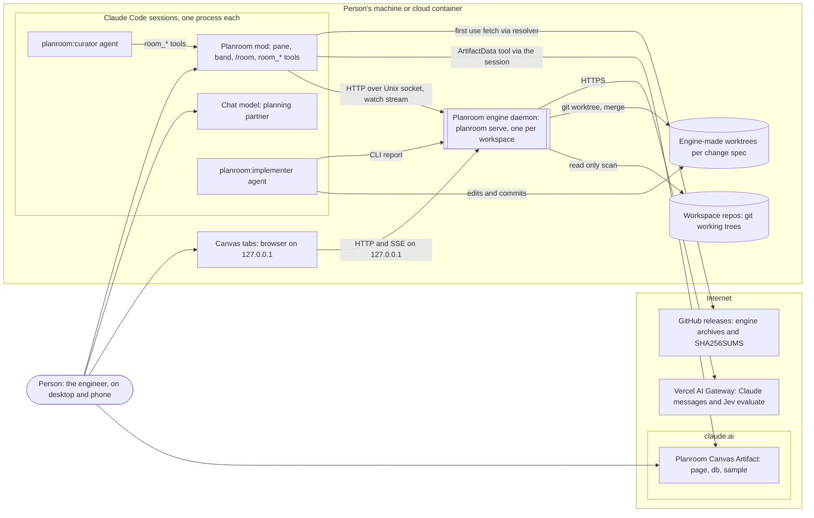
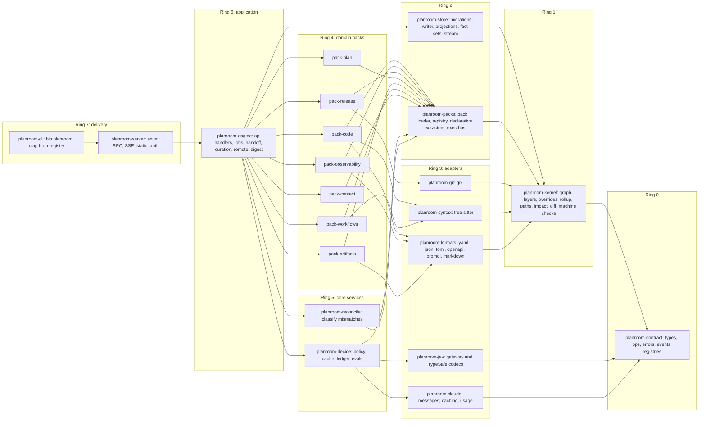
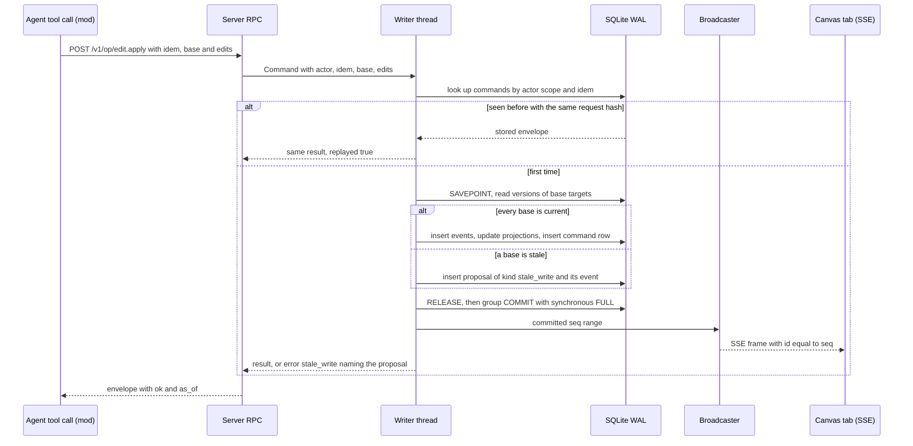
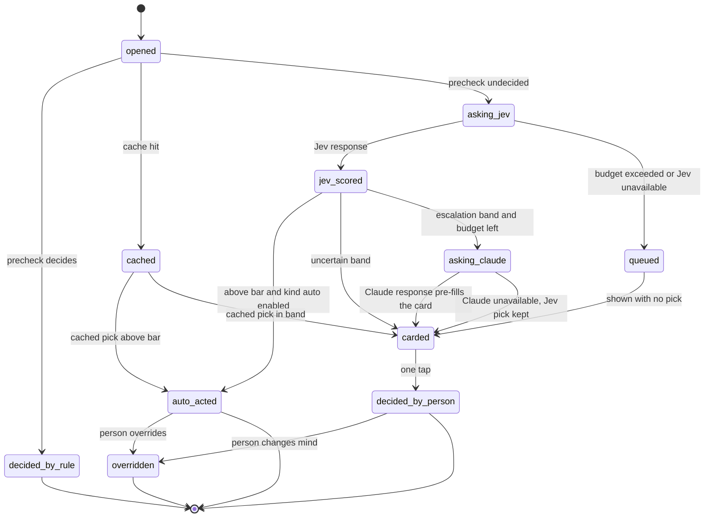
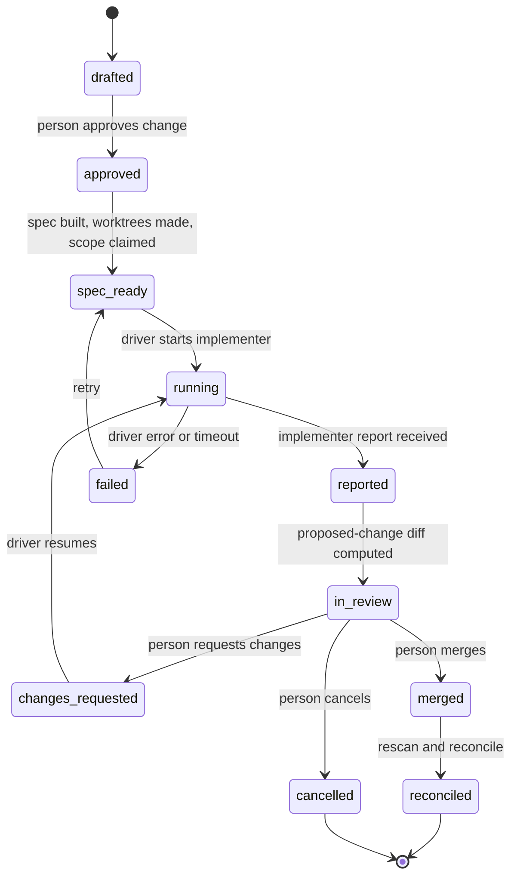
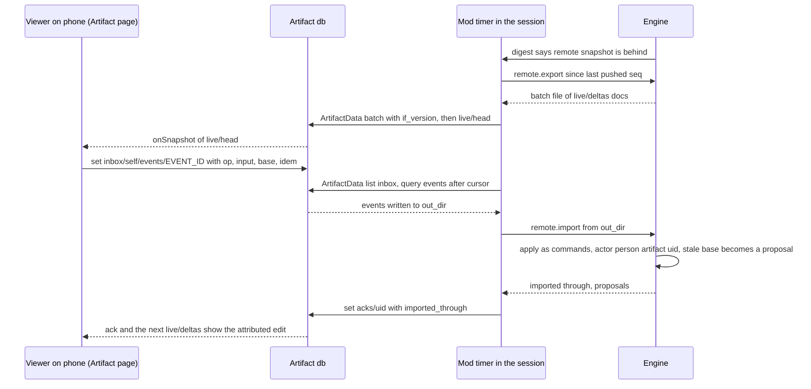

# Candidate architecture: concurrency- and agent-first

This page is one of three independent candidate architectures for Planroom, written in Phase 2. It puts concurrency and agents first: many agents, sessions, devices and projects writing at once with no lost write, and agents as the primary users of every interface. It still meets every requirement (R1 to R16) and scenario (S1 to S15) in `KICKOFF.md`. It is scored against the requirements and the two principles, and the final design may take any part of it.

Evidence labels follow the Phase 1 notes: **[V]** was measured in a Phase 1 spike (the note is cited), **[D]** comes from docs, **[A]** is an assumption this design makes, and **[S]** marks a walking-skeleton spike that settles it. Every element names the requirement it serves.

## Central idea

Planroom is one **command log per workspace**. Every change from any actor (a person on the canvas, the mod, the Artifact or the CLI; an agent through a tool or the CLI; automation such as a commit-triggered rescan) is a typed command. Each command carries:

- the actor and the session it came through;
- an idempotency key;
- the versions it was based on.

One writer thread in one daemon per workspace applies commands in order. It appends events and updates projections in the same SQLite transaction, then publishes the new sequence number to a live stream. Three rules follow from that one shape:

1. **No lost write.** A command is durable before its reply, under `synchronous=FULL`, and the reply carries the event sequence number `seq`.
2. **Safe retries.** The same idempotency key and request hash always return the stored reply, marked `replayed`. A key reused with a different request is refused.
3. **No last-writer-wins on user-authored state.** A command whose base version is stale is not applied and not merged. It becomes a proposal holding a three-way diff, which the person resolves with one tap.

Agents get the same log through one **operation registry** in the contract crate. Each operation declares its input and output schemas, error codes, size budget, pagination, actor rule and undo. The CLI subcommands, the HTTP routes, the mod's tools, the `/room` command table and the reference docs are all generated from that registry, so every surface exposes the same capability with the same IDs, codes and budgets.

---

## 1. Requirements to capabilities

Capabilities have IDs (`C01` to `C38`) that sections 2 to 13 and the traceability table in section 14 refer to.

### Capability index

| ID | Capability | Where it lives |
|---|---|---|
| C01 | Workspace discovery and config (`planroom.toml`, auto-detect repos) | `planroom-engine::workspace` |
| C02 | Tiered extraction runtime with a content-addressed fact cache | `planroom-packs::extract`, adapter crates |
| C03 | External extractor protocol (`planroom.extractor/v1`, NDJSON over stdio) | `planroom-packs::exec`, contract |
| C04 | Stable, namespaced, deterministic IDs and fingerprints | `planroom-kernel::id` |
| C05 | Levels and a one-parent hierarchy with a closure table | kernel, store |
| C06 | Faithful roll-up of edges across levels, with counts and evidence samples | `planroom-kernel::rollup` |
| C07 | Lenses (pack-declared sets of relation kinds with styles) | packs runtime |
| C08 | Search over every entity (SQLite FTS5) | store |
| C09 | Named queries: paths, impact, why, and pack queries | kernel, pack crates |
| C10 | Evidence pointers, confidence, provenance; confirm or reject a fact | kernel, store |
| C11 | Artifact anatomy: parse, segment, classify part relations | `planroom-pack-artifacts` |
| C12 | State machine extraction, checks, step-through, drift | `planroom-pack-workflows`, kernel |
| C13 | Planning stages, stage models and lint | `planroom-pack-plan` |
| C14 | Ghosts: AI proposals that count only after a person accepts | kernel layers, store |
| C15 | Overrides that survive rescans, with conflict diffs | kernel, store |
| C16 | Event log, projections, rebuild, versions | store |
| C17 | One diff engine for versions, intended vs actual, and proposed changes | `planroom-kernel::diff` |
| C18 | Reconciler that classifies mismatches | `planroom-reconcile` |
| C19 | Change spec, hand-off drivers, engine-made worktrees, merge | `planroom-engine::handoff` |
| C20 | Decision policy, Jev and Claude adapters, cache, ledger, evals | `planroom-decide`, adapters |
| C21 | Concurrency core: single writer, group commit, CAS to proposal, idempotency | `planroom-store::writer` |
| C22 | Live stream (SSE) and digests | store broadcaster, server |
| C23 | Sessions, presence and claims | store, engine |
| C24 | Several projects sharing one system model | kernel scoping, store |
| C25 | Pack system: kinds, levels, extractors, lenses, queries, decision kinds, views | packs runtime |
| C26 | Context curation miner and proposals | `planroom-engine::curate` |
| C27 | Operation registry, CLI, `--json` envelope, error codes, pagination, budgets | contract, cli |
| C28 | Local server, Unix socket and loopback TCP, auth | `planroom-server` |
| C29 | Mod: pane, band, `/room`, tools, agents, model broker, remote sync loop | `packages/mod` |
| C30 | Canvas web app | `packages/canvas` |
| C31 | Remote bridge to the Artifact | engine `remote`, mod, canvas transport |
| C32 | Contracts with one source, codegen and drift tests | contract, `xtask gen` |
| C33 | Repo tooling: one task entry point, boundaries, CI | `xtask`, `.github/` |
| C34 | Packaging: plugin, engine resolver, release workflow | `plugin/`, `.github/workflows/release.yml` |
| C35 | Undo for every edit type | contract registry, store |
| C36 | Deterministic fallback when no model is reachable | decide, packs |
| C37 | Token budgets: output budgets, prompt-prefix caching, measurement | contract, decide, testkit |
| C38 | `.planroom/` export and import per repo, reviewable in PRs | engine `export` |

### Requirements

| Req | What it needs | Capabilities | The concurrency and agent angle |
|---|---|---|---|
| R1 Point it at work | Scan one repo or a workspace; any language gets at least the universal tier; levels from intent to code; faithful roll-ups; adding a language touches no core | C01, C02, C03, C04, C05, C06, C25 | Scans run off the writer and land as one `scan.completed` transaction, so a scan never blocks or interleaves with user writes. IDs are derived from paths and semantic keys, so an agent can name an entity before asking for it. |
| R2 Relationships | Lenses for dependencies, dependents, data flow, deployment, co-change, ownership and plan links; "how does A reach B", "what does this touch", "why"; evidence and confidence on every inferred fact; confirm or reject | C07, C09, C10, C15 | `path.find`, `impact.get` and `relation.why` return hops with evidence pointers (`path`, `line`, `contains`), never file contents. Confirm and reject are overrides with versions. |
| R3 Break down any artifact | Parsers for prompts, docs, records, specs, skills, agent configs, issues, PRs, commits, reviews, threads, CI workflows, modules; part purpose, why, relations, gaps; PR threads addressed or open and touched components | C11, C20, C17 | Breakdowns are entities like any other (`part` level), so agents query them with the same tools and IDs. An edit to a breakdown becomes a text diff to its source. |
| R4 State machines | Extract from code, config and prose; states, transitions, events, guards, evidence; unreachable, dead end, missing transition, nondeterminism; step-through; drift | C12, C17 | `machine.step` is a pure query, so many agents can simulate at once. Planroom's own hand-off and escalation machines are tables in its code, extracted the same way. |
| R5 Clarify intent top down | Stages intent, outcome, breakdown, next actions, priorities, pre-mortem, lint; jump between stages; AI proposes, person disposes; next actions attach to real entities | C13, C14, C24, C20 | Every AI edit is a ghost in the `proposed` layer. Accepting one is a person-only operation, enforced by the actor rule in the registry, not by convention. |
| R6 Tweak everything | Regroup, rename, re-scope, re-wire, hide, pin layout, edit a breakdown, by hand or by asking Claude; corrections survive rescans; scan conflicts become diffs | C15, C14, C17, C35 | Overrides are separate rows over the actual layer, each with its own version and the fact fingerprint it was made against. A rescan re-derives facts and re-applies overrides; a changed fingerprint opens a `rescan_conflict` diff item. |
| R7 Diffs and reconciliation | Plan and model versions; intended vs actual with boundary rules; proposed changes mapped onto the map; one engine and one visual language; reconciler on demand and on change | C16, C17, C18 | One `Diff` type with one item schema. The reconciler runs as a job keyed by `(trigger, head seq)`, so two triggers for the same state join one run. |
| R8 Hand-off | Self-contained change spec; a separate implementer agent in isolation; result as a diff; reconciliation after merge; the planning partner never implements | C19, C17, C18, C23 | The engine makes one git worktree per touched repo and claims the spec's scope, so several implementers can run at once without touching the person's checkout. |
| R9 Cheap decisions | Jev for small frequent decisions; three bands; declared policy per kind; eval-backed thresholds; every decision recorded, inspectable, overridable | C20, C36, C37 | One request per slice with every question about that slice; cache by request hash; a per-scope spend guard; decisions are single-assignment with CAS, so two taps never both win silently. |
| R10 Many agents, sessions, projects at once | Several Claude sessions, mods, implementer and curator agents, automation and canvas tabs on several devices; several projects over one model; no lost write; safe retries; live updates; presence and claims; never last-writer-wins on user-authored state | C21, C22, C23, C24, C31 | This is the core of the lens. Sections 3.7 to 3.11 give the whole mechanism; S8 tests it. |
| R11 Extensible domains | Domain-free core extending into a graph; packs add domains with no core change; v0.1 packs for code, plans, observability, release, artifacts, workflows | C25, C02, C03 | Packs are data plus, for built-ins only, a Rust crate that depends inward. Out-of-tree packs plug in with data and external extractors. Pack kinds become open-set strings in the contract. |
| R12 Context curation | Propose `CLAUDE.md` and `AGENTS.md` updates and project skills from implementer-run history; on a trigger and on demand; proposals as diffs | C26, C17, C20 | The curator runs as a job on `handoff.merged` or every 5 runs, as automation. Its proposals are ordinary diffs that a person approves. |
| R13 Surfaces | Mod with focus, the one open decision, progress, pending diffs, drift, presence, band, slash commands, tools, mini-map, keyboard-first; canvas local and as an Artifact; CLI and server; one plugin | C27, C28, C29, C30, C31, C34 | Every surface renders the same presentation-neutral digests (`focus.get`, `decision.list`, `diff.list`). The engine computes them once; surfaces only lay them out. |
| R14 Tiny surface | Five ideas; one CLI entry point; one slash family `/room`; no extra concepts | C27, C29, C30 | The registry tags every operation with one of the five ideas (or `engine` for plumbing). `--help`, the `/room` table and the canvas navigation are generated from those tags. |
| R15 Releasable | The Iris bar | C32, C33, C34 | Release dry run in CI on every push. |
| R16 Designed repo | Purpose per directory; `AGENTS.md` per area; boundaries enforced in Rust and TS; generated code marked; conventions once; decision records for layout changes | C33, C32 | One `boundaries.toml` is the source for both the Rust crate-graph check and the generated dependency-cruiser config, so the two languages cannot drift apart. |

---

## 2. Architecture

### 2.1 Context view

Who and what Planroom talks to, with the trust and network boundaries.



| Actor or system | Talks to Planroom through | Identity on the log |
|---|---|---|
| Person in a Claude Code session | `/room`, pane and band buttons, the chat | `person:local:<os-user>` via the mod session, only from `onPress`, `onSubmit` and user-typed `/room` |
| Chat model (planning partner) | `room_*` tools (mod) | `agent:<session>:main` |
| `planroom:implementer` | its worktree, then `planroom handoff report` (CLI) | `agent:<session>:implementer:<agentId>` |
| `planroom:curator` | `room_*` tools, or the engine job directly | `agent:<session>:curator:<agentId>` or `automation:curator` |
| Person on a canvas tab | HTTP RPC and SSE on loopback | `person:local:<os-user>` via the tab's session cookie |
| Person on the Artifact (phone) | Artifact `db` inbox, imported by the session | `person:artifact:<u_id>` (path-proven) |
| Automation | file watcher, git ref watcher, reconcile and curate triggers | `automation:<name>` |
| Jev | `POST /v1/evaluate` on the gateway, or TypeSafe `/v1/systemone` | provenance `jev:<model>` on decisions |
| Claude (engine) | `POST /v1/messages` on the gateway | provenance `claude:<model>` |
| Claude (session) | `$.model.complete` through the mod's model broker | provenance `claude:session:<model>` |
| Claude (Artifact) | `sample`, on an explicit "Ask Claude" | provenance `claude:sample:<tier>` |

### 2.2 Container view

Every process, store and boundary.

```mermaid
flowchart TB
  subgraph HOST["Machine boundary: one OS user"]
    subgraph CCP["Claude Code process, one per session"]
      hooks["Mod hooks module: plugin/hooks/planroom-mod.js"]
      model["Session model: chat and $.model.complete"]
      sub["Subagents: implementer, curator"]
    end
    watch["planroom watch --digest mod: child of the mod, dies on reload"]
    resolver["plugin/scripts/planroom: engine resolver, POSIX sh"]
    subgraph D["Engine daemon process: planroom serve"]
      rpc["HTTP RPC: POST /v1/op/NAME"]
      sse["SSE: GET /v1/stream"]
      stat["Static canvas assets: GET /"]
      writer["Writer thread: group commit, CAS, idempotency"]
      readers["Reader pool: WAL snapshots"]
      jobs["Job workers: scan, reconcile, decide, curate, handoff"]
    end
    db[("SQLite WAL: WS/.planroom/state/store.sqlite")]
    exp[("Per-repo .planroom/ export: intended, overrides, plans, views")]
    repos[("Workspace repos")]
    wts[("WS/.planroom/state/worktrees/SPEC/REPO")]
    ext["External extractors: exec from trusted packs"]
    cli["planroom CLI: one-shot client"]
    browser["Browser tab: canvas, React"]
  end
  subgraph INET["Network boundary: HTTPS"]
    gw["ai-gateway.vercel.sh: /v1/messages and /v1/evaluate"]
    ts["api.typesafe.ai: /v1/systemone"]
    rel["github.com releases"]
    subgraph CLAI["claude.ai boundary"]
      page["Artifact page: same canvas bundle, artifact transport"]
      adb[("Artifact db: live/*, inbox/{self}/*, acks/*")]
      pdata[("Published data file: data/snapshot.json")]
    end
  end
  hooks -- "fetch with socketPath" --> rpc
  hooks -- "spawn" --> watch
  watch -- "stream" --> sse
  hooks -- "run serve --detach" --> resolver
  resolver -- "fetch and verify" --> rel
  resolver -- "exec" --> D
  cli -- "Unix socket" --> rpc
  sub -- "Bash: planroom CLI" --> cli
  browser -- "127.0.0.1 TCP, token cookie" --> rpc
  browser -- "EventSource" --> sse
  browser --> stat
  rpc --> writer
  rpc --> readers
  writer --> db
  readers --> db
  jobs --> writer
  jobs -- "read only" --> repos
  jobs -- "git worktree add, merge" --> wts
  jobs -- "stdin and stdout NDJSON" --> ext
  jobs -- "write on version cut" --> exp
  jobs --> gw
  jobs --> ts
  hooks -- "$.tool.call ArtifactData" --> adb
  model -- "Artifact publish" --> pdata
  page --> adb
  page --> pdata
```



| Container | Process | Lifetime | Talks over | Owns |
|---|---|---|---|---|
| Engine daemon | `planroom serve` (Rust, tokio + one writer OS thread) | Starts on first use by any client, outlives sessions and mod reloads, exits after 30 min with no session, presence or job | Unix socket `engine.sock` (0600), loopback TCP `127.0.0.1:<port>` for browsers | The store, the live stream, jobs, worktrees, the `.planroom/` export |
| CLI | `planroom <command>` one-shot | One command | Unix socket to the daemon; starts it with `serve --detach` if absent | Nothing: a client like any other |
| Watch | `planroom watch --digest mod --after <seq>` | Child of the mod's `$.process.spawn`; dies on reload and is restarted from the saved cursor | SSE from the daemon, NDJSON to stdout | Nothing |
| Mod | Hooks module inside each Claude Code process | Session; re-runs `register` on reload | `$.http.fetch` with `socketPath`, `$.process.*`, `$.tool.call`, `$.model.complete` | `$.state` atoms (summaries only), the agent-id map, the remote cursor |
| Canvas tab | Browser | Tab | `fetch` and `EventSource` on loopback, session cookie | A zustand view store; pending local writes |
| Artifact page | claude.ai frame | View | `db` and the published data file only | Viewer's inbox documents |
| Resolver | `plugin/scripts/planroom` (POSIX sh) | Per call; `exec`s the binary | `curl` or `wget` to GitHub releases | `$CLAUDE_PLUGIN_DATA/engine/<version>/` |
| External extractor | Any executable a trusted pack declares | One run per repo per scan | stdin and stdout NDJSON | Nothing |
| Implementer | Claude subagent, `cwd` = engine-made worktree root | One hand-off | Files and git in its worktrees; `planroom handoff report` | Its branches |

**Stores:**

| Store | Path | Writer | Format | Lost if deleted? |
|---|---|---|---|---|
| Workspace store | `<ws>/.planroom/state/store.sqlite` (+ `-wal`, `-shm`) | Engine writer thread only | SQLite 3.54 WAL, `user_version` migrations | User-authored state survives in the `.planroom/` export up to the last export; facts are re-derived by a scan |
| Run files | `<ws>/.planroom/state/engine.{json,lock,sock}` | Engine | JSON, `flock` | No |
| `.planroom/` export | `<repo>/.planroom/{intended,overrides,views}.toml`, `<repo>/.planroom/plans/<project>.toml` | Engine on version cut and approval; people via git | Sorted TOML, one entity per table | Committed in git |
| Worktrees | `<ws>/.planroom/state/worktrees/<spec>/<repo>/` | Engine (`git worktree add`), implementer | git | Branches remain in the repo |
| Engine binary cache | `$CLAUDE_PLUGIN_DATA/engine/<version>/` | Resolver | Archive layout plus a `.ok` stamp | Refetched |
| Mod state | `$.state` (session) and `$.store` (cross-session, at most 4 MiB) | Mod | JSON | Rebuilt from the engine |
| Artifact `db` | claude.ai | Session (shared docs) and each viewer (own inbox) | JSON documents | Rebuilt by the next push |

Why the store lives in the workspace and not in the plugin data directory: every caller must find the same store, or two daemons would split the writes. The mod, a CLI run from the Bash tool (which has no `CLAUDE_PLUGIN_DATA` [V `plugin-packaging.md` section 3]), CI and a canvas all reach the workspace root the same way, by walking up from `cwd` (section 7.2). The engine writes `.planroom/.gitignore` containing `state/`.

### 2.3 Engine component view

Crates in rings. An arrow is a direct dependency in this design. The boundary check (section 9.3) bans every edge that points outward or sideways, so a crate may use only rings inside its own.



| Crate | Owns | Key types and modules |
|---|---|---|
| `planroom-contract` | Every public type, and the registries: `OPS`, `ErrorCode`, `EventKind`, `ToolGroup`, `Idea` | `Envelope<T>`, `OpSpec`, `Actor`, `Entity`, `Relation`, `Evidence`, `Event`, `StreamFrame`, `ChangeSpec`, `PackManifest`, `ExtractorMsg`, `RemoteDoc` |
| `planroom-kernel` | Domain-free graph semantics | `id`, `graph::EffectiveGraph`, `layer`, `overlay` (overrides), `rollup`, `paths`, `impact`, `diff`, `machine` (generic reachability, dead ends, nondeterminism), `query` (traversal algebra) |
| `planroom-store` | Persistence and ordering | `migrations/NNNN_*.sql`, `writer` (actor thread, group commit), `idem`, `cas`, `projections`, `facts`, `readers`, `broadcast`, `fts` |
| `planroom-packs` | Pack runtime | `manifest`, `registry` (kinds, levels, lenses, queries, decision kinds, views), `extract` (scheduler, fact cache, `Extractor` trait), `declarative` (`regex`, `yaml_path`, `json_path`, `ts_query`), `exec` (external protocol host), `trust` |
| `planroom-git` | git through gix 0.90 | history walk, co-change, ownership, tags, worktrees, merge (shells to `git` for worktree and merge, see section 6.4) |
| `planroom-syntax` | tree-sitter 0.27 and six grammars | language detection, per-thread parser pool, query runner, ABI floor test |
| `planroom-formats` | Format parsing with mature crates | YAML (`serde_yaml_ng` [A]), JSON, TOML, OpenAPI paths, PromQL (`promql-parser` [A]), Markdown (`pulldown-cmark`). Mermaid `stateDiagram-v2` has no mature Rust parser [A], so the workflows pack reads its one-line transition form (`A --> B: event`) with a declarative `regex` extractor instead of a hand-written parser |
| `planroom-jev` | Jev codecs | `JevBackend`, `GatewayCodec`, `TypeSafeCodec`, `Recorded<B>` (live, record, replay) [`jev.md` section 7] |
| `planroom-claude` | Claude Messages | `Transport`, `ClaudeRequest`, `Usage`, `ReplayTransport` [`claude-gateway.md` section 7] |
| `planroom-pack-*` | Built-in domain logic that is not declarative | extractors and named-query implementations referenced from pack TOML as `builtin:<pack>.<name>` |
| `planroom-decide` | Decision policy | `Policy`, `Band`, `Slice`, `DecisionCache`, `Ledger`, `Budget`, `eval` |
| `planroom-reconcile` | Classification | `Reconciler`, `Classification` (`expected`, `in_progress`, `done`, `unplanned`, `regression`) |
| `planroom-engine` | Composition root | `ops::{handlers}`, `jobs`, `handoff` (machine table), `curate`, `remote`, `digest`, `export`, `workspace`, `session`, `broker` |
| `planroom-server` | HTTP delivery | `rpc`, `stream`, `assets`, `auth`, `limits` |
| `planroom-cli` | The `planroom` binary | generated `clap` tree, `render` (text renderer for humans), `daemon` (start, find, version handshake) |
| `planroom-testkit` | Dev-only test support (`publish = false`) | fixture runner, truth matcher, replay fixture store, fake Artifact db, fixture implementer, S8 load driver |

### 2.4 TypeScript component view

| Package | Owns | May import |
|---|---|---|
| `@planroom/contract` (`packages/contract`) | Generated types (`src/generated/`), the generated operation table `OPS`, `TOOL_SPECS`, `ROOM_COMMANDS`, error codes | nothing |
| `@planroom/client` (`packages/client`) | Typed client: `callOp(name, input)`, idempotency keys, retry, cursor tracking. Transports: `LocalHttp` (fetch and EventSource), `ModSocket` (an injected `post` that wraps `$.http.fetch`), `ArtifactDb` | contract |
| `@planroom/view-model` (`packages/view-model`) | Pure layout helpers: truncation to columns, glyph rows for diff items, decision card model, five-idea labels, lens styles from pack data | contract |
| `@planroom/ui` (`packages/ui`) | React primitives (Radix-based), tokens in CSS variables, motion moments | contract, view-model |
| `@planroom/canvas` (`packages/canvas`) | The app, two entries: `src/entry-local.tsx` and `src/entry-artifact.tsx` | contract, client, view-model, ui |
| `@planroom/mod` (`packages/mod`) | Hooks module source: engine bridge, watch loop, pane, band, commands, tools, agents, broker, remote loop | contract, client, view-model |

### 2.5 How the parts connect

| From | To | Mechanism | Why this one |
|---|---|---|---|
| Mod | Engine | `$.http.fetch(url, {socketPath})`, wrapped with a timeout race and retry under the same idempotency key | No TCP port for the mod; `http.fetch` has no timeout or abort [V `mod-api.md` section 7], so the server enforces a 10 s request limit and the mod never waits past it |
| Engine | Mod | `planroom watch --digest mod` through `$.process.spawn`, NDJSON digest frames | `http.fetch` cannot stream [V]; a spawned child streams but dies on reload [V], so the cursor in `$.state` lets the restarted watch resume with no gap |
| Canvas | Engine | `POST /v1/op/<name>` and `GET /v1/stream` (SSE with `Last-Event-ID`) | One-way push that reconnects with a cursor [V `rust-stack.md` section 7] |
| Chat model | Engine | `room_*` tools registered by the mod, proxied to the RPC | Tools carry the session identity for presence and attribution |
| Subagents | Engine | `planroom` CLI from the Bash tool; mod tools when the subagent inherits them [S] | The CLI works in every context, with mods on or off |
| Mod | Implementer | `$.agent.spawn({subagentType: 'planroom:implementer', cwd, prompt})`, result joined on `turn.complete` by `agentId` | `spawn` takes no isolation [V], so isolation comes from the engine-made worktree in `cwd` |
| Engine | Implementer (CI) | `exec` driver running the fixture implementer | Deterministic CI with no model |
| Engine | Jev | `planroom-jev` over `reqwest`, pinned `typesafe-ai/jev-1.14.0` | One adapter, two codecs |
| Engine | Claude | `planroom-claude`, `POST /v1/messages`, `providerOptions.gateway.only = ["anthropic"]` | Cache counters and stable prefixes [V `claude-gateway.md`] |
| Engine | Claude via the session | Model broker: engine posts `llm.request` jobs; a mod that offered with `broker.offer` runs `$.model.complete` with `cache: true` blocks and posts `llm.respond` | Gives the engine Claude on the person's own account when no gateway key is set |
| Mod | Artifact | `$.tool.call({tool: 'ArtifactData', ...})` from a timer [S]; fallback `/room remote sync` | `db` writes do not wake the session [V `artifact.md` section 2] |
| Artifact | Engine | Viewer writes `inbox/{self}/events/<id>`; the mod lists and imports them | Path-proven authorship [V `artifact-spike.md`] |
| Artifact | Claude | `sample.json({modelTier: 'quick'})` on an explicit tap | The page cannot reach Jev or the engine [V] |

---

## 3. The kernel's data model and the event model

### 3.1 Primitives

The kernel knows six things and no domain. Packs give every `kind` its meaning.

```rust
// planroom-contract::graph (serde + schemars; serialize and deserialize schemas both generated)
pub struct Entity {
    pub id: EntityId,                 // "storefront:component:src/cart"
    pub kind: KindId,                 // open set, validated against loaded packs: "component"
    pub level: LevelId,               // "component"
    pub parent: Option<EntityId>,     // one parent; None only at the top of a level ladder
    pub name: String,
    pub props: Props,                 // BTreeMap<String, serde_json::Value>, pack-validated
    pub layer: Layer,
    pub provenance: Provenance,
    pub version: u32,                 // per-entity, bumped by every applied change (< 2^53 policy)
    pub fingerprint: Option<Fingerprint>, // what a scan saw: path, content hash, semantic key
}
pub struct Relation {
    pub id: RelationId,               // "rel:http:ws:container:storefront>ws:container:orders"
    pub kind: RelKindId,              // "http"
    pub from: EntityId, pub to: EntityId,
    pub via: Option<String>,          // "POST /orders"
    pub props: Props,
    pub evidence: Vec<Evidence>,      // pointers, never file bodies
    pub confidence: f32,              // 1.0 deterministic; < 1.0 inferred
    pub layer: Layer, pub provenance: Provenance, pub version: u32,
}
pub struct Evidence {
    pub path: RepoPath,               // "<repo>/<repo-relative path>", the truth's path form
    pub line: u32, pub end_line: u32,
    pub contains: String,             // the exact substring on `line`, at most 200 chars
    pub commit: Option<Oid>,          // the scanned commit
    pub extractor: ExtractorId, pub tier: Tier,
}
pub enum Layer { Actual, Intended, Proposed { proposal: ProposalId } }
pub struct Override {                 // an overlay row, not a layer
    pub id: OverrideId, pub target: Target, pub op: OverrideOp,
    pub base: FactHash,               // fingerprint of the fact it was made against
    pub project: Option<ProjectId>,   // None: workspace-wide (regroup, rename); Some: project-scoped view tweaks
    pub version: u32, pub provenance: Provenance,
}
pub enum OverrideOp { Rename(String), Reparent(EntityId), Group { name: String, members: Vec<EntityId> },
    Hide, Unhide, SetProp(String, serde_json::Value), Confirm, Reject, Pin { view: ViewId, x: f32, y: f32 } }
pub struct View { pub id: ViewId, pub name: String, pub query: ViewQuery /* level, lens, focus, filters */,
    pub project: Option<ProjectId>, pub version: u32 }
pub struct Event { /* section 3.5 */ }
```

- **Provenance** is `{source, actor, run?, extractor?, decision?, seq}`, where `source` is one of `scan`, `person`, `agent`, `automation`, `jev`, `claude`, `import`, `artifact`.
- **Inferred** is derived, not stored: a fact is inferred when its tier is `inference` or its confidence is below 1.0. Every surface marks it, and a person can confirm or reject it with an override (R2).
- **Positions** are not a field on `View`. They are rows of their own (section 3.6) so that two tabs pinning two blocks never conflict.

### 3.2 IDs

IDs are deterministic, readable and stable across rescans, so an agent can name a thing before it asks for it and retries never mint duplicates (R10, principle 2).

| Thing | Form | Example |
|---|---|---|
| Repo-scoped entity | `<repo>:<kind>:<key>`, key = repo-relative path or semantic key | `orders:component:internal/order`, `worker:file:worker/consumer.py` |
| Workspace-scoped entity | `ws:<kind>:<key>` | `ws:container:orders-db`, `ws:system:acme-shop`, `ws:group:purchase` |
| Relation | `rel:<kind>:<from>><to>`, plus `#<via-hash8>` when two relations share kind and endpoints | `rel:queue_publish:ws:container:orders>ws:container:redis` |
| Plan entity | `plan:<project>:<key>`; the key is caller-chosen or a slug of the title | `plan:worker-retries:na-backoff-config` |
| Decision, proposal, claim, job, event | `<prefix>:<uuid v7>` | `dec:0193…`, `prop:0193…`, `claim:…`, `job:…`, `evt:…` |
| Diff | `diff:<kind>:<sha256-12 of inputs>`, so the same inputs give the same diff | `diff:intended_actual:5f1c…` |
| Session and actor | section 3.11 | `agent:7c2e:main` |

Rules:

- **Containers merge across repos.** A compose service, its repo and its image are one container (`ws:container:storefront`), linked by evidence. The rule is declared in the code pack as an identity resolver.
- **Creates are idempotent by ID.** Creating an existing ID with identical content returns the existing entity with `replayed: true`. Different content returns `id_conflict` with a diff of the two (section 3.9).
- **A rename in the code is a remove plus an add.** A person's override follows the entity through it by fingerprint (section 3.14).
- **No 64-bit integers in the contract.** Versions and counts stay below 2^53 [V `rust-stack.md` G8]. The `seq` is `i64` in SQLite but serialized as a number checked against that bound.

### 3.3 Layers, overlays and the effective graph

| Layer or overlay | Holds | Written by | Never written by |
|---|---|---|---|
| `actual` | Facts from the latest scan per repo (entities, relations, evidence) | Scan jobs only, as fact sets | People, agents |
| overlay: overrides | Renames, regroups, reparents, hides, pins, confirm and reject, prop edits | People; agents only by accepting nothing (their edits are proposals) | Scans |
| `intended` | Boundary rules (`worker -/-> orders-db : db`), intended relations, approved change sets | People (approve), from accepted proposals | Scans, agents directly |
| `proposed` | Ghosts (AI proposals) and stale-write proposals, each under one `ProposalId` | Agents, Jev or Claude via policy, the writer on a stale base | Nothing becomes `actual` or `intended` from here without a person-only `proposal.accept` |

The effective graph a surface sees is computed by `kernel::graph::EffectiveGraph::build(actual, overrides, intended, proposals_visible)`:

1. Start from `actual`.
2. Apply overrides in `seq` order. A `Group` adds a `ws:group:<slug>` entity, reparents its members under it, and parents it where the members' common parent was.
3. Mark each intended relation as met, unmet or violated against step 2 (boundary rules are checked here).
4. Overlay visible ghosts, each tagged with its proposal.

Drift is then a diff between layers (section 6.1), which keeps the starting point's idea.

### 3.4 Levels and the hierarchy

- **Levels are pack-declared, ranked rows.** The default ladder merges `plan` (`intent` at rank 0), `code` (`system` 10, `container` 20, `component` 30, `code` 40) and `artifacts` (`part` 50). A kind declares one level.
- **One parent per entity.** The store keeps a closure table `ancestors(entity_id, ancestor_id, depth)`, maintained by the writer on every reparent, group or scan delta. Roll-ups and impact walk it with indexed SQL.
- **Groups are level-transparent.** `ws:group:purchase` takes the level of its members and acts as a fold. At component level it shows as one block containing `src/cart` and `src/checkout`.
- **Intent sits above the system.** Plan entities attach to system entities with `attaches_to` relations, which roll up like any other relation, so a project at the top level shows which containers it touches (R1, R5).

### 3.5 What is an event, and what is derived

An **event** is an immutable record of an accepted change to user-authored or coordination state, or of a completed scan. Facts are not events: a scan of 5 repos yields thousands of evidence rows, and storing each as an event would make the log mostly noise. Facts are content-addressed **fact sets** that a `scan.completed` event references. Everything else is derived from events plus the fact sets they name, so `planroom admin rebuild` reproduces every projection.

```rust
pub struct Event {
    pub seq: i64,                     // workspace-wide total order, assigned by the writer
    pub id: EventId,                  // evt:<uuid v7>
    pub kind: EventKind,              // open set, namespaced: "override.set"
    pub workspace: WorkspaceId,
    pub project: Option<ProjectId>,
    pub actor: ActorId, pub session: SessionId,
    pub command: CommandId,           // the command that produced it (one command, 1..n events)
    pub cause: Option<EventId>,       // the event that triggered it (a scan that opened a decision)
    pub targets: Vec<TargetRef>,      // ids touched, with their version after the change
    pub base: Vec<(TargetRef, u32)>,  // versions the command was based on
    pub payload: serde_json::Value,   // kind-specific, schema'd in events.v1
    pub at: Timestamp, pub v: u16,    // payload schema version
}
```

| Event kind | Payload carries | Projection it updates |
|---|---|---|
| `scan.completed` | `run`, `repo`, `commit`, `fact_set`, delta counts and changed IDs | `entities`/`relations`/`evidence` actual rows, `ancestors`, `fts` |
| `override.set`, `override.cleared` | target, op, base fingerprint | `overrides`, `ancestors` |
| `proposal.created`, `proposal.accepted`, `proposal.rejected`, `proposal.withdrawn` | proposal kind (`ghost`, `stale_write`, `id_conflict`, `rescan_conflict`), items | `proposals`, and on accept the target layer |
| `intent.rule.set`, `intent.relation.set`, `intent.change.approved` | rule or relation, change set | `intended`, `change_sets` |
| `project.created`, `project.renamed`, `project.archived` | name, home repo | `projects` |
| `plan.item.added`, `plan.item.changed`, `plan.item.moved`, `plan.stage.set` | stage model fields | `plan_items` (entities in the `plan` pack's kinds) |
| `version.cut` | project, number, `seq` cutoff, snapshot hash | `versions` |
| `view.saved`, `position.pinned`, `position.unpinned` | view query; per-block pin | `views`, `positions` |
| `decision.opened`, `decision.scored`, `decision.auto_acted`, `decision.carded`, `decision.resolved`, `decision.overridden` | kind, slice hash, scores, band, pick, cost | `decisions` |
| `diff.opened`, `diff.item.resolved`, `diff.closed` | diff kind, inputs, resolution | `diffs`, `diff_items` |
| `reconcile.completed` | classifications | `reconcile_items` |
| `handoff.*` (one per machine transition, section 6.4) | spec, driver, branches, report | `handoffs` |
| `claim.acquired`, `claim.released`, `claim.expired` | targets, purpose, holder, ttl | `claims` |
| `curation.proposed` | lesson, supporting runs, diff | `curation` |
| `remote.imported` | artifact url, viewer, through-cursor | `remote_cursors` |
| `undo.applied` | undone event, compensating events | per target |

Presence heartbeats are **not** events: they are ephemeral rows (section 3.11). Positions computed by layout are not events either: they are a cache keyed by a layout hash. Only pins are events.

### 3.6 Store schema

`planroom-store/migrations/0001_init.sql` creates these tables (abridged to key columns). SQLite runs with `journal_mode=WAL`, `synchronous=FULL`, `foreign_keys=ON`, `busy_timeout=5000`.

| Table | Key columns | Notes |
|---|---|---|
| `events` | `seq INTEGER PRIMARY KEY`, `id TEXT UNIQUE`, `kind`, `project`, `actor`, `session`, `command`, `cause`, `targets JSON`, `base JSON`, `payload JSON`, `at`, `v` | Append-only; an index on `(project, seq)` and on `(actor, seq)` |
| `commands` | `id`, `actor_scope`, `idem_key`, `op`, `request_hash`, `status`, `reply JSON`, `first_seq`, `last_seq`, `at`; `UNIQUE(actor_scope, idem_key)` | The idempotency table (section 3.8); pruned after 30 days except for commands referenced by open proposals |
| `fact_sets` | `id` (sha256 of sorted facts), `repo`, `commit`, `extractor_versions JSON`, `at` | Content-addressed; one per repo per scanned state |
| `facts_entities`, `facts_relations`, `facts_evidence` | `fact_set`, then the `Entity`/`Relation`/`Evidence` columns | Immutable; old sets pruned after 10 newer sets unless a version references them |
| `file_cache` | `(blob_sha, extractor_id, extractor_version)` → `facts JSON` | Makes incremental scans cheap: unchanged blobs are not re-parsed |
| `entities`, `relations`, `evidence` | Current effective rows with `layer`, `version`, `updated_seq` | Projection; indexed on `kind`, `parent`, `from`, `to` |
| `ancestors` | `(entity_id, ancestor_id, depth)` | Closure table |
| `overrides` | `id`, `target`, `op JSON`, `base`, `project`, `version`, `orphaned` | |
| `intended`, `change_sets` | rule or relation rows; change set status | |
| `proposals`, `proposal_items` | `id`, `kind`, `status`, `actor`, `base JSON`, `mine JSON`, `theirs JSON`, `diff` | Ghosts and stale writes share one table |
| `projects`, `plan_items`, `versions` | project; item fields; `(project, n, seq, snapshot_hash, snapshot JSON)` | Snapshots are materialized at cut time for fast diffs |
| `views`, `positions` | view; `(view, level, entity, x, y, w, h, source, layout_hash, version)` | `source` is `layout` (cache) or `pin` (user-authored, CAS) |
| `decisions`, `decision_cache`, `llm_calls` | decision rows; `key` → reply; ledger of every Jev and Claude call with tokens, cost, prefix hash, `generation_id` | |
| `diffs`, `diff_items`, `reconcile_items` | | |
| `handoffs`, `implementer_runs` | spec, state, driver, branches; imported `planroom.implementer-run/v1` rows | |
| `sessions`, `presence`, `claims` | session registry; ephemeral presence; leases | `presence` is excluded from rebuild |
| `jobs` | `id`, `key UNIQUE`, `kind`, `state`, `progress`, `result JSON` | `key` makes duplicate job requests join (section 3.10) |
| `entity_fts` | FTS5 over `name`, `id`, path, kind | FTS5 availability in the bundled build is checked in the skeleton [S]; fallback is a trigram `LIKE` index |
| `meta` | `schema_version`, `workspace_id`, `contract_version` | Plus `PRAGMA user_version` for migrations |

### 3.7 Commands

A command is the only way state changes. The registry declares each command operation's actor rule and undo.

```rust
pub struct Command {
    pub id: CommandId,
    pub op: OpName,                       // "edit.apply"
    pub actor: Actor, pub session: SessionId,
    pub idem_key: IdemKey,                // client-minted uuid v7, or derived (section 3.8)
    pub base: BTreeMap<TargetRef, u32>,   // versions read; required for every user-authored target
    pub input: serde_json::Value,         // validated against the op's input schema
    pub project: Option<ProjectId>,
}
```

The writer applies a command in seven steps, all inside one `SAVEPOINT` of the current group transaction:

1. **Validate** the input against the op's deserialize schema (`jsonschema` crate) and the pack registry (kinds, props).
2. **Authorize** by actor rule: `any`, `person_only` (accept a ghost, cut a version, approve a change, merge a hand-off, resolve a person-only decision kind), or `agent_or_person`. Agents calling person-only ops get `person_required`, with the proposal or card ID that a person can tap.
3. **Idempotency lookup** (section 3.8).
4. **Base check**: every user-authored target in the input must appear in `base`, or the command fails with `base_required`. Creates need no base.
5. **CAS**: compare each base version with the current one. All current: continue. Any stale: divert to a proposal (section 3.9).
6. **Apply**: append events, update projections and the closure table, write the `commands` row with the reply.
7. **Release** the savepoint. A failing command rolls back only itself.

The writer drains its channel in groups (up to 64 commands or 2 ms, whichever first), commits once per group, then broadcasts. One `fsync` serves the whole group, which keeps `synchronous=FULL` affordable under bursts from many agents.

### 3.8 Idempotent retries

| Retry kind | How it is made safe |
|---|---|
| Transport retry (mod fetch timed out, SSE dropped, CLI reconnect) | The client reuses the command's `idem_key`. The `commands` row returns the stored reply byte for byte with `replayed: true`. |
| Model retry (the chat model calls the same tool again) | Tool inputs for creates carry a caller-chosen `key`, which makes the ID deterministic (`plan:<project>:<key>`). A repeated create with the same content is a replay. With different content it is `id_conflict`, and the second version becomes a proposal so neither is lost. |
| Mod reload mid-call | The mod writes `{idem_key, op, input}` to a `$.state` outbox atom before sending and clears it on reply. After reload, `session.start` resends the outbox with the same keys. |
| Implementer report repeated | The report key is `handoff:<spec>:report:<attempt>`. |
| Artifact edit re-imported | The viewer mints `eventId` with `collection.doc()`, and `idem_key = artifact:<uid>:<eventId>`. |
| Job requested twice | Jobs have a `key` (`scan:<repo>:<commit>:<extractor-hash>`, `reconcile:<head seq>`). A second request joins the running job. |
| Paid model call retried | Decision cache by request hash. A Jev or Claude call is retried only on 429, 529, 5xx or a transport error before a response, and every attempt is in the ledger [`jev.md` section 7, `claude-gateway.md` section 7]. |

The same `idem_key` with a different `request_hash` fails with `idempotency_mismatch`, so a client bug never silently replays the wrong result.

### 3.9 Optimistic concurrency and how a stale write becomes a diff

User-authored state has per-row versions at a fine grain: each plan item, override, pin, intended rule and view is its own row. Two people or agents working on different items never conflict. When they do touch the same row, the result is never last-writer-wins and never an automatic merge.

```text
command(base: {override:ov_12 @ v3}, op: rename "Cart" -> "Basket")
current: override:ov_12 @ v4 (Bob renamed it "Bag" 2 s ago)
  -> not applied
  -> proposal prop:… kind stale_write {
       base:   {name: "Cart"}      (v3, from the event log)
       theirs: {name: "Bag"}       (v4, Bob, evt:…)
       mine:   {name: "Basket"}    (Alice's attempted patch)
       diff:   diff:stale_write:…  (rendered like every other diff)
     }
  -> reply: ok:false, error.code "stale_write", details.proposal, hint "planroom diff get diff:stale_write:…"
  -> a decision card for Alice: "Bob renamed this to Bag 2 s ago. Keep Bag / Use Basket / Edit"
```

| Situation | Result | Why |
|---|---|---|
| Stale base on a user-authored row, person actor | `stale_write` proposal plus a one-tap card for that person | R10, S8: a diff, not a merge |
| Stale base, agent actor | `stale_write` error with a compact three-way diff in `details` (at most 1 KB); no card | Agents re-read and retry themselves; a person is not interrupted for an agent's race (principle 1) |
| Create with an existing ID and different content | `id_conflict` proposal holding both | Neither write is lost |
| Two taps on the same decision | First tap resolves it (CAS on `status = open`); the second gets `already_resolved` with who and when, and may override, which is its own event | Single-assignment, with history |
| Writes to an entity someone holds a claim on | Applied, with warning `claimed_by_other` naming the holder; the holder's surfaces show who edited | Claims warn, never block |
| Scan changes a fact an override depends on | Override still applied; a `rescan_conflict` diff item for the person | R6 (section 3.14) |
| Layout positions from two tabs | `positions.set` is idempotent by `layout_hash`; the same hash is a no-op, a different hash replaces the cache (positions with `source = layout` are derived, not user-authored) | Layout is a cache; pins are CAS |
| Artifact edit with a stale base | `stale_write` proposal, attributed to the viewer, shown back in the Artifact through the next delta | S11 |

Resolving a stale-write proposal is a command too: `diff.resolve{item, choice: keep_theirs | use_mine | edit, base: {proposal: v}}`, so even resolution is CAS-protected.

### 3.10 Ordering, the live stream and the 1 s bar

- **Total order.** `seq` orders every event in the workspace. Reads report `as_of` (the highest committed `seq` they saw). Writes return the `seq` range they produced, so a client can pass `min_seq` on its next read for read-your-writes across surfaces.
- **Stream.** `GET /v1/stream?after=<seq>&scope=<scope>[&scope=…]` is SSE. Scopes are `ws`, `project:<id>`, `entity:<id>` (its subtree), `view:<id>`, `decisions`, `presence`, `jobs`. Each frame is compact, at most 2 KB:

  ```json
  {"seq":1842,"kind":"override.set","project":null,"actor":"person:local:sridhar","ids":["ws:group:purchase"],"summary":"Grouped cart and checkout as purchase","at_ms":1761470000123}
  ```

  Clients fetch details by ID when they need them. Frames carry `id: <seq>`, so `EventSource` resumes with `Last-Event-ID`. A comment heartbeat goes every 15 s.
- **Backpressure.** Each subscriber has a bounded queue of 1024 frames. On overflow, or when a client resumes from a `seq` more than 5000 behind, the server sends one `reset` frame and the client refetches its view. Nothing is silently skipped.
- **Digest frames.** `planroom watch --digest mod` turns the stream into the mod's digests (section 7.4). The engine recomputes a digest at most every 100 ms and only emits it when its hash changes.
- **Latency budget for S8** (local surfaces): group commit at most 2 ms plus `fsync` (a few ms on SSD), broadcast under 1 ms, SSE flush, client render. Target p95 under 250 ms, hard limit 1 s. The Artifact path is bounded by the sync loop instead (5 s interval when the mod loop works, section 7.6), and S8 states that separately.

### 3.11 Sessions, presence and claims

- **Sessions.** Every client opens one: `session.open{kind: mod | canvas | cli | bridge | driver, label, parent?, agent_type?}` returns a `session_id` and a token. The mod opens one per Claude Code session (label `$.session.id`), and a child per subagent it spawns. The server resolves the actor from the token on every request.

  | Actor kind | ID form | Granted when |
  |---|---|---|
  | `person` | `person:local:<os-user>`, `person:artifact:<u_id>` | Canvas cookie session; mod calls made from `onPress`/`onSubmit` handlers or a user-typed `/room` (`CommandRunInput.origin`); CLI on a TTY; Artifact inbox path |
  | `agent` | `agent:<session8>:<role>[:<agentId>]` | Mod tool handlers (always agent); CLI with `PLANROOM_SESSION` and no TTY; CLI with no TTY and no session (`agent:cli:<ppid-hash>`) |
  | `automation` | `automation:<name>` | Engine-internal jobs and watchers |

  An agent can never act as a person through a tool, because tool handlers always send `agent`. The actor rule is a guardrail for "AI proposes, person disposes", not a security boundary between processes of the same OS user (section 12 states this).
- **Presence.** `presence.beat{surface, focus?, activity?}` every 10 s, TTL 30 s, kept in the `presence` table and broadcast on the `presence` scope. The mod beats for its session and for each running subagent it tracks through `$.agent.list()`. Canvas tabs beat from a visibility-aware timer. Any command counts as a beat. `presence.list` and every digest carry who is active, on what, through which surface.
- **Claims.** `claim.acquire{targets[], purpose, ttl_s ≤ 3600}` returns a lease that the holder renews by heartbeat. Overlapping claims are granted with `already_claimed` warnings, so both holders see each other. Hand-offs claim their spec's scope automatically and release it on merge or cancel. Every write to a claimed target by someone else carries `claimed_by_other`.

### 3.12 Projects over one model

- A **project** is a named plan (`project:<slug>`) with a home repo for its export. All projects share one system model: actual facts, workspace overrides and the intended layer.
- **Project-scoped state:** plan items, versions, project views and pins, change sets before approval, decisions about plan items.
- **Workspace-scoped state:** facts, regroups and renames, boundary rules and approved intended relations.
- **Cross-project effects are visible, never implicit.** Approving project A's change set changes the shared intended layer. Project B's digest then shows a drift item if B's plan attaches to anything in A's impact radius.
- Commands carry `project`, and the stream scope `project:<id>` lets an agent follow only its project. In S8, two agents work in two projects of one workspace.

### 3.13 Versions and provenance

- **Plan versions.** `plan.version.cut{project}` (person only) records `version.cut{n, seq}` and materializes the project's plan projection at that `seq` into `versions.snapshot`. Version 1 is cut when the intent stage is first accepted. S3 cuts version 2 after the accepted plan.
- **Model versions.** Each `scan.completed` is a model version (`model@<seq>`). `diff.compute{kind: versions, a: "model@1200", b: "model@1842"}` works the same way as for plans.
- **Provenance** is on every entity, relation, override, decision and proposal, and `relation.why` returns it with the evidence. "Why do you think A depends on B?" therefore has a structured reply: the extractor, tier, evidence lines and confidence, plus any decision that confirmed it.

### 3.14 How corrections survive rescans (R6)

A scan never writes user-authored state. It produces a new fact set; the writer swaps the repo's actual rows in one transaction, then re-applies every override against the new facts:

| Override target after the rescan | What happens |
|---|---|
| Exists, and the fingerprint fields the override touches are unchanged | Re-applied silently. This is the common case, and S4 step 5 ("a rescan keeps the regrouping") |
| Exists, and the code changed a field the override also sets (the person renamed `src/cart` to "Basket"; the code renamed its exported module) | The override still wins, and a `rescan_conflict` item opens: "Code changed this since your edit: keep yours / follow the code". Never silently overridden |
| Missing, and a unique strong match exists (git rename detection by gix, or the same content hash at a new path) | Rebound automatically as an `automation:rebind` event, with an inspectable decision record. Reversible |
| Missing, and several or weak candidates exist | Decision kind `override_rebind` (choice over candidates, core pack). Jev picks; a card pre-selects it |
| Missing, with no candidate | The override is marked `orphaned` and shows in the diff tray; it never vanishes |

Ghost proposals made against an old fact set carry their base too, and a stale ghost shows a "based on an older scan" marker until it is re-proposed or accepted.

### 3.15 The `.planroom/` export and other machines

- **What and where.** `<repo>/.planroom/` holds `intended.toml`, `overrides.toml`, `views.toml` and `plans/<project>.toml` for the entities that repo owns. A cross-repo item belongs to the repo of its `from` entity; a project's files go to its home repo. Files are sorted by ID, one TOML table per entity, each with `version` and `hash`, so a git merge touches only the lines of the entities that changed.
- **When.** The engine writes the export on `version.cut`, on `intent.change.approved` and on `handoff.merged`. It never commits: the change appears in the working tree (or inside the hand-off branch) for the person to review in a PR.
- **Import.** On scan, the engine compares each exported entity with the store. If only the file changed (a teammate's merged PR), it imports the change as `import` events attributed to the file's last git author. If both changed since the last common `hash`, it opens an `id_conflict` proposal. Import never overwrites a newer local edit.
- **Scope of real-time sync.** One machine runs one daemon per workspace. Other machines and teammates converge through git (this export) and the Artifact. Cross-machine event replication is out of scope for v0.1, and the export is designed so that adding it later needs no format change.

### 3.16 Undo

Every command op declares its undo in the registry: `Inverse(op)` (rename has rename back), `Compensate` (the store derives compensating events from the event's `base` and `targets`), or `NotUndoable(reason)` (a merged hand-off is undone by a revert hand-off, not by `undo`). `undo.apply{event | last_mine}` is itself a command with a base: undoing an event whose targets changed since is a stale write and becomes a proposal. A generated test walks every edit op in the registry and asserts apply, undo, then state equals the original (S15).

| Edit type (R6) | Command | Stored as | Undo |
|---|---|---|---|
| Rename | `edit.apply{rename}` | override `Rename` | inverse rename |
| Regroup | `edit.apply{group}` | override `Group` plus the `ws:group:*` entity | compensate (ungroup) |
| Re-scope (move under another parent) | `edit.apply{reparent}` | override `Reparent` | inverse reparent |
| Hide noise, show again | `edit.apply{hide}`, `{unhide}` | override `Hide` | inverse |
| Pin or unpin a layout position | `positions.pin`, `positions.unpin` | `positions` row, `source = pin` | inverse |
| Set a property | `edit.apply{set_prop}` | override `SetProp` | compensate (previous value from `base`) |
| Confirm or reject an inferred fact | `edit.apply{confirm}`, `{reject}` | override `Confirm`, `Reject` | inverse |
| Re-wire (intended relation added or removed) | `intent.change.approve`, `boundary.set` | `intended` rows | compensate |
| Plan item add, change, move; stage set | `plan.*` via accepted proposals or `edit.apply` | plan item rows | compensate |
| Edit a breakdown part | `edit.apply{part_text}` | override on the `part` entity plus a `proposed_change` text diff | inverse |
| Save a view | `view.save` | `views` row | compensate |
| Resolve or override a decision | `decision.resolve`, `decision.override` | `decisions` row | `decision.override` back, and the action's own undo |
| Accept or reject a proposal | `proposal.accept`, `proposal.reject` | target layer rows | compensate (back to `proposed`) |

### 3.17 Rebuild and determinism

- `planroom admin rebuild` replays `events` over the fact sets they reference into a fresh database file. A test asserts the rebuilt projections equal the live ones after every scenario run.
- Every list output is sorted by a stable key (ID, then `seq`), so snapshots, caches and diffs are deterministic.
- Facts are deterministic for a given commit and extractor versions (the fact set ID is a hash of sorted facts), so two scans of the same commit join one job and one fact set.

### 3.18 The write path



---

## 4. Packs, extractors and adapters

### 4.1 What a pack is

A pack is a directory of declarative files. A built-in pack may also have a Rust crate for logic that cannot be declarative, which its TOML references by name. An out-of-tree pack is data plus external extractors only: no dynamic libraries, no WASM, no core change (S10).

```text
<pack>/
  pack.toml              # identity and requirements
  levels.toml            # optional: levels this pack adds, with ranks
  kinds.toml             # entity kinds and relation kinds
  extractors.toml        # extractors: builtin, declarative or exec
  resolvers.toml         # optional: how unresolved hints bind to entities across repos
  lenses.toml            # lenses: relation-kind sets, styles, flow direction
  queries.toml           # named queries: declarative traversals or builtin implementations
  decisions/<kind>.toml  # decision kinds (section 5.2)
  rules.toml             # optional: lint rules, boundary templates, reconcile hints
  views/default.toml     # the pack's default view
  evals/<kind>.cases.jsonl, evals/<kind>.tune.jsonl, evals/<kind>.results.json
  extractors/*           # files that exec extractors run (scripts, binaries, query files *.scm)
```

| File | Fields (all validated against `pack.v1` schemas, `deny_unknown_fields`) |
|---|---|
| `pack.toml` | `[pack] id, version, pack_api = 1, summary, requires = [pack ids whose kinds it references]`, `[trust] exec = true/false` |
| `levels.toml` | `[[level]] id, rank, label` |
| `kinds.toml` | `[[entity_kind]] id, level, parent_kinds, icon, summary, props = {name = type}`; `[[relation_kind]] id, from, to, rollup = "count" or "none", flow = "forward" or "reverse", confidence_default, lenses, summary` |
| `extractors.toml` | `[[extractor]] id, tier, version, files = [globs], languages = [...], impl = "builtin:<name>" or kind = "regex", "yaml_path", "json_path", "ts_query", "exec"`, plus kind-specific `pattern`, `query`, `command`, `emit` |
| `resolvers.toml` | `[[resolver]] id, hint = "url" or "env" or "import" or "queue_key" or "image", impl = "builtin:<name>" or declarative match` |
| `lenses.toml` | `[[lens]] id, label, relation_kinds, color_token, dash, default_level, default = bool` |
| `queries.toml` | `[[query]] id, summary, params = {name = type}, impl = "builtin:<name>"` or `traverse = {start, follow = [kinds], direction, until, max_hops}`; `budget_bytes` |
| `views/default.toml` | `level, lens, focus, fold = "one-level"` |
| `rules.toml` | `[[lint]] id, stage, check = "builtin:<name>" or a declarative field predicate`; `[[reconcile_hint]]` |

The pack registry merges every enabled pack at engine start, rejects duplicate IDs, checks every `requires`, and publishes the merged registry through `pack.registry` (an op), so surfaces get kinds, icons and lens colors from data, never from their own code. Kinds in the contract are open-set strings: the TS types are `string` with the known built-in IDs as a documented union, so a toy pack's kinds pass through every surface untouched.

### 4.2 The extractor contract

All extractors, in-process or not, speak the same message set (`planroom.extractor/v1`, schema in the contract). In-process extractors implement it as a trait; external ones as NDJSON over stdio.

```rust
pub trait Extractor: Send + Sync {
    fn id(&self) -> &ExtractorId;
    fn version(&self) -> u32;                           // bump -> its file_cache rows are invalid
    fn wants(&self, file: &FileInfo) -> bool;           // from the pack's globs and languages
    fn extract(&self, ctx: &RepoCtx, files: &[FileInfo], out: &mut dyn FactSink) -> Result<Stats, ExtractError>;
}
pub enum ExtractorMsg {                                 // also the NDJSON wire format, field "t"
    Hello { protocol: u16, repo: String, root: PathBuf },       // engine -> extractor
    Files { files: Vec<FileInfo> },                             // engine -> extractor
    Entity { kind: KindId, key: String, parent: Option<KeyRef>, name: String, props: Props, evidence: Vec<Evidence> },
    Relation { kind: RelKindId, from: KeyRef, to: Option<KeyRef>, to_hint: Option<Hint>, via: Option<String>,
               confidence: Option<f32>, evidence: Vec<Evidence> },
    Diagnostic { path: RepoPath, level: Level, code: String, message: String },  // partial parses
    Done { stats: Stats },
}
pub enum Hint { Url(String), Env { name: String, value: String }, Import(String), QueueKey(String), Image(String), Path(String) }
```

- **Two-phase scan.** Phase 1 extracts per repo, in parallel, cached per blob. Phase 2 links across the workspace: resolvers bind hints to entities. For example, `ORDERS_URL=http://orders:8080` plus a `fetch` to `${baseUrl}/orders` binds to `ws:container:orders` through the code pack's `url_host_to_service` resolver and the OpenAPI path `/orders`. Phase 2 emits the final fact set.
- **Evidence is checked.** The runtime verifies that `contains` is a substring of `line` in the scanned blob and drops evidence that fails, with a diagnostic. This is the same rule `TRUTH.json` uses, so tests and runtime agree on what evidence means.
- **Limits.** 30 s per external extractor per repo, 1 MB per NDJSON line, 200,000 messages per run. Exceeding a limit records a diagnostic and keeps the universal-tier facts, so no repo gets nothing.

### 4.3 Tiers and the built-in extractors

| Tier | Built-in extractors (crate) | Output | Precision |
|---|---|---|---|
| 1 universal | `universal.tree` (packs runtime, `ignore` walk), `git.history`, `git.cochange`, `git.ownership`, `git.tags` (`planroom-git`), `manifest.*` (npm, Go, Python, Cargo, Gemfile: `planroom-formats`) | file and directory entities for every file in any language; co-change, ownership, churn, tags; packages and versions | High for structure; every repo gets this |
| 2 syntactic | `ts.imports`, `py.imports`, `go.imports`, `rust.imports`, `*.http_client`, `*.http_routes`, `*.queue`, `*.db_dsn`, `*.otel` (`planroom-syntax` queries in `crates/domain/code/pack/extractors/*.scm`) | imports, HTTP clients and routes, queue publish and consume, DB connections, telemetry calls | Good; partial parses recorded as diagnostics [V `rust-stack.md` section 4] |
| 3 precise | `scip.index`: reads an `index.scip` that already exists in the repo (`scip` crate [A]) | symbol-level references | Exact where present. v0.1 starts no language server: that would run repo tooling, which section 12 forbids |
| 4 config | `compose`, `openapi`, `k8s`, `terraform` (resource and module edges only), `github_actions`, `protobuf`, `otel_collector`, `prometheus_scrape`, `prometheus_rules` (with `promql-parser`), `grafana_dashboard` | services, wiring, endpoints, CI jobs, telemetry pipeline, alerts, panels | High |
| 5 inference | `claude.grouping` (proposes system and component groupings as ghosts), `claude.segment` (artifact parts), Jev kinds (section 5) | ghosts and decisions, always marked inferred | Below 1.0; never applied without policy or a person |

For artifacts, the order is the starting point's: deterministic parsing first (Markdown headings and XML-like section tags, YAML keys, review-thread JSON, git commits), then `claude.segment` only for prose that parsing cannot split, then Jev to classify part relations.

### 4.4 A new language, and an out-of-tree pack (S10)

Two packs live in `tests/packs/` and the S10 test copies them to a temporary directory outside the source tree before loading them:

- **`lang-ruby`**: one extractor, `kind = "exec"`, `files = ["**/*.rb"]`, `command = ["python3", "extractors/ruby_http.py"]`. The script reads `Files` and emits a `container` entity `healthcheck` (from the script name), `requires` as props, and one `http` relation with a `Url` hint per `http://` string literal (the fixture's `CHECKS` hash gives two). Resolution to `orders` and `storefront` is done by the code pack's existing `url_host_to_service` resolver, so the Ruby pack needs no knowledge of compose.
- **`toy-flags`**: kinds `flag` (level `component`, parent `file`) and relation `reads_flag`; a `yaml_path` extractor for `flags.yaml` (`$.flags.*~` gives each key); a `regex` extractor for `isEnabled\('(?P<name>[a-z_]+)'\)` in `src/**/*.ts`; a lens `flags`; a decision kind `flag_unused` (boolean: "is this flag referenced by no code on the default branch?", precheck in code: zero `reads_flag` relations decides `true` with no Jev call).

Loading: `planroom.toml` gets `[packs] paths = ["/tmp/…/lang-ruby", "/tmp/…/toy-flags"]`. A pack with `exec` extractors loads only after `planroom pack trust <path>`, which records the sha256 of the pack directory in the workspace store (section 12). The S10 assertions: the pack kinds appear in `pack.registry`, `map.get{lens: "flags"}` returns the `gift_wrap` and `new_checkout` flags with their evidence, `decision.list` shows a `flag_unused` decision for `gift_wrap`, `healthcheck` reaches `orders` and `storefront` through `path.find`, and `git diff --stat` on `crates/` is empty.

### 4.5 Roll-ups across levels (R1)

A roll-up lifts each leaf relation to the nearest ancestors at the viewed level and groups them:

```sql
-- planroom-store::rollup, for level L and the lens's relation kinds K
SELECT af.ancestor_id AS from_id, at.ancestor_id AS to_id, r.kind,
       COUNT(*) AS n, MIN(r.id) AS sample_relation
FROM relations r
JOIN ancestors af ON af.entity_id = r.from_id AND af.ancestor_level = :L
JOIN ancestors at ON at.entity_id = r.to_id   AND at.ancestor_level = :L
WHERE r.kind IN (:K) AND af.ancestor_id <> at.ancestor_id
GROUP BY 1, 2, 3;
```

- **Faithfulness invariant.** For every level L, the rolled-up edge multiset equals the projection of leaf edges through the ancestor map, and the counts at L sum to the leaf count. A `proptest` property test in `planroom-kernel` checks it on random trees, regroups and hides. A fixture test checks it at every level of the scanned fixture (S1: "zooming to code and back shows faithful roll-ups").
- **Hidden entities** drop out of the projection with their edges counted under `hidden` in the edge's props, so a hide is visible as "3 hidden" rather than a silent loss.
- **Evidence samples.** Each rolled-up edge carries up to 3 evidence pointers and the sample relation's ID for drill-down. Agents get counts and handles, not every leaf.
- **Cost.** Indexed SQL on a closure table at fixture scale returns in milliseconds; at 200 to 500 nodes it stays well under 50 ms [A, measured in M1]. Results are cached per `(view, level, lens, structure_seq)`, where `structure_seq` is the last `seq` that changed the hierarchy or relations.

### 4.6 Lenses

| Lens (pack) | Relation kinds | Default |
|---|---|---|
| `runtime` (code) | `http`, `queue_publish`, `queue_consume` (flow reversed), `db` | Yes, at container level |
| `dependencies` (code, release) | `imports`, `depends_on_package` | |
| `deployment` (release) | `deploys`, `publishes` | |
| `observability` (observability) | `exports_telemetry`, `scrapes`, `queries`, `watches`, `panels` | |
| `co_change` (code, from git) | `co_changes` (weighted) | |
| `ownership` (code, from git) | `owned_by` | |
| `plan` (plan) | `attaches_to`, `refines`, `blocks` | |
| `anatomy` (artifacts) | `constrains`, `verifies`, `refines`, `contradicts`, `addresses` | |
| `flags` (toy pack, tests only) | `reads_flag` | |

`flow = "reverse"` on `queue_consume` makes `path.find` follow message flow (`orders` to `redis` to `worker`), the rule `TRUTH.json` states for "how does the web app reach the worker" [`examples/README.md`].

### 4.7 The v0.1 packs

| Pack | Kinds (entity; relation) | Key extractors | Named queries | Decision kinds |
|---|---|---|---|---|
| `core` (data only) | `group`; none | none | none | `override_rebind` |
| `code` | `system`, `container`, `component`, `file`, `person`; `contains`, `imports`, `http`, `queue_publish`, `queue_consume`, `db`, `co_changes`, `owned_by` | tiers 1, 2, 4 (compose, OpenAPI) | `code.path` (wraps `path.find`), `code.dependents`, `code.why` | `file_component`, `dep_inferred_real` |
| `plan` | `project`, `intent`, `outcome`, `work_item`, `next_action`, `risk`, `lint_finding`; `attaches_to`, `refines`, `blocks`, `covers` | none (state is user-authored) | `plan.stage`, `plan.coverage` | `next_action_concrete`, `plan_vagueness` |
| `observability` | `telemetry_signal`, `collector_pipeline`, `alert_rule`, `dashboard`, `panel`; `exports_telemetry`, `scrapes`, `queries`, `watches`, `panels` | `otel_collector`, `prometheus_scrape`, `prometheus_rules`, `grafana_dashboard`, `*.otel` | `observability.overview`, `observability.unmonitored`, `observability.what_fires` | none in v0.1 |
| `release` | `package`, `release`, `image`, `deploy_pin`; `depends_on_package`, `deploys`, `publishes` | `manifest.*`, `git.tags`, `compose` images, `github_actions` publish steps | `release.order`, `release.stale`, `release.bump_impact` | none in v0.1 |
| `artifacts` | `artifact`, `part`, `review_thread`, `pull_request`, `commit_ref`; `constrains`, `verifies`, `refines`, `contradicts`, `addresses`, `touches` | `md.sections`, `xml_tags`, `skill_md`, `agent_md`, `github_actions.anatomy`, `review_threads` (`planroom.review-threads/v1`), `git.pr_commits` | `artifacts.breakdown`, `artifacts.pr_status` | `commit_addresses_thread`, `part_relation` |
| `workflows` | `state_machine`, `state`, `transition`; `transitions_to`, `describes` | `go.transition_table`, `rust.transition_table` (tree-sitter queries for `[]transition{From:…, Event:…, To:…, Guard:…}` and `const TRANSITIONS: &[(S, E, S)]`), `mermaid.state_diagram`, `prose.machine` (Claude segment, replayed) | `machine.get`, `machine.check`, `machine.drift` | none in v0.1 |
| `context` (curation) | `lesson`, `procedure`; `supported_by` | `implementer_runs` (imports `planroom.implementer-run/v1`) | `context.lessons` | `lesson_worth_recording` |

Observability's "unmonitored" rule is the fixture's: a runtime container is monitored only when an alert expression selects a metric that the container emits or is scraped from it (its `job` label). The `prometheus_rules` extractor parses the expression with `promql-parser`, collects selectors and `job` matchers, and emits `watches` relations. Indirect coverage (`orders-db` through `OrdersHighErrorRate`) is a note, not a relation [`examples/README.md`, observability].

The artifacts pack also reports what is missing (R3). Its `rules.toml` declares the parts each artifact kind is expected to have: a skill needs a name, a description, when to use it and steps; a CI workflow needs triggers and a job that runs tests; a prompt needs context, requirements and acceptance criteria; a PR needs a description and tests. An absent part becomes a `gap` item in the breakdown with the rule that expects it. PRs and issues come from JSON files in `planroom.review-threads/v1` (issues use the same format with an `issue` object in place of `pr`), which `gh` can export with one documented command, so scans never need GitHub credentials.

Config-defined machines (XState JSON and AWS Step Functions definitions) use a declarative `json_path` extractor in the workflows pack, next to the code and prose extractors.

### 4.8 Scan pipeline and its speed

1. `scan.run{repos?}` starts a job keyed by `scan:<repo>:<HEAD oid>:<registry hash>` per repo. Concurrent requests join.
2. A worker pool (rayon, one tree-sitter parser set per thread [V `rust-stack.md` section 4]) walks with `ignore`, skips files over 1 MB, and looks up `file_cache` by blob SHA. Only changed blobs are parsed.
3. Phase 2 links hints, then builds the fact set and its hash.
4. The writer applies the fact set as one `scan.completed` transaction: it swaps actual rows, re-applies overrides (section 3.14), opens decisions for new uncertain facts, and broadcasts.
5. Triggers: CLI and tools on demand; the mod at session start when HEAD moved; a `notify` watcher on `.git/HEAD` and `.git/refs` for commit-triggered rescans (S7), debounced 500 ms with `notify-debouncer-full`.

The cold-scan budget for S1 is 5 s on the fixture. The Phase 1 spike parsed a 32-file polyglot fixture in 162 ms of wall time [V `rust-stack.md` section 4]. The S1 test asserts the bound and records the time.

### 4.9 State machine checks

The checks live in `planroom-kernel::machine` and know nothing about where a machine came from:

| Check | Rule | Fixture result |
|---|---|---|
| Unreachable state | No path from the initial state reaches it | `on_hold` |
| Dead end | Not terminal, and no outgoing transition | `payment_failed` |
| Missing transition | An event that is declared but used by no transition, or a `(state, event)` pair that another source of the same machine has and this one lacks | reported as drift when the other source is the doc |
| Nondeterminism | Two transitions share a `(state, event)` and their guards are not mutually exclusive (identical or absent guards) | none in the fixture |
| Drift | Code and doc machines of the same name differ in states, transitions or guards, named `<from>-<event>` | `fulfilling-cancel` |

`machine.step{machine, state, event, guards?}` returns the next state, or the reason it cannot move (no transition, or a guard that is false in the supplied context), so a person or agent can walk the machine without running code.

---

## 5. Decisions

### 5.1 Adapters

| Adapter | Crate | Backends | Pinned model | CI mode |
|---|---|---|---|---|
| Jev | `planroom-jev` | `Gateway` (`POST https://ai-gateway.vercel.sh/v1/evaluate`), `TypeSafe` (`POST https://api.typesafe.ai/v1/systemone`, or the gateway's `/typesafe` path) | `typesafe-ai/jev-1.14.0` on the gateway; `jev-1.14.0` on the direct API if its docs list it, else `jev-latest` with the reported version recorded | `Recorded<B>` in `Replay` strict mode; fixtures keyed by request hash |
| Claude (engine) | `planroom-claude` | `Gateway` (`POST /v1/messages`, `only: ["anthropic"]`, `x-session-affinity`), `Broker` (the mod's `$.model.complete`) | `anthropic/claude-haiku-5.5` (cheap), `anthropic/claude-sonnet-5.5` (capable), from `planroom.toml` | `ReplayTransport::Strict`; an unexpected request fails the test, which proves "0 Claude calls" |
| Claude (Artifact) | page code in `packages/canvas` | `sample.json` with `modelTier: "quick"` | platform-chosen tier, recorded from `modelTierApplied` | stubbed `window.claude.use` |

Both Jev codecs normalize into one `Evaluation` and one `JevError`. One contract test suite feeds every fixture in `crates/adapters/jev/fixtures/` (built from the docs and the Phase 1 recordings) through both codecs and asserts equal results (S7). The Claude adapter builds only request shapes that are valid on the gateway and on the direct API: no sampling parameters, no `budget_tokens`, at most 4 cache breakpoints, `tool_choice: auto` [V `claude-gateway.md` section 1].

**The model broker.** When no gateway key is configured, the engine can still reach Claude on the person's own account. A mod that is running sends `broker.offer{models}`. The engine then queues `llm.request` jobs that the mod's watch stream delivers. The mod runs `$.model.complete` with the stable prefix in `prompt` blocks marked `cache: true` (behind a gateway, marks go in `prompt`, not `system` [V `mod-api.md` section 6]) and posts `llm.respond` with the usage. The ledger records broker calls like gateway calls. With neither available, section 5.10 applies.

### 5.2 How a decision kind is declared

```toml
# crates/domain/plan/pack/decisions/next_action_concrete.toml
id = "next_action_concrete"
version = 3                                    # bump -> cache invalidated, eval re-run
summary = "A next action names a verb, a target and a done-test"
question = { type = "boolean", instructions = "…literal condition, from the labeller's rationales…", criteria = { true = "…", false = "…" } }
slice = { query = "plan.item_slice", fields = ["title", "verb", "targets", "done_test"], max_tokens = 2000 }
group = "plan_item"                            # kinds with the same slice share one Jev request
precheck = "builtin:plan.next_action_structural"   # deterministic rules first; Jev only if undecided
person_only = false                            # agents may resolve this kind's cards
[policy]
auto = { p_at_least = 0.92, p_at_most = 0.08 } # used only if evals/<kind>.results.json says auto_enabled
card = { preselect = "jev" }                   # everything not auto: one tap, Jev's pick pre-selected
escalate = { p_between = [0.35, 0.65], to = "claude:cheap" }
on_unavailable = "card"
[eval]
cases = "evals/next_action_concrete.cases.jsonl"   # held out, independently labelled
tune = "evals/next_action_concrete.tune.jsonl"     # tuning split
min_cases = 60
min_acted = 30
budget = { max_requests_per_scan = 20 }
```

For choice and score kinds, the policy uses `confidence_at_least` and `auto_choices` (which picks may auto-act; `done` and `regression` never do) [`jev.md` section 8].

### 5.3 v0.1 decision kinds

| Kind (pack) | Type | Precheck in code | Starting policy | Why |
|---|---|---|---|---|
| `file_component` (code) | choice | path rule: a file belongs to the component whose path is its longest prefix | auto only if the eval allows; else card | Jev followed the path literally in Phase 1, so the rule decides first and Jev gets only leftovers [V `jev.md` section 5] |
| `dep_inferred_real` (code) | boolean | evidence count and tier | card | Ambiguous cases gave a confident miss [V] |
| `next_action_concrete` (plan) | boolean | verb, target and done-test present | auto candidate | 10/10 easy, 5/5 ambiguous in Phase 1 [V] |
| `plan_vagueness` (plan) | score, 4 levels | none | auto candidate (raises a lint finding) | Score was best calibrated [V] |
| `mismatch_class` (reconcile) | choice: `expected`, `in_progress`, `done`, `unplanned`, `regression` | the reconciler's rules (section 6.2) | card, never auto for `done` or `regression` | Confident literal-reading errors [V] |
| `change_significance` (reconcile) | score: `cosmetic`, `minor`, `structural`, `architectural` | no relation or entity added or removed means at most `minor` | `cosmetic` and `minor` auto-acknowledge if the eval allows; else one card | S7: a routine commit raises at most one card |
| `commit_addresses_thread` (artifacts) | boolean | the commit changed lines overlapping the thread anchor | auto candidate | 10/10 and 5/5 in Phase 1 [V] |
| `part_relation` (artifacts) | choice: `constrains`, `verifies`, `refines`, `contradicts`, `addresses`, `none` | none | card; results show as ghosts | Semantic, ambiguous |
| `override_rebind` (core) | choice over candidates | unique strong git rename match decides | card | A person's edit is at stake |
| `lesson_worth_recording` (context) | boolean | cluster size of at least 3 runs | card | The diff is reviewed anyway |
| `flag_unused` (toy-flags, tests) | boolean | zero `reads_flag` relations decides | auto by precheck | S10 decision kind |

### 5.4 Bands and the escalation loop



- This machine is `planroom-decide::machine::TRANSITIONS`, a `const` table of `(State, Event, State)`. The workflows pack's `rust.transition_table` extractor reads it, and S6 compares the extracted machine with the diagram above, kept in `docs/concepts/decisions.md`.
- **Bands.** Auto when the kind is auto-enabled by its eval and the score is past the bar. Card for everything else. Escalation to Claude only inside the declared band and only when the scope's budget allows. A Claude reply pre-fills a card and never auto-acts in v0.1. Phase 1 showed that ambiguous items mostly land at softer extremes, not near 0.5, so card bands start wide (0.15 to 0.85 for booleans, confidence below 0.9 for choices) and are fitted on the tuning split [V `jev.md` section 9].
- **One card at a time.** Cards queue by priority (stakes times recency). Every surface shows the top card and a count. A rescan raises at most one card: lower-priority cards from the same scan batch fold into the top card's "and 2 more like this" with one tap to accept all pre-selected picks (S7).

### 5.5 Slices and batching

- A slice is the output of the kind's named query for one subject, trimmed to the declared `fields` and `max_tokens`. Section 12.4 covers how untrusted content in it is fenced.
- One Jev request per slice carries every question for that slice from kinds in the same `group`. Requests never batch several subjects into one state, because Phase 1 measured score shifts of up to 0.84 when they did [V `jev.md` section 5].
- Preflight in code: estimated tokens (bytes / 4) at most 8,000, score levels 2 to 10, choice options 1 to 255, finite numbers. A failing slice is a card, not a billable error.

### 5.6 Caching

- Key: `sha256(backend_model ‖ kind_id ‖ kind_version ‖ canonical(questions) ‖ canonical(state))`, using serde_json `preserve_order` because option order reaches the model [`jev.md` section 7]. `sha2` is already in the tree, so no `blake3` C build is added.
- A hit costs nothing and is deterministic, which also absorbs Jev's run-to-run drift (up to 0.05 on a boolean [V]).
- The cache is the `decision_cache` table. It survives restarts, and a kind version bump invalidates its rows.

### 5.7 Recording, inspecting and overriding

- Every decision is a `decisions` row plus `decision.*` events: kind and version, subject, slice hash, questions, scores, band, pick, model, cost, latency, and resolution with its actor.
- `planroom decide show <id>` and `room_decide` return that record. The canvas evidence popover shows it on any fact a decision touched.
- `decision.override{id, pick, base}` is a person command at any time. It records the override and reverts the auto-action through the action's undo (section 3.16), so auto-actions are safe because they are reversible.

### 5.8 Evals and thresholds (R9, S7)

| Step | What happens | Where |
|---|---|---|
| Case generation | `cargo xtask eval cases --kind K` samples subjects from the fixture and from synthetic variants into `evals/K.pool.jsonl`, at least 90 per kind | pack `evals/` |
| Independent labelling | A separate labeller agent (Opus, high effort) sees only the kind's definition and each slice, never Jev's output, and writes `{case, label, rationale}`. Whoever runs the eval, not the labeller, splits the cases into `tune` (30) and held-out `cases` (at least 60), stratified by label | `evals/K.cases.jsonl`, `evals/K.tune.jsonl` with `labeller` metadata |
| Tuning | Instructions, criteria and band edges are tuned on `tune` only, using the labeller's rationales | |
| Measuring | `planroom eval run --kind K --live` (gated by `PLANROOM_LIVE_JEV=1`) runs held-out cases twice on `typesafe-ai/jev-1.14.0` through `/v1/evaluate` with option order shuffled, recording responses | `crates/adapters/jev/fixtures/evals/` |
| Gate | `auto_enabled = precision_at_auto ≥ 0.95 on both runs ∧ cases ≥ 60 ∧ acted ≥ 30`. Coverage and the Wilson lower bound are reported too | `evals/K.results.json`, generated, never hand-edited |
| CI | `planroom eval run --replay` recomputes every results file from the recorded responses and must reproduce it byte for byte. The policy loader refuses `auto` for a kind whose results file says `auto_enabled: false` | `cargo xtask test` |
| Report | `planroom eval report --json` prints the S7 table (kind, cases, precision, coverage, bounds, enabled), committed to `docs/evidence/s7-evals.md` | |

Expected live spend for a full pass: 11 kinds times 60 cases times 2 runs at about $0.00002 per request, roughly $0.03 [V cost per request in `jev.md` section 4].

### 5.9 Budgets: spend and tokens (C37)

**Spend guards.** Every Jev and Claude call goes through the ledger (`llm_calls`). Guards nest: per scan ($0.001 Jev, 0 Claude on the routine path), per job, per day per workspace (configurable, $0.25 default), and per build (`max_spend_usd = 3.00` while `PLANROOM_LIVE_*` is set). A call that would cross a guard returns `budget_exceeded`, and the decision goes to the card queue with no pick.

**Token budgets.** Tokens are what agents pay, so each budget below has an owner, a measurement and an enforcement point.

| Budget | Measured as | Enforced by |
|---|---|---|
| Output size per operation | UTF-8 bytes of `data`, and `est_tokens = ceil(bytes / 4)` in the envelope | The envelope encoder in `planroom-engine::ops`: over budget, it trims items to fit, sets `budget.truncated`, and returns `page.next`. A hard cap of 32 KB applies even with `--budget` |
| Tool surface (always-on) | Characters of descriptions and schemas for non-deferred tools, plus skill frontmatter; `claude plugin details` "projected token cost" | A snapshot test fails above 1,500 projected tokens for always-on tools and skills |
| Claude prompts | `prefix_hash`, `cache_write`, `cache_read`, `uncached_input`, `output` per call (from `usage`) | The adapter emits `cache_regression` when an unchanged prefix writes again inside its TTL; each call family's prefix is at least 1,024 tokens so it caches [`claude-gateway.md` section 3] |
| Jev slices | Estimated tokens per request | Preflight at 8,000 |
| S7 scenario budgets | For each S2 question and the S3 plan: bytes and estimated tokens of tool output the canonical agent path consumes; Claude input, cache read, cache write, output, and `hit_rate = Σ cache_read / Σ prompt_total` | `budgets/agent-tokens.json` (committed). `tests/budgets.rs` replays each path and fails if any number grows by more than 20% or the hit rate falls by more than 20% relative |

How the S7 numbers are taken:

- **CI path.** The canonical agent path for each question is a script of operations, the same ones the `room-explore` and `room-plan` skills teach (for example, `focus.get` then `query.run observability.overview`). The test runs it against the fixture and sums output bytes. Claude numbers come from the replayed `usage` blocks of the S3 plan calls. Both are deterministic.
- **Evidence path.** A live Claude Code session drives the same questions through the plugin's tools. The mod sums tool-result sizes and `turn.complete.usage`. Tool output is counted with the gateway's free `POST /v1/messages/count_tokens` [V `claude-gateway.md` section 1], which also records the real bytes-to-tokens ratio next to the CI estimate.

### 5.10 When no model is reachable

| Missing | Behavior |
|---|---|
| Jev | Prechecks still decide what they can. Undecided decisions become cards with no pick, marked `deterministic_fallback` |
| Claude | Inference-tier extractors are skipped. Artifact segmentation falls back to headings, tags and paragraphs. Plan proposals come only from the chat model in the session. Curation drafts use deterministic templates from the mined cluster |
| Both, and the broker | Every surface still renders tiers 1 to 4, all queries, diffs, the reconciler's rule-based classes and the hand-off. The status line says "Models offline: deterministic mode" once |

---

## 6. Diffs, reconciliation, hand-off and curation

### 6.1 Planning: stages, ghosts and lint (R5)

Plans feed everything in this section, so their model comes first.

| Stage | Entity kinds (plan pack) | Fields | Structural lint (code) | Semantic lint (Jev) |
|---|---|---|---|---|
| intent | `intent` | job statement (JTBD: when, want, so that), ladder (why and how chain) | missing "so that"; ladder under 2 rungs | `plan_vagueness` |
| outcome | `outcome` | SMART fields (metric, target, deadline), `non_goals[]` | no metric; no deadline; no non-goal | `plan_vagueness` |
| breakdown | `work_item` tree | `method` (`wbs`, `impact_map`, `story_map`), scope tags | WBS 100% rule: the children's scope tags must cover the parent's; overlap between siblings (MECE) | none |
| next actions | `next_action` | verb, `attaches_to` targets (entity IDs), `done_test`, context (GTD), method parent (HTN) | no done-test; no attachment; target ID not found | `next_action_concrete` |
| priorities | fields on items | `moscow`, `mvp_line` position | no MoSCoW; no MVP line; a Must below the line | none |
| pre-mortem | `risk` | failure story, likelihood, mitigation item | a top risk with no mitigation | none |
| lint | `lint_finding` | rule, subject, severity, fix suggestion | runs on every change and on demand | |

- **Jumping between stages.** `plan.stage.set{project, stage}` is a cursor, not a gate. Lint shows what earlier stages still lack.
- **Proposals.** `plan.propose{project, stage, items}` from an agent always creates ghosts under one proposal. The chat model writes items itself (it is Claude already), so asking a second Claude would only cost tokens. Surfaces with no chat (canvas, Artifact) call `plan.propose{project, stage, by: "engine"}`, and the engine asks Claude with the stage's cached prefix: the stage method rubric, the pack schema and the attached slice. Accepting is person-only, item by item or all at once (S3: "AI proposals stay ghosts until accepted").
- **Attachment.** Next actions name what they touch by entity ID. The engine validates the IDs and stores `attaches_to` relations with evidence pointers, so S3's attach targets (`worker/worker/consumer.py`, `platform/docker-compose.yml`, `platform/prometheus/alerts.yml`) are checkable facts.
- **Versions.** An accepted plan is cut as version 2 by the person. `diff.compute{kind: versions, a: "plan:worker-retries@1", b: "@2"}` renders in the same diff view as S4's intended-vs-actual diff.

### 6.2 One diff engine (R7)

```rust
pub struct Diff { pub id: DiffId, pub kind: DiffKind, pub a: DiffSide, pub b: DiffSide,
                  pub summary: DiffSummary /* counts by op and kind, one line */, pub items: Paged<DiffItem>,
                  pub impact: Option<Impact>, pub status: DiffStatus }
pub enum DiffKind { Versions, IntendedActual, ProposedChange, StaleWrite, RescanConflict, IdConflict, Curation }
pub struct DiffItem { pub id: String, pub op: Op /* add | remove | change | move */, pub target: TargetRef,
                      pub before: Option<Value>, pub after: Option<Value>, pub text: Option<TextHunks>,
                      pub rule: Option<RuleRef>, pub class: Option<Classification>, pub status: ItemStatus }
```

| Kind | Side a | Side b | How it is computed |
|---|---|---|---|
| `versions` | snapshot at `version.cut` or `model@seq` | another snapshot | `kernel::diff::graph_diff` over entity and relation sets keyed by stable ID; text fields with `similar` |
| `intended_actual` | intended layer (with boundary rules) | effective actual | rule evaluation: each unmet intended relation is `add`, each violated boundary is `remove`, with the evidence that violates it |
| `proposed_change` | actual at the base commits | facts re-extracted from a branch or patch | The changed files are extracted in an overlay (the cache makes this cheap), relinked, and diffed as graph changes; the code itself is a text diff per file. Changes are mapped onto the map: each file hunk is attached to its component |
| `stale_write`, `id_conflict`, `rescan_conflict` | base | theirs and mine | three-way record from the proposal (section 3.9) |
| `curation` | the target file now | the proposed file | text diff |

- **One visual language.** Every kind renders through the same item schema: ghost (translucent block) for `add` in `proposed`, green tape for added edges, red tape for removed edges, chalk outline for intended, `≠` for drift [`docs/contributing/design-language.md`]. The mod renders text hunks with `Code format="diff"`.
- **Impact radius.** `impact.get{change}` applies the fixture's rule: every component that holds evidence (code, an API spec or compose wiring) of a relation the change adds or removes, plus their containers. An HTTP relation's evidence includes the callee's route handler and the spec path [`TRUTH.json` `scenarios.S4.impact_radius`]. The canvas heat ramp shades by hop distance from those components.
- **Paging.** `diff.get` returns the summary and the first page of items within its 8 KB budget. Agents walk `page.next`; nobody gets a 2,000-item dump.

### 6.3 The reconciler

- **Triggers.** On demand (`reconcile.run`, `/room diff`, `room_diff`), on `scan.completed`, and on `handoff.merged`. Jobs are keyed by `reconcile:<head seq>`, so simultaneous triggers share one run.
- **Inputs.** The intended layer and change sets with their approval `seq`; plan items with `attaches_to`; hand-off states and claims; the actual delta since the last reconcile (relations and components added or removed, with the commits that introduced them, from `git.history`).

Rules, applied in order (the first match wins):

| # | Rule | Class |
|---|---|---|
| 1 | An intended item is approved, unmet, and nothing has started | `expected` |
| 2 | An intended item is unmet, and a hand-off is running, a claim is held, or a branch exists | `in_progress` |
| 3 | An intended item was unmet at approval and is met now | `done` (stays `done`; later breaks are reported against it, `resolved-stays-done`) |
| 4 | An actual change breaks a met intent: it re-adds a relation intended absent, or violates a boundary rule | `regression`, against that item. This takes precedence over `unplanned` (`regression-over-unplanned`) |
| 5 | An actual change touches entities that a plan item, next action or open change set attaches to | counts toward that item |
| 6 | Any other commit since the last reconcile | `unplanned`, grouped per commit or branch, named `<repo>-<slug>` with the commit subject kept as `subject`. `change_significance` decides whether it interrupts: cosmetic and minor items are acknowledged automatically when that kind's eval allows, otherwise they join one batched card |
| 7 | Anything a rule cannot place | decision `mismatch_class`, card with Jev's pick |

On the S4 fixture after the merges, rules 3, 4 and 6 give exactly the truth's table: `worker-status-via-api` is `done` with the regression listed against it, the gift-wrap commit is `unplanned`, and the audit write is `regression`, not `unplanned`. The test matches reconcile items to the truth's planted names by `subject` and `breaks`, since the planted names are labels for the fixture.

### 6.4 The change spec and hand-off loop (R8)

**The change spec** (`planroom.change-spec/v1`) is self-contained, so the implementer needs no Planroom access:

```json
{
  "format": "planroom.change-spec/v1",
  "key": "worker-status-via-api",
  "title": "Worker reports order status through the orders API",
  "source": {"change_set": "cs:…", "plan_items": ["plan:…"]},
  "goal": "worker reports order status through the orders API and must not depend on orders-db",
  "intended": {
    "relations_added": [{"from": "worker", "to": "orders", "kind": "http", "via": "POST /orders/{id}/events"}],
    "relations_removed": [{"from": "worker", "to": "orders-db", "kind": "db"}]
  },
  "repos": [{"repo": "worker", "base": "<sha>", "branch": "planroom/worker-status-via-api"},
            {"repo": "platform", "base": "<sha>", "branch": "planroom/worker-status-via-api"}],
  "scope": [{"id": "worker:file:worker/db.py", "why": "holds the direct orders-db writes"}],
  "context": [{"path": "orders/api/openapi.yaml", "lines": [45, 70], "excerpt": "…"}],
  "acceptance": [{"query": "relation.exists", "args": {"from": "worker", "to": "orders-db", "kind": "db"}, "expect": false},
                 {"command": "pytest -q", "repo": "worker", "env": {"REDIS_URL": "redis://redis:6379/15"}}],
  "constraints": ["Do not edit files outside the listed repos", "Report with planroom handoff report"],
  "budget": {"max_turns": 60}
}
```

Excerpts are bounded (at most 40 lines each, 8 KB in all), so the spec stays small and still works offline.

**The hand-off machine** (`planroom-engine::handoff::machine::TRANSITIONS`, extracted and checked in S6):



| Step | Who | Mechanism |
|---|---|---|
| Approve | Person | `intent.change.approve` (person only) on the S4 intended-vs-actual diff |
| Spec and worktrees | Engine | `handoff.create` builds the spec, runs `git worktree add <ws>/.planroom/state/worktrees/<key>/<repo> -b planroom/<key> <base>` per repo, and claims the scope |
| Run | Driver | **`mod-agent`**: the mod sees `handoff.spec_ready` in its digest and calls `$.agent.spawn({subagentType: 'planroom:implementer', cwd: <worktree root>, prompt})`. The prompt carries the spec. The `agentId` goes to `$.state` `planroom.agents`. **`exec`**: the engine runs a configured command with the spec on stdin; CI uses the fixture implementer, which applies `examples/fixture/implementer/<key>/<repo>.patch` with `git apply` and commits |
| Report | Implementer | `planroom handoff report --spec <key> --file report.json` (`planroom.implementer-report/v1`: branches, commits, checks run, notes). The mod also parses the final turn of that `agentId` on `turn.complete` as a fallback |
| Review | Person | `proposed_change` diff mapped onto the map, with the acceptance queries already evaluated on the branch overlay |
| Merge | Person | `handoff.merge` (person only) merges each branch into the repo's main with `git merge --no-ff` (shelling to `git`: gix has no porcelain merge [A]); a conflict returns `merge_conflict` with the files |
| Close the loop | Engine | Rescan the touched repos, reconcile, release claims, and record a `planroom.implementer-run/v1` row from the report for curation |

Several hand-offs can run at once: each has its own worktrees, branch names and claims, and the S8 load test runs two.

**The planning partner never implements.** Three things hold that line:

- Planroom's tools have no operation that writes repo source. Only the implementer, in its own worktree, writes code.
- The `room` skill tells the chat model to propose and hand off, never to edit files in scope.
- While a hand-off is open, the mod's `tool.call` hook adds a one-line notice when the main session's Edit or Write touches a claimed path: "This file is in hand-off `worker-status-via-api`; the implementer owns it." It notices; it does not deny, because the person may want to edit by hand.

### 6.5 Context curation (R12)

- **Input.** The `implementer_runs` table: imported `planroom.implementer-run/v1` rows (the seeded fixture history) plus every run Planroom records itself.
- **Mining** (deterministic, `planroom-engine::curate`):
  1. Gotchas. Cluster failing `command` steps by `(repo, normalized command, error signature)`, where the signature is the exception type plus the first stable token, such as `redis.exceptions.ConnectionError`. When a later step in the same run succeeds with a changed environment (`REDIS_URL=… pytest -q`), that diff of commands is the fix. A cluster of 3 or more runs becomes a lesson.
  2. Procedures. Find repeated command sequences after a triggering edit, using n-grams over runs (`npm run gen:orders-client` then `npm test` after `orders/api/openapi.yaml` changes). 3 or more runs make a procedure, which becomes a skill.
- **Drafting.** Claude (cheap tier, cached prefix holding the target file's current text and house style) drafts the `CLAUDE.md` or `AGENTS.md` lines and the `SKILL.md` body. With no model, a template fills from the cluster data. Either way, the draft must mention the cluster's key tokens (`REDIS_URL`; `npm run gen:orders-client`, `npm test`), and the job checks this before proposing.
- **Proposal.** A `curation` diff per target file, with the supporting run IDs as evidence, plus a `lesson_worth_recording` card. Approving applies the diff through the hand-off machinery as a patch-only hand-off: the engine writes the file in a worktree branch, so the person reviews it like any other change.
- **Triggers.** After every `handoff.merged`, after every 5 recorded runs, and on demand (`/room curate`, `planroom curate`). The curator agent (`planroom:curator`, hidden from the model through `agent.offer`) is used when a lesson needs reading across files the miner cannot summarize; it receives the cluster and returns a draft in `planroom.curation-draft/v1`.

---

## 7. Surfaces

### 7.1 The operation registry

Every capability is one entry in `planroom-contract::ops::OPS`. Bindings are generated from it, and nothing reaches the engine any other way.

```rust
pub struct OpSpec {
    pub name: &'static str,                // "path.find"
    pub idea: Idea,                        // Levels | Lenses | Intent | Diffs | Decisions | Engine
    pub kind: OpKind,                      // Query | Command | Job
    pub summary: &'static str,             // one line: help, tool description, docs
    pub input: fn(&mut SchemaGenerator) -> Schema,
    pub output: fn(&mut SchemaGenerator) -> Schema,
    pub errors: &'static [ErrorCode],
    pub budget: Budget,                    // { bytes: 6_144, items: 50 }
    pub paged: bool,
    pub actor: ActorRule,                  // Any | PersonOnly | AgentOrPerson
    pub undo: Undo,                        // Inverse("…") | Compensate | NotUndoable("…") | Query
    pub cli: Option<CliBinding>,           // path ["path"], positional args, aliases
    pub tool: Option<ToolGroup>,           // which room_* tool exposes it
    pub slash: Option<&'static str>,       // "/room diff"
}
```

Generated from it: the clap tree (`planroom-cli/src/generated/commands.rs`), the axum route table, `TOOL_SPECS` and `ROOM_COMMANDS` in `@planroom/contract`, `docs/reference/ops.md`, `docs/reference/cli.md`, and the per-op `$defs` in `schema/ops.v1.schema.json`. A test asserts that every `OpSpec` has exactly one handler in `planroom-engine` and every handler has a spec.

| Operation | Idea | Kind | Actor | Budget | CLI | Tool |
|---|---|---|---|---|---|---|
| `focus.get` | Levels | query | any | 1.5 KB | `planroom` (no args), `planroom focus` | `room_focus` |
| `next.get` | Decisions | query | any | 1 KB | `planroom next` | `room_focus` |
| `map.get` | Levels | query, paged | any | 8 KB | `planroom map [--level] [--lens] [--focus]` | `room_query` |
| `entity.show` | Levels | query | any | 4 KB | `planroom show ID` | `room_query` |
| `search` | Levels | query, paged | any | 3 KB | `planroom search TEXT` | `room_query` |
| `evidence.slice` | Levels | query | any | 40 lines, 4 KB | `planroom slice PATH:L1-L2` | `room_query` |
| `relation.why` | Lenses | query | any | 3 KB | `planroom why REL` | `room_query` |
| `path.find` | Lenses | query | any | 4 KB | `planroom path A B [--lens]` | `room_query` |
| `impact.get` | Lenses | query | any | 6 KB | `planroom impact ID or --change CS` | `room_query` |
| `query.run` | Lenses | query, paged | any | per query, default 6 KB | `planroom query NAME [--param k=v]` | `room_query` |
| `pack.registry` | Lenses | query | any | 8 KB | `planroom packs` | none (surfaces use it) |
| `breakdown.get` | Levels | query, paged | any | 6 KB | `planroom breakdown PATH or ID` | `room_query` |
| `machine.get`, `machine.check`, `machine.step`, `machine.drift` | Levels | query | any | 4 KB | `planroom machine …` | `room_query` |
| `activity.list` | Engine | query, paged | any | 3 KB | `planroom activity` | `room_work` |
| `edit.apply` | Intent | command | person only | 2 KB | `planroom edit …` (TTY) | none |
| `edit.propose` | Intent | command | any | 2 KB | `planroom edit … --propose` | `room_propose` |
| `proposal.accept`, `proposal.reject` | Diffs | command | accept: person only | 2 KB | `planroom accept ID`, `planroom reject ID` | reject only: `room_propose` |
| `project.create`, `project.list` | Intent | command, query | any | 2 KB | `planroom plan new`, `planroom plan list` | `room_plan` |
| `plan.get` | Intent | query, paged | any | 6 KB | `planroom plan show [--stage]` | `room_plan` |
| `plan.propose` | Intent | command | any | 4 KB | `planroom plan propose` | `room_propose` |
| `plan.stage.set` | Intent | command | any | 1 KB | `planroom plan stage S` | `room_plan` |
| `plan.lint` | Intent | query | any | 4 KB | `planroom plan lint` | `room_plan` |
| `plan.version.cut` | Intent | command | person only | 1 KB | `planroom plan cut` | none |
| `intent.propose`, `intent.change.approve`, `boundary.set` | Intent | command | approve and set: person only | 2 KB | `planroom intend …` | propose: `room_propose` |
| `view.save`, `positions.set`, `positions.pin`, `positions.unpin` | Levels | command | set: any; pin and unpin: person only | 1 KB | none (canvas) | none |
| `diff.list` | Diffs | query, paged | any | 3 KB | `planroom diff` | `room_diff` |
| `diff.get` | Diffs | query, paged | any | 8 KB | `planroom diff show ID` | `room_diff` |
| `diff.compute` | Diffs | job | any | 3 KB | `planroom diff versions A B`, `planroom diff intended`, `planroom diff branch REPO BRANCH` | `room_diff` |
| `diff.resolve` | Diffs | command | person only for person-authored targets | 1 KB | `planroom diff resolve ITEM CHOICE` | none |
| `reconcile.run`, `reconcile.get` | Diffs | job, query | any | 6 KB | `planroom reconcile` | `room_diff` |
| `decision.list`, `decision.get` | Decisions | query | any | 3 KB | `planroom decide`, `planroom decide show ID` | `room_decide` |
| `decision.resolve` | Decisions | command | per kind (`person_only`) | 1 KB | `planroom decide ID PICK` | `room_decide` |
| `decision.override` | Decisions | command | person only | 1 KB | `planroom decide override ID PICK` | none |
| `handoff.create`, `handoff.get` | Diffs | command, query | any | 4 KB | `planroom handoff new`, `planroom handoff show` | `room_handoff` |
| `handoff.start` | Diffs | command | person only | 1 KB | `planroom handoff start KEY` | none |
| `handoff.report` | Diffs | command | agent or person | 2 KB | `planroom handoff report` | `room_handoff` |
| `handoff.merge`, `handoff.cancel` | Diffs | command | person only | 2 KB | `planroom handoff merge KEY` | none |
| `curate.run`, `curate.list` | Diffs | job, query | any | 4 KB | `planroom curate` | `room_diff` |
| `claim.acquire`, `claim.release`, `claim.list` | Engine | command, query | any | 1 KB | `planroom claim …` | `room_work` |
| `presence.beat`, `presence.list` | Engine | command, query | any | 2 KB | none, `planroom who` | `room_work` (list) |
| `scan.run`, `job.get`, `job.wait` | Engine | job, query | any | 2 KB | `planroom scan [PATH]`, `planroom job ID` | `room_work` |
| `undo.apply` | Engine | command | own events: any; others': person only | 1 KB | `planroom undo [EVENT]` | `room_work` |
| `remote.export`, `remote.import`, `remote.status` | Engine | command, query | bridge session | 4 KB | `planroom remote …` | `room_remote` |
| `session.open`, `broker.offer`, `llm.respond` | Engine | command | client sessions | 1 KB | none | none |
| `engine.status`, `ops.list`, `schema.get` | Engine | query | any | 4 KB | `planroom doctor`, `planroom op --list`, `planroom schema NAME` | none |

Long-running operations are jobs. A job op returns `{job, status: "pending"}` at once; `job.wait{job, wait_ms ≤ 8000}` long-polls. This suits tools that cannot stream and an `http.fetch` with no timeout.

### 7.2 The CLI

**One binary, one entry point.** `planroom` with no arguments prints `focus.get` (where am I, the one open decision, the next action). `planroom op NAME [JSON]` runs any operation with a JSON input validated against its schema, so an agent needs nothing but the registry. `planroom op --list --json` prints every op's name, summary and input schema reference.

**Help is grouped by the five ideas.** clap `help_heading`s come from `OpSpec.idea`, so `planroom --help` reads:

```text
Levels:     map, show, search, slice, breakdown, machine
Lenses:     path, why, impact, query, packs
Intent:     plan, edit, intend, accept
Diffs:      diff, reconcile, handoff, curate, reject
Decisions:  decide, next
Engine:     scan, who, claim, undo, activity, remote, open, serve, watch, op, schema, doctor, version
```

**Global flags** (the only ones): `--json`, `-C, --workspace PATH`, `--cursor CURSOR`, `--budget BYTES`, `--quiet`. Workspace discovery walks up from `cwd`: first `planroom.toml`, then an existing `.planroom/state/`, then the git top level. `planroom scan DIR` with none of these and git repos inside `DIR` writes a `planroom.toml` listing them, which is a default, not a question.

**The `--json` envelope** (`planroom.envelope/v1`, one line on stdout; logs go to stderr):

```json
{"v":1,"ok":true,"op":"path.find","as_of":1842,
 "data":{"summary":"storefront reaches worker in 3 hops via orders and redis",
         "hops":[{"from":"ws:container:storefront","to":"ws:container:orders","kind":"http","via":"POST /orders",
                  "relation":"rel:http:ws:container:storefront>ws:container:orders",
                  "evidence":[{"path":"storefront/src/api/orders.ts","line":26,"contains":"fetch(`${this.baseUrl}/orders`, {"}],
                  "evidence_more":3}]},
 "page":null,"budget":{"bytes":1210,"limit":4096,"est_tokens":303,"truncated":false},
 "warnings":[],"replayed":false}
```

```json
{"v":1,"ok":false,"op":"edit.apply","as_of":1850,
 "error":{"code":"stale_write","category":"conflict","message":"Bob renamed this 2 s ago.",
          "retryable":false,"details":{"proposal":"prop:0193…","theirs_version":4,"base_version":3},
          "hint":"planroom diff show diff:stale_write:5f1c…"}}
```

Rules for every output:

- **Summary first.** `data.summary` is one line of at most 200 characters. Lists follow, then handles to drill down (IDs plus `evidence_more` counts).
- **Pointers, not files.** Evidence is `{path, line, contains}`. `evidence.slice` returns at most 40 lines.
- **Omissions.** Defaults and nulls are left out of `data`. Keys are readable, not abbreviated, because the schema is the documentation.
- **Stable order.** Items are sorted by ID unless the op declares a ranking.
- **Empty is never blank.** An empty list carries `empty: {reason, next: {op, input, label}}`, for example `{"reason":"no_scan","next":{"op":"scan.run","label":"Scan this workspace"}}`. Every surface renders it as its empty state.

**Error codes.** One registry, `planroom-contract::errors::ErrorCode`, snake_case, open set in the schema (`anyOf: [enum, pattern]`) like Iris's:

| Category | Exit | Codes |
|---|---|---|
| usage | 2 | `invalid_input`, `unknown_op`, `invalid_cursor` |
| not_found | 3 | `not_found`, `no_workspace` |
| conflict | 4 | `stale_write`, `id_conflict`, `idempotency_mismatch`, `base_required`, `already_resolved` |
| permission | 5 | `person_required`, `pack_untrusted`, `remote_forbidden` |
| unavailable | 6 | `engine_unavailable`, `engine_version_mismatch`, `model_unavailable`, `repo_unreadable`, `busy` |
| budget | 7 | `budget_exceeded`, `slice_too_large` |
| failed | 8 | `job_failed`, `extractor_failed`, `merge_conflict` |
| internal | 1 | `internal` |

Warnings use the same registry: `claimed_by_other`, `already_claimed`, `truncated`, `deterministic_fallback`, `inferred_unconfirmed`, `stale_snapshot`, `pack_diagnostic`. Every code has a `hint` template in the registry, and `docs/reference/errors.md` is generated from it (S15 drift test).

**Pagination.** Cursors are opaque, base64 of `{as_of, sort_key_after, filter_hash}` with keyset paging on stable IDs. A page read after the data changed still returns no duplicates or gaps for unchanged rows, and it adds `stale_snapshot` with the newer `as_of`. Page size comes from the op's budget, not from a flag.

**Human output** is the same data through `planroom-cli::render`: the summary line, then a compact table, with no extra facts. The `--json` form is the contract, and the human form is tested by snapshot only.

### 7.3 The local server API

| Endpoint | Purpose | Auth |
|---|---|---|
| `POST /v1/op/{name}` | Every operation. Body is the op input plus `idem` and `base`; `Idempotency-Key` header accepted too. Returns the envelope | Session token (`X-Planroom-Session`) or cookie |
| `GET /v1/stream?after=&scope=` | SSE (section 3.10) | Same |
| `POST /v1/session` | `session.open`; on TCP it also exchanges the one-time login code for an HttpOnly `SameSite=Strict` cookie | Login code (TCP) or socket peer (Unix) |
| `GET /`, `GET /assets/*` | Canvas build (section 11.4) | Cookie, or the one-time code in the URL fragment exchanged by the page |
| `GET /v1/health` | `{ok, version, workspace_id}` and nothing else | None |

- **Two listeners.** The Unix socket at `<ws>/.planroom/state/engine.sock` (mode 0600 in a 0700 directory) serves the mod and CLI. If that path is over 100 bytes [V `mod-api.md` section 7], the socket goes to `${XDG_RUNTIME_DIR:-/tmp/planroom-$UID}/<ws-id>.sock`, and `engine.json` records where. Loopback TCP on `127.0.0.1` with an ephemeral port serves browsers only.
- **Limits.** 10 s per request (`tower` timeout; long work is a job), 1 MB request body, 256 concurrent requests, and SSE subscribers capped at 64 per workspace.
- **Daemon lifecycle.** `planroom serve --detach` is idempotent: it takes `flock` on `engine.lock`; if another engine holds it and reports the same version through `engine.status`, it exits 0 and prints the socket. If the running engine is older, the newer one asks it to drain (`POST /v1/op/engine.shutdown`, session token from `engine.json`), waits for the lock, and takes over. The writer flushes before exit, so an upgrade loses no write.

### 7.4 The mod

**Lifecycle (`session.start`, idempotent).**

1. Resolve the engine: `$.process.run([ROOT + '/scripts/planroom', 'serve', '--detach', '--workspace', cwd])`. The resolver finds or fetches the binary (section 11.2).
2. Open a session (`session.open{kind: 'mod', label: $.session.id}`) and keep the token in `$.state`.
3. Register `/room`, the tools and the agents; await them so the tools are listed from turn one [V `mod-api.md` section 4].
4. Resend the outbox (section 3.8).
5. Start the watch loop: `$.process.spawn([engine, 'watch', '--digest', 'mod', '--after', cursor])`, writing atoms. The loop restarts with backoff on exit.
6. Start timers: presence every 10 s, the remote loop every 5 s while remote mode is on, and the broker offer if no gateway key is configured.
7. Open the pane only when the viewport is fullscreen and at least 144 columns, or when the person opened it before [V `mod-api.md` section 2].

**State contract** (`plugin/types/index.d.ts`, generated from `mod-state.v1`), small `Shaped<T>` atoms under `planroom`:

| Atom | Holds (summaries only) |
|---|---|
| `engine` | status, version, socket, session token, models mode |
| `cursor` | last digest `seq` |
| `focus` | project, stage, level, lens, focused entity, breadcrumb |
| `decision` | the top card: kind, one-line question, choices with the pre-selected pick, count of others |
| `progress` | scan and job progress, plan stage completion |
| `diffs` | pending diffs: ID, kind, one-line summary, up to 5 hunk lines |
| `drift` | drift count and the top 3 items |
| `presence` | who is active on what, and claims |
| `minimap` | positions of up to 60 blocks at the current level, and edges by lens |
| `agents` | `agentId` to hand-off key, status |
| `outbox` | unsent commands |
| `remote` | Artifact URL, last pushed `seq`, import cursor |

**The pane** is designed for the narrowest dock, 49 columns by 34 rows [V `mod-spike.md`]:

```text
▣ worker-retries · Intent › next actions      (3 rows: focus header)
  Level container · Lens runtime · 2 drift ≠
┌ Decision ─────────────────────────────────┐ (6 rows: the one open decision)
│ Is "Tune backoff" concrete enough?        │
│ [1] Yes, keep ✓  [2] Rewrite  [3] Later   │
│ Jev 0.81 · 2 more like this · [a] all     │
└───────────────────────────────────────────┘
Plan ▰▰▰▰▱▱ 4/6 stages · Scan done 1.2 s       (1 row: progress)
Diffs  [d]                                     (5 rows: pending diffs)
  ≠ intended↔actual  +1 −1 relations  [o]pen
  ⧉ handoff worker-status-via-api  review
Who: you · agent impl (worker) · tab Alice     (1 row: presence and claims)
  [m] map  [p] plan  [r] reconcile  [s] search (about 15 rows: list or mini-map)
  …
```

The mini-map is an `Svg` on desktop, vscode and mobile and a braille `Raster` on the terminal, repainted with `$.ui.blit` [V `mod-api.md` section 2]. A wider dock adds list rows, not sections.

**The band** shows the next best action from `next.get` with three hotkeyed Buttons: `1` primary (for example "Review the intended-vs-actual diff"), `2` the alternative, `3` "Later". It yields to surveys. A bare digit at the empty prompt presses band Button `1` to `3`, so the next action is one keystroke from the prompt [V `mod-spike.md`].

**Keys** (S9: every action at most two keystrokes from pane focus, where `/room` or `ctrl+x tab` gives focus):

| Key in the pane | Action | Key | Action |
|---|---|---|---|
| `1`–`4` | pick a choice on the decision card | `m` | map at the current level |
| `a` | accept every pre-selected pick in the batch | `z` / `x` | zoom a level out / in on the focused block |
| `d` | diff tray | `l` | next lens |
| `o` | open the top diff (hunks in `Code format="diff"`) | `p` | plan for the current project |
| `y` / `n` | accept / reject the focused ghost | `s` | search (Input on terminal and desktop) |
| `h` | hand off the approved change | `g` | merge the reviewed hand-off |
| `r` | reconcile now | `u` | undo my last edit |
| `w` | who is working on what | `e` | open the canvas in the browser |
| `c` | curate | `t` | remote: publish or sync the Artifact |

Mobile has no Input or Select [V `mod-api.md` section 2], so search and renames on mobile go through `/room` arguments or the Artifact.

**`/room` family.** One registered command, `room`. `args` is parsed against the generated `ROOM_COMMANDS` table: `/room` (open the pane, focused), `/room map [level] [lens]`, `/room plan [intent]`, `/room diff`, `/room decide`, `/room focus <id or search>`, `/room scan`, `/room handoff`, `/room remote`, `/room curate`, `/room help`. `prompt.autocomplete` offers the subcommands. `/room focus` and `/room decide` are `immediate`. Output goes through the `CommandOutput` site as a tree; `context` gives the model the same digest in compact JSON.

**Tools** (`mcp__planroom__room_*`). Nine tools group the registry; each tool's input is a discriminated union of its ops, generated from the contract. Three are non-deferred: `room_focus`, `room_query` and `room_propose`. The rest sit behind ToolSearch, so they cost only their names until used [V `mod-api.md` section 4].

| Tool | Ops | Deferred | `tool.check` |
|---|---|---|---|
| `room_focus` | `focus.get`, `next.get` | no | allow |
| `room_query` | map, show, search, slice, why, path, impact, query, breakdown, machine | no | allow |
| `room_propose` | `edit.propose`, `plan.propose`, `intent.propose`, `proposal.reject` (own ghosts) | no | ask (default) |
| `room_plan` | project create and list, `plan.get`, `plan.stage.set`, `plan.lint` | yes | allow reads |
| `room_diff` | `diff.list`, `diff.get`, `diff.compute`, reconcile, curate | yes | allow reads |
| `room_decide` | `decision.list`, `decision.get`, `decision.resolve` (agent-allowed kinds) | yes | allow reads |
| `room_handoff` | `handoff.create`, `handoff.get`, `handoff.report` | yes | allow reads |
| `room_work` | claims, presence, scan, jobs, activity, `undo.apply` (own) | yes | allow reads |
| `room_remote` | `remote.status`, `remote.export`, `remote.import` (fallback sync) | yes | ask |

Tool handlers add the session's agent identity, pass `idem` from the tool call ID, and return the envelope as compact JSON. How a plugin tool's result is serialized for the model is undocumented [V `mod-api.md` section 4], so the skeleton spikes it and the budget test measures what the model receives [S].

**Agents.** `plugin/agents/implementer.md` (`model: sonnet`, `effort: medium`, `tools: Read, Edit, Write, Bash, Grep, Glob`) and `plugin/agents/curator.md` (`model: sonnet`, `effort: medium`, `tools: Read, Grep, Glob`). Isolation does not depend on agent frontmatter: the mod spawns the implementer with `cwd` set to the engine's worktree root. If the skeleton shows that frontmatter `isolation: worktree` works for plugin agents, it is added as a second fence [S]. The curator is hidden from the model with `agent.offer` returning `isOffered: false` [V `mod-api.md` section 5].

**Status and toasts.** Status shows engine health and scan state, one line. Toasts appear only for completions the person started: a hand-off reported, a reconcile done.

### 7.5 The canvas

- **Stack** [V `ts-stack.md`]: Vite 8.3.4, React 19.3.1, `@xyflow/react` 12.12.0, elkjs 0.12.0 in a Web Worker, `motion` 14.3.0 through `LazyMotion`, `radix-ui` 1.8.1, zustand 5.0.15, xstate 5.33.3 lazy-loaded with the statechart view. Fonts: Bricolage Grotesque, Atkinson Hyperlegible Next and JetBrains Mono, self-hosted.
- **Navigation is the five ideas and nothing else**: a zoom rail and breadcrumb (Levels), a lens picker (Lenses), a project shelf (Intent), a diff tray (Diffs) and a card stack (Decisions). Search is a command bar, not a concept. A Playwright test asserts the top-level landmarks are exactly these five (S15).
- **Views**: map with semantic folding and edge bundling; focus (ego) view; path finder with evidence per hop; impact heat ramp; dependency matrix synced with the graph; plan board by stage with ghosts; diff view shared by every diff kind; anatomy outline; statechart with an xstate simulator built from `machine.get`; evidence popovers; minimap; presence avatars and claim badges on blocks; an activity drawer.
- **Data flow.** `@planroom/client` `LocalHttp` transport: one `focus.get` and one `map.get` on load, then SSE frames update the zustand store by ID. An edit is applied optimistically as `pending`, and the server's reply confirms it or turns it into a `stale_write` card. Pending edits are never dropped silently, and a reload keeps them in `sessionStorage` (wrapped in try/catch) until confirmed.
- **Layout.** Positions come from the engine. When a container's child set has no cached layout, the worker computes ELK for that compound only (`SEPARATE_CHILDREN`, per-compound, bottom up) and posts it with `positions.set{layout_hash}` so no other tab or the Artifact pays for it. ELK at 200 nodes takes 1.1 to 1.5 s [V `ts-stack.md` section 3], which is why positions persist and the default view starts folded at container level.
- **Speed budgets**: first paint about 215 KB gzip [V]; interactive under 1 s on the fixture with cached positions (measured 0.31 to 0.45 s at 200 nodes [V]); pan and zoom p95 under 20 ms at 200 nodes (measured 16.8 ms [V]).
- **Mobile**: 390×844 first. Tap targets at least 44 px, pinch-zoom on the map, tap-to-focus, decision cards with one tap, the diff tray as a bottom sheet.
- **Motion**: exactly three moments (a ghost drops and settles, tape peels off a resolved diff, a lid lifts on a level zoom), each under 300 ms, replaced by a crossfade under `prefers-reduced-motion` [`design-language.md`].

### 7.6 Remote mode through the Artifact (S11)

**Manifest** (published by the main session only):

```js
capabilities: {
  db: { rules: [
    { path: "", read: "view", write: "owner" },              // live/*, acks/*: only the session writes
    { path: "inbox", read: "interact", write: "owner" },
    { path: "inbox/{self}", read: "interact", write: "interact" }, // each viewer writes only their own inbox
  ] },
  user: { scopes: ["profile"] },
  sample: {},
}
```

**Documents and files** (`planroom.remote/v1`):

| Path | Writer | Content | Size rule |
|---|---|---|---|
| `data/snapshot.json` (published file) | session publish | Effective graph at `snapshot_seq`, positions, packs registry subset, decision cards, digests; code snippets excluded by default (section 12.5) | Up to 16 MB; republished only when deltas pass 200 KB or 500 events |
| `live/head` | session | `{remote_v, snapshot_seq, snapshot_rev, head_seq, delta_docs: [...]}` | Written last in each batch, so viewers never see half a push |
| `live/deltas/<n>` | session | Compact stream frames plus changed rows since `snapshot_seq` | At most 200 KB each; pruned after the next snapshot |
| `live/decisions` | session | Top 20 cached cards with picks | |
| `inbox/<uid>/events/<eventId>` | viewer | `{seq, op, input, base, at}`; `eventId` from `collection.doc()` | Deleted by the viewer once acked |
| `acks/<uid>` | session | `{imported_through, proposals: [...]}` | One per viewer |

**Sync loop** (diagram below). The bet is that the mod can call the session's `ArtifactData` tool through `$.tool.call` from a timer, with `tool.check` allowing it for this artifact's URL [S]. Then sync costs no model tokens and runs every 5 s while remote mode is on. If the spike fails, the fallbacks are, in order:

1. Sync at each turn start, through a `prompt.submit` context line asking the model to run `/room remote sync`.
2. `/room remote sync` by hand: one command.
3. The page's "Send to Claude" button (`comments.sendToClaude`), which wakes a watching session [V `artifact.md` section 2].



- **Attribution.** The `<uid>` path segment is server-enforced [V `artifact-spike.md`], so the engine records `person:artifact:<uid>` and resolves the display name once through `ArtifactData profiles`. That makes an Artifact edit an attributed user edit (S11).
- **Concurrency.** Page-side writes are last-writer-wins with no preconditions [V `artifact.md` section 2], so shared documents are never written by viewers. Each viewer writes only new documents in its own inbox. The session writes shared documents with `if_version`, and the engine does the version bookkeeping in the batch files it hands the mod.
- **Decisions remotely.** Cached cards travel in `live/decisions`, and a tap writes `decision.resolve` to the inbox. "Ask Claude now" calls `sample.json({modelTier: "quick"})` and writes the result as a proposal input with provenance `claude:sample`.
- **Read-only fallback.** The page renders the whole canvas from the snapshot alone, and edit controls appear only when `db` is present and `can("data.write") !== false`.

### 7.7 How the three surfaces render the same output (R13, R14)

- **The engine owns meaning.** `focus.get`, `next.get`, `decision.list`, `diff.list`, `diff.get`, `presence.list` and `map.get` return presentation-neutral data, including one-line summaries, glyph classes (`ghost`, `tape_add`, `tape_remove`, `chalk`, `drift`) and lens styles from pack data.
- **Surfaces own layout.** The CLI's `render` module (Rust) and `@planroom/view-model` (TS, shared by the mod and the canvas) only fit that data to columns, rows or pixels. No surface computes a classification, a summary or a next action of its own.
- **Tests hold it together.** One golden set of envelopes (`tests/golden/*.json`, produced by the engine on the fixture) is rendered by the CLI renderer, by the mod in `claude plugin test` on all four surfaces, and by the canvas in Playwright. Each snapshot must show the same summary strings and the same item IDs.
- **The five ideas are the only top-level concepts** on every surface: CLI help headings, the `/room` subcommands (`map`, `plan`, `diff`, `decide`, plus `focus`, `scan` and `remote` as verbs on those ideas), the pane's sections, and the canvas navigation. A new concept would need a new `Idea` variant, which is a contract change with a decision record.

---

## 8. Contracts

### 8.1 Every public contract and its single source

Rust types in `planroom-contract` are the source for every JSON contract [V `rust-stack.md` section 9]. `cargo xtask gen` writes everything below; nothing is hand-copied across the language boundary.

| Contract | Version constant | Source | Committed schema | Generated for TS | Consumers |
|---|---|---|---|---|---|
| Envelope (`--json`, HTTP replies, tool results) | `CONTRACT_VERSION = 1` | `contract::envelope` | `schema/envelope.v1.schema.json` | `packages/contract/src/generated/envelope.ts` | CLI, server, mod, canvas, agents |
| Operations (inputs and outputs per op) | `CONTRACT_VERSION` | `contract::ops` + per-op types | `schema/ops.v1.schema.json` (one `$defs` entry per op input and output, deserialize and serialize variants) | `ops.ts`, plus the `OPS`, `TOOL_SPECS` and `ROOM_COMMANDS` constants | all |
| Error and warning codes | `CONTRACT_VERSION` | `contract::errors::ErrorCode` | in `envelope.v1` as an open set | `errors.ts` | all; `docs/reference/errors.md` |
| Graph (entities, relations, evidence, views, positions) | `CONTRACT_VERSION` | `contract::graph` | `schema/graph.v1.schema.json` | `graph.ts` | all |
| Events and stream frames | `CONTRACT_VERSION` (payload `v` per kind) | `contract::events` | `schema/events.v1.schema.json` | `events.ts` | canvas, mod watch, remote |
| Digests (mod and HUD) | `CONTRACT_VERSION` | `contract::digest` | `schema/digest.v1.schema.json` | `digest.ts` | mod, canvas |
| Mod state | `MOD_STATE_SHAPE` (atom `shape` tags) | `contract::mod_state` | `schema/mod-state.v1.schema.json` | `plugin/types/index.d.ts` (`interface PluginState`) | mod, `claude plugin validate` |
| Pack format | `PACK_API = 1` | `contract::pack` | `schema/pack.v1.schema.json` | `pack.ts` (for docs and tooling) | pack authors, loader |
| Extractor protocol | `EXTRACTOR_PROTOCOL = 1` | `contract::extractor` | `schema/extractor.v1.schema.json` | none needed; the schema is the reference for any language | external extractors |
| Change spec, implementer report | `HANDOFF_V = 1` | `contract::handoff` | `schema/change-spec.v1.schema.json`, `schema/implementer-report.v1.schema.json` | `handoff.ts` | implementer agent, mod, fixture implementer |
| Remote documents and snapshot | `REMOTE_V = 1` | `contract::remote` | `schema/remote.v1.schema.json` | `remote.ts` | Artifact page, engine |
| `.planroom/` export | `EXPORT_V = 1` | `contract::export` | `schema/export.v1.schema.json` | none | engine, PR reviewers |
| Workspace config `planroom.toml` | `CONFIG_V = 1` | `contract::config` | `schema/config.v1.schema.json` | none | engine, people |
| Implementer-run and review-thread formats | format strings `planroom.implementer-run/v1`, `planroom.review-threads/v1` | `contract::fixtures` (already defined in `examples/README.md`) | `schema/implementer-run.v1.schema.json`, `schema/review-threads.v1.schema.json` | none | importers, the fixture |
| Store schema | `PRAGMA user_version` | `planroom-store/migrations/*.sql` | `schema/store.sql` (a dump of `sqlite_schema` after all migrations) | none: no TS reads the store | engine only |
| Budgets file | `BUDGETS_V = 1` | `contract::budgets` | `schema/budgets.v1.schema.json` | none | `tests/budgets.rs` |

### 8.2 Versioning

- **One integer for the public contract.** `CONTRACT_VERSION` covers commands, operations, flags, exit codes, the envelope, error codes, events and the graph, as in Iris [V `iris-release-bar.md` section 6]. Additive changes keep it; renames, removals and changed meanings bump it. Every envelope and stream frame carries `v`.
- **Open sets** are error and warning codes, event kinds, entity and relation kinds, op names and lens IDs, encoded as `anyOf: [{enum: [known]}, {pattern}]`. An older reader treats an unknown code by its category and an unknown kind as an opaque string.
- **Persisted formats version separately**: store migrations (`user_version`), `.planroom/` export (`EXPORT_V`), remote documents (`REMOTE_V`), pack format (`PACK_API`), extractor protocol. Readers accept versions up to their own and refuse newer ones with a clear error. Unknown fields in persisted records are kept with `#[serde(flatten)] extra`.
- **Breaking-change check.** `schema/released/v0.1.0/` holds the schemas of the last release. `cargo xtask schema-compat` fails when a change removes or narrows anything without a `CONTRACT_VERSION` bump.

### 8.3 Codegen flow

```text
crates/contract (serde + schemars 1.2.3, preserve_order)
  └─ cargo xtask gen
       ├─ schema/*.v1.schema.json             (draft 2020-12; .for_serialize() for outputs, .for_deserialize() for inputs)
       ├─ packages/contract/src/generated/*.ts (json-schema-to-typescript 16.0.0 --no-additionalProperties, prettier)
       ├─ packages/contract/src/generated/ops-table.ts (OPS, TOOL_SPECS, ROOM_COMMANDS as const data)
       ├─ plugin/types/index.d.ts             (mod-state, as `declare module 'claude-code' { interface PluginState … }`)
       ├─ crates/cli/src/generated/commands.rs (clap tree)
       ├─ docs/reference/{cli,ops,errors,events}.md
       ├─ schema/store.sql                     (from a migrated in-memory database)
       └─ .dependency-cruiser.cjs              (from boundaries.toml, section 9.3)
```

The `u64` problem [V `rust-stack.md` G8] is avoided by policy: a schema lint in `xtask gen` fails on any `uint64` or `int64` format in the public schemas.

### 8.4 Drift tests

| Test | Fails when |
|---|---|
| `contract::tests::committed_schemas_match` | Any `schema/*.json` differs byte for byte from generation; the message says `cargo xtask gen` |
| `xtask check-gen` (CI) | Regenerating into a temp dir and diffing shows any change in TS, docs, clap, mod types or depcruise config |
| `contract::tests::outputs_validate` | Any envelope produced by any e2e test fails its op's serialize schema (validated with the `jsonschema` crate) |
| `packages/contract` vitest `golden.test.ts` | The golden envelopes do not type-check or fail ajv validation against the same committed schemas |
| `errors_reference_matches_registry` | `docs/reference/errors.md` tables differ from `ErrorCode::ALL` (S15) |
| `codes_only_from_registry` | Any source file other than the registry spells an error code literal |
| `cli_help_snapshot`, `room_help_snapshot` | `planroom --help` or the `/room help` output changes without an accepted `insta` snapshot (S15) |
| `ops_have_handlers` | An op has no handler or a handler has no op |
| `undo_for_every_edit` | Any command op with `Undo::Inverse` or `Compensate` fails apply, undo, compare (S15) |
| `mod_state_matches` | `plugin/types/index.d.ts` differs from generation; `claude plugin validate --strict` also checks the module against it |
| `store_schema_matches` | `schema/store.sql` differs from the migrated database; every older fixture database in `crates/store/tests/fixtures/*.sqlite` must migrate |
| `schema-compat` | A breaking change lacks a version bump |

---

## 9. Repo layout

### 9.1 Directory map

```text
planroom/
├── AGENTS.md                      invariants for agents and humans; CLAUDE.md imports it on line 1
├── CLAUDE.md                      @AGENTS.md, then the existing sections on notes kept across compactions and on subagents
├── README.md  CONTRIBUTING.md  SECURITY.md  CODE_OF_CONDUCT.md  CHANGELOG.md  LICENSE
├── feature_list.json              one entry per scenario: tier, CI path, evidence path, status
├── progress.md                    build record
├── Cargo.toml  Cargo.lock         one Cargo workspace
├── package.json  pnpm-workspace.yaml  pnpm-lock.yaml   one pnpm workspace (packageManager pnpm@10.28.0)
├── rust-toolchain.toml  .node-version                   toolchain pins
├── boundaries.toml                the one source of layering rules for Rust and TS
├── deny.toml  about.toml  about.hbs  rustfmt.toml  .prettierrc.json  eslint.config.js  tsconfig.base.json
├── .cargo/config.toml             alias xtask = "run -p xtask --"
├── .claude-plugin/marketplace.json   {"name":"planroom","plugins":[{"name":"planroom","source":"./plugin"}]}
├── .claude/                       guardrails (kept and run in CI), the notes kept across compactions, settings.json, project skills
├── .github/                       workflows (ci, release, advisories, toolchain), templates, dependabot
├── crates/
│   ├── contract/                  planroom-contract   (ring 0)
│   ├── kernel/                    planroom-kernel     (ring 1)
│   ├── store/                     planroom-store      (ring 2), migrations/
│   ├── packs/                     planroom-packs      (ring 2): pack runtime
│   ├── adapters/{git,syntax,formats,jev,claude}/    (ring 3), each with fixtures/ where it talks to a service
│   ├── domain/{core,code,plan,observability,release,artifacts,workflows,context}/   (ring 4)
│   │      each: Cargo.toml (except core: data only), src/, pack/ (the pack directory, embedded with include_dir)
│   ├── decide/                    planroom-decide     (ring 5)
│   ├── reconcile/                 planroom-reconcile  (ring 5)
│   ├── engine/                    planroom-engine     (ring 6)
│   ├── server/                    planroom-server     (ring 7)
│   ├── cli/                       planroom-cli        (ring 7), bin "planroom", src/generated/
│   └── testkit/                   planroom-testkit    (dev only, publish = false)
├── xtask/                         the task entry point
├── packages/
│   ├── contract/                  @planroom/contract, src/generated/ (never hand-edited)
│   ├── client/  view-model/  ui/  canvas/  mod/
├── plugin/                        the shipped plugin (section 11.1); hooks/planroom-mod.js and types/ are generated
├── schema/                        committed JSON Schemas and store.sql (generated), released/ snapshots
├── budgets/                       agent-tokens.json (S7 budgets, regenerated only by xtask budgets --accept)
├── tests/
│   ├── scenarios/                 S1–S15 CI paths (Rust integration tests driving the binary)
│   ├── golden/                    golden envelopes rendered by every surface
│   ├── e2e/                       Playwright specs for canvas and the Artifact page
│   ├── packs/                     out-of-tree test packs (lang-ruby, toy-flags)
│   ├── installer/                 resolver tests (127.0.0.1 server, uname shims), ported from Iris
│   └── replay/{claude,jev}/       recorded responses keyed by request hash
├── examples/                      fixture, build-fixture, check-fixture, TRUTH.json, kickoff-snapshot.md
└── docs/
    ├── guides/                    install, first-map, ask-questions, plan-a-change, hand-off, work-remotely, write-a-pack
    ├── concepts/                  model-and-layers, levels-and-lenses, decisions, concurrency, hand-off, curation
    ├── reference/                 cli, ops, errors, events (generated); configuration, packs, extractor-protocol
    ├── contributing/              architecture, decisions, repo-layout, adding-an-extractor, live-testing, releasing,
    │                              style-guide, design-language, research/
    ├── evidence/                  live evidence per scenario, dated
    ├── screenshots/               1440×900 and 390×844, both themes
    └── art/                       Iris images with their prompts
```

### 9.2 Area contracts

Each top-level area has a short `AGENTS.md` with what it owns, what it may depend on and how to test it.

| Area | Owns | May depend on | Test command |
|---|---|---|---|
| `crates/contract` | Public types and registries | serde, schemars, uuid | `cargo xtask test -p contract` |
| `crates/kernel` | Domain-free graph semantics | contract; petgraph, similar | property tests and unit tests |
| `crates/store` | SQLite, ordering, idempotency, stream | contract, kernel; rusqlite, tokio | writer tests, migration tests, proptest interleavings |
| `crates/packs` | Pack format and extractor runtime | contract, kernel; toml, globset, ignore | loader tests, protocol tests with a fake exec extractor |
| `crates/adapters/*` | One external system or format each | contract, kernel; their library | contract tests on fixtures |
| `crates/domain/*` | One domain each | contract, kernel, packs, adapters | pack tests on the fixture |
| `crates/decide`, `crates/reconcile` | Decision policy; classification | contract, kernel, packs, jev and claude adapters (decide only) | policy and eval replay tests |
| `crates/engine` | Ops, jobs, hand-off, curation, remote, digests | all inner crates | op tests through an in-process engine |
| `crates/server`, `crates/cli` | Delivery | contract, engine (server); contract, engine, server (cli) | HTTP and CLI e2e |
| `packages/contract` | Generated TS | nothing | type-check, golden validation |
| `packages/client`, `view-model` | Transport; layout helpers | contract | vitest |
| `packages/ui` | Primitives and tokens | contract, view-model | vitest, Playwright component shots |
| `packages/canvas` | The app | contract, client, view-model, ui | vitest, Playwright |
| `packages/mod` | The mod | contract, client, view-model | vitest for pure logic; `claude plugin test` on all four surfaces |
| `plugin/` | Shipped files only | built outputs | `claude plugin validate --strict` twice, resolver tests |
| `examples/` | Fixture and truth | Python standard library | `examples/check-fixture` |

### 9.3 Boundary enforcement

`boundaries.toml` is the single source:

```toml
[rust.rings]
contract = 0
kernel = 1
store = 2
packs = 2
"adapters/*" = 3
"domain/*" = 4
decide = 5
reconcile = 5
engine = 6
server = 7
cli = 7
[rust.rules]
inward_only = true          # a crate may depend only on crates in lower rings
no_sideways = ["adapters/*", "domain/*"]   # no edge between two siblings of these groups
only = { kernel = ["contract"], "adapters/jev" = ["contract"], "adapters/claude" = ["contract"],
         server = ["contract", "engine"], cli = ["contract", "engine", "server"] }
dev_only = ["testkit"]      # testkit may appear only as a dev-dependency
[ts.packages]
contract = []
client = ["contract"]
view-model = ["contract"]
ui = ["contract", "view-model"]
canvas = ["contract", "client", "view-model", "ui"]
mod = ["contract", "client", "view-model"]
[ts.rules]
entry_only = true           # imports between packages only through their package.json "exports"
generated_read_only = ["packages/contract/src/generated/**"]
```

- **Rust.** `cargo xtask check-boundaries` reads `cargo metadata --format-version 1`, maps each workspace package to its ring and group, and fails on any edge the rules forbid, including dev-dependencies other than `testkit`. It also greps for `#[path = "../` and `include!(` that leave a crate's directory. `cargo-deny` bans `openssl` and `openssl-sys` and denies unknown git sources.
- **TypeScript.** `xtask gen` turns `[ts]` into `.dependency-cruiser.cjs` (allow-list with default deny, `not-to-unresolvable`, `no-circular`), which caught 5 of 5 planted imports in Phase 1 [V `ts-stack.md` section 6.1]. `depcruise packages --config .dependency-cruiser.cjs --output-type err` runs in `xtask check`.
- **Generated code.** Every generated file starts with `@generated by cargo xtask gen; do not edit`. `xtask check-gen` regenerates and diffs, and `.gitattributes` marks the paths `linguist-generated`.
- **The planted-import test (S15).** `cargo xtask check-boundaries --self-test` copies the manifests and sources to a temporary directory, then plants two crossings: `planroom-kernel` gains a dependency on `planroom-pack-code`, and `packages/canvas/src/planted.ts` imports `../../mod/src/register`. It runs both checks on the copy and passes only if both fail with the expected rule names. It runs in CI on every push.

### 9.4 The one task entry point

`cargo xtask` needs no extra install (`just` is not present [V `progress.md` A2]). Agents use only these commands, and CI calls the same ones.

| Command | Runs |
|---|---|
| `cargo xtask check` | `cargo fmt --check`, `cargo clippy --all-targets --locked -D warnings`, `cargo deny check`, boundaries (Rust and TS), `check-gen`, ESLint, Prettier check, `tsc -b`, docs tests (links, anchors, style), guardrail tests (`python3 .claude/guardrails/tests/test_guardrails.py` and `test_context_restore.py`), `examples/check-fixture`, `pnpm audit --prod`. Never stops early; prints one line per check (`ok`, `FAILED`, `skipped: why`) as Iris's `check.sh` does |
| `cargo xtask test` | `cargo nextest run` plus doc tests, vitest, `claude plugin test packages/mod`, eval replay |
| `cargo xtask e2e` | builds the fixture, then `tests/scenarios` (S1–S15 CI paths), Playwright, plugin validate and install smoke |
| `cargo xtask gen` | section 8.3 |
| `cargo xtask build` | `pnpm -r build` (canvas, mod bundle), then `cargo build --release` |
| `cargo xtask release-dry-run` | release toolchain check, build, package twice and `cmp`, checksums, resolver smoke against `127.0.0.1` |
| `cargo xtask fixture OUT` | `examples/build-fixture OUT` |
| `cargo xtask budgets [--accept]` | measure the S7 budgets; `--accept` rewrites `budgets/agent-tokens.json` and is refused in CI |
| `cargo xtask eval …` | case pools, live runs (env-gated), replay, report |
| `cargo xtask live …` | every live test, gated by `PLANROOM_LIVE_JEV`, `PLANROOM_LIVE_GATEWAY`, `PLANROOM_LIVE_SESSION`; writes to the spend ledger |
| `cargo xtask bench` | canvas Playwright trace at 200 nodes, scan timing, S8 latency |

### 9.5 Toolchain pins

| Tool | Pin | Where it is stated once |
|---|---|---|
| Rust | 1.97.0, edition 2024, MSRV 1.97 | `rust-toolchain.toml`; `rust-version` in the workspace `Cargo.toml` |
| Node | 22.22.0 | `.node-version`; `engines` in root `package.json` |
| pnpm | 10.28.0, `minimumReleaseAge: 10080` | `packageManager`; `pnpm-workspace.yaml` |
| TypeScript | 6.0.3 (typescript-eslint needs < 6.1) | root `package.json` [V `ts-stack.md`] |
| Claude Code (CI) | 2.1.310 | `xtask/src/pins.rs`; a pin test checks every other mention |
| Playwright | 1.63.0, matching the preinstalled browsers | root `package.json` |
| cargo-deny, cargo-nextest, cargo-about | 0.20.2, 0.9.149, 0.9.2, prebuilt with pinned sha256 | `xtask/src/pins.rs` |
| Crates and npm packages | exact `=` pins from the Phase 1 tables | `Cargo.toml`, `package.json`; lockfiles committed |

A `release_pins` test, ported from Iris, fails when any file names a different version of a pinned tool.

### 9.6 Conventions (written once, in `AGENTS.md`)

- **Naming.** Crates `planroom-<area>`; packages `@planroom/<area>`; ops `<group>.<verb>`; tools `room_<group>`; events `<noun>.<past-participle>`; error codes snake_case nouns; IDs as in section 3.2; files snake_case in Rust, kebab-case in TS.
- **Errors.** Library crates use `thiserror` enums that map to one `ErrorCode`. Only binaries and tests use `anyhow`. No string error codes outside the registry.
- **Logging.** `tracing` with JSON to `<ws>/.planroom/state/logs/engine.log` (rotated daily, 7 kept) and human output to stderr. Never log headers, keys, prompts or file contents; a redaction layer drops fields named `authorization`, `api_key`, `token`, `prompt`, `content`.
- **Configuration.** Precedence: flags, then `PLANROOM_*` environment, then `planroom.toml` (workspace), then `~/.config/planroom/config.toml` (user), then defaults. Keys never live in files; config names the environment variable (`api_key_env`).
- **Where new code goes.** A new domain is a `crates/domain/<name>` crate plus its `pack/` directory. A new format is a module in `adapters/formats`. A new external service is a new adapter crate. A new capability is an `OpSpec` first, then its handler. A new surface concept needs a decision record (R14).
- **Changes to layout, boundaries or conventions** need a decision record in `docs/contributing/decisions.md` before they land (R16).

---

## 10. Testing and CI

### 10.1 Deterministic stand-ins

| Boundary | Stand-in | Where |
|---|---|---|
| Fixture repos | `examples/build-fixture <tmp>` per test run, deterministic commit IDs | `planroom-testkit::fixture` wraps it and caches the output per test binary |
| Truth | `TRUTH.json` matched by `planroom-testkit::truth`, which implements the truth's rules: evidence `contains` on `line` (on `main`, a branch, a commit subject or an S4 state), "must exist; a scan may find more", component matches at any level of the hierarchy | `crates/testkit/src/truth.rs` |
| Jev | `Recorded<GatewayCodec>` in strict replay; fixtures keyed by request hash in `tests/replay/jev/` | missing fixture fails the test |
| Claude (engine) | `ReplayTransport::Strict`; `tests/replay/claude/` | an unexpected call fails, which proves S7's zero Claude calls |
| Claude (mod) | `on('model.complete', …)` stub in `claude plugin test` | `packages/mod/test/` |
| Claude (Artifact) | `window.claude.use('sample')` shim in Playwright | `tests/e2e/shims/claude.ts` |
| Implementer | `planroom-testkit` binary `fixture-implementer`, used by the `exec` driver | applies `examples/fixture/implementer/<key>/<repo>.patch`, commits as `Planroom Fixture <fixture@planroom.test>`, prints a report |
| Artifact `db` | `planroom-testkit::fake_artifact`: a local document store with the real rules (page-side last-writer-wins, session-side `if_version`, `{self}` paths, `onSnapshot` push) behind both the page shim and a fake `ArtifactData` | S11 CI path |
| Mod runtime | `claude plugin test` with `http.fetch` and `process.spawn` stubbed by golden envelopes | |
| Network | none: CI has no secrets and no live model [`KICKOFF.md` constraints] | live tests gated by `PLANROOM_LIVE_*` |

Recording: `cargo xtask live record --scenario S3` runs a scenario with `Record` transports, strips auth headers, secret-scans the new fixtures (the same grep CI runs), and writes them under `tests/replay/`.

### 10.2 Scenario paths

| Scenario | Tier | Deterministic CI path (`tests/scenarios/`) | Evidence path (`docs/evidence/`) |
|---|---|---|---|
| S1 First look | A | `s01_first_look.rs`: cold `planroom scan` of the built fixture under 5 s (timed); `focus.get` returns a top-level map summary, the default lens `runtime` and exactly one `next`; `map.get` at every level satisfies the roll-up invariant against leaf relations; `search` finds every truth container and component; containers, components and relations match `TRUTH.json` | Screen capture of the canvas and the pane on the fixture; scan timing log |
| S2 Questions | A | `s02_questions.rs`: `query.run observability.overview`, `observability.unmonitored`, `release.order {change_to: kit}`, `release.stale`, and `path.find storefront worker` compared with `questions.*` in the truth, including every hop's evidence | A live session asks the five questions in chat using only plugin tools; transcript and token counts |
| S3 Top-down plan | A | `s03_plan.rs`: engine-mode `plan.propose` per stage with replayed Claude; ghosts stay in `proposed` until a person session accepts; agent `proposal.accept` returns `person_required`; `plan.lint` flags a vague action (Jev replay) and a missing done-test (structural); next actions attach to the three truth targets; `plan.version.cut` gives v2; `diff.compute versions` v1 to v2 renders in the shared diff view (Playwright screenshot compared with the S4 view's component tree) | Live: "Add retries to the worker" planned in chat through `/room plan` |
| S4 Tweak and hand off | A | `s04_handoff.rs`: group `storefront/src/cart` and `storefront/src/checkout` as `purchase`; set the intended change; `diff.compute intended_actual` items and `impact.get` match `scenarios.S4.impact_radius` (must include and must exclude); approve; `exec` driver with the fixture implementer; review diff touches the patched files; merge; reconcile after merging the `teammates` branches gives the truth's `reconciliation_after_merges`; rescan keeps `purchase` | Live: the same flow in the pane, with the `mod-agent` driver run once |
| S5 Artifact anatomy | B | `s05_anatomy.rs`: `breakdown.get examples/kickoff-snapshot.md` parts equal `prompt_snapshot.part_names` with line ranges; PR 42 threads addressed and open equal `pr_42.threads`, and touched components equal `pr_42.touched_components`; skill and CI workflow parts equal `breakdowns.*`; a part edit produces a `proposed_change` text diff against the snapshot copy in the temp fixture (never the root `KICKOFF.md`) | Canvas anatomy outline screenshots |
| S6 State machines | B | `s06_machines.rs`: code and doc machines equal `state_machines.order-lifecycle`; drift is `fulfilling-cancel`; checks find `on_hold` (unreachable) and `payment_failed` (dead end) by name; the process machine from the snapshot equals `prompt_snapshot.process_machine` (Claude segmentation replayed); Planroom's own `handoff` and `decision` machines extracted from `crates/engine/src/handoff/machine.rs` and `crates/decide/src/machine.rs` equal the Mermaid in `docs/concepts/`; `machine.step` walks `created → paid → fulfilling` and refuses `ship` without the guard | Statechart simulator capture |
| S7 Cheap decisions | A | `s07_decisions.rs`: commit-triggered rescan of `storefront` branch `routine`: 0 Claude requests (strict replay), Jev ledger total under $0.001, at most one card; eval replay reproduces every `results.json`; auto is enabled only where precision is at least 0.95 on at least 60 cases; both Jev codecs pass the shared contract suite; `tests/budgets.rs` checks `budgets/agent-tokens.json` within 20% | Live eval runs on `typesafe-ai/jev-1.14.0` (two runs), the eval table, the labeller's notes, spend |
| S8 Concurrency | A | `s08_concurrency.rs` plus `tests/e2e/s08.spec.ts` (section 10.3) | Live: two Claude sessions and a phone Artifact view at once, with a screen capture of presence and a stale-write card |
| S9 Mod | B | `claude plugin test`: every main flow driven through pane and band presses on four surfaces; a key-map test asserts each action's keystroke count from pane focus is at most 2; `/room` table snapshot | Live session in tmux at 120×40 and 200×50; the real `mod-agent` hand-off run recorded |
| S10 Extensibility | B | `s10_packs.rs`: copy `tests/packs/{lang-ruby,toy-flags}` to a temp dir; trust; scan; truth `scenarios.S10` matches; `git diff --stat crates/` is empty | Short guide run-through recorded |
| S11 Remote | B | `tests/e2e/s11.spec.ts`: the Artifact entry of the canvas against the fake `db`; a viewer edit lands in `inbox/<uid>`; `remote.import` applies it as `person:artifact:<uid>`; a stale edit becomes a proposal visible in the page after the next delta | Real publish from the main session; a phone edit imported; screenshots |
| S12 Context curation | B | `s12_curation.rs`: on the seeded runs, proposals include a `worker/CLAUDE.md` diff mentioning `REDIS_URL` (supported by runs 0001, 0003, 0006, 0008) and `storefront/.claude/skills/regenerate-orders-client/SKILL.md` mentioning both commands (runs 0002, 0005, 0007); with Claude replayed and again with no model (template path) | Live draft by Claude, recorded |
| S13 Quality bars | B | Playwright: interactive under 1 s on the fixture (CI asserts under 1.5 s on shared runners, records the number); 390×844 touch: no horizontal overflow, every target at least 44 px, pinch and tap-to-focus, one-tap cards; `prefers-reduced-motion` test; console has no errors | Local Playwright trace at 200 nodes: p95 frame time; recorded captures of the three motion moments |
| S14 Release | A | CI green on the branch; `xtask release-dry-run` builds from a fresh clone and runs the release binary on the built fixture; plugin validate and install smoke (section 10.5); resolver tests against a local checksummed asset | Live: `/plugin marketplace add`, `/plugin install planroom@planroom`, `/room`, then an agent drives S1 and S2 with plugin tools and skills only |
| S15 Tiny surface | A | help snapshots; a UI test that top-level landmarks are the five ideas; the empty-state audit (Playwright visits every view on an empty workspace and asserts each renders its `empty.next` action); error-code drift test; `undo_for_every_edit`; boundary self-test | Screenshots of the empty states |

`feature_list.json` holds each row with `tier`, `ci` (the test names), `evidence` (the folder) and `status`.

### 10.3 The S8 concurrency test

`planroom-testkit::load` drives the daemon directly, and a Playwright page plays the canvas tab.

1. Build the fixture, scan it, create projects `p-alpha` and `p-beta`.
2. Agent A (session `agent:a`, project `p-alpha`) and agent B (session `agent:b`, project `p-beta`) each send 300 commands: plan items with deterministic keys, edits proposed on shared entities, and claims. 10% of A's requests go through a fault proxy that drops the connection after the server commits (`PLANROOM_TEST_FAULTS=drop_after_commit:0.1`, compiled only in test builds), and A retries each with the same key. 5% are sent twice on purpose.
3. The tab (person session) renames `storefront:component:src/cart` with a base it read before B's rename of the same entity, opened as a person session through the testkit to force the race.
4. A claims `ws:container:worker`; B writes an override on it.

Assertions:

- **No lost write.** Every command that got `ok: true` has its events in the log, and the count of unique commands equals the count of command rows.
- **Idempotent retries.** Every retried and duplicated request returned the identical reply with `replayed: true`, and no event appears twice.
- **Live within 1 s.** Each frame's `at_ms` is compared with its arrival time at the tab and at a `planroom watch` client: p95 under 250 ms, maximum under 1,000 ms.
- **Claims and presence.** The tab shows A's claim badge on `worker` and three active actors. B's write carried `claimed_by_other`.
- **Stale write becomes a diff.** The tab's rename returned `stale_write`; a `stale_write` proposal exists with `base`, `theirs` and `mine`; the entity still has B's name; the tab shows the card.
- **Never last-writer-wins.** For every user-authored row, each change in the log had a base equal to the prior version.
- **Determinism.** `planroom admin rebuild` equals the live projections.

A `proptest` test in `planroom-store` (`writer_interleavings`) generates random interleavings of commands from 2 to 6 actors with retries and drops, and checks the same invariants in-process.

### 10.4 Performance and UX checks

| Check | Gate in CI? | Tool |
|---|---|---|
| Cold scan under 5 s (S1) | yes | `s01_first_look.rs` timer |
| Canvas interactive under 1 s (S13) | yes, with a margin on shared runners | Playwright `performance.mark` from navigation to first interactive frame |
| 200-node p95 frame time under 20 ms (S13) | no (evidence, as KICKOFF says) | `cargo xtask bench` Playwright trace |
| Stream latency (S8) | yes | S8 test |
| Op output budgets | yes | the envelope encoder plus `tests/budgets.rs` |
| Mobile layout at 390×844 (S13) | yes | Playwright with touch emulation |
| Console errors (S13) | yes | Playwright `page.on('console')` |
| Screenshots of every main view at 1440×900 and 390×844 in both themes | produced in `xtask e2e`, reviewed by a person before the milestone closes | `docs/screenshots/` |

### 10.5 Plugin install tests

- `claude plugin validate --strict .` and `claude plugin validate --strict plugin` (each catches different things [V `plugin-packaging.md` section 2]).
- A manifest check: the marketplace entry name equals `plugin.json` `name`, and the versions in `plugin.json`, the workspace `Cargo.toml`, the root `package.json` and `plugin/scripts/engine.env` agree. `claude plugin tag --dry-run plugin` also runs.
- `test ! -e plugin/bin`, and `plugin/` holds no symlinks.
- `claude plugin test packages/mod` (the mod's tests).
- An isolated install smoke with `HOME` and `CLAUDE_CONFIG_DIR` in a temp dir: `claude plugin marketplace add <repo>`, `claude plugin install planroom@planroom --json`, then `claude plugin list --json` shows the plugin, its skills and agents. A headless session that would assert the `init` event needs credentials, so it runs only on the evidence path.
- Resolver tests in `tests/installer/` (ported from Iris): a `127.0.0.1` release server with a checksummed archive, `uname` shims for all four targets, a bad checksum, a truncated archive, offline mode, a concurrent first use from two processes (lock), and the dev-checkout path.

### 10.6 CI workflows

`.github/workflows/ci.yml` runs on `push` to every branch (`branches: ["**"]`), on pull requests and on `workflow_dispatch`. It cancels superseded runs per ref except on `main`, sets `permissions: contents: read`, uses `persist-credentials: false`, and pins every action by SHA [V `iris-release-bar.md` section 2].

| Job | Runner | Runs |
|---|---|---|
| `check` | ubuntu-24.04 | `cargo xtask check` |
| `test (os)` | ubuntu-24.04, macos-15 | `cargo xtask test` |
| `e2e` | ubuntu-24.04 | `cargo xtask e2e` (fixture, scenarios, Playwright, plugin smoke) |
| `boundaries-self-test` | ubuntu-24.04 | `cargo xtask check-boundaries --self-test` |
| `installer (os)` | ubuntu-24.04, macos-15 | ShellCheck, BusyBox, `sh tests/installer/run.sh` |
| `release dry run (target)` | x86_64 and aarch64 musl on Linux runners | `cargo xtask release-dry-run` |
| `deny` and `audit` | ubuntu-24.04 | `cargo deny check`, `pnpm audit --prod` |

Scheduled: `advisories.yml` (weekly `cargo deny` and `pnpm audit`) and `toolchain.yml` (weekly pin-age check for Rust, Node and Claude Code). `dependabot.yml` covers `cargo`, `npm` and `github-actions`, weekly and grouped.

---

## 11. Packaging and release

### 11.1 Plugin layout

```text
.claude-plugin/marketplace.json        name "planroom", one plugin with source "./plugin"
plugin/
├── .claude-plugin/plugin.json         name "planroom", version, description, author, license, homepage,
│                                      repository, keywords; "hooks" inline: SessionStart prefetch (async)
├── .claude-plugin/icon.png            square PNG from the Iris logo, 512–2048 px
├── README.md  LICENSE                 required by validate --profile directory [V mod-spike.md]
├── hooks/hooks.json                   {"modules": ["./planroom-mod.js"]}
├── hooks/planroom-mod.js              @generated: esbuild bundle of packages/mod (ESM, no splitting, no import())
├── types/index.d.ts                   @generated: $.state contract
├── skills/room/SKILL.md               umbrella: the five ideas, which tool or command for which task, budgets
├── skills/room-explore/SKILL.md       S1 and S2: questions about the system
├── skills/room-plan/SKILL.md          S3: top-down planning
├── skills/room-change/SKILL.md        S4: tweak, intend, hand off, review, merge
├── skills/room-remote/SKILL.md        S11: publish and sync the Artifact (main session only)
├── agents/implementer.md              model sonnet, effort medium, minimal tools
├── agents/curator.md                  model sonnet, effort medium, read-only tools
└── scripts/planroom                   POSIX sh engine resolver (no bin/ directory)
    scripts/engine.env                 @generated: PLANROOM_ENGINE_VERSION, repo slug, asset names
```

Skills call the engine as `"${CLAUDE_PLUGIN_ROOT}/scripts/planroom" …` with `PLANROOM_DATA="${CLAUDE_PLUGIN_DATA}"`, since both are substituted in skill bodies [V `plugin-packaging.md` section 3]. No `.mcp.json` ships (section 15, D6).

### 11.2 Engine on first use

`plugin/scripts/planroom` resolves in this order, then `exec`s the binary with the original arguments:

1. `$PLANROOM_ENGINE` if set and executable.
2. **Dev checkout**: `$CLAUDE_PLUGIN_ROOT/../target/release/planroom` or `…/debug/planroom` when it exists and `--version` matches `engine.env`. This is the walking skeleton's path, built from source.
3. **Cached release**: `$DATA/engine/$VERSION/bin/planroom` with a `.ok` stamp holding its sha256, where `DATA` is `$CLAUDE_PLUGIN_DATA`, else `$PLANROOM_DATA`, else `${XDG_DATA_HOME:-$HOME/.local/share}/planroom`.
4. **Fetch**, in the style of Iris's `install.sh` [V `iris-release-bar.md` section 3]:
   - map `uname -s` and `uname -m` to `x86_64` or `aarch64` with `unknown-linux-musl` or `apple-darwin`;
   - download `planroom-$VERSION-$TARGET.tar.gz` and `SHA256SUMS` from `https://github.com/<owner>/planroom/releases/download/v$VERSION/` (a pinned tag, never `releases/latest`, which 403s through this proxy [V]) with `curl -fsSL` or `wget`;
   - check that exactly one well-formed checksum line matches, verify with `sha256sum` or `shasum -a 256`, check the tar layout against an allow-list, extract to a temp directory inside `$DATA`, and `mv` into place atomically;
   - hold a `mkdir` lock so the SessionStart prefetch and a first call never race;
   - write progress to stderr only, `exec </dev/null`, no `sudo`;
   - `PLANROOM_RELEASE_BASE` overrides the URL for the local checksummed-asset test (S14).
5. **Fallback**: print the exact `cargo install --locked --git https://github.com/<owner>/planroom --tag v$VERSION planroom-cli` and the local `cargo xtask build` command, then exit non-zero with `engine_unavailable`.

Older versions in `$DATA/engine/` are pruned after a successful fetch, keeping the previous one for rollback.

### 11.3 Release workflow

`.github/workflows/release.yml`, triggered by a `v*` tag push or by `workflow_dispatch` with `dry_run` (default true, never publishes):

| Job | Does |
|---|---|
| `verify` | tag equals `v` + workspace version; `plugin.json`, `package.json` and `engine.env` agree; changelog section non-empty (parse-changelog 0.6.17); read-only token |
| `checks` | `cargo xtask check` and `cargo xtask test` with the release toolchain |
| `canvas` | `pnpm -r build` once; uploads `canvas-dist` |
| `build (target)` | x86_64 and aarch64 Linux musl on Linux runners; x86_64 and aarch64 macOS on macOS runners; `cargo build --release --locked`; packages `bin/planroom`, `share/planroom/canvas/`, `LICENSE`, `THIRD-PARTY-LICENSES` (cargo-about 0.9.2 plus the npm notices, with elkjs's EPL-2.0 notice and source pointer [V `ts-stack.md` gotcha 13]); packages twice and `cmp`s; smoke-tests the binary on the built fixture |
| `publish` | only on a tag push: asserts the asset set equals the expected list, writes `SHA256SUMS`, creates the GitHub release with notes from the changelog |

Per KICKOFF, the maintainer pushes the tag and creates the release; the build prepares everything and lists the clicks.

### 11.4 Canvas assets

- **Local server.** The engine serves the canvas from the first directory that exists: `$PLANROOM_CANVAS_DIR`, `<exe>/../share/planroom/canvas` (release layout), then `packages/canvas/dist` (dev checkout, found from the resolver's dev path). A build without any of them still runs every CLI and agent path. The canvas URL then returns a page that names the build command.
- **Why not embed.** Embedding the bundle in the binary would make `cargo install --git` (the fallback) need Node. Shipping it beside the binary in the archive keeps the fallback Rust-only.
- **Artifact.** `pnpm --filter @planroom/canvas build:artifact` builds the artifact entry with stable file names (`assets/[name].[ext]`), `base: './'` and `modulePreload.polyfill: false`, then post-processes `index.html` into a page fragment with `<title>Planroom Canvas</title>` and the theme tokens inline [V `artifact.md` section 5]. The main session publishes it with `files` mapping `assets/*` and `data/snapshot.json`.

---

## 12. Security and privacy

### 12.1 Secrets

- The gateway key comes from the environment variable that `planroom.toml` names (`api_key_env = "AI_GATEWAY_API_KEY"`), or from none when OIDC or the build container's proxy injects credentials [V `claude-gateway.md` section 7]. `TYPESAFE_API_KEY` is used only by the direct Jev backend.
- Keys never go in config files, the store, logs, fixtures, the export or the Artifact. The tracing redaction layer drops sensitive fields (section 9.6).
- `OPENAI_API_KEY` and `GEMINI_API_KEY` are never read by the engine or tests. `xtask check` and `xtask test` unset them, as Iris's `check.sh` does.
- Recorded fixtures are stripped of auth headers, and CI secret-scans `tests/replay/` and every `fixtures/` directory.

### 12.2 The local server's exposure

- **Unix socket** in a 0700 directory with mode 0600, same-user only. No token is needed on it.
- **TCP** binds `127.0.0.1` only, never `0.0.0.0`, on an ephemeral port.
  - Every request needs the session token or the HttpOnly `SameSite=Strict` cookie, obtained by exchanging a one-time login code that `planroom open` (or the pane's `e` key) puts in the URL fragment.
  - The `Host` header must be `127.0.0.1:<port>` or `localhost:<port>`, which blocks DNS rebinding.
  - State-changing requests need a matching `Origin`. No CORS headers are sent.
  - The canvas is served with a strict CSP: `default-src 'self'`, no inline scripts.
- **Limits** (section 7.3) bound slow-loris requests and floods.
- **Run files.** `engine.json` holds the drain token, readable only by the user.

### 12.3 Scanned repos are untrusted input

- **No repo code runs.** Extractors never run builds, package managers, tests or language servers in a scanned repo. `git` runs with hooks disabled (`core.hooksPath=/dev/null`), and gix reads objects directly.
- **Paths are confined.** Paths are normalized and must stay inside the repo root. Symlinks are not followed out of the repo, and the walk uses `ignore` with `.gitignore` respected.
- **Parsers are bounded.** Files over 1 MB are skipped with a diagnostic, tree-sitter parses get a timeout, and YAML parsing caps aliases and depth (billion-laughs guard). Error nodes are tolerated, so a hostile file degrades to partial facts rather than a crash.
- **External extractors run only from trusted packs.** `planroom pack trust <path>` records the pack directory's sha256. A changed pack is untrusted until re-trusted (`pack_untrusted`). The extractor runs with `cwd` = repo, an environment cleared to `PATH`, `HOME` and `LANG`, and the limits in section 4.2. Isolation beyond that is not provided, and the docs say so.
- **Worktrees** are created under the workspace state directory, and the implementer's tools run there, never in the person's checkout.

### 12.4 Prompt injection from scanned content

Content from scanned repos reaches Jev slices, Claude prompts and, through tool outputs, the chat model. The design treats it as data at every step:

1. **Fixed prefix, fenced data.** Every engine prompt has a fixed, cached instruction prefix that says the following block is untrusted repository data. The data follows inside a per-request random fence (`<repo-data id="r8f2…">…</repo-data id="r8f2…">`), and any occurrence of the fence string inside the data is escaped.
2. **Constrained outputs.** Jev outputs are probabilities over declared options, which cannot carry instructions. Claude calls use `output_config.format` with a JSON schema and enumerated fields, and replies that fail the schema are discarded. Nothing a model writes is executed or used as a path, a command or a URL.
3. **No side effects from models.** A model's output becomes a decision pick, a ghost or a draft diff. Only kinds whose eval allows auto-action act alone, and every auto-action is reversible and recorded. Hand-offs, merges, approvals and accepts are person-only.
4. **Tool outputs mark repo text.** Evidence and slices returned to the chat model carry `untrusted: true` and are short (pointers, at most 200-character `contains`, slices up to 40 lines). The `room` skill states that text inside them is data, never instructions.
5. **The implementer** reads repo files as any coding agent does. Its spec comes from the person-approved change, and its result is reviewed as a diff before any merge.
6. **Curation** drafts are diffs to agent context files, so a poisoned implementer log cannot reach `CLAUDE.md` without a person approving the text.

### 12.5 Artifact data exposure

- The Artifact is private to its owner by default. Publishing is a person action in the main session: the first publish shows a one-line summary of what will be shared (repo names, paths, entity names, counts).
- Snapshots exclude code snippets and evidence `contains` text by default and keep paths and line numbers. `planroom remote export --include-snippets` opts in, per workspace.
- Viewers write only their own inbox. Imported edits are validated against the op schemas, run through the same actor rules (an Artifact viewer is a person, but not the owner: `remote_forbidden` for merges and hand-off starts), and attributed by path.
- `sample` spends the viewer's own Claude usage. It runs only on an explicit tap [V `artifact.md` section 3].

---

## 13. Milestones

Each slice runs end to end, from the engine to at least one surface, and finishes with its `feature_list.json` entry passing. Estimates are hours of focused implementation, including tests, not review rounds. Per KICKOFF, at twice a milestone's estimate the milestone finishes its tier A items and records the rest.

### 13.1 Walking skeleton (about 22 h)

| Slice | Content | Est. |
|---|---|---|
| WS1 Repo skeleton | Cargo and pnpm workspaces, toolchain pins, `xtask check/test/gen` stubs, `boundaries.toml` with both checks and the self-test, `ci.yml`, root and per-area `AGENTS.md`, `CLAUDE.md` importing it, the contract crate with the envelope and four ops, codegen to TS, drift tests | 5 |
| WS2 Engine slice | `serve --detach` with lock and socket, a writer with idempotency and CAS, the universal extractor plus compose containers, `scan.run`, `map.get`, `focus.get`, SSE stream | 5 |
| WS3 Plugin and mod | `marketplace.json`, `plugin.json`, the resolver's dev path, the mod bundle: `session.start`, `/room` opens the pane on the top-level containers, watch loop, `room_focus`. Loaded through `/plugin marketplace add` from day one, raising the mods consent prompt early | 4 |
| WS4 Canvas | Served by the engine; containers map with live SSE updates; one rename round trip with a stale-write card | 3 |
| WS5 Artifact | The artifact entry, `remote.export`, a publish from the main session, one viewer edit imported as an attributed edit | 3 |
| WS6 Spikes | `$.tool.call` of `ArtifactData` from a timer; how tool results reach the model; whether subagents inherit mod tools; `$.env.set` reaching the Bash tool; `isolation` in plugin agent frontmatter; FTS5 in bundled SQLite; `CommandRunInput.origin`; whether `tool.call` carries `agentId`. Results update this design | 2 |

### 13.2 M1: kernel, store, code and plan packs, mod and canvas basics (about 49 h)

| Slice | Content | Scenario focus | Est. |
|---|---|---|---|
| M1.1 | Kernel graph, layers, overrides, closure table, roll-up with the property test; `map.get` at every level | S1 roll-ups | 6 |
| M1.2 | Store complete: migrations, group commit, idempotency, stale-write proposals, rebuild test, `writer_interleavings` proptest | S8 core | 6 |
| M1.3 | Pack runtime, core and code packs: tiers 1, 2 and 4, resolvers; truth containers, components and relations | S1 | 8 |
| M1.4 | Show, search, why, path, impact, slice; envelope encoder with budgets and paging; generated CLI with the help snapshot; error registry and its docs | S1, S15 | 6 |
| M1.5 | Plan pack: projects, stages, ghosts, person-only accept, structural lint, version cut, version diff | S3 (no Jev yet) | 6 |
| M1.6 | Sessions, presence, claims, stream scopes, digests; the full pane, band, keys, `/room` family, nine tools; key-map test | S9, S8 | 6 |
| M1.7 | Canvas: folding map, zoom rail, lenses, focus view, search, plan board, ghost motion, worker layout with persisted positions, mobile layout, empty states | S1, S13, S15 | 8 |
| M1.8 | Undo for every edit type; `.planroom/` export and import | S15, R6 | 3 |

### 13.3 M2: diffs, reconciliation, hand-off, Jev decisions (about 50 h)

| Slice | Content | Scenario focus | Est. |
|---|---|---|---|
| M2.1 | Diff engine for every kind; the shared diff view in canvas and pane; impact radius | S4 step 2, S3 | 7 |
| M2.2 | Intended layer: boundary rules, change sets, approval; regroup | S4 steps 1–2 | 4 |
| M2.3 | Hand-off: spec, worktrees, `exec` driver with the fixture implementer, `mod-agent` driver, report, review, merge | S4 step 3 | 8 |
| M2.4 | Reconciler rules; rescan keeps the group | S4 steps 4–5 | 5 |
| M2.5 | Jev adapter (both codecs, shared contract tests, replay); policy, cache, ledger, guards, cards; escalation machine table | S7 | 8 |
| M2.6 | Claude adapter and the model broker; engine-mode `plan.propose`; Jev semantic lint | S3 | 6 |
| M2.7 | Evals: pools, independent labeller, gated live runs, results, gate, report; commit-triggered rescan; budgets file and regression test | S7 | 8 |
| M2.8 | S8 load test with the fault proxy and the Playwright tab | S8 | 4 |

### 13.4 M3: multi-repo, observability, release (about 34 h)

| Slice | Content | Scenario focus | Est. |
|---|---|---|---|
| M3.1 | Cross-repo linking, co-change and ownership lenses | S2, R2 | 6 |
| M3.2 | Observability pack: OTel, collector, Prometheus scrape and rules with `promql-parser`, Grafana; overview, unmonitored, what fires | S2 questions 1–2 | 8 |
| M3.3 | Release pack: manifests, tags, images; release order, stale versions, bump impact | S2 questions 3–4 | 6 |
| M3.4 | Path question with hops and evidence; canvas path finder, dependency matrix, impact heat ramp | S2 question 5 | 5 |
| M3.5 | Remote mode complete: deltas, cached decisions, stale remote edits, the mod sync loop or its fallback | S11 | 6 |
| M3.6 | S2 live evidence and S2 token budgets | S2, S7 | 3 |

### 13.5 M4: artifacts, state machines, anatomy (about 36 h)

| Slice | Content | Scenario focus | Est. |
|---|---|---|---|
| M4.1 | Artifacts pack: sections and tags, skills, agent configs, CI workflows; breakdown view | S5 | 7 |
| M4.2 | PR and review threads; `commit_addresses_thread` | S5 | 5 |
| M4.3 | Breakdown edits as text diffs | S5 | 3 |
| M4.4 | Workflows pack: Go and Rust transition tables, Mermaid parser, checks, step, drift | S6 | 7 |
| M4.5 | Prose machine through replayed Claude segmentation against the frozen truth; Planroom's own machines | S6 | 5 |
| M4.6 | Statechart view with the xstate simulator; anatomy outline | S6, S5 | 5 |
| M4.7 | Exec extractor protocol, trust, `lang-ruby`, `toy-flags` | S10 | 4 |

### 13.6 M5: context curation, polish, release (about 40 h)

| Slice | Content | Scenario focus | Est. |
|---|---|---|---|
| M5.1 | Curation miner, drafts, proposals, patch-only hand-off | S12 | 6 |
| M5.2 | Mod polish: mini-map Raster and Svg, density, live S9 evidence, the real hand-off run | S9 | 5 |
| M5.3 | Canvas polish: motion moments, reduced motion, designed dark mode, the 200-node trace, screenshots and critique | S13 | 8 |
| M5.4 | Docs: guides, concepts, generated reference, contributing; docs tests; README with the art | S14 | 7 |
| M5.5 | Release workflow, resolver tests, dry run, live plugin install, changelog, notes | S14 | 6 |
| M5.6 | S15 audits: concepts, empty states | S15 | 4 |
| M5.7 | Final review fixes | all | 4 |

Total: about 231 hours.

---

## 14. Traceability

| Item | Design elements | Planned tests |
|---|---|---|
| R1 | C01–C06, C25; tiers (4.3); roll-up (4.5); levels (3.4); exec protocol (4.2) | `s01_first_look`, `kernel::rollup` proptest, `s10_packs` (a language with no core change) |
| R2 | Lenses (4.6), `path.find`, `impact.get`, `relation.why`, evidence (3.1), confirm and reject overrides | `s02_questions` (path with evidence), `kernel::paths` tests, `undo_for_every_edit` (confirm, reject) |
| R3 | Artifacts pack (4.7), breakdown ops, part relations decision, text diffs | `s05_anatomy` |
| R4 | Workflows pack, kernel machine checks, `machine.step`, drift | `s06_machines` |
| R5 | Plan pack stages and lint (6.1), ghosts (3.3), person-only accept (3.7), attachments | `s03_plan` |
| R6 | Overrides with base fingerprints (3.14), rescan conflicts, pins, `.planroom/` export | `s04_handoff` step 5, `rescan_conflict` tests, `export_roundtrip` |
| R7 | One diff engine (6.2), reconciler (6.3) | `s03_plan` (versions), `s04_handoff` (intended vs actual, proposed change, reconcile) |
| R8 | Change spec, hand-off machine, drivers, worktrees, claims (6.4) | `s04_handoff`, S9 live hand-off, `handoff::machine` extracted in `s06_machines` |
| R9 | Decide crate (5), kinds (5.3), bands and machine (5.4), cache, ledger, evals (5.8) | `s07_decisions`, eval replay, Jev codec contract suite |
| R10 | Writer, CAS, proposals, idempotency, ordering, stream, sessions, presence, claims, projects (3.7–3.12) | `s08_concurrency`, `writer_interleavings`, `tests/e2e/s08.spec.ts` |
| R11 | Pack format (4.1), v0.1 packs (4.7), out-of-tree loading | `s10_packs`, pack loader tests, `check-boundaries` (no pack-to-pack edges) |
| R12 | Curation miner and drafts (6.5) | `s12_curation` |
| R13 | Mod (7.4), canvas (7.5), CLI and server (7.2, 7.3), Artifact (7.6), shared digests (7.7) | golden-envelope render tests, `claude plugin test`, Playwright, S9, S11 |
| R14 | `Idea` tags in the registry, generated help and `/room` table, five-idea navigation | `cli_help_snapshot`, `room_help_snapshot`, UI landmark test |
| R15 | Release (11), CI (10.6), docs, contracts (8) | `xtask release-dry-run`, docs tests, `release_pins`, schema drift |
| R16 | Layout (9.1), area contracts (9.2), `boundaries.toml` (9.3), generated markers, conventions (9.6) | `check-boundaries --self-test`, `check-gen` |
| S1 | Scan, roll-up, focus digest with one next action, search | `s01_first_look` |
| S2 | Observability, release and code queries; path with hops | `s02_questions` |
| S3 | Plan stages, ghosts, lint, version cut, shared diff view | `s03_plan` |
| S4 | Regroup, intended change, impact radius, hand-off, reconcile, rescan | `s04_handoff` |
| S5 | Artifacts pack | `s05_anatomy` |
| S6 | Workflows pack, own machines as tables | `s06_machines` |
| S7 | Decisions, evals, guards, budgets | `s07_decisions`, `tests/budgets.rs` |
| S8 | Concurrency core | `s08_concurrency`, `s08.spec.ts` |
| S9 | Mod keys, flows, `mod-agent` hand-off | `claude plugin test` key-map test, live evidence |
| S10 | Pack format, exec protocol, trust | `s10_packs` |
| S11 | Remote bridge, inbox attribution, stale remote edits | `s11.spec.ts` with the fake `db`, live publish |
| S12 | Curation | `s12_curation` |
| S13 | Canvas performance, mobile, motion, console | Playwright suites, bench trace |
| S14 | Release, resolver, plugin install | `release-dry-run`, `tests/installer`, plugin smoke, live install |
| S15 | Help snapshots, five-idea UI, empty-state audit, error-code drift, undo per edit, boundary self-test | the tests named in section 8.4 and 9.3 |

---

## 15. Departures from the design starting points

| # | Starting point | This design | Why |
|---|---|---|---|
| D1 | "Event (append-only; everything else is derived from events)" | Events for user-authored and coordination state; scan facts as content-addressed fact sets that `scan.completed` events reference | Thousands of evidence rows per scan would bury the log that people and agents read for activity and undo. Rebuild stays exact because events name fact-set hashes |
| D2 | `layer` is actual or intended | Three layers (actual, intended, proposed) plus an overrides overlay | Ghosts and stale writes need a home that is visibly not yet true (R5, R10). Overrides on top of actual are what lets corrections survive rescans (R6) |
| D3 | View = saved query plus layout plus overrides | Views hold the query; positions are per-block rows with their own versions; overrides are workspace or project rows | Per-block rows mean two tabs pinning two blocks never conflict, and layout caches are idempotent by hash (R10) |
| D4 | Optimistic concurrency on entity versions | Kept, with a rule: a stale base on user-authored state becomes a proposal with a three-way diff, never applied or merged; plus group commit, an idempotency table and deterministic IDs for creates | Turns S8's "a stale write becomes a diff" into one mechanism and makes model-level retries safe, not only transport retries |
| D5 | Single-writer server with HTTP commands and queries | Kept, as one RPC route per op generated from an operation registry, plus a Unix socket for the mod and CLI | One registry gives the CLI, tools, docs and HTTP the same names, schemas, codes and budgets (principle 2) |
| D6 | `rmcp` if there is an MCP server | No MCP server in v0.1. The mod's tools are the tool path, and the CLI covers every non-mod context | Two tool paths in one session would duplicate tools in the model's context and split attribution. The registry makes an MCP binding a generated addition later |
| D7 | Remote: session pushes snapshots to `db`; imports on `/room open`, turn start, edit notices | Bulk snapshot as a published data file, deltas and cached cards in `db`, inbox under `{self}`; a mod timer syncs through `$.tool.call` (spike), with turn-start and `/room remote sync` fallbacks | Measured limits: `db` writes do not wake the session, and bulk data fits a file [V `artifact.md`]. A timer keeps the phone current without model tokens |
| D8 | Claims are leases that warn | Kept; plus automatic claims for hand-off scopes, and `claimed_by_other` warnings to both sides | Several implementers at once need visible ownership (R8, R10) |
| D9 | Jev cache keyed by state and question hash | Key also includes backend model and kind version; slices group the questions of one subject; per-scope spend guards | Phase 1 measured drift and fan-out errors [V `jev.md`]; version bumps must invalidate |
| D10 | Packs as declarative files | Declarative files for every pack; built-in packs may add a Rust crate (ring 4) referenced by name; out-of-tree packs use the exec protocol | PromQL, OpenAPI path matching and transition tables need real parsers; out-of-tree code stays out of process (S10, security) |
| D11 | Levels fixed as C4 plus Intent | Levels are ranked rows that packs declare; the default ladder is Intent, System, Container, Component, Code, plus Part from the artifacts pack | Artifact parts sit below code, and a pack must not need a core change for its level (R11) |
| D12 | `crates/planroom-schema` as the contract source | `crates/contract` (`planroom-contract`) | "Schema" collides with the SQL store schema; the crate holds registries and types, not only schemas |
| D13 | `justfile` or `cargo xtask` | `cargo xtask` | `just` is not installed; xtask needs nothing extra [`progress.md` A2] |
| D14 | Canvas kit "stable hierarchical layout with pinnable positions" | Layout in a worker per compound, positions persisted in the engine, pins as CAS rows | ELK takes 1.1 to 1.5 s at 200 nodes [V `ts-stack.md`] |
| D15 | Store under a per-plugin data directory (implied by `CLAUDE_PLUGIN_DATA`) | Store under `<workspace>/.planroom/state/`, binary cache under `CLAUDE_PLUGIN_DATA` | Callers in the Bash tool have no `CLAUDE_PLUGIN_DATA` [V]; one workspace must map to one store, or writes split across daemons |
| D16 | TanStack Query or a small store | zustand fed by the transport, with optimistic pending writes | Pushed, event-sourced data from two transports [`ts-stack.md` section 6] |

---

## 16. Top risks

| # | Risk | Likelihood and impact | Containment |
|---|---|---|---|
| 1 | The mod cannot call `ArtifactData` from a timer, so remote sync needs model turns | Medium; S11 freshness | Spike in WS6; fallbacks in section 7.6 keep S11 passing (it needs an attributed edit, not a timer); the docs state the sync interval plainly |
| 2 | Mod tool results reach the model in an unexpected shape, or subagents do not inherit mod tools | Medium; token budgets, S14 | Spike in WS6; the CLI path works in every context; budgets are measured on what the model receives |
| 3 | Actor attribution for subagent tool calls is unavailable (`tool.call` lacks `agentId`) | Medium; presence detail | Fall back to the session-level agent identity; the implementer reports through the CLI with its own session token passed in the spec prompt |
| 4 | Jev cannot reach 0.95 precision on enough kinds, so few auto-actions | High; S7 "auto only where earned" still passes | Prechecks decide most cases in code; cards with picks are one tap; batched cards keep a rescan to one card |
| 5 | Too many stale-write cards annoy people | Medium; principle 1 | Fine-grained rows; agents' races never card a person; cards batch per entity; "keep theirs" is the pre-selected default when the other writer is a person and the edit is older than theirs |
| 6 | Writer throughput under many agents | Low; latency | Group commit (64 commands or 2 ms per `fsync`); reads off the writer on WAL snapshots; jobs off the writer; the S8 test and a bench measure it |
| 7 | Two daemons for one workspace through different paths (symlinks, bind mounts) | Low; split writes | Workspace ID from the canonical real path; `flock` on the store directory; the store refuses a second writer through SQLite's own locking as a last fence |
| 8 | ELK and canvas speed on phones | Medium; S13 | Folded default view, persisted positions, per-compound layout, measured at 4× throttle in the bench |
| 9 | Mod API churn (early access) | Medium; S9, S14 | Claude Code pinned to 2.1.310 in CI; one bridge module in `packages/mod` owns every `$` call; `claude plugin validate --strict` in CI |
| 10 | Token budgets drift between the CI estimate and real tokens | Low; S7 | Budgets compare bytes in CI and record real counts from `count_tokens` on the evidence path; the ratio is reviewed at each milestone |
| 11 | Prompt injection through scanned repos | Medium; integrity | Section 12.4: fenced data, schema-constrained outputs, no model side effects outside reversible eval-earned actions, person-only approvals |
| 12 | Engine fetch fails on first use (proxy, offline, `releases/latest` blocked) | Medium; S14 | Pinned tag URLs, git-tag-free download path, checksum and layout checks, lock, dev-checkout and cargo fallbacks, tested in `tests/installer/` |
| 13 | gix churn or tree-sitter ABI drift breaks builds | Medium; build | Exact pins, gix confined to `planroom-git` with git2 as the verified fallback, an ABI floor test [V `rust-stack.md`] |
| 14 | `.planroom/` export conflicts in teammates' git merges | Low; R6 | One table per entity, sorted, with `version` and `hash`; import turns divergent edits into proposals instead of picking a side |

