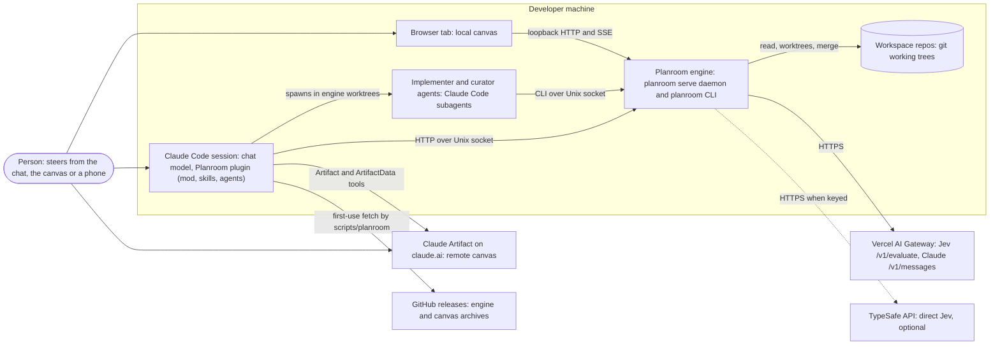
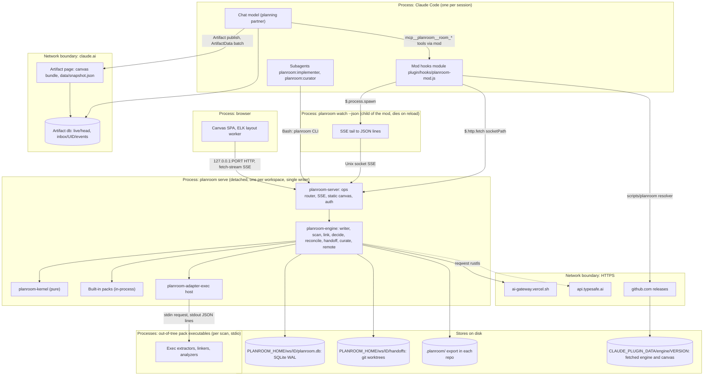
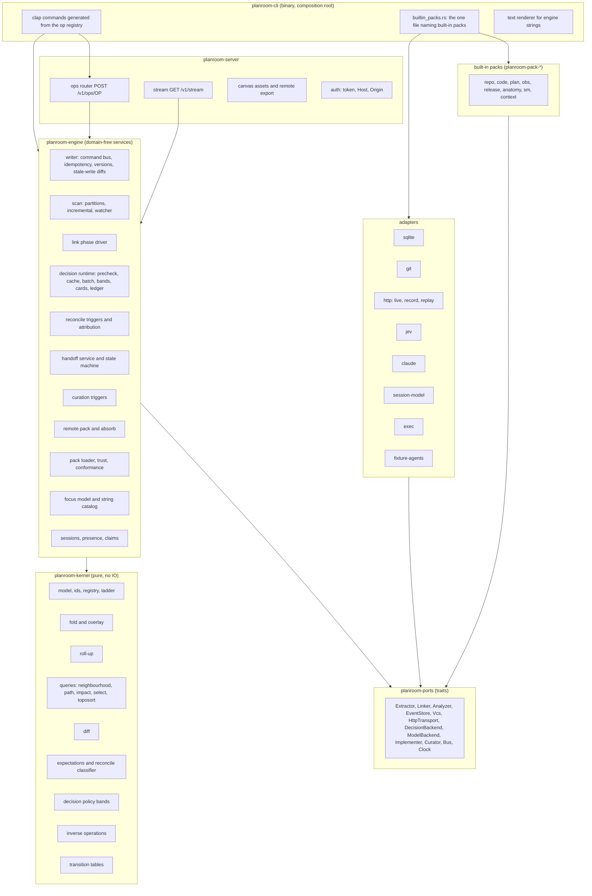
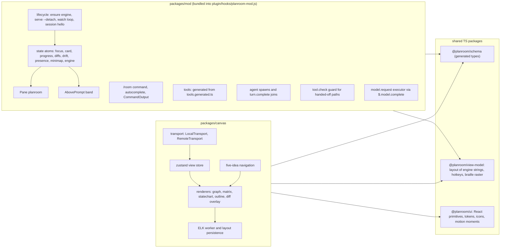
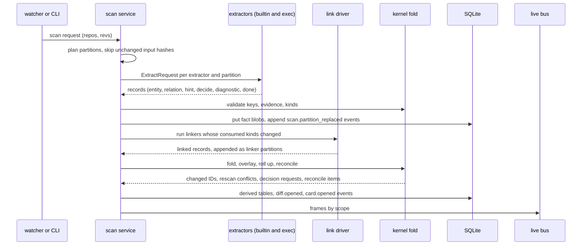
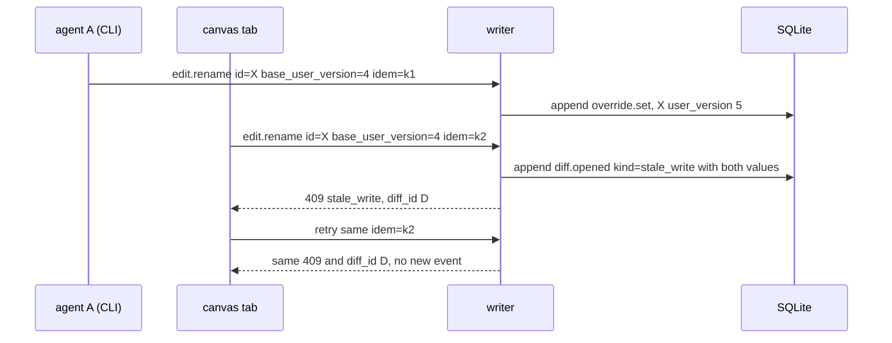
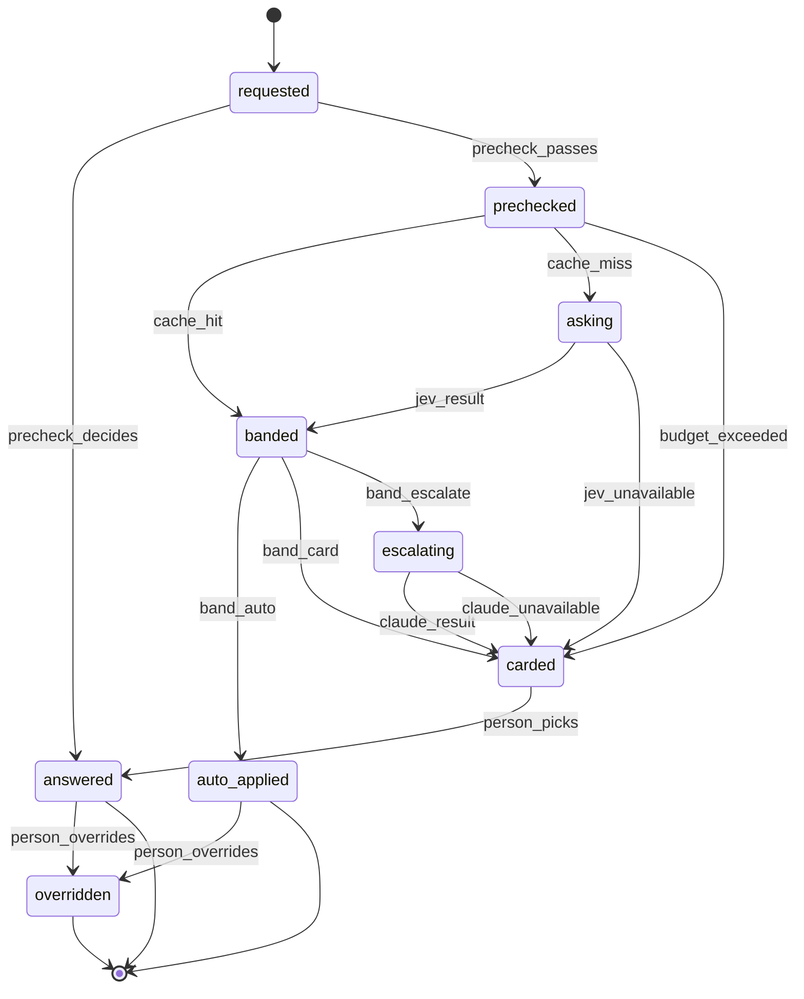
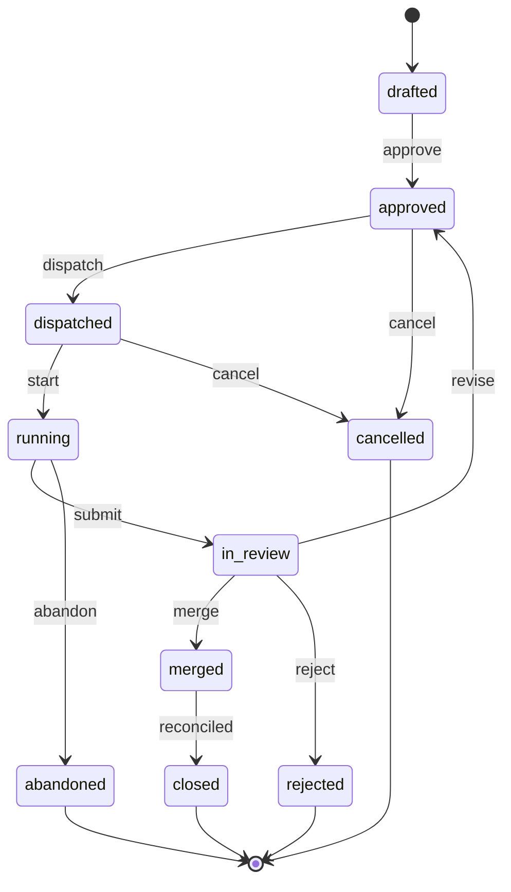
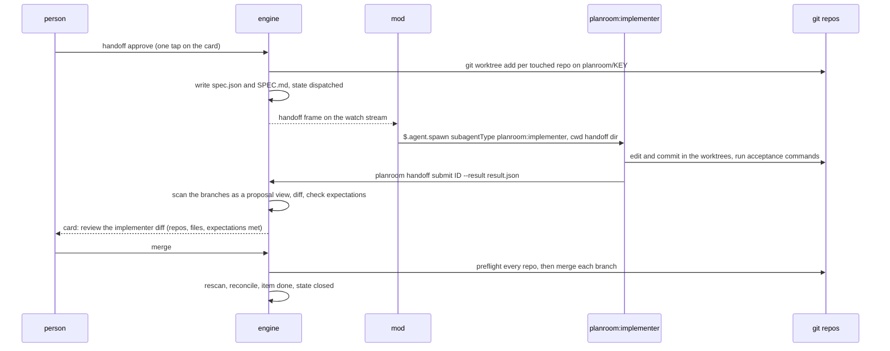

# Candidate architecture: extensibility-first

Phase 2 candidate, one of three. The lens: a domain-free kernel that never changes when a domain, language, lens or decision kind is added. Packs and adapters are the unit of growth, and the pack contract is clean enough that an out-of-tree pack or extractor is first-class. Every element below traces to a requirement or scenario in `KICKOFF.md`, and section 4.15 lists what is deliberately not extensible in v0.1.

How to read it. Section 0 is the idea on one page. Sections 1 to 16 follow the order the brief asks for. A fact measured in Phase 1 cites its note in `docs/contributing/research/` (for example "[jev.md §5]"). A claim nobody has measured yet is marked **[A]**, and section 16.2 lists each one with the spike that settles it.

---

## 0. The idea on one page

1. **A kernel that only knows graphs.** The kernel (`planroom-kernel`) knows entities, relations, evidence, provenance, events, views, expectations, diffs and decision records. It knows how to fold events, overlay corrections, roll edges up a ladder of levels, find paths, diff two graphs and classify mismatches. It does not know what a container, an alert rule or a plan item is. Kinds, levels, lenses, questions and decision kinds are data loaded from packs. A CI check fails if any crate other than the composition root names a pack's kind.
2. **First-party domains are packs that use the public contract.** Eight built-in packs (`repo`, `code`, `plan`, `obs`, `release`, `anatomy`, `sm`, `context`) live in `packs/<id>/` as a `pack.toml` plus an optional Rust crate. An out-of-tree pack is the same `pack.toml` plus an executable that speaks `planroom.extractor/v1` over stdio. The only privilege a built-in pack has is that its code runs in-process. A parity test runs a built-in extractor through the exec protocol and requires byte-identical facts, so the external path can never fall behind.
3. **Facts, not writes.** Extractors emit facts keyed by natural keys, with evidence. The kernel mints IDs, stores each extractor's output as a content-addressed partition referenced by one event, and overlays person corrections on top by stable ID. Corrections survive rescans because no extractor ever writes the layer a person edits. When a rescan contradicts a correction, the correction still wins and a diff opens.
4. **Three seams carry all growth.** Open kinds: a language pack emits the `code` pack's published hint kinds (`code.import`, `code.http_call`, `code.module`), and every code linker, roll-up, lens and question then works for that language. Decision requests: any pack code asks the decision runtime for a cheap decision and gets policy, caching, batching, cards and recording without writing any of it. Catalogs: questions, lenses, views and suggestions are served through a fixed set of operations.
5. **A fixed surface.** One operation registry in `planroom-schema` generates the CLI, the HTTP API, the mod's tools and the `/room` help. Packs extend what those operations serve, never the operations. Adding a domain adds zero CLI verbs, tools or slash commands (R14).
6. **Every outside party is an adapter behind a port, with a deterministic stand-in.** Jev, Claude on the gateway, Claude through the session's mod, git, SQLite, the implementer agent and the curator agent each sit behind a trait in `planroom-ports`. CI swaps each for a replay or fixture adapter, so no CI path needs a secret or a live model.

The biggest bets, each contained in section 16:

- **B1.** The exec protocol is complete, so out-of-tree packs are first-class (parity test).
- **B2.** Natural-key IDs plus field-level overrides with basis digests make corrections survive rescans, with everything else surfacing as a diff.
- **B3.** Domain logic fits in extractors, linkers and analyzers written as code, so the kernel needs no query language and no rule language.
- **B4.** The engine authors every human-readable string, so the three surfaces render the same output by construction.

---

## 1. Requirements to capabilities

### 1.1 Capability catalogue

Each capability has an ID used in the traceability table (section 14). "Owner" is where it lives: K kernel, E engine services, P pack, S surface, X repo and tooling.

| ID | Capability | Owner |
|---|---|---|
| CAP-01 | Workspace discovery (one repo, a folder of repos, or `planroom.toml`), scan orchestration across repos | E |
| CAP-02 | Fact ingestion: natural keys to IDs, evidence validation, content-addressed partitions | K, E |
| CAP-03 | Pack loader, registry, manifest validation, trust records | E |
| CAP-04 | Extractor contract `planroom.extractor/v1`: in-process and exec runtimes, one record format | ports, adapter-exec |
| CAP-05 | Universal tier: file tree, git history (co-change, ownership, churn), manifests | P `repo` |
| CAP-06 | Syntactic tier: tree-sitter imports and calls for TS/JS, Python, Go, Rust | P `code` |
| CAP-07 | Config tier: compose, OpenAPI, CI workflows, OTel, Prometheus, dashboards, package manifests | P `code`, `obs`, `release`, `anatomy` |
| CAP-08 | Link phase: cross-file and cross-repo resolution of hints into relations | E, P linkers |
| CAP-09 | Level ladder contributed by packs; faithful roll-ups with counts and witnesses | K |
| CAP-10 | Lenses and views as pack data; a closed set of canvas renderers | K, S |
| CAP-11 | Search over names, keys and paths (SQLite FTS5) | adapter-sqlite |
| CAP-12 | Named queries: neighbourhood, path with per-kind flow direction, why, impact, select, toposort | K |
| CAP-13 | Evidence, confidence and provenance on every record | K |
| CAP-14 | Confirm or reject any inferred fact | K |
| CAP-15 | Artifact anatomy: deterministic parsers, Claude segmentation, Jev relation classes, missing parts | P `anatomy` |
| CAP-16 | PR and review breakdown: thread status, touched components | P `anatomy` |
| CAP-17 | State machine extraction from code, docs and prose; checks, drift, step-through | P `sm`, S canvas |
| CAP-18 | Projects and plans: stages, methods, ghosts, acceptance, attachment to the system | P `plan`, K stance |
| CAP-19 | Plan lint: structural rules in code, semantic checks through Jev | P `plan` |
| CAP-20 | One set of stage prompts shared by the chat partner, engine Claude and the Artifact's `sample` | P `plan`, E |
| CAP-21 | Field-level overrides that survive rescans; rescan-conflict diffs | K |
| CAP-22 | Undo for every edit type, from stored inverse operations | K |
| CAP-23 | One diff engine: versions, drift, proposals, stale writes, rescan conflicts | K, S |
| CAP-24 | Expectations and boundary rules in the intended layer | K |
| CAP-25 | Reconciler: expected, in progress, done, unplanned, regression; on demand and on change | K, E |
| CAP-26 | Impact radius | K |
| CAP-27 | Change spec and hand-off state machine | E |
| CAP-28 | Engine-managed worktrees per touched repo; implementer port with agent and fixture adapters | E, adapters |
| CAP-29 | Merge and close the loop with reconciliation | E |
| CAP-30 | Guard: the chat partner cannot silently edit a handed-off change | S mod |
| CAP-31 | Decision runtime: precheck, cache, per-slice batching, policy bands, cards, escalation, recording, override | K policy, E |
| CAP-32 | Jev adapter (gateway and TypeSafe codecs), Claude adapter (messages, cached prefix), session model adapter | adapters |
| CAP-33 | Evals: independent labels, held-out split, runner, threshold fit, auto-action gate, eval table | X, E |
| CAP-34 | Spend ledger, budget guards, token budgets with a regression test | E, X |
| CAP-35 | Single-writer daemon, command log, idempotency keys, optimistic versions | E, adapter-sqlite |
| CAP-36 | Scoped live stream (SSE) under 1 s | server |
| CAP-37 | Sessions, presence, claims as leases that warn | E |
| CAP-38 | Context curation: candidates from implementer runs, triggers, curator port, proposals as diffs | P `context`, E |
| CAP-39 | CLI: one binary, `--json` envelope, error registry, pagination, size budgets | cli, schema |
| CAP-40 | Local HTTP API generated from the op registry; loopback and Unix socket; auth | server |
| CAP-41 | Mod: pane, band, status, `/room`, tools, agents, guards | S mod |
| CAP-42 | Canvas: renderers, five-idea navigation, layout worker with persisted positions, mobile, motion | S canvas |
| CAP-43 | Remote mode through the Artifact: pack, publish, live head, inbox absorb with attribution | E, S canvas |
| CAP-44 | Shared presentation model: engine-authored strings, `@planroom/view-model` | schema, packages |
| CAP-45 | One contract source, codegen to Rust and TS, drift tests | schema, xtask |
| CAP-46 | Plugin packaging, engine resolver with checksum verification, canvas assets | plugin, release |
| CAP-47 | Release workflow, reproducible archives, docs, art, changelog | X |
| CAP-48 | Repo layout, area contracts, boundary enforcement, generated directories, one task entry point | X |
| CAP-49 | Deterministic fallback when no model is reachable | E |
| CAP-50 | Defaults that remove settings: workspace detection, default view, next action, daemon autostart | E |
| CAP-51 | `.planroom/` export and import | E |
| CAP-52 | Security controls: server auth, untrusted input limits, injection handling, pack trust, redaction | all |

### 1.2 Requirements to capabilities

| Req | What it needs | Capabilities |
|---|---|---|
| R1 | Scan one repo or a workspace; a map at a glance; move from intent to code with faithful roll-ups; any language, and adding one never touches the core | CAP-01, 02, 04, 05, 06, 07, 08, 09, 10, 11, 50 |
| R2 | Relations of seven families (dependencies, dependents, data flow, deployment, co-change, ownership, plan links); "how does A reach B", "what does this touch", "why A depends on B"; evidence, confidence, confirm or reject | CAP-08, 10, 12, 13, 14, 26 |
| R3 | Break down prompts, docs, ADRs, specs, skills, agent configs, issues, PRs, commits, reviews, CI workflows, modules into parts with purpose, why, typed relations and what's missing; PR threads and touched parts | CAP-15, 16, 31 |
| R4 | State machines from code, config and prose; explicit and explorable; unreachable, dead end, missing transition, nondeterminism; step-through; prose-vs-code drift | CAP-17, 23 |
| R5 | Top-down planning through seven stages with methods; Claude checks, curates and extends; ghosts until accepted; next actions attach to real components; jump between stages | CAP-18, 19, 20, 31 |
| R6 | Shape map, plan and breakdowns on the canvas or by asking Claude; corrections survive rescans; conflicts become diffs | CAP-14, 21, 22, 23, 51 |
| R7 | Three kinds of diff in one engine and one visual language; boundary rules; reconciler on demand and on change with five classes | CAP-23, 24, 25, 26 |
| R8 | Approved change to a self-contained spec; a separate implementer in isolation; result as a diff; reconcile after merge; partner never silently implements | CAP-27, 28, 29, 30 |
| R9 | Jev for small decisions with three bands; declared policy and an eval per kind; every decision recorded, inspectable and overridable | CAP-31, 32, 33, 34, 49 |
| R10 | Many sessions, agents, tabs and projects on one workspace; no lost writes; safe retries; live updates; who works on what; user state never last-writer-wins | CAP-23, 35, 36, 37, 51 |
| R11 | Simple domain-free core that extends into a graph; domains as packs; v0.1 covers code, plans, observability, release, artifacts, workflows and state machines | CAP-02, 03, 04, 09, 10 and every P capability |
| R12 | Propose `CLAUDE.md` and `AGENTS.md` updates and skills from implementer history; trigger and on demand; proposals as diffs | CAP-38, 23 |
| R13 | Three surfaces on one model: mod beside the chat, canvas locally and as an Artifact, CLI and server; one plugin | CAP-39 to 44, 46, 49 |
| R14 | Five ideas only; one CLI entry point; one `/room` family; better defaults instead of settings | CAP-39, 41, 42, 44, 50 |
| R15 | Release at the Iris bar, including its security posture | CAP-45, 46, 47, 52 |
| R16 | Stated purpose per directory; area contracts; enforced boundaries in Rust and TS; generated code marked; conventions in `AGENTS.md`; decision records for layout changes | CAP-45, 48 |

---

## 2. Architecture

### 2.1 C4 context



### 2.2 C4 containers, with process, store and network boundaries



Boundaries, one row each:

| Boundary | Crosses it | Protocol | Contract |
|---|---|---|---|
| Claude Code to daemon | mod reads and writes | HTTP/1.1 over a Unix socket at `$XDG_RUNTIME_DIR/planroom/<ws>.sock` (fallback `$PLANROOM_HOME/run/<ws>.sock`), mode 0600 in a 0700 dir | `planroom.api/v1` |
| Mod to watch child | live frames | child stdout, JSON lines | `planroom.api/v1` stream frames |
| Subagents and shells to daemon | `planroom` CLI | CLI proxies to the socket, or runs in-process when it holds the writer lock | `planroom.cli/v1` |
| Browser to daemon | canvas | loopback TCP `127.0.0.1:<random port>`, bearer token, Host and Origin checks | `planroom.api/v1` |
| Daemon to exec packs | extract, link, analyze | child process, stdin one request, stdout JSON lines, stderr logs | `planroom.extractor/v1` |
| Daemon to SQLite | all state | rusqlite, one writer connection, read-only readers | `planroom.event/v1`, migrations |
| Daemon to repos | read files and history; write worktrees and merges | gix (filesystem) | none (git) |
| Daemon to gateway and TypeSafe | Jev and Claude | HTTPS, rustls, pinned models | adapter codecs, recorded fixtures |
| Session to claude.ai | publish, db reads and writes | Artifact and ArtifactData tools (main session only) | `planroom.remote/v1` |
| Artifact page to its db | viewer edits, live head | `claude.use("db")` | `planroom.remote/v1` |
| Resolver to GitHub | engine and canvas archives | HTTPS, `SHA256SUMS` | release asset layout |

### 2.3 How the parts connect

| From | To | How | Why this way |
|---|---|---|---|
| Mod | Engine | `$.http.fetch(url, { socketPath })` with a mod-side timeout wrapper; `planroom serve --detach` started by `$.process.run` in `session.start` | `http.fetch` has a socket path but no timeout or streaming; spawned children die on reload [mod-api.md §7] |
| Mod | Live updates | `planroom watch --json --scope focus` through `$.process.spawn`; frames written to `$.state` atoms | the only streaming channel a mod has; cheap to lose on reload because the daemon outlives it |
| Chat model | Engine | `mcp__planroom__room_*` tools registered by the mod, generated from the op registry | one tool path; no MCP server (section 15, D7) |
| Implementer and curator agents | Engine | `"${CLAUDE_PLUGIN_ROOT}/scripts/planroom" handoff submit …` and `curate propose …` through Bash | agents need only the CLI; they run in engine-made worktrees |
| Canvas (local) | Engine | `POST /v1/ops/<op>`, `GET /v1/stream` read with `fetch` streaming (so it can carry the bearer header) | same ops as every other surface |
| Canvas (remote) | Workspace | reads `./data/snapshot.json` and `db.doc("live/head")`; writes `inbox/{self}/events/<id>`; the session absorbs | pages can't reach localhost [KICKOFF verified facts] |
| Engine | Jev | `planroom-adapter-jev` codec over `planroom-adapter-http` (live, record or replay transport) | two codecs, one normalized model [jev.md §7] |
| Engine | Claude | `planroom-adapter-claude` (gateway `/v1/messages`), or `planroom-adapter-session-model`, which hands the request to the mod's `$.model.complete` when no gateway key is set | the mod already holds session credentials; no blank feature for users without a gateway key |
| Engine | Git | `planroom-adapter-git` (gix 0.90, confined to one crate) [rust-stack.md §6] | pure Rust, one module to bump |
| Engine | Exec packs | `planroom-adapter-exec` | the out-of-tree path |

### 2.4 C4 components: the engine



Dependency direction: `schema <- kernel <- ports <- {pack-sdk, packs, adapters}`, `engine -> {kernel, ports}`, `server -> engine`, and only `cli` sees everything. Section 9.3 shows how CI enforces it.

### 2.5 C4 components: the mod and the canvas



### 2.6 The core flows

Scan to live update:



Edit with a stale base becomes a diff:



---

## 3. The kernel data model and the event model

### 3.1 Primitives

All types live in `planroom-schema` (serde and schemars) so they are the one contract source. The kernel adds behaviour, not types.

```rust
pub struct EntityId(String);        // "storefront:code.component:src/cart"
pub struct RelationId(String);      // "rel:7k2m9q4x1c0a" (hash of kind, from, to, discriminator)
pub struct KindId(String);          // "code.component": "<pack>.<kind>", open set
pub struct LevelId(String);         // "component": contributed by a pack's [[level]]

pub enum Layer  { Actual, Intended }
pub enum Stance { Asserted, Proposed }                  // Proposed is a ghost
pub enum Source { Extracted, Linked, Inferred, Person, Agent, Imported }

pub struct Provenance {
    pub source: Source,
    pub by: ActorRef,               // person:local, agent:<session>/<name>, extractor:code.ts_imports@3
    pub event: Option<EventId>,     // the event that asserted it
    pub partition: Option<PartitionRef>,
    pub decision: Option<DecisionId>,
    pub confidence: f32,            // 1.0 for direct evidence and person edits
}

pub struct Evidence {               // same shape as TRUTH.json evidence
    pub path: String,               // "<repo>/<repo-relative path>"
    pub line: u32,
    pub end_line: Option<u32>,
    pub contains: String,           // exact substring of that line, at most 160 chars
    pub rev: Option<String>,        // commit, branch or "post_handoff"-style state
}

pub struct Entity {
    pub id: EntityId, pub kind: KindId, pub level: LevelId,
    pub parent: Option<EntityId>, pub name: String, pub props: Props,
    pub layer: Layer, pub stance: Stance, pub prov: Provenance,
    pub evidence: Vec<Evidence>, pub project: Option<ProjectId>,
    pub hidden: bool, pub fact_version: Version, pub user_version: Version,
}

pub struct Relation {
    pub id: RelationId, pub kind: KindId, pub from: EntityId, pub to: EntityId,
    pub props: Props, pub evidence: Vec<Evidence>, pub confidence: f32,
    pub layer: Layer, pub stance: Stance, pub prov: Provenance,
    pub project: Option<ProjectId>, pub hidden: bool,
    pub fact_version: Version, pub user_version: Version,
}

pub struct View { pub id: ViewId, pub lens: LensId, pub level: LevelId,
                  pub focus: Option<EntityId>, pub fold: FoldSpec, pub project: Option<ProjectId> }
```

`Props` is a JSON object validated against the kind's `props` schema at ingest. Hints (section 4.4) use the same shape as entities but never render.

The kernel defines a closed set of domain-free kinds, all under `kernel.`:

| Kind | Class | Why it is in the kernel |
|---|---|---|
| `kernel.repo` | entity | IDs and scans are scoped by repo; a workspace holds several (R1, R10) |
| `kernel.group` | entity | regrouping is a correction any domain needs (R6, S4) |
| `kernel.expectation` | entity, intended layer | boundary rules and intended relations; the reconciler reads them (R7) |
| `kernel.touches` | relation | "next actions name what they touch" for any domain (R5) |
| `kernel.covers` | relation | a work item covers an expectation (R7 classification) |

### 3.2 Stable IDs

- Entity ID: `<scope>:<kind>:<key>`. `scope` is a repo name, or `ws` for workspace-level entities such as a container declared in compose but built in another repo. `key` comes from the kind's `identity` template, for example `{path}` for a component directory or `{path}#{name}` for an alert rule.
- Relation ID: `rel:` plus 12 base32 characters of `sha256(kind, from, to, discriminator)`, where `discriminator` is the kind's declared distinguishing prop (`via` for `code.http`). The readable `kind`, `from` and `to` travel alongside it.
- Extractors never mint IDs. They emit `{kind, key, scope?}` natural keys; the kernel builds the ID. That keeps the ID scheme a kernel decision and lets an exec extractor in any language reference an entity another pack emits.
- Lookups accept any unique suffix (`cart`, `src/cart`), so agents and people rarely type a full ID. An ambiguous suffix returns `ambiguous_ref` with the candidates.

### 3.3 Layers, stance and source

- **Layer** is `actual` (what the code says) or `intended` (what the person wants). Drift is a diff between the two.
- **Stance** is orthogonal to layer. A ghost is any assertion with `stance: proposed`, in either layer: a proposed plan item, a proposed grouping, a proposed boundary rule. Only asserted records count for reconciliation, lint completeness and versions.
- **Source** records who produced it. `Extracted` and `Linked` come from packs. `Inferred` comes from an auto-acted decision. `Person` and `Agent` come from edits. `Imported` comes from `.planroom/` or the Artifact inbox, and keeps the original actor.
- An agent's edit is always `proposed`. Only a person's press makes it asserted (`ghost.accepted`). Agent edits from one chat turn batch into one card ("Apply Claude's 2 edits: group cart and checkout as purchase"), so asking Claude to tweak costs one keystroke, and R5's "nothing the AI invents counts until a person accepts it" holds for every write.

### 3.4 Events

An event is an immutable, append-only record. Everything else is derived from events plus the fact blobs they reference.

```rust
pub struct Event {
    pub seq: Seq,                 // workspace-wide order, the SSE id; within 2^53 (section 8.2)
    pub id: EventId,              // uuid v7
    pub ws: WorkspaceId,
    pub project: Option<ProjectId>,
    pub actor: Actor,             // { kind: person|agent|automation|extractor, id, surface, session }
    pub cause: Option<Cause>,     // event, decision, handoff or scan that led to it
    pub idem: IdemKey,            // unique; a retry with the same key replays the stored outcome
    pub kind: EventKind,          // closed set below
    pub payload: EventPayload,    // typed per kind
    pub inverse: Option<Vec<Op>>, // computed at apply time; what undo applies
    pub schema: u32,              // planroom.event version
    pub at: Timestamp,            // engine clock
}
```

The event kinds are a closed, kernel-defined set. Packs never add event kinds; they add kinds of records that these events carry.

| Event kind | Payload | Written by | Undo |
|---|---|---|---|
| `scan.partition_replaced` | `{extractor, version, partition, input_hash, digest, counts}` | scan | rescan, not undo |
| `scan.completed` | `{run, repos: {name: rev}, stats, duration_ms}` | scan | n/a |
| `entity.asserted` | `{id, kind, layer, stance, parent?, name?, props?, project?}` | person, agent | inverse restores prior or retracts |
| `entity.retracted` | `{id, layer}` | person, agent | re-assert |
| `relation.asserted`, `relation.retracted` | `{kind, from, to, layer, stance, props?, project?}` | person, agent | inverse |
| `override.set` | `{target, field, value, basis}` | person, agent (proposed) | prior value or clear |
| `override.cleared` | `{target, field}` | person | re-set |
| `ghost.accepted`, `ghost.rejected` | `{targets[], card?}` | person only | back to proposed |
| `project.created`, `project.updated` | `{project, name, intent?}` | person | inverse |
| `version.cut`, `version.withdrawn` | `{project, n, label, at_seq}` | person | withdraw |
| `view.saved`, `view.deleted` | `{view}` | person | inverse |
| `layout.pinned`, `layout.unpinned` | `{view, node, x, y}` | person | inverse |
| `decision.recorded` | `{decision}` | engine | override instead |
| `decision.overridden` | `{decision, pick, reason?}` | person | override back |
| `card.opened`, `card.closed` | `{card}` | engine, person | n/a |
| `diff.opened`, `diff.resolved` | `{diff}`, `{diff, resolution}` | engine, person | reopen |
| `handoff.transitioned` | `{handoff, from, to, event, data}` | engine, agent, person | per machine |
| `claim.acquired`, `claim.released` | `{subject, holder, lease_until, note?}` | agent, person | release |
| `session.joined`, `session.left` | `{session, actor, surface}` | engine | n/a |
| `remote.absorbed` | `{batch, uids, count, cursor}` | engine | per imported edit |
| `pack.trusted`, `pack.disabled` | `{pack, path, manifest_digest}` | person | inverse |
| `undo.applied` | `{target_event, applied[]}` | person, agent | redo is undo of the undo |

Presence heartbeats are not events. They live in memory, are mirrored to the `presence` table every 10 s, and are streamed as `presence` frames.

### 3.5 What is derived

Every table below is rebuildable from `events` plus `fact_blobs`. `planroom doctor --rebuild` rebuilds them into a scratch database and compares digests, and a property test does the same for random event logs.

| Derived | From | Used by |
|---|---|---|
| `entities`, `relations`, `evidence` (resolved view) | partitions, overlay events | every query |
| `hints` | partitions | linkers |
| `rollups` (per level and lens) | resolved view, ladder | map, canvas |
| `fts` (FTS5) | entity names, keys, paths | `find` |
| `decisions`, `cards` | `decision.*`, `card.*` | decide, focus |
| `diffs` | `diff.*` | diff, focus |
| `handoffs` | `handoff.transitioned` | handoff, reconcile |
| `claims` | `claim.*` | presence, reconcile |
| `versions`, `projects`, `views` | their events | intent, map |
| `idem` | writer results | retries |

Two tables are caches, not derived state, and are allowed to be last-writer-wins because no person authored them: `layouts` (positions computed by the canvas's ELK worker, keyed by view and structure hash) and `decision_cache`. A person's pinned position is an event (`layout.pinned`) and wins over the cache.

### 3.6 Overlay resolution

The kernel resolves each field of each record by precedence, highest first:

1. a person override, or an accepted agent override;
2. an inferred value from an auto-acted decision (reversible, recorded);
3. a linked value;
4. an extracted value.

Proposed overrides never apply to the asserted view. They render as ghosts on top of it. `GraphView::at(seq, project, include_proposed)` gives a resolved graph at any point in the log, which is what versions and diffs use.

### 3.7 Projects and versions

- A project is a named scope for intent: its plan items, its expectations and its views. The actual layer is shared by all projects in a workspace (R10). Expectations with no project form the workspace baseline (standing boundary rules).
- A version is `(project, seq)`. `version.cut` records the seq and a label. Version 1 is cut when a project is created, so S3's "accepted plan becomes version 2" is the second cut.
- A version diff is `diff(GraphView::at(v1.seq, project), GraphView::at(v2.seq, project))`, restricted to records scoped to that project plus the relations they hold to the shared system.

### 3.8 Provenance

Every resolved field can be traced: `planroom ask why <ref>` returns the winning source, the event or partition behind it, the extractor or linker ID and version, the decision record if one acted, the evidence list, and the losing values below it. That is R2's "why do you think A depends on B" for any record, from one kernel function, `kernel::overlay::explain`.

### 3.9 Corrections survive rescans (R6)

An override records the value the person saw when they made it, as `basis = sha256(resolved value below the override)`. On every rescan, for each changed ID, the kernel compares the new underlying value with each override's basis:

| New underlying value | Outcome |
|---|---|
| unchanged | the override applies, nothing to say (S4 step 5: the `purchase` regroup survives) |
| changed, now equal to the override | the override is marked redundant and applies; no interruption |
| changed to something else | the override still applies; a `rescan_conflict` diff opens with three choices: keep mine, take the scan's, edit |
| the target vanished | the override is kept as orphaned; the decision kind bound to the `rescan.retarget` role (the `repo` pack's `rename_follow`, section 5.2) runs on git rename evidence; above its bar the override is retargeted (recorded and undoable), otherwise one card or a `rescan_conflict` diff |

Why this works: extraction writes only partitions, which only feed the base of the overlay. Nothing a scan does can remove an override event. The only way a correction stops applying is a person's resolution, an undo, or a recorded `rename_follow` retarget that a person can reverse.

Hidden noise and rejected facts are overrides too (`field: hidden` and `field: rejected` on a record), so "hide noise" and "reject this inferred dependency" survive rescans the same way.

### 3.10 Writes, retries and stale writes (R10, S8)

- Every write is a command to the one writer in the daemon. Commands carry an idempotency key (`Idempotency-Key` header, or the CLI's `--idem`, defaulting to a hash of the command and the caller's session). The writer stores the outcome in `idem` in the same transaction as its events. A retry with the same key returns the stored outcome and appends nothing. The same key with a different payload returns `idempotency_conflict`.
- Writes to user-authored state carry `base_user_version` for each record they touch. Extraction bumps only `fact_version`, so a background rescan never makes a person's edit stale.
- If a base version is behind, nothing is merged. The writer appends `diff.opened {kind: stale_write, attempted, current}` and returns `409 stale_write` with the diff ID. The person resolves it (keep mine, keep theirs, edit) in Diffs. An agent that gets `stale_write` re-reads and decides whether to propose again. User-authored state is therefore never last-writer-wins.
- One SQLite transaction per command: events, `idem`, derived rows, then a broadcast on the in-process bus. SSE subscribers get the frame after commit, so no client sees a write that could still roll back.

### 3.11 Undo

Every edit event stores its `inverse` operations, computed by `kernel::undo` against the state it was applied to. `undo` applies the inverse as a new event (`undo.applied`) with base versions taken from the original event's result. If the record moved on since, the undo itself becomes a `stale_write` diff instead of clobbering newer work. Undo of an auto-acted decision is `decision.overridden`, which applies the action's inverse. S15's "every edit type has an undo test" is a generated test: for each edit op in the registry, apply, undo, and compare the resolved view with the original.

### 3.12 Store schema (SQLite, rusqlite 0.41 bundled, WAL)

```sql
-- authoritative
CREATE TABLE events (seq INTEGER PRIMARY KEY, id TEXT UNIQUE NOT NULL, ws TEXT NOT NULL,
  project TEXT, actor TEXT NOT NULL, actor_kind TEXT NOT NULL, surface TEXT, session TEXT,
  cause TEXT, idem TEXT UNIQUE NOT NULL, kind TEXT NOT NULL, payload TEXT NOT NULL,
  inverse TEXT, schema INTEGER NOT NULL, at TEXT NOT NULL);
CREATE TABLE fact_blobs (digest TEXT PRIMARY KEY, extractor TEXT NOT NULL,
  version INTEGER NOT NULL, records BLOB NOT NULL);           -- sorted JSON lines
CREATE TABLE partitions (extractor TEXT, partition TEXT, input_hash TEXT NOT NULL,
  digest TEXT NOT NULL, seq INTEGER NOT NULL, PRIMARY KEY (extractor, partition));
CREATE TABLE idem (key TEXT PRIMARY KEY, request_hash TEXT NOT NULL, outcome TEXT NOT NULL, seq INTEGER);
CREATE TABLE ledger (id INTEGER PRIMARY KEY, scope TEXT, run TEXT, backend TEXT, model TEXT,
  cost_usd TEXT, input INTEGER, output INTEGER, cache_read INTEGER, cache_write INTEGER,
  prefix_hash TEXT, generation_id TEXT, at TEXT);
-- derived (rebuildable)
CREATE TABLE entities (...); CREATE TABLE relations (...); CREATE TABLE evidence (...);
CREATE TABLE hints (...); CREATE TABLE rollups (...); CREATE VIRTUAL TABLE fts USING fts5(...);
CREATE TABLE decisions (...); CREATE TABLE cards (...); CREATE TABLE diffs (...);
CREATE TABLE handoffs (...); CREATE TABLE claims (...); CREATE TABLE versions (...);
CREATE TABLE projects (...); CREATE TABLE views (...);
-- caches
CREATE TABLE layouts (view TEXT, structure_hash TEXT, positions TEXT, at TEXT, PRIMARY KEY (view, structure_hash));
CREATE TABLE decision_cache (key TEXT PRIMARY KEY, evaluation TEXT NOT NULL, model TEXT, at TEXT);
CREATE TABLE presence (actor TEXT, session TEXT, surface TEXT, focus TEXT, last_beat TEXT, PRIMARY KEY (actor, session));
```

Migrations are numbered SQL files in `crates/adapters/sqlite/migrations/NNNN_*.sql`, applied by `PRAGMA user_version`. A test opens a committed fixture database from every released schema version. FTS5 being compiled into the `bundled` build is **[A]** (spike in the walking skeleton; fallback: `LIKE` over a trigram table).

The daemon keeps the resolved graph in memory as a `GraphIndex` (petgraph `StableGraph` plus hash maps), loaded from the derived tables at start and updated by the writer. Reads take a read lock on it. That keeps queries free of SQL and lets the kernel stay pure.

### 3.13 Kernel purity rules

- No IO, no clock, no randomness: time and IDs come in through `Clock` and `IdGen` arguments.
- Depends only on `planroom-schema`, `petgraph`, `similar` (text hunks for diffs), `sha2` (basis digests and IDs) and `serde_json`.
- Names no pack kind. `cargo xtask check` scans the string literals of `kernel`, `ports`, `engine` and `server` against every kind and pack ID in `packs/*/pack.toml` and `examples/packs/*/pack.toml`, and fails on any match outside `kernel.*`.
- Size budget: about 6,000 lines of non-test Rust at v0.1. Growing past 8,000 needs a decision record, which is a nudge to put the new thing in a pack.

---

## 4. Packs, extractors and adapters

### 4.1 What a pack is

A pack is a directory with a `pack.toml` manifest. Built-in and out-of-tree packs have the same shape. A built-in pack adds a Rust crate whose functions the manifest names as `builtin:` runtimes; an out-of-tree pack adds executables it names as `exec` runtimes.

```text
packs/obs/                      a built-in pack            examples/packs/flags/        an out-of-tree pack
  pack.toml                     manifest                    pack.toml
  AGENTS.md                     owns, depends on, test      README.md
  Cargo.toml, src/lib.rs        planroom-pack-obs crate     exec/flags.py               stdlib Python, speaks the protocol
  queries/*.scm                 tree-sitter queries         evals/flag_removable/
  prompts/*.md                  Claude prompt templates       cases.jsonl, LABELLING.md, responses/, result.json
  evals/<kind>/                 eval cases and results      tests/
  tests/inputs/, expected.jsonl conformance fixtures          inputs/, expected.jsonl
```

The eight built-in packs and what each owns:

| Pack | Owns | Requires | v0.1 domain (R11) |
|---|---|---|---|
| `repo` | files, dirs, languages, commits, people, tags, branches, manifests; co-change, ownership, churn | none | code (universal tier) |
| `code` | system, containers, components, modules; imports, HTTP calls and routes, queues, databases, compose, OpenAPI; the request-flow and dependency lenses | `repo` | code |
| `plan` | projects' plan items, stages, methods, lint, stage prompts, priority and MVP line, pre-mortem risks | `repo`, `code` | plans |
| `obs` | OTel usage, collector pipelines, scrape targets, alert rules, dashboards; coverage | `code` | observability |
| `release` | versions, tags, changelogs, publish and deploy edges, pins and staleness, release order | `repo`, `code` | release management |
| `anatomy` | parts of prompts, docs, ADRs, specs, skills, agent configs, issues, PRs, commits, reviews, CI workflows, modules | `repo`, `code` | artifacts (R3); named `anatomy` so it never collides with "Claude Artifact" |
| `sm` | machines, states, transitions, guards from code, docs and prose; checks, drift, step | `repo`, `anatomy` | workflows and state machines (R4) |
| `context` | curation candidates from implementer runs, `CLAUDE.md`/`AGENTS.md`/skill proposals | `repo`, `anatomy` | context curation (R12) |

### 4.2 `pack.toml` (`planroom.pack/v1`)

The manifest's schema is generated from `planroom_schema::pack::PackManifest` and committed as `schema/planroom-pack.v1.schema.json`, so an out-of-tree author can validate it with any JSON Schema tool. TOML is parsed into the same type.

| Table | Field | Type | Meaning |
|---|---|---|---|
| `[pack]` | `id` | `^[a-z][a-z0-9_]{1,15}$` | namespace for everything the pack declares |
| | `version`, `contract` | semver, integer | pack version; pack contract version (1) |
| | `title`, `summary` | string | shown in `planroom pack list` |
| | `requires` | map of pack ID to semver range | packs whose open kinds this pack emits or reads |
| | `priority` | integer | ordering for default views and suggestions |
| `[[level]]` | `id`, `rank`, `title` | | contributes one rung to the workspace ladder |
| `[[kind]]` | `id`, `class` | `entity`, `relation` or `hint` | |
| | `level`, `parents` | level ID, kind IDs | where an entity sits and what may contain it |
| | `from`, `to` | kind IDs | allowed endpoints of a relation |
| | `identity` | template, for example `"{path}#{name}"` | natural key |
| | `scope` | `repo` (default) or `ws` | ID scope |
| | `props` | JSON Schema object | validated at ingest |
| | `open` | bool, default false | other packs may emit records of this kind |
| | `discriminator` | prop name | distinguishes parallel relations (`via`) |
| | `rollup` | `count` (default), `none`, or `{ as = "<kind>" }` | how the relation rolls up |
| | `flow` | `forward` (default) or `reverse` | direction a path follows (queue consume flows from the queue to the consumer) |
| | `glyph`, `label`, `search` | icon ID from `@planroom/ui`, label, indexed props | |
| | `needs_target` | bool, default false | raises the `attach.target` role when such an entity has no `kernel.touches` (next actions) |
| `[[extractor]]`, `[[linker]]`, `[[question]]` | `id`, `version` | | version bump invalidates the cache |
| | `runtime` | `builtin:<crate>::<fn>` or `exec` | |
| | `command` | argv, relative to the pack dir | for `exec` |
| | `tier` | `universal`, `syntactic`, `precise`, `config`, `inference` | extractors only |
| | `inputs`, `languages`, `granularity` | globs, language IDs, `file`/`repo`/`workspace` | extractors only |
| | `consumes`, `emits`, `after` | kind IDs, linker IDs | link-phase ordering |
| | `args`, `slice`, `budget_tokens`, `role` | | questions only |
| | `timeout_ms`, `max_file_bytes` | defaults 60,000 and 1 MiB | |
| `[[lens]]` | `id`, `title`, `relations` (`[{kind, flow?}]`), `level`, `renderer`, `highlight` | | renderer is one of `graph`, `matrix`, `statechart`, `outline` |
| `[[view]]` | `id`, `lens`, `level`, `fold`, `priority`, `empty_text`, `empty_action` | | default views; empty states are data, never blank |
| `[[decision]]` | section 5.2 | | |
| `[[prompt]]` | `id`, `path`, `version`, `output` (schema ref) | | stable cached prefixes |
| `[[suggestion]]` | `id`, `question`, `when` (`non_empty`), `text`, `priority` | | candidates for the one next action |
| `[[trigger]]` | `id`, `on` (event kind), `every`, `run` (question or op) | | R12's "every N runs or after a merge" |
| `[ext]` | any | opaque to the kernel | pack-private config, read only by the pack's own code (the plan pack's stage definitions live here and are served through its `plan.stage` question) |

An abridged built-in example, `packs/obs/pack.toml`:

```toml
[pack]
id = "obs"
version = "0.1.0"
contract = 1
title = "Observability"
summary = "Telemetry, scraping, alerts and dashboards, and what they leave unwatched."
requires = { code = "^0.1" }
priority = 60

[[kind]]
id = "alert_rule"
class = "entity"
level = "component"
parents = ["code.module"]
identity = "{path}#{name}"
props = { type = "object", required = ["expr"], properties = { expr = { type = "string" }, severity = { type = "string" } } }
glyph = "bell"
label = "Alert rule"
search = ["name"]

[[kind]]
id = "watches"
class = "relation"
from = ["obs.alert_rule"]
to = ["code.container"]
discriminator = "metric"

[[extractor]]
id = "prometheus_rules"
version = 1
tier = "config"
runtime = "builtin:planroom_pack_obs::prometheus_rules"
inputs = ["**/alerts.yml", "**/*.rules.yml"]
granularity = "file"
emits = ["obs.alert_rule", "obs.selects_metric"]

[[linker]]
id = "watches"
version = 1
runtime = "builtin:planroom_pack_obs::link_watches"
consumes = ["obs.selects_metric", "obs.scrape_target", "obs.emits_metric", "code.container"]
emits = ["obs.watches"]

[[question]]
id = "unmonitored"
title = "What's unmonitored?"
runtime = "builtin:planroom_pack_obs::unmonitored"
budget_tokens = 900

[[lens]]
id = "observability"
title = "Observability"
relations = [{ kind = "obs.exports_telemetry" }, { kind = "obs.scrapes" }, { kind = "obs.queries" }, { kind = "obs.watches" }]
level = "container"
renderer = "graph"
highlight = "obs.unmonitored"

[[suggestion]]
id = "unmonitored"
question = "obs.unmonitored"
when = "non_empty"
text = "{count} runtime containers have no alert watching them"
priority = 60
```

### 4.3 Kinds: open, closed and namespaced

- Every kind ID is `<pack>.<kind>`. The kernel schema types `KindId` as an open string with pattern `^[a-z][a-z0-9_]*\.[a-z][a-z0-9_]*$`, so adding a pack never changes a schema.
- A pack may emit records of its own kinds, and of another pack's kinds only when that kind is `open = true` and the pack lists the owner in `requires`. The `code` pack publishes these open kinds as its language seam:

| Open kind | Class | Props | Consumed by |
|---|---|---|---|
| `code.module` | entity | `language`, `path` | component rules, roll-ups, every code lens |
| `code.container` | entity (scope `ws`) | `class` (`service`, `library`, `queue`, `datastore`, `observability`, `tooling`) | everything at container level |
| `code.import` | hint | `from`, `spec`, `external` | `code.resolve_imports` |
| `code.http_call` | hint | `from`, `url` or `base_env` plus `path`, `method` | `code.runtime_wiring` |
| `code.http_route` | hint | `from`, `method`, `path` | `code.runtime_wiring` |
| `code.queue_op` | hint | `from`, `op` (`publish`/`consume`), `key`, `url_env` | `code.runtime_wiring` |
| `code.db_open` | hint | `from`, `url_env` | `code.runtime_wiring` |
| `code.env_read` | hint | `from`, `name` | `code.runtime_wiring` |
| `obs.emits_metric` | hint (owned by `obs`) | `from`, `metric`, `instrument` | `obs.watches` |

Reading another pack's kinds, as linker input or in a question's slice, needs only the `requires` entry; emitting them also needs `open = true`. A language pack therefore needs no new kinds. It emits these, and the existing linkers do the rest. That is what "a new language works through the extractor contract alone" (S10) means here.

### 4.4 The extractor contract (`planroom.extractor/v1`)

One record format serves three phases, and two runtimes speak it.

| Phase | Runs | Input | Output |
|---|---|---|---|
| `extract` | per partition (file, repo or workspace), only when its input hash changed | files of one repo matching `inputs` | entities, relations, hints, decision requests, diagnostics |
| `link` | after extraction, when any consumed kind changed | the current records of the consumed kinds | relations and entities (with merged evidence) |
| `analyze` | on `ask`, cached per seq | a slice from a named kernel query, plus question args | one `Answer` record |

The request, one JSON document on stdin (exec) or a struct (in-process):

```json
{"format":"planroom.extractor/v1","phase":"extract","id":"ruby.lexical","version":1,
 "workspace":{"id":"ws_7f3a","root":"/tmp/fx"},
 "repo":{"name":"platform","root":"/tmp/fx/platform","rev":"9c1e…","branch":"main"},
 "files":[{"path":"tools/healthcheck.rb","sha256":"…","bytes":1240,"language":"ruby"}],
 "removed":[],"options":{},"limits":{"max_records":200000,"deadline_ms":60000}}
```

The records, one JSON object per line on stdout:

```json
{"entity":{"kind":"code.container","key":"healthcheck","scope":"ws","name":"healthcheck","props":{"class":"tooling"},"evidence":[{"path":"tools/healthcheck.rb","line":9,"contains":"require 'net/http'"}]}}
{"entity":{"kind":"code.module","key":"tools/healthcheck.rb","parent":{"kind":"code.container","key":"healthcheck","scope":"ws"},"props":{"language":"ruby","path":"tools/healthcheck.rb"}}}
{"hint":{"kind":"code.import","key":"tools/healthcheck.rb@net/http","props":{"from":"tools/healthcheck.rb","spec":"net/http","external":true},"evidence":[{"path":"tools/healthcheck.rb","line":9,"contains":"require 'net/http'"}]}}
{"hint":{"kind":"code.http_call","key":"tools/healthcheck.rb:15","props":{"from":"tools/healthcheck.rb","url":"http://orders:8080/healthz","method":"GET"},"evidence":[{"path":"tools/healthcheck.rb","line":15,"contains":"'orders' => 'http://orders:8080/healthz',"}]}}
{"decide":{"kind":"flags.flag_removable","subject":{"kind":"flags.flag","key":"gift_wrap"},"state":{"enabled":false,"readers_on_main":[]}}}
{"diagnostic":{"level":"warn","code":"partial_parse","path":"tools/legacy.rb","message":"…"}}
{"done":{"files":1,"records":4}}
```

The rules the kernel enforces on every record, whichever runtime produced it:

1. Natural keys only; no IDs. Unknown kinds, kinds the pack may not emit, and props failing the kind's schema are rejected with a diagnostic, and the rest of the partition is kept.
2. Evidence paths are repo-relative on input and become `<repo>/<path>`. Each `contains` must be an exact substring of that line of the file at that rev, checked at ingest against the line index. This catches extractor drift and is the same rule `TRUTH.json` uses.
3. Determinism: the kernel sorts records and stores the sorted bytes, so order doesn't matter, but the same input must give the same set. The conformance kit runs each fixture twice.
4. Limits: `deadline_ms`, `max_records`, 64 MiB of output, `max_file_bytes` per input file (larger files get a `repo.file` entity and a `skipped_large` diagnostic, never a parse).
5. Exec children run with a cleared environment (`PATH`, `LANG`, `HOME`, `TMPDIR` and `PLANROOM_PROTOCOL=1` only), cwd at the pack directory, stdin closed after the request, and are killed at the deadline. Exit code 0 with a `done` record is success; anything else marks the partition failed and keeps the previous partition.

Caching. `input_hash = sha256(id ‖ version ‖ pack manifest digest ‖ options digest ‖ sorted (path, sha256) of the partition's files)`. A partition whose hash is unchanged is skipped. A `file` partition is one file; a `repo` partition is one repo at one rev; a `workspace` partition is the whole workspace. A commit that changes one file re-runs one file partition per file extractor, plus the repo-granular extractors of that repo.

The Rust side, in `planroom-ports`:

```rust
pub trait Extractor: Send + Sync {
    fn spec(&self) -> &ExtractorSpec;                      // from the manifest
    fn run(&self, req: &ExtractRequest, sink: &mut dyn RecordSink) -> Result<(), ExtractError>;
}
pub trait Linker: Send + Sync {
    fn spec(&self) -> &LinkerSpec;
    fn run(&self, req: &LinkRequest, input: &dyn RecordIndex, sink: &mut dyn RecordSink) -> Result<(), ExtractError>;
}
pub trait Analyzer: Send + Sync {
    fn spec(&self) -> &QuestionSpec;
    fn run(&self, req: &AnalyzeRequest, slice: &GraphSlice) -> Result<Answer, ExtractError>;
}
```

`planroom-adapter-exec` implements all three traits over a child process. `planroom-pack-sdk` gives pack authors a tree-sitter query runner, a line index, an evidence builder that finds the exact line for a substring, glob matching, and `serve_stdio(extractor)`, which turns any Rust extractor into an exec extractor. That last function is what the parity test uses.

### 4.5 Built-in tiers

Tiers are a manifest field, not a kernel concept. The engine uses them twice: to order extractors, and to skip the `inference` tier when no model is reachable.

| Tier | Pack | Extractors | Inputs | Emits |
|---|---|---|---|---|
| universal | `repo` | `repo.tree` | every file, `.gitignore`-aware (`ignore` crate) | `repo.file`, `repo.dir`, language by extension table |
| universal | `repo` | `repo.history` | all branches (gix rev walk with line stats) | `repo.commit`, `repo.person`, `repo.tag`, `repo.branch`, `repo.co_changes`, `repo.owned_by`, churn props |
| universal | `repo` | `repo.manifests` | `package.json`, `go.mod`, `pyproject.toml`, `Cargo.toml` | `repo.manifest` (name, version, dependencies) |
| syntactic | `code` | `code.ts`, `code.py`, `code.go`, `code.rs` | sources by language | `code.module`, `code.import`, `code.http_call`, `code.http_route`, `code.queue_op`, `code.db_open`, `code.env_read`; tree-sitter 0.27 with the five grammar crates [rust-stack.md §4] |
| config | `code` | `code.compose`, `code.openapi` | compose files, OpenAPI specs | `code.container` (scope `ws`), `code.env_url`, `code.depends_on_service`, `code.api_path` |
| config | `obs` | `obs.otel_sdk`, `obs.collector`, `obs.scrape`, `obs.prometheus_rules`, `obs.grafana` | code (OTel imports, metric names), collector, prometheus, alert and dashboard files | `obs.emits_metric`, `obs.pipeline`, `obs.scrape_target`, `obs.alert_rule`, `obs.selects_metric` (PromQL parsed by `promql-parser` **[A]**), `obs.dashboard`, `obs.panel` |
| config | `release` | `release.tags_changelog`, `release.workflows`, `release.images` | tags, `CHANGELOG.md`, release workflows, compose `image:` | `release.version`, `release.publish_step`, `release.image_ref` |
| config | `anatomy` | `anatomy.markdown`, `anatomy.skill`, `anatomy.agent`, `anatomy.ci_workflow`, `anatomy.review_threads`, `anatomy.commits` | Markdown (headings and XML-like top-level tags, `pulldown-cmark`), `SKILL.md`, `agents/*.md`, workflow YAML, `planroom.review-threads/v1`, commit messages | `anatomy.doc`, `anatomy.part`, `anatomy.thread`, `anatomy.pr` |
| syntactic | `sm` | `sm.go_table`, `sm.rs_table`, `sm.ts_table`, `sm.py_table`, `sm.mermaid`, `sm.md_table` | transition tables in code, `stateDiagram` blocks and transition tables in docs | `sm.machine`, `sm.state`, `sm.transition` |
| inference | `anatomy`, `sm`, `code` | not extractors: decision kinds of type `claude` (section 5) | slices | ghosts and cards |
| precise | none in v0.1 | a SCIP or LSIF reader plugs in as an extractor with `tier = "precise"` and higher confidence; no kernel change | | |

YAML is parsed with `saphyr` for line markers **[A]** (fallback `yaml-rust2`); TOML with `toml`; versions with `semver`.

### 4.6 The link phase

Linkers resolve hints across files and repos. They are the place most domain logic lives. Built-in linkers:

| Linker | Consumes | Emits | Fixture example |
|---|---|---|---|
| `code.resolve_imports` | `code.import`, `code.module`, `repo.manifest` | `code.imports` (module to module), `code.depends_on_package` (container to library container) | `storefront` uses `@acme/kit` |
| `code.runtime_wiring` | `code.container`, `code.env_url`, `code.http_call`, `code.http_route`, `code.api_path`, `code.queue_op`, `code.db_open` | `code.http {via}`, `code.queue_publish`, `code.queue_consume`, `code.db` | `storefront -http POST /orders-> orders`, `worker -db-> orders-db` |
| `release.deploys` | `release.image_ref`, `code.container` | `release.deploys`, `release.pins_image` | `platform -deploys-> orders` at 1.4.0 |
| `release.versions` | `repo.manifest`, `release.version`, `repo.tag` | `release.pins {uses, latest, stale}` | `storefront` pins kit 1.1.0, latest 1.2.0 |
| `obs.pipeline` | `code.env_url`, `obs.pipeline`, `obs.scrape_target`, `obs.panel` | `obs.exports_telemetry`, `obs.scrapes`, `obs.queries` | `orders -> otel-collector` |
| `obs.watches` | `obs.selects_metric`, `obs.emits_metric`, `obs.scrape_target` (job label) | `obs.watches` | `OrdersHighErrorRate` watches `orders` |
| `anatomy.threads` | `anatomy.thread`, `repo.commit` | decision requests `anatomy.commit_addresses_thread` | PR 42 thread T1 |
| `sm.match` | `sm.machine` from several sources | `sm.describes` | `order-lifecycle` code and doc |

Each linker output is a partition keyed by linker ID, replaced as a whole, so a linker is always a pure function of its inputs. Linked relations carry the union of the evidence of the hints they joined and `confidence = rule confidence × min(input confidences)`. A linker that is unsure (for example two services matching a host) emits a decision request instead of guessing.

### 4.7 Questions

A question is an analyzer with a stable ID and an `Answer` shape (`planroom.answer/v1`: `summary`, `items[]`, `evidence[]`, `handles[]`, `gaps[]`). The kernel provides five questions itself, and packs add the rest:

| Question | Owner | Args | Scenario |
|---|---|---|---|
| `path` | kernel | `from`, `to`, `lens` | S2 (each hop with evidence; follows each kind's `flow`) |
| `why` | kernel | a relation, or `from` and `to` | R2 |
| `impact` | kernel | a target or a diff | S4 |
| `neighbours` | kernel | `id`, `lens`, `depth`, `direction` | R2 dependencies and dependents |
| `rollup` | kernel | `level`, `lens` | S1 |
| `obs.how` | obs | none | S2 |
| `obs.unmonitored` | obs | none | S2 |
| `obs.fires_if` | obs | `target` | R11 "what fires if this breaks" |
| `release.order` | release | `target` | S2 (kernel `toposort` over the release lens) |
| `release.stale` | release | none | S2 |
| `release.bump_breaks` | release | `package`, `version` | R11 "what breaks if I bump X" |
| `anatomy.breakdown` | anatomy | `target` | S5 |
| `anatomy.pr` | anatomy | `repo`, `number` | S5 |
| `sm.check`, `sm.drift`, `sm.step` | sm | `machine`, `events` | S6 |
| `plan.stage` | plan | `project`, `stage` | S3 (role `intent.stage`: checklist, current slice, prompt ID for one of the seven stages) |
| `plan.lint` | plan | `project` | S3 |
| `context.candidates` | context | none | S12 |

Questions take `key=value` args validated against the question's declared `args`, so `planroom ask release.order target=kit` needs no CLI change when a pack adds a question.

### 4.8 Plugging in a new language (S10, Ruby)

`platform/tools/healthcheck.rb` has no built-in extractor. Before any Ruby support, the `repo` pack already gives it a `repo.file` (language `ruby`), history, ownership and co-change, so no repo gets nothing (R1). Ruby support is then one out-of-tree pack, `examples/packs/ruby/`:

```toml
[pack]
id = "ruby"
version = "0.1.0"
contract = 1
title = "Ruby (lexical)"
requires = { code = "^0.1", repo = "^0.1" }

[[extractor]]
id = "lexical"
version = 1
tier = "syntactic"
runtime = "exec"
command = ["python3", "-I", "exec/ruby_lexical.py"]
languages = ["ruby"]
inputs = ["**/*.rb"]
granularity = "file"
emits = ["code.module", "code.container", "code.import", "code.http_call"]
```

`exec/ruby_lexical.py` (standard library only) reads the request, matches `require`, `require_relative` and string URL literals line by line, and prints the records shown in section 4.4. The `code.runtime_wiring` linker resolves `http://orders:8080` to the compose service `orders`, so the map gains `healthcheck -http-> orders` and `healthcheck -http-> storefront` with evidence, which is what `TRUTH.json` `scenarios.S10.ruby` expects. Nothing in `crates/` or `packs/` changes. A better Ruby extractor later (Ripper, or a tree-sitter grammar) replaces the pack, not the core.

### 4.9 Plugging in an out-of-tree domain pack (S10, feature flags)

`examples/packs/flags/` adds a domain: two kinds, a lens and a decision kind.

```toml
[pack]
id = "flags"
version = "0.1.0"
contract = 1
title = "Feature flags"
requires = { code = "^0.1", repo = "^0.1" }

[[kind]]
id = "flag"
class = "entity"
level = "code"
parents = ["repo.file"]
identity = "{name}"
props = { type = "object", required = ["enabled"], properties = { enabled = { type = "boolean" } } }
glyph = "toggle"
label = "Flag"

[[kind]]
id = "reads"
class = "relation"
from = ["repo.file", "code.module"]
to = ["flags.flag"]

[[extractor]]
id = "flags"
version = 1
tier = "config"
runtime = "exec"
command = ["python3", "-I", "exec/flags.py"]
inputs = ["**/flags.yaml", "**/*.ts"]
granularity = "repo"
emits = ["flags.flag", "flags.reads"]

[[lens]]
id = "flags"
title = "Feature flags"
relations = [{ kind = "flags.reads" }]
level = "component"
renderer = "graph"

[[decision]]
id = "flag_removable"
version = 1
type = "boolean"
instructions = "True when the flag is disabled and no file on the main branch reads it."
criteria = { true = "disabled and unreferenced on main", false = "enabled, or read by any file on main" }
state = { inline = true, max_tokens = 1500 }
action = { on_true = { op = "suggest", text = "Remove flag {subject.name}" } }
policy = { auto = [], escalate = false, on_unavailable = "card" }
eval = { cases = "evals/flag_removable/cases.jsonl", min_cases = 20 }
```

The test loads it from a temporary directory outside the repo (`planroom pack add $TMP/flags`), scans the fixture, and checks: `flags.flag` entities `gift_wrap` (disabled) and `new_checkout` (enabled) with the truth's evidence; `flags.reads` from `storefront/src/checkout/routes.ts` to `new_checkout` on main; the `flags` lens listed by `planroom map --lens flags.flags`; one card for `flag_removable` on `gift_wrap`. A `git diff --exit-code crates/ packs/` after the test proves "no core change".

### 4.10 Conformance kit and parity

- `planroom pack test <dir>` validates the manifest, resolves `requires`, runs every extractor, linker and question over `tests/inputs/`, compares sorted records with `tests/expected.jsonl` (`--update` rewrites it), runs each twice to prove determinism, checks every record against `schema/planroom-extractor.v1.schema.json`, checks the deadline handling with a slow-input fixture when present, and validates eval files. CI runs it on `packs/*` and `examples/packs/*`.
- The parity test (`crates/adapters/exec/tests/parity.rs`) runs `code.ts` and `obs.prometheus_rules` in-process and through `planroom-pack-sdk::serve_stdio` behind `planroom-adapter-exec`, on the fixture, and requires identical fact blob digests. If a built-in extractor ever needs something the protocol can't carry, this test fails, and the fix is a protocol change for everyone (bet B1).

### 4.11 Loading, versions and trust

1. Built-in packs load first, from manifests embedded with `include_str!` in each pack crate and registered in `crates/cli/src/builtin_packs.rs`.
2. Out-of-tree packs load from the user's trust list, `~/.config/planroom/packs.toml`, written only by `planroom pack add <dir>` (a person op). A trust record holds the path, the manifest digest and the digest of each `exec` command file. A digest mismatch disables the pack and raises one card ("flags changed since you trusted it: trust this version?").
3. A workspace's `planroom.toml` may list pack paths, but they still need a trust record. A scanned repo can never contribute a pack, which keeps scanned content from becoming executed code (section 12).
4. `requires` ranges are checked; a missing or incompatible pack is `pack_invalid` with the reason, and the rest of the workspace still loads.
5. The merged ladder must have unique ranks; packs that contribute the same rank fail to load with `pack_invalid`.

### 4.12 Roll-ups across levels (R1)

The ladder is contributed by packs. With the built-in packs it is:

| Rank | Level | From pack |
|---|---|---|
| 50 | `intent` | `plan` |
| 40 | `system` | `code` |
| 30 | `container` | `code` |
| 20 | `component` | `code` |
| 10 | `code` | `code` |

Rules, all in `kernel::rollup`:

- One parent per entity (after overrides). An entity's level rank is at most its parent's. A group (`kernel.group`) takes its members' level, so a regroup at component level folds `cart` and `checkout` into `purchase` at that level.
- `anc(x, L)` is the outermost ancestor of `x` whose level is `L`.
- For every asserted, unhidden relation `r` and every level `L` above both endpoints: when `anc(r.from, L) ≠ anc(r.to, L)`, add `r` as a witness to the rolled edge `(anc(r.from, L), anc(r.to, L), rollup_as(r.kind))`.
- Relations declared directly at a higher level (compose wiring at container level) merge into the rolled edge of the same key, with their own evidence.
- Each rolled edge carries `count`, up to 20 witness IDs, the evidence union as pointers, and the lowest witness confidence.
- Hidden entities still roll their edges up into visible ancestors; hiding is about noise, not about losing dependencies. The rolled edge says how many witnesses are hidden.

Faithfulness invariant, tested by a proptest over random trees, edges and overrides, and by a snapshot on the fixture: for every level `L` and pair of distinct entities `(A, B)` at `L`, `rolled(A, B, k).count` equals the number of lower-level witnesses that map to `(A, B, k)` plus direct relations, and no rolled edge exists without a witness or direct evidence.

### 4.13 Lenses and views

A lens is a named set of relation kinds, each with an optional flow direction, a default level, a renderer and an optional highlight question. A view is a saved lens plus level, focus, fold state and project. Views never hold corrections: a regroup is a model fact that applies in every view, which is why it survives rescans and lens changes (section 15, D13).

| Lens | Pack | Relation kinds | Level | Renderer |
|---|---|---|---|---|
| `code.runtime` (default view) | code | `code.http`, `code.queue_publish`, `code.queue_consume` (flow reverse), `code.db`, `release.deploys` | container | graph |
| `code.dependencies` | code | `code.imports`, `code.depends_on_package` (dependents: same lens, reversed) | component | graph, matrix |
| `code.data_flow` | code | `code.http`, `code.queue_*`, `code.db` | container | graph |
| `release.deployment` | release | `release.deploys`, `release.publishes`, `release.pins` | container | graph |
| `repo.co_change` | repo | `repo.co_changes` | component | matrix |
| `repo.ownership` | repo | `repo.owned_by` | container | graph |
| `obs.observability` | obs | `obs.exports_telemetry`, `obs.scrapes`, `obs.queries`, `obs.watches` | container | graph |
| `plan.links` | plan | `kernel.touches`, `kernel.covers`, `plan.blocks` | intent | graph, outline |
| `anatomy.parts` | anatomy | `anatomy.part_of`, `anatomy.constrains`, `anatomy.verifies`, `anatomy.refines`, `anatomy.contradicts`, `anatomy.addresses` | component | outline |
| `sm.statechart` | sm | `sm.transition` | code | statechart |

The default view is the highest-priority `[[view]]` whose kinds exist in the workspace, so the first map always shows something real (S1).

### 4.14 Ports and adapters

| Port (`planroom-ports`) | Used by | Live adapter | Deterministic stand-in for CI |
|---|---|---|---|
| `EventStore` | writer, projections | `planroom-adapter-sqlite` | in-memory store in `planroom-ports::testing` |
| `Vcs` | scan, handoff, release | `planroom-adapter-git` (gix) | same adapter on repos made by `examples/build-fixture` |
| `HttpTransport` | jev, claude | `planroom-adapter-http` `Live` (reqwest 0.13, rustls) | `Replay` (strict: an unknown request fails the test) and `Record` (only with a live flag) |
| `DecisionBackend` | decision runtime | `planroom-adapter-jev`: gateway codec (`/v1/evaluate`) and TypeSafe codec (`/v1/systemone`, direct or `/typesafe` on the gateway) | Jev codecs over `Replay` |
| `ModelBackend` | escalation, inference, segmentation, plan assist, curation drafts | `planroom-adapter-claude` (gateway `/v1/messages`); `planroom-adapter-session-model` (the mod runs `$.model.complete`) | Claude codec over `Replay`; session adapter with a scripted mod |
| `Extractor`, `Linker`, `Analyzer` | scan, link, ask | built-in pack crates; `planroom-adapter-exec` | conformance fixtures |
| `Implementer` | handoff | agent implementer: dispatch is an event the mod acts on | `planroom-adapter-fixture-agents::FixtureImplementer`: applies `examples/fixture/implementer/<spec>/<repo>.patch` and commits with a fixed identity |
| `Curator` | curation | agent curator, same pattern | `FixtureCurator`: recorded proposals under `examples/fixture/curator/` |
| `Bus`, `Clock`, `IdGen` | writer, server | tokio broadcast, system clock, uuid v7 | fixed clock and counter IDs |

### 4.15 What is extensible, and what deliberately is not

| Point | Out-of-tree in v0.1? | Mechanism | Why this boundary |
|---|---|---|---|
| Kinds, levels, lenses, views, questions, decision kinds, prompts, suggestions, triggers, evals | yes | `pack.toml` and files | R11, S10 |
| Extractors, linkers, analyzers | yes | exec protocol; built-ins in-process | R1, S10 |
| A new language | yes | an extractor emitting the `code` pack's open kinds | R1, S10 |
| Model and decision backends | no, compile-time adapters | ports | the constraints fix Jev and Claude; a plugin boundary here would be speculative |
| Store | no | port for tests only | one store is a requirement, not a choice |
| Canvas renderers (graph, matrix, statechart, outline, diff overlay) | no, a closed set packs choose from | `renderer` field | pack UI code would break the Artifact's CSP and the one-visual-language rule (R7, R13) |
| Edit operations and event kinds | no, kernel-defined | closed enums | undo, conflict handling and the five ideas depend on a known set (R6, R10, R14) |
| CLI verbs, HTTP ops, tools, `/room` subcommands | no, one op registry | packs extend the catalogs those ops serve | R14: adding a domain adds no surface |

---

## 5. Decisions

### 5.1 Backends

- **Jev** (`planroom-adapter-jev`). One normalized model (`Question`, `Evaluation`, `JevError`) and two codecs, as measured in [jev.md §7]: the gateway codec for `POST /v1/evaluate` (`boolean` with `probability`, camelCase usage, `providerMetadata.gateway.cost`) and the TypeSafe codec for `POST /v1/systemone` (`noul`, snake_case usage), which serves both the direct API and the gateway's `/typesafe` path. Pins: `typesafe-ai/jev-1.14.0` on the gateway; on the direct API a versioned ID if the docs list one, otherwise `jev-latest` with the reported version recorded. Retries only on 429, 529, 500, 502, 503, 504 and transport errors, three attempts, honouring `retry-after`; never on 4xx or `max_tokens_exceeded`; 10 s per call.
- **Claude** (`planroom-adapter-claude`). `POST /v1/messages` on the gateway, `providerOptions.gateway.only = ["anthropic"]`, `x-session-affinity`, one explicit cache breakpoint at the end of a stable prefix of at least 1,024 tokens, `output_config.format` with a JSON Schema, `output_config.effort = "low"` by default, no sampling params, no forced tool choice [claude-gateway.md §7]. Pins in config: `anthropic/claude-haiku-5.5` (cheap) and `anthropic/claude-sonnet-5.5` (capable).
- **Session model** (`planroom-adapter-session-model`). When no gateway key resolves and a mod is connected, the engine sends the same request as a `model.request` frame. The mod runs `$.model.complete` with the cached prefix in `prompt` (the gateway rule [mod-api.md §6]) and posts the result with its `usage`, which goes into the same ledger. The engine's Claude features therefore work for anyone running the plugin.
- **Replay.** `planroom-adapter-http` in `Replay` mode serves recorded responses keyed by `sha256(path ‖ canonical request body)`. Strict replay fails a test on any unrecorded request, which is also how S7 proves zero Claude calls.

### 5.2 Declaring a decision kind

A kind declares structure in `pack.toml`. Numbers come only from its eval result, never from the manifest.

```toml
[[decision]]
id = "next_action_concrete"
version = 3                                   # bump: cache invalidated, eval must re-run
type = "boolean"                              # boolean | choice | score | claude
instructions = "True when the action names a verb, the exact thing it changes, and how we will know it is done."
criteria = { true = "names verb, target and done-test", false = "a wish, a theme, or no done-test" }
state = { slice = "plan.item_with_action", fields = ["text", "touches", "done_test"], max_tokens = 2000 }
group = "plan_item"                           # kinds with the same slice share one Jev request
precheck = "builtin:planroom_pack_plan::action_shape"   # deterministic rule; decides or passes
action = { on_false = { op = "lint", code = "vague_action" } }
policy = { auto = ["false"], escalate = true, on_unavailable = "card" }   # which outcomes may auto-act
escalate = { model = "cheap", prompt = "prompts/next_action_concrete.md" }
eval = { cases = "evals/next_action_concrete/cases.jsonl", min_cases = 60 }
budget = { max_calls_per_scan = 20 }
```

- `action` uses a closed set of kernel operations (`move`, `confirm`, `reject`, `retarget_override`, `lint`, `classify`, `suggest`, `attach`), so every automatic action has a stored inverse and can be overridden.
- Any pack code requests a decision by emitting a `decide` record (section 4.4) with a subject and either a named slice or an inline state. That is the second seam: the toy pack's out-of-tree extractor requests `flags.flag_removable` exactly the way the built-in `code` linker requests `code.dependency_real`.
- The kernel and engine never name a decision kind or a question. Where they need one, they ask for a **role**, a closed kernel-defined hook, and a pack binds a decision kind or a question to it with `role = "…"`:

| Role | Raised by | Bound in v0.1 to |
|---|---|---|
| `rescan.retarget` | the overlay, for an orphaned override (section 3.9) | decision `repo.rename_follow` |
| `reconcile.routine` | the reconciler, for an unplanned commit (section 6.3) | decision `plan.change_is_routine` |
| `reconcile.residual` | the reconciler, for a mismatch its rules can't place | decision `plan.mismatch_class` |
| `attach.target` | the writer, when an asserted entity's kind sets `needs_target = true` and it has no `kernel.touches` | decision `plan.attach_target` |
| `intent.stage` | `intent assist` and the Intent views, for a stage's checklist, slice and prompt ID | question `plan.stage` |

  A role with nothing bound falls back to a card (decisions) or an empty result with a `gaps` note (questions), so the kernel works with no packs loaded. Two packs binding the same role is `pack_invalid`. Role names never start with a pack ID, so the domain-free check can tell them apart.

### 5.3 The decision runtime and its own state machine



The machine is `pub const TRANSITIONS: &[Transition<DecisionState, DecisionEvent>]` in `crates/engine/src/decide/machine.rs`, run through `kernel::machine`. The same diagram is the home copy in `docs/concepts/decisions.md`. S6 extracts both with the `sm` pack and requires no drift (section 10.2).

### 5.4 Bands, cards and escalation

| Type | Auto-act | Card with Jev's pick pre-selected | Escalate to Claude, then card |
|---|---|---|---|
| boolean | `p ≥ auto_hi` or `p ≤ auto_lo`, outcome listed in `policy.auto`, kind `auto_enabled` | otherwise | `p` in `escalate_band` and `policy.escalate` |
| choice | `confidence ≥ auto_conf` and pick listed in `policy.auto` | otherwise | `confidence < escalate_conf` |
| score | `confidence ≥ auto_conf` | otherwise | `confidence < escalate_conf` |
| claude | never | always: a ghost proposal with Claude's pick | n/a |

- Bands are fitted per kind on the tune split (section 5.7) and stored in `result.json`. The measured data says the card band must be wide, about 0.15 to 0.85 for booleans, because Jev is confident on ambiguous cases [jev.md §5]. With no `result.json`, every outcome is a card.
- A Claude escalation never auto-acts in v0.1. It returns a pick, a rationale of at most 140 characters and a confidence, and the card pre-selects Claude's pick. The person disposes.
- A card is one line of question, one line of why, two to four options with one pre-selected, and an effect preview ("Move src/promo.ts into catalog"). Enter takes the pre-selected option.
- Cards batch. Cards of the same kind and the same action from one scan or one turn merge into one card ("3 files look like they belong in catalog: move all"). Surfaces show only the top card; the rest wait behind it with a count. That is how a routine rescan raises at most one card (S7).

### 5.5 Caching and batching

- Cache key: `sha256(model ‖ kind ‖ kind_version ‖ canonical(questions) ‖ canonical(state))`, using `serde_json` with `preserve_order` because option order reaches the model [jev.md §7]. A hit costs nothing and removes run-to-run drift of up to 0.05 [jev.md §1]. Changing the pin or bumping a kind invalidates its entries.
- One Jev request per subject slice, carrying every applicable kind whose `group` matches as a separate question. Never several subjects in one request: measured outputs moved by up to 0.84 when items shared a state [jev.md §5, item 7].
- Pre-flight in code: slices over 8,000 estimated tokens are rejected before any billable call, with a `slice_too_large` diagnostic and a card.

### 5.6 Recording, inspection and override

Every decision, including prechecked and cached ones, appends `decision.recorded` with: kind and version, subject, slice and question hashes, cache key, backend, model requested and reported, the evaluation, band, action taken, card ID, cost, tokens, wall and provider time, request ID and, for Claude, the prefix hash. Then:

- `planroom decide log [--kind K] [--subject REF]` lists them, summary first.
- `planroom decide show <id>` gives the exact question and slice that were sent.
- `planroom decide override <id> <pick>` applies the inverse of the old action and the new action, as `decision.overridden`, and the override is kept as a labelled case candidate for that kind's next eval round.

### 5.7 Decision kinds in v0.1

"Auto possible" means the kind may auto-act once its eval clears the bar. Until then it is a card.

| Kind | Type | Requested by | Precheck | Action | Auto possible |
|---|---|---|---|---|---|
| `repo.rename_follow` | boolean | role `rescan.retarget` | git rename similarity ≥ 90% decides | retarget the override | yes |
| `code.file_component` | choice, up to 6 | component rules, leftover files | path rules decide | move the file | yes, leftovers only |
| `code.dependency_real` | boolean | linkers below 0.9 confidence | a direct import or exact host match decides | confirm or reject | no: measured confident misses [jev.md §9] |
| `code.group_name` | claude | inference tier, unnamed clusters | none | ghost group with a name | no |
| `plan.attach_target` | choice, top 5 `find` hits | role `attach.target` | an exact path or ID in the text decides | `kernel.touches` | yes |
| `plan.next_action_concrete` | boolean | plan lint | `action_shape` rule | lint flag | yes, flag only |
| `plan.item_vagueness` | score, 4 levels | plan lint | none | lint flag with level | yes, flag only |
| `plan.change_is_routine` | boolean | role `reconcile.routine` | one-file, no-new-relation rule | mark routine, no card | yes |
| `plan.mismatch_class` | choice, 5 | role `reconcile.residual` | deterministic rules (section 6.3) | set the class | no: high stakes |
| `anatomy.commit_addresses_thread` | boolean | `anatomy.threads` | no later commit touches the anchored region decides false | mark addressed | yes |
| `anatomy.part_relation` | choice, 6 | breakdown | none | typed relation between parts | for display ghosts only |
| `sm.same_machine` | boolean | `sm.match` | identical names decide true | `sm.describes` | yes |
| `context.lesson_is_new` | boolean | curation candidates | lesson keyword already in the target decides false | keep the candidate | yes |
| `flags.flag_removable` | boolean | toy pack, out-of-tree | none | suggestion | no (card) |

### 5.8 Evals and thresholds (S7)

Each kind keeps its eval next to its declaration, in `packs/<pack>/evals/<kind>/`:

| File | Contract | Written by |
|---|---|---|
| `LABELLING.md` | instructions for the labeller | pack author |
| `cases.jsonl` | `planroom.eval-case/v1`: `{id, split, state, args, label, rationale, labeller, labelled_at, tags}` | case writer (states), independent labeller (labels) |
| `responses/<hash>.json` | recorded Jev evaluations, two runs per case | `cargo xtask eval --live --record` |
| `result.json` | `planroom.eval-result/v1`: `{kind, kind_version, model, runs, n_tune, n_heldout, bands, precision_at_auto, coverage, wilson_lo, n_acted, auto_enabled, cases_digest}` | `cargo xtask eval` only |

The protocol:

1. A case writer produces states from the fixture and from varied synthetic slices, including ambiguous ones and at least two injection canaries per kind (state text that tells the model which way to decide). It writes no labels.
2. An independent labeller, a separate agent at the main model's level that is given only `LABELLING.md`, the question and the states and never sees a Jev output, labels every case with a rationale. The labels are committed before any Jev call on those cases. `cargo xtask eval --verify-order` checks with git that the labels' commit precedes the first `responses/` commit and that `cases_digest` matches.
3. The split is fixed by case ID hash: one third tune, two thirds held out, stratified by tag. Instructions, criteria and bands are fitted on tune only. Disagreements on tune feed back into `criteria`, which is where the measured confident literal-reading errors get fixed [jev.md §5, item 3].
4. `cargo xtask eval` replays both runs, fits bands on tune (maximize coverage subject to tune precision ≥ 0.97), then measures on held-out: precision over auto-acted cases, coverage, Wilson lower bound and the number acted.
5. `auto_enabled` is true only when precision ≥ 0.95 on ≥ 60 held-out cases, in both runs, with at least 30 auto-acted held-out cases, on the pinned model. Card-only kinds still need ≥ 20 held-out cases to fit their escalation band.
6. The runtime enables auto-action only for kinds whose `result.json` validates, matches the kind version, the pinned model and the cases digest, and recomputes from the committed responses. Test: `decision_policy_matches_eval_results`.
7. `cargo xtask eval --report` writes `docs/evidence/S7/eval-table.md`: kind, n, precision, coverage, Wilson bound, bands, auto or card. That is the table the final message reports.

Both Jev codecs pass one contract test (`crates/adapters/jev/tests/contract.rs`) over fixtures built from the docs plus the recorded live fixtures from Phase 1 (`docs/contributing/research/jev-fixtures/`), and must produce identical `Evaluation` and `JevError` values. A key-gated smoke test (`TYPESAFE_API_KEY`) records the direct API's reported version. Expected live cost of a full eval pass at about $0.00002 a request: 14 kinds, about 80 cases, two runs, so about $0.05 [jev.md §9 arithmetic].

### 5.9 Budgets: what is measured and how it is enforced

| Budget | Default | Measured by | Enforced by |
|---|---|---|---|
| Jev spend per rescan | $0.001 (S7) | ledger, from the gateway's reported `cost` | the runtime's guard: past it, requests become one batched card ("4 small decisions are waiting") |
| Jev and Claude spend per workspace per day | $0.05 and $0.50 | ledger | guard; `planroom doctor` shows the day's spend |
| Claude calls on the routine rescan path | 0 (S7) | ledger | strict replay in CI: the S7 test has no Claude fixtures, so any call fails it |
| Live spend during the build | under $3 total | the ledger plus the run log in `docs/contributing/live-testing.md` | `cargo xtask evidence` and `eval --live` refuse to start when the logged total plus the run's estimate passes $3 |
| Tool output per op | per op (section 7.3) | `tokens_est = ceil(utf8_bytes / r)`, with `r` calibrated against the gateway's free `count_tokens` on each evidence run and stored in `budgets/agent-tokens.json` | the renderer truncates lists to fit and adds `page.next`; it never cuts an item in half |
| S2 questions and the S3 plan | committed in `budgets/agent-tokens.json` | replayed flows: tool output tokens, Claude input, cache write, cache read, output and hit rate (`Σ cache_read / Σ prompt_total`) | `tests/scenarios/tests/budgets.rs` fails on growth of more than 20% in any count, or a relative hit-rate drop of more than 20% |
| Claude cache prefix stability | prefix hash unchanged within a TTL | prefix hash logged per call | a `cache_regression` diagnostic when the hash is unchanged and `cache_write > 0` after the first call |

### 5.10 No model reachable

- No Jev: decisions with `on_unavailable = "card"` become cards, batched into one card. Kinds with `skip` drop silently and are logged.
- No Claude (no gateway key and no connected mod): the inference tier is skipped; anatomy parts keep their deterministic structure with "purpose not inferred" placeholders; plan assist is hidden in the canvas, while the chat partner still works in the mod.
- Every surface shows one status line: "Deterministic mode: Jev and Claude unreachable". Nothing renders blank.

---

## 6. Diffs, reconciliation, hand-off and curation

### 6.1 One diff model

```rust
pub struct Diff {
    pub id: DiffId, pub kind: DiffKind, pub title: String,   // title authored by the engine
    pub a: GraphRef, pub b: GraphRef, pub changes: Vec<Change>,
    pub impact: Impact, pub status: DiffStatus, pub resolution: Option<Resolution>,
}
pub enum DiffKind {
    Version { project: ProjectId, from: u32, to: u32 },        // R7: plan and model versions
    Drift { project: Option<ProjectId> },                      // R7: intended vs actual
    Proposal { source: ProposalSource },                       // R7: handoff, curation, breakdown edit, ghost batch
    StaleWrite { attempted: Vec<Op>, current: Snapshot },      // R10, S8
    RescanConflict { override_event: EventId },                // R6
}
pub struct Change {
    pub op: ChangeOp,                // Add | Remove | Modify | Move
    pub target: RecordRef, pub field: Option<Field>,
    pub before: Option<Value>, pub after: Option<Value>,
    pub text: Option<TextHunks>,     // similar 3.2 hunks, or git hunks for code
    pub evidence: Vec<Evidence>, pub class: Option<ReconcileClass>,
}
```

- One function computes every graph diff: `kernel::diff::diff(a: &GraphView, b: &GraphView) -> Vec<Change>`. A version diff passes two `GraphView::at` results, drift passes the intended and actual views, and a proposal passes the actual view and the view of the proposal's branches.
- One visual language: add `+`, remove `−` (struck through), modify `~`, move `→`, and a dashed outline for a ghost. The same glyphs and the same colour tokens (`--diff-add`, `--diff-remove`, `--diff-modify`, `--diff-move`, `--ghost`) are used by the canvas overlay, the mod (`Text` colours plus `Code format="diff"` for text hunks) and the CLI.
- So S3's version diff (plan v1 to v2) and S4's drift and proposal diffs render in the same view.

### 6.2 Expectations and boundary rules

```rust
pub enum Rule {
    Present { from: Selector, to: Selector, kinds: Vec<KindId>, via: Option<String> },
    Absent  { from: Selector, to: Selector, kinds: Vec<KindId> },
    OnlyTo  { from: Selector, allowed: Vec<Selector>, kinds: Vec<KindId> },  // what may depend on what
}
pub enum Selector { Id(EntityId), Kind(KindId), Under(EntityId), Group(EntityId) }
```

An expectation is a `kernel.expectation` entity in the intended layer with its rule in props, scoped to a project or to the workspace baseline. A plan item covers it through `kernel.covers`. S4's intended change is two expectations covered by the plan item `worker-status-via-api`: `Present { worker -> orders, code.http, via "POST /orders/{id}/events" }` and `Absent { worker -> orders-db, code.db }`.

### 6.3 Reconciliation

The kernel classifier (`kernel::reconcile`) is a pure function of the expectations, the actual view now, the history of met and unmet per expectation, and the commits scanned since the last run. The engine supplies the history and attribution. Rules, applied in order:

1. **done**: an expectation that is met now, covered by a plan item. It records what resolved it (handoff or commit).
2. **regression**: an expectation that was met at some seq and is unmet now. The engine attributes it to the commit whose partition change flipped it: the scan run that flipped it gives the commit range, and the commit is the one whose files carry the breaking evidence. Regression takes precedence over unplanned, and the expectation's covering item stays `done` with the regression reported against it, as `TRUTH.json` `scenarios.S4.reconciliation_rules` requires.
3. **in progress**: unmet, never met, with an open handoff, an active claim, or commits on a `planroom/*` branch touching its evidence.
4. **expected**: unmet, never met, with none of the above.
5. **unplanned**: a scanned commit, grouped by branch merge, that changes relations or touches components outside every plan item's touch set and every handoff, and is not already a regression. The `reconcile.routine` role (bound to `plan.change_is_routine`) marks routine ones, which are listed but raise no card.
6. Anything rules 1 to 5 can't place with one class (for example a commit inside a touch set that also adds an unrelated relation) goes to the `reconcile.residual` role (bound to `plan.mismatch_class`) and a card.

After S4's merges this gives: `worker-status-via-api` done with `worker-audit-db-write` reported against it, `storefront-gift-wrap` unplanned, `worker-audit-db-write` regression. Tests match `TRUTH.json` items by repo and commit subject.

Triggers. On change: `scan.completed`, a handoff reaching `merged`, and any expectation edit, debounced by 500 ms. On demand: `planroom diff drift`, `/room diff`, the canvas's Diffs view.

### 6.4 Impact radius

`kernel::query::impact(changes)`: for every added or removed relation in a diff, take each evidence file, find its owning entity at component level, add it and its container, and do the same for any endpoint that holds evidence. That is the rule in `TRUTH.json` `scenarios.S4.impact_radius`, and it is domain-free: it needs only evidence, parents and levels. The canvas's heat ramp colours entities by hop distance from that set.

### 6.5 The change spec

`planroom.change-spec/v1`, written to `<handoff dir>/spec.json` with a readable `SPEC.md` beside it:

```json
{"format":"planroom.change-spec/v1","key":"worker-status-via-api","handoff":"ho_01J…","project":"pj_…",
 "title":"Worker reports status through the orders API",
 "why":"worker writes order status straight into orders-db; intended: through POST /orders/{id}/events",
 "expectations":[{"id":"ws:kernel.expectation:…","rule":"present worker -> orders code.http via POST /orders/{id}/events"},
                 {"id":"…","rule":"absent worker -> orders-db code.db"}],
 "repos":[{"repo":"worker","base":"<sha>","branch":"planroom/worker-status-via-api","worktree":"…/worker"},
          {"repo":"platform","base":"<sha>","branch":"planroom/worker-status-via-api","worktree":"…/platform"}],
 "touch":[{"entity":"worker:code.module:worker/db.py","why":"holds the direct writes","slices":[{"path":"worker/worker/db.py","lines":"18-52"}]},
          {"entity":"orders:code.module:api/openapi.yaml","why":"the endpoint to call","slices":[{"path":"orders/api/openapi.yaml","lines":"45-70"}]}],
 "constraints":["worker must not depend on orders-db (kind db)","do not change the orders service"],
 "acceptance":{"expectations_met":true,"commands":[{"repo":"worker","run":"pytest -q","env":{"REDIS_URL":"redis://redis:6379/15"}}]},
 "context":{"files":["worker/CLAUDE.md"],"notes":[]},
 "deliver":{"submit":"planroom handoff submit ho_01J… --result result.json","format":"planroom.implementer-result/v1"}}
```

It is self-contained: the rules, the slices, the acceptance checks and the context files are in it, so the implementer needs no chat history and no Planroom tools beyond `handoff submit`.

### 6.6 The hand-off loop (R8, S4)



`approve`, `merge`, `reject`, `revise` and `cancel` are person-only events. The table is `TRANSITIONS` in `crates/engine/src/handoff/machine.rs`, with its home diagram in `docs/concepts/handoff.md`, and S6 checks they match.



- Isolation: the engine creates one worktree per touched repo under `$PLANROOM_HOME/ws/<id>/handoffs/<handoff>/<repo>`. The implementer is a separate agent with its own context, `cwd` at the hand-off directory, and a minimal tool list. The agent type's own `isolation: 'worktree'` is not used, because it isolates only the session's repo and S4's change touches `worker` and `platform` (section 15, D8).
- The implementer cannot merge: `merge` is person-only, and the CLI refuses it from an agent actor (`forbidden_actor`).
- Merge preflight checks every repo (clean working tree, branch merges cleanly) before merging any, so a failure leaves nothing half-merged. A failure opens a diff with the reason.
- `planroom.implementer-result/v1` carries branches, commits, steps (the `implementer-run` step format), acceptance outputs and notes. The engine appends a `planroom.implementer-run/v1` record to the workspace's run history, which is the input to curation.
- CI uses `FixtureImplementer`: `planroom handoff run <id>` with `handoff.implementer = "fixture:examples/fixture/implementer"` applies `worker-status-via-api/{worker,platform}.patch` with `git apply` into the worktrees and submits a result. The rest of the loop is the same code.
- The chat partner never silently implements: while a hand-off is approved and not closed, the mod's `tool.check` hook denies the main thread's `Edit`, `Write`, `MultiEdit` and `NotebookEdit` calls on any path in that hand-off's touch set, with "This change is handed off to planroom:implementer (worker-status-via-api). See /room handoff." `/room handoff cancel` takes it back.

### 6.7 Context curation (R12, S12)

1. **Trigger.** The `context` pack declares `[[trigger]] on = "handoff.transitioned:closed" every = 5 run = "context.candidates"` and a second trigger after every merge. `/room curate` and `planroom curate candidates` run it on demand.
2. **Candidates, deterministic.** The `context.candidates` analyzer reads the run history and each repo's context files (as `anatomy` parts of `CLAUDE.md`, `AGENTS.md` and `.claude/skills/*/SKILL.md`):
   - a gotcha is a failing command whose error signature (the first `…Error` or `…Exception` name, else the exit code and normalized first line) is followed in the same run by a passing variant of the same command with an added environment variable or flag; three or more runs in one repo sharing the signature and fix make a `claude_md_diff` candidate for that repo's `CLAUDE.md`;
   - a procedure is the same ordered command sequence after an edit to the same trigger path, in three or more runs of one repo; it makes a `skill` candidate, named from the script (`gen:orders-client` becomes `regenerate-orders-client`), with the manifest script line as evidence;
   - `context.lesson_is_new` drops candidates whose lesson the target file already states.
3. **Drafting.** The engine writes a curation brief (candidate, supporting run IDs, output excerpts, evidence, target path). The curator agent (`planroom:curator`, hidden from the chat model through `agent.offer`) drafts the text and submits it with `planroom curate propose --file proposal.json`. CI uses `FixtureCurator` with recorded proposals.
4. **Validation.** A proposal must only add lines, stay inside the target repo, and mention every keyword of its candidate (`REDIS_URL`; `npm run gen:orders-client` and `npm test`).
5. **Review.** Each proposal is a `Proposal` diff (source curation) behind one batched card ("2 context proposals from 7 implementer runs"). Approval commits them on `planroom/curate-<id>` and merges through the hand-off merge path, so they are reviewable and undoable like any change.

On the fixture this yields the two proposals in `TRUTH.json` `scenarios.S12.expected_proposals`, with exactly their supporting runs.

---

## 7. Surfaces

### 7.1 One presentation model, rendered three ways

- **The engine authors every human-readable string.** Summaries, one-line explanations, card questions, effect previews, next actions and empty-state text come from the engine's string catalog (`crates/engine/text/en.toml`) and from the packs it loads (kind labels, question titles, suggestion templates). Surfaces lay strings out; they never compose prose.
- **Presentation types are contract types** in `planroom_schema::present`: `Focus { breadcrumb, lens, level, card, next, progress, diffs, drift, presence, minimap }`, `Card`, `NextAction { text, op, args }`, `DiffSummary`, `PresenceItem`. Each carries its own `summary`.
- **`@planroom/view-model`** (pure TS, no React, no `$`) turns those types into surface-neutral rows: it orders them, assigns hotkeys deterministically, truncates to a width, and rasterizes the mini-map to braille cells for the terminal. The mod and the canvas both use it. The CLI's text mode prints the same `summary` fields (`crates/cli/src/render.rs`).
- **Test** `same_output`: after a fixture scan, the CLI text, the mounted pane (`claude plugin test`, `drawn()`) and the canvas DOM (Playwright) contain the same focus summary, card question and next-action text.

### 7.2 The CLI

One binary, `planroom`, with verbs grouped by the five ideas in `--help`. The help, `docs/reference/cli.md` and the mod's `/room` table are generated from the op registry and snapshot-tested (S15).

| Verb | Idea | Subcommands and main flags |
|---|---|---|
| `planroom scan` | Levels | `[--repo R] [--rev REV] [--watch]` |
| `planroom map` | Levels, Lenses | `[--level L] [--lens LENS] [--focus REF] [--depth N] [--project P]` |
| `planroom find` | Levels | `<text>` |
| `planroom show` | Levels | `<ref> [--evidence] [--slice PATH:L1-L2]` |
| `planroom ask` | Lenses | `<question> [key=value ...]`; `--list` prints the catalog |
| `planroom edit` | (tweak) | `rename`, `group`, `ungroup`, `move`, `hide`, `show`, `wire`, `unwire`, `confirm`, `reject`, `pin`, `unpin`, `set`, `text` |
| `planroom intent` | Intent | `new`, `list`, `add`, `stage`, `assist`, `propose`, `lint`, `cut`, `expect` |
| `planroom diff` | Diffs | `list`, `show`, `versions A B`, `drift`, `resolve <id> <choice>` |
| `planroom decide` | Decisions | `list`, `take <card> [option]`, `accept`, `reject`, `override`, `log`, `show` |
| `planroom handoff` | Diffs | `spec`, `approve`, `run`, `submit`, `review`, `merge`, `cancel` |
| `planroom curate` | Diffs | `candidates`, `brief`, `propose` |
| `planroom remote` | (surface) | `pack`, `absorb` |
| `planroom pack` | (engine) | `list`, `add`, `remove`, `test` |
| `planroom undo` | (tweak) | `[<event>]` |
| `planroom focus` | all five | the pane's model, for agents |
| `planroom serve`, `watch`, `open`, `doctor`, `version`, `schema` | (engine) | daemon, stream, canvas URL, health, version, schema output |

Global flags: `--json`, `--budget TOKENS`, `--limit N`, `--cursor C`, `--idem KEY`, `--workspace DIR`, `--no-daemon` (in-process, for CI and for a machine with no daemon). Configuration precedence: flags, then `PLANROOM_*` environment, then the workspace's `planroom.toml`, then `~/.config/planroom/config.toml`, then defaults. Nothing is needed for the fixture.

### 7.3 Envelope, errors, pagination and size budgets

`--json` prints one JSON document on one line:

```json
{"schema_version":1,"ok":true,"op":"ask",
 "result":{"question":"obs.unmonitored","summary":"4 runtime containers have no alert watching them directly",
   "items":[{"id":"ws:code.container:storefront","name":"storefront","why":"no alert selects a metric it emits or that is scraped from it"}],
   "evidence":[{"path":"platform/prometheus/alerts.yml","line":4,"contains":"- alert: OrdersHighErrorRate"}],
   "handles":[{"op":"ask","args":{"question":"why","from":"platform:obs.alert_rule:prometheus/alerts.yml#OrdersHighErrorRate","to":"ws:code.container:orders"}}],
   "gaps":[]},
 "page":{"next":null},"size":{"tokens_est":412,"budget":900,"truncated":[]},"warnings":[]}
```

```json
{"schema_version":1,"ok":false,"op":"edit",
 "error":{"code":"stale_write","category":"conflict","retryable":false,
   "message":"cart changed since you read it; your edit is waiting in Diffs",
   "details":{"diff":"diff_01J…","your_base":4,"current":5}}}
```

The error registry (`planroom_schema::errors::ErrorCode`, the only place a code is spelled; a source scan enforces it):

| Code | Category | Exit | Retry | Meaning |
|---|---|---|---|---|
| `invalid_input` | usage | 2 | no | flags, args or body fail validation |
| `ambiguous_ref` | usage | 2 | no | a suffix matched several records; candidates in `details` |
| `forbidden_actor` | usage | 2 | no | an agent tried a person-only operation |
| `schema_mismatch` | usage | 2 | no | client newer than the engine |
| `remote_invalid` | usage | 2 | no | an inbox document fails the remote schema |
| `unknown_ref` | not_found | 3 | no | no such record |
| `stale_write` | conflict | 4 | no | base version behind; a diff was opened |
| `idempotency_conflict` | conflict | 4 | no | same key, different request |
| `invalid_transition` | conflict | 4 | no | hand-off or decision state forbids it |
| `budget_exceeded` | budget | 5 | later | a spend or size guard stopped it |
| `model_unavailable` | unavailable | 6 | yes | Jev or Claude unreachable |
| `engine_unavailable` | unavailable | 6 | yes | no daemon and none could start |
| `engine_busy` | unavailable | 6 | yes | writer queue full |
| `pack_invalid` | pack | 7 | no | manifest or dependency problem |
| `pack_untrusted` | pack | 7 | no | digest mismatch or no trust record |
| `extractor_failed` | pack | 7 | no | non-zero exit, bad record; `details.pack_code` carries the pack's own code |
| `extractor_timeout` | pack | 7 | yes | deadline passed |
| `vcs_error` | environment | 8 | no | dirty tree, merge conflict, missing rev |
| `internal_error` | internal | 70 | no | a bug |

In the schema the code field is an open set (`anyOf: [{enum: [...]}, {pattern}]`), so an older client still validates a newer engine's codes and falls back on the category, as Iris does [iris-release-bar.md §6].

Pagination and size:

- Lists take `--limit` (a per-op default) and return an opaque `page.next` cursor.
- Every op has a default output budget in estimated tokens, overridable with `--budget`: `map` 1,200, `find` 300, `show` 800, `ask` 1,500 (or the question's own `budget_tokens`), `diff` 1,500, `decide` 600, `focus` 600, `handoff` 800, `edit` 300.
- Results are summary first: `summary`, then the top items, then `handles` that are exact op invocations to drill down.
- No op returns a whole file. Evidence is pointers. `show --evidence` returns slices of three lines either side; `--slice` returns at most 80 lines.

### 7.4 The local server and the live stream

| Route | Method | Purpose |
|---|---|---|
| `/v1/ops/{op}` | POST | every operation in the registry; body is the op's input type; `Idempotency-Key` header for writes |
| `/v1/stream` | GET | SSE; `?scope=ws|project:ID|entity:ID|focus:SESSION&kinds=…`; `Last-Event-ID` resumes |
| `/v1/layouts/{view}` | PUT | the canvas's computed positions (cache, last-writer-wins) |
| `/v1/health` | GET | version, schema versions, workspace, uptime |
| `/` and `/assets/*` | GET | canvas assets |

- Two listeners, one router: the Unix socket for the mod and the CLI (no token; 0600 file in a 0700 directory), and loopback TCP on a random port for the browser.
- Browser auth: `planroom open` prints `http://127.0.0.1:PORT/#t=TOKEN`. The fragment never reaches the server. The SPA keeps the token in `sessionStorage` and sends `Authorization: Bearer`. The server rejects a `Host` other than `127.0.0.1:PORT` or `localhost:PORT`, any cross-site `Origin` or `Sec-Fetch-Site`, and sends no CORS headers. The stream is read with `fetch` streaming, so it can carry the header.
- Frames: `event` (seq, kind, targets, actor, summary), `focus` (the per-session focus model, sent on change, debounced 100 ms), `presence`, `model.request` (session model adapter) and `handoff` (dispatch requests). The server keeps the last 10,000 frames; a client that resumes from further back gets `resync` and refetches.
- Latency path: commit, then in-process broadcast, then the SSE write. Expected well under 100 ms locally **[A]**; S8 requires and measures under 1 s.
- Daemon lifecycle: `planroom serve --detach` is idempotent. It takes `writer.lock` (`fd-lock`) in the workspace data dir, `setsid`s, writes the socket and port to `run.json`, and exits after 30 minutes with no clients or requests. A CLI call that finds no daemon starts one, or with `--no-daemon` takes the lock itself and runs in-process. Two writers can never run.

### 7.5 The mod

**Lifecycle.** `session.start` is idempotent and does, in order: resolve the engine (`scripts/planroom`), `planroom serve --detach` through `$.process.run`, `POST session.hello` (actor, surface, session ID), register `/room`, the tools and the agents, then start `planroom watch --json --scope focus:SESSION` with `$.process.spawn` in a detached loop that writes `$.state` atoms. A reload kills the watch child and `session.start` starts a new one; the daemon is untouched [mod-api.md §7].

**State atoms** (`plugin/types/index.d.ts`, generated): `focus`, `card`, `progress`, `diffs`, `drift`, `presence`, `minimap`, `engine`, `agents` (agent ID to hand-off ID). They hold the engine's presentation types only; the graph stays in SQLite.

**The pane** (`planroom`, docked from 110 columns, about 52 columns by 30 rows at a 120-column terminal [mod-api.md §2]):

```text
Acme Shop › container · runtime                     you · impl(worker)
Focus  worker: consumes order-jobs, writes orders-db
───────────────────────────────────────────────────
Decide  Is "Show 24 products per page" routine?
        Jev: routine (0.91)
  [1] Routine ✓   [2] Plan it   [3] Ask Claude
───────────────────────────────────────────────────
Intent  retries v2 · 4 of 6 actions ready
Diffs   [d] 2 open: drift worker→orders-db, v1→v2
Drift   1 regression: worker-audit-db-write
Who     you (canvas) · implementer on worker-status-via-api
───────────────────────────────────────────────────
⣿⣷⣄⡀ mini-map (braille Raster on the terminal, Svg elsewhere)
```

**Keys from pane focus** (every action within two keystrokes, S9): `1` to `4` pick a card option and Enter takes the pre-selected one; `a` accepts the current ghost batch, `r` rejects it; `d` opens Diffs, then `1` to `9` picks one; `v` shows the latest version diff; `p` opens Intent; `l` cycles lenses; `z` and `x` move a level up and down; `f` opens find (an `Input`); `h` opens the hand-off; `o` opens the canvas; `u` undoes; `s` switches project; `w` shows who. Hotkeys come from `@planroom/view-model`, and a snapshot test pins them.

**The band** shows one row, the engine's next action: "Next: review the implementer diff for worker-status-via-api" with a primary button and "not now". It yields to surveys. Whether a bare digit from an empty prompt can press a mod's band button is unverified **[A]**; without it, the band costs ctrl+x tab then Enter, which is still two keystrokes.

**Status, toasts and suggestions.** Status: engine health and scan state in one line. Toasts: completions only (scan done, hand-off returned). `$.prompt.suggest` offers the next `/room …` command.

**`/room`**, one registered command; subcommands parsed from `args`, discovered through `prompt.autocomplete`, rich output through the `CommandOutput` site:

| Command | Does |
|---|---|
| `/room` | open or focus the pane |
| `/room map [lens] [level]` | the map summary inline, and the pane's mini-map |
| `/room find <text>` | search |
| `/room ask <question> [args]` | a question; `/room ask` alone lists the catalog |
| `/room plan [intent]` | start or continue a project at its current stage |
| `/room diff` | open diffs |
| `/room decide` | the card queue |
| `/room handoff [cancel]` | hand-off status, review, cancel |
| `/room curate` | curation candidates and proposals |
| `/room remote [publish|sync]` | Artifact publish and inbox sync (main session) |
| `/room undo` | undo the last edit |
| `/room open` | the canvas URL |

**Tools**, generated from the op registry, seen by the model as `mcp__planroom__room_*`. Three are eager (`isDeferred: false`): `room_map`, `room_ask`, `room_propose`. The rest are deferred: `room_find`, `room_show`, `room_edit`, `room_intent`, `room_diff`, `room_decide`, `room_handoff`, `room_focus`. `tool.check` auto-allows the read-only ones. Every tool call carries the `agent` actor, so any write it makes is a proposal (section 3.3); a test asserts no tool handler sends a `person` actor.

**Agents**: `plugin/agents/implementer.md` and `plugin/agents/curator.md` (model and effort in frontmatter; minimal `tools`). The mod spawns them with `$.agent.spawn({ subagentType, cwd, prompt })` and joins results on `turn.complete` by `agentId`, keeping the map in `$.state` so a reload doesn't lose it. `agent.offer` hides the curator from the chat model.

**The prompt section.** `prompt.compose` adds one stable `planroom` section of at most 300 tokens: the five ideas, which tool serves what, and "hand off code changes; never implement them in chat". It is identical across turns, so it stays in the cached prefix.

**Surfaces.** Terminal: Raster mini-map repainted with `$.ui.blit`. Desktop and VS Code: Svg. Mobile: Buttons and Markdown only (no Input, no band), so find goes through `/room find`.

### 7.6 The canvas

- **Stack** (pins from [ts-stack.md §2]): Vite 8.3.4, React 19.3.1, `@xyflow/react` 12.12.0, elkjs 0.12.0 in a Web Worker, zustand 5.0.15, `radix-ui` 1.8.1, `motion` 14.3.0 through `LazyMotion`, `xstate` 5.33.3 lazy-loaded with the statechart view, fonts self-hosted through Fontsource (Bricolage Grotesque, Atkinson Hyperlegible Next, JetBrains Mono).
- **Navigation is the five ideas and nothing else.** The top bar holds exactly: Levels (the zoom rail and breadcrumb), Lenses (picker), Intent (projects and plans), Diffs, Decisions. A Playwright test asserts these five landmarks are the only top-level navigation (S15).
- **Renderers**, a closed set that packs choose from: `graph` (compound nodes, semantic folding, edge bundling with counts, focus or ego mode, path finder, impact heat ramp), `matrix` (dependency matrix synced with the graph selection), `statechart` (XState simulator: step, back, reset), `outline` (anatomy and plan trees), plus the diff overlay any renderer can show. Evidence popovers, a minimap and search are shared.
- **Layout is data.** ELK runs in a worker per compound (`SEPARATE_CHILDREN`), only for nodes without a position. Positions go back to the engine (`PUT /v1/layouts/{view}`) and arrive with the next snapshot, so other tabs and the Artifact never pay the measured 1.1 to 1.5 s at 200 nodes [ts-stack.md §3.2]. A person's drag is `layout.pinned`, an undoable event.
- **Interactive under 1 s** (S13): cached positions, one level expanded by default, `React.memo` nodes, `onlyRenderVisibleElements` off at this scale [ts-stack.md §3.3], first-paint budget about 215 KB gzip.
- **Phone**: mobile-first layout at 390×844, tap targets of at least 44 px, pinch-zoom, tap-to-focus, decision cards with one tap.
- **Motion**: three named moments (`ghost-accept`, `diff-resolve`, `level-zoom`) defined once in `@planroom/ui/motion`, all off under `prefers-reduced-motion`.
- **Empty states**: every view renders its pack's `empty_text` and `empty_action` from the engine, never blank ("No plan yet: start one from the next action").
- **Transport**: `LocalTransport` (ops, stream) or `RemoteTransport` (section 7.7), chosen at start by whether `window.claude` exists. The rest of the canvas doesn't know which.

### 7.7 Remote mode through the Artifact (S11)

Only the main Claude session can publish and touch the Artifact's `db` [KICKOFF verified facts], and `db` writes don't wake the session [artifact.md §2]. The design follows from those two facts.

| Piece | Where | Content |
|---|---|---|
| page | `page.html`, a fragment made from the canvas's `index.html` by `planroom remote pack` | the same canvas bundle, stable file names under `assets/` |
| snapshot | published file `data/snapshot.json` | `planroom.remote/v1` `Snapshot`: graph at every level, roll-ups, positions, views, open cards and cached decisions, open diffs, projects and plans, stage prompts for `sample`; budget 8 MB |
| live head | db document `live/head` | `{seq, snapshot_digest, synced_at, cards, absorbed: {uid: cursor}}` |
| inbox | db `inbox/{uid}` and `inbox/{uid}/events/{eventId}` | `{seq, op, input, base_versions, idem, at}`; the page writes only under its own `{self}` path |

Capabilities declared at publish:

```js
{ db: { rules: [
    { path: "", read: "interact", write: "owner" },
    { path: "inbox", read: "interact", write: "owner" },
    { path: "inbox/{self}", read: "interact", write: "interact" } ] },
  user: { scopes: ["profile"] }, sample: {}, comments: {} }
```

Flows:

1. **Publish.** `/room remote publish` runs `planroom remote pack --out $DATA/remote/WS` and returns, as the command's `context`, the exact Artifact publish call (`file_path`, `files`, `capabilities`) for the model to make. Republishing uses the same file path, so the URL stays.
2. **Edits come back.** An edit on the page (any op from the edit set, a card pick, a ghost acceptance) is written to `inbox/{uid}/events/<id>` with the snapshot's base versions, and shown as "queued" on the page. On `/room` open, `/room remote sync`, or when the page's "Sync now" button posts `comments.sendToClaude` (which wakes a watching session [artifact.md §2]), the session lists the inbox with `ArtifactData … out_dir`, and runs `planroom remote absorb --from DIR`.
3. **Absorb.** The engine validates each document against `planroom.remote/v1`, maps the actor to `person:artifact/<uid>` with the display name from `ArtifactData profiles`, and applies it through the normal writer. A stale base version becomes a `stale_write` diff, exactly as for a local tab. It records `remote.absorbed` and writes `acks.json`, a ready `ArtifactData batch` that advances `live/head.absorbed` with `if_version` and deletes absorbed events, keeping well under the 25,000-document cap.
4. **Ask Claude on the page** uses `sample.json({ modelTier: "quick" })` with the same stage prompt templates the engine uses, and queues the result as a ghost proposal (`source: sample`).

Limits, stated where the page shows them: workspace-to-page freshness is bounded by when the session syncs, not by S8's 1 s, which applies to local surfaces. The page always renders a full read-only canvas from the snapshot alone, and hides edit controls when `db` is null or `can("data.write")` is false.

### 7.8 The five ideas in every surface (R14)

| Idea | CLI | `/room` | Mod pane | Canvas | Artifact |
|---|---|---|---|---|---|
| Levels | `map --level`, `find`, `show` | `/room map`, `/room find` | breadcrumb, `z`/`x` | zoom rail, breadcrumb | same |
| Lenses | `map --lens`, `ask` | `/room map LENS`, `/room ask` | `l` | lens picker | same |
| Intent | `intent` | `/room plan` | Intent row, `p` | Intent | same, plus `sample` assist |
| Diffs | `diff`, `handoff`, `curate` | `/room diff`, `/room handoff`, `/room curate` | Diffs and Drift rows, `d` | Diffs | read, resolve queued |
| Decisions | `decide` | `/room decide` | the card, `1`-`4` | Decisions | cached cards, picks queued |

Tweaking (`edit`, `undo`) is an action available in every view, not a sixth idea. Nothing else is top level. A pack can add a lens, a question or a decision kind, and each appears inside one of the five; a pack can't add a top-level concept.

---

## 8. Contracts

### 8.1 Every public contract and its one source

All Rust types live in `crates/schema` (`planroom-schema`). The JSON Schemas under `schema/` are generated from them with schemars 1.2 (`preserve_order`, draft 2020-12, separate serialize and deserialize variants [rust-stack.md §9]), and TypeScript is generated from those files. Nobody writes a type twice.

| Contract | Rust source | Committed schema | Generated TS | Version | Drift and contract tests |
|---|---|---|---|---|---|
| CLI `--json` envelope and op results | `schema::cli`, `schema::ops::OPS` | `schema/planroom-cli.v1.schema.json` | `packages/schema/src/generated/cli.ts` | `schema_version` 1 | byte equality; every scenario output validates; `docs/reference/cli.md` equals `--help` |
| Local API and stream frames | `schema::api` | `schema/planroom-api.v1.schema.json` | `…/generated/api.ts` | 1 | byte equality; the server's route table equals the registry |
| Operation registry (ops, tools, `/room`) | `schema::ops` | `schema/planroom-ops.v1.json` | `packages/mod/src/generated/{tools,commands}.ts` | 1 | regenerate and diff; help snapshot; tool descriptions within 4,096 characters |
| Error codes | `schema::errors::ErrorCode` | `$defs/ErrorCode` in the CLI schema | in `cli.ts` | 1 | registry equals schema equals the table in `docs/reference/errors.md`; no code literal outside the registry |
| Presentation (focus, card, next action) | `schema::present` | in the API schema | `…/generated/present.ts` | 1 | `same_output` test |
| Answer | `schema::answer` | in the CLI schema | in `cli.ts` | 1 | every question's output validates |
| Events | `schema::event` | `schema/planroom-event.v1.schema.json` | `…/generated/event.ts` | per-event `schema` | byte equality; rebuild determinism |
| SQLite store | `crates/adapters/sqlite/migrations/*.sql` | the SQL files | none | `user_version` | open each committed old database |
| Pack manifest | `schema::pack::PackManifest` | `schema/planroom-pack.v1.schema.json` | `…/generated/pack.ts` | `contract` 1 | every built-in and example manifest validates; conformance kit |
| Extractor protocol | `schema::extractor::{Request, Record}` | `schema/planroom-extractor.v1.schema.json` | none (exec authors read the schema) | 1 | parity test; conformance kit validates every record |
| Mod state | `schema::modstate` | `schema/planroom-mod-state.v1.schema.json` | `plugin/types/index.d.ts` (`interface PluginState`) | `Shaped` versions | `claude plugin validate --strict` checks keys against it |
| Remote (Artifact) | `schema::remote` | `schema/planroom-remote.v1.schema.json` | `…/generated/remote.ts` | 1 | absorb validates every inbox doc; page round-trip test |
| Change spec, implementer result, implementer run | `schema::handoff` | `schema/planroom-handoff.v1.schema.json` | `…/generated/handoff.ts` | 1 | the fixture's `implementer-runs.jsonl` validates |
| Review threads | `schema::anatomy::ReviewThreads` | `schema/planroom-review-threads.v1.schema.json` | none | 1 | the fixture's `reviews/*.json` validate |
| Eval cases and results | `schema::eval` | `schema/planroom-eval.v1.schema.json` | none | 1 | every pack's eval files validate |
| `.planroom/` export | `schema::export` | `schema/planroom-export.v1.schema.json` | none | 1 | export, import, compare resolved views |
| Configuration | `schema::config::Config` | `schema/planroom-config.v1.schema.json` | none | 1 | `docs/reference/configuration.md` generated |
| Plugin manifest and marketplace | `plugin/.claude-plugin/plugin.json`, `.claude-plugin/marketplace.json` | validated by Claude Code | none | plugin version equals workspace version | `cargo xtask check` version agreement; `claude plugin tag --dry-run` |

Kinds are open strings in every schema, so a new pack changes no schema (section 4.3).

### 8.2 Versioning rules

- One integer major per contract. Additive changes keep it. A rename, removal or change of meaning increments it and needs a decision record. A test compares the committed schema at the merge base and fails a breaking change that didn't bump the version.
- Open sets (`anyOf: [{enum}, {pattern}]`) for error codes, kinds, question IDs and lens IDs; closed sets everywhere else.
- Persisted records (events, export files, eval results) carry their own version. Readers accept older and equal versions and reject newer ones with `schema_mismatch`. Unknown fields in older-version persisted records are kept with `#[serde(flatten)] extra`.
- Integers in contracts stay within 2^53. `Seq`, versions and counts are newtypes whose schema carries `maximum: 9007199254740991`; a schema lint rejects any other `uint64` [rust-stack.md §9, G8].

### 8.3 Codegen flow

`cargo xtask gen` runs, in order:

1. `planroom schema write schema/`: every schema file, both variants.
2. `json2ts` (json-schema-to-typescript 16.0.0, `--no-additionalProperties --unreachableDefinitions`) into `packages/schema/src/generated/`, then Prettier.
3. `planroom schema ops`: `packages/mod/src/generated/tools.ts` and `commands.ts`.
4. The mod state schema through `json2ts`, wrapped in `declare module 'claude-code' { interface PluginState { … } }`, into `plugin/types/index.d.ts`.
5. Generated sections of `docs/reference/{cli,errors,api,configuration,pack}.md`, between `<!-- generated:start -->` and `<!-- generated:end -->` markers.
6. esbuild (exact pin) bundles `packages/mod` into `plugin/hooks/planroom-mod.js` (ESM, no splitting, `claude-code` external).
7. `plugin/scripts/engine.env`: the engine version and repository slug.

`cargo xtask gen --check` regenerates into a temporary tree and fails on any difference, printing `cargo xtask gen` as the fix. A Rust test also regenerates the schemas in memory and compares them byte for byte, so `cargo test` alone catches schema drift.

---

## 9. Repo layout (R16)

### 9.1 Directory map

```text
.
├── AGENTS.md                  invariants and conventions; CLAUDE.md imports it on line 1
├── CLAUDE.md                  @AGENTS.md, then its existing sections, unchanged
├── README.md  CHANGELOG.md  CONTRIBUTING.md  SECURITY.md  CODE_OF_CONDUCT.md  LICENSE
├── Cargo.toml  Cargo.lock  rust-toolchain.toml  rustfmt.toml  deny.toml  about.toml  about.hbs
├── package.json  pnpm-workspace.yaml  pnpm-lock.yaml  .node-version  .npmrc  tsconfig.base.json
├── eslint.config.js  .prettierrc.json  .dependency-cruiser.cjs  .gitattributes  .gitignore
├── .cargo/config.toml         alias: xtask = "run --package xtask --"
├── .claude-plugin/marketplace.json   the marketplace: one plugin, source ./plugin
├── .claude/                   guardrails (kept, run in CI), carry.md, project skills for building Planroom
├── .github/                   workflows: ci, release, advisories, toolchain; dependabot; issue and PR templates
├── crates/                    the engine (Rust)
│   ├── AGENTS.md
│   ├── schema/                planroom-schema: every contract type and the op registry; no logic
│   ├── kernel/                planroom-kernel: pure, domain-free core
│   ├── ports/                 planroom-ports: traits for everything outside the kernel
│   ├── pack-sdk/              planroom-pack-sdk: helpers for pack code, serve_stdio
│   ├── engine/                planroom-engine: domain-free services (writer, scan, decide, handoff, remote)
│   ├── server/                planroom-server: axum HTTP, SSE, static assets, auth
│   ├── cli/                   planroom-cli: the planroom binary, the composition root
│   └── adapters/              sqlite, git, http, jev, claude, session-model, exec, fixture-agents
├── packs/                     built-in packs: manifest, crate, queries, prompts, evals, conformance tests
│   ├── AGENTS.md              the pack contract, for contributors
│   └── repo/ code/ plan/ obs/ release/ anatomy/ sm/ context/
├── packages/                  TypeScript (one pnpm workspace)
│   ├── AGENTS.md
│   ├── schema/                @planroom/schema: generated types only
│   ├── view-model/            @planroom/view-model: pure presentation logic shared by mod and canvas
│   ├── ui/                    @planroom/ui: React primitives, tokens, icons, motion moments
│   ├── canvas/                @planroom/canvas: the web app (local and Artifact)
│   └── mod/                   @planroom/mod: the mod's source, bundled into plugin/
├── plugin/                    the shipped Claude Code plugin (section 11.1)
├── schema/                    committed JSON Schemas (generated)
├── budgets/                   committed token budgets (S7)
├── tests/
│   ├── AGENTS.md
│   ├── scenarios/             planroom-scenarios: the deterministic path of S1 to S15
│   ├── fixtures/              recorded Jev and Claude responses per scenario, old databases, remote inbox docs
│   └── installer/             resolver tests: 127.0.0.1 server, uname shims, checksum cases
├── examples/                  fixture, build-fixture, TRUTH.json, kickoff-snapshot.md (unchanged)
│   └── packs/                 out-of-tree example packs: flags (domain), ruby (language)
├── xtask/                     the one task entry point; boundaries.toml, pins.toml
├── docs/
│   ├── README.md              index of every page by type
│   ├── guides/  concepts/  reference/  contributing/
│   ├── evidence/              live runs per scenario (S1/ … S15/)
│   ├── screenshots/
│   └── art/                   Iris images and their prompts
└── feature_list.json          one entry per scenario: tier, CI path, evidence path, status
```

### 9.2 Area contracts

Each area's `AGENTS.md` states these three things, and `cargo xtask check` fails if an area or a crate or package directory lacks one with all three headings.

| Area | Owns | May depend on | How to test |
|---|---|---|---|
| `crates/schema` | contract types, op registry, error registry | serde, schemars, uuid | `cargo test -p planroom-schema` (schema drift) |
| `crates/kernel` | model, overlay, fold, roll-up, queries, diff, reconcile, policy, undo, machines | `planroom-schema`, petgraph, similar, sha2, serde_json | unit and property tests; no IO |
| `crates/ports` | traits and test doubles | `planroom-schema`, `planroom-kernel` | doc tests |
| `crates/pack-sdk` | helpers for pack code | `planroom-schema`, `planroom-ports`, tree-sitter, globset | unit tests |
| `packs/*` | one domain each | `planroom-schema`, `planroom-ports`, `planroom-pack-sdk`, their parsing libraries; never another pack's crate | `planroom pack test packs/<id>` plus unit tests |
| `crates/adapters/*` | one outside system each | `planroom-schema`, `planroom-ports`, that system's library | contract tests on recorded fixtures |
| `crates/engine` | domain-free services | `planroom-schema`, `planroom-kernel`, `planroom-ports` | service tests with stand-in adapters |
| `crates/server` | HTTP and SSE | `planroom-engine`, `planroom-schema`, axum, tower-http | route tests |
| `crates/cli` | the binary and composition root | everything | `assert_cmd` and `insta` snapshots |
| `packages/schema` | generated TS | nothing | typecheck |
| `packages/view-model` | presentation logic | `@planroom/schema` | vitest |
| `packages/ui` | React primitives | `@planroom/schema`, `@planroom/view-model`, react, radix-ui, motion | vitest |
| `packages/canvas` | the web app | `@planroom/schema`, `@planroom/view-model`, `@planroom/ui`, @xyflow/react, elkjs, zustand, xstate | vitest, Playwright |
| `packages/mod` | the mod | `@planroom/schema`, `@planroom/view-model`, `claude-code` types | vitest for pure logic; `claude plugin test` over four surfaces |
| `plugin/` | what ships | built outputs only | `claude plugin validate --strict` twice; install test |
| `tests/scenarios` | scenario paths | the `planroom` binary, `TRUTH.json` | `cargo xtask e2e` |
| `examples/` | fixture and example packs | Python 3.11 standard library | build twice, compare heads |
| `xtask/` | tasks and checks | anything, never shipped | `cargo test -p xtask` including the self-tests |

### 9.3 Boundaries enforced by tooling

**Rust.** `xtask/boundaries.toml` is an allow-list of direct dependencies, checked against `cargo metadata` by `cargo xtask check`:

```toml
[allow]
"planroom-schema"      = []
"planroom-kernel"      = ["planroom-schema"]
"planroom-ports"       = ["planroom-schema", "planroom-kernel"]
"planroom-pack-sdk"    = ["planroom-schema", "planroom-ports"]
"planroom-pack-*"      = ["planroom-schema", "planroom-ports", "planroom-pack-sdk"]
"planroom-adapter-*"   = ["planroom-schema", "planroom-ports"]
"planroom-engine"      = ["planroom-schema", "planroom-kernel", "planroom-ports"]
"planroom-server"      = ["planroom-schema", "planroom-engine"]
"planroom-cli"         = ["*"]

[confine]   # an outside library may appear only in these crates
rusqlite      = ["planroom-adapter-sqlite"]
gix           = ["planroom-adapter-git"]
reqwest       = ["planroom-adapter-http"]
axum          = ["planroom-server"]
"tree-sitter*" = ["planroom-pack-sdk", "planroom-pack-*"]
notify        = ["planroom-engine"]
```

The same confinements are mirrored as `cargo-deny` `bans` with `wrappers`, so `cargo deny check` fails on them too. Two more checks run in `cargo xtask check`:

- **domain-free**: the string literals of `kernel`, `ports`, `engine` and `server` must not contain any pack ID followed by `.`, or any kind ID declared in `packs/*/pack.toml` or `examples/packs/*/pack.toml`. Only `crates/cli/src/builtin_packs.rs` names the built-in packs.
- **decision records**: a change to `xtask/boundaries.toml`, `.dependency-cruiser.cjs`, the conventions section of `AGENTS.md`, or the set of top-level directories fails unless `docs/contributing/decisions.md` changes in the same diff against the merge base.

**TypeScript.** `dependency-cruiser` 18.6.0 with an allow-list and default deny, which caught 5 of 5 planted imports where `eslint-plugin-boundaries` caught 4 [ts-stack.md §6.1]. Allowed: each package to itself and its npm dependencies; `view-model` to `schema`; `ui` to `schema` and `view-model`; `canvas` to `schema`, `view-model` and `ui`; `mod` to `schema` and `view-model`. Forbidden by default: any import of `canvas` or `mod`, deep imports past a package's `exports`, anything unresolvable, cycles. Surfaces reach the engine only over HTTP with types from `@planroom/schema`; there is no TS import path to engine code at all.

**Planted bad imports (S15).** `cargo xtask check --self-test` copies the workspace to a temporary directory and plants, one at a time: `planroom-pack-code` as a dependency of `planroom-kernel` with a `use` line; `rusqlite` in `planroom-engine`; a string `"code.container"` in `planroom-engine`; `import { x } from '@planroom/mod'` in the canvas; a deep `@planroom/schema/src/generated/cli` import in the mod. Each must fail with its rule's name. The self-test runs in CI.

### 9.4 Generated code

| Path | Generator |
|---|---|
| `schema/*.json` | `planroom schema write` |
| `packages/schema/src/generated/` | json2ts |
| `packages/mod/src/generated/` | `planroom schema ops` |
| `plugin/types/index.d.ts` | json2ts plus wrapper |
| `plugin/hooks/planroom-mod.js` | esbuild |
| `plugin/scripts/engine.env` | xtask |
| `docs/reference/*.md` between markers | xtask |

Every generated file starts with `@generated by cargo xtask gen; do not edit`, is marked `linguist-generated` in `.gitattributes`, and is checked by `gen --check`. A check fails any generated directory containing a file without the header.

### 9.5 The one task entry point

`cargo xtask` needs no install beyond the pinned Rust toolchain (`just` isn't available here [progress.md A2]). CI calls only these commands, and agents use only these.

| Command | Runs |
|---|---|
| `cargo xtask check` | rustfmt, clippy `-D warnings`, cargo-deny, boundaries, domain-free, decision-record check, layout check, `gen --check`, ESLint, Prettier, `tsc -b`, dependency-cruiser, docs lint (ported from Iris `tests/docs.rs`), version agreement, `claude plugin validate --strict` on `.` and `plugin/`, guardrail tests (`python3 .claude/guardrails/tests/test_guardrails.py`); never stops at the first failure; one line per check |
| `cargo xtask test` | `cargo nextest run` plus doc tests, vitest, `claude plugin test packages/mod`, `planroom pack test` over `packs/*` and `examples/packs/*` |
| `cargo xtask e2e [--scenario S1]` | builds the fixture with `examples/build-fixture`, runs `tests/scenarios` against the release-profile binary, runs Playwright |
| `cargo xtask gen [--check]` | section 8.3 |
| `cargo xtask build [--release]` | engine, canvas, mod bundle |
| `cargo xtask release-dry-run` | release build, package twice and compare, smoke-test the resolver against a 127.0.0.1 server |
| `cargo xtask eval [--kind K] [--live --record] [--report] [--verify-order]` | section 5.8 |
| `cargo xtask evidence <scenario>` | live run, gated by `PLANROOM_LIVE=1` and the spend log; writes `docs/evidence/<scenario>/` |
| `cargo xtask fix` | format and regenerate |

### 9.6 Toolchain pins

| Tool | Pin | Home |
|---|---|---|
| Rust | 1.97.0 with rustfmt and clippy; MSRV `rust-version = "1.90"` | `rust-toolchain.toml`, workspace `Cargo.toml` |
| Node | 22.22.0 | `.node-version` |
| pnpm | 10.28.0, `minimumReleaseAge: 10080` | `package.json` `packageManager`, `pnpm-workspace.yaml` |
| TypeScript | 6.0.3 (not 7; typescript-eslint needs below 6.1) | `package.json` |
| Claude Code (CI) | 2.1.310 | `xtask/pins.toml` |
| Playwright | 1.63.0, matching the installed Chromium | `package.json` |
| Python (fixture and example packs) | 3.11 or newer, standard library only | `examples/README.md` |
| cargo-deny, cargo-nextest, cargo-about, parse-changelog | 0.20.2, 0.9.149, 0.9.2, 0.6.17, prebuilt with pinned sha256 | `xtask/pins.toml` |
| json-schema-to-typescript, esbuild, dependency-cruiser | 16.0.0, exact, 18.6.0 | `package.json` |

`xtask/pins.toml` is the one home for hand-pinned versions; a test (ported from Iris `tests/release_pins.rs`) fails when any workflow or doc names a different one.

### 9.7 Conventions (written once, in `AGENTS.md`)

- **Naming.** Crates `planroom-<area>`; built-in pack crates `planroom-pack-<id>`; adapters `planroom-adapter-<system>`; npm packages `@planroom/<name>`; kinds `<pack>.<snake_case>`; events `<noun>.<past_participle>`; ops `<verb>` or `<verb>.<sub>`; error codes `snake_case`.
- **Errors.** Library crates use `thiserror` enums that map to one `ErrorCode`; binaries and tests may use `anyhow`. Every user-facing message says what happened and what to do, in one sentence.
- **Logging.** `tracing` to stderr only, so `--json` stdout stays clean. Spans per op with the op name, seq and idempotency key. Never log secrets, request headers, prompts, or file contents beyond evidence pointers.
- **Configuration.** One file name, `planroom.toml`; one environment prefix, `PLANROOM_`; precedence as in section 7.2; every key in the generated configuration reference.
- **IDs and evidence.** Section 3.2 and the evidence invariant in section 4.4.
- **Where new code goes.** A new domain is a new pack. A new language is an extractor emitting `code.*` open kinds, built-in under `packs/code` or out-of-tree. A new outside system is an adapter behind a port. A new canvas renderer, edit op, event kind or CLI verb changes the fixed surface and needs a decision record first.

---

## 10. Testing and CI

### 10.1 Test layers

| Layer | Tool | Where | Command |
|---|---|---|---|
| Kernel units and properties (roll-up faithfulness, overlay precedence, rebuild determinism, undo round trip) | `cargo test`, `proptest` | `crates/kernel/tests/` | `xtask test` |
| Contract drift | Rust byte-equality test, `gen --check` | `crates/schema/tests/`, xtask | `xtask check`, `xtask test` |
| Adapter contracts | recorded fixtures (Phase 1 Jev and Claude fixtures included) | `crates/adapters/*/tests/` | `xtask test` |
| Pack conformance | `planroom pack test` | `packs/*/tests/`, `examples/packs/*/tests/` | `xtask test` |
| Exec parity | built-in versus `serve_stdio` digests | `crates/adapters/exec/tests/parity.rs` | `xtask test` |
| Engine services | stand-in adapters, fixed clock | `crates/engine/tests/` | `xtask test` |
| CLI output | `insta` snapshots, `assert_cmd` | `crates/cli/tests/` | `xtask test` |
| Scenarios | `planroom-scenarios` against the release binary and the built fixture | `tests/scenarios/tests/s01_first_look.rs` … `s15_principles.rs`, `budgets.rs`, `same_output.rs` | `xtask e2e` |
| Mod hooks and UI | `claude plugin test`, every UI test looped over terminal, desktop, vscode and mobile | `packages/mod/test/*.test.tsx` | `xtask test` |
| TS units | vitest | `packages/*/src/**/*.test.ts` | `xtask test` |
| Canvas end to end | Playwright 1.63 with the installed Chromium | `packages/canvas/e2e/*.spec.ts` | `xtask e2e` |
| Resolver | sh, a 127.0.0.1 server, `uname` shims, bad-checksum and bad-layout cases | `tests/installer/` | `xtask check` (installer job) |
| Docs | links, anchors, prose rules from the Iris style guide, CLI reference equals help | xtask | `xtask check` |

Every scenario test builds a fresh fixture with `examples/build-fixture <tmp>` (deterministic commit IDs), and every Jev and Claude call goes through strict replay of `tests/fixtures/<scenario>/`. S5 and S6 also add a read-only copy of the Planroom checkout to the test workspace as the repo `planroom`, so the prompt snapshot and Planroom's own state machines are scanned like any other repo. A test that makes an unrecorded call fails, so "no secrets and no live model in CI" is checked, not assumed.

### 10.2 The deterministic CI path of every scenario

`feature_list.json` holds one entry per scenario: `{id, tier, ci: {command, tests}, evidence: "docs/evidence/<id>/", status}`.

| Scenario | Deterministic CI path (stand-ins in brackets) | Compared with | Evidence path (live once) |
|---|---|---|---|
| **S1** first look | `planroom scan --json` timed under 5 s; `planroom map --json` (default view `code.runtime` at container level, one `next`); `planroom ask rollup level=component --json`; `planroom find <name>` ranks each truth entity first; Playwright zooms container to code and back and searches | `TRUTH.containers`, `components`, `relations`; the faithfulness invariant | screen capture, timings |
| **S2** questions | `planroom ask obs.how`, `obs.unmonitored`, `release.order target=kit`, `release.stale`, `path from=storefront to=worker lens=code.runtime`, each `--json` [no model calls] | `TRUTH.questions.*` field by field, evidence `(path, line, contains)` | an agent drives the five questions through the plugin's tools only; transcript and token counts |
| **S3** top-down plan | replay of the recorded partner calls `tests/fixtures/S3/partner.jsonl` (`room_propose` inputs) [recorded Claude for `intent assist`, recorded Jev for lint]; `planroom decide accept`; `planroom intent lint --json`; `planroom intent cut`; `planroom diff versions retries@1 retries@2 --json` | ghosts stay proposed until accepted; lint flags `vague_action` and `missing_done_test`; next actions attach to `TRUTH.scenarios.S3.attach_targets`; the version diff has the same `Diff` type as S4's | the live chat session, recorded with Claude usage |
| **S4** tweak and hand-off | `edit group … --name purchase`; `intent expect` twice; `diff drift --json`; `handoff spec`, `approve`, `run` [FixtureImplementer]; `handoff review --json`; `handoff merge`; the test merges `teammates` in `storefront` and `worker`; `scan`; `diff drift --json`; a final `scan` | `TRUTH.scenarios.S4`: impact radius `must_include` and `must_exclude`, post-handoff relations, the three reconciliation items, `rescan_keeps_group` | the hand-off run live once with `planroom:implementer` (shared with S9) |
| **S5** artifact anatomy | `ask anatomy.breakdown target=planroom/examples/kickoff-snapshot.md` [recorded Claude segmentation, recorded Jev relation classes]; `ask anatomy.pr repo=orders number=42` [recorded Jev `commit_addresses_thread`]; breakdowns of the skill and the CI workflow; `edit text <part>` then `diff show --json` | `TRUTH.prompt_snapshot.part_names`; `TRUTH.pr_42` threads and touched components; `TRUTH.breakdowns`; a text hunk against the source | the breakdown table, as a person sees it |
| **S6** state machines | `ask sm.check`, `sm.drift`, `sm.step machine=order-lifecycle events=pay,fulfil,ship`; the process machine from the snapshot [recorded Claude]; the scan of the Planroom repo itself: `ask sm.drift machine=handoff` and `machine=decision`, compared with `planroom schema machines --json`; Playwright steps through the statechart | `TRUTH.state_machines`, `TRUTH.planted` (`on_hold`, `payment_failed`, `fulfilling-cancel`), `TRUTH.prompt_snapshot.process_machine` | a step-through capture |
| **S7** cheap decisions | `cargo xtask eval` [replayed responses]: results recompute and auto gates hold; `s07_rescan.rs`: merge `routine` into `storefront` main, a commit-triggered rescan, then the ledger [strict replay with no Claude fixtures] | 0 Claude calls, Jev cost under $0.001 from recorded costs, at most one card; `budgets/agent-tokens.json` within 20%; both Jev codecs equal on the contract fixtures | the live eval pass on the pinned model, `docs/evidence/S7/eval-table.md` |
| **S8** concurrency | `s08_concurrency.rs`: one daemon; agents A and B as two CLI loops with distinct actors on projects P1 and P2; a Playwright tab writing; retries replayed with the same keys; one forced concurrent edit on one entity | accepted writes equal appended events; no duplicates; SSE p95 under 1 s at the tab and at a `watch` client; presence and claims in `planroom focus --json`; one `stale_write` diff, no merge | a recording with two real sessions and a phone tab |
| **S9** mod | `claude plugin test packages/mod`: every main flow driven by key presses from pane focus, at most two keys each, on all four surfaces; `/room` subcommands | the generated hotkey map; flows reach the expected ops (stubbed `http.fetch`) | a live session driving every flow; the implementer hand-off for real, output recorded |
| **S10** extensibility | `s10_extensibility.rs`: copy `examples/packs/flags` and `examples/packs/ruby` to a temp dir outside the repo, `planroom pack add` each, scan, then `git diff --exit-code -- crates packs` | `TRUTH.scenarios.S10.flags` and `.ruby`; the `flags` lens and one `flag_removable` card | none needed beyond CI |
| **S11** remote | `planroom remote pack` output validated (fragment, files map, size, schema); `planroom remote absorb --from tests/fixtures/S11/inbox` [recorded ArtifactData output]; RemoteTransport vitest with a fake `claude.use("db")` | an attributed `person:artifact/<uid>` event; a stale inbox doc becomes a diff | a live publish, an edit from the page, the absorbed event |
| **S12** context curation | `planroom curate candidates --runs examples/fixture/implementer-runs.jsonl --json`; proposals [FixtureCurator]; `diff show --json` | `TRUTH.scenarios.S12`: both proposals, supporting runs, `must_mention`, paths, baseline untouched before approval | a live curator run |
| **S13** quality bars | Playwright: interactive under 1 s on the fixture; 390×844 touch emulation (no overflow, targets at least 44 px, pinch-zoom, tap-to-focus, one-tap cards); `prefers-reduced-motion` test; a console-error listener fails any test | the bars as written | p95 frame time at 200 nodes from a local trace (`cargo xtask fixture --synthetic 200`); the three motion captures |
| **S14** release | `cargo xtask release-dry-run` from a fresh clone; the plugin install test (isolated `HOME`: `claude plugin marketplace add`, `install planroom@planroom`, `list --json`, `details planroom` lists skills, agents and hooks); resolver: source-build path and release-asset path against a locally built, checksummed asset on 127.0.0.1 | layout, checksums, versions agree | `/room` in a fresh session; an agent drives S1 and S2 with the plugin's tools and skills only |
| **S15** tiny surface | `planroom --help` and the `/room` list snapshots; the five-landmark nav test; the empty-state audit (every view, empty workspace, `[data-empty-state]` with an action, screenshots under `docs/screenshots/empty/`); the error-code drift test; the generated undo test per edit type; `cargo xtask check --self-test` | snapshots, registries | screenshot critique notes |

### 10.3 Performance and UX checks

- S1's 5 s is a CI gate; the expected cold scan of the fixture is well under 1 s, from the measured 162 ms for a 32-file polyglot tree [rust-stack.md §4] plus link and roll-up **[A]**.
- The canvas's interactive-under-1-s check is a CI gate with cached positions; the 200-node frame time is local evidence only, as S13 says.
- Screenshots at 1440×900 and 390×844 in both themes for every main view go to `docs/screenshots/` from one Playwright script, `packages/canvas/e2e/screenshots.spec.ts`.

### 10.4 CI workflow

`.github/workflows/ci.yml` triggers on pushes to every branch (`branches: ["**"]`), on pull requests and by hand. Superseded runs on the same ref are cancelled, except on `main`. `permissions: contents: read`, actions pinned by SHA, no secrets.

| Job | Runner | Runs |
|---|---|---|
| `check` | ubuntu-24.04 | `cargo xtask check` (includes the boundary self-test and guardrail tests) |
| `test (os)` | ubuntu-24.04, macos-15 | `cargo xtask test` |
| `e2e` | ubuntu-24.04 | `cargo xtask e2e` |
| `plugin` | ubuntu-24.04 | Claude Code 2.1.310; validate `.` and `plugin/` with `--strict`; `claude plugin test packages/mod`; the isolated-`HOME` install test; `test ! -e plugin/bin`; no symlinks under `plugin/` |
| `installer (os)` | ubuntu-24.04, macos-15 | ShellCheck on `plugin/scripts/planroom`; `sh tests/installer/run.sh` |
| `release dry run (target)` | x86_64 and aarch64 musl | `cargo xtask release-dry-run` |
| `audit` | ubuntu-24.04 | `cargo deny check advisories`, `pnpm audit --prod` |

Weekly: `advisories.yml` (deny and audit) and `toolchain.yml` (pin age), as in Iris.

---

## 11. Packaging and release

### 11.1 The plugin

```text
.claude-plugin/marketplace.json   {"name":"planroom","plugins":[{"name":"planroom","source":"./plugin",…}]}
plugin/
  .claude-plugin/plugin.json      name planroom, version, description, author, license MIT, homepage,
                                  repository, keywords; inline SessionStart hook: scripts/planroom prefetch
  .claude-plugin/icon.png         Iris art
  README.md
  hooks/hooks.json                {"modules": ["./planroom-mod.js"]}
  hooks/planroom-mod.js           generated mod bundle
  types/index.d.ts                generated PluginState contract
  skills/room/SKILL.md            map, find, ask, edit: which tool or command answers what
  skills/room-plan/SKILL.md       the seven stages and the propose-accept loop
  skills/room-handoff/SKILL.md    approved changes become specs; never implement them in chat
  skills/room-remote/SKILL.md     publish and sync the Artifact
  skills/room-pack/SKILL.md       write and test an out-of-tree pack
  agents/implementer.md           model sonnet, effort high, tools: Read, Edit, Write, Glob, Grep, Bash
  agents/curator.md               model sonnet, effort medium, tools: Read, Glob, Grep, Bash
  scripts/planroom                POSIX sh engine resolver (not in bin/)
  scripts/engine.env              generated: PLANROOM_ENGINE_VERSION, PLANROOM_REPO
```

- The install ID is `planroom@planroom` and the data directory is `~/.claude/plugins/data/planroom-planroom/` [plugin-packaging.md §3].
- The prefetch hook is declared inline in `plugin.json`, because mixing `modules` and classic hooks in one `hooks.json` is unverified [plugin-packaging.md, design implications]. It only downloads, never prints to stdout, and exits 0 offline.
- Skills cost always-on tokens. `claude plugin details planroom` reports them, and the plugin job snapshots that number so the surface can't creep (S15).

### 11.2 The engine on first use

`plugin/scripts/planroom` is a port of Iris's `install.sh` verification [iris-release-bar.md §3]. Every entry point calls it: the mod (`$.process.run`), the skills (`"${CLAUDE_PLUGIN_ROOT}/scripts/planroom" …`) and the agents. It resolves in this order:

1. `$PLANROOM_ENGINE`, if set and executable.
2. The dev checkout: `$CLAUDE_PLUGIN_ROOT/../target/{release,debug}/planroom` when its `planroom version --json` matches `engine.env`. The walking skeleton and local-marketplace development use this path.
3. The cache: `$DATA/engine/$VERSION/planroom` with a `.ok` stamp holding its sha256. `DATA` is `$CLAUDE_PLUGIN_DATA`, else `$PLANROOM_DATA`, else `${XDG_DATA_HOME:-$HOME/.local/share}/planroom`.
4. Fetch from `${PLANROOM_RELEASE_BASE_URL:-https://github.com/OWNER/planroom/releases/download}/v$VERSION/`: map `uname` to one of four targets, download `SHA256SUMS` first, require exactly one well-formed line for the archive, download into a private temp dir inside `$DATA`, compare the sha256, check the tar listing against the allowed layout (no links, no `..`), extract, run `planroom version`, `mv` into place atomically, under a `mkdir` lock so a prefetch and a first call can't race. `curl --proto =https` (http only for a `127.0.0.1` test base), never `sudo`, never reading stdin. `$VERSION` is fixed at release, so no `releases/latest` lookup is needed (it returns 403 through this proxy [iris-release-bar.md §3]).
5. Fallback: print the exact `cargo install --locked --git https://github.com/OWNER/planroom --tag v$VERSION planroom-cli --root "$DATA/engine/$VERSION"` and exit 3. In the mod this is one card ("Build the engine from source, about 4 minutes?"), and the build runs in the background with progress in the status line.

Old versions in `$DATA/engine/` are pruned after a successful resolve.

### 11.3 The release workflow

`.github/workflows/release.yml`, on a `v*` tag push or by hand with `dry_run` (default true), mirroring Iris [iris-release-bar.md §3]:

| Job | Does |
|---|---|
| `verify` | tag equals `v` plus the version in `Cargo.toml`, every `package.json`, `plugin.json` and `engine.env`; `claude plugin tag --dry-run plugin`; parse-changelog 0.6.17 extracts a non-empty section |
| `checks` | `cargo xtask check test e2e` on the tagged commit with the pinned toolchain |
| `canvas` | builds `packages/canvas/dist` once with stable file names |
| `build (target)` | `x86_64-unknown-linux-musl`, `aarch64-unknown-linux-musl`, `x86_64-apple-darwin`, `aarch64-apple-darwin`: `cargo build --release --locked -p planroom-cli`, then `cargo xtask package` (cargo-about 0.9.2 licenses, fixed modes, sorted entries, `SOURCE_DATE_EPOCH`, `gzip -n`); dry runs package twice and compare |
| `smoke` | runs each Linux archive's binary on the built fixture; resolves it through `scripts/planroom` from a 127.0.0.1 server |
| `publish` | only on a tag push; downloads the artifacts; fails unless the set is exactly the four engine archives plus `planroom-canvas-vX.Y.Z.tar.gz`; writes `SHA256SUMS`; `gh release create` with notes from the changelog |

Archive layout: `planroom-vX.Y.Z-TARGET/{planroom, LICENSE, THIRD-PARTY-LICENSES, README.md, CHANGELOG.md, share/planroom/canvas/…}`. The separate canvas archive serves `cargo install` users, whose binary has no `share/`.

### 11.4 Canvas assets

- The local server finds assets in this order: `$PLANROOM_CANVAS_DIR`, then `<exe dir>/../share/planroom/canvas`, then `$DATA/canvas/$VERSION` (fetched by the resolver from the canvas archive), then `packages/canvas/dist` when the binary runs from a checkout. If none exists, the canvas route serves one page that says how to fix it, and `planroom doctor` reports it.
- Assets are served with `tower-http` compression and immutable caching for hashed names.
- The Artifact gets the same directory through `planroom remote pack`, which strips the document skeleton into a page fragment, maps `assets/*` with stable names, and adds `data/snapshot.json` [artifact.md §5].

### 11.5 What the owner clicks

Push the `v0.1.0` tag; approve the release run; set the social preview image (1280×640, Iris) and topics; turn on private vulnerability reporting and Dependabot alerts. Nothing is published to crates.io or npm. The plugin installs from this repo's marketplace.

---

## 12. Security and privacy

| Area | Threat | Control | Test |
|---|---|---|---|
| Secrets | a gateway or TypeSafe key leaks into config, the store, fixtures, the Artifact or logs | keys only from the environment (`AI_GATEWAY_API_KEY`, `VERCEL_OIDC_TOKEN`, `TYPESAFE_API_KEY`); config holds env var names, never values; `SecretString` wrapper; a tracing layer that drops headers; record mode strips auth headers | CI secret scan over `tests/fixtures/`, `docs/evidence/`, `packs/*/evals/*/responses/`; a test that sets poison values and greps every recorded request and log |
| Secrets | `OPENAI_API_KEY` or `GEMINI_API_KEY` used for inference | the engine never reads them; exec children get a cleared environment | the poison-value test covers both names |
| Local server | another local process or a web page drives the engine | Unix socket 0600 in a 0700 dir; loopback TCP on a random port; bearer token passed in the URL fragment; `Host`, `Origin` and `Sec-Fetch-Site` checks against DNS rebinding and CSRF; no CORS; no non-loopback bind in v0.1 (the Artifact serves phones) | route tests for each rejection |
| Scanned repos | content that executes, exhausts resources or escapes the repo | nothing from a scanned repo is ever run (no package or build scripts, git hooks off, no packs from scanned repos); 1 MiB per file and 64 MiB per partition; no symlink following outside the root (realpath check); YAML alias limits; tree-sitter error tolerance with a `partial_parse` diagnostic | fixtures with a symlink escape, a YAML bomb, a 50 MiB file, a planted `.planroom/packs/` |
| Out-of-tree packs | a pack is code | explicit `pack add` by a person; digest pinning of the manifest and each command file; cleared environment; deadline; output caps. No sandbox in v0.1; stated in `SECURITY.md`: a pack is code you choose to run, like a plugin | digest-mismatch test; deadline test |
| Prompt injection into Jev and Claude | scanned text steers a decision or a proposal | scanned text only travels as data (Jev `state` values; for Claude, a fenced `<repository_content>` block after a cached prefix that says instructions inside it are content, not commands); structured outputs validated against schemas; engine Claude calls have no tools; outputs become ghosts or cards that a person disposes; auto-action only for reversible kinds whose evals include injection canaries | injection canaries in every kind's held-out set; a test that an injected "accept this" string can't produce an asserted fact |
| Injection into agents | the chat or the implementer reads hostile repo text | tool outputs are summaries and evidence pointers (160 characters), never whole files; the implementer works in worktrees, has no web tools, can't merge (person-only), and its result is reviewed as a diff | `forbidden_actor` test for `handoff merge` from an agent |
| Artifact data exposure | code, plans or secrets reach a page others can see | pages are private by default; the snapshot holds names, paths, plan text and evidence snippets, never file bodies; a secret scanner (pattern set plus entropy) redacts snippets before packing; `remote pack --dry-run` and the publish card state what will be shared; inbox writes only under `{self}`; inbox docs validated and applied only as edit ops, never as instructions; `sample` only on an explicit click | snapshot redaction test; inbox fuzz test against the schema |
| Supply chain | a bad dependency or tool | cargo-deny (advisories, licenses, bans, sources), `pnpm audit`, 7-day `minimumReleaseAge`, committed lockfiles, actions pinned by SHA, prebuilt tools checked by sha256, cargo-about notices, an explicit EPL-2.0 entry for elkjs [ts-stack.md §8] | CI jobs |
| Release integrity | a corrupted download | `SHA256SUMS` and layout checks; no signing in v0.1, stated in `SECURITY.md` as Iris does | installer tests |
| Data at rest | workspace facts and plans on disk | data dir 0700; `planroom doctor --forget <workspace>` deletes a workspace's data | doctor test |

---

## 13. Milestones

Estimates are agent-hours of focused build work, including tests and the milestone's review fixes. At twice a milestone's estimate, its tier A items are finished and the rest recorded, as `<acceptance_scenarios>` says. Within a milestone, slices marked with the same track letter run in one worktree; different letters can run in parallel.

### 13.1 Walking skeleton (12 h)

One thin slice through every surface, loaded through the plugin install from day one, with the engine built from source.

| Slice | Track | Content | Hours |
|---|---|---|---|
| WS-1 | A | Workspace skeleton: Cargo and pnpm workspaces, every directory in 9.1 with its `AGENTS.md`, `xtask check`, `test` and `gen` minimal, `boundaries.toml`, dependency-cruiser, the boundary self-test, `ci.yml` green on the branch | 3 |
| WS-2 | A | `planroom-schema` with `Entity`, `Event`, `Envelope` and one op (`map`); `gen` to TS and to `plugin/types/index.d.ts` | 1.5 |
| WS-3 | A | Kernel fold (minimal), the SQLite adapter, `repo.tree` plus one `code.container` per repo; `planroom scan` and `planroom map --json` on the built fixture | 2.5 |
| WS-4 | B | Server on the socket and loopback, `serve --detach`, `watch`; the mod's pane shows the top node; installed from the local marketplace with the dev-checkout resolver path (raises the "turn on mods" question) | 2.5 |
| WS-5 | B | The canvas shows the node from the local server; `remote pack` and an Artifact publish of the same snapshot (raises the Artifact consent) | 2 |
| WS-6 | B | Spikes from section 16.2 that the skeleton can settle (A1, A4, A5, A6, A8); update this architecture | 0.5 |

### 13.2 M1: kernel, store, code and plan packs, mod and canvas basics (48 h)

| Slice | Track | Content | Hours |
|---|---|---|---|
| M1-1 | A | Kernel: IDs, overlay precedence, fold, inverses, rebuild determinism; property tests | 6 |
| M1-2 | A | Pack loader, manifest schema, registry, ladder merge, domain-free check, `planroom pack test` | 5 |
| M1-3 | A | `planroom-adapter-exec`, `serve_stdio`, the parity test | 3 |
| M1-4 | B | `repo` pack complete: history, co-change, owners, churn, manifests | 4 |
| M1-5 | B | `code` pack: tree-sitter extractors for TS/JS, Python, Go, Rust; compose; OpenAPI; both linkers; `TRUTH` containers, components and relations | 9 |
| M1-6 | A | Roll-ups, lenses, views, search, `path`/`why`/`impact`/`neighbours`; S1 passing, S2's path question passing | 4 |
| M1-7 | A | Writer: edit ops, idempotency, versions, stale-write diffs, SSE stream; the generated undo test | 5 |
| M1-8 | B | `plan` pack: projects, stages, ghosts, batched accept cards, structural lint, attach with precheck only, versions | 4 |
| M1-9 | C | Mod: lifecycle, atoms, pane, band, `/room map|find|plan|undo`, generated tools, `same_output` started | 4 |
| M1-10 | C | Canvas: graph renderer, zoom rail, lenses, search, evidence popovers, ELK worker, persisted layouts, five-idea navigation, empty states | 4 |

### 13.3 M2: diffs, reconciliation, hand-off, Jev decisions (44 h)

| Slice | Track | Content | Hours |
|---|---|---|---|
| M2-1 | A | Diff engine, all five kinds; canvas overlay; mod diff list; CLI | 6 |
| M2-2 | A | Expectations, reconciler, impact radius, triggers | 6 |
| M2-3 | B | Decision runtime, Jev adapter with both codecs, the HTTP replay adapter, cache, ledger, batched cards | 7 |
| M2-4 | B | Claude adapter with a cached prefix, escalation, the session-model adapter and the mod's executor, inferred group names | 5 |
| M2-5 | B | Evals: case writing, the independent labeller workflow, the runner, band fitting, the auto gate, the eval table; Jev semantic lint for S3 | 7 |
| M2-6 | A | Hand-off: change spec, worktrees, the fixture implementer, the implementer agent type, the proposal diff, merge, the chat guard; S4 passing; S9's live hand-off recorded | 8 |
| M2-7 | C | S7's commit-triggered rescan, `budgets/agent-tokens.json` and its regression test; S8's concurrency test; presence and claims | 5 |

### 13.4 M3: multi-repo, observability, release (28 h)

| Slice | Track | Content | Hours |
|---|---|---|---|
| M3-1 | A | Several projects per workspace, claims and presence on every surface, `.planroom/` export and import | 5 |
| M3-2 | B | `obs` pack and its questions; S2's two observability questions | 7 |
| M3-3 | C | `release` pack and its questions; S2's two release questions | 6 |
| M3-4 | A | S10: the `flags` and `ruby` packs, out of tree; conformance in CI | 4 |
| M3-5 | C | Matrix renderer; deployment, ownership and co-change lenses; S2 budgets and live evidence | 6 |

### 13.5 M4: artifacts, state machines, anatomy (32 h)

| Slice | Track | Content | Hours |
|---|---|---|---|
| M4-1 | A | `anatomy` parsers: prompt tags, Markdown, `SKILL.md`, agent files, CI YAML, ADRs, issues and commits | 6 |
| M4-2 | A | Claude segmentation, Jev part relations, missing parts, their evals | 5 |
| M4-3 | A | PR and review threads, `commit_addresses_thread`, touched components | 4 |
| M4-4 | A | Breakdown edits to source text diffs; S5 passing | 3 |
| M4-5 | B | `sm` pack: tables in Go, Rust, TS and Python; Mermaid and doc tables; prose through Claude; checks, drift, step; Planroom's own machines; S6 passing | 9 |
| M4-6 | C | Statechart renderer with the simulator; outline renderer | 5 |

### 13.6 M5: context curation, polish, release (40 h)

| Slice | Track | Content | Hours |
|---|---|---|---|
| M5-1 | A | `context` pack, curator agent and fixture curator, triggers, proposals; S12 passing | 6 |
| M5-2 | B | Remote mode complete; S11 passing and its live evidence | 6 |
| M5-3 | C | Mod polish; S9 live run | 5 |
| M5-4 | C | Canvas polish: motion moments, mobile, reduced motion, the 200-node trace, screenshots and critique; S13 | 7 |
| M5-5 | A | Iris art under $5 with prompts; guides, concepts, reference, contributing; changelog and `v0.1.0` notes | 6 |
| M5-6 | B | Release workflow, resolver and installer tests, the plugin install test; S14 passing | 6 |
| M5-7 | all | Final review rounds | 4 |

Total: 204 agent-hours.

---

## 14. Traceability

### 14.1 Requirements

| Req | Design elements | Planned tests |
|---|---|---|
| R1 | 4.5 tiers; 4.6 linkers; 4.12 roll-ups; 4.13 default view; 4.3 open kinds; `planroom-kernel::rollup`; packs `repo`, `code` | `crates/kernel/tests/rollup_props.rs`; `tests/scenarios/tests/s01_first_look.rs`; `s10_extensibility.rs` (Ruby); `planroom pack test packs/code` |
| R2 | 4.6; 4.7 `path`, `why`, `impact`, `neighbours`; 3.8 provenance; 3.9 confirm and reject; 4.13 lenses | `s02_questions.rs` (path); `crates/kernel/tests/explain.rs`; `s04_tweak_handoff.rs` (impact); `crates/cli/tests/why.rs` |
| R3 | `anatomy` pack (4.5); 5.7 `anatomy.*`; 6.1 proposal diffs for breakdown edits | `s05_anatomy.rs`; anatomy conformance; anatomy evals |
| R4 | `sm` pack (4.5); 4.7 `sm.*`; 7.6 statechart renderer; 5.3 and 6.6 Planroom's own machines | `s06_state_machines.rs`; `packages/canvas/e2e/statechart.spec.ts` |
| R5 | `plan` pack; 3.3 stance; 5.7 `plan.*`; CAP-20 shared prompts; `kernel.touches` | `s03_plan.rs`; plan evals |
| R6 | 3.9 overrides and rescan conflicts; 3.11 undo; 7.2 `edit`; 3.3 agent edits as proposals | `s04_tweak_handoff.rs` (rescan keeps `purchase`); `crates/kernel/tests/rescan_conflict.rs`; generated `crates/engine/tests/undo_every_edit.rs` |
| R7 | 6.1 diff; 6.2 expectations; 6.3 reconciler; 6.4 impact | `s03_plan.rs` (version diff); `s04_tweak_handoff.rs`; `crates/kernel/tests/reconcile.rs` |
| R8 | 6.5 change spec; 6.6 hand-off and guard; `Implementer` port | `s04_tweak_handoff.rs`; `crates/engine/tests/handoff_machine.rs`; `packages/mod/test/guard.test.ts`; S9 evidence |
| R9 | section 5 | `s07_decisions.rs`; `crates/adapters/jev/tests/contract.rs`; `decision_policy_matches_eval_results`; `budgets.rs` |
| R10 | 3.10 writer; 7.4 stream; 3.7 projects; presence and claims | `s08_concurrency.rs`; `crates/engine/tests/idempotency.rs` |
| R11 | sections 0 and 4; 9.3 domain-free check | `s10_extensibility.rs`; `cargo xtask check --self-test`; `s02_questions.rs` (observability, release) |
| R12 | 6.7; `context` pack; `Curator` port | `s12_curation.rs` |
| R13 | section 7; 11.1 plugin | `same_output.rs`; `packages/mod/test/*`; `packages/canvas/e2e/*`; `s11_remote.rs`; `s14_release.rs` |
| R14 | 7.8; the op registry; CAP-50 defaults | `s15_principles.rs` (help snapshot, five landmarks, empty states) |
| R15 | sections 10 and 11; docs | `s14_release.rs`; CI; docs lint; `release_pins` |
| R16 | section 9 | `cargo xtask check --self-test`; layout check; decision-record check |

### 14.2 Scenarios

| Scenario | Tier | Design elements | Planned tests |
|---|---|---|---|
| S1 | A | 4.5, 4.12, 4.13, 7.6, CAP-50 | `s01_first_look.rs`; `packages/canvas/e2e/first_look.spec.ts` |
| S2 | A | 4.6, 4.7, `obs` and `release` packs, 5.9 budgets | `s02_questions.rs`; `budgets.rs` |
| S3 | A | `plan` pack, 3.3, 3.7, 5.7, 6.1 | `s03_plan.rs`; `packages/canvas/e2e/version_diff.spec.ts` |
| S4 | A | 3.9, 6.1 to 6.6 | `s04_tweak_handoff.rs` |
| S5 | B | `anatomy` pack, 6.1 | `s05_anatomy.rs` |
| S6 | B | `sm` pack, 5.3, 6.6 | `s06_state_machines.rs`; `statechart.spec.ts` |
| S7 | A | section 5 | `s07_decisions.rs`; `budgets.rs`; `jev/tests/contract.rs`; `cargo xtask eval` |
| S8 | A | 3.10, 7.4 | `s08_concurrency.rs`; `packages/canvas/e2e/concurrency.spec.ts` |
| S9 | B | 7.5 | `packages/mod/test/flows.test.tsx`; live evidence |
| S10 | B | 4.3, 4.8 to 4.11 | `s10_extensibility.rs` |
| S11 | B | 7.7 | `s11_remote.rs`; `packages/canvas/src/transport/remote.test.ts`; live evidence |
| S12 | B | 6.7 | `s12_curation.rs` |
| S13 | B | 7.6 | `packages/canvas/e2e/quality.spec.ts`; local trace evidence |
| S14 | A | section 11 | `s14_release.rs`; `cargo xtask release-dry-run`; `tests/installer/run.sh`; plugin job |
| S15 | A | 7.2, 7.8, 8.1, 3.11, 9.3 | `s15_principles.rs`; `undo_every_edit.rs`; `cargo xtask check --self-test` |

---

## 15. Departures from the design starting points

Each is a decision record to write in `docs/contributing/decisions.md`, naming the starting point it replaces.

| # | Starting point | This design | Why |
|---|---|---|---|
| D1 | Levels: C4 with Intent on top | Kept as the default ladder, but contributed by packs (`code`: system, container, component, code; `plan`: intent) | A fixed ladder is domain knowledge in the kernel. Same default, and the kernel stays domain-free |
| D2 | Packs are declarative files that add kinds, levels, roll-ups, extractors, lenses, decision kinds and a view | Manifests stay declarative; behaviour (extractors, linkers, analyzers, prechecks) is code behind one process contract, in-process for built-ins and exec for out-of-tree. No join, query or rule language | The cross-repo wiring and the S2 questions need real logic (URL resolution, PromQL, semver, toposort). A DSL able to express them is a second language to maintain; a process protocol makes any language a pack language, and the parity test keeps it complete |
| D3 | Five extractor tiers | Tiers are a manifest field. Tier 3 (SCIP or a language server) is not built in v0.1; it plugs in as an extractor. Tier 5 inference is a decision kind of type `claude` | Nothing requires tier 3. Inference as a decision kind gets policy, budgets, recording and ghosts for free |
| D4 | Events, append-only; everything else derived | Kept, but extracted facts are content-addressed partitions referenced by one event each | One event per fact would bloat the log and slow S1; partitions keep replay exact |
| D5 | `layer` is actual or intended | Kept; ghosts are a `stance` on any record, and corrections are field-level overrides with basis digests | A ghost can be in either layer; field-level overrides are what make R6 work |
| D6 | View: a saved query plus layout and overrides | Views hold lens, level, focus, fold and project; overrides are model facts that apply in every view | S4 step 5: the regroup must survive rescans and every view |
| D7 | MCP server if the architecture calls for one | No MCP server; tools come from the mod's `$.tool.register`, generated from the op registry; agents without the mod use the CLI through skills | One tool path; rmcp moved three majors in five months [rust-stack.md §8] |
| D8 | `$.agent.spawn` with `isolation: 'worktree'` | Engine-managed worktrees per touched repo; the agent type sets no isolation | That isolation covers only the session's repo, and S4's change spans `worker` and `platform` |
| D9 | (silent) | Every agent write is a proposal, batched per turn into one card | R5's "nothing the AI invents counts until a person accepts it", applied to every write |
| D10 | Remote: session pushes snapshots to `db`; edits land as `db` events | Bulk graph as a published data file plus a small `live/head` doc; the inbox under `{self}` paths; wakes through "Sync now" comments | Measured limits: 256 KiB documents, 25,000 documents, no wake on `db` writes, server-enforced authorship only through `{self}` [artifact.md §2, §6] |
| D11 | SQLite WAL; `.planroom/` export per repo | Kept, rusqlite over sqlx [rust-stack.md §5]; the export is written on `version.cut` and on `planroom export`, not on every edit | Continuous writes would dirty the person's working trees |
| D12 | Typed query builder plus named queries | Kept as a closed set of kernel primitives; pack questions are analyzers | Same reason as D2 |
| D13 | Jev policy per kind, cache by hash | Kept; numbers and the auto flag come only from committed eval results; the cache key is sha256 (already in the stack) rather than blake3 | S7 forbids hand-set thresholds; one hash stack |
| D14 | Repo sketch with `crates/planroom-packs` and `-decide` | `packs/` is a top-level area holding each built-in pack's manifest and crate together; one crate per adapter; reqwest confined to `planroom-adapter-http`; `packages/view-model` added; `cargo xtask` instead of a justfile | A built-in pack has the shape of an out-of-tree one; tighter confinement; `just` isn't installed |
| D15 | depcruise or eslint-plugin-boundaries; crate-graph test or cargo-deny bans | dependency-cruiser [ts-stack.md §6.1]; an xtask allow-list matrix plus cargo-deny wrappers plus the domain-free string check | Measured catch rate; library confinement is part of the boundary |
| D16 | TanStack Query or a small store | zustand | The canvas consumes a pushed, event-sourced model from two transports [ts-stack.md §6] |
| D17 | (silent) | The R3 pack is named `anatomy` | "Artifact" already names the Claude page |
| D18 | The engine uses Claude on the gateway | Kept as the backend; added a session-model adapter used only when no gateway key is set and a mod is connected | Without it, every engine Claude feature is blank for a plugin user with no gateway key. Evals and budgets still run on the gateway pin |

---

## 16. Top risks and assumptions

### 16.1 Risks and how the design contains each

| # | Risk | Impact | Containment |
|---|---|---|---|
| 1 | The exec protocol misses something a built-in needs, so out-of-tree packs become second-class (B1) | S10 passes but the promise doesn't hold | The parity test fails the build; the conformance kit runs on built-ins too; the protocol is versioned and changed for everyone |
| 2 | IDs move under refactors and orphan overrides (B2) | lost corrections, R6 broken | Natural keys; `rename_follow` on git rename evidence; orphaned overrides are kept and surfaced as diffs, never dropped |
| 3 | Domain logic leaks into the kernel under deadline pressure | the lens fails quietly | The domain-free string check, the line budget, decision records for boundary changes, and only `builtin_packs.rs` naming packs |
| 4 | Linker heuristics misfire on real repos (URL to service, import resolution) | wrong map | Confidence, evidence and `why` on every relation; `code.dependency_real` cards below 0.9; confirm and reject survive rescans |
| 5 | Jev is confidently wrong on ambiguous cases [jev.md §5] | wrong auto-actions | A wide card band; auto only for reversible, low-stakes kinds that clear held-out evals with injection canaries; overrides feed the next eval |
| 6 | The mod API is early access, and the band hotkey is unverified | S9 slips | CI pinned to Claude Code 2.1.310; the mod renders the engine's presentation model and holds no logic; every action has a two-key path without the band digit |
| 7 | The Artifact can't wake the session on edits | stale remote view | Sync on `/room` open and by "Sync now" comments; the page shows its freshness; S11 needs only that an edit comes back attributed |
| 8 | Eight packs and three surfaces is a lot of scope | late tier A | Milestones put tier A first; packs are independent tracks; the two-times-estimate rule |
| 9 | ELK takes 1.1 to 1.5 s at 200 nodes [ts-stack.md §3.2] | slow canvas | Worker, persisted positions, per-compound incremental layout, folding by default |
| 10 | Daemon lifecycle: stale locks, orphan daemons, a daemon older than the CLI | confusing failures | `fd-lock`, idle exit, a version handshake on `session.hello` that restarts an older daemon, `planroom doctor` |
| 11 | Exec packs are slow on large repos | slow scans | Repo-granular requests (one process per repo per scan), input-hash caching, per-pack timing in `scan.completed` stats |
| 12 | gix churn [rust-stack.md §6] | upgrade breakage | Confined to one adapter crate; git2 verified as a drop-in |

### 16.2 Assumptions to verify, with the spike that settles each

| # | Assumption | Settled by | Fallback |
|---|---|---|---|
| A1 | FTS5 is compiled into rusqlite's `bundled` SQLite | WS-6 | a trigram table with `LIKE` |
| A2 | `saphyr` gives line markers for compose, OpenAPI and workflow YAML | M1-5 | `yaml-rust2` event markers |
| A3 | `promql-parser` exposes the selectors of the fixture's alert expression | M3-2 | metric-name matching on the expression text |
| A4 | A bare digit from an empty prompt presses a mod's band button | WS-6 | ctrl+x tab, then Enter |
| A5 | `$.agent.spawn` honours `cwd` for a plugin agent type, and its Bash reaches the socket | WS-6 | the spec's absolute paths, and the CLI's in-process mode |
| A6 | How a plugin tool's `result` is serialized for the model | WS-6 | return a compact JSON string |
| A7 | `comments.sendToClaude` from the page wakes an `ArtifactComments` watch | M5-2 | sync at `/room` open and at turn start |
| A8 | `ArtifactData` batches don't prompt in auto mode | WS-6 | one approval per sync, batched |
| A9 | Stream latency stays under 100 ms locally | M1-7 | none needed for S8's 1 s |
| A10 | A cold fixture scan with link and roll-up stays under 1 s | M1-6 | none needed for S1's 5 s |
| A11 | gix runs no hooks, filters or fsmonitor when reading | M1-4 | explicit config overrides |
| A12 | `$.model.complete` with `cache: true` in `prompt` reports cache reads | M2-4 | the session adapter records usage without hit rates |
