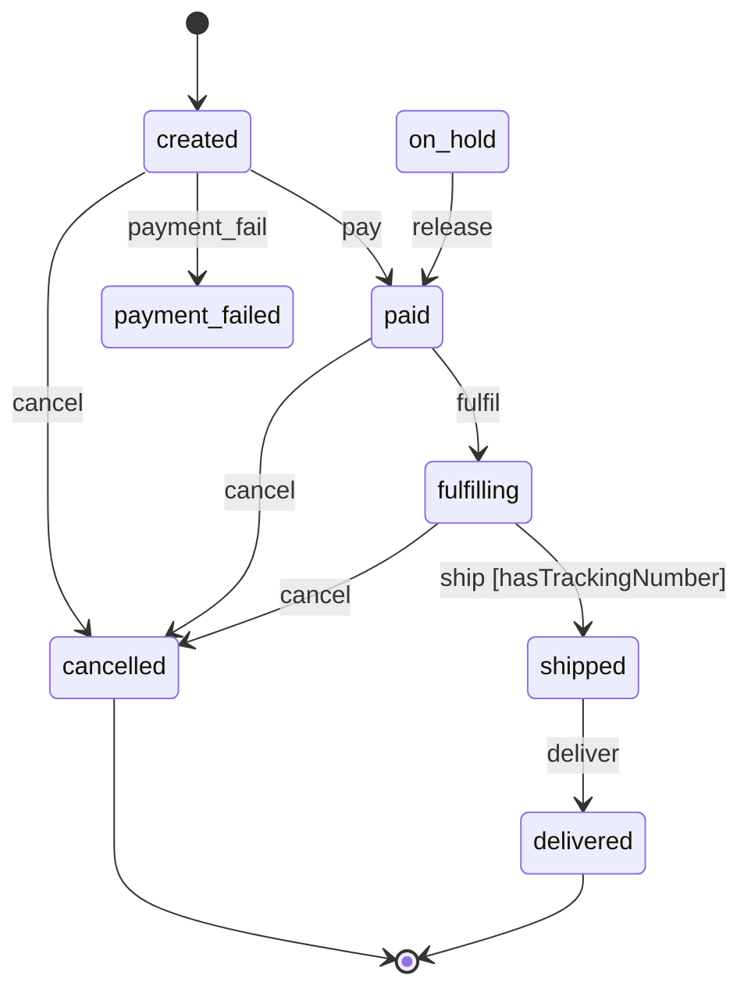

# Order lifecycle

Every order moves through a small state machine. The orders service is the
only thing that should change an order's state, through
`POST /orders/{id}/events`.

## States

An order starts in **created** when `POST /orders` accepts it.

- **created**: the order exists but nobody has paid for it yet.
- **paid**: payment went through. A paid order is queued for the worker.
- **payment_failed**: the payment provider declined the charge.
- **fulfilling**: the worker is picking and packing the order.
- **shipped**: the parcel has left the warehouse with a tracking number.
- **delivered**: the carrier confirmed delivery. This is final.
- **cancelled**: the order was cancelled. This is final.
- **on_hold**: the order is paused for review. `release` returns it to paid.

## Events

- `pay` moves a created order to paid, and `payment_fail` moves it to
  payment_failed.
- `cancel` cancels an order that is created, paid or fulfilling. Once the
  worker has started fulfilling, cancelling still stops the shipment.
- `fulfil` moves a paid order to fulfilling.
- `ship` moves a fulfilling order to shipped, but only if the order has a
  tracking number (the `hasTrackingNumber` guard).
- `deliver` moves a shipped order to delivered.
- `release` returns an order on hold to paid.

## Diagram

